# 前端界面工程

> 把设计变成稳定好用的界面：标题变长、图片缺失、屏幕变窄、网络变慢、只用键盘操作，界面都依然清楚、可用、不出错。  
> 版本：1.0 · 整理日期：2026-10-25  
> 适用对象：会写一些 HTML、CSS 和 JavaScript，想把页面做得稳定、好用、经得起真实内容的开发者；也适合想了解“设计稿怎样变成代码”的设计师。先修：能在编辑器里写一个 HTML 文件并用浏览器打开；知道变量、函数、数组和对象。会 Vue 或 React 更好，但不是必需。

前端界面工程负责把设计意图转化为稳定的交互界面。照着设计稿把页面“画出来”只是起点：页面上线后，会遇到设计稿里没有的情况——标题比预想的长三倍、图片缺失、用户在手机上横屏、网络很慢、用户只用键盘、接口返回错误、数据有一万条。界面工程要让页面在这些情况下依然清楚、可用。

本册对每个主题都按同样的顺序讲：先说明它解决什么问题；再用白话解释核心概念；然后给出一个可以直接运行的最小示例，附运行截图和关键代码；最后是常见问题、本章练习和继续深入的方向。所有示例都放在本目录的[示例](示例/)文件夹中，用浏览器直接打开即可运行，每个示例都已在浏览器中实际运行并检查过。

主线是：**先打好结构与样式的地基 → 掌握布局、排版、视觉、组件、状态、性能、多输入与可访问、调试八个方向 → 用一个资源列表页把它们组合起来，并用自动检查守住质量。**

## 阅读导航

正文共 14 章（01—14），附 10 个可运行示例、3 组附录与 29 项资料入口。

- [第一篇：地基](#part-1)
  - [01 界面工程负责什么](#ch01)
  - [02 结构与样式的地基](#ch02)
- [第二篇：八个方向](#part-2)
  - [03 布局与响应式](#ch03)
  - [04 字体与排版工程](#ch04)
  - [05 CSS 视觉表达](#ch05)
  - [06 组件结构与接口](#ch06)
  - [07 应用状态与数据表现](#ch07)
  - [08 资源与渲染性能](#ch08)
  - [09 多输入与可访问实现](#ch09)
  - [10 调试与质量保障](#ch10)
- [第三篇：综合实战与技术选择](#part-3)
  - [11 纵向深入：卡片列表的五次升级](#ch11)
  - [12 综合项目：资源列表页](#ch12)
  - [13 技术选择](#ch13)
  - [14 继续深入与学习路线](#ch14)
- [附录 A：术语表](#appendix-a)
- [附录 B：资料入口](#appendix-b)
- [附录 C：与原手册的对应关系及修订记录](#appendix-c)

<a id="part-1"></a>

## 第一篇：地基

<a id="ch01"></a>

### 01 界面工程负责什么

#### 01.1 一个页面要经受的考验

设计稿通常只画出“内容刚好、一切顺利”的样子。真实使用中，页面要经受下面这些考验。长期的内容变化、设备差异和异常状态，都会影响页面的品质：

| 考验 | 例子 | 本册章节 |
| --- | --- | --- |
| 内容变化 | 标题很长、图片缺失、数据为空、数字很大 | 03、04、11 |
| 设备差异 | 手机竖屏、宽屏显示器、文字放大到 200% | 03、09 |
| 输入方式 | 鼠标、触屏、键盘、读屏软件、触控笔 | 06、09 |
| 网络与性能 | 网络很慢、请求失败、低端手机、上万条数据 | 07、08 |
| 异常状态 | 加载中、空结果、失败、无权限、重复提交 | 06、07、12 |
| 长期修改 | 半年后增加功能、换人维护 | 06、10、13 |

界面工程师的工作，就是在写代码时把这些情况都考虑进去，并且能证明页面经受住了它们。

#### 01.2 需要哪些基础

| 技术 | 负责什么 | 什么时候需要 |
| --- | --- | --- |
| HTML | 页面的结构与含义：这是标题、这是按钮、这是表单 | 一开始 |
| CSS | 布局与外观：放在哪里、多大、什么颜色 | 一开始 |
| JavaScript | 逻辑与交互：点击后做什么、怎样请求数据 | 一开始 |
| TypeScript | 给 JavaScript 加上类型检查，提前发现“传错了数据”一类的错误 | 代码量变大、多人协作时 |
| 组件框架（Vue、React 等） | 把界面拆成可复用的组件，让界面随数据自动更新 | 页面多、交互复杂时 |
| 状态管理 | 组织多个组件共享的数据 | 很多组件需要同一份数据时 |
| 构建工具（Vite 等） | 打包、压缩代码，开发时自动刷新 | 使用框架或大量模块时 |

不必一开始就学全部。先用 HTML、CSS 和 JavaScript 做出完整的页面；项目变复杂、遇到具体困难时，再补充后面的工具。MDN 的核心课程是系统学习这三项基础的好起点。[B01](#ref-b01)

#### 01.3 第一个阶段：结构与样式基础

学习的第一个阶段，首先掌握语义化 HTML、盒模型、层叠规则、Flex、Grid、定位和响应式，配合基本事件、DOM 操作和数据结构，完成导航、表单、卡片和弹窗。练习时有意使用长标题、缺失图片和不同的屏幕宽度，让结构经受内容变化。这一阶段可以横向接触文字排版、表单交互、浏览器调试、基础可访问性和资源加载，本册分别在 02—10 章展开。

完成这一阶段的标准是：**能在不依赖固定截图尺寸的情况下实现页面，并且知道一个元素为什么出现在当前位置**。“改到看起来对”不算掌握；能解释“它在这里，是因为父元素是网格、它占了第二列、宽度由内容决定”才算。

#### 01.4 怎样运行本册的示例

- 大多数示例是单个 HTML 文件，下载后用浏览器直接打开即可。
- `01-12-resource-list.html` 会把筛选条件写进地址栏。直接打开也能运行；如果浏览器限制本地文件修改地址，可以在示例目录中运行 `python3 -m http.server`，再访问 `http://localhost:8000/01-12-resource-list.html`。
- `01-10-checks.js` 是自动检查脚本，需要先安装 Node.js 与 Playwright，运行方法见 10 章。
- 运行示例时，同时打开浏览器的开发者工具（按 F12），在“元素”面板中查看结构和样式，是理解示例最快的方法。

本册的示例使用同一组示意数据：求职平台的资源库，包含文章、清单、能力模型等资源。数据中有意包含很长的标题、缺失的缩略图和较多的标签，用来检验界面能否经受真实内容。

**本章练习**：

1. 打开一个你常用的网站，找出它处理“标题很长”“图片缺失”“没有结果”的方式，各截一张图。
2. 把浏览器窗口从最宽拖到最窄，记录页面布局在哪些宽度发生了变化，以及变化后是否仍然好用。

<a id="ch02"></a>

### 02 结构与样式的地基

#### 02.1 语义化 HTML：先说清楚“这是什么”

HTML 标签表达的是**含义**，而不是外观。用 `<button>` 写按钮，浏览器就会自动让它可以用键盘聚焦、按回车或空格触发、被读屏软件读成“按钮”；用 `<div>` 加点击事件写按钮，这些都要自己补，而且很容易漏。读屏软件用户还会按标题和页面区域跳转浏览，搜索引擎也依靠这些结构理解页面。

| 需要表达 | 应当使用 | 常见误用 |
| --- | --- | --- |
| 页面区域 | `header`、`nav`、`main`、`aside`、`footer` | 全部用 `div` |
| 标题层级 | `h1`—`h6`，按内容层级依次使用 | 为了字号大小选择标题级别 |
| 执行一个操作 | `button` | 给 `div` 或 `span` 加点击事件 |
| 跳转到另一个页面或位置 | `a href` | 用按钮加脚本跳转 |
| 输入 | `label` 加 `input`、`select`、`textarea` | 只用输入框里的占位文字作说明 |
| 列表与导航项 | `ul`／`ol` 加 `li` | 一串 `div` |
| 表格数据 | `table`、`th`、`caption` | 用 `div` 拼出表格的样子 |

一个经验法则：**链接去往别处，按钮在当前页面做事**。下面是导航、卡片和表单字段的最小写法：

```html
<nav aria-label="主导航">
  <ul>
    <li><a href="/resources" aria-current="page">资源库</a></li>
    <li><a href="/jobs">岗位</a></li>
  </ul>
</nav>

<article class="card">
  <h2>面试准备清单</h2>
  <p>清单 · 约 5 分钟</p>
</article>

<label for="email">邮箱</label>
<input id="email" type="email" autocomplete="email">
```

`aria-current="page"` 告诉读屏软件“这是当前所在的页面”，视觉上也可以用它来高亮当前导航项。

#### 02.2 盒模型：每个元素都是一个盒子

浏览器把每个元素都当作一个矩形的盒子，从里到外分为四层：**内容**、**内边距**（`padding`）、**边框**（`border`）和**外边距**（`margin`）。

最常见的困惑是宽度。默认情况下（`box-sizing: content-box`），`width` 只算内容，内边距和边框会再加到外面；设置 `box-sizing: border-box` 后，`width` 就包含内边距和边框。示例中两个盒子都写了 `width: 160px`、16 像素内边距、6 像素边框，实际宽度分别是 204 像素和 160 像素。大多数项目会在开头统一设置 `* { box-sizing: border-box; }`，让宽度更符合直觉。

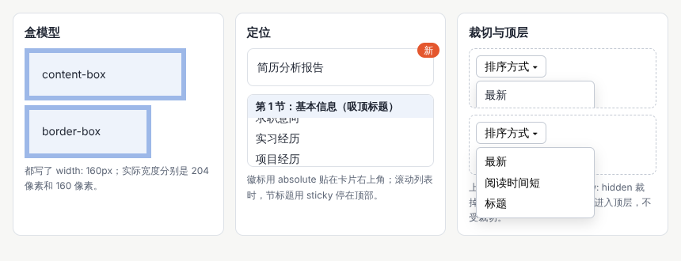

示例：[01-02-box.html](示例/01-02-box.html)

```css
.content-box { box-sizing: content-box; }  /* 实际宽度 = 160 + 16 × 2 + 6 × 2 = 204 */
.border-box  { box-sizing: border-box; }   /* 实际宽度就是 160 */
```

另一个常见现象是**外边距合并**：上下相邻的两个块元素，一个下外边距 24 像素、一个上外边距 16 像素，它们之间的距离是 24 而不是 40。在 Flex 和 Grid 布局中用 `gap` 控制间距，可以避开这个问题。

#### 02.3 层叠规则：多条样式冲突时听谁的

同一个元素常常被多条样式规则同时选中。浏览器按下面的顺序决定谁生效：

1. **重要性与来源**：带 `!important` 的声明优先；浏览器默认样式、用户设置与网页样式各有先后。
2. **层叠层**：用 `@layer` 分组的样式，后声明的层优先。
3. **选择器的优先级**：id 选择器 ＞ 类、属性和伪类选择器 ＞ 元素选择器；直接写在元素 `style` 属性中的内联样式比任何选择器都优先。
4. **出现顺序**：优先级相同时，后写的覆盖先写的。

此外，有些属性会从父元素**继承**，例如颜色和字体；有些不会，例如边框和内边距。

| 选择器 | 优先级（id、类、元素） | 说明 |
| --- | --- | --- |
| `p` | 0、0、1 | 一个元素 |
| `.card p` | 0、1、1 | 一个类、一个元素 |
| `#main .card` | 1、1、0 | 一个 id、一个类 |
| `:where(.card) p` | 0、0、1 | `:where()` 中的部分不计优先级 |

实用建议：主要使用类选择器，保持优先级低而平；不用 `!important` 解决冲突；大型项目用 `@layer` 把重置样式、基础样式、组件样式和工具类分层。样式不生效时，在开发者工具的“计算样式”中可以看到哪条规则胜出、哪些被划掉了。

#### 02.4 定位：让元素离开正常的排列

默认情况下，元素按照文档顺序从上到下、从左到右排列（正常流）。`position` 让元素离开这种排列：

| 取值 | 相对于谁定位 | 常见用途 |
| --- | --- | --- |
| `static` | 不定位（默认） | 绝大多数元素 |
| `relative` | 自己原来的位置，原位置仍然保留 | 作为绝对定位子元素的参照物 |
| `absolute` | 最近的设置了定位的祖先元素（称为包含块） | 角标、徽标、浮层 |
| `fixed` | 浏览器窗口 | 固定在窗口底部的操作栏 |
| `sticky` | 滚动到指定位置前随内容滚动，之后停住 | 吸顶的表头、分组标题 |

示例中，卡片设置了 `position: relative`，徽标用 `position: absolute; top: -8px; right: -8px` 贴在卡片右上角；滚动列表时，节标题用 `position: sticky; top: 0` 停在顶部。

两个容易踩的坑：

- **层叠上下文**：`z-index` 只在同一个“层叠上下文”中比较大小。父元素设置了 `opacity` 小于 1、`transform` 等属性时会形成新的层叠上下文，子元素的 `z-index` 再大也盖不过外面的元素。
- **被裁切**：父元素设置了 `overflow: hidden`，里面的下拉菜单会被裁掉（示例右上）。较新的做法是把菜单放进浏览器的**顶层**：使用 `popover` 属性或 `<dialog>`，元素会显示在所有内容之上，不受父元素裁切与层叠上下文的影响（示例右下，见 06 章）。

#### 02.5 DOM 操作与事件：让页面响应

浏览器把 HTML 解析成一棵对象树，称为 **DOM**。JavaScript 通过 DOM 读取和修改页面：

```js
// 小工具：创建元素。文字一律通过 textContent 写入，避免把数据当作 HTML 解析
function h(tag, attrs = {}, ...children) {
  const el = document.createElement(tag);
  for (const [k, v] of Object.entries(attrs)) el.setAttribute(k, v);
  el.append(...children);
  return el;
}

const list = document.querySelector('#list');
list.replaceChildren(...items.map(it => h('li', {}, it.title)));
```

**不要用 `innerHTML` 插入用户或接口提供的文字**。如果标题里恰好有 `` 这样的内容，`innerHTML` 会把它当成真正的标签执行，造成跨站脚本攻击。`textContent` 和 `append` 只把它当作文字。本册所有示例都用上面的 `h` 函数创建元素。

**事件**让页面响应用户。`addEventListener` 登记处理函数；事件会从被点击的元素向外层“冒泡”，所以可以只在列表上登记一次，处理所有卡片的点击（称为**事件委托**）：

```js
list.addEventListener('click', e => {
  const card = e.target.closest('.card');   // 找到被点击的卡片
  if (card) openDetail(card.dataset.id);
});
```

最后是**数据结构**。可靠的界面通常把数据放在数组和对象中，再根据数据生成界面，而不是直接修改界面上的文字。修改时先改数据，再重新生成受影响的部分，界面就总是和数据一致——这也是 Vue、React 等框架的核心思路。

#### 02.6 常见问题

- **元素比设定的宽度更宽**：没有设置 `box-sizing: border-box`，内边距和边框加在了外面。
- **两个块之间的距离比设定的小**：上下外边距发生了合并，改用 `gap` 或只设置一个方向的外边距。
- **样式写了却不生效**：被优先级更高或写在后面的规则覆盖，在开发者工具中查看被划掉的规则。
- **`z-index` 很大仍被盖住**：元素处在另一个层叠上下文中，检查祖先元素的 `opacity`、`transform`、`z-index`。
- **用户输入的内容显示成了奇怪的格式，甚至执行了脚本**：使用了 `innerHTML`，改用 `textContent`。

**本章练习**：

1. 在 `01-02-box.html` 中把 `border-box` 盒子的内边距改为 30 像素，观察实际宽度是否变化，并解释原因。
2. 删除 `.card` 的 `position: relative`，观察徽标跑到了哪里，用“包含块”解释这个变化。
3. 用语义化标签写一个包含导航、主要内容和页脚的页面骨架，在开发者工具的“无障碍”面板中查看浏览器识别出的结构。
4. 写一个包含姓名、邮箱和提交按钮的表单，每个输入框都有可见的标签，并且只用键盘就能填写和提交。

**继续深入**：层叠层（`@layer`）组织大型样式表；`:has()` 选择器根据子元素选择父元素；Shadow DOM 与样式隔离；浏览器内置的表单验证接口。

<a id="part-2"></a>

## 第二篇：八个方向

<a id="ch03"></a>

### 03 布局与响应式

#### 03.1 解决什么问题

布局研究内容怎样在不同的可用空间中重排：同一个页面，在手机上是一列，在宽屏上是三列；同一张卡片，放在主区域时图文左右排列，放在窄边栏时上下排列。工具包括 Flex、Grid、容器尺寸、内在尺寸和定位。MDN 的布局课程系统讲解了这些工具。[B02](#ref-b02)

做响应式布局之前，先要想清楚每个区域在空间不足时允许怎样变化：**压缩、换行、折叠，还是转为列表**。

#### 03.2 Flex 与 Grid 怎样选

| 布局方式 | 擅长 | 典型用途 |
| --- | --- | --- |
| Flex | 沿一个方向（一行或一列）排列，并分配剩余空间 | 导航栏、工具条、按钮组、标签列表 |
| Grid | 同时控制行和列，让元素对齐到网格 | 卡片网格、页面整体分区、表单的标签与输入框对齐 |

两者经常组合使用：页面整体用 Grid 分区，区域内部的一行按钮用 Flex 排列。

#### 03.3 内在尺寸：让内容决定大小

“外在尺寸”是写死的宽度，例如 `width: 300px`；“内在尺寸”由内容决定：

| 写法 | 含义 |
| --- | --- |
| `min-content` | 内容能缩到的最窄宽度（通常是最长的那个词） |
| `max-content` | 内容完全不换行时的宽度 |
| `fit-content` | 在可用空间内尽量按内容宽度，但不超过可用空间 |
| `minmax(220px, 1fr)` | 至少 220 像素，有剩余空间时平分 |
| `clamp(16px, 2vw, 20px)` | 随窗口变化，但限制在最小值与最大值之间 |
| `aspect-ratio: 16 / 9` | 只给宽度，高度按比例计算 |

卡片网格最常用的一行代码是：

```css
.grid { display: grid; grid-template-columns: repeat(auto-fill, minmax(220px, 1fr)); gap: 16px; }
```

它的意思是：每列至少 220 像素，放得下几列就放几列，剩余空间平均分配。窗口变窄时，列数自动减少，不需要写任何断点。`auto-fill` 与 `auto-fit` 的区别是：项目很少时，`auto-fill` 保留空列，`auto-fit` 把空列收起、让已有项目拉宽。

#### 03.4 容器查询：组件按自己的宽度变化

媒体查询（`@media`）根据**整个窗口**的宽度改变样式；可是一张卡片放在主区域还是边栏，和窗口宽度无关。**容器查询**让组件根据**自己所在容器**的宽度变化：

```css
.card { container-type: inline-size; }        /* 声明卡片是一个“容器” */
@container (min-width: 420px) {                /* 卡片自己宽于 420 像素时 */
  .card-inner { display: grid; grid-template-columns: 180px 1fr; }  /* 图片在左，文字在右 */
}
```

示例中，第一张卡片横跨两列，宽度足够，于是图片放在左边、文字放在右边；其他卡片较窄，图片在上、文字在下。它们使用的是同一个组件，没有写任何与窗口宽度有关的规则。容器查询的用法见 MDN 指南。[B03](#ref-b03)

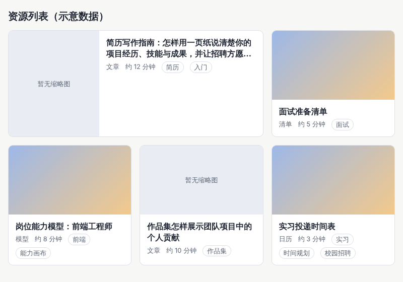


示例：[01-03-layout.html](示例/01-03-layout.html)

示例还处理了两种真实内容：长标题最多显示两行，超出部分用省略号表示，完整标题放在 `title` 属性和详情中；缺失的缩略图显示“暂无缩略图”，而不是一块空白或一个破损图标。

#### 03.5 响应式的四种手段

| 手段 | 做法 | 例子 |
| --- | --- | --- |
| 压缩 | 宽度按比例缩小，图片按比例缩放 | 正文栏变窄，图片保持比例 |
| 换行 | 一行放不下时移到下一行 | 标签、按钮组、卡片网格 |
| 折叠 | 次要内容收起，需要时再展开 | 导航收进菜单按钮；筛选条件收进“更多筛选” |
| 转为列表 | 改变内容的组织方式 | 宽屏的多列表格在手机上变成一条条记录 |

**断点按内容设计，而不是按设备设计**。与其照搬某几款手机的宽度，不如慢慢缩小窗口，看布局在哪个宽度开始变得别扭——那里就是需要调整的地方。真实内容（长标题、长数字、多标签）比示意文字更能暴露问题。

尺寸单位也影响响应式：`rem` 跟随用户设置的根字号，适合字号与间距；百分比与 `fr` 跟随容器；`vw`、`vh` 跟随窗口。手机浏览器的地址栏会伸缩，`100vh` 可能比实际可见区域更高，需要占满一屏时可以用 `100dvh`（动态视口高度）。

#### 03.6 常见问题

- **长单词或网址撑破布局**：给文字容器设置 `overflow-wrap: anywhere`，允许在任意位置断开。
- **Flex 或 Grid 的子元素不肯缩小**：子元素默认的最小宽度是内容宽度，设置 `min-width: 0` 后才能缩小。
- **图片被拉伸变形**：给图片设置 `object-fit: cover` 与 `aspect-ratio`，按比例裁切而不是拉伸。
- **长标题露出被截断的第三行**：多行截断的容器被拉高了。示例中给卡片内部的网格设置 `align-content: start` 解决。
- **同一行卡片的标题和按钮对不齐**：可以使用子网格（`grid-template-rows: subgrid`），让卡片内部的行与外层网格对齐。

**本章练习**：

1. 把 `01-03-layout.html` 中的 `auto-fill` 改为 `auto-fit`，并只保留两张卡片，比较两种写法的差别。
2. 给卡片增加一个“价格”区域：宽卡片中放在右侧，窄卡片中放在底部，只使用容器查询。
3. 把一个四列的表格改造成在 480 像素以下显示为一条条记录的样式。

**继续深入**：网格区域命名（`grid-template-areas`）；子网格；逻辑属性（`margin-inline` 等）与从右到左的语言；容器查询单位（`cqi`）；本册 11 章的卡片列表升级过程。

<a id="ch04"></a>

### 04 字体与排版工程

#### 04.1 解决什么问题

文字是界面中最多的内容。排版工程处理字体加载、回退、字重、行高、字距、断行和中英文混排。两个底线：**字体文件尚未加载时，页面仍应可读**；**字体切换造成的布局移动需要观察和控制**。横向可以进入可变字体、多语种排版和阅读器。中文排版的系统要求可以参考 W3C 的《中文排版需求》。[B04](#ref-b04)

#### 04.2 字体栈与回退

`font-family` 写的是一个**字体栈**：浏览器从左到右尝试，前一个字体不可用、或缺少某个字时，就用下一个。

```css
body {
  font-family: system-ui, -apple-system, "PingFang SC", "Microsoft YaHei", "Noto Sans SC", sans-serif;
}
```

`system-ui` 使用操作系统的界面字体；PingFang SC 是苹果系统的中文字体，Microsoft YaHei（微软雅黑）是 Windows 的中文字体，Noto Sans SC（思源黑体）常见于安卓与 Linux；最后的 `sans-serif` 是兜底。一个实用技巧：如果希望英文使用某款西文字体，把它写在中文字体前面——西文字体不包含汉字，汉字会自动回退到后面的中文字体。

**语言标记影响字形**：同一个汉字在简体中文、繁体中文和日文字体中写法可能不同。给页面设置正确的 `lang`（例如 `<html lang="zh-CN">`），浏览器才会选择合适的字体；多语种页面中，不同语言的段落也应各自标注 `lang`。

#### 04.3 网络字体的加载

使用网络字体时，浏览器要先下载字体文件。中文字体包含上万个字，完整文件常有几 MB，需要处理加载过程：

| 做法 | 作用 |
| --- | --- |
| 使用 WOFF2 格式 | 压缩率高 |
| 子集化 | 只保留页面实际用到的字；或按 `unicode-range` 拆成多个小文件，按需下载 |
| `font-display: swap` | 先用回退字体显示文字，网络字体下载后再替换，文字不会长时间不可见 |
| `font-display: optional` | 网络字体很快可用才使用，否则本次访问一直用回退字体，避免替换造成的跳动 |
| 预加载关键字体 | `<link rel="preload" as="font" type="font/woff2" crossorigin>` 让浏览器尽早下载 |
| 调整回退字体的度量 | 在 `@font-face` 中用 `size-adjust`、`ascent-override` 等让回退字体与网络字体大小接近，减少替换时的跳动 |

```css
@font-face {
  font-family: "Brand Sans";
  src: url(brand-sans-subset.woff2) format("woff2");
  font-display: swap;          /* 先显示回退字体，下载完成后替换 */
}
```

字体加载有三种常见现象：下载期间文字不可见（称为“不可见文字闪烁”）；先显示回退字体、下载后换成网络字体（称为“无样式文字闪烁”）；以及替换时字宽不同导致的布局移动。`font-display` 的各个取值说明见 MDN。[B05](#ref-b05) 很多中文产品界面直接使用系统字体，就是为了避开这些问题。

#### 04.4 字重、行高与字距

- **字重**：常用 400（常规）、600（半粗）、700（粗）。如果字体文件没有某个字重，浏览器会把常规字体“描粗”来模拟，效果较差；可以用 `font-synthesis: none` 禁止模拟，并确认需要的字重都已加载。
- **行高**：使用不带单位的数字，例如 `line-height: 1.7`，子元素会按自己的字号计算。中文正文通常比英文需要更大的行高，可以从 1.5—1.8 开始尝试；标题行数少，1.2—1.4 即可。
- **字距**：中文正文一般不额外增加字距；小号的西文大写标签可以略微加宽。注意 `letter-spacing` 也会加在一行的最后一个字后面，居中的文字会因此略微偏左。
- **行长**：每行太长，读者换行时容易找错行；太短则频繁换行。中文正文每行约 25—40 个字较为舒适（经验值），可以用 `max-width: 40em` 一类的写法限制。
- **用户的文字间距设置**：有些用户会用浏览器插件加大行高、段距和字距。WCAG 2.2 的 1.4.12 要求，行高调到 1.5 倍字号、段落间距 2 倍、字距 0.12 倍、词距 0.16 倍时，内容不能被截断或重叠。[B06](#ref-b06) 所以不要给文字容器写死高度。

#### 04.5 断行

中文默认可以在任意两个字之间断行，标点则遵守“避头尾”规则：句号、逗号等不出现在行首，前引号、前括号不出现在行尾。浏览器默认已处理大部分情况，`line-break: strict` 会执行更严格的规则。

| 需求 | 写法 |
| --- | --- |
| 长网址、长英文单词不撑破容器 | `overflow-wrap: anywhere` |
| 英文按音节加连字符断行 | `hyphens: auto`，并给英文段落设置 `lang="en"` |
| 多行标题各行长度均衡 | `text-wrap: balance` |
| 段落最后一行不只剩一两个字 | `text-wrap: pretty`（各浏览器支持程度不同，不支持时按默认方式断行） |
| 标题只在指定的位置换行 | `word-break: keep-all` 加 `<wbr>` |

`text-wrap` 的用法见 MDN。[B07](#ref-b07) 示例的最后一行对比了三种标题断行：默认断行断在“你的”中间；`text-wrap: balance` 让两行长度接近，但断在“清楚”中间，因为它不认识中文词语；`word-break: keep-all` 让汉字之间不再随意断开，再用 `<wbr>` 标出允许换行的位置，标题就断在了想要的地方。重要的标题可以这样手动控制。

#### 04.6 中英文混排

中文与英文、数字混排时，在它们之间加一个空格，阅读更清楚。有两种做法：

- **在内容中直接加空格**：最可靠，复制到其他地方也保持一致。
- **由浏览器自动加间距**：CSS 的 `text-autospace` 让浏览器在汉字与西文、数字之间自动加入较窄的间距（约八分之一个字宽），适合内容来自用户、无法逐条修改的情况。[B08](#ref-b08) 这项能力在 2025 年才得到各主流浏览器的最新版本支持，较旧的浏览器会忽略它；本册示例显式写上 `text-autospace: normal`。

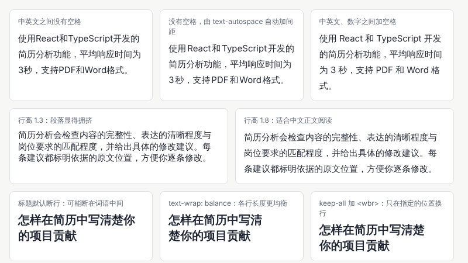

示例：[01-04-typography.html](示例/01-04-typography.html)

```css
p { line-height: 1.8; }
.autospace { text-autospace: normal; }  /* 较新的浏览器：自动在汉字与西文、数字之间加入较窄的间距 */
.balance { text-wrap: balance; }        /* 让多行标题的每行长度更均衡 */
.keep { word-break: keep-all; }         /* 汉字之间不再随意断开，只在空格与 <wbr> 处换行 */
```

中文界面中的标点使用全角形式（，。：；？！），数字与单位之间按内容规范决定是否加空格，同一产品中保持一致即可。

#### 04.7 横向延伸：可变字体与阅读器

**可变字体**把同一字族的多种粗细、宽窄放在一个文件里，用“轴”连续调整：字重（`wght`）、宽度（`wdth`）、光学尺寸（`opsz`）等。好处是文件更少、可以使用 350 这样的中间字重，甚至做字重渐变的动画（注意性能）：

```css
@font-face { font-family: "Brand VF"; src: url(brand-vf.woff2) format("woff2"); font-weight: 100 900; }
h1 { font-family: "Brand VF"; font-weight: 650; }
```

**阅读器**是排版工程的集中体现：电子书、文档阅读页、长文章页面需要可调的字号、行高和主题，记住阅读位置，处理分页或连续滚动，还要保证长篇内容的渲染性能。动态字体与文字动效在[《动效与时间设计》](04-动效与时间设计.md)中展开，多语言与从右到左的排版在[《包容、国际化与多感官》](16-包容国际化与多感官.md)中展开。

#### 04.8 常见问题

- **字体加载后整页文字跳动**：网络字体与回退字体的宽度不同。使用 `font-display: optional`，或调整回退字体的度量。
- **粗体看起来发虚或过粗**：字体没有对应字重，浏览器模拟了粗体。
- **同一个汉字在不同页面写法不同**：页面的 `lang` 设置不一致，浏览器选择了不同语言的字体。
- **用户放大文字后内容被截断**：容器写死了高度，改为由内容决定高度。

**本章练习**：

1. 在 `01-04-typography.html` 中把行高从 1.8 依次改为 1.2、1.5、2.2，记录每种的阅读感受。
2. 给一段包含长网址的文字加上 `overflow-wrap: anywhere`，在 320 像素宽的窗口中比较前后差别。
3. 为你的项目写一份字体规则：字体栈、正文与标题的字号、行高、字重，以及中英文混排的约定。

**继续深入**：中文网络字体的子集化工具；字体度量与基线对齐；竖排（`writing-mode`）；直排与标点挤压；阅读器的分页排版。

<a id="ch05"></a>

### 05 CSS 视觉表达

#### 05.1 解决什么问题

CSS 可以运用背景、渐变、阴影、边框、滤镜、遮罩、裁切和混合模式构建风格。但**每一层装饰都应有可以解释的作用**：分组、表现深度、引导焦点，或体现品牌特征。还要检查效果叠加之后文字是否看得清，以及运行成本是否可以承受。

#### 05.2 工具箱

| 属性 | 能做什么 | 常见用途 | 注意 |
| --- | --- | --- | --- |
| `background`（可叠加多层） | 颜色、图片、渐变、纹理 | 区块底色、氛围背景 | 背景图片上的文字要检查对比度 |
| `linear-gradient`、`radial-gradient`、`conic-gradient` | 线性、径向、角向渐变 | 品牌色过渡、光晕、进度环 | 渐变两端的颜色都要检查文字对比 |
| `box-shadow`（可叠加多层） | 投影 | 表现浮起的层级 | 层级只用少数几档 |
| `border`、`border-radius`、`outline` | 边框、圆角、轮廓 | 分组、焦点指示 | 焦点轮廓不要去掉 |
| `filter` | 模糊、阴影、灰度、亮度 | 禁用状态、图片处理 | 大面积模糊成本高 |
| `backdrop-filter` | 模糊元素背后的内容 | 毛玻璃效果 | 背后内容变化时文字对比随之变化 |
| `mask-image` | 用图片或渐变控制哪里可见 | 渐隐的边缘、异形图片 | 准备不支持时的回退 |
| `clip-path` | 把元素裁成指定形状 | 星形、斜切的区块 | 被裁掉的部分仍可能响应点击 |
| `mix-blend-mode` | 与下层内容的颜色混合 | 文字与图片的融合效果 | 结果随背景变化，难以保证对比 |

#### 05.3 每一层装饰都要有作用

| 作用 | 常用手段 |
| --- | --- |
| 分组：让用户看出哪些内容属于一起 | 背景色块、边框、间距 |
| 深度：表现哪一层浮在上面 | 阴影、半透明遮罩 |
| 焦点：引导视线到当前最重要的地方 | 对比色、轮廓、亮度差异 |
| 品牌特征：形成可以识别的风格 | 特定的渐变、形状、纹理、圆角 |

说不出作用的装饰，通常可以删掉。层级和风格的设计方法在[《视觉设计与品牌表达》](02-视觉设计与品牌表达.md)中展开。

#### 05.4 叠加之后检查对比度

文字与背景的**对比度**决定文字是否看得清。WCAG 2.2 规定：正文至少 4.5:1；大号文字（约 24 像素常规字重，或约 18.7 像素粗体以上）至少 3:1；图标、输入框边框、焦点指示等识别所需的图形至少 3:1。[B06](#ref-b06)

对比度的计算方法是：先把两种颜色换算为**相对亮度**（0 表示纯黑，1 表示纯白，计算时考虑人眼对绿色最敏感、对蓝色最不敏感），再计算“（较亮的亮度 ＋ 0.05）÷（较暗的亮度 ＋ 0.05）”。纯黑与纯白的对比度是 21:1，相同颜色是 1:1。

示例在同一个渐变背景上放了两张卡片：毛玻璃卡片的白字在背景较亮的位置只有 2.94:1，不合格；实色卡片的深色文字达到 15.73:1。毛玻璃并非不能用，但需要加深半透明底色、限制背景的亮度范围，或者在文字下方加一层更不透明的底。


示例：[01-05-css-visual.html](示例/01-05-css-visual.html)

```js
// WCAG 的对比度计算：先把颜色换算为相对亮度，再计算 (较亮 + 0.05) ÷ (较暗 + 0.05)
function luminance([r, g, b]) {
  const f = c => { c /= 255; return c <= 0.04045 ? c / 12.92 : Math.pow((c + 0.055) / 1.055, 2.4); };
  return 0.2126 * f(r) + 0.7152 * f(g) + 0.0722 * f(b);
}
function ratio(a, b) {
  const [l1, l2] = [luminance(a), luminance(b)].sort((x, y) => y - x);
  return (l1 + 0.05) / (l2 + 0.05);
}
```

#### 05.5 运行成本

视觉效果需要浏览器计算和绘制。成本较高的有：大半径的模糊、覆盖大面积的 `backdrop-filter`、对阴影和滤镜做动画、许多半透明层叠在一起。做动画时尽量只改变 `transform` 与 `opacity`，它们通常可以交给显卡合成，不需要重新绘制（见 08 章）。效果是否可以承受，要在目标设备、尤其是中低端手机上实际检查。

#### 05.6 深色模式与高对比度模式

- **深色模式**：用媒体查询 `prefers-color-scheme: dark` 提供深色配色；设置 `color-scheme: light dark`，让滚动条、表单控件也跟着变化；较新的 `light-dark()` 函数可以在一处写出两种颜色。深色模式不是简单的“反色”，阴影在深色背景上几乎看不见，层级要改用明暗差异表现。
- **强制颜色模式**：Windows 的对比度主题会用系统颜色替换网页配色，并去掉阴影和背景图片。如果焦点只靠阴影表示，在这种模式下就消失了。焦点指示可以使用 `outline`，或者在阴影之外加一条透明的轮廓，在强制颜色模式中它会显示为系统颜色。

#### 05.7 常见问题

- **毛玻璃上的文字时清楚时不清楚**：背后的内容在变化。加深底色，或改用实色卡片。
- **页面滚动时卡顿**：大面积的 `backdrop-filter` 或固定背景需要不断重绘，在开发者工具的“渲染”面板中打开“绘制闪烁”查看重绘区域。
- **裁切成异形的按钮，空白处也能点击**：`clip-path` 只改变显示，点击区域可能仍是矩形；必要时调整结构。
- **深色模式下层级看不清**：只换了颜色没有调整阴影，改用不同明度的背景表示层级。

**本章练习**：

1. 修改 `01-05-css-visual.html` 中毛玻璃卡片的底色透明度，找到让对比度达到 4.5:1 的最小值。
2. 为一组卡片设计三档阴影，分别对应“静止”“悬停”“浮层”，并说明每一档的用途。
3. 给你的页面加上深色模式，检查所有文字与图标的对比度。

**继续深入**：CSS 中的颜色空间（`oklch`）与渐变插值；`@property` 与可以动画的自定义属性；滚动驱动的视觉变化；更复杂的效果见[《常见视觉效果拆解》](19-常见视觉效果拆解.md)。

<a id="ch06"></a>

### 06 组件结构与接口

#### 06.1 解决什么问题

组件是可以重复使用的界面部件：按钮、输入框、菜单、弹窗、表格。设计组件，就是设计它的属性、事件和状态。好的组件允许内容变化（长短不同的文字、有无图标），并保持键盘、触屏和读屏软件都能正确使用；外观上的变体与业务逻辑能够合理组合，而不是每个页面复制一份再改。

#### 06.2 一个组件的“接口”

| 组成 | 含义 | 按钮的例子 |
| --- | --- | --- |
| 属性（输入） | 使用者传进来的配置 | 类型：主要、次要、危险；尺寸；是否禁用；是否加载中 |
| 事件（输出） | 组件告诉外部发生了什么 | 被点击 |
| 状态 | 组件当前所处的情况 | 默认、悬停、按下、获得焦点、禁用、加载中 |
| 内容 | 使用者放进组件的内容 | 文字、图标 |
| 变体 | 外观上的几种固定样式 | 主要按钮、文字按钮 |

变体按**含义**命名（主要、危险），而不是按外观命名（蓝色、红色）。这样换品牌色时只改一处，也能提醒使用者“危险操作要用危险样式”。颜色、间距等设计决定的统一管理，见[《计算设计与创作工具》](11-计算设计与创作工具.md)中的设计令牌。

#### 06.3 状态清单

每个组件都要把下面适用的状态设计并实现出来：

| 状态 | 用户看到什么 | 实现要点 |
| --- | --- | --- |
| 默认 | 正常样式 | — |
| 悬停 | 轻微变化，提示可以操作 | 触屏上没有悬停，不能只靠悬停传达信息 |
| 按下 | 被按下的反馈 | `:active` |
| 获得焦点 | 清楚的焦点轮廓 | 使用 `:focus-visible`，不要去掉轮廓 |
| 禁用 | 看起来不可用 | 禁用的按钮无法用键盘聚焦，用户不知道原因；需要说明原因时可以用 `aria-disabled="true"` 并显示说明 |
| 加载中 | 进度指示，防止重复点击 | 保持按钮宽度不变，避免布局跳动 |
| 错误 | 错误信息与恢复方法 | 信息与控件关联，见下文示例 |
| 选中 | 当前选中的项 | `aria-selected`、`aria-current` 等 |

#### 06.4 先用原生元素

浏览器已经内置了许多组件，自带键盘操作和读屏语义。能用原生元素时，不要自己从头实现：

| 需要 | 原生元素或属性 | 自带的能力 |
| --- | --- | --- |
| 按钮 | `<button type="button">` | 聚焦、回车与空格触发、读成“按钮” |
| 对话框 | `<dialog>` | 焦点限制在对话框内、Esc 关闭、背景不可操作 |
| 折叠内容 | `<details>` 与 `<summary>` | 展开与收起，读屏软件能识别状态 |
| 下拉选择 | `<select>` | 键盘选择、手机上的系统选择器 |
| 浮层与菜单 | `popover` 属性 | 显示在顶层、点击外部或按 Esc 自动关闭 |
| 进度 | `<progress>` | 读屏软件能读出进度 |

注意：放在表单中的 `<button>` 默认会提交表单，普通按钮要写明 `type="button"`。只有原生元素无法满足时，才使用 ARIA 属性补充语义——这是 W3C 关于 ARIA 使用的第一条原则。

#### 06.5 示例：对话框

示例用原生 `<dialog>` 实现“重命名简历”：

- `showModal()` 打开对话框后，焦点自动移入，背景不可操作，按 Esc 关闭。[B09](#ref-b09)
- 表单写成 `method="dialog"`，点击按钮会关闭对话框，并把按钮的 `value` 记在 `returnValue` 中，据此判断用户选择了“保存”还是“取消”。
- 名称为空时阻止关闭，显示错误信息。错误信息通过 `aria-describedby` 与输入框关联，并设置 `aria-invalid="true"`，读屏软件读到输入框时会一起读出错误。
- 关闭后，焦点回到打开对话框的按钮上，键盘用户不会“迷路”。

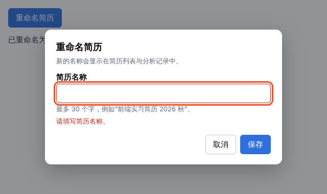

示例：[01-06-dialog.html](示例/01-06-dialog.html)

```js
document.getElementById('open').addEventListener('click', () => {
  input.value = current;            // 打开时填入当前值
  dlg.returnValue = '';             // 按 Esc 关闭时 returnValue 不会被改写，先清空上一次的结果
  showError('');
  dlg.showModal();
  input.select();
});

dlg.addEventListener('close', () => {
  if (dlg.returnValue === 'ok') {                // 只有点击“保存”才生效
    current = input.value.trim();
    document.getElementById('result').textContent = `已重命名为“${current}”。`;
  }
});
```

代码中的第二行来自测试中发现的一个真实问题：用户先保存一次（`returnValue` 变成 `ok`），再打开对话框、修改后按 Esc 取消——Esc 关闭时 `returnValue` 不会被改写，仍是上一次的 `ok`，于是取消的修改被错误地保存了。每次打开时清空 `returnValue` 就解决了。这类问题只有在“重复操作”“换一种方式关闭”时才会出现，正是 12 章自动检查要覆盖的情况。

#### 06.6 菜单与浮层：popover 与锚点定位

菜单、提示框、下拉选项需要显示在其他内容之上。`popover` 属性让这件事几乎不需要脚本：[B10](#ref-b10)

```html
<button type="button" popovertarget="sort-menu">排序方式</button>
<ul id="sort-menu" popover>
  <li><button type="button">最新</button></li>
  <li><button type="button">阅读时间短</button></li>
</ul>
```

点击按钮打开菜单，点击外部或按 Esc 自动关闭；菜单显示在浏览器的顶层，不会被父元素的 `overflow: hidden` 裁掉（见 02 章示例）。这项能力从 2025 年起在各主流浏览器的最新版本中可用。

菜单还需要**放在按钮旁边**。过去要用脚本计算位置；CSS 锚点定位可以直接声明“这个浮层跟随那个按钮”：给按钮设置 `anchor-name: --sort`，给菜单设置 `position-anchor: --sort` 与 `position-area: bottom span-right`。[B11](#ref-b11) 锚点定位在 2026 年初才得到各主流浏览器最新版本的支持，面向较旧浏览器时，可以像 02 章示例那样用脚本计算位置作为回退。

完整的菜单还要支持键盘：方向键在选项之间移动，回车选择，Esc 关闭并把焦点还给按钮。各种复杂控件的键盘约定可以查阅 WAI-ARIA 编写实践指南（见 09 章）。

#### 06.7 表格与输入框

- **表格**：用 `<caption>` 写表格标题，`<th scope="col">` 写列标题。可以排序的列，把列标题做成按钮，并用 `aria-sort` 表示当前的排序方向。窄屏上，表格可以放进可横向滚动的容器（给容器加 `tabindex="0"` 和标签，键盘用户才能滚动），或者转为一条条记录。
- **输入框**：始终有可见的标签；说明文字与错误信息用 `aria-describedby` 关联；用 `autocomplete` 帮助浏览器自动填写（例如 `email`、`tel`），用 `inputmode` 调出合适的手机键盘（例如 `numeric`）；多行输入框可以用较新的 `field-sizing: content` 随内容自动长高，不支持的浏览器保持固定高度。

#### 06.8 外观变体与业务逻辑分开

一个“提交订单”按钮，外观是“主要按钮”，行为是“检查库存并提交”。把两者分开：按钮组件只负责外观、状态和点击事件；提交逻辑写在使用它的页面或业务模块中。这样，按钮可以用在任何地方，提交逻辑也可以在不改外观的情况下修改和测试。判断标准是：**组件里不应该出现具体业务的名词**。

#### 06.9 常见问题

- **按钮点击后页面刷新了**：按钮在表单中，默认类型是提交，写明 `type="button"`。
- **对话框关闭后，键盘焦点跑到了页面开头**：自己实现的弹窗没有把焦点还回去；使用原生 `<dialog>`，或在关闭时手动聚焦打开它的按钮。
- **禁用的按钮让用户困惑**：用户不知道为什么不能点。在旁边说明原因，或者允许点击后提示缺少什么。
- **组件越写属性越多**：把不同用途拆成不同组件，或者让使用者通过“内容”传入可变的部分。

**本章练习**：

1. 在 `01-06-dialog.html` 中增加“名称不能与已有简历重复”的校验，错误信息同样要能被读屏软件读出。
2. 用 `popover` 实现一个“更多操作”菜单，测试点击外部、按 Esc 和用键盘选择。
3. 为一个按钮组件写出完整的接口说明：属性、事件、状态、内容和变体。

**继续深入**：组件的受控与非受控模式；组合式组件（一组相互配合的组件）；无样式组件库；Web Components 与自定义元素；组件的展示页与文档（见 11 章）。

<a id="ch07"></a>

### 07 应用状态与数据表现

#### 07.1 解决什么问题

一个数据页面要管理筛选、排序、分页、编辑中的草稿、加载和错误。优秀的页面能让用户随时回答三个问题：**我现在看到的是哪份数据？刚才的操作生效了吗？下一步能做什么？**

#### 07.2 把状态列出来

动手写代码之前，先把页面上所有会变化的东西列成表，并决定每一项放在哪里：

| 状态 | 例子 | 放在哪里 | 原因 |
| --- | --- | --- | --- |
| 筛选与排序 | 关键词“简历”、分类“文章”、按最新排序 | 地址栏 | 刷新后保留，可以分享给别人 |
| 当前查看的详情 | 第 4 篇文章 | 地址栏 | “后退”可以回到列表 |
| 分页位置 | 第 3 页，或“从第 40 条之后” | 地址栏 | 同上 |
| 请求状态 | 加载中、成功、空结果、失败 | 内存 | 只在当前页面有意义 |
| 编辑中的草稿 | 写了一半的简历描述 | 本地存储或服务器 | 关闭页面后不丢失 |
| 服务器数据 | 资源列表 | 服务器，页面中缓存一份 | 以服务器为准 |

#### 07.3 用状态机避免“不可能的状态”

如果用 `isLoading`、`hasError`、`isEmpty` 三个独立的变量表示请求状态，代码中就可能出现“既在加载、又出错了”这种不可能的组合，界面也随之混乱。更可靠的做法是用**一个**变量表示状态，并规定状态之间怎样转换：

| 当前状态 | 事件 | 下一个状态 |
| --- | --- | --- |
| 空闲 | 开始请求 | 加载中 |
| 加载中 | 返回了数据 | 成功（或空结果） |
| 加载中 | 请求失败 | 失败 |
| 失败 | 点击重试 | 加载中 |
| 成功、空结果、失败 | 筛选条件改变 | 加载中 |

这种“有限的状态加上明确的转换规则”的模型称为**状态机**。它让界面的每一种样子都对应一个确定的状态，也方便检查有没有漏掉的情况。复杂流程中的状态机在[《产品交互与用户体验》](03-产品交互与用户体验.md)中继续展开。

#### 07.4 异步请求的竞态

用户在搜索框中依次输入“前”“前端”“前端实习”，页面依次发出三个请求。如果先发出的请求处理得更慢、更晚返回，它的结果就会**覆盖**后面请求的结果：用户明明搜的是“前端实习”，看到的却是“前”的结果。这种由“谁先完成”决定结果的问题称为**竞态**。

示例模拟了这种情况：左边每次输入都发请求、谁最后返回就显示谁，最终显示了错误的“前”的结果；右边在新请求开始时取消上一个请求，并且只采用最新一次请求的结果，显示正确。

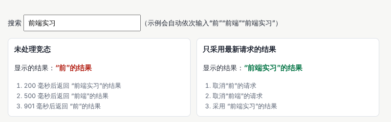

示例：[01-07-race.html](示例/01-07-race.html)

```js
let controller = null, latest = 0;
async function safe(q) {
  controller?.abort();                  // 取消上一个还没完成的请求
  controller = new AbortController();
  const id = ++latest;                  // 给这次请求编号
  try {
    const r = await fakeSearch(q, controller.signal);
    if (id !== latest) return;          // 双重保险：过期的结果直接丢弃
    document.getElementById('safe').textContent = r;
  } catch (e) {
    if (e.name !== 'AbortError') throw e;
  }
}
```

`AbortController` 是浏览器提供的“取消器”：把它的 `signal` 传给 `fetch`，调用 `abort()` 就能取消请求。[B12](#ref-b12) 请求编号是第二道保险：有些操作无法取消，至少可以丢弃过期的结果。此外，对搜索框的输入做**防抖**——停止输入 250 毫秒左右再发请求——可以减少不必要的请求。

`AbortController` 还可以用来**清理事件**：登记事件时传入 `{ signal }`，之后一次 `abort()` 就能移除全部相关的事件处理函数，适合在组件销毁时使用。

#### 07.5 用界面回答三个问题

| 问题 | 界面怎样回答 |
| --- | --- |
| 我看到的是哪份数据？ | 显示当前的筛选条件与排序方式，显示结果数量（例如“共 6 项”）；筛选条件可以单独清除 |
| 操作生效了吗？ | 操作后给出明确的反馈，例如“已保存，2 分钟前”；先在界面上显示结果、失败后再恢复的“乐观更新”，必须在失败时清楚告知 |
| 下一步能做什么？ | 空结果时提供“清除筛选”；失败时提供“重试”，并保留用户已填的内容 |

状态的文字变化可以放在带 `role="status"` 的元素中，读屏软件会在不打断用户的情况下读出“共 6 项”“加载失败”等提示。

#### 07.6 分页、“加载更多”与无限滚动

| 方式 | 优点 | 缺点 | 适合 |
| --- | --- | --- | --- |
| 分页 | 位置明确，可以跳转与分享 | 需要多次点击 | 需要定位、比较的数据 |
| “加载更多”按钮 | 连续浏览，用户自己控制 | 列表很长后性能下降 | 资讯、资源列表 |
| 无限滚动 | 浏览最顺畅 | 页脚永远到不了；返回时位置容易丢失 | 以浏览为主的内容流 |

无论哪种方式，都要能在返回列表时恢复到原来的位置。服务器端的分页方式（按页码或按“上一页最后一条”）在后端手册中讲解。

#### 07.7 编辑草稿

用户写了一半的内容不能因为误关页面、网络中断而丢失：

- **自动保存**：输入停止几秒后保存到本地存储或服务器，并显示“已自动保存”。
- **恢复提示**：再次打开时提示“发现未提交的草稿，是否恢复？”。
- **离开提醒**：有未保存的修改时，监听 `beforeunload` 事件提醒用户。
- **冲突**：同一份草稿在两个标签页中同时编辑时，后保存的会覆盖先保存的。可以记录版本号，发现冲突时提示用户选择。

#### 07.8 常见问题

- **搜索结果和输入的关键词对不上**：没有处理竞态。
- **刷新页面后筛选条件丢了**：筛选条件只放在内存中，没有写进地址栏。
- **加载指示一闪而过，页面跳动**：请求很快时也显示了指示器。可以在请求超过约 300 毫秒后才显示，或者使用占位骨架保持布局不变。
- **点击“保存”后不知道是否成功**：缺少反馈，或者反馈出现在用户看不到的位置。

**本章练习**：

1. 在 `01-07-race.html` 中给搜索加上 250 毫秒的防抖，观察请求次数的变化。
2. 为一个“编辑个人资料”页面列出完整的状态表，并画出状态之间的转换。
3. 实现草稿的自动保存与恢复：刷新页面后，未提交的内容仍然存在。

**继续深入**：服务器数据的缓存与失效；乐观更新与回滚；离线优先的应用；多个组件共享状态的组织方式；复杂流程的状态机工具。

<a id="ch08"></a>

### 08 资源与渲染性能

#### 08.1 解决什么问题

性能研究图片尺寸、字体资源、脚本拆分、列表规模和重绘成本。原则是**先观察真实的慢点，再选择优化**——凭感觉优化，常常改了很多却没有改到真正的瓶颈。效果较复杂的页面，还要为资源尚未准备好、设备能力较弱的情况设计完整的状态。web.dev 的性能课程系统讲解了这些内容。[B13](#ref-b13)

#### 08.2 先测量

- **实验室测量**：在开发者工具中，用“网络”面板模拟慢速网络，用“性能”面板录制页面加载和操作过程，并降低处理器速度来模拟中低端手机。
- **真实用户数据**：在真实用户的设备上收集指标，才能知道大多数人的体验。
- **核心网页指标**提供了一组常用的外部参照，按真实访问的第 75 百分位评估：[B14](#ref-b14)

| 指标 | 衡量什么 | 良好 |
| --- | --- | --- |
| LCP（最大内容绘制） | 页面主要内容多久显示出来 | 不超过 2.5 秒 |
| INP（交互到下一次绘制） | 用户操作后多久看到反馈 | 不超过 200 毫秒 |
| CLS（累积布局偏移） | 页面内容意外移动的程度 | 不超过 0.1 |

这些阈值适合发现加载、响应和布局稳定性问题，但不能代替对关键任务的观察。

#### 08.3 图片

| 做法 | 作用 |
| --- | --- |
| 写明 `width` 和 `height` 属性，或设置 `aspect-ratio` | 图片加载前就预留位置，避免内容跳动 |
| 用 `srcset` 与 `sizes` 提供多种尺寸 | 手机下载小图，宽屏下载大图 |
| 用 `<picture>` 按屏幕提供不同的裁切 | 窄屏使用竖图，宽屏使用横图 |
| 使用 AVIF、WebP 等现代格式 | 同样画质下文件更小 |
| 首屏以外的图片加 `loading="lazy"` | 滚动到附近才下载 |
| 首屏最重要的图片加 `fetchpriority="high"` | 让它优先下载；不要对它使用懒加载 |
| 设计缺失状态 | 图片加载失败或没有图片时，显示占位与说明 |

```html

```

`sizes` 告诉浏览器图片将显示多宽，浏览器据此从 `srcset` 中选择合适的文件。响应式图片的完整说明见 MDN。[B15](#ref-b15)

#### 08.4 字体与脚本

- **字体**：子集化、使用 WOFF2、预加载首屏需要的字体、设置 `font-display`（见 04 章）。
- **脚本加载**：普通的 `<script>` 会暂停页面解析；`defer` 让脚本在页面解析完后按顺序执行；`async` 让脚本下载完立即执行、不保证顺序；`type="module"` 的脚本默认像 `defer` 一样执行。
- **脚本拆分**：用 `import()` 按需加载暂时用不到的代码，例如打开编辑器时才加载编辑器模块。
- **长任务**：浏览器的主线程一次只能做一件事，一段脚本运行超过 50 毫秒，期间用户的点击就要排队等待，INP 变差。处理大量数据时，可以分批处理，每批之间让出主线程。

#### 08.5 列表规模

列表有上千项时，渲染全部项目会很慢：

- **分页或“加载更多”**：一次只渲染一部分。
- **虚拟列表**：只渲染当前可见的几十项，滚动时替换内容。适合很长、每项高度相近的列表，但会影响浏览器的页内查找，需要权衡。
- **`content-visibility: auto`**：让浏览器跳过屏幕外内容的布局与绘制，配合 `contain-intrinsic-size` 预估高度，避免滚动条跳动。[B16](#ref-b16)

#### 08.6 渲染流水线与重绘成本

浏览器把页面画到屏幕上，大致经过四步：

1. **样式计算**：算出每个元素最终的样式。
2. **布局**：算出每个元素的位置和大小。
3. **绘制**：把文字、颜色、边框、阴影画成像素。
4. **合成**：把画好的各层组合起来显示。

修改宽度、高度、字号会触发布局及之后的步骤，成本最高；修改颜色、阴影会触发绘制；修改 `transform` 与 `opacity` 通常只需要合成，成本最低。所以动画应当尽量只改变 `transform` 与 `opacity`。

一个常见的性能陷阱是**交替读写布局**：在循环中先读取一个元素的尺寸（读布局），再修改样式（使布局失效），下一次读取时浏览器被迫立即重新计算布局。示例对 800 个元素做同样的事：交替读写在测试环境中耗时约 500—650 毫秒；先把需要的值全部读出、再统一写入，只需要不到 5 毫秒，相差上百倍。具体数值随设备变化，差距的量级是稳定的。

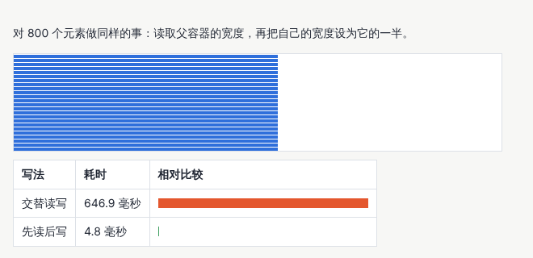

示例：[01-08-layout-thrash.html](示例/01-08-layout-thrash.html)

```js
// 交替读写：每次写入后再读取，浏览器都要立即重新计算布局
for (const b of boxes) {
  const w = b.parentElement.offsetWidth;      // 读取布局
  b.style.width = (w * scale) + 'px';         // 修改样式，使布局失效
}

// 先读后写：布局只计算一次
const widths = boxes.map(b => b.parentElement.offsetWidth);
boxes.forEach((b, i) => { b.style.width = (widths[i] * scale) + 'px'; });
```

#### 08.7 为“没准备好”和“跑不动”设计

- **先给内容**：文字信息先显示，图片、动画和三维效果随后加载；资源未就绪时显示占位骨架，而不是空白。
- **能力检测**：使用某项能力前先检测，例如浏览器是否支持某个 CSS 特性或 WebGL；不支持时使用简化版本。
- **质量分级**：在低性能设备上减少动画、降低图片尺寸、关闭非必要的效果，但仍然保证主要任务可以完成。

#### 08.8 常见问题

- **页面加载时内容上下跳动**：图片没有预留尺寸，或字体替换造成了移动。
- **首屏大图显示得很慢**：首屏图片使用了懒加载，或者没有提高它的优先级。
- **输入时页面卡顿**：每次输入都触发了大量计算或请求，加上防抖，并把繁重的计算拆开。
- **滚动长列表越来越卡**：列表项越来越多，考虑分页、虚拟列表或 `content-visibility`。

**本章练习**：

1. 用开发者工具录制 `01-08-layout-thrash.html` 的运行过程，在火焰图中找到“强制布局”的提示。
2. 为你的页面中的一张大图补上 `srcset`、`sizes`、`width` 和 `height`，比较手机宽度下下载的文件大小。
3. 在开发者工具中把网络限制为慢速，记录你的页面从打开到可以操作的过程，找出最慢的一步。

**继续深入**：真实用户指标的收集；服务器端渲染与流式渲染；缓存策略与服务工作线程；图片与视频的处理服务；动画与三维页面的帧时间测量（见[《质量、性能与设计运营》](18-质量性能与设计运营.md)）。

<a id="ch09"></a>

### 09 多输入与可访问实现

#### 09.1 解决什么问题

同一个界面会被鼠标、触屏、键盘、读屏软件、语音控制等不同方式使用。可访问实现要保证焦点顺序、键盘操作、表单标签、语义关系、触摸目标和内容的替代方式。鼠标悬停可以增加细节，但**关键操作应当有其他可以到达的方式**。可访问性的基本概念见 W3C 的入门介绍。[B17](#ref-b17)

#### 09.2 焦点与键盘

- **焦点顺序与文档顺序一致**：按 Tab 键时，焦点按 HTML 中的先后移动。不要用视觉位置与代码顺序不同的布局制造混乱，也不要使用大于 0 的 `tabindex`。
- **`tabindex` 的两个常用值**：`0` 让本来不能聚焦的元素可以用 Tab 到达；`-1` 让元素不在 Tab 顺序中，但可以用脚本聚焦。
- **清楚的焦点样式**：用 `:focus-visible` 设置明显的轮廓，它只在键盘操作时显示，鼠标点击时不显示。
- **跳过导航的链接**：页面开头放一个“跳到主要内容”的链接，键盘用户不必每次都穿过整个导航。
- **焦点管理**：打开对话框时焦点移入，关闭时还回原处；单页应用切换页面后，把焦点移到新页面的标题。
- **焦点不被遮挡**：吸顶的页头可能盖住获得焦点的元素，用 `scroll-padding-top` 预留空间。WCAG 2.2 加入的 2.4.11 要求获得焦点的元素不能被完全遮挡。[B06](#ref-b06)

#### 09.3 用编写实践指南实现复杂控件

标签页、菜单、树、组合框等复杂控件的键盘约定，可以在 W3C 的 WAI-ARIA 编写实践指南中查到，每种控件都有说明和示例。[B18](#ref-b18) 示例按指南实现了标签页：

- 整组标签只占一个 Tab 位置：只有当前标签的 `tabindex` 是 0，其他是 -1（称为“漫游 tabindex”）。
- 左右方向键在标签之间移动并切换，Home 与 End 跳到第一个和最后一个。
- 标签与面板通过 `aria-controls`、`aria-labelledby` 关联，选中状态用 `aria-selected` 表示。
- 标签的高度为 44 像素，便于触屏点击。

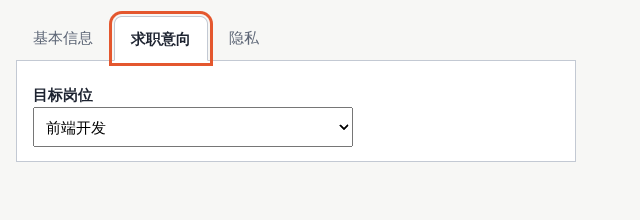

示例：[01-09-a11y.html](示例/01-09-a11y.html)

```js
function select(tab) {
  for (const t of tabs) {
    const on = t === tab;
    t.setAttribute('aria-selected', String(on));
    t.tabIndex = on ? 0 : -1;                     // 只有当前标签可以用 Tab 键到达
    document.getElementById(t.getAttribute('aria-controls')).hidden = !on;
  }
  tab.focus();
}
tabs.forEach((t, i) => t.addEventListener('keydown', e => {
  const next = { ArrowRight: i + 1, ArrowLeft: i - 1, Home: 0, End: tabs.length - 1 }[e.key];
  if (next === undefined) return;
  e.preventDefault();
  select(tabs[(next + tabs.length) % tabs.length]);
}));
```

#### 09.4 表单标签与语义关系

- 每个输入框都有可见的标签，并用 `<label for>` 关联；占位文字会在输入后消失，不能代替标签。
- 一组相关的选项（例如单选按钮）放在 `<fieldset>` 中，用 `<legend>` 说明这组选项问的是什么。
- 说明与错误信息用 `aria-describedby` 关联；必填项用 `required` 标出，并在标签中用文字说明。
- 异步结果放在 `role="status"` 的区域中，读屏软件会读出。
- 标题层级与页面区域（`main`、`nav` 等）组成页面的“目录”，读屏软件用户靠它们快速跳转。

#### 09.5 触摸目标与指针

- **目标尺寸**：WCAG 2.2 的 2.5.8 要求可以点击的目标一般不小于 24 × 24 CSS 像素，或者与相邻目标保持足够的间距。[B06](#ref-b06) 触屏上的主要操作通常留出 44 像素左右的区域。
- **不要只靠悬停**：触屏没有悬停。悬停时显示的内容，也要能通过点击或获得焦点显示；按照 WCAG 的 1.4.13，这类内容要能被关闭（例如按 Esc），鼠标移到上面时不消失。
- **按输入能力调整**：媒体查询 `(hover: hover)` 判断设备是否能悬停，`(pointer: coarse)` 判断主要指针是否不精确（例如手指），可以据此放大触摸目标。

#### 09.6 内容的替代方式

- **图片的替代文字**：传达信息的图片写出它传达的信息；纯装饰的图片写 `alt=""`，读屏软件会跳过。
- **只有图标的按钮**：需要可读的名称，例如 `aria-label="删除"`，或者放一段视觉上隐藏的文字。
- **音频与视频**：提供字幕或文字稿。
- **图表**：提供文字摘要或数据表格。

#### 09.7 缩放、重排与动态效果偏好

- **文字放大**：把文字放大到 200% 时，内容不能被截断或重叠。
- **重排**：WCAG 的 1.4.10 要求在相当于 320 CSS 像素宽的窗口中，内容不需要左右滚动就能阅读（表格、地图等除外）。
- **减少动态效果**：用户在系统中开启“减少动态效果”后，用媒体查询 `prefers-reduced-motion: reduce` 关闭或简化动画。12 章的骨架屏在这种情况下停止闪烁动画。

#### 09.8 怎样检查

1. **只用键盘走一遍主要任务**：拔掉鼠标，用 Tab、Shift ＋ Tab、回车、空格、方向键和 Esc 完成任务，注意焦点是否始终可见、顺序是否合理。
2. **用读屏软件试一试**：Windows 上的 NVDA（免费）、苹果设备上的 VoiceOver、安卓上的 TalkBack。听一听标题、按钮和表单是否都能被正确读出。
3. **放大与缩窄**：把文字放大到 200%，把窗口缩到 320 像素宽。
4. **自动检查**：使用 axe 等工具扫描，它能发现缺少标签、对比度不足等问题，但只能发现一部分问题（见 10 章）。

#### 09.9 常见问题

- **按 Tab 键时看不到焦点在哪里**：样式中写了 `outline: none`。恢复轮廓，或用 `:focus-visible` 设计更好看的焦点样式。
- **自定义下拉框无法用键盘操作**：用 `div` 实现，没有处理键盘事件。优先使用原生 `<select>`，或按编写实践指南实现。
- **读屏软件把图标按钮读成“按钮”而没有名称**：图标按钮缺少可读的名称。
- **手机上很难点中小图标**：触摸目标太小，增加内边距扩大点击区域。

**本章练习**：

1. 只用键盘操作 `01-09-a11y.html`，再用读屏软件听一遍标签与面板的读法。
2. 给你的页面加上“跳到主要内容”链接，只在获得焦点时显示。
3. 检查一个表单：每个输入框是否都有标签、错误信息是否能被读出、提交结果是否会被告知。

**继续深入**：WCAG 2.2 的全部成功准则；语音控制与开关控制的使用方式；无障碍测试的系统方法；包容性设计与认知障碍（见[《包容、国际化与多感官》](16-包容国际化与多感官.md)）。

<a id="ch10"></a>

### 10 调试与质量保障

#### 10.1 解决什么问题

调试与质量保障使用开发者工具检查布局、网络、性能和可访问性；对核心操作、历史上出过的问题和高风险逻辑保留适当的测试，同时进行人工视觉检查。项目交付后，还需要关注真实使用中出现的错误。

#### 10.2 开发者工具的常用面板

以 Chrome 为例，其他浏览器有类似的面板：[B19](#ref-b19)

| 面板 | 用来做什么 |
| --- | --- |
| 元素 | 查看结构与样式；查看盒模型的四层；显示 Flex 与 Grid 的辅助线；查看哪条样式规则胜出 |
| 控制台 | 查看错误信息；直接运行代码检查变量 |
| 网络 | 查看每个请求的耗时与内容；模拟慢速网络；屏蔽某个请求来模拟加载失败 |
| 性能 | 录制一段操作，找出长任务、强制布局和布局偏移 |
| Lighthouse | 生成加载性能、可访问性、最佳实践的检查报告 |
| 渲染 | 模拟深色模式、减少动态效果、色觉差异；显示重绘区域与布局偏移区域 |
| 无障碍 | 查看浏览器给读屏软件提供的名称、角色与状态 |

一个高效的习惯：**遇到界面问题，先在开发者工具中定位原因，再改代码**。例如元素位置不对，先看它的父元素是 Flex 还是 Grid、它占了哪个网格区域，而不是反复调整数值碰运气。

#### 10.3 测试放在哪里

| 测试 | 检查什么 | 例子 |
| --- | --- | --- |
| 单元测试 | 不依赖界面的逻辑 | 筛选、排序、日期格式化的函数 |
| 组件测试 | 单个组件的行为 | 对话框在名称为空时显示错误 |
| 端到端测试 | 在真实浏览器中完成的完整任务 | 搜索、筛选、打开详情、刷新后恢复 |
| 视觉回归测试 | 截图与上一次相比是否有变化 | 组件在各种状态与宽度下的样子 |
| 可访问性自动检查 | 缺少标签、对比度不足等可以自动发现的问题 | 用 axe 扫描页面 |

不可能、也不需要测试一切。优先给三类内容写测试：**核心操作**（用户最常做、做不了就无法使用产品的事）、**历史问题**（出过一次的错误，修复时同时写一个测试，防止再次出现）、**高风险逻辑**（涉及金额、权限、数据删除的逻辑）。

#### 10.4 示例：用 Playwright 自动检查资源列表页

Playwright 可以用代码控制真实的浏览器：打开页面、输入、点击、按键、改变窗口大小，再检查结果。[B20](#ref-b20) 示例对 12 章的资源列表页做 8 项检查：

```js
await check('快速连续切换时只显示最后一次的结果', async () => {
  for (const c of ['清单', '模型', '文章']) await page.selectOption('#cat', c);
  await page.waitForTimeout(1200);
  const types = await page.$$eval('.card .meta', els => [...new Set(els.map(e => e.textContent.split(' ')[0]))]);
  expect(types.length === 1 && types[0] === '文章', `显示的分类是 ${types.join('、')}`);
});

await check('320 像素宽时没有横向滚动条', async () => {
  await page.setViewportSize({ width: 320, height: 640 });
  const scroll = await page.evaluate(() => document.documentElement.scrollWidth);
  expect(scroll <= 320, `页面宽度 ${scroll} 像素`);
});
```

示例：[01-10-checks.js](示例/01-10-checks.js)。在示例目录中运行 `npm install playwright`、`npx playwright install chromium`，再运行 `node 01-10-checks.js`，输出如下：

```text
通过  长标题不会撑破卡片
通过  没有结果时显示空状态和清除按钮
通过  筛选条件写进地址，刷新后恢复
通过  快速连续切换时只显示最后一次的结果
通过  只用键盘可以打开详情
通过  320 像素宽时没有横向滚动条
通过  加载失败时保留条件并提供重试
通过  页面没有脚本错误
```

**一个检查必须能够失败，才有价值**。编写这组检查时，我们故意把页面改坏了三处：去掉竞态保护、不再把条件写进地址、让长标题不换行。前两处立即被发现；第三处却“通过”了——原来的检查只看标题元素自身是否溢出，而标题元素被撑宽后又被卡片裁掉，自身并不溢出。把检查改为“比较文字与卡片的边界”后，三处问题全部被发现。写完检查后，故意制造一次它要防止的问题，确认它真的会报错，是一个简单而有效的习惯。

#### 10.5 可访问性的自动检查与人工检查

axe 等工具可以自动发现缺少替代文字、缺少标签、对比度不足、ARIA 属性用错等问题，适合放进自动检查流程。[B21](#ref-b21) 但是，自动工具无法判断替代文字写得是否准确、焦点顺序是否合理、读屏软件读出的内容是否好懂，这些仍然需要 09 章的人工检查。

#### 10.6 人工视觉检查

自动检查擅长发现“和上次不一样”，人负责判断变化是否合理、页面是否好看好用。每次交付前，至少用真实内容在三种宽度（手机、平板、桌面）下看一遍，检查长标题、空状态、失败状态和深色模式。视觉回归测试的系统做法在[《质量、性能与设计运营》](18-质量性能与设计运营.md)中展开。

#### 10.7 上线后的错误

开发环境中一切正常，不代表用户那里也正常。可以收集真实使用中的错误：

```js
addEventListener('error', e => report({ message: e.message, source: e.filename, line: e.lineno }));
addEventListener('unhandledrejection', e => report({ message: String(e.reason) }));
```

上报时附带页面地址、浏览器版本和产品版本，便于复现；压缩后的代码要配合源码映射文件，才能看懂错误发生在哪一行。修复线上错误时，同时补一个测试，让它不再出现。

#### 10.8 常见问题

- **测试时好时坏**：测试依赖了固定的等待时间或随机数据。改为等待明确的条件（例如某个元素出现），并固定测试数据。
- **截图对比总是报告微小差异**：字体、动画或时间不固定。测试时使用固定的字体与数据，关闭动画。
- **自动检查全部通过，用户却反馈无法使用**：自动检查只覆盖了一部分问题，补充人工检查与真实用户测试。

**本章练习**：

1. 运行 `01-10-checks.js`，然后故意改坏 `01-12-resource-list.html` 的一处行为，确认检查能发现它。
2. 为 `01-12-resource-list.html` 增加一项检查：清除筛选后，地址栏中不再有筛选参数。
3. 在开发者工具中屏蔽资源列表页的某个请求，观察页面的失败状态。

**继续深入**：Playwright 的测试运行器与截图比较；组件测试工具；持续集成中的自动检查；错误监控与性能监控服务。

<a id="part-3"></a>

## 第三篇：综合实战与技术选择

<a id="ch11"></a>

### 11 纵向深入：卡片列表的五次升级

纵向深入的意思是：在同一个主题上，围绕真实需求一步一步增加能力。以卡片列表为例，它可以经历五次升级：

| 阶段 | 增加的能力 | 会遇到的新问题 | 验收 |
| --- | --- | --- | --- |
| 1 固定内容 | 用网格排出几张卡片 | — | 在设计稿的宽度下看起来正确 |
| 2 内容变化 | 支持长短不同的文字与不同比例的图片 | 长标题撑破卡片、图片变形、缩略图缺失 | 用最长、最短、缺失的内容测试 |
| 3 筛选与空状态 | 搜索、分类、排序，处理没有结果 | 竞态、刷新后条件丢失、空白页面 | 快速切换条件、刷新、空结果 |
| 4 数据量与键盘 | 处理上千条数据，支持键盘浏览 | 渲染变慢、焦点丢失 | 一千条数据下的操作速度；只用键盘完成任务 |
| 5 稳定的接口与展示页 | 把卡片整理成接口清楚的组件，并做一个展示所有状态的页面 | 不同页面各自修改、样式分叉 | 其他人只看展示页就能正确使用 |

每一次升级都由一个真实需求触发，而不是为了“技术更先进”。本册的示例正好对应前四个阶段：`01-03-layout.html` 处理内容变化，`01-07-race.html` 和 `01-12-resource-list.html` 处理筛选、竞态与空状态，08、09 章处理数据量与键盘。

第五阶段的**展示页**（也常称为组件工作台）把一个组件的所有状态放在一个页面上：正常、长标题、缺失图片、加载中的骨架、选中、错误。它有三个用途：设计师和开发者对照检查；新成员学习怎样使用组件；视觉回归测试对它截图。展示页中的每个状态都用固定的数据，结果才能稳定地比较。

<a id="ch12"></a>

### 12 综合项目：资源列表页

#### 12.1 目标与验收

制作一个资源列表页，包含**搜索、分类、排序和详情**。准备长标题、空结果、加载失败、缩略图缺失等数据。验收时改变窗口宽度、只用键盘操作、重复切换筛选，并观察页面是否丢失上下文。最终保存一份组件清单和各种异常状态的截图。

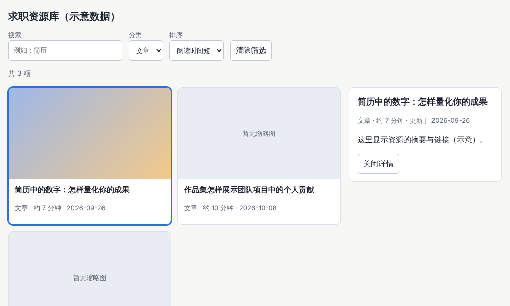

示例：[01-12-resource-list.html](示例/01-12-resource-list.html)

#### 12.2 第一步：列出数据与状态

先写出页面的状态表（参考 07 章）：筛选关键词、分类、排序和当前详情放在地址栏；请求状态（加载中、成功、空结果、失败）放在内存中。示意数据中有意包含一个很长的标题、两条没有缩略图的记录，并提供一个“失败模式”（地址中带上 `?fail=1`）来模拟加载失败。

#### 12.3 第二步：结构与布局

- 工具栏是一个 `role="search"` 的表单，每个控件都有可见的标签。
- 列表使用 03 章的自适应网格；每张卡片是一个链接，指向自己的详情地址，因此可以用键盘聚焦、用回车打开，也可以在新标签页中打开。
- 详情面板在宽屏上显示在右侧；窄屏上显示在列表下方。
- 卡片的标题最多显示两行，完整标题在详情中显示。

#### 12.4 第三步：搜索、分类与排序

所有修改都经过同一个 `update` 函数：先更新状态，再写进地址栏，最后决定是否需要重新请求——只有筛选条件改变时才重新请求，选中某张卡片只更新详情：

```js
function update(change, push = false) {
  const reload = ['q', 'cat', 'sort'].some(k => k in change && change[k] !== state[k]);
  state = { ...state, ...change };
  writeState(state, push);
  syncControls();
  reload ? load() : renderList();
}
```

搜索框的输入经过 250 毫秒的防抖，用户停止输入后才更新。

#### 12.5 第四步：把状态放进地址

```js
function readState() {
  const p = new URLSearchParams(location.search);
  return { q: p.get('q') || '', cat: p.get('cat') || '', sort: p.get('sort') || 'new', id: Number(p.get('id')) || null };
}
```

修改筛选条件时用 `history.replaceState` 改写当前地址，不增加历史记录；打开或关闭详情时用 `history.pushState` 增加一条记录，于是浏览器的“后退”可以关闭详情、回到列表。监听 `popstate` 事件，在前进或后退时根据地址恢复状态。刷新页面、把地址发给别人，看到的都是同样的筛选结果。

#### 12.6 第五步：只采用最新的结果

加载函数使用 07 章的做法：新请求开始时取消上一个请求，并用编号丢弃过期的结果。快速连续切换分类时，页面只显示最后一次选择的结果。

#### 12.7 第六步：加载、空结果与失败

| 状态 | 页面显示 | 实现要点 |
| --- | --- | --- |
| 加载中 | 三个占位骨架 | 列表设置 `aria-busy="true"`；开启减少动态效果时骨架不闪烁 |
| 空结果 | “没有找到与‘薪资谈判’相关的资源”与“清除筛选”按钮 | 说明为什么为空，并给出下一步 |
| 失败 | “资源加载失败，已保留你的筛选条件”与“重试”按钮 | 筛选条件不丢失 |
| 缩略图缺失 | “暂无缩略图”的占位 | 卡片高度与其他卡片一致 |

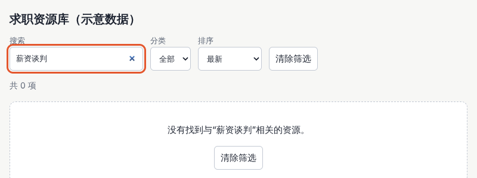

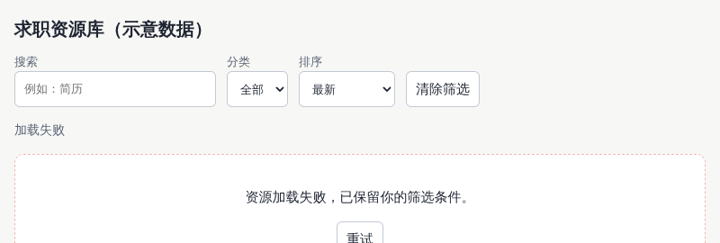

状态文字（“共 6 项”“正在加载…”“加载失败”）放在 `role="status"` 的区域中，读屏软件会读出变化。

#### 12.8 第七步：键盘与读屏

- 按 Tab 依次经过搜索框、分类、排序、清除按钮和每张卡片；在卡片上按回车打开详情。
- 当前打开的卡片设置 `aria-current="true"`，同时显示蓝色边框。
- 所有控件都有可见的焦点轮廓。

#### 12.9 第八步：响应式

窄屏上，工具栏的控件自动换行，卡片变为单列，详情显示在列表下方。

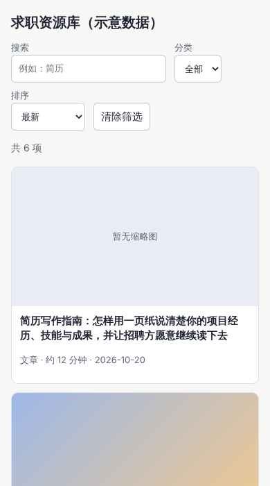

#### 12.10 第九步：自动检查

用 10 章的 `01-10-checks.js` 检查八项关键行为。以后每次修改页面，都先运行一遍。

#### 12.11 验收清单

- [ ] 改变窗口宽度（包括 320 像素）时，没有关键内容被遮挡，也不需要左右滚动。
- [ ] 文字放大到 200% 时，内容不被截断。
- [ ] 只用键盘可以完成搜索、筛选、排序、打开和关闭详情；焦点始终可见，顺序合理。
- [ ] 重复、快速地切换筛选条件，页面显示的结果与当前条件一致。
- [ ] 刷新页面、前进后退，筛选条件与详情都能恢复，用户不丢失上下文。
- [ ] 长标题、缺失的缩略图、空结果、加载失败都有合适的呈现，失败时有恢复路径。
- [ ] 表单控件都有标签，控件语义正确（按钮是按钮、链接是链接），焦点顺序清楚，状态变化能被读屏软件读出。
- [ ] 开启减少动态效果后，主要任务仍能完成，骨架不再闪烁。
- [ ] 请求被取消或页面离开时，计时器与事件都得到清理。
- [ ] 在慢速网络和较慢的处理器下记录了加载与操作的表现。

#### 12.12 交付物：组件清单与异常状态截图

| 组件 | 状态 |
| --- | --- |
| 搜索框 | 空、有内容、获得焦点 |
| 分类选择、排序选择 | 默认、已选择、获得焦点 |
| 清除筛选按钮 | 默认、获得焦点 |
| 资源卡片 | 正常、长标题、缺失缩略图、获得焦点、当前打开 |
| 加载骨架 | 闪烁、减少动态效果时静止 |
| 空结果 | 带关键词、带分类 |
| 失败提示 | 带重试按钮 |
| 详情面板 | 宽屏在右侧、窄屏在下方 |
| 状态提示 | 共 N 项、正在加载、加载失败 |

截图至少包括：正常、空结果、加载失败、手机宽度，以及打开详情的状态。本章的五张截图就是一份这样的记录。

<a id="ch13"></a>

### 13 技术选择

#### 13.1 先按任务选择

一个项目通常只需要少量工具。先明确主要任务和约束，再选择必要的技术：

| 任务 | 可以考虑 | 选择时要明确 |
| --- | --- | --- |
| 页面结构与样式 | HTML、CSS、JavaScript、TypeScript | 内容、交互、设备与团队的基础 |
| 复杂应用的组织 | Vue、React | 已有项目、组件生态与维护能力 |
| 样式规则的实现 | 原生 CSS、Tailwind CSS | 团队约定与设计令牌的管理方式 |
| 基础界面组件 | shadcn/ui（React）、Element Plus（Vue） | 框架是否匹配、状态是否完整、可访问性是否达标 |
| 设计稿与原型 | Figma 等设计工具 | 协作方式、组件与交付需求 |

其他任务的工具在相应的分册中介绍：动效编排（CSS、Motion、GSAP）见[《动效与时间设计》](04-动效与时间设计.md)；二维创意图形（SVG、Canvas、p5.js）与自定义数据图形（D3）见[《创意编程与二维图形》](05-创意编程与二维图形.md)；三维场景（Three.js）与三维资产（Blender）见[《三维内容与空间设计》](06-三维内容与空间设计.md)；自定义着色器（WebGL 与 GLSL、WebGPU 与 WGSL）见[《技术美术与实时效果》](07-技术美术与实时效果.md)；完整的工具对照表见[《工作流程与 AI 协作》](22-工作流程与AI协作.md)。

#### 13.2 什么时候引入 TypeScript、框架与构建工具

- **TypeScript**：代码超过几千行、多人协作、数据结构复杂时引入。它在写代码时就能发现“传错了字段”“可能是空值”之类的错误。[B22](#ref-b22)
- **组件框架**：页面中有许多随数据变化的部分、同样的界面在多处重复时引入。框架让“界面随数据自动更新”，不必手动同步 DOM。
- **构建工具**：使用框架、TypeScript 或大量模块时需要。Vite 提供快速的开发服务器和生产环境打包。[B23](#ref-b23)

#### 13.3 Vue 还是 React

两者都能做出高质量的产品，选择时主要看：团队已有的经验与项目；需要的组件库和生态；招聘与长期维护。React 以函数和 JSX 组织界面，生态庞大；Vue 的模板语法接近 HTML，上手平缓，官方提供了较完整的配套工具。[B24](#ref-b24) [B25](#ref-b25) 已有项目使用哪个，就先把哪个用好。

#### 13.4 原生 CSS 还是 Tailwind CSS

- **原生 CSS**：写类名与样式规则，配合层叠层、自定义属性和容器查询，已经可以很好地组织大型项目。
- **Tailwind CSS**：在 HTML 中直接组合预先定义的工具类，例如 `p-4 rounded-lg`。工具类的数值来自统一的设计尺度，容易保持一致；代价是标记中的类名较长，团队需要统一习惯。[B26](#ref-b26)

无论哪种方式，颜色、间距、字号等设计决定都应当集中定义，而不是散落在各处。

#### 13.5 组件库

- **shadcn/ui**：面向 React。它不是作为依赖安装的组件包，而是把组件的源代码复制到你的项目中，由你修改和维护。[B27](#ref-b27)
- **Element Plus**：面向 Vue 3 的组件库，提供表单、表格、对话框等大量常用组件。[B28](#ref-b28)

使用组件库时仍要检查：组件的状态是否完整（加载、错误、禁用）、键盘与读屏是否可用、能否与项目的视觉规则配合。

#### 13.6 设计稿与原型

Figma 等设计工具用于绘制设计稿、制作可点击的原型、管理组件与样式，并支持多人协作。[B29](#ref-b29) 开发者从设计稿中获取尺寸、颜色与资源，但要记住：设计稿通常只画出了部分状态，长标题、空结果、失败等情况需要和设计师一起补齐。

#### 13.7 记录版本与维护方式

工具和浏览器能力都在更新。开始项目时查看官方文档的最新版本，并在项目中记录：使用的工具及版本、选择它的原因、使用条件（许可证等）、谁负责升级。新的浏览器能力（例如本册介绍的 `popover`、锚点定位、`text-autospace`）在使用前确认目标用户的浏览器是否支持，并准备回退方案。

<a id="ch14"></a>

### 14 继续深入与学习路线

#### 14.1 八个方向的纵向深入

| 方向 | 入门 | 进阶 | 深入 |
| --- | --- | --- | --- |
| 布局与响应式 | Flex、Grid、自适应网格 | 容器查询、子网格、内在尺寸 | 复杂编辑器与仪表盘的布局系统 |
| 字体与排版 | 字体栈、行高、中英文混排 | 网络字体加载与度量调整、断行控制 | 可变字体、多语种排版、阅读器 |
| CSS 视觉表达 | 背景、阴影、圆角 | 遮罩、裁切、混合、深色模式 | 颜色空间、复杂视觉效果的性能 |
| 组件结构与接口 | 原生元素、状态清单 | 对话框、菜单、表格的完整实现 | 组件库的设计与维护 |
| 应用状态与数据 | 加载、空、失败三种状态 | 地址栏状态、竞态、草稿 | 状态机、服务器数据缓存、离线 |
| 资源与渲染性能 | 图片尺寸、懒加载 | 渲染流水线、长任务、列表规模 | 真实用户指标、渲染架构 |
| 多输入与可访问 | 标签、焦点、键盘 | 编写实践指南中的复杂控件 | 系统的无障碍测试与包容性设计 |
| 调试与质量保障 | 开发者工具 | 端到端测试、自动可访问性检查 | 视觉回归、持续集成、线上监控 |

#### 14.2 横向连接

界面工程是所有方向共同的基础：

- 视觉层级、字体与色彩的设计方法：[《视觉设计与品牌表达》](02-视觉设计与品牌表达.md)。
- 任务流程、信息架构与可用性测试：[《产品交互与用户体验》](03-产品交互与用户体验.md)。
- 过渡、微交互与动画状态：[《动效与时间设计》](04-动效与时间设计.md)。
- 设计令牌、组件库与设计系统：[《计算设计与创作工具》](11-计算设计与创作工具.md)。
- 无障碍、国际化与多感官：[《包容、国际化与多感官》](16-包容国际化与多感官.md)。
- 视觉质量检查、感知性能与设计运营：[《质量、性能与设计运营》](18-质量性能与设计运营.md)。

#### 14.3 下一步

1. 完成 12 章的资源列表页，并通过全部验收项。
2. 把你现有的一个页面按 11 章的五个阶段逐一检查，找出它停留在哪个阶段。
3. 选择一个最薄弱的方向，完成该章的全部练习。

<a id="appendix-a"></a>

## 附录 A：术语表

| 术语 | 含义 | 阅读位置 |
| --- | --- | --- |
| 语义化 HTML | 用表达含义的标签组织页面，例如用 `button` 写按钮 | 02 |
| 盒模型 | 元素由内容、内边距、边框、外边距四层组成 | 02 |
| 外边距合并 | 上下相邻的块元素的外边距合并为较大的一个 | 02 |
| 层叠 | 多条样式规则冲突时决定谁生效的规则 | 02 |
| 优先级 | 选择器的权重，id ＞ 类 ＞ 元素 | 02 |
| 包含块 | 绝对定位元素的参照物 | 02 |
| 层叠上下文 | `z-index` 进行比较的范围 | 02 |
| 顶层 | 显示在所有内容之上、不受父元素裁切的一层 | 02、06 |
| DOM | 浏览器把 HTML 解析成的对象树 | 02 |
| 事件委托 | 在外层元素上统一处理子元素的事件 | 02 |
| 内在尺寸 | 由内容决定的尺寸，例如 `min-content` | 03 |
| 容器查询 | 根据组件所在容器的宽度改变样式 | 03 |
| 断点 | 布局发生变化的宽度 | 03 |
| 字体栈 | 依次尝试的一组字体 | 04 |
| 子集化 | 只保留实际用到的字，减小字体文件 | 04 |
| 可变字体 | 在一个文件中连续调整粗细、宽窄等的字体 | 04 |
| 避头尾 | 某些标点不出现在行首或行尾的规则 | 04 |
| 对比度 | 文字与背景亮度的差异，正文至少 4.5:1 | 05 |
| 强制颜色模式 | 系统用自己的颜色替换网页配色的显示模式 | 05 |
| 组件接口 | 组件的属性、事件、状态、内容与变体 | 06 |
| 状态机 | 由有限的状态和状态之间的转换规则组成的模型 | 07 |
| 竞态 | 结果取决于多个异步任务谁先完成的问题 | 07 |
| 防抖 | 停止触发一段时间后才执行 | 07 |
| 乐观更新 | 先在界面上显示操作结果，失败后再恢复 | 07 |
| LCP、INP、CLS | 核心网页指标：主要内容显示时间、交互响应时间、布局偏移 | 08 |
| 懒加载 | 内容快要进入视野时才加载 | 08 |
| 长任务 | 占用主线程超过 50 毫秒的任务 | 08 |
| 虚拟列表 | 只渲染可见部分的长列表 | 08 |
| 强制同步布局 | 修改样式后立即读取布局，迫使浏览器马上重新计算 | 08 |
| 合成 | 把绘制好的各层组合起来显示 | 08 |
| 焦点顺序 | 按 Tab 键时焦点移动的顺序 | 09 |
| 漫游 tabindex | 一组控件中只有当前项可以用 Tab 到达 | 09 |
| 读屏软件 | 把屏幕内容读出来的辅助技术 | 09 |
| 替代文字 | 图片等非文字内容的文字说明 | 09 |
| 端到端测试 | 在真实浏览器中完成完整任务的自动测试 | 10 |
| 视觉回归测试 | 比较截图，发现意外的视觉变化 | 10 |
| 源码映射 | 把压缩后的代码对应回源代码的文件 | 10 |
| 展示页 | 集中展示组件所有状态的页面 | 11 |

<a id="appendix-b"></a>

## 附录 B：资料入口

以下资料用于核对方法来源和继续学习。资料核对日期：2026-10-25。

<a id="ref-b01"></a>
**B01 · MDN：Web 开发核心课程。** [Core learning modules](https://developer.mozilla.org/en-US/docs/Learn_web_development/Core)。对应 01、02 章，HTML、CSS、JavaScript、设计与可访问性的系统课程。

<a id="ref-b02"></a>
**B02 · MDN：CSS 布局。** [CSS layout](https://developer.mozilla.org/en-US/docs/Learn_web_development/Core/CSS_layout)。对应 03 章，Flex、Grid、定位与响应式。

<a id="ref-b03"></a>
**B03 · MDN：容器查询。** [CSS container queries](https://developer.mozilla.org/en-US/docs/Web/CSS/Guides/Containment/Container_queries)。对应 03 章，根据容器尺寸改变样式。

<a id="ref-b04"></a>
**B04 · W3C：中文排版需求。** [Requirements for Chinese Text Layout](https://www.w3.org/TR/clreq/)。对应 04 章，中文的字体、标点、断行与混排要求。

<a id="ref-b05"></a>
**B05 · MDN：font-display。** [font-display](https://developer.mozilla.org/en-US/docs/Web/CSS/Reference/At-rules/@font-face/font-display)。对应 04、08 章，网络字体加载期间的显示策略。

<a id="ref-b06"></a>
**B06 · W3C：WCAG 2.2 快速参考。** [How to Meet WCAG (Quick Reference)](https://www.w3.org/WAI/WCAG22/quickref/)。对应 04、05、09 章，对比度、文字间距、目标尺寸、焦点等成功准则。

<a id="ref-b07"></a>
**B07 · MDN：text-wrap。** [text-wrap](https://developer.mozilla.org/en-US/docs/Web/CSS/Reference/Properties/text-wrap)。对应 04 章，均衡断行与避免孤字。

<a id="ref-b08"></a>
**B08 · MDN：text-autospace。** [text-autospace](https://developer.mozilla.org/en-US/docs/Web/CSS/Reference/Properties/text-autospace)。对应 04 章，在汉字与西文、数字之间自动加入间距。

<a id="ref-b09"></a>
**B09 · MDN：dialog 元素。** [dialog](https://developer.mozilla.org/en-US/docs/Web/HTML/Reference/Elements/dialog)。对应 06 章，模态与非模态对话框。

<a id="ref-b10"></a>
**B10 · MDN：Popover API。** [Popover API](https://developer.mozilla.org/en-US/docs/Web/API/Popover_API)。对应 02、06 章，显示在顶层、可以自动关闭的浮层。

<a id="ref-b11"></a>
**B11 · MDN：CSS 锚点定位。** [CSS anchor positioning](https://developer.mozilla.org/en-US/docs/Web/CSS/Guides/Anchor_positioning)。对应 06 章，让浮层跟随另一个元素定位。

<a id="ref-b12"></a>
**B12 · MDN：AbortController。** [AbortController](https://developer.mozilla.org/en-US/docs/Web/API/AbortController)。对应 07 章，取消请求与清理事件。

<a id="ref-b13"></a>
**B13 · web.dev：性能课程。** [Learn Performance](https://web.dev/learn/performance/)。对应 08 章，资源、加载与运行性能。

<a id="ref-b14"></a>
**B14 · web.dev：核心网页指标的阈值。** [Defining the Core Web Vitals metrics thresholds](https://web.dev/articles/defining-core-web-vitals-thresholds)。对应 08 章，LCP、INP、CLS 的阈值与第 75 百分位评估方式。

<a id="ref-b15"></a>
**B15 · MDN：响应式图片。** [Responsive images](https://developer.mozilla.org/en-US/docs/Web/HTML/Guides/Responsive_images)。对应 08 章，`srcset`、`sizes` 与 `picture`。

<a id="ref-b16"></a>
**B16 · MDN：content-visibility。** [content-visibility](https://developer.mozilla.org/en-US/docs/Web/CSS/Reference/Properties/content-visibility)。对应 08 章，跳过屏幕外内容的渲染。

<a id="ref-b17"></a>
**B17 · W3C WAI：可访问性入门。** [Introduction to Web Accessibility](https://www.w3.org/WAI/fundamentals/accessibility-intro/)。对应 09 章，可访问性的基本概念。

<a id="ref-b18"></a>
**B18 · W3C：WAI-ARIA 编写实践指南的标签页模式。** [Tabs Pattern](https://www.w3.org/WAI/ARIA/apg/patterns/tabs/)。对应 09 章，标签页的键盘约定与示例；同一指南还包括菜单、对话框、组合框等模式。

<a id="ref-b19"></a>
**B19 · Chrome 开发者工具文档。** [Chrome DevTools](https://developer.chrome.com/docs/devtools)。对应 10 章，各个面板的用法。

<a id="ref-b20"></a>
**B20 · Playwright。** [Playwright](https://playwright.dev/)。对应 10 章，用代码控制浏览器进行自动检查。

<a id="ref-b21"></a>
**B21 · axe-core。** [axe-core](https://github.com/dequelabs/axe-core)。对应 10 章，可访问性自动检查引擎。

<a id="ref-b22"></a>
**B22 · TypeScript 手册。** [The TypeScript Handbook](https://www.typescriptlang.org/docs/handbook/intro.html)。对应 13 章，类型系统入门。

<a id="ref-b23"></a>
**B23 · Vite 指南。** [Getting Started](https://vite.dev/guide/)。对应 13 章，开发服务器与生产打包。

<a id="ref-b24"></a>
**B24 · React 学习文档。** [Learn React](https://react.dev/learn)。对应 13 章，组件、状态与应用组织。

<a id="ref-b25"></a>
**B25 · Vue 入门文档。** [Introduction](https://vuejs.org/guide/introduction.html)。对应 13 章，Vue 组件与应用基础。

<a id="ref-b26"></a>
**B26 · Tailwind CSS。** [Styling with utility classes](https://tailwindcss.com/docs/styling-with-utility-classes)。对应 13 章，工具类与设计约束。

<a id="ref-b27"></a>
**B27 · shadcn/ui。** [shadcn/ui](https://ui.shadcn.com/)。对应 13 章，复制到项目中维护的 React 组件。

<a id="ref-b28"></a>
**B28 · Element Plus。** [Element Plus](https://element-plus.org/en-US/)。对应 13 章，Vue 3 组件库。

<a id="ref-b29"></a>
**B29 · Figma。** [Figma](https://www.figma.com/)。对应 13 章，设计与原型工具。

<a id="appendix-c"></a>

## 附录 C：与原手册的对应关系及修订记录

### C.1 与原手册的对应关系

本册由原《前端与 UI／UX 设计进阶全景手册》第 03 章“前端界面工程”扩写而成，并吸收了其他章节中的相关内容：

| 原手册内容 | 本册位置 |
| --- | --- |
| 3.1 研究对象与先修要求 | 01 章 |
| 3.2 分支 1：布局与响应式 | 03 章 |
| 3.2 分支 2：字体与排版工程 | 04 章 |
| 3.2 分支 3：CSS 视觉表达 | 05 章 |
| 3.2 分支 4：组件结构与接口 | 06 章 |
| 3.2 分支 5：应用状态与数据表现 | 07 章 |
| 3.2 分支 6：资源与渲染性能 | 08 章 |
| 3.2 分支 7：多输入与可访问实现 | 09 章 |
| 3.2 分支 8：调试与质量保障 | 10 章 |
| 3.3 纵向深入示例：卡片列表 | 11 章 |
| 3.4 练习与验收：资源列表页 | 12 章 |
| 3.4 参考入口：MDN 核心课程 | 附录 B |
| 2.2 学习阶段 S0：结构与样式基础 | 01、02 章 |
| 24.3 工程与可访问性检查 | 12.11 验收清单 |
| 25.1 按任务选择工具 | 13 章 |
| 25.2 前端与界面资料 | 13 章、附录 B |

### C.2 修订记录

| 版本 | 日期 | 主要变化 |
| --- | --- | --- |
| 1.0 | 2026-10-25 | 初版：由原手册第 03 章扩写，新增 10 个可运行示例与截图 |
