# 视觉设计与品牌表达

> 安排用户先看见什么、怎样理解信息之间的关系、页面传递怎样的气质：从层级、版式、字体、色彩，到图标、图片、插画、品牌与数据图形。  
> 版本：1.0 · 整理日期：2026-10-25  
> 适用对象：想让页面“好看”、并且说得清为什么好看的开发者，以及设计学习者。先修：能用 HTML 和 CSS 做出页面（见[《前端界面工程》](01-前端界面工程.md)）；不需要美术基础，本册从观察讲起。

“好看”听起来很主观，但大部分可以拆成能观察、能比较、能解释的具体变量：字号、对齐、边距、留白、明暗、图片比例、视觉重心。视觉设计就是用这些变量安排用户**先看见什么**、**怎样理解信息之间的关系**，以及页面**传递怎样的气质**。制作工具可以按自己的习惯选择——Figma 等设计工具，或者直接写代码——最终要能解释每一个设计取舍：为什么标题这么大、为什么这两块离得近、为什么用这个颜色。

本册对每个主题都按同样的顺序讲：先说明它解决什么问题；再用白话解释核心概念；然后给出一个可以直接运行的示例，附运行截图；最后是常见问题、本章练习和继续深入的方向。所有示例都放在本目录的[示例](示例/)文件夹中，用浏览器直接打开即可运行，每个示例都已在浏览器中实际运行并检查过。示例从 CDN 加载开源的中文网络字体（思源黑体、思源宋体、霞鹜文楷），第一次打开时需要联网。

主线是：**学会观察层级 → 掌握版式、字体、色彩、图标、图片、插画、品牌、数据图形八个方向 → 把它们整理成一套可用的视觉规则，并用同一份内容做出三种视觉方向。**

## 阅读导航

正文共 14 章（01—14），附 10 个可运行示例、3 组附录与 20 项资料入口。

- [第一篇：学会观察](#part-1)
  - [01 视觉设计负责什么](#ch01)
  - [02 视觉层级：用几个变量安排先后](#ch02)
- [第二篇：八个方向](#part-2)
  - [03 版式与构图](#ch03)
  - [04 字体设计与字体应用](#ch04)
  - [05 色彩系统](#ch05)
  - [06 图标与符号](#ch06)
  - [07 摄影与图像编排](#ch07)
  - [08 插画与图形语言](#ch08)
  - [09 品牌识别与艺术方向](#ch09)
  - [10 信息与数据设计](#ch10)
- [第三篇：规则、实战与积累](#part-3)
  - [11 一套可用于起步的视觉规则](#ch11)
  - [12 综合项目：同一产品的三种视觉方向](#ch12)
  - [13 把审美练习变成可积累的材料](#ch13)
  - [14 继续深入与学习路线](#ch14)
- [附录 A：术语表](#appendix-a)
- [附录 B：资料入口](#appendix-b)
- [附录 C：与原手册的对应关系及修订记录](#appendix-c)

<a id="part-1"></a>

## 第一篇：学会观察

<a id="ch01"></a>

### 01 视觉设计负责什么

#### 01.1 三件事

| 视觉设计要回答的问题 | 例子 | 主要手段 |
| --- | --- | --- |
| 用户先看见什么 | 岗位页面上，先看到岗位名称和待遇，再看到要求 | 字号、粗细、颜色、位置 |
| 怎样理解关系 | 公司名和地点属于一组，与待遇是另一组 | 间距、对齐、分组、背景 |
| 传递怎样的气质 | 可靠、亲切、专业，还是活泼 | 字体、色彩、图片、插画、动效 |

前两件事决定页面**好不好用**，第三件事决定页面**像不像这个品牌**。三者同时发生：同样的字号层级，用宋体和用黑体，气质完全不同。

#### 01.2 先练观察

视觉判断力的基础是观察和比较。打开任何一个页面，试着逐项说出：

- **字号**：页面上有几种字号？最大的和最小的差多少？
- **对齐**：元素沿着哪几条看不见的线对齐？
- **边距与留白**：哪些内容之间离得近、哪些离得远？空白是被安排的，还是剩下的？
- **明暗**：页面上最暗和最亮的地方在哪里？视线是不是先落在那里？
- **图片比例**：图片是什么比例？同类图片的比例是否一致？
- **视觉重心**：整个页面的“重量”偏向哪一边？是否平衡？

能把感受说成这样具体的观察，就能把“不够精致”变成可以修改的问题。

#### 01.3 视觉品质的阶段目标

建立视觉品质的阶段，要逐步形成字号层级、间距尺度、色彩语义、图片比例和组件轮廓的规则。对照参考页面时，逐项分析它们怎样排列信息，然后用自己的内容重新设计；参考研究要保留来源，使用素材时核对授权。这一阶段的成果是一套视觉规则（11 章），以及至少三种页面类型，证明这些规则能支持不同的内容（12 章）。

**本章练习**：选一个你喜欢的产品页面，按 01.2 的六项写出观察记录，每项一两句话。

<a id="ch02"></a>

### 02 视觉层级：用几个变量安排先后

#### 02.1 层级是什么

**视觉层级**是页面上各部分“被看到的先后顺序”。层级清楚的页面，用户一眼就知道哪里最重要、下一步看哪里；层级不清的页面，所有信息都在“争夺注意”，结果什么都不突出。

可以用来建立层级的变量：

| 变量 | 怎样拉开差距 | 注意 |
| --- | --- | --- |
| 字号 | 重要的更大 | 层级之间的差距要明显，相邻两级差 1—2 像素等于没差 |
| 粗细 | 重要的更粗 | 同一页面的粗体不宜太多 |
| 颜色与明暗 | 重要的颜色更深或用强调色，次要的用灰色 | 强调色只给最重要的一两处 |
| 位置 | 重要的放在视线先到达的位置（通常是左上和上方） | — |
| 间距 | 相关的靠近，不相关的拉开 | 间距本身就表达分组 |
| 对齐 | 同一层级的元素对齐到同一条线 | 不必要的对齐方式越少越好 |

每个元素可以同时用好几个变量，但整个页面要有**主次**：最重要的只有一个，其次的两三个，其余的都退后。

#### 02.2 示例：同一张岗位卡片

示例用完全相同的内容做了两张岗位卡片。左边所有信息同样的字号、颜色和间距，两个按钮同样醒目；右边用字号与粗细突出岗位名称，用强调色突出待遇，把公司、地点、学历归为一组并调成灰色，标签做成小标签，只有“投递简历”是醒目的主按钮，“收藏”退成文字按钮。


**模糊测试**是检查层级的简单方法：把页面模糊到看不清文字，看还能不能分辨出哪些东西最重要。点击示例下方的“模糊测试”按钮：左边成了一片均匀的灰，右边的岗位名称、待遇和主按钮依然清楚可辨。

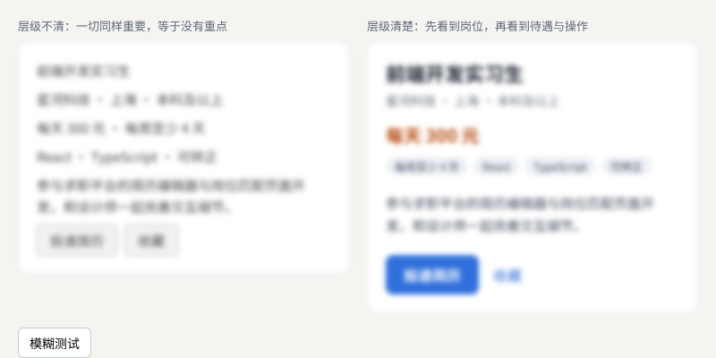

示例：[02-02-hierarchy.html](示例/02-02-hierarchy.html)

```css
body.blur .card { filter: blur(3px); }   /* 模糊测试：看不清文字时，还能分辨出哪些东西最重要吗？ */
```

#### 02.3 视觉重量与视觉重心

每个元素都有**视觉重量**：越大、越暗、颜色越饱和、形状越复杂，看起来越“重”。页面上所有元素的重量合起来，形成整个画面的**视觉重心**。重心偏向一侧时，画面显得失衡；可以用另一侧的元素平衡，或者有意让重心偏向需要强调的地方。

**留白**也是设计的一部分：周围空白越多，元素越突出。留白不是“剩下的空间”，而是被安排的停顿。

人眼怎样把靠近的、相似的元素看成一组，属于感知研究的范围，在[《感知与认知》](13-感知与认知.md)中详细展开。

#### 02.4 常见问题

- **每样东西都加粗、都用强调色**：等于什么都没强调。先决定唯一最重要的是什么。
- **层级之间差距太小**：14 像素与 15 像素看不出区别，层级要有明显的跳跃。
- **相关的内容离得远、不相关的离得近**：间距与分组矛盾，用户会误读关系。

**本章练习**：

1. 在 `02-02-hierarchy.html` 中，只改间距，不改字号和颜色，让左边的卡片也出现分组。
2. 对你自己的一个页面做模糊测试，写下模糊后最先看到的三样东西，判断它们是否是最重要的三样。

<a id="part-2"></a>

## 第二篇：八个方向

<a id="ch03"></a>

### 03 版式与构图

#### 03.1 解决什么问题

版式决定信息在页面上怎样排列：用什么网格、怎样对齐、节奏如何、是否平衡、内容有多密。顺序是：**先按内容建立分组，再决定分栏**——先想清楚哪些内容属于一起、谁先谁后，再决定放进几栏。

#### 03.2 网格、对齐、节奏、平衡与密度

- **网格**：把页面宽度分成若干等宽的栏（常用 12 栏，因为可以被 2、3、4、6 整除），栏与栏之间有固定的间距。元素的宽度和位置都对齐到栏上，页面就显得有秩序。
- **对齐**：元素的边缘对齐到同一条线上。对齐线越少，页面越整齐。
- **节奏**：间距、元素大小有规律地重复与变化。全部一样会单调，毫无规律会混乱。
- **视觉平衡**：左右、上下的视觉重量大致相当，或者有意打破以制造重点。
- **内容密度**：单位面积里的信息量。密度没有好坏，要与阅读方式匹配。

#### 03.3 三种页面，三种布局逻辑

长文、仪表盘和营销页面的信息量与阅读方式不同，需要各自的布局逻辑：

| 页面类型 | 阅读方式 | 布局逻辑 |
| --- | --- | --- |
| 长文 | 从头到尾连续阅读 | 正文栏较窄，控制每行字数；宽图、引文打破单调；密度低 |
| 仪表盘 | 扫视、比较、定位异常 | 密度高、对齐严格；相同的东西用相同的宽度；重要指标放左上 |
| 营销页面 | 先被吸引，再逐步了解，最后行动 | 第一屏的大标题与大图形成视觉重心；按“特点、证言、行动”的节奏向下展开 |

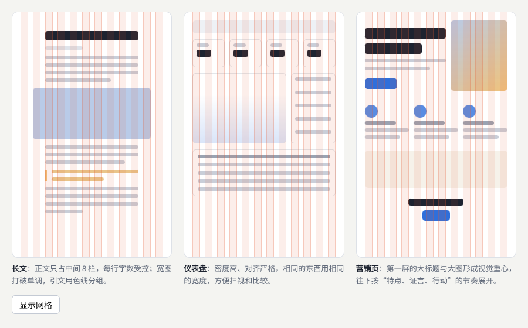

示例：[02-03-layouts.html](示例/02-03-layouts.html)（点击“显示网格”可以开关红色的栏线）

示例中的三个页面骨架都画在 12 栏网格上，用灰条表示文字、色块表示图片。打开栏线可以看到：每个元素的边缘都落在栏线上。

#### 03.4 常见问题

- **页面看起来“乱”**：对齐线太多，或者元素没有对齐到网格。打开网格叠加检查。
- **长文读起来累**：正文栏太宽，每行字数太多（见《前端界面工程》04 章的行长建议）。
- **仪表盘看起来“空”或“挤”**：密度与任务不匹配。监控类页面需要密集；面向新手的概览可以疏一些。

**本章练习**：

1. 在 `02-03-layouts.html` 中把长文的正文栏改为占 12 栏，比较阅读感受。
2. 找一个真实的营销页面，截图后在上面画出它的网格和主要的对齐线。

**继续深入**：模块化网格与基线网格；编辑设计中的版面节奏；响应式网格在不同宽度下的栏数变化（见[《前端界面工程》](01-前端界面工程.md) 03 章）。

<a id="ch04"></a>

### 04 字体设计与字体应用

#### 04.1 解决什么问题

字体是界面中占比最大的视觉元素。选择和搭配字体，要观察字形的气质、笔画、字面率和字重关系，安排标题、正文、注释与数字的搭配。关键是**让字体支持内容和品牌**。Google Fonts 的知识库用短文讲解了字体的基本概念。[B01](#ref-b01)

#### 04.2 字形的气质

| 类型 | 特征 | 气质 | 适合 |
| --- | --- | --- | --- |
| 黑体（无衬线） | 笔画粗细均匀，没有装饰 | 稳定、现代、清晰 | 界面文字、标题 |
| 宋体（衬线） | 横细竖粗，笔画末端有三角形的装饰（字脚） | 正式、有书卷气 | 长文、编辑设计、标题 |
| 楷体 | 保留书写的笔意 | 亲切、有手写感 | 引语、小面积点缀 |
| 拉丁字母的无衬线体 | 笔画均匀 | 现代、中性 | 界面、数字 |
| 拉丁字母的衬线体 | 笔画末端有衬线 | 传统、正式 | 长文、品牌 |
| 等宽字体 | 每个字符一样宽 | 技术感 | 代码、数据标签 |

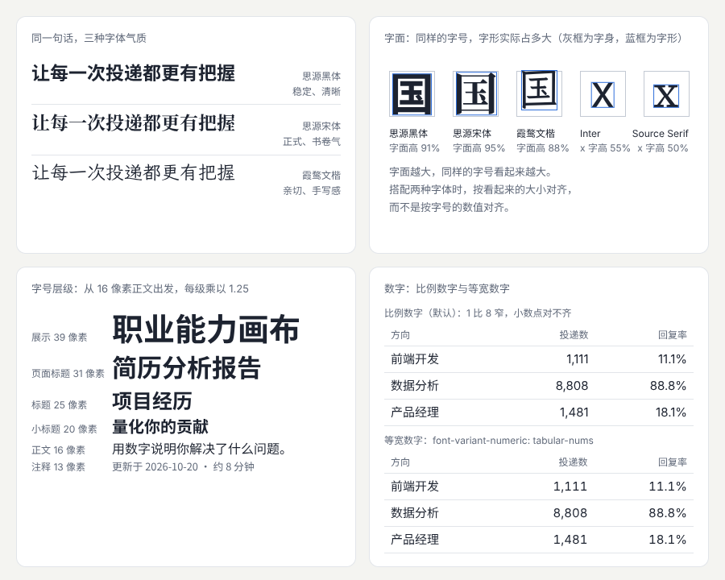

示例：[02-04-type.html](示例/02-04-type.html)

#### 04.3 字面率与 x 字高

每个汉字都画在一个正方形的“字身”里，字号就是字身的大小。但字形本身不会占满字身，字形实际占据的部分称为**字面**，字面与字身的比例称为**字面率**。字面率越大，同样的字号看起来越大。示例用画布测量了三种中文字体“国”字的字形高度：同样的字号，三种字体占字身的比例各不相同。

拉丁字母有类似的概念：**x 字高**，即小写字母 x 的高度与字号的比例。[B02](#ref-b02) x 字高大的字体，小字号下也容易看清。示例中 Inter 的 x 字高约为字号的 55%，Source Serif 约为 50%。

实际意义：**搭配两种字体时，按看起来的大小对齐，而不是按字号的数值对齐**。例如中文用思源黑体、英文用某款 x 字高较小的衬线字体，同样 16 像素时英文会显得偏小，可以给英文略微放大。

#### 04.4 标题、正文、注释与数字的搭配

- **字号层级**：从正文字号出发，每一级乘以一个固定的比例，例如 1.25：13、16、20、25、31、39 像素。比例固定，层级之间的差距就有规律。
- **字重关系**：通常两三种字重就够了，例如常规与粗体；用字号区分层级时，不必每一级都换字重。
- **一种还是两种字体**：一种字体用字号和字重区分层级，最稳妥；两种字体（例如宋体标题加黑体正文）对比更鲜明，要选择气质相配、字面率接近的组合。
- **数字**：表格中的数字使用**等宽数字**（`font-variant-numeric: tabular-nums`），每个数字一样宽，竖向才能对齐；在比例数字中，“1”比“8”窄，小数点会对不齐。[B03](#ref-b03) 正文中的数字通常用西文字体显示：把西文字体写在字体栈的前面，数字和字母会使用它，汉字回退到中文字体。

```css
body { font-family: Inter, "Noto Sans SC", sans-serif; }   /* 西文与数字用 Inter，汉字用思源黑体 */
.tnum td { font-variant-numeric: tabular-nums; }           /* 等宽数字：每个数字一样宽，竖向对齐 */
```

中文排版的标点、行长、断行等系统要求可以参考 W3C 的《中文排版需求》[B04](#ref-b04)；西文排版的基本规则可以参考《Practical Typography》。[B05](#ref-b05)

#### 04.5 横向延伸

- **中文字体**：了解黑体、宋体、楷体、仿宋等类型的历史与结构，注意商业字体的授权范围。
- **拉丁字体**：衬线、无衬线、几何、人文等分类，以及中西文混排时的搭配。
- **动态字体**：文字随时间变化的表达，以及可变字体的连续变化，见[《动效与时间设计》](04-动效与时间设计.md)。
- **编辑设计**：杂志式的版面，大标题、首字放大、栏与线的运用（12 章的“编辑设计”方向就是一例）。

#### 04.6 常见问题

- **中英文混排时英文显得太小或太大**：两种字体的字面率不同，按看起来的大小调整。
- **用了太多字体**：一个产品通常一两种字体就够了。
- **网络字体加载时文字跳动**：见[《前端界面工程》](01-前端界面工程.md) 04 章的字体加载方法。

**本章练习**：

1. 在 `02-04-type.html` 中把字号比例从 1.25 改为 1.2 和 1.333，比较层级的鲜明程度。
2. 为一个产品选一对标题与正文字体，写出选择理由，并在真实页面中检查中英文混排。

<a id="ch05"></a>

### 05 色彩系统

#### 05.1 解决什么问题

色彩系统要区分**品牌色、内容色、状态色、背景和交互强调**各自的用途。做法是**先建立颜色角色，再为不同主题选择具体的值**；同时结合亮度、对比和语义使用颜色，避免同一种颜色同时承担互相冲突的含义——例如品牌色恰好是红色，就不宜再用同样的红色表示“错误”。

#### 05.2 颜色角色

**颜色角色**是按用途给颜色命名：不说“蓝色”，而说“主操作”；不说“浅灰”，而说“分隔线”。Material Design 的色彩系统就是按角色组织的。[B06](#ref-b06)

| 角色 | 用途 |
| --- | --- |
| 背景、表面 | 页面底色、卡片底色 |
| 正文、次要文字 | 主要内容与辅助信息 |
| 分隔线 | 装饰性的分隔，不承担识别任务 |
| 控件边框 | 输入框等控件的边界，需要被看清 |
| 主操作 | 最重要的按钮与链接 |
| 成功、警示、错误 | 状态与反馈 |
| 品牌色 | 标志、品牌时刻、少量强调 |

按角色命名后，换主题、换品牌色时只要改每个角色对应的值，用到它的地方都会跟着变。

#### 05.3 用 OKLCH 生成色阶

一个角色常常需要同一色相的多个深浅，例如主按钮的常态、悬停、按下。把一种颜色从浅到深排成 10 级左右，称为**色阶**。

生成色阶时，推荐使用 **OKLCH** 色彩空间。它用三个数描述颜色：L 是明度，C 是彩度（鲜艳程度），H 是色相角度。[B07](#ref-b07) 它的优点是**明度符合人眼的感受**：两种颜色的 L 相同，看起来就差不多亮。常用的 HSL 做不到这一点——HSL 中“亮度”相同的黄色和蓝色，看起来亮度差别很大。所以用 OKLCH 时，只要每一级使用固定的明度，不同色相的色阶在同一级上亮度接近，对比度也更可预测。[B08](#ref-b08)

示例按固定的明度步长生成了品牌色、中性色和三种状态色的色阶，再把颜色角色映射到色阶的不同位置，形成浅色与深色两套主题，并逐项计算对比度：

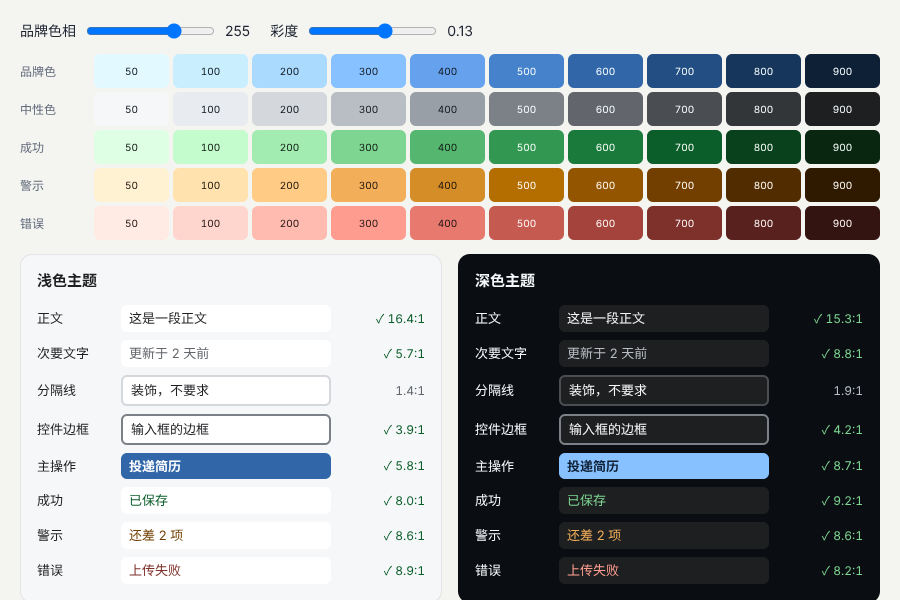

示例：[02-05-color.html](示例/02-05-color.html)（拖动滑块可以改变品牌色相与彩度，对比度实时重新计算）

```js
const STEPS = [50, 100, 200, 300, 400, 500, 600, 700, 800, 900];
const LIGHTNESS = [0.975, 0.94, 0.88, 0.80, 0.70, 0.60, 0.51, 0.42, 0.33, 0.24];   // 每一级固定的明度
const ramp = (h, c) => LIGHTNESS.map((L, i) => [L, c * Math.sin(Math.PI * (0.12 + 0.76 * i / 9)), h]);  // 两端彩度收小
```

#### 05.4 亮度、对比与主题

- **对比度要求**：正文与背景至少 4.5:1；输入框边框、图标、焦点指示等识别所需的图形至少 3:1；纯装饰的分隔线不要求。[B09](#ref-b09) 示例最初把同一种浅灰同时用作分隔线和输入框边框，自动检查显示只有 1.9:1——作为分隔线没问题，作为输入框边框不合格。于是把两者拆成两个角色，输入框边框改用更深的一级，达到 3.9:1。这正是“先定角色、再选值”的好处。
- **深色主题**不是简单的反色：同一个角色在深色主题中取色阶上的另一端。例如主按钮在浅色主题中用 600 级配白字，在深色主题中用 300 级配深色字。
- **不要只靠颜色传达信息**：有色觉差异的用户可能分不清红与绿。错误状态除了红色，还要有图标或文字说明。这是 WCAG 1.4.1 的要求。[B10](#ref-b10)

#### 05.5 常见问题

- **页面颜色太多太杂**：没有角色，每个地方单独选色。先定角色，再统一取值。
- **品牌色做按钮，白字看不清**：品牌色明度太高。为按钮另选色阶中更深的一级。
- **状态色在深色主题中太刺眼或看不清**：两套主题使用了同一个值。为深色主题单独映射。

**本章练习**：

1. 在 `02-05-color.html` 中把品牌色相改为 30（橙色），观察哪些角色的对比度不再合格，并调整映射使其合格。
2. 为你的产品写一张颜色角色表：角色、浅色主题的值、深色主题的值、对比度。

**继续深入**：色彩空间与广色域显示；`color-mix()` 与相对颜色语法；数据可视化中的分类、顺序与发散配色（见 10 章）；色觉差异模拟（开发者工具的“渲染”面板）。

<a id="ch06"></a>

### 06 图标与符号

#### 06.1 解决什么问题

一套图标要统一**线宽、视角、圆角、细节密度和视觉重量**，看起来才像同一个家族。还要研究用户能否识别图标的含义，为含义模糊的符号提供文字标签；小尺寸的图标需要专门检查，细节在缩小时可能丢失。

#### 06.2 一致的一套图标

图标通常画在一个固定的网格中，例如 24 × 24，四周留出一点边距，再约定：

| 项目 | 约定的例子 |
| --- | --- |
| 线宽 | 统一 2 像素 |
| 端点与拐角 | 统一圆头、圆角 |
| 填充 | 统一为线框，或者统一为实心；选中状态可以改为实心 |
| 视角 | 统一为正面平视，不混入带透视的立体图标 |
| 细节密度 | 每个图标的线条数量相近，视觉重量一致 |

Material Design 的图标设计指南详细说明了网格、关键线与线宽的做法。[B11](#ref-b11)

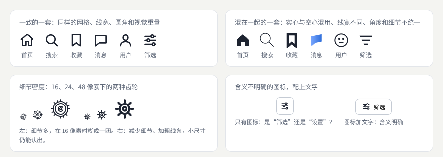

示例：[02-06-icons.html](示例/02-06-icons.html)

```css
.line { fill: none; stroke: currentColor; stroke-width: 2; stroke-linecap: round; stroke-linejoin: round; }
```

示例中的图标都用 `currentColor` 作为线条颜色，图标会自动使用所在文字的颜色，换主题时不必单独修改。

#### 06.3 小尺寸与可识别性

- **细节密度**：同一个图标在 48 像素下好看，在 16 像素下可能糊成一团。小尺寸使用的图标要减少细节、加粗线条，必要时单独绘制一个小尺寸版本。
- **可识别性**：放大镜表示搜索、房子表示首页这类符号大多数人都认识；“筛选”“设置”“分享”等符号容易混淆。含义不确定时，**图标加文字**；只有图标的按钮也要有可读的名称（见《前端界面工程》09 章）。
- **文化差异**：同一个符号在不同文化中含义可能不同，见[《包容、国际化与多感官》](16-包容国际化与多感官.md)。

**本章练习**：

1. 在 `02-06-icons.html` 中按同样的规则增加“下载”和“分享”两个图标。
2. 把你的产品中所有图标排在一页上，检查线宽、圆角、填充和视觉重量是否一致。

**继续深入**：图标的光学校正（圆形要比方形略大才显得一样大）；图标字体与 SVG 图标的取舍；可变图标（线宽与填充可以连续变化）。

<a id="ch07"></a>

### 07 摄影与图像编排

#### 07.1 解决什么问题

选择图片时要考虑**主题、光线、裁切、视线方向和色调**是否协调。还要提前设计不同屏幕下的裁切方式，保护主体和关键信息。不同类型的图片承担不同的表达任务：

| 类型 | 表达任务 | 编排要点 |
| --- | --- | --- |
| 产品截图 | 说明产品能做什么 | 内容真实、清晰，放大关键区域，避免过小看不清 |
| 人物摄影 | 建立信任与情感连接 | 真实自然；人物的视线方向会引导读者的视线 |
| 氛围图片 | 营造气质 | 色调与品牌一致，不与文字争夺注意 |

Material Design 的图像指南讨论了不同类型图片的用法。[B12](#ref-b12)

#### 07.2 按主体裁切

同一张图片在不同比例的容器中会被裁掉不同的部分。默认的居中裁切可能把主体切掉。CSS 的 `object-position` 可以指定裁切时保留的位置。[B13](#ref-b13) 示例中，人物站在图片横向约 78% 的位置：4:5 的竖图居中裁切时，人物被切掉了一半；按主体位置裁切后，人物完整地留在画面中。

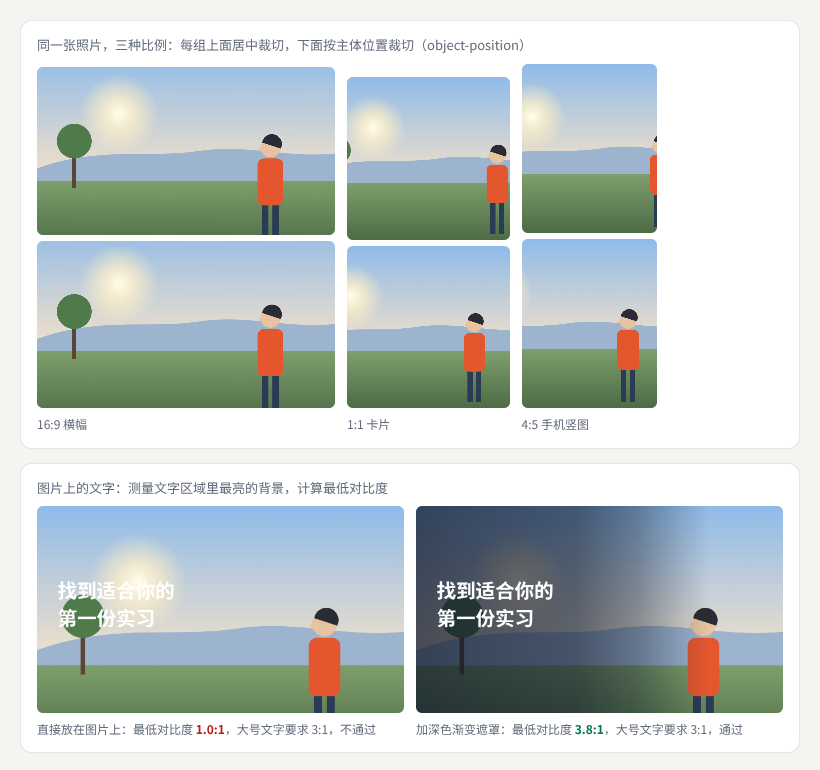

示例：[02-07-crop.html](示例/02-07-crop.html)

```css
.r45 { aspect-ratio: 4 / 5; object-fit: cover; }
.focal { object-position: 78% 60%; }      /* 主体大约在图片横向 78%、纵向 60% 的位置 */
```

需要完全不同的构图时（例如宽屏用横图、手机用另一张竖图），可以用 `<picture>` 按屏幕宽度提供不同的图片文件。[B14](#ref-b14)

**视线方向**也是编排的一部分：图中人物看向哪边，读者的视线就会跟过去。示例中人物面朝左，所以标题放在左侧，视线自然地从人物引到文字上。

#### 07.3 图片上的文字

在图片上放文字，最常见的问题是看不清。正确的检查方法是：**测量文字区域里最亮（或最暗）的背景**，计算最低对比度。示例在画布上取文字区域的全部像素，找出最亮的一个，与白字计算对比度：

- 直接放在图片上：文字正好落在太阳的光晕上，最低对比度只有 1.0:1，完全不合格。
- 加深色渐变遮罩：最初的遮罩只盖住了文字区域的左半边，测量结果仍只有 1.8:1；把遮罩加深并延长到文字区域的末端，同时在人物之前完全变透明、不压暗主体，最低对比度达到 3.8:1，满足大号文字 3:1 的要求。

这个过程说明：凭眼睛“看起来还行”不可靠，要用最差的位置来检查。其他办法还有：把文字放在图片中较平静的区域、给文字加一块半透明底板、换一张图片。

#### 07.4 常见问题

- **同一页面的图片比例、色调各不相同**：没有图片规则。约定比例、色调与主体位置（11 章）。
- **产品截图在手机上看不清**：截图里的文字太小。截取关键区域放大，或者改用示意图。
- **素材来源不明**：使用前核对授权；记录来源与使用条件。

**本章练习**：

1. 在 `02-07-crop.html` 中把人物移到图片左侧，调整 `object-position` 与文字位置。
2. 为你的产品定一份图片规则：比例、主体位置、色调、文字叠加方式、缺失时的占位。

<a id="ch08"></a>

### 08 插画与图形语言

#### 08.1 解决什么问题

插画与图形能形成独特的**图形语言**：几何、手绘、拼贴、纸感、三维插画、纹理……把它应用到空状态、引导、专题和品牌识别中，产品就有了自己的面貌。要检查的是：图形语言与正文、交互组件是否协调。

#### 08.2 示例：同一个空状态的三种画法

示例把“还没有收藏的资源”这个空状态画成三种图形语言，并且让标题、正文和按钮也随之调整：

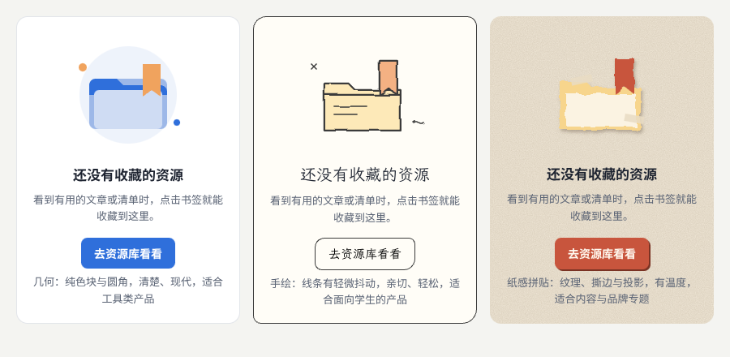

示例：[02-08-illustration.html](示例/02-08-illustration.html)

| 图形语言 | 做法 | 气质 | 适合 |
| --- | --- | --- | --- |
| 几何 | 纯色块、圆与圆角矩形 | 清楚、现代 | 工具类产品 |
| 手绘 | 线条有轻微的抖动，配楷体标题和不规则圆角 | 亲切、轻松 | 面向学生、新手的产品 |
| 纸感拼贴 | 纸张颗粒、撕边、胶带与投影 | 有温度 | 内容专题、品牌活动 |

手绘的抖动和纸张的颗粒都是用 SVG 滤镜生成的：`feTurbulence` 产生连续的随机噪声，`feDisplacementMap` 用噪声让图形的边缘轻微错位，于是直线变成了“手画的线”、整齐的边变成了“撕开的边”。[B15](#ref-b15)

```html
<filter id="wobble">
  <feTurbulence type="fractalNoise" baseFrequency="0.03" numOctaves="2" seed="3"/>
  <feDisplacementMap in="SourceGraphic" scale="4"/>
</filter>
```

#### 08.3 让图形语言与界面协调

- **一致**：同一产品的插画使用同一种语言、同一组颜色、同样的线宽。
- **克制**：插画用在空状态、引导、专题页等“停顿”的地方，不要放进需要高效操作的表单和表格。
- **随之调整**：插画风格变化时，标题字体、按钮形状、圆角也要相应调整，示例中三张卡片的按钮各不相同。
- **三维插画**：用三维工具制作的插画质感更强，制作与修改成本也更高，见[《三维内容与空间设计》](06-三维内容与空间设计.md)。

**本章练习**：

1. 为“加载失败”状态画一张同样三种风格的插画。
2. 在 `02-08-illustration.html` 中修改 `feDisplacementMap` 的 `scale`，观察抖动程度与“手绘感”的关系。

**继续深入**：插画系统的规范（角色比例、线宽、配色）；用代码生成图形语言（见[《创意编程与二维图形》](05-创意编程与二维图形.md)）；插画的无障碍处理（装饰性插画对读屏软件隐藏，传达信息的插画提供文字说明）。

<a id="ch09"></a>

### 09 品牌识别与艺术方向

#### 09.1 解决什么问题

品牌识别要把品牌希望传达的特征，转化为**字体、色彩、图像、声音和运动**的规则。做法是建立多种概念方案，通过实际页面比较，而不是只比较标志和色板。品牌的一致性需要允许内容变化，同时保留核心的识别特征。

#### 09.2 从品牌特征到具体规则

先用几个形容词描述品牌，再把每个形容词翻译成可执行的规则：

| 品牌特征 | 字体 | 色彩 | 图像 | 声音 | 运动 |
| --- | --- | --- | --- | --- | --- |
| 可靠 | 稳定的黑体，层级清楚 | 沉稳的蓝，强调色克制 | 真实的产品截图 | 简短、柔和的提示音 | 平稳、不夸张 |
| 亲切 | 楷体或圆润的黑体 | 暖色，明度较高 | 手绘插画、自然的人物 | 轻快的音效 | 带一点弹性 |
| 专业 | 宋体标题，严格的网格 | 黑、白与一种点缀色 | 黑白或低饱和的摄影 | 几乎不用声音 | 精确、快速 |

形容词本身无法执行，翻译成规则后才能指导每一个页面。声音与运动同样属于品牌：提示音、按钮按下时的反馈节奏，都会让人感受到不同的性格，分别在[《包容、国际化与多感官》](16-包容国际化与多感官.md)和[《动效与时间设计》](04-动效与时间设计.md)中展开。

#### 09.3 核心识别与可变部分

一个品牌系统可以分成两部分：

- **核心识别**：标志、主色、主字体、一两个标志性的形状或图形元素。任何页面都保留它们。
- **可变部分**：插画主题、版面、配图、辅助色。随内容与场景变化。

核心太多，系统僵硬；核心太少，品牌认不出。检验方法是：遮住标志，用户还能认出这是哪个产品吗？成熟的设计系统会把这些规则写成文档，例如英国政府的设计系统用统一的字体、颜色、组件与写作规范，让上百个服务看起来像同一个整体。[B16](#ref-b16)

#### 09.4 概念方案与艺术方向

**艺术方向**是统筹字体、图像、颜色、材质、灯光、声音和运动，让它们共同表达一个整体。做法：

1. 写一页**方向说明**：希望传达什么、面向谁、哪些内容最重要。
2. 为每个方向做一张**方向板**（也称情绪板）：收集字体、颜色、图片、质感的参考，并写明每一项借鉴的具体地方。
3. 用**真实页面**比较方向：同一份内容，分别做成每个方向的首页、详情和空状态（12 章）。
4. 选择一个方向，写成规则（11 章）。

艺术指导的理论与方法在[《美学与艺术指导》](14-美学与艺术指导.md)中展开。

<a id="ch10"></a>

### 10 信息与数据设计

#### 10.1 解决什么问题

数据图形要根据**任务**选择：是比较、看趋势、看分布，还是看关联。图表的标签、单位、来源和不确定性要清楚；装饰应当帮助辨认信息，而不是喧宾夺主。这一方向可以继续深入地图、科学可视化和交互解释，见[《信息、数据与空间》](15-信息数据与空间.md)。

#### 10.2 按任务选择图表

| 任务 | 回答的问题 | 常用图表 |
| --- | --- | --- |
| 比较 | 哪个多、哪个少 | 排序的条形图 |
| 趋势 | 随时间怎样变化 | 折线图 |
| 分布 | 数值集中在哪里、分散程度如何 | 直方图、点图、箱线图 |
| 关联 | 两个量是否一起变化 | 散点图 |

英国《金融时报》的“视觉词汇表”按任务列出了常用图表，适合在选择时对照。[B17](#ref-b17)

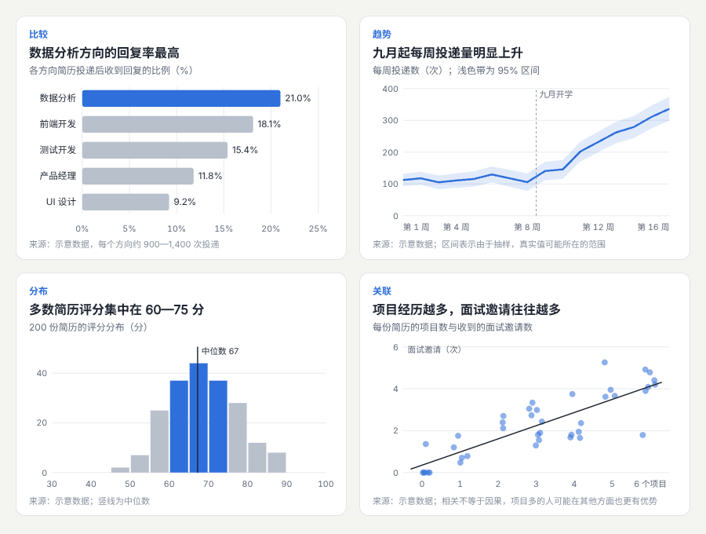

示例：[02-10-charts.html](示例/02-10-charts.html)（示意数据，使用固定的随机种子生成）

#### 10.3 让图表说清楚

示例的四张图遵循同样的规则：

- **标题写结论**：“数据分析方向的回复率最高”，而不是“各方向回复率”。读者先知道该看什么。
- **副标题写清测量什么和单位**：“各方向简历投递后收到回复的比例（%）”。
- **注明来源与样本**：图下写出数据来源；示意数据要明确标为示意。
- **强调色只给要点**：条形图中只有最高的一项用强调色，其余用灰色；直方图中只突出 60—75 分的区间。
- **直接标注**：在条形末端直接写出数值，省去读者对照坐标轴的麻烦。
- **表达不确定性**：趋势图的浅色带表示 95% 区间——由于抽样，真实值可能所在的范围。只画一条线，会让读者误以为数字是精确的。[B18](#ref-b18)
- **说明限制**：散点图的注释提醒“相关不等于因果”：项目多的人可能在其他方面也更有优势。

#### 10.4 视觉编码的准确程度

人眼判断不同视觉属性的准确程度不同：比较同一基线上的位置最准确，长度其次，角度、面积、颜色深浅较差。所以需要精确比较时优先用条形图，而不是饼图或气泡图。这一结论来自 Cleveland 与 McGill 的图形感知实验。[B19](#ref-b19)

**本章练习**：

1. 把示例中的条形图改成饼图，比较读出“前端开发比测试开发高多少”的难度。
2. 找一张新闻中的图表，按 10.3 的规则逐项检查，写出修改建议。

**继续深入**：交互式图表的筛选与联动（见[《创意编程与二维图形》](05-创意编程与二维图形.md) 08 章）；分类、顺序、发散三类配色；地图与科学可视化（见[《信息、数据与空间》](15-信息数据与空间.md)）。

<a id="part-3"></a>

## 第三篇：规则、实战与积累

<a id="ch11"></a>

### 11 一套可用于起步的视觉规则

#### 11.1 为什么需要规则

没有规则时，每个页面都在重新决定间距、字号和颜色，越做越不一致。下面这套数值用于搭建第一版基线，之后要根据**内容、字体、阅读距离和设备**调整。其中对比度和点击目标三项来自 WCAG 2.2 的 AA 级成功准则，属于可访问性的底线，不宜随意放宽。[B09](#ref-b09)

| 项目 | 起步示例 | 调整依据 |
| --- | --- | --- |
| 间距 | 以 4 或 8 像素为基础，常用 8、16、24、32 | 分组关系、内容密度与触摸操作 |
| 字体层级 | 正文约 16 像素，小标题约 20—24，页面标题约 32—40 | 字体实际字面、页面用途与响应式 |
| 行高 | 正文先尝试约 1.5—1.8 倍 | 语言、行长与阅读任务 |
| 色彩角色 | 背景、内容、边界、主操作、成功、警示、错误 | 对比、语义与主题 |
| 文字对比 | 正文与背景至少 4.5:1；大号文字（约 24 像素常规字重或 18.7 像素粗体以上）至少 3:1 | WCAG 2.2 AA 的 1.4.3；背景图片与主题切换时重新检查 |
| 非文字对比 | 图标、输入框边界、焦点指示等识别所需的图形至少 3:1 | WCAG 2.2 AA 的 1.4.11；状态不能只靠颜色区分 |
| 点击目标 | 一般不小于 24 × 24 CSS 像素，或与相邻目标保持足够间距 | WCAG 2.2 AA 的 2.5.8；触屏主要操作通常留出更大区域 |
| 圆角 | 为小控件、卡片、弹窗建立少量规则 | 品牌形态与层级 |
| 阴影 | 按悬浮层级建立少量预设 | 背景、叠层和设备效果 |
| 动效 | 小反馈可先在约 150—300 毫秒范围试验 | 距离、输入方式与理解需求 |
| 图像 | 约定比例、主体位置和缺失状态 | 内容题材与屏幕裁切 |

#### 11.2 把规则写成变量

规则要落实到代码中，最直接的办法是写成 CSS 变量（也称**设计令牌**），页面中的数值只能从这些变量中取：

```css
:root {
  --space-1: 4px; --space-2: 8px; --space-4: 16px; --space-5: 24px; --space-6: 32px;
  --text-body: 16px; --text-h3: 20px; --text-h2: 24px; --text-h1: 32px; --leading-body: 1.7;
  --color-text: #1d2330; --color-border: #8a93a3; --color-primary: #2f6fdb;
  --radius-control: 6px; --radius-card: 10px; --radius-dialog: 14px;
  --shadow-1: 0 1px 2px rgba(16, 24, 40, .08);
  --duration-fast: 150ms;
}
```

示例把整套规则做成了一页可以直接看见的规则表，颜色的对比度从实际样式中读出计算；右下角的卡片只使用这些变量搭建：

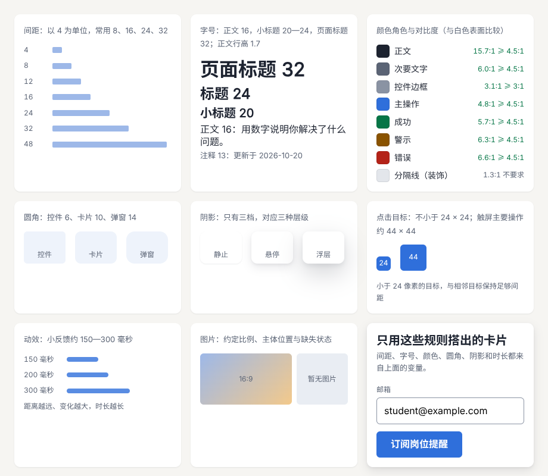

示例：[02-11-tokens.html](示例/02-11-tokens.html)

阴影只有三档，分别对应静止、悬停与浮层三种层级；层级越高，阴影越大越柔和。Material Design 的层级说明讨论了阴影与层级的对应关系。[B20](#ref-b20) 设计令牌的命名、分层与在团队中的维护，在[《计算设计与创作工具》](11-计算设计与创作工具.md)中展开。

#### 11.3 用真实内容检查规则之间的关系

规则之间会相互影响：字号增大后，行长和布局密度可能需要一起调整；图片变化后，文字的对比与位置也可能需要重新安排。规则应当允许合理的例外，并**记录例外的原因**，否则例外会慢慢变成新的混乱。

<a id="ch12"></a>

### 12 综合项目：同一产品的三种视觉方向

#### 12.1 目标与验收

为同一个产品做**简约、编辑设计、科技**三种视觉方向，每种方向提供首页、详情页和空状态。**固定内容，只改变视觉组织**。比较文字是否易读、主次是否明确、素材是否统一、不同页面是否保留识别特征。最终选择一个方向，写出颜色角色、字体层级、间距和图片规则。

示例中的三种方向使用完全相同的 HTML 结构和文字，区别只在一组 CSS 变量和少量规则：

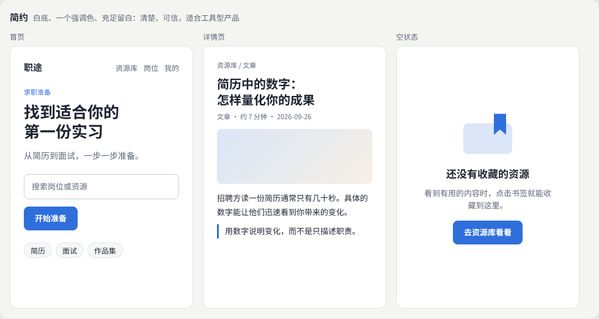

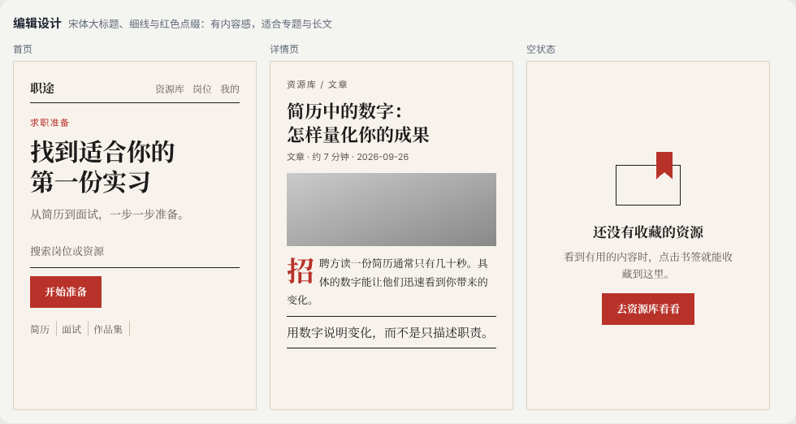

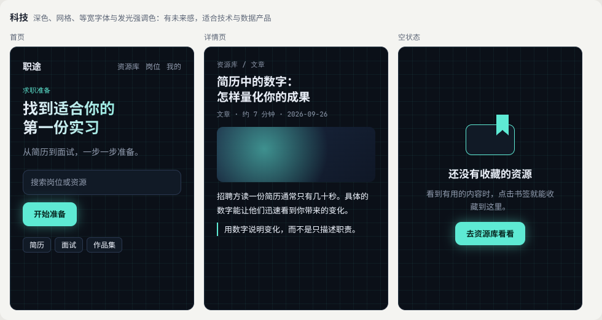

示例：[02-12-directions.html](示例/02-12-directions.html)

```css
/* 三种方向共用同一份结构，只通过变量和少量规则区分 */
[data-dir="minimal"]   { --bg: #ffffff; --accent: #2f6fdb; --title-font: "Noto Sans SC", sans-serif; --radius: 8px; }
[data-dir="editorial"] { --bg: #f7f3ec; --accent: #b8322a; --title-font: "Noto Serif SC", serif; --radius: 0; }
[data-dir="tech"]      { --bg: #0b1018; --accent: #5eead4; --label-font: "JetBrains Mono", monospace; --radius: 10px; }
```

制作过程中，三个首页的标题最初都断在了词语中间（“第一份／实习”“第一／份实习”“实／习”）。字体、字号和栏宽一变，断行位置就跟着变。用《前端界面工程》04 章的方法——`word-break: keep-all` 加 `<wbr>`——让标题只在“找到适合你的”之后换行，三个方向就都正确了。视觉方向的比较必须在真实页面中进行，才会发现这类问题。

#### 12.2 比较与取舍

| 检查项 | 简约 | 编辑设计 | 科技 |
| --- | --- | --- | --- |
| 文字是否易读 | 最易读 | 宋体正文适合长文，界面小字略弱 | 深色背景上的长文较累 |
| 主次是否明确 | 明确，强调色只用在按钮 | 明确，靠字号与细线 | 明确，靠发光与渐变 |
| 素材是否统一 | 柔和的渐变图片 | 黑白图片 | 深色抽象图形 |
| 不同页面是否保留识别特征 | 蓝色与圆角 | 宋体、细线、红色 | 网格、等宽字体、青绿色 |
| 适合的场景 | 工具型产品、日常使用 | 专题、长文、内容品牌 | 技术与数据产品、活动页 |

#### 12.3 交付物

- **方向板**：每个方向的字体、颜色、图片与质感参考，写明借鉴点。
- **三个页面组**：每个方向的首页、详情页、空状态。
- **取舍说明**：12.2 的比较表，以及选择的理由。
- **选定方向的规则**：颜色角色、字体层级、间距、图片规则（11 章的格式）。
- **评审记录**：请他人描述每个方向给人的感受，与设计意图对照。

<a id="ch13"></a>

### 13 把审美练习变成可积累的材料

#### 13.1 每周分析少量好页面

审美能力靠持续的观察积累。每周选择少量高质量的页面，按固定的格式记录。只保存截图，过几个月就不记得当初为什么觉得它好；写明**值得学习的具体地方**，以后才能迁移到自己的作品中。

```text
页面：名称与地址
来源与授权：截图仅供个人学习；素材与代码的使用条件
内容目的：这个页面要让谁完成什么
版式骨架：几栏网格、主要分区、阅读路径
字体关系：用了哪些字体，字号与字重的层级
图片处理：比例、裁切、色调、文字与图片的关系
值得学习的具体地方：一到三条，写成可以执行的规则
可以怎样用在我的项目中：一句话
```

#### 13.2 同一份内容做两种风格

练习时固定内容，只改变视觉：同一篇文章做成简约风格和编辑设计风格，比较各自适合的场景。固定内容可以排除“内容本身更好”的干扰，让你看清视觉选择本身带来的差别。12 章的项目就是这个练习的完整版本。

#### 13.3 建立参考库

把分析记录按主题整理成参考库：版式、字体搭配、配色、图标、插画、数据图形。每条记录都有来源和借鉴点。参考库是你的视觉词汇表，做新项目时先从中查找，而不是每次从零开始。

<a id="ch14"></a>

### 14 继续深入与学习路线

#### 14.1 八个方向的纵向深入

| 方向 | 入门 | 进阶 | 深入 |
| --- | --- | --- | --- |
| 版式与构图 | 网格与对齐 | 不同页面类型的布局逻辑 | 编辑设计、版面节奏 |
| 字体 | 字体类型与层级 | 字面与搭配、数字处理 | 字体设计、动态字体 |
| 色彩系统 | 颜色角色 | OKLCH 色阶、深色主题 | 数据配色、品牌色彩系统 |
| 图标与符号 | 统一的线宽与圆角 | 小尺寸与可识别性 | 图标系统、光学校正 |
| 摄影与图像 | 比例与裁切 | 按主体裁切、图片上的文字 | 艺术指导、拍摄方案 |
| 插画与图形语言 | 一种风格的空状态 | 风格与组件的协调 | 插画系统、程序化图形 |
| 品牌识别 | 品牌特征与规则 | 核心识别与可变部分 | 完整的品牌系统 |
| 信息与数据设计 | 按任务选择图表 | 标注、不确定性、强调 | 交互图表、地图、科学可视化 |

#### 14.2 横向连接

- 把规则落实为代码与组件：[《前端界面工程》](01-前端界面工程.md)。
- 让视觉规则支撑完整的任务流程：[《产品交互与用户体验》](03-产品交互与用户体验.md)。
- 设计令牌与设计系统的维护：[《计算设计与创作工具》](11-计算设计与创作工具.md)。
- 视觉分组与注意的原理：[《感知与认知》](13-感知与认知.md)。
- 风格史、叙事与艺术指导：[《美学与艺术指导》](14-美学与艺术指导.md)。
- 常见视觉效果的实现：[《常见视觉效果拆解》](19-常见视觉效果拆解.md)。

#### 14.3 下一步

1. 完成 12 章的三种方向，选定一个并写出规则。
2. 开始每周的页面分析，坚持一个月后回顾自己的参考库。
3. 用选定的规则做一个完整的多页面作品（首页、列表、详情、表单），检查规则能否支持不同的内容。

<a id="appendix-a"></a>

## 附录 A：术语表

| 术语 | 含义 | 阅读位置 |
| --- | --- | --- |
| 视觉层级 | 页面各部分被看到的先后顺序 | 02 |
| 模糊测试 | 把页面模糊后检查哪些元素仍然突出 | 02 |
| 视觉重量 | 元素看起来的“分量”，由大小、明暗、饱和度等决定 | 02 |
| 视觉重心 | 画面整体重量的中心 | 02 |
| 留白 | 被有意安排的空白 | 02 |
| 网格 | 把页面分成等宽栏的结构 | 03 |
| 节奏 | 间距与大小有规律的重复与变化 | 03 |
| 内容密度 | 单位面积中的信息量 | 03 |
| 字身 | 汉字所在的正方形，大小等于字号 | 04 |
| 字面、字面率 | 字形实际占据的部分，及其与字身的比例 | 04 |
| x 字高 | 小写字母 x 的高度与字号的比例 | 04 |
| 字号比例 | 相邻两级字号之间的固定倍数 | 04 |
| 等宽数字 | 每个数字宽度相同，便于竖向对齐 | 04 |
| 颜色角色 | 按用途给颜色命名，例如主操作、错误 | 05 |
| 色阶 | 同一色相从浅到深的一组颜色 | 05 |
| OKLCH | 用明度、彩度、色相描述颜色、明度符合人眼感受的色彩空间 | 05 |
| 对比度 | 两种颜色亮度的差异，正文至少 4.5:1 | 05、11 |
| 视觉重量（图标） | 图标看起来的轻重，取决于线宽与细节 | 06 |
| 细节密度 | 图标中线条与细节的多少 | 06 |
| 焦点裁切 | 按主体位置而不是中心裁切图片 | 07 |
| 遮罩 | 叠在图片上、帮助文字看清的半透明层 | 07 |
| 图形语言 | 一套统一的图形风格，例如几何、手绘、拼贴 | 08 |
| 品牌识别 | 让人认出品牌的字体、色彩、图形等特征 | 09 |
| 艺术方向 | 统筹各种表达手段，形成整体的风格 | 09 |
| 方向板 | 收集某个视觉方向参考的展示板，也称情绪板 | 09 |
| 不确定性 | 数据可能的误差范围，例如 95% 区间 | 10 |
| 设计令牌 | 保存设计决定的有名变量 | 11 |

<a id="appendix-b"></a>

## 附录 B：资料入口

以下资料用于核对方法来源和继续学习。资料核对日期：2026-10-25。

<a id="ref-b01"></a>
**B01 · Google Fonts 知识库。** [Google Fonts Knowledge](https://fonts.google.com/knowledge)。对应 04 章，字体的基本概念与搭配方法。

<a id="ref-b02"></a>
**B02 · Google Fonts 术语表：x 字高。** [x-height](https://fonts.google.com/knowledge/glossary/x_height)。对应 04 章。

<a id="ref-b03"></a>
**B03 · MDN：font-variant-numeric。** [font-variant-numeric](https://developer.mozilla.org/en-US/docs/Web/CSS/Reference/Properties/font-variant-numeric)。对应 04 章，等宽数字与比例数字。

<a id="ref-b04"></a>
**B04 · W3C：中文排版需求。** [Requirements for Chinese Text Layout](https://www.w3.org/TR/clreq/)。对应 04 章，中文的字体、标点与排版要求。

<a id="ref-b05"></a>
**B05 · Matthew Butterick：Practical Typography。** [Practical Typography](https://practicaltypography.com/)。对应 04 章，西文排版的实用规则。

<a id="ref-b06"></a>
**B06 · Material Design 3：颜色角色。** [Color roles](https://m3.material.io/styles/color/roles)。对应 05 章，按角色组织的色彩系统。

<a id="ref-b07"></a>
**B07 · MDN：oklch()。** [oklch()](https://developer.mozilla.org/en-US/docs/Web/CSS/Reference/Values/color_value/oklch)。对应 05 章，OKLCH 颜色的写法。

<a id="ref-b08"></a>
**B08 · Evil Martians：为什么改用 OKLCH。** [OKLCH in CSS: why we moved from RGB and HSL](https://evilmartians.com/chronicles/oklch-in-css-why-quit-rgb-hsl)。对应 05 章，OKLCH 与 HSL 的比较，以及用它生成色阶的方法。

<a id="ref-b09"></a>
**B09 · W3C：WCAG 2.2 快速参考。** [How to Meet WCAG (Quick Reference)](https://www.w3.org/WAI/WCAG22/quickref/)。对应 05、11 章，对比度与目标尺寸等成功准则。

<a id="ref-b10"></a>
**B10 · W3C：理解 WCAG 1.4.1 颜色的使用。** [Understanding Use of Color](https://www.w3.org/WAI/WCAG22/Understanding/use-of-color.html)。对应 05 章，不只靠颜色传达信息。

<a id="ref-b11"></a>
**B11 · Material Design 3：设计图标。** [Designing icons](https://m3.material.io/styles/icons/designing-icons)。对应 06 章，图标的网格、关键线与线宽。

<a id="ref-b12"></a>
**B12 · Material Design：图像。** [Imagery](https://m2.material.io/design/communication/imagery.html)。对应 07 章，不同类型图片的用法。

<a id="ref-b13"></a>
**B13 · MDN：object-position。** [object-position](https://developer.mozilla.org/en-US/docs/Web/CSS/Reference/Properties/object-position)。对应 07 章，指定裁切时保留的位置。

<a id="ref-b14"></a>
**B14 · MDN：响应式图片。** [Responsive images](https://developer.mozilla.org/en-US/docs/Web/HTML/Guides/Responsive_images)。对应 07 章，用 `picture` 为不同屏幕提供不同构图。

<a id="ref-b15"></a>
**B15 · MDN：feTurbulence。** [feTurbulence](https://developer.mozilla.org/en-US/docs/Web/SVG/Reference/Element/feTurbulence)。对应 08 章，用 SVG 滤镜生成噪声与纹理。

<a id="ref-b16"></a>
**B16 · GOV.UK 设计系统。** [GOV.UK Design System](https://design-system.service.gov.uk/)。对应 09 章，用统一的规则让大量服务保持一致的例子。

<a id="ref-b17"></a>
**B17 · 《金融时报》：视觉词汇表。** [Visual Vocabulary](https://ft-interactive.github.io/visual-vocabulary/)。对应 10 章，按任务列出的图表类型。

<a id="ref-b18"></a>
**B18 · Claus O. Wilke：数据可视化基础。** [Fundamentals of Data Visualization](https://clauswilke.com/dataviz/)。对应 10 章，图表选择、配色与不确定性的可视化，全书可在线阅读。

<a id="ref-b19"></a>
**B19 · Cleveland 与 McGill：图形感知。** [Graphical Perception: Theory, Experimentation, and Application to the Development of Graphical Methods](https://doi.org/10.1080/01621459.1984.10478080)。对应 10 章，比较不同视觉属性的判断准确程度。

<a id="ref-b20"></a>
**B20 · Material Design 3：层级。** [Elevation](https://m3.material.io/styles/elevation/overview)。对应 11 章，阴影与层级的关系。

<a id="appendix-c"></a>

## 附录 C：与原手册的对应关系及修订记录

### C.1 与原手册的对应关系

本册由原《前端与 UI／UX 设计进阶全景手册》第 04 章“视觉设计与品牌表达”扩写而成，并吸收了其他章节中的相关内容：

| 原手册内容 | 本册位置 |
| --- | --- |
| 4.1 研究对象与先修要求 | 01、02 章 |
| 4.2 分支 1：版式与构图 | 03 章 |
| 4.2 分支 2：字体设计与字体应用 | 04 章 |
| 4.2 分支 3：色彩系统 | 05 章 |
| 4.2 分支 4：图标与符号 | 06 章 |
| 4.2 分支 5：摄影与图像编排 | 07 章 |
| 4.2 分支 6：插画与图形语言 | 08 章 |
| 4.2 分支 7：品牌识别与艺术方向 | 09 章 |
| 4.2 分支 8：信息与数据设计 | 10 章 |
| 4.3 把审美练习变成可积累的材料 | 13 章 |
| 4.4 练习与验收：三种视觉方向 | 12 章 |
| 2.3 学习阶段 S1：视觉品质 | 01 章 |
| 23.2 一套可用于起步的视觉规则 | 11 章 |

### C.2 修订记录

| 版本 | 日期 | 主要变化 |
| --- | --- | --- |
| 1.0 | 2026-10-25 | 初版：由原手册第 04 章扩写，新增 10 个可运行示例与截图 |
