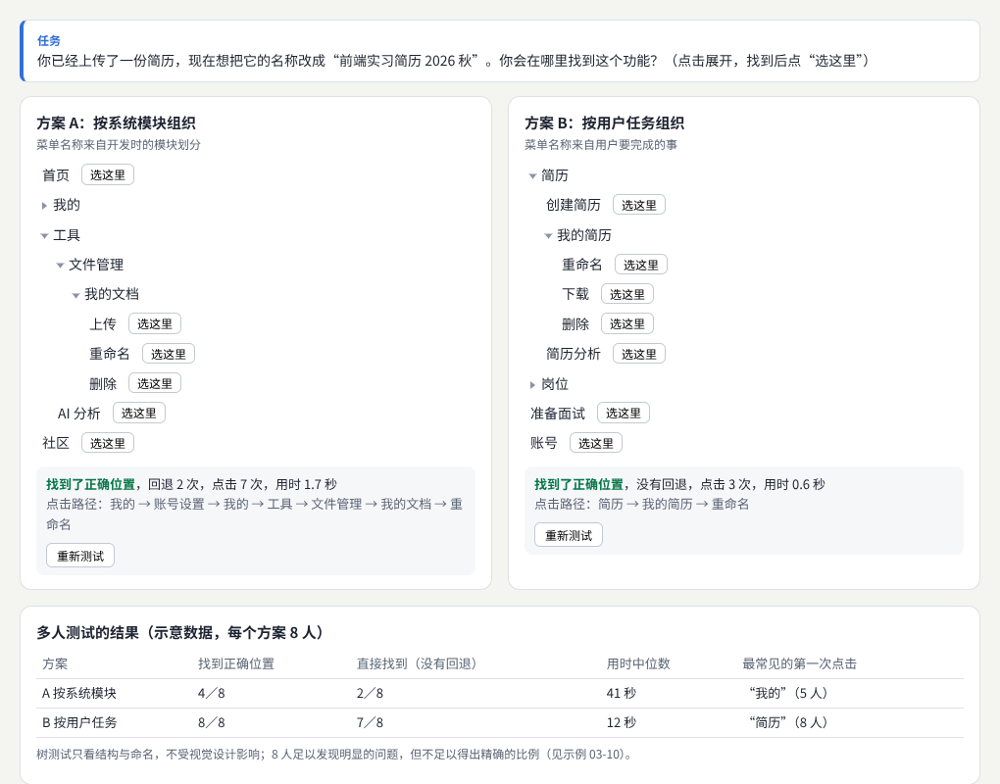
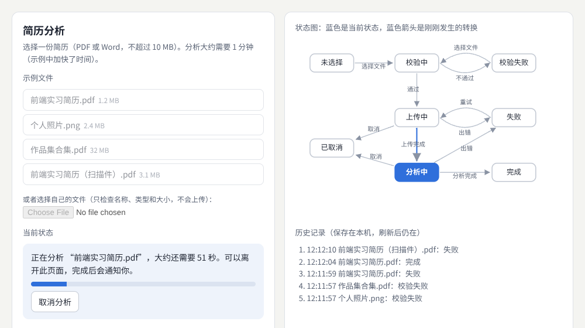
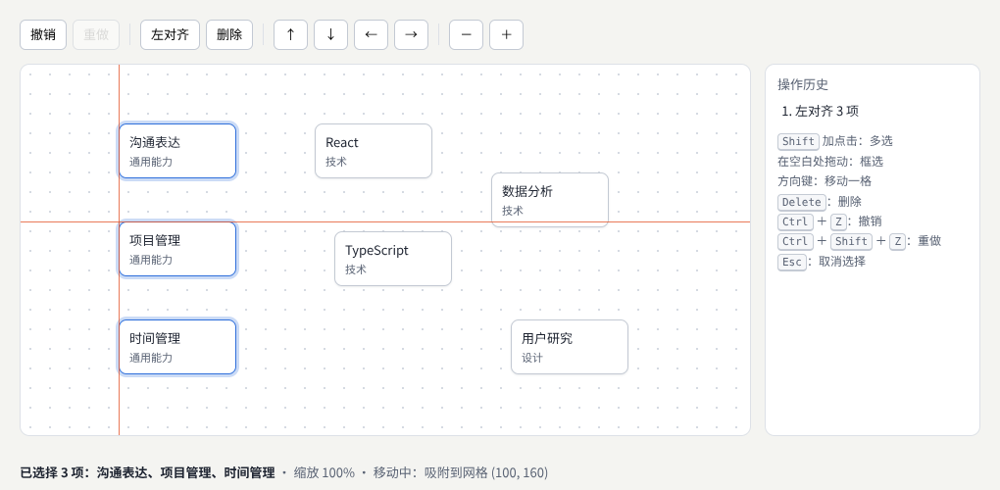
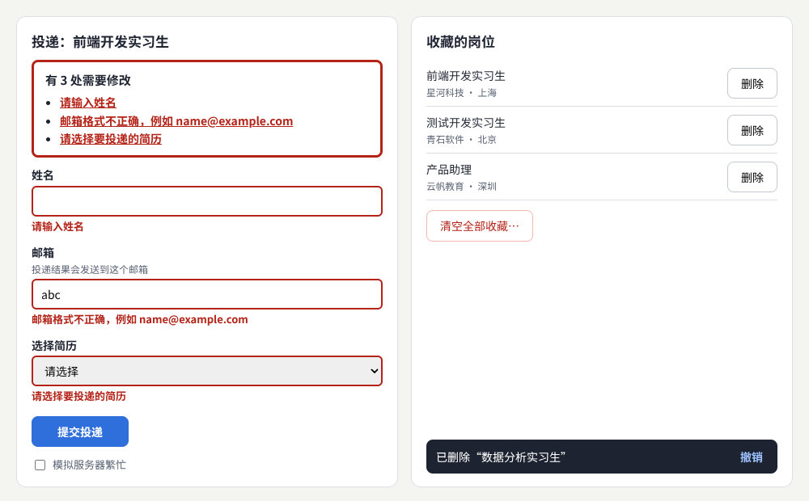
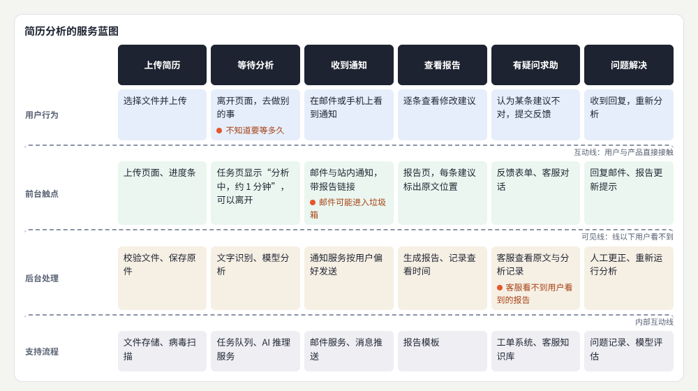
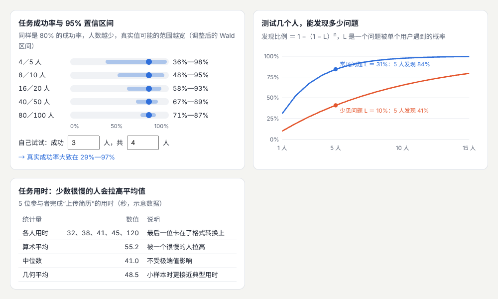

# 产品交互与用户体验

> 从用户想完成的事情出发：研究任务、组织信息、设计流程、处理复杂操作与错误，用文字说清楚每一步，并通过测试验证与改进。  
> 版本：1.0 · 整理日期：2026-10-25  
> 适用对象：想让产品“好用”的开发者与设计学习者。先修：能做出可以操作的网页（见[《前端界面工程》](01-前端界面工程.md)）；不需要心理学或统计学基础，本册从身边的真实任务讲起。

用户体验（UX）关心的是用户完成目标的整个过程：需求是否真实、入口是否找得到、步骤是否合理、结果是否容易理解、出错时能否恢复。界面的外观（UI）是其中重要的一部分，但 UX 的范围还包括流程、内容、服务衔接和研究验证。**交互设计**则具体定义用户的每个动作与系统响应之间的关系：一个“上传文件”功能，需要考虑选择文件、拖入文件、格式校验、上传中、取消、失败重试、成功查看等状态，以及它们之间怎样转换。

本册对每个主题都按同样的顺序讲：先说明它解决什么问题；再用白话解释核心概念；然后给出一个可以直接运行的示例，附运行截图；最后是常见问题、本章练习和继续深入的方向。所有示例都放在本目录的[示例](示例/)文件夹中，用浏览器直接打开即可运行，每个示例都已在浏览器中实际运行并检查过。

主线是：**从任务出发，写出任务模型 → 掌握研究、信息架构、流程、复杂操作、反馈、文案、服务衔接、评价八个方向 → 完成“上传资料并得到分析结果”的完整流程，并请别人不经讲解地试用。**

## 阅读导航

正文共 13 章（01—13），附 6 个可运行示例、3 组附录与 19 项资料入口。

- [第一篇：从任务出发](#part-1)
  - [01 用户体验负责什么](#ch01)
  - [02 任务模型：把用户要做的事写清楚](#ch02)
- [第二篇：八个方向](#part-2)
  - [03 用户与任务研究](#ch03)
  - [04 信息架构](#ch04)
  - [05 任务流程](#ch05)
  - [06 复杂操作](#ch06)
  - [07 反馈与错误恢复](#ch07)
  - [08 内容与微文案](#ch08)
  - [09 服务与多端衔接](#ch09)
  - [10 评价与迭代](#ch10)
- [第三篇：综合项目与连接](#part-3)
  - [11 综合项目：上传资料并得到分析结果](#ch11)
  - [12 与视觉和工程的连接](#ch12)
  - [13 继续深入与学习路线](#ch13)
- [附录 A：术语表](#appendix-a)
- [附录 B：资料入口](#appendix-b)
- [附录 C：与原手册的对应关系及修订记录](#appendix-c)

<a id="part-1"></a>

## 第一篇：从任务出发

<a id="ch01"></a>

### 01 用户体验负责什么

#### 01.1 从用户想完成的事情开始

UX 工作从用户想完成的事情开始，而不是从界面开始。先了解四件事：

| 要了解的 | 问题 | 例子：投递简历 |
| --- | --- | --- |
| 环境 | 任务在什么情况下发生 | 晚上在宿舍，用手机或笔记本 |
| 已有做法 | 现在是怎样完成的 | 在多个招聘网站分别填写，复制粘贴同样的内容 |
| 困难 | 哪里费时、出错、让人不安 | 不知道简历有没有被看过；格式在不同网站被打乱 |
| 成功标准 | 怎样算完成得好 | 十分钟内投出，并且知道接下来会发生什么 |

了解这些之后，再设计流程与界面。

#### 01.2 开发者可以怎样开始

不需要等到学会全部研究方法再开始。开发者可以从身边的真实任务入手：观察同学怎样投简历、自己怎样整理作品集。先用简单的原型验证自己的理解——一张纸上的流程图、一个能点击的网页草稿——然后逐步学习访谈和可用性测试（03、10 章）。

#### 01.3 UX、UI 与工程怎样分工

UX 决定**需要表达哪些状态**（上传中、失败、完成……），UI 决定**这些状态怎样被看见**（进度条、颜色、文字），工程负责**让状态真实地发生**（请求、超时、重试）。三者应当共享同一份任务模型（02 章）。只画出成功状态的设计稿，很难说明产品在真实使用中是否完整。12 章会详细讨论这种连接。

**本章练习**：选一个你最近完成过的线上任务（例如报名一个活动），按 01.1 的四项写下来。

<a id="ch02"></a>

### 02 任务模型：把用户要做的事写清楚

#### 02.1 任务模型的内容

**任务模型**是一张说明用户要做什么的表。它是 UX、UI 和工程共同的出发点：

```text
任务：上传简历并得到分析结果
用户：准备找实习的学生，第一次使用本产品
触发：看到招聘信息，想先确认简历是否合格
频率：求职期间每周一到两次
环境：笔记本或手机；网络可能不稳定
输入：一份 PDF 或 Word 简历
步骤：选择文件 → 校验 → 上传 → 等待分析 → 查看结果 → 按建议修改
结果：一份分析报告，列出可以改进的地方
成功标准：三分钟内拿到报告，看得懂每条建议，知道怎样修改
例外：文件格式不对、文件太大、上传中断、分析失败、中途取消、关掉页面后回来
```

最后一行最容易被忽略，也最重要：**例外**决定了产品在真实使用中是否可靠。05 章和 11 章会把这些例外一一设计出来。

#### 02.2 从任务模型到状态表

把任务模型中的步骤和例外整理成**状态表**：用户可能处在哪些状态、每个状态显示什么、能做什么、会转到哪里。状态表是 UX、视觉和工程共享的“合同”：

| 状态 | 用户看到什么 | 能做什么 | 接下来 |
| --- | --- | --- | --- |
| 未选择 | 文件要求说明 | 选择文件 | 校验中 |
| 校验失败 | 哪里不符合、怎样解决 | 重新选择 | 校验中 |
| 上传中 | 进度百分比 | 取消 | 分析中、失败、已取消 |
| 分析中 | 预计剩余时间，“可以离开” | 取消、离开 | 完成、失败、已取消 |
| 完成 | 结果摘要 | 查看报告 | — |
| 失败 | 原因与下一步 | 重试或换文件 | 上传中、校验中 |
| 已取消 | 没有保存任何内容 | 重新选择 | 校验中 |

**本章练习**：为“修改个人资料”写一份任务模型和状态表。

<a id="part-2"></a>

## 第二篇：八个方向

<a id="ch03"></a>

### 03 用户与任务研究

#### 03.1 解决什么问题

研究用户实际怎样做事。关键是区分三类信息：**事实**、**表达的愿望**和**设计者的推测**。还要记录任务的触发条件、频率、使用的工具、输入和结果。研究结果应当能指导产品的范围与优先级。英国政府的服务手册系统介绍了用户研究的做法。[B01](#ref-b01)

#### 03.2 事实、愿望与推测

| 类型 | 例子 | 可信程度 |
| --- | --- | --- |
| 事实：观察到或用户描述的过去行为 | “我上周投了 12 份，有 9 份是在手机上投的” | 高 |
| 表达的愿望 | “要是能一键投递所有网站就好了” | 中：说明有痛点，但解决方案未必如此 |
| 设计者的推测 | “学生应该更喜欢用电脑投递” | 低：需要验证 |

访谈时多问**过去发生过的具体事情**（“上次投递时，你是怎样做的？”），少问假设（“如果有这个功能，你会用吗？”）。人们对假设问题的回答，常常与实际行为不同。不要用引导性的问题（“这个功能是不是很方便？”）。用户访谈的方法可以参考 Nielsen Norman Group 的介绍。[B02](#ref-b02)

#### 03.3 记录什么

每次观察或访谈后，按固定的格式记录：

| 项目 | 记录 |
| --- | --- |
| 触发条件 | 什么事情让用户开始这个任务 |
| 频率 | 多久做一次 |
| 工具 | 用了哪些网站、软件、纸笔 |
| 输入 | 需要准备什么材料 |
| 结果 | 最后得到了什么，满意吗 |
| 困难 | 卡住、出错、犹豫的地方，原话 |
| 类型标注 | 每条是事实、愿望还是推测 |

#### 03.4 从研究到优先级

把多位用户的记录放在一起，找出反复出现的困难，再按两个维度排序：**影响多少人**、**影响有多大**。影响很多人、又会阻碍任务完成的问题排在最前面。研究要尊重参与者：说明用途、征得同意、允许随时退出、妥善保管记录。

**本章练习**：访谈两位同学最近一次投递简历的过程，按 03.3 的格式记录，并标出每条是事实、愿望还是推测。

<a id="ch04"></a>

### 04 信息架构

#### 04.1 解决什么问题

信息架构组织**分类、导航、层级、标签和搜索**，决定用户能不能找到东西。用户可能按项目、时间、类型或目标寻找内容，所以要根据任务选择组织方式，并测试命名是否容易理解。

#### 04.2 几种组织方式

| 按什么组织 | 例子 | 适合 |
| --- | --- | --- |
| 按任务或目标 | 简历、岗位、准备面试 | 大多数面向普通用户的产品 |
| 按类型 | 文章、清单、视频 | 内容库 |
| 按时间 | 本周、本月、更早 | 动态、记录、消息 |
| 按项目 | 每次求职一个文件夹 | 用户自己组织内容的工具 |

常见的错误是**按公司的内部结构组织**：菜单名称来自开发时的模块划分（“工具”“文件管理”），而不是用户要做的事。

#### 04.3 卡片分类与树测试

- **卡片分类**：把每个功能写在一张卡片上，请用户分组并命名，了解他们心中的分类方式。[B03](#ref-b03)
- **树测试**：只给出导航的文字结构（没有视觉设计），布置一个任务，看用户能否找到正确位置、走了多少弯路。[B04](#ref-b04)

示例是一个树测试：任务是“给已经上传的简历改名”。方案 A 按系统模块组织，正确位置藏在“工具 › 文件管理 › 我的文档 › 重命名”；方案 B 按用户任务组织，位置是“简历 › 我的简历 › 重命名”。页面会记录每次点击的路径、回退次数和用时。



示例：[03-04-tree-test.html](示例/03-04-tree-test.html)

示意结果显示：方案 A 只有一半的人找到，大多数人第一次点了“我的”；方案 B 全部找到，用时短得多。树测试只看结构与命名，不受视觉设计影响，所以可以在画设计稿之前就做。

示例还暴露了一个实现细节：展开标记最初用 CSS 生成的“▸”文字，结果被算进了按钮的名称，读屏软件会读出这个符号。改成不含文字的 CSS 三角形后解决。

#### 04.4 搜索

当内容很多、或者用户知道自己要找什么时，搜索比导航更快。搜索要处理：同义词与错别字、结果的排序、没有结果时的建议、按类型和时间筛选。搜索不能代替清楚的导航——用户不知道某个功能存在时，不会去搜它。

**本章练习**：

1. 为你的产品的主要功能写 15 张卡片，请三个人做卡片分类，比较他们的分组与你的导航。
2. 在 `03-04-tree-test.html` 中增加一个任务“查看投递记录”，比较两个方案。

<a id="ch05"></a>

### 05 任务流程

#### 05.1 解决什么问题

任务流程设计从入口到结果的每一步，还要处理**跨页面、跨设备和中断后恢复**。每一步都要说明：为什么需要这项信息、需要处理多久、结果会出现在哪里。复杂流程适合用**状态和条件**来描述。

#### 05.2 用状态机描述流程

复杂流程用文字描述容易遗漏。更可靠的方法是写出**状态机**：列出所有状态，以及每个状态下发生什么事件、转到哪个状态（参见《前端界面工程》07 章）。代码中，所有的状态变化都经过同一个函数，不在转换表中的变化直接拒绝，界面就不会出现“既在上传、又显示失败”这类不可能的情况：

```js
const TRANSITIONS = [
  ['idle', 'select', 'checking'], ['checking', 'valid', 'uploading'], ['checking', 'invalid', 'invalid'],
  ['uploading', 'uploaded', 'analyzing'], ['uploading', 'fail', 'failed'], ['uploading', 'cancel', 'cancelled'],
  ['analyzing', 'analyzed', 'done'], ['analyzing', 'fail', 'failed'], ['analyzing', 'cancel', 'cancelled'],
  ['failed', 'retry', 'uploading']   // 另有从各结束状态“重新选择”回到校验的转换，此处从略
];
function send(event, patch = {}) {
  const t = TRANSITIONS.find(([from, ev]) => from === job.state && ev === event);
  if (!t) return false;                  // 不在表中的转换一律拒绝
  job = { ...job, ...patch, state: t[2] };
  render();
}
```



示例：[03-05-upload-flow.html](示例/03-05-upload-flow.html)（可以选择示例文件，打开“模拟网络中断”，或者选择自己的文件）

#### 05.3 每一步说清三件事

| 步骤 | 为什么需要 | 要多久 | 结果在哪里 |
| --- | --- | --- | --- |
| 选择文件 | 说明支持的格式与大小限制 | 立即 | — |
| 上传 | 显示进度 | 几秒 | 进度百分比 |
| 分析 | 说明在做什么 | “大约 1 分钟” | 可以离开，完成后通知；回来时在任务页查看 |

#### 05.4 中断与恢复

用户会关掉页面、断网、换一台设备。示例在本机保存任务状态，并区分两种情况：

- **上传中关闭页面**：上传必然中断。再次打开时显示“上传在页面关闭时中断了。文件已保留，可以重试”。
- **分析中关闭页面**：分析在服务器上继续进行。再次打开时仍显示“分析中”，并继续更新，完成后显示结果。

跨设备时，任务状态要保存在服务器上，用户在手机上开始、在电脑上查看结果，看到的是同一个任务。

**本章练习**：

1. 在 `03-05-upload-flow.html` 中打开“模拟网络中断”，体验上传失败、重试；再在分析时刷新页面，观察恢复。
2. 为“修改个人资料”画出状态图，包括保存失败与离开前未保存的提醒。

<a id="ch06"></a>

### 06 复杂操作

#### 06.1 解决什么问题

编辑器和工作台需要更复杂的操作：**选择、批量编辑、拖拽、吸附、缩放、撤销和快捷键**。原则是：操作的反馈要显示**影响范围**，用户应当能够理解并修正结果。

#### 06.2 示例：能力画布

示例是一个简化的能力画布，卡片可以：

- **选择**：点击选中一张；按住 Shift 点击加选；在空白处拖动，框选范围内的卡片。
- **拖动与吸附**：拖动时，卡片的位置吸附到 20 像素的网格，红色参考线显示吸附的位置；选中的多张卡片一起移动、保持相对位置。
- **批量编辑**：选中多张后“左对齐”。
- **缩放**：放大、缩小画布。
- **撤销与重做**：每个修改都记录在右侧的操作历史中，可以撤销和重做。
- **影响范围**：底部状态栏始终显示“已选择 3 项：……”，操作前就知道会影响哪些卡片。



示例：[03-06-board.html](示例/03-06-board.html)

#### 06.3 撤销的实现：命令

可靠的撤销，来自把每个修改写成一条**命令**：它知道怎样执行，也知道怎样撤销。执行时放进撤销栈；撤销时取出并反向执行，放进重做栈：

```js
function moveCmd(ids, dx, dy) {
  return { label: `移动 ${ids.length} 项`,
           apply()  { ids.forEach(id => { byId(id).x += dx; byId(id).y += dy; }); },
           revert() { ids.forEach(id => { byId(id).x -= dx; byId(id).y -= dy; }); } };
}
function execute(cmd) { cmd.apply(); done.push(cmd); undone.length = 0; render(); }
function undo() { const c = done.pop(); if (!c) return; c.revert(); undone.push(c); render(); }
```

拖动过程中卡片已经实时移动了；松开时，先把卡片放回原处，再把整次拖动作为**一条**命令执行。这样撤销一次就回到拖动之前，而不是倒退一个像素。有了可靠的撤销，很多“确定要删除吗？”的确认都可以省掉，用户放心地尝试。[B05](#ref-b05)

#### 06.4 键盘与单指针的替代方式

- **拖动要有替代方式**：WCAG 2.2 的 2.5.7 要求，通过拖动完成的功能，也要能用单次点击完成（除非拖动是必需的）。[B06](#ref-b06) 示例在工具栏提供了上移、下移、左移、右移按钮；键盘用户可以用方向键移动。
- **快捷键**：撤销、重做、删除、全选等常用操作提供快捷键，并在界面上说明。避免只用单个字母作快捷键，或者允许关闭，否则语音输入和误触时会意外触发（WCAG 2.1.4）。[B07](#ref-b07)

#### 06.5 常见问题

- **撤销一次只撤回了一点点**：拖动过程中的每一步都记成了一条命令。整次拖动只记一条。
- **框选时页面文字也被选中了**：给画布设置 `user-select: none`。
- **触屏上拖动时页面跟着滚动**：给画布设置 `touch-action: none`。

**本章练习**：

1. 在 `03-06-board.html` 中增加“顶部对齐”与“水平等距分布”两个批量操作，都要能撤销。
2. 增加 `Ctrl` ＋ `A` 全选，并在状态栏显示全选后的影响范围。

**继续深入**：智能参考线（对齐其他卡片的边缘与中心）；连线与节点编辑器（见[《计算设计与创作工具》](11-计算设计与创作工具.md)）；多人同时编辑时的冲突（见[《产品形态专题》](17-产品形态专题.md)）。

<a id="ch07"></a>

### 07 反馈与错误恢复

#### 07.1 解决什么问题

反馈要明确三件事：**系统当前的状态**、**执行的结果**，以及**用户可以采取的下一步**。错误信息应当指出可以处理的问题，并尽量保留用户已经输入的内容。加载、取消、重试和回退需要放在同一个流程中考虑。

#### 07.2 示例：表单错误与删除后撤销



示例：[03-07-feedback.html](示例/03-07-feedback.html)

示例左侧的投递表单演示了错误处理的完整做法：

- **错误汇总**：提交时如果有错误，在表单顶部列出全部问题（“有 3 处需要修改”），焦点移到汇总上，读屏软件会读出；每条都是链接，点击跳到对应的输入框。英国政府设计系统的错误信息组件采用同样的做法。[B08](#ref-b08)
- **具体的错误信息**：不说“输入无效”，而说“邮箱格式不正确，例如 name@example.com”——指出问题，也给出改法。[B09](#ref-b09)
- **保留输入**：出错时，已经填写的内容全部保留。
- **防止重复提交**：提交过程中按钮显示“正在提交…”，重复点击不会再次提交。
- **服务器出错**：显示“提交没有成功：服务器暂时繁忙。你填写的内容都已保留，可以稍后重试”。
- **成功**：说明接下来会发生什么：“我们会在 3 个工作日内通过邮件告诉你结果”。

右侧的收藏列表演示了两种删除：

- **单个删除**：直接删除，底部提示“已删除‘数据分析实习生’”并提供“撤销”，6 秒内可以恢复到原来的位置。
- **清空全部**：影响大且无法恢复，用确认对话框写清后果：“将删除全部 4 个收藏，删除后无法恢复”。按钮写明动作（“清空”“保留收藏”），而不是“确定”“取消”。

#### 07.3 响应时间与反馈方式

用户对等待的感受有三个大致的界限：约 0.1 秒以内感觉是即时的；约 1 秒以内思路不会被打断，但能察觉延迟；超过约 10 秒，注意力就难以保持。[B10](#ref-b10)

| 等待时间 | 反馈方式 |
| --- | --- |
| 不到 0.1 秒 | 直接显示结果 |
| 0.1—1 秒 | 按钮的按下状态；必要时显示简短的加载指示 |
| 1—10 秒 | 加载指示，说明在做什么 |
| 10 秒以上 | 进度百分比或剩余时间，允许取消，允许离开后再回来 |

#### 07.4 可用性原则

Nielsen 的十条可用性原则概括了反馈与错误处理的许多要点，例如：让系统状态始终可见、让用户有控制权与“退出口”（撤销、取消）、预防错误优于事后提示、让用户识别而不是回忆。[B11](#ref-b11) 这些原则适合用来检查设计，但不能代替真实用户的测试。

**本章练习**：

1. 在 `03-07-feedback.html` 中打开“模拟服务器繁忙”，提交后检查已填写的内容是否都还在。
2. 找一个你常用的产品的错误信息，按 07.2 的标准改写。

<a id="ch08"></a>

### 08 内容与微文案

#### 08.1 解决什么问题

微文案是界面上的小段文字：按钮标签、说明、提示、空状态和确认信息。要用用户熟悉的对象与动作命名，并让同一个概念在各处保持一致。文案长度会影响布局，应当和视觉设计一起验证。英国政府服务手册中关于界面写作的指南简洁实用。[B12](#ref-b12)

#### 08.2 改写示例

| 场景 | 不好的写法 | 更好的写法 | 原因 |
| --- | --- | --- | --- |
| 按钮 | 确定 | 提交投递 | 按钮写明动作和对象 |
| 删除确认 | 确定要执行此操作吗？ | 将删除全部 4 个收藏，删除后无法恢复。 | 写清后果 |
| 错误 | 输入无效 | 邮箱格式不正确，例如 name@example.com | 指出问题并给出改法 |
| 空状态 | 暂无数据 | 还没有收藏的资源。看到有用的内容时，点击书签就能收藏到这里。 | 解释为什么为空、下一步做什么 |
| 等待 | 处理中… | 正在分析，大约还需要 40 秒。可以离开此页面，完成后会通知你。 | 说明在做什么、要多久、能否离开 |
| 成功 | 操作成功 | 已投递。我们会在 3 个工作日内通过邮件告诉你结果。 | 说明接下来会发生什么 |

#### 08.3 一致的命名

同一个东西在产品中只用一个名字：如果叫“简历”，就不要在别处叫“履历”“文档”“附件”。可以维护一份**术语表**，列出产品中的每个概念、正式名称和不该使用的近义词。微文案的系统方法在[《信息、数据与空间》](15-信息数据与空间.md)的“内容设计”部分继续展开。

#### 08.4 文案与布局

文案的长度会改变布局：按钮文字变长会换行，提示文字变多会挤压表单，翻译成其他语言后长度可能翻倍。设计时用真实的文案，而不是“文字文字”占位；检查最长的文案在手机上的样子。多语言的处理见[《包容、国际化与多感官》](16-包容国际化与多感官.md)。

**本章练习**：把你的产品中所有的按钮标签和错误信息列成表，按 08.2 的标准逐条改写。

<a id="ch09"></a>

### 09 服务与多端衔接

#### 09.1 解决什么问题

网页只是服务的一部分。用户还会通过邮件、通知、客服、线下服务和其他终端与产品打交道。状态的变化要在每个入口都解释清楚；用户回来时，应当知道任务进行到了哪里。这一方向可以扩展到服务蓝图与全流程设计。

#### 09.2 服务蓝图

**服务蓝图**把一项服务按阶段展开，分成几条“泳道”：用户的行为、用户能接触到的前台触点、用户看不到的后台处理，以及支撑这一切的支持流程。[B13](#ref-b13) 泳道之间的几条线很重要：**互动线**以上是用户直接接触的部分，**可见线**以下用户看不到，**内部互动线**以下是支持系统。



示例：[03-09-blueprint.html](示例/03-09-blueprint.html)

蓝图帮助发现跨部门的问题。示例标出了三处痛点：

- **等待分析**时，用户不知道要等多久——任务页要显示预计时间，并说明可以离开。
- **收到通知**时，邮件可能进入垃圾箱——同时发送站内通知，任务页也显示结果。
- **求助**时，客服看不到用户看到的报告——客服工具要能查看同一份分析记录。

这些问题单看网页都发现不了。服务蓝图本质上是一张表，示例用真正的 HTML 表格实现，读屏软件可以按行、按列读出。

#### 09.3 多个入口说同一件事

同一个任务的状态，在网页、邮件、手机通知中要一致：邮件说“分析完成”，网页上不能还显示“分析中”。通知中的链接应当直接打开对应的任务，而不是首页。服务设计的完整方法在[《产品形态专题》](17-产品形态专题.md)中展开。

**本章练习**：为“预约面试辅导”画一张服务蓝图，标出至少两处痛点。

<a id="ch10"></a>

### 10 评价与迭代

#### 10.1 解决什么问题

评价通过代表性的任务，观察用户的**成功、错误、耗时和困惑点**，并结合主观反馈。少量的定性测试适合发现问题；统计性的结论需要相应的研究设计与样本。每次改动都记录改动前后的证据。

#### 10.2 可用性测试的做法

1. **准备任务**：写成真实情境，不透露界面上的词。不说“点击上传按钮”，而说“你想知道简历有没有问题，请试一试”。
2. **请参与者边做边说**（出声思维）：说出看到了什么、在想什么、打算做什么。[B14](#ref-b14)
3. **不讲解、不帮忙**：参与者卡住时，记录卡在哪里，问“你这时在想什么？”，而不是告诉答案。
4. **记录**：是否完成、出了什么错、用了多久、在哪里犹豫、说了什么原话。
5. **整理**：按影响排序，优先修正阻碍任务完成的问题。

#### 10.3 少量用户能说明什么

示例用三个计算回答“测试几个人就够了”：



示例：[03-10-metrics.html](示例/03-10-metrics.html)

- **发现问题**：一个问题被单个用户遇到的概率记为 L，测试 n 个人发现它的概率是 1 −（1 − L）<sup>n</sup>。Nielsen 与 Landauer 统计的 L 平均约为 31%，测试 5 个人就能发现约 84% 的问题（文章中取整为 85%）。[B15](#ref-b15) 但对于只有 10% 的人会遇到的问题，5 个人只能发现约 41%。所以更好的做法是**多轮小测试**：每轮 5 人左右，修改后再测。
- **成功率**：5 人中 4 人成功，成功率是 80%，但真实的成功率可能在 36%—98% 之间。这个范围用**调整后的 Wald 区间**计算，它在小样本时比直接用正态近似更可靠。[B16](#ref-b16) [B17](#ref-b17) 所以少量用户的测试不能说“成功率 80%”，只能说“5 人中 4 人完成”。需要比较数字时，Nielsen 建议定量研究约 20 人。[B18](#ref-b18)
- **用时**：任务用时通常有少数人特别慢，算术平均会被拉高。示例中 5 人的用时为 32、38、41、45、120 秒，算术平均 55.2 秒，中位数 41 秒，几何平均 48.5 秒。样本较小时，几何平均更接近典型的用时。[B19](#ref-b19)

```js
// 调整后的 Wald 区间：在成功数与总数上各加 z²/2 与 z²
function adjustedWald(x, n, z = 1.96) {
  const nAdj = n + z * z, p = (x + z * z / 2) / nAdj;
  const m = z * Math.sqrt(p * (1 - p) / nAdj);
  return [Math.max(0, p - m), Math.min(1, p + m)];
}
```

#### 10.4 记录改动前后的证据

每次改版，都保留改动前后的对比：同样的任务、同样的测量方式。只有这样，才能说“改版后 5 人全部完成，改版前只有 2 人完成”，而不是“感觉好用多了”。报告中要区分个人观察、初步发现和经过充分验证的结论。

**本章练习**：

1. 在 `03-10-metrics.html` 中输入“成功 3 人，共 4 人”，观察区间有多宽。
2. 为你的产品设计一次 5 人的可用性测试：写出 3 个任务、记录表和完成标准。

<a id="part-3"></a>

## 第三篇：综合项目与连接

<a id="ch11"></a>

### 11 综合项目：上传资料并得到分析结果

#### 11.1 目标与范围

选择“上传资料并得到分析结果”作为任务，设计**文件选择、校验、处理、结果、失败重试、取消和历史记录**。然后请使用者在没有口头指导的情况下尝试，记录他们犹豫的位置和理解错误，优先修正阻碍任务的原因。

`03-05-upload-flow.html` 就是这个项目的一个可运行版本，包含全部状态，以及刷新后的恢复与历史记录。

#### 11.2 步骤

1. **写任务模型**（02 章）：用户、触发、步骤、成功标准、例外。
2. **画状态图**（05 章）：每个状态、事件与转换。
3. **写文案**（08 章）：每个状态说清现在怎样、为什么、下一步能做什么。
4. **做可运行的原型**：可以使用明确标注的模拟数据。
5. **准备测试**（10 章）：3 个任务，例如“上传你的简历并看看分析结果”“上传一张照片会怎样”“上传时网络断了怎么办”。
6. **测试 5 人**：不讲解、不帮忙，记录犹豫与误解。
7. **修改并再测**：先改阻碍任务完成的问题。

#### 11.3 验收清单

- [ ] 文件选择前就说明支持的格式与大小。
- [ ] 格式错误、文件过大时，说明问题与解决方法。
- [ ] 上传与分析过程中，显示进度或预计时间，并且可以取消。
- [ ] 分析时可以离开页面，回来后能看到进度或结果。
- [ ] 上传中断后可以重试，不需要重新选择文件。
- [ ] 分析失败时说明原因；不提供无效的“重试”。
- [ ] 取消后说明没有保存任何内容。
- [ ] 历史记录保留每次的结果。
- [ ] 重复点击、快速切换不会造成混乱。
- [ ] 参与者在没有讲解的情况下能够完成主要任务，并能说出当前的进度。

<a id="ch12"></a>

### 12 与视觉和工程的连接

#### 12.1 同一份任务模型

UX、UI、工程最容易脱节的地方是**状态**。设计稿只画了成功的样子，工程实现时才发现还有加载中、空数据、失败、无权限……只好临时拼凑。避免的办法是：三方从同一份任务模型与状态表出发（02 章）——UX 列出状态，UI 为每个状态设计样子，工程让每个状态真实地发生，测试按状态表逐项检查。

#### 12.2 产品体验与系统化

产品体验与系统化的阶段，要学习任务分析、信息架构、操作流程、状态机、组件接口和设计系统。几个要点：

- **视觉变化对应真实状态**：一个按钮的样式变化（禁用、加载中），必须对应系统中真实存在的状态。
- **表单完整**：说明、校验、错误恢复、提交反馈缺一不可（07 章）。
- **完整的任务**：阶段项目应包含从入口到结果的完整任务，以及空数据、加载、失败和权限不足等情况。
- **横向扩展**：内容设计、复杂数据表、权限视图、国际化、多端适配和设计协作，都会在这一阶段遇到，分别在其他分册中展开。

组件的状态与接口设计见[《前端界面工程》](01-前端界面工程.md) 06 章；视觉层面的状态表达见[《视觉设计与品牌表达》](02-视觉设计与品牌表达.md)；设计系统见[《计算设计与创作工具》](11-计算设计与创作工具.md)。

<a id="ch13"></a>

### 13 继续深入与学习路线

#### 13.1 八个方向的纵向深入

| 方向 | 入门 | 进阶 | 深入 |
| --- | --- | --- | --- |
| 用户与任务研究 | 访谈与观察记录 | 区分事实与推测、整理优先级 | 研究计划、长期研究、多方法结合 |
| 信息架构 | 按任务组织导航 | 卡片分类、树测试 | 搜索、大型内容的分类体系 |
| 任务流程 | 写出步骤与例外 | 状态机、中断与恢复 | 跨设备、跨角色的长流程 |
| 复杂操作 | 选择与撤销 | 拖动、吸附、批量编辑、快捷键 | 编辑器、多人协作 |
| 反馈与错误恢复 | 加载、空、失败三种状态 | 错误汇总、保留输入、撤销 | 预防错误、可恢复设计 |
| 内容与微文案 | 写清动作与后果 | 一致的术语 | 内容策略、多语言 |
| 服务与多端衔接 | 通知与邮件 | 服务蓝图 | 全流程服务设计 |
| 评价与迭代 | 5 人可用性测试 | 指标与置信区间 | 实验设计、长期指标 |

#### 13.2 横向连接

- 实现完整的状态与组件：[《前端界面工程》](01-前端界面工程.md)。
- 用动效说明状态变化：[《动效与时间设计》](04-动效与时间设计.md)。
- 注意、记忆与心智模型的原理：[《感知与认知》](13-感知与认知.md)。
- AI 产品、协作编辑器、服务设计、可恢复设计：[《产品形态专题》](17-产品形态专题.md)。
- 内容设计与信息编辑：[《信息、数据与空间》](15-信息数据与空间.md)。

#### 13.3 下一步

1. 完成 11 章的综合项目，并测试 5 人。
2. 为你正在做的产品写一份任务模型与状态表，交给设计与开发一起核对。
3. 每次发布前，用 07 章与 08 章的标准检查一遍错误信息与按钮文案。

<a id="appendix-a"></a>

## 附录 A：术语表

| 术语 | 含义 | 阅读位置 |
| --- | --- | --- |
| 用户体验（UX） | 用户完成目标过程中的整体体验 | 01 |
| 交互设计 | 定义用户动作与系统响应之间关系的工作 | 01 |
| 任务模型 | 说明用户要做什么、怎样算成功、有哪些例外的表 | 02 |
| 状态表 | 列出所有状态、显示内容、可做的事与转换 | 02 |
| 事实、愿望、推测 | 研究中三类可信程度不同的信息 | 03 |
| 引导性问题 | 暗示了期望答案的问题 | 03 |
| 信息架构 | 内容如何分类、命名、关联与被找到 | 04 |
| 卡片分类 | 请用户把功能卡片分组并命名的研究方法 | 04 |
| 树测试 | 只用导航的文字结构测试用户能否找到目标 | 04 |
| 回退 | 在导航中返回上一层或改走其他分支 | 04 |
| 状态机 | 由状态和状态之间的转换规则组成的模型 | 05 |
| 影响范围 | 一个操作会改变哪些对象 | 06 |
| 吸附 | 拖动时自动对齐到网格或其他元素 | 06 |
| 命令（撤销） | 知道怎样执行、也知道怎样撤销的一次修改 | 06 |
| 错误汇总 | 在表单顶部列出全部错误并链接到对应输入框 | 07 |
| 微文案 | 按钮、提示、错误、空状态等界面上的小段文字 | 08 |
| 服务蓝图 | 按阶段与泳道展开一项服务的图 | 09 |
| 可见线 | 服务蓝图中用户能看到与看不到部分的分界 | 09 |
| 出声思维 | 请参与者边操作边说出想法的测试方法 | 10 |
| 置信区间 | 由于抽样，真实值可能所在的范围 | 10 |
| 调整后的 Wald 区间 | 适合小样本的成功率区间计算方法 | 10 |
| 几何平均 | 各值相乘再开 n 次方，受极端值影响较小 | 10 |

<a id="appendix-b"></a>

## 附录 B：资料入口

以下资料用于核对方法来源和继续学习。资料核对日期：2026-10-25。

<a id="ref-b01"></a>
**B01 · GOV.UK 服务手册：用户研究。** [User research](https://www.gov.uk/service-manual/user-research)。对应 03 章，用户研究的计划、方法与伦理。

<a id="ref-b02"></a>
**B02 · Nielsen Norman Group：用户访谈。** [User Interviews 101](https://www.nngroup.com/articles/user-interviews/)。对应 03 章，访谈的准备与提问方法。

<a id="ref-b03"></a>
**B03 · Nielsen Norman Group：卡片分类。** [Card Sorting: Uncover Users' Mental Models](https://www.nngroup.com/articles/card-sorting-definition/)。对应 04 章。

<a id="ref-b04"></a>
**B04 · Nielsen Norman Group：树测试。** [Tree Testing](https://www.nngroup.com/articles/tree-testing/)。对应 04 章。

<a id="ref-b05"></a>
**B05 · Aza Raskin：需要撤销时不要用警告。** [Never Use a Warning When You Mean Undo](https://alistapart.com/article/neveruseawarning/)。对应 06、07 章，2007 年发表于 A List Apart。

<a id="ref-b06"></a>
**B06 · W3C：理解 WCAG 2.5.7 拖动动作。** [Understanding Dragging Movements](https://www.w3.org/WAI/WCAG22/Understanding/dragging-movements.html)。对应 06 章，拖动功能的单指针替代方式。

<a id="ref-b07"></a>
**B07 · W3C：理解 WCAG 2.1.4 字符快捷键。** [Understanding Character Key Shortcuts](https://www.w3.org/WAI/WCAG22/Understanding/character-key-shortcuts.html)。对应 06 章。

<a id="ref-b08"></a>
**B08 · GOV.UK 设计系统：错误信息。** [Error message](https://design-system.service.gov.uk/components/error-message/)。对应 07 章，错误汇总与行内错误信息的做法。

<a id="ref-b09"></a>
**B09 · Nielsen Norman Group：错误信息指南。** [Error-Message Guidelines](https://www.nngroup.com/articles/error-message-guidelines/)。对应 07 章。

<a id="ref-b10"></a>
**B10 · Nielsen Norman Group：响应时间的三个界限。** [Response Times: The 3 Important Limits](https://www.nngroup.com/articles/response-times-3-important-limits/)。对应 07 章。

<a id="ref-b11"></a>
**B11 · Nielsen Norman Group：十条可用性原则。** [10 Usability Heuristics for User Interface Design](https://www.nngroup.com/articles/ten-usability-heuristics/)。对应 07 章。

<a id="ref-b12"></a>
**B12 · GOV.UK 服务手册：为用户界面写作。** [Writing for user interfaces](https://www.gov.uk/service-manual/design/writing-for-user-interfaces)。对应 08 章。

<a id="ref-b13"></a>
**B13 · Nielsen Norman Group：服务蓝图。** [Service Blueprints: Definition](https://www.nngroup.com/articles/service-blueprints-definition/)。对应 09 章。

<a id="ref-b14"></a>
**B14 · Nielsen Norman Group：出声思维。** [Thinking Aloud: The #1 Usability Tool](https://www.nngroup.com/articles/thinking-aloud-the-1-usability-tool/)。对应 10 章。

<a id="ref-b15"></a>
**B15 · Nielsen Norman Group：为什么只需测试 5 个用户。** [Why You Only Need to Test with 5 Users](https://www.nngroup.com/articles/why-you-only-need-to-test-with-5-users/)。对应 10 章，发现问题比例的公式与 31% 的平均值。

<a id="ref-b16"></a>
**B16 · MeasuringU：调整后的 Wald 区间计算器。** [Adjusted Wald calculator](https://measuringu.com/calculators/wald/)。对应 10 章。

<a id="ref-b17"></a>
**B17 · Agresti 与 Coull：二项比例区间估计。** [Approximate Is Better than "Exact" for Interval Estimation of Binomial Proportions](https://doi.org/10.1080/00031305.1998.10480550)。对应 10 章，1998 年发表于《美国统计学家》，提出调整后的 Wald 区间。

<a id="ref-b18"></a>
**B18 · Nielsen Norman Group：定量研究需要多少用户。** [Quantitative Studies: How Many Users to Test?](https://www.nngroup.com/articles/quantitative-studies-how-many-users/)。对应 10 章，2006 年的文章，建议定量指标约测试 20 人。

<a id="ref-b19"></a>
**B19 · MeasuringU：怎样报告平均任务用时。** [Average Task Times in Usability Tests: What to Report?](https://measuringu.com/average-times/)。对应 10 章，小样本时使用几何平均。

<a id="appendix-c"></a>

## 附录 C：与原手册的对应关系及修订记录

### C.1 与原手册的对应关系

本册由原《前端与 UI／UX 设计进阶全景手册》第 05 章“产品交互与用户体验”扩写而成，并吸收了其他章节中的相关内容：

| 原手册内容 | 本册位置 |
| --- | --- |
| 5.1 研究对象与先修要求 | 01 章 |
| 5.2 分支 1：用户与任务研究 | 03 章 |
| 5.2 分支 2：信息架构 | 04 章 |
| 5.2 分支 3：任务流程 | 05 章 |
| 5.2 分支 4：复杂操作 | 06 章 |
| 5.2 分支 5：反馈与错误恢复 | 07 章 |
| 5.2 分支 6：内容与微文案 | 08 章 |
| 5.2 分支 7：服务与多端衔接 | 09 章 |
| 5.2 分支 8：评价与迭代 | 10 章 |
| 5.3 练习与验收：上传资料并得到分析结果 | 11 章 |
| 5.4 与视觉的连接 | 01、12 章 |
| 1.1 交互设计的概念 | 引言 |
| 2.4 学习阶段 S2：产品体验与系统化 | 12 章 |

### C.2 修订记录

| 版本 | 日期 | 主要变化 |
| --- | --- | --- |
| 1.0 | 2026-10-25 | 初版：由原手册第 05 章扩写，新增 6 个可运行示例与截图 |
