# 动效与时间设计

> 界面在时间中的变化：怎样让用户注意到变化、看懂元素之间的关系、感到操作是连续的；从一次按钮反馈，到滚动叙事、手势、动态排版与声音。  
> 版本：1.0 · 整理日期：2026-10-25  
> 适用对象：能做出静态页面、想让界面“动得有道理”的开发者与设计学习者。先修：会写 HTML、CSS 和基本的 JavaScript（见[《前端界面工程》](01-前端界面工程.md)）；不需要动画软件的经验。

动效设计处理的是界面**在时间中的变化**：用户以什么方式注意到变化，移动的元素之间是什么关系，操作是否连续。大多数产品中的动效只有三个用途：**给出反馈**（按钮被按下了、保存成功了）、**解释关系**（这个详情是从那张卡片展开的）、**组织注意力**（新消息出现在这里）。说不出用途的动画，通常可以删掉。

学习的顺序是：先掌握 CSS 的过渡、变换和关键帧，再学习时间线、手势、布局动画和状态控制。动画库能帮助实现与编排，但“什么应该动、怎样动、何时结束”由动效设计决定。

本册对每个主题都按同样的顺序讲：先说明它解决什么问题；再用白话解释核心概念；然后给出一个可以直接运行的示例，附运行截图；最后是常见问题、本章练习和继续深入的方向。动画在截图中看不出来，所以示例常用“胶片条”的方式：把同一段动画停在几个不同的时刻排成一排。所有示例都放在本目录的[示例](示例/)文件夹中，用浏览器直接打开即可运行，每个示例都已在浏览器中实际运行并逐项检查过。

主线是：**用过渡、变换、关键帧做出第一个反馈 → 掌握微交互、布局过渡、运动规律、手势、动态排版、滚动叙事、声音、运行质量八个方向 → 为“列表到详情”设计一套连贯、可打断、可关闭的动效，并选择合适的工具。**

## 阅读导航

正文共 13 章（01—13），附 11 个可运行示例、3 组附录与 20 项资料入口。

- [第一篇：动效的基础](#part-1)
  - [01 动效负责什么](#ch01)
  - [02 三件基本工具：过渡、变换与关键帧](#ch02)
- [第二篇：八个方向](#part-2)
  - [03 微交互](#ch03)
  - [04 布局与共享元素过渡](#ch04)
  - [05 运动规律](#ch05)
  - [06 手势与直接操纵](#ch06)
  - [07 动态排版](#ch07)
  - [08 滚动叙事与镜头编排](#ch08)
  - [09 声音与运动配合](#ch09)
  - [10 动画状态与运行质量](#ch10)
- [第三篇：综合项目与工具](#part-3)
  - [11 综合项目：列表到详情的连贯动效](#ch11)
  - [12 工具：CSS、Motion 与 GSAP](#ch12)
  - [13 继续深入与学习路线](#ch13)
- [附录 A：术语表](#appendix-a)
- [附录 B：资料入口](#appendix-b)
- [附录 C：与原手册的对应关系及修订记录](#appendix-c)

<a id="part-1"></a>

## 第一篇：动效的基础

<a id="ch01"></a>

### 01 动效负责什么

#### 01.1 三个用途

| 用途 | 例子 | 没有动效时的问题 |
| --- | --- | --- |
| 给出反馈 | 按钮按下时轻微下沉；保存后显示对勾 | 用户不确定点到了没有，于是再点一次 |
| 解释关系 | 卡片“长”成详情页；删除的项目滑出，其余项目补上 | 画面突然变了，用户要重新找自己看到的东西 |
| 组织注意力 | 新消息从侧边滑入；出错的输入框轻轻摇动 | 变化发生了，用户没有注意到 |

动效还关心**操作的连续性**：拖动时卡片紧跟手指，松手后自然地落到位置上；中途改变主意时，动画能够顺着当前的状态转向，而不是跳回起点。

#### 01.2 动效的代价

动画会延迟用户看到结果，会分散注意力，会消耗性能，还可能让一部分人感到不适。有前庭功能障碍的人看到大幅度的运动可能头晕、恶心，所以系统提供了“减少动态效果”的设置，网页应当尊重它（02 章）。好的动效**短、有目的、可以被关闭**。

#### 01.3 一个动画要回答的问题

| 问题 | 例子 |
| --- | --- |
| 什么触发它 | 点击、悬停、滚动到某处、数据返回 |
| 什么在变化 | 位置、大小、透明度、颜色 |
| 持续多久、怎样加速减速 | 200 毫秒，先快后慢 |
| 什么时候结束 | 到达目标；或者被新的操作打断 |
| 被打断时怎么办 | 从当前位置转向新的目标 |
| 用户关闭动态效果时怎么办 | 直接显示结果，或者换成淡入淡出 |

写不出这几行，就还没有想清楚这个动画。

**本章练习**：找一个你常用的应用，记下三处动画，分别说出它的用途；再找一处你觉得多余的动画，说明理由。

<a id="ch02"></a>

### 02 三件基本工具：过渡、变换与关键帧

#### 02.1 过渡：从一个状态平滑地变到另一个状态

**过渡**（`transition`）让属性值的变化在一段时间内完成，而不是瞬间跳变。最常见的用法是悬停与按下：

```css
.btn { transition: transform 150ms ease-out, box-shadow 150ms ease-out; }
.btn:hover  { transform: translateY(-2px); box-shadow: 0 6px 14px rgba(47, 111, 219, .35); }
.btn:active { transform: translateY(0) scale(.97); transition-duration: 60ms; }   /* 按下要更快 */
```

示例中的胶片条显示了悬停过渡在 0、30、60、100、150 毫秒时的样子：前一半时间已经移动了大部分距离，后面逐渐放慢——这就是“先快后慢”（`ease-out`）。

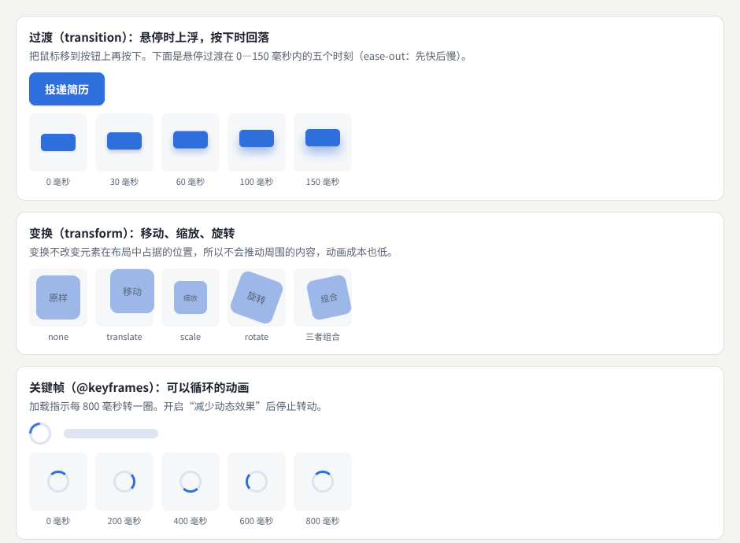

示例：[04-02-css-basics.html](示例/04-02-css-basics.html)

#### 02.2 变换：只改变“画出来的样子”

**变换**（`transform`）可以移动（`translate`）、缩放（`scale`）、旋转（`rotate`），也可以组合。它不改变元素在布局中占据的位置，所以不会推动周围的内容。浏览器通常可以只在“合成”这一步处理变换和透明度（`opacity`），不必重新计算布局，动画成本最低（见《前端界面工程》08 章）。**能用变换和透明度完成的动画，就不要改变宽度、高度、位置或边距。**

#### 02.3 关键帧：可以重复的一段动画

**关键帧**（`@keyframes`）定义一段动画在不同时刻的样子，适合加载指示、提示脉冲这类循环的动画：

```css
.spinner { animation: spin 800ms linear infinite; }
@keyframes spin { to { transform: rotate(1turn); } }
```

#### 02.4 尊重“减少动态效果”

用户在系统中开启“减少动态效果”后，媒体查询 `prefers-reduced-motion: reduce` 会生效。[B01](#ref-b01) 这时应当停止循环动画、去掉大幅度的移动，必要时换成简单的淡入淡出：

```css
@media (prefers-reduced-motion: reduce) {
  .spinner { animation: none; }               /* 停止旋转，用文字或静态图标说明在加载 */
  .btn, .btn:hover { transition: none; transform: none; }
}
```

“减少”不等于“全部删除”：说明状态变化的简短淡入、颜色变化通常可以保留。本册所有示例都处理了这个设置。

#### 02.5 常见问题

- **动画卡顿**：动画改变了宽度、位置等布局属性。改用 `transform`。
- **悬停效果在手机上“粘住”**：触屏没有真正的悬停，点击后悬停样式会一直保留。用媒体查询 `(hover: hover)` 只在支持悬停的设备上启用。
- **页面一打开就有很多东西在动**：动画应当服务于用户的操作或重要的变化，而不是装饰。

**本章练习**：

1. 在 `04-02-css-basics.html` 中把悬停过渡的缓动改为 `ease-in`，比较胶片条中点的分布。
2. 在系统设置中打开“减少动态效果”，检查示例中的加载指示是否停止转动。

<a id="part-2"></a>

## 第二篇：八个方向

<a id="ch03"></a>

### 03 微交互

#### 03.1 解决什么问题

**微交互**是围绕一次小操作组织的**触发、过程和反馈**，例如收藏、复制、切换、提交。最重要的原则是：**状态变化要与实际结果一致**。“复制成功”的动画应当在复制真正完成之后出现；失败时要提供可以理解的替代操作。

#### 03.2 示例：四种微交互

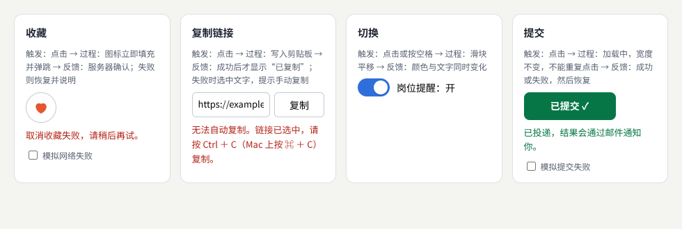

示例：[04-03-micro.html](示例/04-03-micro.html)（可以打开“模拟网络失败”“模拟提交失败”）

| 微交互 | 触发 | 过程 | 反馈 |
| --- | --- | --- | --- |
| 收藏 | 点击 | 图标立即填充并轻轻弹跳（乐观更新） | 服务器确认；失败时恢复原状、轻微摇动，并说明“收藏失败，已恢复原状” |
| 复制 | 点击 | 写入剪贴板 | 写入成功后才显示“已复制”；失败时选中链接，提示用键盘复制 |
| 切换 | 点击或按空格 | 滑块平移 | 颜色与文字同时变化，读屏软件读出“开”或“关” |
| 提交 | 点击 | 显示加载动画，按钮宽度不变，不能重复点击 | 成功显示对勾；失败时摇动并说明，内容保留 |

复制的关键代码：只有 `writeText` 成功后才说“已复制”。在本地文件、非安全连接或用户拒绝授权时，剪贴板接口会失败——示例截图正是在这种情况下拍的，页面给出了替代操作：

```js
try {
  await navigator.clipboard.writeText(link.value);
  copyMsg.textContent = '链接已复制到剪贴板';
} catch {
  link.focus(); link.select();              // 失败时提供替代操作
  copyMsg.textContent = '无法自动复制。链接已选中，请按 Ctrl ＋ C（Mac 上按 ⌘ ＋ C）复制。';
}
```

#### 03.3 常见问题

- **动画显示成功，实际却失败了**：在得到结果之前就播放了“成功”。乐观更新可以先变化，但失败时必须恢复并说明。
- **加载时按钮变窄或变宽，布局跳动**：给按钮固定最小宽度。
- **重复点击触发了多次提交**：加载过程中忽略点击。

**本章练习**：给示例增加“点赞”微交互：点击后数字加一，失败时数字恢复。

**继续深入**：把产品中的微交互整理成一张表：每种操作（收藏、复制、提交、删除）的触发、过程、成功与失败的反馈，统一时长与文案；等待超过约 1 秒时给出加载指示或进度（见[《产品交互与用户体验》](03-产品交互与用户体验.md) 07 章的响应时间）；可以撤销的操作用“撤销”提示代替确认弹窗。

<a id="ch04"></a>

### 04 布局与共享元素过渡

#### 04.1 解决什么问题

列表重排、卡片展开、详情进入时，要让用户看出**对象是连续的**：这还是刚才那张卡片，只是移动了、变大了。需要研究位置、尺寸和内容怎样同时变化，并处理三种麻烦情况：**元素被移除**、**重复打开**、**快速切换**。

#### 04.2 列表重排：FLIP

列表重新排序时，浏览器会让每一项瞬间跳到新位置。要让它们“滑”过去，常用的方法叫 **FLIP**：[B02](#ref-b02)

1. **First**：记下每一项现在的位置。
2. **Last**：改变 DOM，让每一项到达新位置。
3. **Invert**：算出新旧位置的差距，用 `transform` 把每一项“推回”旧位置。
4. **Play**：把这个 `transform` 动画到 0，元素就从旧位置平滑地移到新位置。

```js
function flip(change) {
  // First：记下每一项“现在看到”的位置（如果正在动画中，得到的就是动画中的位置）
  const first = new Map([...list.children].map(li => [li.dataset.id, li.getBoundingClientRect()]));
  for (const li of list.children) li.getAnimations().forEach(a => a.cancel());   // 打断正在进行的动画
  change();                                                                       // Last：改变顺序
  for (const li of list.children) {
    const a = first.get(li.dataset.id), b = li.getBoundingClientRect();
    if (!a) { li.animate([{ opacity: 0 }, { opacity: 1 }], { duration: 250 }); continue; }   // 新出现的项淡入
    const dx = a.left - b.left, dy = a.top - b.top;                               // Invert
    if (dx || dy) li.animate([{ transform: `translate(${dx}px, ${dy}px)` }, { transform: 'none' }],
                             { duration: 400, easing: 'cubic-bezier(.2, .8, .2, 1)' }); // Play
  }
}
```

这段代码处理了三种麻烦情况：

- **快速切换**：在动画进行中再次排序时，`getBoundingClientRect()` 得到的是元素**当前看到的**位置，所以新动画从这里出发，不会跳动。测试中连续快速点击三次排序，最终顺序正确，没有残留的动画。
- **元素被移除**：被删除的项先淡出，再从数据中删掉，其余项用 FLIP 补上空位。
- **新出现的元素**：没有旧位置可比，改为淡入。

#### 04.3 卡片展开：视图过渡

卡片展开成详情时，布局完全变了，自己计算位置很麻烦。浏览器的**视图过渡**可以代劳：给新旧两个画面中“是同一个东西”的元素起同一个 `view-transition-name`，再用 `document.startViewTransition()` 包住界面的更新，浏览器会在旧画面与新画面之间自动生成变形动画。[B03](#ref-b03)

```js
function go(id) {
  if (id) lastOpened = id;                     // 记住打开的是哪张卡片，返回时把焦点放回去
  open = id;
  // 不支持视图过渡或用户要求减少动态效果时直接更新
  if (!document.startViewTransition || reduce.matches) return renderView();
  document.startViewTransition(renderView);
}
```

```css
::view-transition-group(*) { animation-duration: 350ms; animation-timing-function: cubic-bezier(.2, .8, .2, 1); }
```

同一页面内的视图过渡从 2025 年 10 月起在各主流浏览器的最新版本中可用；不支持的浏览器直接切换，内容不受影响。快速连续点击时，浏览器会跳过上一个尚未完成的过渡，**重复打开**也不会叠加。

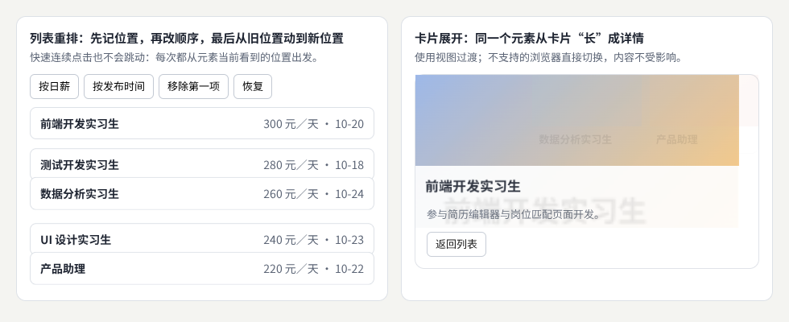

示例：[04-04-flip.html](示例/04-04-flip.html)（截图把两段动画都定格在进行到一半的时刻）

返回列表时，焦点回到刚才打开的那张卡片上，键盘用户不会迷路。

#### 04.4 常见问题

- **动画开始时闪了一下**：测量、取消旧动画、改变 DOM 的顺序错了。先测量当前看到的位置，再取消旧动画、改变 DOM，最后立即开始新动画，中间不要等待下一帧。
- **标题在过渡中被放大或缩小**：视图过渡移动和缩放的是新旧画面的“快照”，字号差别很大时，文字在过程中也会跟着缩放。可以只给图片这类形状接近的元素命名，让文字淡入淡出。
- **过渡没有发生**：同一时刻页面上有两个元素用了同一个 `view-transition-name`，浏览器会跳过这次过渡。名称必须唯一，所以示例给每张卡片加上了编号。

**本章练习**：

1. 在 `04-04-flip.html` 中把重排的时长改为 1 秒，然后快速连续点击“按日薪”与“按发布时间”，观察动画怎样转向。
2. 增加“在开头插入一项”，让新项淡入、其余项向下滑。

**继续深入**：跨页面的视图过渡（`@view-transition`，支持仍然有限）；用 `@starting-style` 设置元素刚出现时的起始样式，让 `display` 从无到有的元素也能过渡；动画库中的布局动画（12 章）。

<a id="ch05"></a>

### 05 运动规律

#### 05.1 解决什么问题

现实中的物体不会匀速启动、匀速停下。动效用**缓动曲线、弹簧、惯性和阻尼**安排运动，让变化显得自然。节奏还取决于物体的尺寸、移动的距离和任务的紧迫程度。**持续时间是设计参数**，应当结合设备、距离和使用场景验证。

#### 05.2 缓动曲线

缓动曲线描述“时间过去了多少”与“完成了多少”的关系：

| 缓动 | 写法 | 感觉 | 适合 |
| --- | --- | --- | --- |
| 匀速 | `linear` | 机械 | 旋转的加载指示、进度条 |
| 先慢后快 | `ease-in` | 加速离开 | 元素离开画面 |
| 先快后慢 | `ease-out` | 迅速到达，轻轻停下 | 元素进入画面、对操作的反馈 |
| 两头慢 | `ease-in-out` | 平稳 | 画面内的位置移动 |
| 强调减速 | `cubic-bezier(.2, .8, .2, 1)` | 快速出发，长距离减速 | 大面积的展开、页面切换 |

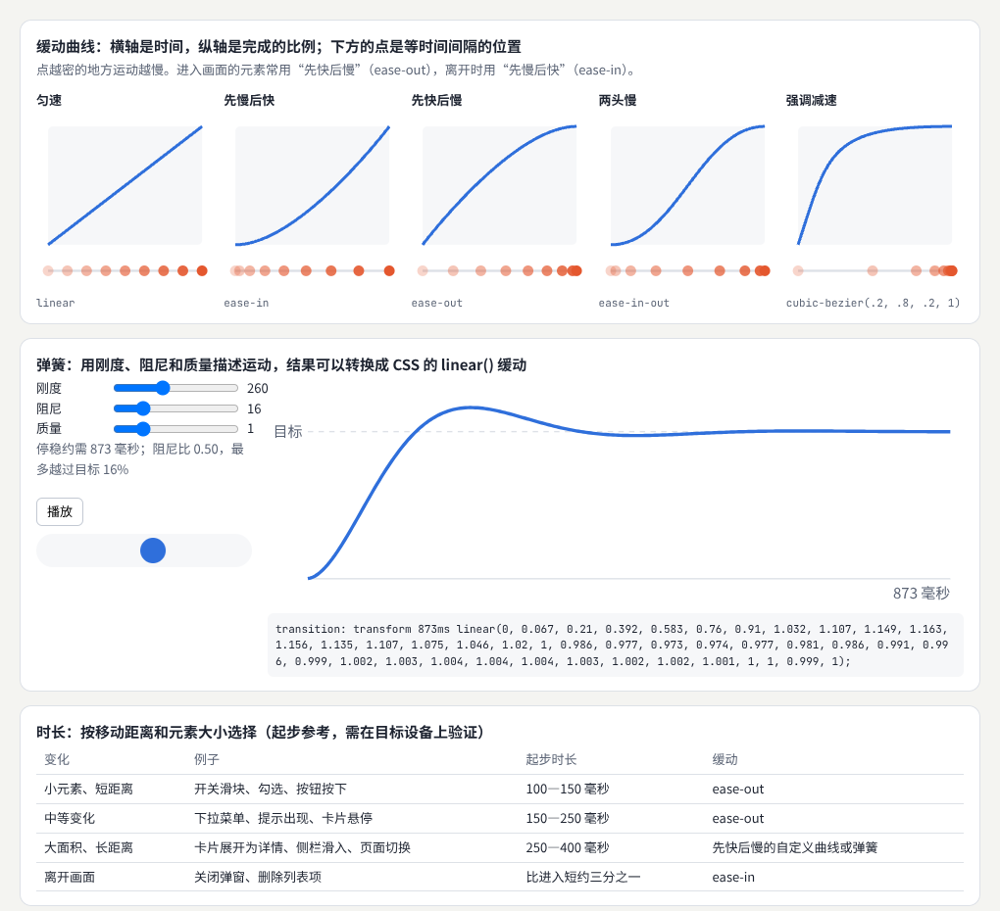

示例：[04-05-easing.html](示例/04-05-easing.html)（可以拖动滑块调整弹簧）

每条曲线下方的点是**等时间间隔**的位置：点越密的地方运动越慢。

#### 05.3 弹簧、惯性与阻尼

**弹簧**用三个物理量描述运动：**刚度**（拉回目标的力有多大）、**阻尼**（让运动停下来的阻力有多大）、**质量**（物体有多“重”）。阻尼较小时，物体会越过目标再回来（回弹）；阻尼足够大时，平稳停下。是否回弹由**阻尼比**决定：阻尼比 ＝ 阻尼 ÷（2 × √（刚度 × 质量）），小于 1 就会回弹。弹簧的好处是可以从任意位置、任意速度出发，非常适合被打断后转向和松手后的回弹（06 章）。

**惯性**是松手后物体按当时的速度继续运动、逐渐减速；**阻尼**决定它减速得多快。

示例用小时间步逐步计算弹簧的运动，并把结果均匀取样，写成 CSS 的 `linear()` 缓动函数——这样，弹簧效果不需要任何库也能在 CSS 中使用。[B04](#ref-b04)

```js
// 弹簧：m·a = −k·(x − 1) − c·v，从 0 出发，用小时间步逐步计算
const a = (-k * (x - 1) - c * v) / m;
v += a * dt; x += v * dt;
// 均匀取 40 个点，写成 linear()
const easing = `linear(${samples.map(v => +v.toFixed(3)).join(', ')})`;
```

示例默认的参数（刚度 260、阻尼 16、质量 1）阻尼比为 0.5，最多越过目标 16%，大约 870 毫秒停稳；浏览器确认生成的 `linear()` 可以直接使用。

#### 05.4 时长

| 变化 | 例子 | 起步时长 | 缓动 |
| --- | --- | --- | --- |
| 小元素、短距离 | 开关滑块、勾选、按钮按下 | 100—150 毫秒 | `ease-out` |
| 中等变化 | 下拉菜单、提示出现、卡片悬停 | 150—250 毫秒 | `ease-out` |
| 大面积、长距离 | 卡片展开为详情、侧栏滑入、页面切换 | 250—400 毫秒 | 先快后慢的自定义曲线或弹簧 |
| 离开画面 | 关闭弹窗、删除列表项 | 比进入短约三分之一 | `ease-in` |

这些只是起步的参考：同样的距离，在手机上通常比在大屏幕上更短；用户反复执行的操作要更快；需要解释复杂变化时可以稍慢。Material Design 的动效规范给出了一套按用途划分的时长与缓动。[B05](#ref-b05) 如果只需要一个起步值，可以记住：小反馈先在约 150—300 毫秒之间试验，再按移动距离、输入方式和用户理解变化所需的时间调整（[《视觉设计与品牌表达》](02-视觉设计与品牌表达.md) 11 章把它写进了视觉规则）。最终要在目标设备上实际体验后决定。

#### 05.5 常见问题

- **所有动画都用同一个时长**：小变化显得拖沓，大变化显得仓促。按 05.4 的表格区分。
- **弹簧迟迟停不下来**：阻尼太小，长时间小幅晃动。增大阻尼，或者在足够接近目标时结束。
- **回弹用错了地方**：错误提示、删除确认这类严肃的反馈，用平稳的缓动；回弹适合轻松的、像实物一样可以拖动的元素。

**本章练习**：

1. 在 `04-05-easing.html` 中把阻尼调到 40，观察阻尼比与回弹的变化。
2. 把生成的 `linear()` 用在你的页面的一个弹出菜单上，比较与 `ease-out` 的感觉。

**继续深入**：为整个产品定义一组时长与缓动的令牌，例如“短、中、长”三档时长和“进入、离开、强调”三种缓动；Motion 与 GSAP 都内置了弹簧或类似的缓动（12 章）；缓动背后的插值、贝塞尔曲线与按时间步计算运动的方法，见[《图形与交互的数学基础》](20-图形与交互的数学基础.md)。

<a id="ch06"></a>

### 06 手势与直接操纵

#### 06.1 解决什么问题

手势包括**拖拽、滑动、缩放、旋转**，以及**松手后的行为**。两个原则：操作期间界面应当紧跟手指，没有延迟；手势结束后清楚地表达结果。还要考虑触屏上手势与页面滚动的冲突，以及鼠标和键盘的替代方式。指针事件统一了鼠标、触摸与触控笔的输入。[B06](#ref-b06)

#### 06.2 示例：滑动卡片

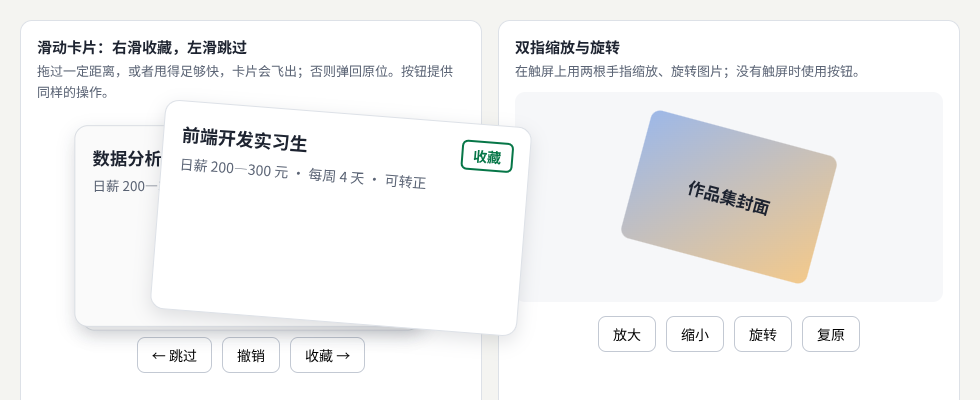

示例：[04-06-gesture.html](示例/04-06-gesture.html)

- **跟手**：拖动时，卡片的位置和角度直接由手指位置决定，不加任何动画延迟；向右显示“收藏”，向左显示“跳过”，越往外越清楚。
- **松手后**：拖过卡片宽度的 35%，**或者**甩得足够快（速度超过每毫秒 0.6 像素），卡片沿当前方向飞出；否则带一点回弹回到原位。速度用最近几次移动估算：两次位置之间的距离除以经过的时间（见[《创意编程与二维图形》](05-创意编程与二维图形.md) 10 章）。

```js
const v = (b.x - a.x) / Math.max(1, b.t - a.t);              // 速度：像素每毫秒
if (Math.abs(dx) > card.offsetWidth * 0.35 || Math.abs(v) > 0.6) return finish(card, Math.sign(Math.abs(v) > 0.6 ? v : dx), dx);
card.animate([{ transform: `translateX(${dx}px) rotate(${dx / 20}deg)` }, { transform: 'none' }],
             { duration: 450, easing: 'cubic-bezier(.3, 1.4, .5, 1)' });    // 弹回：越过一点再停下
```

测试中，慢慢拖 60 像素松手，卡片弹回；快速甩出 90 像素，卡片飞出并收藏；“撤销”可以把它找回来。

#### 06.3 与页面滚动的冲突

在触屏上，手指在卡片上移动时，浏览器不知道你是想拖卡片还是想滚动页面。CSS 的 `touch-action` 可以告诉它：[B07](#ref-b07)

```css
.job { touch-action: pan-y; }   /* 竖向滑动交给浏览器滚动页面，横向由脚本处理 */
.viewer { touch-action: none; } /* 双指缩放区域：所有触摸都由脚本处理 */
```

#### 06.4 双指缩放与旋转

两根手指之间的**距离**决定缩放，两指连线的**角度**决定旋转：

```js
const geom = () => { const [a, b] = [...pointers.values()];
  return { d: Math.hypot(b.x - a.x, b.y - a.y), ang: Math.atan2(b.y - a.y, b.x - a.x) * 180 / Math.PI }; };
view.scale = Math.min(3, Math.max(0.5, base.scale * g.d / base.d));   // 距离变成两倍，图片放大两倍（限制在 0.5—3 倍）
view.angle = base.angle + (g.ang - base.ang);                          // 连线转了多少度，图片就转多少度
```

用浏览器调试协议发送真实的两点触摸测试：两指距离变为原来的两倍、连线转 45 度，图片的变换正好是 `scale(2) rotate(45deg)`。

#### 06.5 替代方式

手势是快捷方式，不能是唯一的方式。示例为滑动提供了“跳过”“收藏”按钮，为缩放与旋转提供了“放大”“缩小”“旋转”“复原”按钮——鼠标、键盘、读屏软件用户和无法做精细手势的人都能完成同样的操作（WCAG 2.5.7，见[《产品交互与用户体验》](03-产品交互与用户体验.md) 06 章）。

#### 06.6 常见问题

- **拖动时页面也跟着滚动**：没有设置 `touch-action`。
- **手指移出卡片后，拖动就断了**：按下时调用 `setPointerCapture`，之后这根手指的移动事件都会发给这张卡片，即使手指已经移到卡片外面。
- **轻点一下也被当成了拖动**：设定一个小的阈值，例如移动超过 5 像素才开始拖动。

**本章练习**：给滑动卡片增加“向上滑动查看详情”，并处理与页面竖向滚动的冲突。

**继续深入**：用 `getCoalescedEvents()` 取得更密集的指针采样（见《创意编程与二维图形》05 章）；GSAP 的 Draggable 与 InertiaPlugin 处理拖动和松手后的惯性；三维空间中的手势、注视与语音输入，见[《人机交互与新型媒介》](12-人机交互与新型媒介.md)。

<a id="ch07"></a>

### 07 动态排版

#### 07.1 解决什么问题

动态排版用文字的**分段、路径、遮罩、字形变化和节奏**表达内容。要求是：正文和重要信息应当保留**可读、可选择**的呈现；标题特效需要检查**中文字符、长文本和减少动态效果的模式**。

#### 07.2 逐词出现与中文分词

逐词出现要先把标题拆成词。浏览器提供了分词接口 `Intl.Segmenter`，[B08](#ref-b08) 但它对中文的分词并不总是符合需要：在测试的浏览器中，“让每一次投递都更有把握”被分成了“让｜每一｜次｜投｜递｜都｜更有｜把握”，把“投递”拆开了。重要的标题最好**人工指定分词**（示例中为“让｜每一次｜投递｜都更有｜把握”），或者干脆逐字出现。

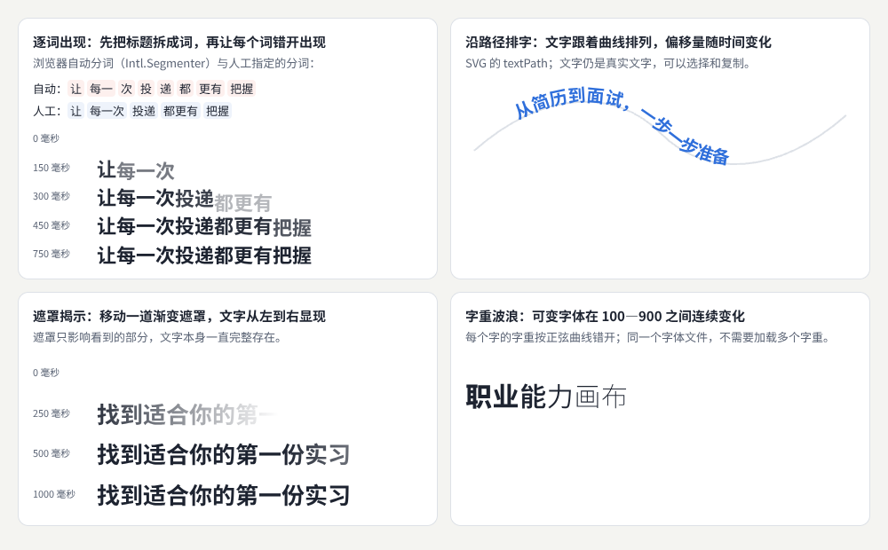

示例：[04-07-kinetic-type.html](示例/04-07-kinetic-type.html)

```js
const MANUAL = ['让', '每一次', '投递', '都更有', '把握'];            // 人工确认的分词
MANUAL.forEach((w, i) => {
  const span = Object.assign(document.createElement('span'), { className: 'w', textContent: w });
  line.append(span);
  span.animate([{ opacity: 0, transform: 'translateY(.4em)' }, { opacity: 1, transform: 'none' }],
               { duration: 360, delay: i * 90, easing: 'cubic-bezier(.2, .8, .2, 1)', fill: 'both' });
});
```

每个词设置为 `display: inline-block`，换行只会发生在词与词之间，长标题也不会把词拆开。为了让读屏软件读到完整、通顺的标题，示例把完整的标题放在一个视觉上隐藏的元素中，拆开的动画层设置为 `aria-hidden="true"`。

#### 07.3 沿路径排字、遮罩与字形变化

- **沿路径排字**：SVG 的 `textPath` 让文字沿着曲线排列，改变 `startOffset` 文字就沿曲线移动。[B09](#ref-b09) 文字仍是真实的文字，可以选择和复制。
- **遮罩揭示**：移动一道渐变遮罩（`mask-image`），文字从左到右显现。遮罩只影响看到的部分，文字本身一直完整存在。
- **字形变化**：可变字体的字重可以在 100—900 之间连续变化。示例让每个字的字重按正弦曲线错开，形成波浪；同一个字体文件，不需要加载多个字重。

GSAP 的 SplitText 插件可以把文字拆成字、词、行，并处理换行与读屏软件的问题。[B10](#ref-b10)

#### 07.4 常见问题

- **读屏软件逐字读出拆开的标题**：给动画层加 `aria-hidden="true"`，另外提供完整的文字。
- **拆开后长标题换行位置奇怪**：按词拆分，并把每个词设为 `inline-block`。
- **减少动态效果时文字一直不出现**：动画的最终状态必须是完整显示的文字；减少动态效果时直接显示最终状态。

**本章练习**：把示例的逐词出现改为逐字出现，比较两种节奏；再换一个两行的长标题检查换行。

**继续深入**：可变字体的其他轴，例如宽度、倾斜和光学尺寸；中文字体文件很大，动画用的字体同样需要子集化与按需加载（见《前端界面工程》04 章）；把文字变成点阵和粒子，见《创意编程与二维图形》07 章。

<a id="ch08"></a>

### 08 滚动叙事与镜头编排

#### 08.1 解决什么问题

滚动叙事把**滚动位置与章节、画面或模型的变化**联系起来，规划每个章节的**进入、停留和退出**。首先要明确：**滚动是在浏览内容，还是在控制一段演示**？浏览内容时，用户应当能以自己的速度阅读、随时跳转；控制演示时，也要保留清楚的**进度和导航**。

#### 08.2 示例：写一份好简历

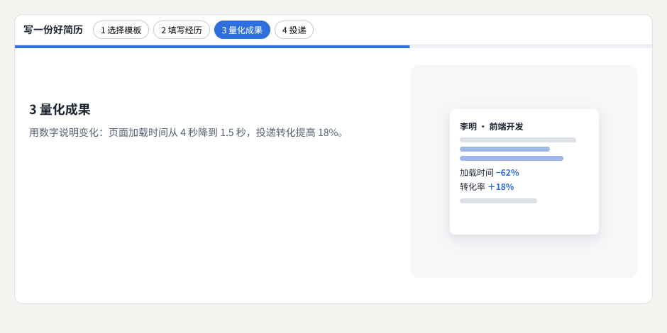

示例：[04-08-scrolly.html](示例/04-08-scrolly.html)

- **进入**：章节越过滚动区域的中线时成为当前章节，用 `IntersectionObserver` 检测。
- **停留**：右侧的画面用 `position: sticky` 停在原处，随章节变化：填写经历时出现内容，量化成果时出现数字，投递时盖上“已投递”。
- **退出**：下一章接替时，画面转入下一个状态；向上滚动时按相反的顺序回到之前的状态。
- **进度与导航**：顶部的进度条显示读到了哪里，章节按钮可以直接跳到任何一章。

#### 08.3 滚动驱动动画与回退

较新的 CSS **滚动驱动动画**可以让动画的进度直接跟随滚动位置，不需要脚本：[B11](#ref-b11)

```css
@supports (animation-timeline: scroll()) {
  .shell { timeline-scope: --story; }        /* 时间线默认只对滚动容器内部可见；进度条在容器外，要扩大可见范围 */
  .scroller { scroll-timeline: --story block; }
  .progress i { animation: grow linear both; animation-timeline: --story; }
}
```

制作示例时踩到了一个坑：进度条一直是满的。原因是命名的滚动时间线默认只对滚动容器**内部**的元素可见，而进度条在容器外面；在共同的祖先上加 `timeline-scope` 后才正常。

滚动驱动动画目前只有部分浏览器支持，所以示例用 `@supports` 判断：不支持时，脚本在滚动事件中更新进度条。测试中，两种方式在第 3 章时得到同样的进度（约 62%）。

#### 08.4 镜头编排

滚动叙事中的画面变化可以看作镜头：推近、拉远、切换角度。三维场景中的镜头与滚动的配合，见[《三维内容与空间设计》](06-三维内容与空间设计.md)中的相机飞行与产品拆解；滚动驱动的产品拆解是[《常见视觉效果拆解》](19-常见视觉效果拆解.md)中的一个完整例子。

#### 08.5 常见问题

- **用户滚得太快，跳过了内容**：内容不应只在动画中出现；每个章节的文字始终可以阅读。
- **页面被“劫持”，滚轮一动就跳一整屏**：尽量不要改变浏览器自然的滚动方式。
- **手机上卡顿**：滚动时只改变 `transform` 和 `opacity`，并在真机上测试。

**本章练习**：给示例增加第 5 章“准备面试”，并让进度条在每章之间平滑地前进。

**继续深入**：视图时间线（`view-timeline`）让元素在进入、穿过、离开视口的过程中驱动动画；GSAP 的 ScrollTrigger 提供画面固定（pin）与平滑的滚动关联；滚动驱动的三维场景，见《三维内容与空间设计》12 章的相机飞行。

<a id="ch09"></a>

### 09 声音与运动配合

#### 09.1 解决什么问题

把**音效、音乐节拍与视觉事件**联系起来，可以加强反馈与节奏感。但声音的**触发、音量、开关和静音状态**都应当由用户理解和控制；**关掉声音后，主要信息仍应完整**。

#### 09.2 示例：提示音与节拍

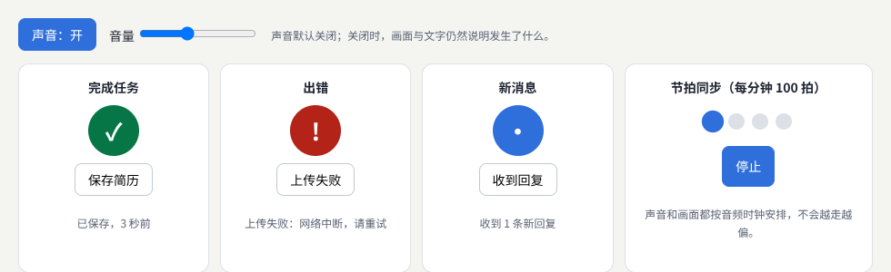

示例：[04-09-sound.html](示例/04-09-sound.html)

- **声音默认关闭**：打开后才创建音频上下文。浏览器要求在用户操作之后才能开始播放声音。
- **每个事件三重反馈**：画面（图标外扩的光环）、文字（“已保存，3 秒前”）、声音（可选）。声音只是补充。
- **音色有含义**：完成任务用两个上行的音，出错用低沉、略粗糙的音，新消息用短促轻快的音。
- **平滑的包络**：每个音都在 10 毫秒内淡入、再逐渐淡出，避免“咔哒”声。

示例用 Web Audio API 直接合成声音，不需要音频文件：[B12](#ref-b12)

```js
function tone(freq, at, len, type = 'sine', peak = 0.6) {
  const o = ctx.createOscillator(), g = ctx.createGain();
  o.type = type; o.frequency.value = freq;
  g.gain.setValueAtTime(0, at);
  g.gain.linearRampToValueAtTime(peak, at + 0.01);        // 10 毫秒淡入
  g.gain.exponentialRampToValueAtTime(0.001, at + len);   // 逐渐淡出
  o.connect(g).connect(master);
  o.start(at); o.stop(at + len + 0.02);
}
```

#### 09.3 让声音和画面同步

节拍器要求声音与画面严格同步。`setTimeout` 的时间不精确，用它直接播放声音，节拍会忽快忽慢、越走越偏。正确的做法是以**音频时钟**为准：每隔 25 毫秒检查一次，把接下来 0.1 秒内要响的拍子**提前安排**到音频时钟的准确时刻；画面也按这些时刻点亮。[B13](#ref-b13) 测试中，每分钟 100 拍的画面间隔约为 594—606 毫秒（理论值 600 毫秒），声音本身由音频时钟精确安排。页面隐藏时，节拍器自动停止，不会在后台继续发声。

声音设计的系统方法（提示音体系、听觉层级、公共环境）见[《包容、国际化与多感官》](16-包容国际化与多感官.md)。

#### 09.4 常见问题

- **第一次点击没有声音**：浏览器要求用户操作之后才能播放声音。在点击事件中创建音频上下文，或者调用 `resume()` 恢复它。
- **声音开头或结尾有“咔哒”声**：音量突然变化。用包络让音量在几毫秒内淡入、淡出。
- **切到别的标签页还在响**：监听 `visibilitychange`，页面隐藏时停止。

**本章练习**：给示例增加“静音时用画面闪动代替节拍声”的选项，并检查闪动频率不超过每秒 3 次。

**继续深入**：用分析节点（`AnalyserNode`）取得音乐的音量与频谱，让画面随音乐变化（见《创意编程与二维图形》09 章）；用 Web Audio 的声像节点把声音放在左右不同的位置，配合画面中物体的位置。

<a id="ch10"></a>

### 10 动画状态与运行质量

#### 10.1 解决什么问题

真实页面中的动画会被**暂停、取消、反向、排队和中断**。还要检查**页面不可见时的执行**、**动画对象的清理**，以及**多个效果同时运行的表现**，并为用户的动态效果偏好提供合适的简化。

#### 10.2 控制一段动画

`element.animate()` 返回一个动画对象，可以随时控制：[B14](#ref-b14)

| 操作 | 写法 | 说明 |
| --- | --- | --- |
| 暂停与继续 | `anim.pause()`、`anim.play()` | — |
| 反向 | `anim.reverse()` | 从当前位置倒着播放 |
| 取消 | `anim.cancel()` | 移除动画效果，回到原样 |
| 改变速度 | `anim.updatePlaybackRate(2)` | 平滑地变成两倍速 |
| 等待结束 | `await anim.finished` | 被取消时会抛出 `AbortError` |
| 中途改变目标 | 读出当前位置，以它为起点开始新动画 | 不会跳回起点 |

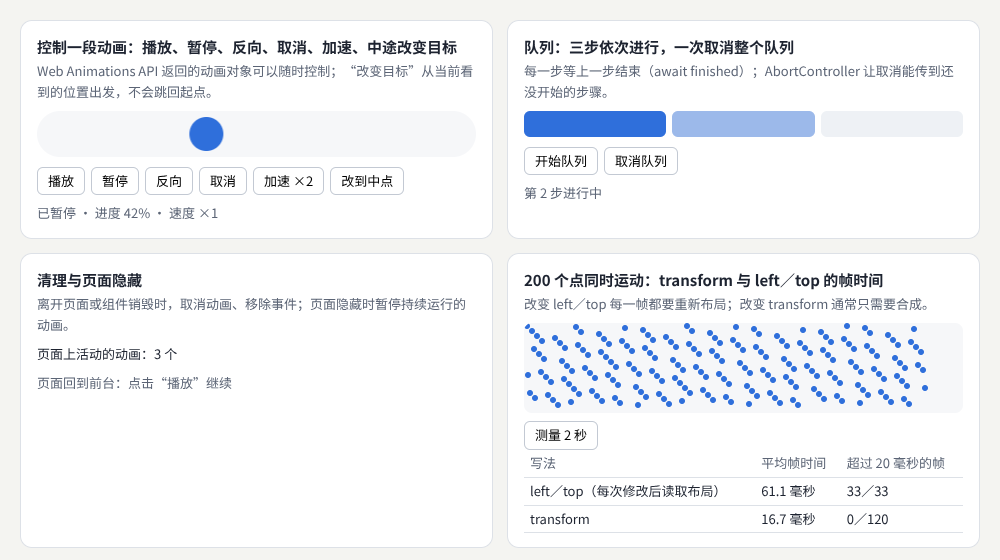

示例：[04-10-control.html](示例/04-10-control.html)

测试中：播放后暂停在 38%，反向后速度变为 ×−1，加速后为 ×−2；“改到中点”从当前位置出发，最终停在 393 像素轨道的 197 像素处。

#### 10.3 队列与取消

多个动画依次进行时，用 `await` 等待上一步结束；用 `AbortController` 让一次“取消”传到整个队列，包括还没开始的步骤：

```js
for (const [i, bar] of bars.entries()) {
  if (signal.aborted) throw new DOMException('已取消', 'AbortError');
  const a = bar.animate([{ background: '#eef1f5' }, { background: '#2f6fdb' }], { duration: 700, fill: 'forwards' });
  signal.addEventListener('abort', () => a.cancel(), { once: true });   // 取消时，正在进行的一步也停下
  await a.finished;                                                       // 被取消时这里会抛出 AbortError
}
```

#### 10.4 清理与页面隐藏

- **清理**：组件销毁或离开页面时，取消它的动画、移除事件监听（可以用 `AbortController` 一次移除）。`document.getAnimations()` 可以列出页面上所有活动的动画，示例实时显示这个数量，取消后变为 0。
- **页面隐藏**：浏览器在后台标签页中会暂停 `requestAnimationFrame`，但 `setInterval` 和声音不会自动停止。监听页面可见性的变化（`visibilitychange`），在隐藏时暂停持续运行的动画与声音。[B15](#ref-b15)

#### 10.5 多个效果同时运行

示例让 200 个点同时运动 2 秒，比较两种写法的帧时间（截图中的一次运行）：

| 写法 | 平均帧时间 | 超过 20 毫秒的帧 |
| --- | --- | --- |
| 改变 left／top，并在每次修改后读取布局 | 61.1 毫秒 | 33／33 |
| 改变 transform | 16.7 毫秒 | 0／120 |

每秒 60 帧时，每帧只有约 16.7 毫秒。改变 `transform` 的写法稳定地达到了这个速度；改变位置并穿插读取布局的写法，每一帧都超时，画面明显卡顿（原因见[《前端界面工程》](01-前端界面工程.md) 08 章）。具体数值随设备和每次运行变化——另一次运行中，前者平均为 48.0 毫秒——但两者的差距始终在两倍以上。

#### 10.6 可访问性的底线

- **可以暂停**：自动开始、持续超过 5 秒、与其他内容同时出现的运动内容（例如轮播、滚动的公告），要提供暂停、停止或隐藏的方法（WCAG 2.2.2，A 级）。[B16](#ref-b16)
- **可以关闭交互引发的动画**：由用户操作触发的运动动画，除非是必需的，应当能够关闭（WCAG 2.3.3，AAA 级）。[B17](#ref-b17) 尊重 `prefers-reduced-motion` 是最常用的做法。
- **不要闪烁**：任何内容每秒闪烁不能超过 3 次，否则可能引发光敏性癫痫。

#### 10.7 常见问题

- **组件已经移除，动画和计时器还在运行**：没有清理。组件销毁时取消动画、清除计时器、移除事件监听。
- **`await anim.finished` 报错**：动画被取消时，`finished` 会以 `AbortError` 结束。用 `try`／`catch` 区分“被取消”和真正的错误，示例的队列就是这样处理的。
- **两个动画同时改变同一个属性**：后开始的动画会覆盖先开始的。开始新动画前先取消旧的，或者从当前看到的值出发（10.2 的“中途改变目标”）。

**本章练习**：

1. 在 `04-10-control.html` 中，播放后切换到另一个标签页再回来，观察动画状态。
2. 把“测量 2 秒”中的 transform 写法改为改变 left／top 但不读取布局，比较帧时间。

**继续深入**：浏览器开发者工具的“动画”面板可以放慢、重放和逐帧查看动画；性能面板可以找出超时的帧和原因（见[《质量、性能与设计运营》](18-质量性能与设计运营.md)）。

<a id="part-3"></a>

## 第三篇：综合项目与工具

<a id="ch11"></a>

### 11 综合项目：列表到详情的连贯动效

#### 11.1 目标与验收

给一个“列表到详情”的流程增加动效：**选中卡片、展开详情、编辑内容、保存、返回列表**。连续快速点击、切换方向，观察内容和动画是否脱节；使用触屏和键盘测试；开启减少动态效果的偏好后，检查信息是否仍然清楚。

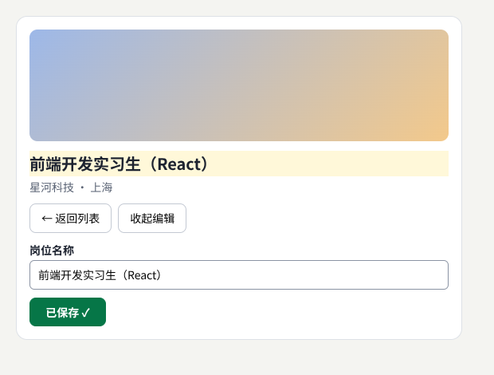

示例：[04-11-flow.html](示例/04-11-flow.html)

#### 11.2 每一步的动效

| 步骤 | 动效 | 用途 |
| --- | --- | --- |
| 选中卡片、展开详情 | 卡片的图片与标题通过视图过渡变成详情的大图与标题 | 解释关系：这是同一个岗位 |
| 编辑内容 | 编辑区从 0 高度展开到内容高度 | 组织注意力：输入框出现在标题下方 |
| 保存 | 按钮显示“正在保存…”，然后变为“已保存”；新标题闪一下 | 反馈：改动已经生效 |
| 返回列表 | 详情缩回到列表中的卡片，焦点回到这张卡片，卡片显示新标题 | 解释关系与连续性 |

编辑区的展开用了一个不需要知道内容高度的技巧：把网格的行从 `0fr` 过渡到 `1fr`。

```css
.editor { display: grid; grid-template-rows: 0fr; transition: grid-template-rows .3s cubic-bezier(.2, .8, .2, 1); }
.editor.open { grid-template-rows: 1fr; }
.editor > div { overflow: hidden; }
```

#### 11.3 打断、键盘与减少动态效果

- **保存过程中**：忽略重复点击，也不允许返回，避免保存了一半就离开。测试中，保存时连点两次“保存”、按一次 Esc，都没有产生作用。
- **键盘**：卡片是按钮，可以用 Tab 和回车打开；Esc 返回列表；打开详情时焦点移到“返回”，返回时焦点回到原来的卡片。
- **减少动态效果**：不使用视图过渡，编辑区直接展开，新标题不闪烁；所有信息仍然完整。

#### 11.4 验收清单

- [ ] 每个动画都能说出用途：反馈、解释关系或组织注意力。
- [ ] 快速连续点击、中途改变方向，内容与动画不脱节，不出现残留的动画。
- [ ] 动画的最终状态与真实数据一致：保存失败时不显示“已保存”。
- [ ] 只用键盘可以完成整个流程，焦点始终可见、位置合理。
- [ ] 触屏上可以完成整个流程，手势有按钮替代。
- [ ] 开启减少动态效果后，没有大幅度的运动，信息仍然完整。
- [ ] 页面隐藏时，持续的动画与声音暂停；离开时动画被清理。
- [ ] 在中低端设备上，动画保持流畅。
- [ ] 交付动效说明、可操作的项目和录屏：说明每个动画的触发、目标、时长、取消与恢复，以及在哪些输入和状态下运行。

<a id="ch12"></a>

### 12 工具：CSS、Motion 与 GSAP

#### 12.1 工具的位置

CSS 适合许多简单的过渡。Motion 和 GSAP 可以帮助组织更复杂的动画与交互，但选择之前应当先写清楚状态和节奏。动画库解决的是**实现与编排**的问题；**动效设计**负责决定什么应该动、怎样动，以及何时结束。

| 工具 | 擅长 | 适合 |
| --- | --- | --- |
| CSS（过渡、关键帧、视图过渡、滚动驱动动画） | 不需要库，性能好，可以用 `linear()` 写弹簧 | 悬停与按下、简单的进场、加载指示 |
| Web Animations API | 用脚本创建和控制动画：暂停、反向、等待结束 | 需要精确控制的交互动画（本册多数示例） |
| Motion | 简洁的函数接口，内置弹簧、滚动、进入视口、布局动画 | 交互丰富的产品界面，React 项目尤其方便 |
| GSAP | 时间线编排复杂的先后与重叠；插件丰富（滚动、拆分文字、布局变化、拖动与惯性） | 品牌官网、营销页面、复杂的叙事动画 |

Motion 的文档按功能介绍了它的接口；[B18](#ref-b18) GSAP 的文档包括时间线与各个插件。[B19](#ref-b19) 从 3.13 版（2025 年 4 月）起，GSAP 连同全部插件——包括 SplitText、ScrollTrigger、Flip——都可以免费使用，包括商业项目。[B20](#ref-b20)

#### 12.2 示例：同一组动画的三种写法

示例用三种工具实现同一组动画：五个标签依次进场，一个方块带回弹地移到终点。测试确认三种写法的最终状态完全一致。

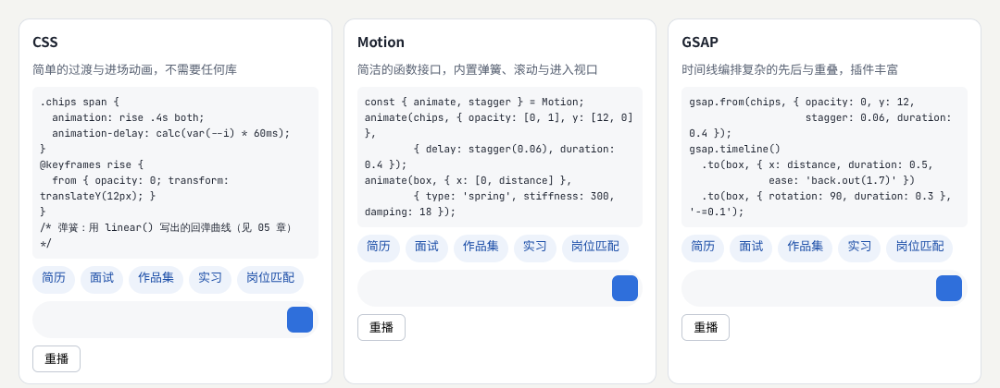

示例：[04-12-libs.html](示例/04-12-libs.html)

```js
// Motion
animate(chips, { opacity: [0, 1], y: [12, 0] }, { delay: stagger(0.06), duration: 0.4 });
animate(box, { x: [0, distance] }, { type: 'spring', stiffness: 300, damping: 18 });

// GSAP
gsap.from(chips, { opacity: 0, y: 12, stagger: 0.06, duration: 0.4 });
gsap.timeline()
  .to(box, { x: distance, duration: 0.5, ease: 'back.out(1.7)' })
  .to(box, { rotation: 90, duration: 0.3 }, '-=0.1');   // 在上一步结束前 0.1 秒开始，两段重叠
```

制作示例时遇到一个值得注意的细节：Motion 会记住上一次动画结束时的值，重播时如果只写终点（`x: distance`），它认为已经在终点，就不会再动；写成 `x: [0, distance]`，明确起点，才能每次从头播放。

#### 12.3 怎样选择

1. 先用 CSS 和 Web Animations API 实现；它们已经覆盖了大多数产品界面的需要。
2. 需要大量弹簧、手势与布局动画，尤其在 React 项目中，考虑 Motion。
3. 需要编排复杂的时间线、滚动叙事和文字效果，考虑 GSAP。
4. 一个项目尽量只用一个动画库，避免两套机制互相干扰。
5. 记录使用的版本，并在项目中统一时长、缓动的取值（见《视觉设计与品牌表达》11 章的设计令牌）。

<a id="ch13"></a>

### 13 继续深入与学习路线

#### 13.1 八个方向的纵向深入

| 方向 | 入门 | 进阶 | 深入 |
| --- | --- | --- | --- |
| 微交互 | 悬停、按下、加载 | 乐观更新与失败恢复 | 一套产品级的反馈规范 |
| 布局与共享元素过渡 | 淡入淡出 | FLIP、视图过渡 | 跨页面过渡、复杂布局动画 |
| 运动规律 | 缓动曲线 | 弹簧与 `linear()` | 物理模拟、动效规范 |
| 手势与直接操纵 | 拖动 | 速度判断、松手后的行为、双指 | 手势识别、空间输入 |
| 动态排版 | 逐字出现 | 分词、路径、遮罩 | 可变字体动画、动态字体设计 |
| 滚动叙事 | 进入视口时出现 | 吸顶画面与章节 | 滚动驱动的三维叙事 |
| 声音与运动 | 提示音与静音 | 音频时钟同步 | 声音设计体系 |
| 动画状态与质量 | 暂停与取消 | 队列、打断、清理 | 复杂场景的性能剖析 |

#### 13.2 动效与创意表达的阶段目标

动效与创意表达的学习阶段，要掌握缓动、时间线、布局过渡、滚动关联、手势，以及 SVG 或 Canvas。先让操作反馈连贯，再设计品牌叙事和视觉实验。动画应当支持暂停、反向和中途打断，并为减少动态效果的用户提供合适的呈现。这一阶段的成果既要有录屏展示，也要有可以操作的版本，并说明动画在哪种输入和状态下运行。

#### 13.3 横向连接

- 用代码驱动图形与粒子：[《创意编程与二维图形》](05-创意编程与二维图形.md)。
- 三维中的动画与相机运动：[《三维内容与空间设计》](06-三维内容与空间设计.md)。
- 着色器驱动的实时特效：[《技术美术与实时效果》](07-技术美术与实时效果.md)。
- 动作与时间知觉的原理：[《感知与认知》](13-感知与认知.md)。
- 常见动效的拆解（按钮弹性反馈、卡片展开、平滑列表重排、滚动叙事、动态文字）：[《常见视觉效果拆解》](19-常见视觉效果拆解.md)。

<a id="appendix-a"></a>

## 附录 A：术语表

| 术语 | 含义 | 阅读位置 |
| --- | --- | --- |
| 动效 | 通过时间中的变化传递关系、反馈与节奏 | 01 |
| 过渡 | 属性从一个值平滑地变到另一个值 | 02 |
| 变换 | 移动、缩放、旋转元素，不影响布局 | 02 |
| 关键帧 | 定义一段动画在不同时刻的样子 | 02 |
| 减少动态效果 | 用户要求减少界面运动的系统设置 | 02 |
| 微交互 | 围绕一次小操作组织的触发、过程与反馈 | 03 |
| 乐观更新 | 先在界面上显示结果，失败后再恢复 | 03 |
| FLIP | 记下位置、改变布局、推回旧位置、动画到新位置的方法 | 04 |
| 视图过渡 | 浏览器在新旧画面之间自动生成过渡的功能 | 04 |
| 共享元素 | 在两个画面中代表同一个东西的元素 | 04 |
| 缓动 | 控制动画过程中变化速度的方式 | 05 |
| 弹簧动画 | 用刚度、阻尼与质量描述的运动 | 05 |
| 阻尼比 | 衡量弹簧是否回弹的比值，小于 1 会回弹 | 05 |
| 惯性 | 松手后按当时的速度继续运动并逐渐减速 | 05、06 |
| 跟手 | 拖动时界面紧跟手指、没有延迟 | 06 |
| 双指缩放 | 用两指距离控制缩放、连线角度控制旋转 | 06 |
| 分词 | 把句子切分成词语 | 07 |
| 可变字体 | 字重等属性可以连续变化的字体 | 07 |
| 滚动叙事 | 随滚动推进的章节式呈现 | 08 |
| 滚动驱动动画 | 进度直接由滚动位置决定的 CSS 动画 | 08 |
| 音频时钟 | 音频上下文中精确的时间，用来安排声音 | 09 |
| 时间线 | 安排多个动画先后、重叠与同步的结构 | 10、12 |
| 帧时间 | 生成一帧画面所用的时间，每秒 60 帧约 16.7 毫秒 | 10 |

<a id="appendix-b"></a>

## 附录 B：资料入口

以下资料用于核对方法来源和继续学习。资料核对日期：2026-10-25。

<a id="ref-b01"></a>
**B01 · MDN：prefers-reduced-motion。** [prefers-reduced-motion](https://developer.mozilla.org/en-US/docs/Web/CSS/Reference/At-rules/@media/prefers-reduced-motion)。对应 02 章，识别用户减少动态效果的偏好。

<a id="ref-b02"></a>
**B02 · Paul Lewis：FLIP 你的动画。** [FLIP Your Animations](https://aerotwist.com/blog/flip-your-animations/)。对应 04 章，FLIP 方法的原始介绍。

<a id="ref-b03"></a>
**B03 · MDN：View Transition API。** [View Transition API](https://developer.mozilla.org/en-US/docs/Web/API/View_Transition_API)。对应 04 章，视图过渡的用法。

<a id="ref-b04"></a>
**B04 · MDN：linear() 缓动函数。** [linear()](https://developer.mozilla.org/en-US/docs/Web/CSS/Reference/Values/easing-function/linear)。对应 05 章，用一组点描述任意缓动，包括弹簧。

<a id="ref-b05"></a>
**B05 · Material Design 3：缓动与时长。** [Easing and duration](https://m3.material.io/styles/motion/easing-and-duration/tokens-specs)。对应 05 章，按用途划分的时长与缓动取值。

<a id="ref-b06"></a>
**B06 · MDN：指针事件。** [Pointer events](https://developer.mozilla.org/en-US/docs/Web/API/Pointer_events)。对应 06 章，统一处理鼠标、触摸与触控笔。

<a id="ref-b07"></a>
**B07 · MDN：touch-action。** [touch-action](https://developer.mozilla.org/en-US/docs/Web/CSS/Reference/Properties/touch-action)。对应 06 章，处理手势与页面滚动的冲突。

<a id="ref-b08"></a>
**B08 · MDN：Intl.Segmenter。** [Intl.Segmenter](https://developer.mozilla.org/en-US/docs/Web/JavaScript/Reference/Global_Objects/Intl/Segmenter)。对应 07 章，按字、词、句切分文本。

<a id="ref-b09"></a>
**B09 · MDN：textPath。** [textPath](https://developer.mozilla.org/en-US/docs/Web/SVG/Reference/Element/textPath)。对应 07 章，让文字沿路径排列。

<a id="ref-b10"></a>
**B10 · GSAP：SplitText。** [SplitText](https://gsap.com/docs/v3/Plugins/SplitText/)。对应 07 章，把文字拆成字、词、行用于动画。

<a id="ref-b11"></a>
**B11 · MDN：滚动驱动动画。** [Scroll-driven animations](https://developer.mozilla.org/en-US/docs/Web/CSS/Guides/Scroll-driven_animations)。对应 08 章，滚动时间线与视图时间线。

<a id="ref-b12"></a>
**B12 · MDN：Web Audio API。** [Web Audio API](https://developer.mozilla.org/en-US/docs/Web/API/Web_Audio_API)。对应 09 章，合成与控制声音。

<a id="ref-b13"></a>
**B13 · web.dev：两个时钟的故事。** [A tale of two clocks](https://web.dev/articles/audio-scheduling)。对应 09 章，用音频时钟精确安排声音的方法。

<a id="ref-b14"></a>
**B14 · MDN：Web Animations API。** [Web Animations API](https://developer.mozilla.org/en-US/docs/Web/API/Web_Animations_API)。对应 10 章，用脚本创建与控制动画。

<a id="ref-b15"></a>
**B15 · MDN：Page Visibility API。** [Page Visibility API](https://developer.mozilla.org/en-US/docs/Web/API/Page_Visibility_API)。对应 10 章，检测页面是否可见。

<a id="ref-b16"></a>
**B16 · W3C：理解 WCAG 2.2.2 暂停、停止、隐藏。** [Understanding Pause, Stop, Hide](https://www.w3.org/WAI/WCAG22/Understanding/pause-stop-hide.html)。对应 10 章。

<a id="ref-b17"></a>
**B17 · W3C：理解 WCAG 2.3.3 交互引发的动画。** [Understanding Animation from Interactions](https://www.w3.org/WAI/WCAG22/Understanding/animation-from-interactions.html)。对应 10 章。

<a id="ref-b18"></a>
**B18 · Motion 文档。** [Motion](https://motion.dev/docs)。对应 12 章，动画与交互的实现。

<a id="ref-b19"></a>
**B19 · GSAP 文档。** [GSAP](https://gsap.com/docs/v3/)。对应 12 章，时间线与复杂动画的编排。

<a id="ref-b20"></a>
**B20 · GSAP：3.13 版发布说明。** [3.13 release](https://gsap.com/blog/3-13/)。对应 12 章，2025 年 4 月起 GSAP 及全部插件免费。

<a id="appendix-c"></a>

## 附录 C：与原手册的对应关系及修订记录

### C.1 与原手册的对应关系

本册由原《前端与 UI／UX 设计进阶全景手册》第 06 章“动效与时间设计”扩写而成，并吸收了其他章节中的相关内容：

| 原手册内容 | 本册位置 |
| --- | --- |
| 6.1 研究对象与先修要求 | 01、02 章 |
| 6.2 分支 1：微交互 | 03 章 |
| 6.2 分支 2：布局与共享元素过渡 | 04 章 |
| 6.2 分支 3：运动规律 | 05 章 |
| 6.2 分支 4：手势与直接操纵 | 06 章 |
| 6.2 分支 5：动态排版 | 07 章 |
| 6.2 分支 6：滚动叙事与镜头编排 | 08 章 |
| 6.2 分支 7：声音与运动配合 | 09 章 |
| 6.2 分支 8：动画状态与运行质量 | 10 章 |
| 6.3 练习与验收：列表到详情的动效 | 11 章 |
| 6.4 工具位置：CSS、Motion、GSAP | 12 章 |
| 2.5 学习阶段 S3：动效与创意表达 | 13 章 |
| 23.2 视觉规则中的动效时长 | 05 章 |

### C.2 修订记录

| 版本 | 日期 | 主要变化 |
| --- | --- | --- |
| 1.0 | 2026-10-25 | 初版：由原手册第 06 章扩写，新增 11 个可运行示例与截图 |
