# 创意编程与二维图形

> 用代码画图、做动画、响应输入：从在网页上画出第一个圆，到做出可交互的海报、画板、数据图形和小游戏。  
> 版本：1.0 · 整理日期：2026-10-25  
> 适用对象：会一点 HTML 与 JavaScript、想用代码做视觉作品的开发者与设计师。先修：能读懂变量、函数和 `for` 循环；不需要图形学或数学基础，本册从坐标讲起。

创意编程是用代码来组织图形、数据和输入，做出能看、能动、能互动的作品：一张会跟着鼠标变化的海报、一个可以作画的画板、一组由规则生成的图案、一张能筛选和查看细节的数据图表，或者一个小游戏。它和普通的网页开发用的是同一套技术（HTML、CSS、JavaScript），区别在于关注点：普通页面主要组织文字和表单，创意编程主要组织形状、颜色、运动和输入。

本册对每个主题都按同样的顺序讲：先用一两句话说明它是什么、能做什么；再解释核心概念；然后给出一个可以直接运行的最小示例，并附上运行截图；最后列出常见问题、动手练习和继续深入的方向。所有示例都放在本目录的[示例](示例/)文件夹中，下载后用浏览器打开即可运行，每个示例都已在浏览器中实际运行并检查过。

主线是：**理解坐标、循环、函数、向量和事件 → 选择 SVG、Canvas 或 DOM 来表示图形 → 掌握八个方向的基本做法 → 把它们组合成一个完整、可访问、性能良好的作品。**

## 阅读导航

正文共 14 章（01—14），附 14 个可运行示例、3 组附录与 12 项资料入口。

- [第一篇：从零开始](#part-1)
  - [01 创意编程是什么](#ch01)
  - [02 坐标、循环、函数、向量与事件](#ch02)
  - [03 三种画法：SVG、Canvas 与 DOM](#ch03)
- [第二篇：八个方向](#part-2)
  - [04 矢量路径与曲线](#ch04)
  - [05 画布与笔刷](#ch05)
  - [06 算法图案](#ch06)
  - [07 文字图形化](#ch07)
  - [08 交互数据图形](#ch08)
  - [09 声音驱动视觉](#ch09)
  - [10 输入与环境响应](#ch10)
  - [11 交互叙事与游戏化图形](#ch11)
- [第三篇：综合实战与发布](#part-3)
  - [12 综合项目：文字粒子画板](#ch12)
  - [13 性能、可访问性与发布](#ch13)
  - [14 继续深入与学习路线](#ch14)
- [附录 A：术语表](#appendix-a)
- [附录 B：资料入口](#appendix-b)
- [附录 C：与原手册的对应关系及修订记录](#appendix-c)

<a id="part-1"></a>

## 第一篇：从零开始

<a id="ch01"></a>

### 01 创意编程是什么

#### 01.1 能做出什么

| 作品类型 | 例子 | 本册相关章节 |
| --- | --- | --- |
| 交互海报 | 鼠标移动时，海报上的图形跟着变化 | 04、06、10 |
| 绘画工具 | 在网页上用笔刷作画、撤销、导出 | 05 |
| 动态图案 | 由规则和随机数生成、每次都不一样的图案 | 06 |
| 文字效果 | 文字散成粒子、沿曲线排列、随声音跳动 | 07、09、12 |
| 解释性作品 | 用可以操作的图形解释一个概念或一组数据 | 08 |
| 声音可视化 | 音乐的频谱、节奏变成画面 | 09 |
| 小游戏与互动故事 | 有目标、规则、失败和重来的小作品 | 11 |

#### 01.2 一个作品的四个部分

几乎所有互动图形都可以拆成四个部分：

1. **输入**：鼠标、触摸、键盘、声音、摄像头、时间。
2. **状态**：记录作品当前情况的数据，例如每个粒子的位置和速度、游戏的得分。
3. **更新**：根据输入和经过的时间修改状态，例如让粒子向目标移动。
4. **绘制**：把当前状态画到屏幕上。

动画就是不断重复“更新、绘制”。浏览器提供的 `requestAnimationFrame` 会在每次屏幕刷新前调用你的函数，通常每秒 60 次左右。遇到复杂的效果时，先把它拆成这四个部分，问题会清楚很多。

#### 01.3 怎样运行本册的示例

1. 打开[示例](示例/)文件夹，下载需要的 `.html` 文件。
2. 用 Chrome、Edge、Firefox 或 Safari 打开它。
3. 想修改时，用任意文本编辑器打开文件，保存后刷新浏览器。

部分示例通过网络加载 D3 等库，需要联网。开发时按 F12 打开浏览器的开发者工具，在“控制台”中可以看到错误信息。

**本章练习**：从上表中选一种你最想做的作品，按“输入、状态、更新、绘制”四部分写出它的组成，例如“鼠标位置是输入，粒子的位置是状态……”。

<a id="ch02"></a>

### 02 坐标、循环、函数、向量与事件

这五个概念是创意编程的地基。本章用最少的数学把它们讲清楚。

#### 02.1 坐标：屏幕上的位置

在网页的画布上，**原点 (0, 0) 在左上角**，x 向右增大，y **向下**增大。这和数学课上 y 向上的习惯相反，是初学时最常见的困惑。Canvas 的绘图接口说明见 MDN 文档。[B01](#ref-b01)

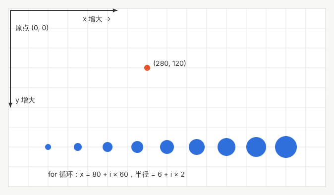

示例：[05-02-coords.html](示例/05-02-coords.html)

```js
const ctx = document.getElementById('c').getContext('2d');
// 在 (280, 120) 画一个半径 6 的圆：距离左边 280 像素，距离上边 120 像素
ctx.beginPath();
ctx.arc(280, 120, 6, 0, Math.PI * 2); // 圆心 x、圆心 y、半径、起始角、结束角
ctx.fillStyle = '#e4572e';
ctx.fill();
```

#### 02.2 循环：用规则代替重复

想画 9 个圆，不需要写 9 遍代码，而是写出“第 i 个圆在哪里、多大”的规则：

```js
for (let i = 0; i < 9; i++) {
  const x = 80 + i * 60;   // 位置：每个间隔 60 像素
  const r = 6 + i * 2;     // 大小：每个比前一个大 2 像素
  ctx.beginPath();
  ctx.arc(x, 280, r, 0, Math.PI * 2);
  ctx.fill();
}
```

创意编程中的大部分图案，都是“循环＋规则”：把 `i` 换成行列号就得到网格，把规则换成三角函数就得到波浪，把规则加上随机数就得到变化。

#### 02.3 函数：把一组操作起个名字

画一朵花需要很多步骤，把它们放进函数 `drawFlower(x, y, size)` 以后，就可以在任何位置、以任何大小画花，也可以在循环里画一片花。函数让作品可以组合，也更容易修改。

#### 02.4 向量：既有大小又有方向的量

**向量**可以理解为一个箭头，用两个数 (x, y) 表示。位置、速度、力都可以用向量表示：

| 操作 | 含义 | 例子 |
| --- | --- | --- |
| 相加 | 把两个箭头首尾相接 | 新位置 ＝ 位置 ＋ 速度 × 时间 |
| 相减 | 从一个点指向另一个点的箭头 | 目标方向 ＝ 目标 − 位置 |
| 乘以数字 | 把箭头拉长或缩短 | 速度 × 0.5 表示减速一半 |
| 长度 | 箭头有多长 | 两点之间的距离 |
| 归一化 | 保留方向，长度变为 1 | 只关心“朝哪边”时使用 |

下面的示例中，小球会朝指针所在的位置移动：蓝色箭头是当前速度，橙色虚线是期望的方向。速度不会瞬间变成期望的方向，而是每一帧靠近一点，因此小球会转弯，而不是生硬地折返。Shiffman 的《The Nature of Code》用大量例子讲解了向量、力和运动，是继续学习的好教材。[B02](#ref-b02)

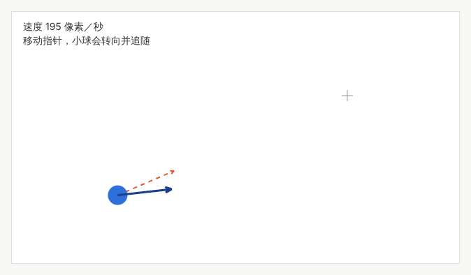

示例：[05-02-vectors.html](示例/05-02-vectors.html)

```js
const toTarget = target.sub(pos);                      // 指向目标的箭头
const speed = Math.min(MAX_SPEED, toTarget.len() * 2); // 离目标越近越慢
const desired = toTarget.norm().mul(speed);            // 期望速度
vel = vel.add(desired.sub(vel).mul(STEER * dt));       // 速度逐渐靠近期望速度
pos = pos.add(vel.mul(dt));                            // 位置 ＝ 位置 ＋ 速度 × 时间
```

#### 02.5 事件与动画循环

**事件**是浏览器通知你“发生了什么”：指针移动（`pointermove`）、按下键盘（`keydown`）、窗口大小改变（`resize`）。事件处理函数只负责更新状态，绘制统一放在动画循环里：

```js
canvas.addEventListener('pointermove', e => { target = 指针位置; }); // 只更新状态

let last = performance.now();
function frame(now) {
  const dt = (now - last) / 1000;  // 距离上一帧过了多少秒
  last = now;
  update(dt);                      // 更新
  draw();                          // 绘制
  requestAnimationFrame(frame);    // 预约下一帧
}
requestAnimationFrame(frame);
```

把运动写成“速度 × 经过的时间”而不是“每帧移动几个像素”，作品在刷新率不同的屏幕上速度才一致。

#### 02.6 常见问题

- **图形画在了意外的位置**：忘了 y 向下增大，或者把鼠标在页面中的坐标直接当成了画布坐标。正确做法是减去画布在页面中的位置：`e.clientX - canvas.getBoundingClientRect().left`。
- **动画在高刷新率屏幕上变快**：每帧移动固定像素，没有乘以 `dt`。
- **角度单位不对**：`Math.sin`、`ctx.arc` 使用弧度，一整圈是 `Math.PI * 2`，不是 360。

**本章练习**：

1. 修改 `05-02-coords.html`，用两层循环画出一个 8 × 5 的圆点网格。
2. 让圆点的大小随列号变大、颜色随行号变化。
3. 修改 `05-02-vectors.html` 中的 `STEER`，比较 1、3、10 时小球转弯的差别，并说明原因。

<a id="ch03"></a>

### 03 三种画法：SVG、Canvas 与 DOM

网页上有三种常用的方式画图形。同一个圆，用三种方式都能画出来，但它们的性质很不一样。

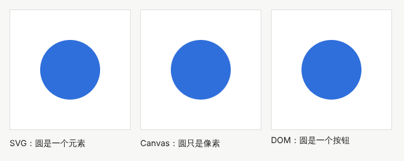

示例：[05-03-three-ways.html](示例/05-03-three-ways.html)

#### 03.1 三种方式的区别

| 方面 | SVG | Canvas | DOM（普通 HTML 元素） |
| --- | --- | --- | --- |
| 图形是什么 | 一个个元素，例如 `<circle>` | 一张位图，画完就只是像素 | 一个个元素，例如 `<div>`、`<button>` |
| 修改一个图形 | 改它的属性即可 | 通常要清空后整张重画 | 改它的样式即可 |
| 点击某个图形 | 元素自己接收事件 | 只能监听整张画布，自己计算点中了谁 | 元素自己接收事件 |
| 放大后是否清晰 | 始终清晰（矢量） | 需要按屏幕像素密度处理，否则发虚 | 始终清晰 |
| 适合的数量 | 几十到几千个 | 几千到几十万个 | 几十到几百个 |
| 可访问性 | 可以加标题与说明 | 需要另外提供文字说明 | 最好，天然支持键盘与读屏 |
| 典型用途 | 图标、图表、标志动画、路径编辑 | 画板、粒子、像素处理、游戏 | 界面控件、卡片、布局动画 |

前两种方式也常被称为**保留模式**与**即时模式**：SVG 和 DOM 由浏览器“保留”每个图形对象；Canvas 则是你“即时”画上去，浏览器只记得最终的像素。

#### 03.2 怎样选择

- 图形数量少、需要逐个交互、需要被读屏软件理解：选 SVG 或 DOM。
- 图形数量多、每帧都在变化、需要处理像素：选 Canvas。
- 需要真正的按钮、输入框：一定用 DOM，不要在 Canvas 上画假按钮。
- 常见的组合：用 Canvas 画大量的动态内容，用 DOM 放控件和文字说明，两者叠放在一起。

#### 03.3 Canvas 的命中检测

Canvas 上的圆只是像素，浏览器不知道“圆”的存在。要判断用户是否点中了圆，需要自己计算：点击位置到圆心的距离小于半径，就算点中。

```js
const x = e.clientX - rect.left, y = e.clientY - rect.top;
if (Math.hypot(x - 100, y - 100) <= 50) { /* 点中了圆心在 (100, 100)、半径 50 的圆 */ }
```

**本章练习**：用三种方式各画 200 个随机位置的小圆，并让每个圆在被点击时变色。比较代码量、点击判断的写法，以及用键盘能否操作。

<a id="part-2"></a>

## 第二篇：八个方向

<a id="ch04"></a>

### 04 矢量路径与曲线

#### 04.1 是什么、能做什么

矢量路径用一串命令描述形状：从哪里开始、画直线还是曲线、到哪里结束。它可以无损放大，适合做标志动画、流程与关系图、可编辑的路径和各种图解。

#### 04.2 路径命令

SVG 的 `<path>` 用 `d` 属性描述路径，常用命令如下。大写字母表示绝对坐标，小写字母表示相对于上一个点的坐标。MDN 的路径教程与 `d` 属性参考有完整的说明。[B03](#ref-b03) [B04](#ref-b04)

| 命令 | 含义 | 例子 |
| --- | --- | --- |
| `M x y` | 移动到某点，开始新的一段 | `M 80 280` |
| `L x y` | 画直线到某点 | `L 200 100` |
| `C x1 y1, x2 y2, x y` | 三次贝塞尔曲线：两个控制点，一个终点 | `C 160 60, 460 60, 560 280` |
| `Q x1 y1, x y` | 二次贝塞尔曲线：一个控制点，一个终点 | `Q 300 0, 560 280` |
| `A …` | 椭圆弧 | 画圆角、扇形 |
| `Z` | 闭合路径，回到起点 | 封闭的形状 |

#### 04.3 贝塞尔曲线

**三次贝塞尔曲线**由四个点决定：起点 P0、两个控制点 P1 和 P2、终点 P3。曲线从起点出发时朝向 P1，到达终点时来自 P2 的方向；控制点离得越远，曲线被“拉”得越厉害。曲线一般不会经过控制点。

曲线上的点可以这样作图：取一个 0 到 1 之间的数 t，在三条线段 P0P1、P1P2、P2P3 上各取比例为 t 的点，把这三点连成两条线，再各取比例为 t 的点，最后在剩下的一条线上取比例为 t 的点，它就在曲线上。t 从 0 变到 1，这个点就走完整条曲线。这种作图方法叫 de Casteljau 算法。Pomax 的《贝塞尔曲线入门》用大量可交互的图讲解了它的原理。[B05](#ref-b05)

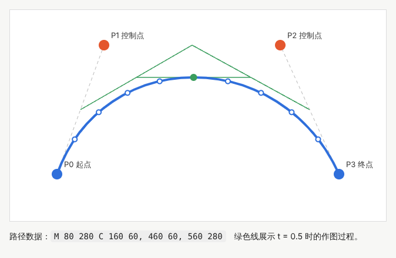

示例：[05-04-bezier.html](示例/05-04-bezier.html)（可以拖动四个点）

```js
const lerp = (a, b, t) => ({ x: a.x + (b.x - a.x) * t, y: a.y + (b.y - a.y) * t });
function pointAt(t) {                     // de Casteljau：反复在线段上按比例取点
  const a = lerp(P[0], P[1], t), b = lerp(P[1], P[2], t), c = lerp(P[2], P[3], t);
  const d = lerp(a, b, t), e = lerp(b, c, t);
  return lerp(d, e, t);
}
```

`lerp` 是“线性插值”的缩写：在两个值之间按比例取中间值。它是创意编程中最常用的工具之一，颜色过渡、位置过渡、缓动都离不开它。

#### 04.4 描边与路径动画

描边的常用属性：`stroke-width` 线宽、`stroke-linecap` 线端形状（平头、圆头、方头）、`stroke-linejoin` 转角形状、`stroke-dasharray` 虚线。标志的“书写动画”常用一个技巧：把虚线的线段长度设为整条路径的长度，再让虚线的偏移量 `stroke-dashoffset` 从路径长度变到 0，路径就像被一笔画出来一样。

```js
const path = document.querySelector('path');
const len = path.getTotalLength();              // 路径总长度
path.style.strokeDasharray = len;
path.style.strokeDashoffset = len;               // 一开始完全“藏”起来
path.animate([{ strokeDashoffset: len }, { strokeDashoffset: 0 }], { duration: 1500, fill: 'forwards' });
```

#### 04.5 路径插值：让一个形状变成另一个

想让圆形平滑地变成星形，最直接的想法是在两条路径之间插值。关键在于**点的对应关系**：两个形状必须有相同数量的点，并且点的顺序与起始位置一致，否则中间过程会出现扭曲和跳变。做法是先把两个形状都沿周长重新采样为相同数量的点（例如 60 个），再让第 i 个点在两个形状的第 i 个点之间按比例移动。

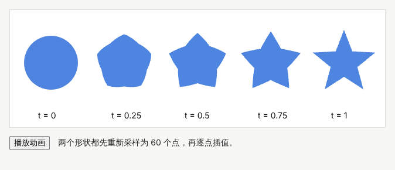

示例：[05-04-morph.html](示例/05-04-morph.html)

```js
const A = circlePoints(46);                // 圆：60 个点
const B = starPoints(56, 24);              // 星形：10 个顶点沿周长重新采样为 60 个点
const mix = t => A.map((a, i) => ({ x: a.x + (B[i].x - a.x) * t, y: a.y + (B[i].y - a.y) * t }));
```

#### 04.6 常见问题

- **变形过程中形状扭成一团**：两个形状的点数不同，或者一个顺时针、一个逆时针。
- **曲线连接处出现尖角**：前一段的第二个控制点、连接点、后一段的第一个控制点不在一条直线上。SVG 的 `S` 命令会自动镜像前一个控制点，保持连接处平滑。
- **缩放后线条变粗**：给形状加 `vector-effect="non-scaling-stroke"` 可以让线宽不随缩放变化。

**本章练习**：

1. 在 `05-04-bezier.html` 中拖动控制点，观察曲线什么时候会出现尖角和自交。
2. 用 `C` 命令画一个心形（提示：左右两段曲线在底部相接）。
3. 用路径动画做一个“签名”效果，并在系统开启“减少动态效果”时直接显示完整路径（见 13 章）。
4. 修改 `05-04-morph.html`，把 N 改为 10，观察插值效果变差的原因。

**继续深入**：曲线的长度计算与等距取点；曲线的偏移（生成等宽描边）；布尔运算（合并、相减两个形状）；B 样条与 NURBS；字体轮廓就是二次或三次贝塞尔曲线，可以在此基础上研究字形处理。

<a id="ch05"></a>

### 05 画布与笔刷

#### 05.1 是什么、能做什么

Canvas 是一块可以逐像素作画的画布。它适合需要大量绘制或像素级处理的作品：画板、印章、纹理生成、图像滤镜、粒子与游戏。

#### 05.2 Canvas 的基本操作

| 操作 | 方法 | 说明 |
| --- | --- | --- |
| 画矩形 | `fillRect`、`strokeRect` | 直接画实心或空心矩形 |
| 画路径 | `beginPath`、`moveTo`、`lineTo`、`arc`、`quadraticCurveTo`、`fill`、`stroke` | 先描述路径，再填充或描边 |
| 坐标变换 | `translate`、`rotate`、`scale` | 移动、旋转、缩放坐标系 |
| 保存与恢复 | `save`、`restore` | 保存当前样式与变换，画完后恢复 |
| 透明度 | `globalAlpha` | 之后画的内容都带有透明度 |
| 合成方式 | `globalCompositeOperation` | 新画的内容怎样与已有的像素混合，例如正片叠底、橡皮擦 |
| 读取与写回像素 | `getImageData`、`putImageData` | 逐个像素处理 |

**坐标变换**改变的是“纸”而不是“笔”：`translate(100, 100)` 之后，原点移到了 (100, 100)；`rotate(Math.PI / 4)` 之后，整个坐标系转了 45 度。画旋转的图形时，先移到图形中心，再旋转，再以 (0, 0) 为中心作画，最后用 `restore` 恢复。

#### 05.3 做一个笔刷

一个可用的笔刷需要处理四个问题：

1. **采样**：指针移动时，浏览器只在某些时刻报告位置。移动很快时，多个采样点会被合并到一个事件中，用 `getCoalescedEvents()` 可以取出全部点，笔迹才不会断续。指针事件统一了鼠标、触摸与触控笔的输入。[B06](#ref-b06)
2. **平滑**：直接把采样点用直线连起来，笔迹会有棱角。常用做法是用二次曲线连接相邻采样点的中点。
3. **高清屏**：在像素密度较高的屏幕上，一个 CSS 像素对应多个物理像素。画布的像素数量要乘以 `devicePixelRatio`，否则线条会发虚。
4. **撤销**：保存每一笔的参数与采样点（而不是保存整张图片），撤销时去掉最后一笔并重画其余的笔画。

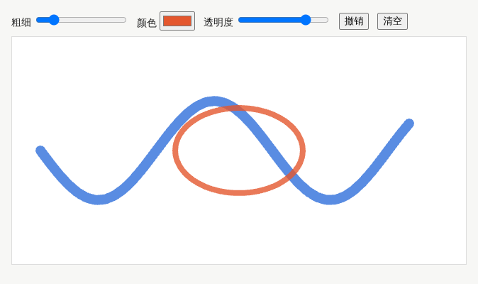

示例：[05-05-brush.html](示例/05-05-brush.html)（支持粗细、颜色、透明度、撤销与清空）

```js
// 高清屏：画布像素 = 显示尺寸 × 设备像素比
const dpr = window.devicePixelRatio || 1;
canvas.width = canvas.clientWidth * dpr;
canvas.height = canvas.clientHeight * dpr;
ctx.setTransform(dpr, 0, 0, dpr, 0, 0);

// 平滑：用二次曲线连接相邻采样点的中点
ctx.moveTo(p[0].x, p[0].y);
for (let i = 1; i < p.length - 1; i++) {
  const mx = (p[i].x + p[i + 1].x) / 2, my = (p[i].y + p[i + 1].y) / 2;
  ctx.quadraticCurveTo(p[i].x, p[i].y, mx, my);
}
```

#### 05.4 像素处理

`getImageData` 返回一个很长的数组，每四个数字表示一个像素的红、绿、蓝和透明度，取值都是 0 到 255。修改这些数字再写回画布，就实现了滤镜：

- **灰度**：按人眼对不同颜色的敏感程度加权，亮度 ≈ 0.2126 × 红 ＋ 0.7152 × 绿 ＋ 0.0722 × 蓝。
- **反相**：每个通道用 255 减去原值。
- **阈值**：亮度大于某个值的像素变白，其余变黑。

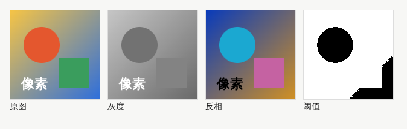

示例：[05-05-pixels.html](示例/05-05-pixels.html)

```js
const img = ctx.getImageData(0, 0, W, H);
const d = img.data;
for (let k = 0; k < d.length; k += 4) {
  const y = 0.2126 * d[k] + 0.7152 * d[k + 1] + 0.0722 * d[k + 2];
  d[k] = d[k + 1] = d[k + 2] = y;   // 透明度 d[k + 3] 不变
}
ctx.putImageData(img, 0, 0);
```

逐像素处理在 JavaScript 中速度有限，大尺寸图片或实时视频适合交给 GPU 处理（见[《技术美术与实时效果》](07-技术美术与实时效果.md)）。

#### 05.5 常见问题

- **半透明笔画重叠处颜色变深**：每一小段分别画导致重复叠加。应把一整笔作为一条路径画出，或者先画到离屏画布再整体合成。
- **缩放画布后笔迹位置错位**：画布显示尺寸与像素尺寸不一致时，需要按比例换算坐标。
- **撤销内存越来越大**：保存每一步的整张图片代价很高，保存笔画数据更省；笔画很多时，可以定期把旧笔画“压平”成一张图片。
- **读取像素时报安全错误**：从其他网站加载、未允许跨域的图片画到画布上后，画布会被标记为“受污染”，不能再读取像素。

**本章练习**：

1. 给 `05-05-brush.html` 增加“橡皮擦”：使用 `globalCompositeOperation = 'destination-out'`。
2. 增加“导出图片”按钮：使用 `canvas.toBlob` 下载 PNG。
3. 实现“印章”笔刷：沿笔迹每隔 10 像素画一个旋转的小图形。
4. 在 `05-05-pixels.html` 中实现“马赛克”：把图片分成 8 × 8 的方块，每块取平均颜色。

**继续深入**：压感与倾角（`pressure`、`tiltX`）；离屏画布与网页工作线程（`OffscreenCanvas`）；图层与混合模式；在 GPU 上处理像素（着色器）；无限画布与分块存储；协同绘画的数据结构。

<a id="ch06"></a>

### 06 算法图案

#### 06.1 是什么、能做什么

算法图案是用规则生成的图形：重复、对称、随机、噪声、扰动，组合起来可以得到无穷多的变化。它适合做海报、纹理、背景、品牌图形和生成艺术。

#### 06.2 五种基本手段

| 手段 | 做法 | 效果 |
| --- | --- | --- |
| 重复 | 循环与网格 | 秩序与节奏 |
| 对称 | 镜像、旋转复制 | 稳定、装饰感 |
| 随机 | 每个元素的属性取随机值 | 变化与自然感 |
| 噪声 | 连续变化的随机值 | 平滑的过渡，像地形、云、流动 |
| 扰动 | 在规则结果上加小的随机偏移 | 手工感，避免过于机械 |

#### 06.3 随机种子：让随机可以重现

`Math.random()` 每次运行结果都不同，无法重现一张满意的作品。**伪随机数生成器**从一个初始数字（**随机种子**）出发，用固定的算法产生一串看起来随机的数字：种子相同，产生的数字就完全相同。这样就可以保存种子，日后重现同一张图，也可以把种子放在网址中分享。

```js
// mulberry32：一个短小、常用的可设种子的伪随机数生成器
function mulberry32(seed) {
  return function () {
    seed |= 0; seed = seed + 0x6D2B79F5 | 0;
    let t = Math.imul(seed ^ seed >>> 15, 1 | seed);
    t = t + Math.imul(t ^ t >>> 7, 61 | t) ^ t;
    return ((t ^ t >>> 14) >>> 0) / 4294967296;   // 0 到 1 之间
  };
}
const rand = mulberry32(42);
rand(); rand(); // 每次运行，这两个数都一样
```

#### 06.4 噪声：连续变化的随机

普通随机数相邻两次之间毫无关联，画出来是杂乱的点；**噪声**则在相近的位置给出相近的值，画出来是平滑起伏的“地形”。最简单的一种是**值噪声**：在整数格点上放随机值，格点之间用平滑曲线插值。Perlin 噪声与 Simplex 噪声是更常用、效果更自然的改进版本。《The Nature of Code》的随机性一章详细比较了随机数与噪声。[B02](#ref-b02)

下面的示例用噪声决定每条短线的方向和颜色：相邻的短线方向相近，形成连续的“流动”区域；线条粗细使用随机扰动。左右两张图参数完全相同，只有种子不同。

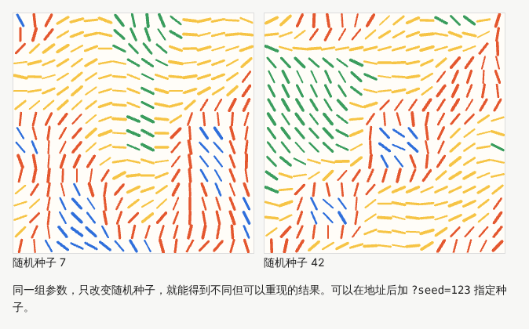

示例：[05-06-pattern.html](示例/05-06-pattern.html)（在地址后加 `?seed=123` 可以指定种子）

```js
const n = noise(x * noiseScale, y * noiseScale);   // 相邻位置得到相近的值
const angle = n * Math.PI * 1.5;                   // 噪声决定方向
const color = palette[Math.floor(n * palette.length)];
ctx.lineWidth = 2 + rand() * 2;                    // 随机扰动粗细
```

#### 06.5 管理参数

作品的参数一多，就很难理解和比较。建议把参数分成三类，分别调整：

- **结构**：格子大小、数量、对称方式、噪声缩放。
- **颜色**：调色板、背景色、透明度。
- **运动**：速度、周期、缓动方式。

每次得到满意的结果，记录下种子与全部参数，便于重现与比较。

#### 06.6 常见问题

- **图案看起来杂乱**：噪声缩放太大，相邻位置的值变化太快。把缩放调小，图案会变得平滑。
- **图案看起来单调**：只有一层规则。可以叠加两层不同尺度的噪声，或加入少量扰动。
- **颜色不协调**：随机取色容易得到不和谐的组合，改为从预先设计的调色板中选择。

**本章练习**：

1. 修改 `05-06-pattern.html` 的 `noiseScale`，比较 0.005、0.012、0.05 的效果。
2. 加入“运动”参数：让噪声随时间缓慢变化，图案像被风吹动。
3. 做一个四重旋转对称的图案：只生成四分之一，再旋转复制三次。
4. 给作品加一个“换一张”按钮：每次生成新的种子，并把种子显示在页面上。

**继续深入**：分形噪声（多层叠加）；流场与粒子轨迹；Truchet 拼贴、Voronoi 图、反应扩散；L 系统与形式文法；这些内容在[《生成艺术与物理仿真》](08-生成艺术与物理仿真.md)中继续展开。

<a id="ch07"></a>

### 07 文字图形化

#### 07.1 是什么、能做什么

文字图形化把文字当作图形来处理：沿路径排列文字、把文字变成点阵、让每个字符成为粒子、让字形随时间变化。它常用于标题、海报、品牌展示与音乐可视化。

#### 07.2 四种常见做法

| 做法 | 实现方式 | 注意 |
| --- | --- | --- |
| 沿路径排字 | SVG 的 `<textPath>` 让文字沿一条路径排列 | 曲率太大时字会挤在一起 |
| 文字点阵 | 把文字画到看不见的画布上，按间隔读取像素 | 间隔越小越清晰，但点越多越慢 |
| 字符粒子 | 每个字符或每个点作为粒子，独立运动 | 需要粒子系统（见 12 章） |
| 动态字形 | 可变字体随时间改变粗细、宽度等轴 | 需要字体本身支持可变轴 |

#### 07.3 把文字变成点阵

做法分三步：先在离屏画布上用普通方式画出文字；再每隔若干像素检查一次这个位置是否有颜色（读取透明度）；有颜色的位置就记为一个点。这个方法对中文同样有效，而且不需要解析字体文件。

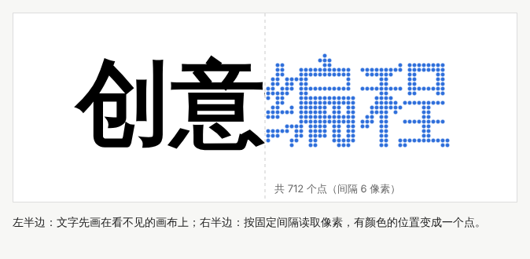

示例：[05-07-text-points.html](示例/05-07-text-points.html)

```js
octx.font = 'bold 120px system-ui, sans-serif';
octx.fillText(text, W / 2, H / 2);                  // 1. 在离屏画布上画文字
const data = octx.getImageData(0, 0, W, H).data;
for (let y = 0; y < H; y += STEP)                   // 2. 按间隔检查像素
  for (let x = 0; x < W; x += STEP)
    if (data[(y * W + x) * 4 + 3] > 128) points.push({ x, y }); // 3. 有颜色就记为点
```

#### 07.4 不要让文字“消失”

画在 Canvas 上的文字只是像素：读屏软件读不到，用户不能选择和复制，搜索引擎也无法理解。做法是**保留语义文字层，让视觉层承担特效**：

- 页面中保留真实的文字元素（例如标题），可以在视觉上隐藏，但读屏软件仍能读到。
- 画布设为 `aria-hidden="true"`，避免读屏软件读出无意义的内容；或者给画布提供 `role="img"` 与准确的 `aria-label`。
- 正文与重要信息不要只以特效的形式出现。

#### 07.5 常见问题

- **中文点阵边缘不完整**：字号太小或采样间隔太大。先用较大的字号绘制，再缩放点的坐标。
- **字体还没加载就开始采样**：使用网络字体时，先等待 `document.fonts.load(...)` 完成，否则会采样到后备字体。
- **长文本超出画面**：根据 `measureText` 测得的宽度自动缩小字号（见 12 章）。

**本章练习**：

1. 修改 `STEP` 为 3 和 12，比较清晰度与点的数量。
2. 用 SVG 的 `<textPath>` 让一句话沿着一条贝塞尔曲线排列。
3. 让点阵中的每个点用不同大小表示原像素的亮度，做出“半色调”效果。

**继续深入**：解析字体轮廓（贝塞尔曲线）得到矢量点；有符号距离场字体渲染；可变字体动画；中文排版中的标点挤压与避头尾规则。

<a id="ch08"></a>

### 08 交互数据图形

#### 08.1 是什么、能做什么

交互数据图形把数据变成可以看、可以操作的图形：柱状图、散点图、地图、关系图。与静态图表相比，它允许用户筛选、缩放和查看细节，从数据中发现问题。

#### 08.2 视觉通道：把数据映射为什么

同一个数字可以用位置、长度、面积、颜色深浅、形状来表达，但人眼对它们的判断精度不同。Cleveland 与 McGill 的实验发现，人们比较位置与长度最准确，比较角度、面积、颜色深浅则误差更大。[B07](#ref-b07) 因此：

- 需要精确比较的数值，优先用位置或长度（例如柱状图、点图）。
- 面积与颜色适合表达大致的差异或类别。
- 形状与色相适合区分类别，不适合表达大小。

#### 08.3 比例尺、图例与单位

**比例尺**把数据的取值范围（定义域）映射为屏幕上的范围（值域），例如把 0 到 120 份映射为 0 到 256 像素。常见的有线性比例尺、对数比例尺、分类比例尺（每个类别一个位置或颜色）。图形必须配有坐标轴、图例与单位，否则数字没有意义。D3 是网页上最常用的数据图形库，提供了比例尺、坐标轴、数据绑定等工具。[B08](#ref-b08)

#### 08.4 交互：概览、筛选、细节

Shneiderman 总结的信息查找原则是：“先概览，再缩放与筛选，最后按需查看细节。”[B09](#ref-b09) 下面的示例可以用复选框筛选专业，鼠标悬停或用键盘聚焦到柱子上时显示具体数值。注意纵轴的范围固定为全部数据的最大值：筛选掉某些专业后，剩下柱子的高度不变，用户不会因为坐标轴悄悄改变而失去比较的基准。

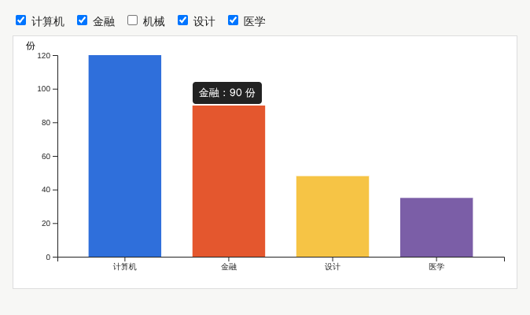

示例：[05-08-chart.html](示例/05-08-chart.html)（示意数据）

```js
// 纵轴范围固定为全部数据的最大值，筛选时不变
const y = d3.scaleLinear().domain([0, d3.max(data, d => d.value)]).nice().range([height, 0]);
g.selectAll('.bar')
  .data(shown, d => d.major)          // 按专业名称绑定数据
  .join('rect')
  .attr('tabindex', 0)                // 键盘也能逐个查看
  .attr('aria-label', d => `${d.major}：${d.value} 份`)
  .attr('y', d => y(d.value))
  .attr('height', d => height - y(d.value));
```

#### 08.5 常见问题

- **纵轴不从 0 开始**：柱状图用长度表达数值，纵轴截断会夸大差异。
- **颜色过多**：超过六七种颜色就难以区分，可以合并为“其他”，或者改用直接标注。
- **只能用鼠标查看细节**：悬停提示要同时支持键盘聚焦，并给每个图形提供文字说明。
- **动画让人看不清变化**：数据更新时的过渡要短，并保持同一个数据点的身份不变（用数据中的唯一标识绑定）。

**本章练习**：

1. 在 `05-08-chart.html` 中增加“按数值排序”的切换，并让柱子平滑地移动到新位置。
2. 把柱状图改为点图（用点的位置表示数值），比较两者的阅读体验。
3. 为图表增加一个数据表格的视图，供不方便看图的用户使用。

**继续深入**：散点图矩阵、平行坐标、关系图布局；大量数据的抽样与聚合；联动视图；可视分析的方法在[《信息、数据与空间》](15-信息数据与空间.md)中继续展开。

<a id="ch09"></a>

### 09 声音驱动视觉

#### 09.1 是什么、能做什么

声音驱动视觉把声音的特征映射为图形的参数：音量控制大小，频谱控制柱子的高度，节拍触发闪烁或变形。它常用于音乐可视化、现场表演与互动装置。

#### 09.2 三种声音特征

| 特征 | 含义 | 获得方式 |
| --- | --- | --- |
| 音量 | 一段时间内声音的平均能量 | 对波形采样计算均方根（RMS） |
| 频谱 | 低音、中音、高音各有多强 | 分析器节点的 `getByteFrequencyData` |
| 节拍 | 能量突然增大的时刻 | 比较当前能量与最近的平均能量 |

浏览器的 Web Audio API 提供了这些能力：声源（振荡器、音频文件、麦克风）连接到**分析器节点**，就能在每一帧读出频谱与波形。[B10](#ref-b10)

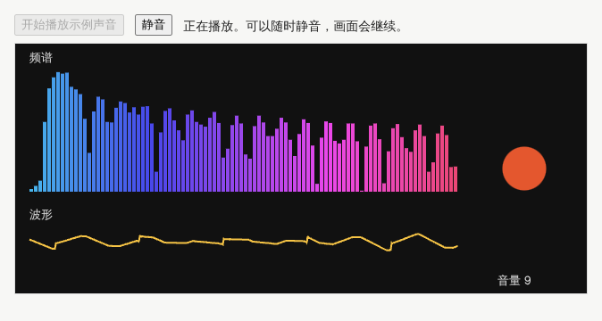

示例：[05-09-audio.html](示例/05-09-audio.html)（点击按钮后播放由代码生成的和弦，不需要麦克风）

```js
const analyser = ac.createAnalyser();
analyser.fftSize = 1024;
mix.connect(analyser).connect(output).connect(ac.destination); // 分析器在静音开关之前

analyser.getByteFrequencyData(freqData);   // 频谱：每个频段的强度
analyser.getByteTimeDomainData(timeData);  // 波形：128 表示静止
let sum = 0;
for (const v of timeData) { const s = (v - 128) / 128; sum += s * s; }
const rms = Math.sqrt(sum / timeData.length); // 音量
```

#### 09.3 映射：数据表达还是艺术选择

把频谱的强度画成柱子的高度，是**数据表达**：观众可以从图形中读出声音的特征。把频段映射为颜色、把音量映射为旋转速度，是**艺术选择**：它们让作品更有表现力，但不应被理解为声音的精确信息。设计时清楚地区分两者，并在需要时向观众说明。

#### 09.4 授权、播放与静音

- **自动播放限制**：浏览器要求用户先进行一次操作（例如点击），页面才能播放声音。因此示例需要点击“开始”。
- **麦克风授权**：使用麦克风需要用户授权，并且页面需要通过安全的连接（https）访问。用户拒绝授权时，要提供替代方式，例如播放一段示例音频。
- **静音与无声体验**：用户随时可以静音；关闭声音后，主要信息仍应完整，例如用文字或图形表达原本由声音传达的内容。示例把分析器放在静音开关之前，静音后画面仍然跟随声音变化。

#### 09.5 常见问题

- **画面抖动太厉害**：分析器的平滑系数 `smoothingTimeConstant` 调高，或对音量做指数平滑（见 10 章）。
- **频谱右半部分几乎没有变化**：多数音乐的能量集中在低频，可以只显示前面的频段，或使用对数刻度的频率轴。
- **静音时有“咔哒”声**：音量突然跳变会产生爆音，用 `setTargetAtTime` 平滑过渡。

**本章练习**：

1. 在 `05-09-audio.html` 中实现简单的节拍检测：当前能量超过最近 1 秒平均能量的 1.5 倍时，让背景闪一下。
2. 增加“使用麦克风”按钮，处理用户拒绝授权的情况。
3. 把频谱画成一个圆环，并说明哪些映射是数据表达、哪些是艺术选择。

**继续深入**：音高检测与和弦识别；音频节点上的自定义处理（AudioWorklet）；声音与画面的同步与延迟补偿；声音设计与声学交互在[《包容、国际化与多感官》](16-包容国际化与多感官.md)中继续展开。

<a id="ch10"></a>

### 10 输入与环境响应

#### 10.1 是什么、能做什么

作品可以响应各种输入：指针的位置与速度、触摸与手势、键盘、摄像头画面、设备的方向与加速度。输入让作品“活”起来，但真实的输入往往不稳定：会缺失、会抖动、会突然中断。

#### 10.2 从位置到速度

很多有趣的效果不取决于指针在哪里，而取决于它移动得多快：速度 ＝ 两次位置之间的距离 ÷ 经过的时间。原始速度抖动很大，需要**平滑**。最常用的是**指数移动平均**：每次只向新值靠近一小步。

```js
rawSpeed = Math.hypot(pos.x - prev.x, pos.y - prev.y) / dt;
smoothSpeed += ALPHA * (rawSpeed - smoothSpeed);  // ALPHA 越小越平稳，但反应越慢
```

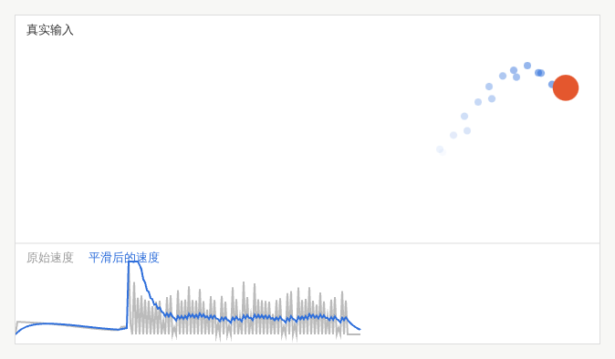

示例：[05-10-input.html](示例/05-10-input.html)（没有输入时自动进入演示模式）

#### 10.3 先模拟，再接入真实信号

接入摄像头或传感器之前，先用代码生成的模拟信号（例如正弦曲线）调试作品的规则。这样可以：在没有设备时开发；用可重复的输入比较参数；把“规则是否合理”与“信号是否可靠”两个问题分开。示例中的演示模式就是一个模拟输入。

#### 10.4 处理缺失、波动与退出

| 情况 | 例子 | 处理方式 |
| --- | --- | --- |
| 缺失 | 用户拒绝授权、设备不支持、指针离开画面 | 提供替代输入或演示模式，并说明原因 |
| 波动 | 传感器噪声、检测结果时有时无 | 平滑、设置阈值、短时间内保持上一次的结果 |
| 退出 | 用户离开、切换标签页 | 平稳回到默认状态，暂停不必要的计算 |

#### 10.5 摄像头与传感器

- 摄像头通过 `getUserMedia` 获取，需要用户授权与安全连接。处理画面时尽量在本地完成，不要上传用户的影像；在页面上清楚地说明摄像头的用途。
- 设备方向与运动传感器在部分浏览器中需要用户授权，并且不同设备的数值范围与噪声差别很大，需要校准。
- 所有依赖特定输入的作品，都应当提供键盘或指针的替代操作方式。

#### 10.6 常见问题

- **触摸时页面跟着滚动**：在画布上设置 CSS `touch-action: none`。
- **速度出现极大的尖峰**：两次事件的时间间隔过小，计算时给时间间隔设置下限。
- **用户离开后画面停在奇怪的状态**：监听 `pointerleave`，让画面回到默认状态。

**本章练习**：

1. 修改 `ALPHA` 为 0.05 与 0.5，比较平滑与反应速度的取舍。
2. 让圆的颜色随移动方向变化（提示：`Math.atan2(dy, dx)` 得到方向角）。
3. 增加键盘控制：方向键移动目标位置，保证不用鼠标也能体验作品。

**继续深入**：手势识别（捏合、旋转、滑动）；卡尔曼滤波等更好的平滑方法；用机器学习模型在本地识别手部或姿态；新型输入在[《人机交互与新型媒介》](12-人机交互与新型媒介.md)中继续展开。

<a id="ch11"></a>

### 11 交互叙事与游戏化图形

#### 11.1 是什么、能做什么

交互叙事与游戏化图形通过探索、选择、反馈和状态变化来组织一段经历：一个可以操作的故事、一个练习、一个小游戏。图形不只是装饰，还要表达规则，让用户知道自己能做什么、做得怎么样。

#### 11.2 用状态机组织流程

**状态机**把作品分为若干个状态，并规定在什么条件下从一个状态转到另一个状态。每个状态决定画什么、接受什么输入。

| 状态 | 画面 | 接受的输入 | 转到 |
| --- | --- | --- | --- |
| 准备 | 标题与说明 | 空格或点击 | 进行中 |
| 进行中 | 游戏画面、得分、生命 | 方向键、指针、P 暂停 | 暂停、成功、失败 |
| 暂停 | 半透明遮罩与提示 | P 继续 | 进行中 |
| 成功 | 结果与“再玩一次” | 空格或点击 | 准备 → 进行中 |
| 失败 | 结果与“重试” | 空格或点击 | 准备 → 进行中 |

把这些写清楚，就不会出现“游戏结束了还在得分”“暂停时还能移动”这类问题。

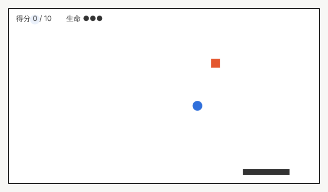

示例：[05-11-game.html](示例/05-11-game.html)（方向键或指针移动托盘，空格开始，P 暂停）

```js
const State = { READY: 'ready', PLAYING: 'playing', PAUSED: 'paused', WON: 'won', LOST: 'lost' };
function frame(now) {
  if (state === State.PLAYING) update(dt);   // 只有进行中才更新
  draw();                                    // 每个状态都绘制
  requestAnimationFrame(frame);
}
```

#### 11.3 目标、失败、重试与结束

- **目标**清楚：用户一开始就知道要做什么、怎样算成功。
- **失败**可理解：用户知道为什么失败。
- **重试**容易：一步就能重新开始，不需要重新加载页面。
- **结束**明确：给出结果与下一步，而不是让画面停在那里。

#### 11.4 可访问的互动

提供键盘操作；允许暂停；切换到其他标签页时自动暂停；用读屏软件可以读到的文字播报状态变化（示例使用了 `aria-live`）；时间压力较大的游戏，提供放慢速度的选项。

#### 11.5 常见问题

- **难度不可控**：使用可设种子的随机数，让同一关卡每次的掉落顺序相同，便于测试与调整。
- **碰撞判断时灵时不灵**：物体移动太快，一帧之间直接穿过了目标。可以限制最大速度，或检查移动的整段路径。
- **状态之间互相干扰**：状态切换时重置相关的数据（得分、计时器、物体列表）。

**本章练习**：

1. 给 `05-11-game.html` 增加难度：每得 3 分，掉落速度增加 10%。
2. 增加“最高分”，用 `localStorage` 保存。
3. 把它改编为一个“互动故事”：用户的选择决定下一幕显示什么，并画出状态机图。

**继续深入**：游戏循环的固定时间步长；碰撞检测的空间划分；叙事结构与分支设计；游戏体验与交互叙事在[《产品形态专题》](17-产品形态专题.md)中继续展开。

<a id="part-3"></a>

## 第三篇：综合实战与发布

<a id="ch12"></a>

### 12 综合项目：文字粒子画板

本章把前面的知识组合成一个完整作品：输入文字后形成点阵，指针移动时粒子被推开，停止后恢复原状。用户可以修改粒子密度、恢复速度和颜色，可以设定随机种子，并且作品要能处理窗口缩放、触摸操作、空输入和长文本，为读屏软件提供文字与操作说明。

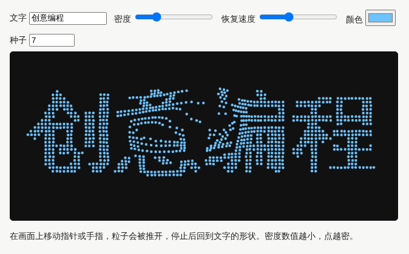

示例：[05-12-text-particles.html](示例/05-12-text-particles.html)

#### 12.1 第一步：文字变成点

沿用 07 章的方法。为了让长文本也能放进画面，先测量文字的宽度，超过画面宽度的 90% 时按比例缩小字号。

```js
let size = H * 0.6;
o.font = `bold ${size}px system-ui, sans-serif`;
const width = o.measureText(text).width;
if (width > W * 0.9) size *= (W * 0.9) / width;   // 长文本自动缩小
```

**检查**：输入 2 个字和 15 个字，都能完整显示。

#### 12.2 第二步：设计粒子的数据

每个粒子记住两组位置：**家**（文字上的位置，固定不变）和**当前位置**（会运动），另外还有速度。

```js
particles = homes.map(h => ({ hx: h.x, hy: h.y, x: rand() * W, y: rand() * H, vx: 0, vy: 0 }));
```

粒子从随机位置出发，随机数使用 06 章的可设种子生成器，种子相同时出发位置相同。

**检查**：刷新页面，粒子从同样的位置出发，汇聚成文字。

#### 12.3 第三步：弹簧与阻尼

让粒子回家，可以想象每个粒子和它的家之间连着一根弹簧：离家越远，拉力越大；同时有阻尼（像在水中运动），让粒子最终停下来而不是一直振荡。

```js
let ax = (p.hx - p.x) * k - p.vx * DAMPING;   // 弹簧拉力 − 阻尼
let ay = (p.hy - p.y) * k - p.vy * DAMPING;
p.vx += ax * dt; p.vy += ay * dt;             // 加速度改变速度
p.x += p.vx * dt; p.y += p.vy * dt;           // 速度改变位置
```

“恢复速度”滑块控制 `k`：数值越大，回家越快。阻尼太小，粒子会来回振荡；阻尼太大，回家会很慢。

**检查**：调节恢复速度，观察粒子回家的快慢与振荡。

#### 12.4 第四步：指针的推力

指针附近一定半径内的粒子，受到一个背离指针的力，离指针越近，力越大：

```js
const dx = p.x - pointer.x, dy = p.y - pointer.y, d = Math.hypot(dx, dy);
if (d < RADIUS && d > 0.01) {
  const f = (1 - d / RADIUS) * PUSH;          // 越近越强
  ax += (dx / d) * f; ay += (dy / d) * f;      // 方向：从指针指向粒子
}
```

使用指针事件，鼠标、触摸与触控笔都能操作；画布设置 `touch-action: none`，触摸时页面不会滚动。

**检查**：在手机或开发者工具的触摸模拟中拖动，粒子被推开，页面不滚动。

#### 12.5 第五步：参数与重建

文字、密度、种子改变时重新生成粒子；颜色与恢复速度改变时只影响绘制与更新，不需要重建。

**检查**：每个控件都能产生预期的变化，并且不会让动画卡顿。

#### 12.6 第六步：边界情况

| 情况 | 处理 |
| --- | --- |
| 窗口大小改变 | 用 `ResizeObserver` 监听画布尺寸，重新计算像素尺寸并重建粒子 |
| 高清屏 | 画布像素乘以设备像素比（见 05 章） |
| 输入为空 | 不生成粒子，在画面中显示“请输入文字” |
| 长文本 | 自动缩小字号（第一步） |
| 页面不可见 | 监听 `visibilitychange`，暂停更新与绘制 |

#### 12.7 第七步：可访问性

- 画布设为 `aria-hidden="true"`，由页面中的文字说明作品与操作方法。
- 用 `aria-live` 区域播报当前的文字与粒子数量，读屏软件用户也能知道作品的状态。
- 系统开启“减少动态效果”时，粒子直接出现在家的位置，不响应推力。

**检查**：用读屏软件浏览页面，能听到操作说明与当前文字；开启系统的减少动态效果后，画面保持静止。

#### 12.8 验收清单

- [ ] 输入文字后形成点阵，长文本能完整显示。
- [ ] 指针与触摸都能推开粒子，停止后恢复。
- [ ] 密度、恢复速度、颜色、种子都能调节，种子相同时结果可重现。
- [ ] 窗口缩放后画面正确，高清屏上清晰。
- [ ] 输入为空时有提示，页面不可见时暂停。
- [ ] 读屏软件能读到说明与状态，减少动态效果时画面静止。

<a id="ch13"></a>

### 13 性能、可访问性与发布

#### 13.1 性能

- **用 `requestAnimationFrame` 驱动动画**，不要用 `setInterval`；页面不可见时浏览器会自动降低调用频率。
- **按时间而不是按帧计算运动**，并限制单帧的最大时间间隔，避免切回页面时物体“瞬移”。
- **减少每帧的工作量**：不变的部分画到离屏画布上缓存；避免在循环中创建大量临时对象；需要时限制粒子数量。
- **先测量，再优化**：用浏览器开发者工具的“性能”面板录制，找出耗时最多的函数。
- **大量计算转移到 GPU**：数万个以上的粒子或逐像素的效果，考虑 WebGL 或 WebGPU（见[《技术美术与实时效果》](07-技术美术与实时效果.md)）。

#### 13.2 减少动态效果

部分用户会因为大幅度的动画感到不适。系统设置中开启“减少动态效果”后，网页可以通过 `prefers-reduced-motion` 媒体特性得知这一偏好。[B11](#ref-b11) 这并不意味着删除所有动画，而是用淡入淡出代替大幅移动，或直接显示最终状态，并提供暂停按钮。

```js
const reduce = matchMedia('(prefers-reduced-motion: reduce)').matches;
if (reduce) { /* 直接显示结果，或使用幅度更小的过渡 */ }
```

#### 13.3 可访问性

- 作品的内容与操作方法有文字说明，Canvas 提供 `role="img"` 与说明，或设为 `aria-hidden` 并在页面中给出说明。
- 交互可以用键盘完成，焦点清楚可见。
- 不只用颜色传达信息；闪烁频率避免每秒超过 3 次。
- 声音可以静音，静音后信息仍然完整。

#### 13.4 发布与展示

- 同时保留**录屏**与**可操作的版本**：录屏便于展示与传播，可操作版本证明作品真实可用。说明作品在哪些输入与状态下运行。
- 使用的字体、图片、声音与代码库，确认授权方式，并在页面上注明来源。
- 在不同的浏览器、手机与平板上实际测试，记录发现的问题。

**本章练习**：用开发者工具录制 `05-12-text-particles.html` 运行 5 秒的性能数据，找出耗时最多的部分，尝试一项优化，并比较优化前后的帧率。

<a id="ch14"></a>

### 14 继续深入与学习路线

#### 14.1 从横向到纵向

本册的八个方向是横向的拓展。每个方向都可以继续纵向深入：

| 方向 | 入门 | 进阶 | 深入 |
| --- | --- | --- | --- |
| 矢量路径与曲线 | 用路径命令画形状 | 路径动画、形状插值 | 曲线算法、字形处理、路径编辑器 |
| 画布与笔刷 | 基本绘制与变换 | 平滑笔刷、撤销、像素滤镜 | 图层系统、GPU 滤镜、协同绘画 |
| 算法图案 | 循环与随机 | 种子、噪声、参数管理 | 流场、反应扩散、形式文法 |
| 文字图形化 | 沿路径排字 | 文字点阵与粒子 | 字体轮廓解析、距离场渲染 |
| 交互数据图形 | 比例尺与坐标轴 | 筛选、缩放、细节查看 | 联动视图、大数据渲染、可视分析 |
| 声音驱动视觉 | 频谱与音量 | 节拍检测、平滑映射 | 音高识别、实时演出系统 |
| 输入与环境响应 | 指针与键盘 | 速度、平滑、模拟输入 | 摄像头与姿态识别、传感器融合 |
| 交互叙事与游戏化 | 状态机 | 难度与反馈设计 | 叙事系统、物理与关卡工具 |

#### 14.2 工具

- **p5.js**：面向创作者的 JavaScript 库，把画布操作封装为简单的函数，适合快速做原型与教学。[B12](#ref-b12)
- **D3**：数据图形的标准工具，提供比例尺、坐标轴、布局与数据绑定。
- 也可以完全使用浏览器原生的 Canvas 与 SVG，本册的示例都没有依赖额外的绘图库（数据图形除外），便于理解底层原理。

#### 14.3 下一步读什么

- 动画的节奏与缓动：[《动效与时间设计》](04-动效与时间设计.md)。
- 由规则与物理生成作品：[《生成艺术与物理仿真》](08-生成艺术与物理仿真.md)。
- 着色器与 GPU 上的效果：[《技术美术与实时效果》](07-技术美术与实时效果.md)。
- 进入三维：[《三维内容与空间设计》](06-三维内容与空间设计.md)。
- 补充数学：[《图形与交互的数学基础》](20-图形与交互的数学基础.md)。
- 拆解常见的视觉效果：[《常见视觉效果拆解》](19-常见视觉效果拆解.md)。

<a id="appendix-a"></a>

## 附录 A：术语表

| 术语 | 含义 | 阅读位置 |
| --- | --- | --- |
| 坐标系 | 描述位置的方式；网页画布的原点在左上角，y 向下增大 | 02 |
| 向量 | 有大小和方向的量，用 (x, y) 表示 | 02 |
| 归一化 | 保留向量的方向，把长度变为 1 | 02 |
| 动画循环 | 不断重复“更新、绘制”的过程 | 02 |
| 保留模式与即时模式 | 浏览器保留每个图形对象，或只保留最终像素 | 03 |
| 命中检测 | 判断用户点中了哪个图形 | 03 |
| 路径命令 | 描述形状的指令，例如移动、直线、曲线、闭合 | 04 |
| 贝塞尔曲线 | 由起点、控制点和终点决定的平滑曲线 | 04 |
| 线性插值 | 在两个值之间按比例取中间值 | 04 |
| 路径插值 | 让一个形状逐渐变成另一个形状 | 04 |
| 坐标变换 | 平移、旋转、缩放坐标系 | 05 |
| 合成方式 | 新绘制的内容与已有像素的混合规则 | 05 |
| 设备像素比 | 一个 CSS 像素对应多少个物理像素 | 05 |
| 伪随机数生成器 | 用算法产生看似随机、可以重现的数列 | 06 |
| 随机种子 | 伪随机数生成器的初始值 | 06 |
| 噪声 | 相近位置取值相近的“连续随机” | 06 |
| 离屏画布 | 不显示在页面上、用于中间处理的画布 | 07 |
| 视觉通道 | 表达数据的视觉属性，例如位置、长度、颜色 | 08 |
| 比例尺 | 把数据范围映射为屏幕范围的函数 | 08 |
| 频谱 | 声音在各个频段上的强度 | 09 |
| 均方根 | 衡量一段信号平均能量的方法 | 09 |
| 指数移动平均 | 每次向新值靠近一小步的平滑方法 | 10 |
| 状态机 | 由状态和状态之间的转换规则组成的模型 | 11 |
| 弹簧与阻尼 | 把物体拉回目标的力，以及让运动停下来的力 | 12 |

<a id="appendix-b"></a>

## 附录 B：资料入口

以下资料用于核对方法来源和继续学习。资料核对日期：2026-10-25。

<a id="ref-b01"></a>
**B01 · MDN：Canvas API。** [Canvas API](https://developer.mozilla.org/en-US/docs/Web/API/Canvas_API)。对应 02、05 章，画布的绘图接口与教程。

<a id="ref-b02"></a>
**B02 · Daniel Shiffman：The Nature of Code。** [The Nature of Code](https://natureofcode.com/)。对应 02、06 章，用 p5.js 讲解随机、噪声、向量、力与粒子系统，2024 年出版的新版可在线阅读。

<a id="ref-b03"></a>
**B03 · MDN：SVG 路径教程。** [Paths](https://developer.mozilla.org/en-US/docs/Web/SVG/Tutorials/SVG_from_scratch/Paths)。对应 04 章，直线、贝塞尔曲线与弧的路径命令。

<a id="ref-b04"></a>
**B04 · MDN：SVG 的 d 属性。** [d](https://developer.mozilla.org/en-US/docs/Web/SVG/Reference/Attribute/d)。对应 04 章，全部路径命令的参考。

<a id="ref-b05"></a>
**B05 · Pomax：贝塞尔曲线入门。** [A Primer on Bézier Curves](https://pomax.github.io/bezierinfo/)。对应 04 章，用可交互的图讲解贝塞尔曲线的原理与算法。

<a id="ref-b06"></a>
**B06 · MDN：指针事件。** [Pointer events](https://developer.mozilla.org/en-US/docs/Web/API/Pointer_events)。对应 05、10 章，统一处理鼠标、触摸与触控笔。

<a id="ref-b07"></a>
**B07 · Cleveland 与 McGill：图形感知。** [Graphical Perception: Theory, Experimentation, and Application to the Development of Graphical Methods](https://doi.org/10.1080/01621459.1984.10478080)。对应 08 章，1984 年发表于《美国统计学会会刊》，比较不同视觉通道的判断精度。

<a id="ref-b08"></a>
**B08 · D3。** [D3 官方网站](https://d3js.org/)。对应 08 章，数据图形的比例尺、坐标轴与数据绑定。

<a id="ref-b09"></a>
**B09 · Shneiderman：按数据类型与任务分类的信息可视化。** [The Eyes Have It](https://doi.org/10.1109/VL.1996.545307)。对应 08 章，1996 年提出“先概览，再缩放与筛选，最后按需查看细节”。

<a id="ref-b10"></a>
**B10 · MDN：Web Audio API。** [Web Audio API](https://developer.mozilla.org/en-US/docs/Web/API/Web_Audio_API)。对应 09 章，声源、分析器与音频节点。

<a id="ref-b11"></a>
**B11 · MDN：减少动态效果的媒体特性。** [prefers-reduced-motion](https://developer.mozilla.org/en-US/docs/Web/CSS/Reference/At-rules/@media/prefers-reduced-motion)。对应 13 章，识别用户减少动画的偏好。

<a id="ref-b12"></a>
**B12 · p5.js 参考文档。** [p5.js Reference](https://p5js.org/reference/)。对应 14 章，面向创作者的绘图函数。

<a id="appendix-c"></a>

## 附录 C：与原手册的对应关系及修订记录

### C.1 与原手册的对应关系

本册由原《前端与 UI／UX 设计进阶全景手册》第 07 章“创意编程与二维图形”扩写而成，并吸收了其他章节中的相关内容：

| 原手册内容 | 本册位置 |
| --- | --- |
| 7.1 研究对象与先修要求 | 01、02、03 章 |
| 7.2 分支 1：矢量路径与曲线 | 04 章 |
| 7.2 分支 2：画布与笔刷 | 05 章 |
| 7.2 分支 3：算法图案 | 06 章 |
| 7.2 分支 4：文字图形化 | 07 章 |
| 7.2 分支 5：交互数据图形 | 08 章 |
| 7.2 分支 6：声音驱动视觉 | 09 章 |
| 7.2 分支 7：输入与环境响应 | 10 章 |
| 7.2 分支 8：交互叙事与游戏化图形 | 11 章 |
| 7.3 练习与验收：文字粒子画板 | 12 章 |
| 7.3 参考入口：p5.js、D3 | 14 章、附录 B |
| 2.5 学习阶段 S3：动画的暂停与打断、减少动态效果、录屏与可操作版本 | 13 章 |
| 2.7 学习阶段 S5：输入、状态、更新、绘制四部分 | 01 章 |
| 20.1 数学：坐标、三角函数、向量、插值、概率与随机 | 02、04、06 章 |

### C.2 修订记录

| 版本 | 日期 | 主要变化 |
| --- | --- | --- |
| 1.0 | 2026-10-25 | 初版：由原手册第 07 章扩写，新增 14 个可运行示例与截图 |
