# 三维内容与空间设计

> 在网页中展示和操作三维内容：从画出第一个旋转的立方体，到理解形体、材质、灯光、相机与动画，再到交付一个加载可靠、能在手机上流畅运行的三维产品展示页。  
> 版本：1.0 · 整理日期：2026-10-25  
> 适用对象：会写 HTML 与 JavaScript、想在网页中做三维展示的开发者与设计师。先修：读过[《创意编程与二维图形》](05-创意编程与二维图形.md)的第 01—03 章，理解坐标、向量与动画循环；不需要三维软件或图形学基础。

三维作品由形体、表面、灯光、相机、动画和空间关系组成。网页中最常用的三维库是 three.js：它在浏览器提供的 WebGL 之上封装了场景、相机、几何体、材质与灯光等概念，让你不必直接编写图形接口的底层代码。三维模型通常先在 Blender 等内容制作工具中完成，再导出为 glTF 格式，在网页中加载、展示和交互。

本册对每个主题都按同样的顺序讲：先说明它是什么、能做什么；再解释核心概念；然后给出一个可以直接运行的最小示例，并附上运行截图；最后列出常见问题、动手练习和继续深入的方向。所有示例都在[示例](示例/)文件夹中，并已在浏览器中实际运行检查。

主线是：**理解三维坐标、变换与透视 → 搭建第一个场景 → 掌握形体、材质、灯光、相机、动画、场景、交互与资源交付八个方向 → 组合成一个可靠、可访问、性能良好的三维展示页。**

## 阅读导航

正文共 14 章（01—14），附 12 个可运行示例、1 个三维模型文件、3 组附录与 10 项资料入口。

- [第一篇：三维的基础](#part-1)
  - [01 三维作品由什么组成](#ch01)
  - [02 三维坐标、变换与透视](#ch02)
  - [03 第一个三维场景](#ch03)
- [第二篇：八个方向](#part-2)
  - [04 形体与建模](#ch04)
  - [05 UV 纹理与材质](#ch05)
  - [06 灯光与环境](#ch06)
  - [07 相机与构图](#ch07)
  - [08 角色与物体动画](#ch08)
  - [09 场景与环境设计](#ch09)
  - [10 三维交互](#ch10)
  - [11 资源制作与交付](#ch11)
- [第三篇：综合实战与质量](#part-3)
  - [12 综合项目：三维产品展示页](#ch12)
  - [13 性能、可访问性与舒适度](#ch13)
  - [14 横向组合与继续深入](#ch14)
- [附录 A：术语表](#appendix-a)
- [附录 B：资料入口](#appendix-b)
- [附录 C：与原手册的对应关系及修订记录](#appendix-c)

<a id="part-1"></a>

## 第一篇：三维的基础

<a id="ch01"></a>

### 01 三维作品由什么组成

#### 01.1 组成部分

| 组成 | 在 three.js 中 | 作用 |
| --- | --- | --- |
| 场景 | `Scene` | 容纳全部物体、灯光的“舞台” |
| 物体 | `Mesh` ＝ 几何体 ＋ 材质 | 一个可以看到的东西 |
| 几何体 | `BoxGeometry`、`SphereGeometry` 等 | 物体的形状，由许多三角形组成 |
| 材质 | `MeshStandardMaterial` 等 | 物体表面的颜色、粗糙程度、金属感 |
| 灯光 | `DirectionalLight`、`HemisphereLight` 等 | 照亮物体，产生明暗与阴影 |
| 相机 | `PerspectiveCamera`、`OrthographicCamera` | 决定从哪里、以什么角度观看 |
| 渲染器 | `WebGLRenderer` | 把相机看到的画面画到网页上 |
| 动画 | 动画循环、`AnimationMixer` | 让物体、相机或灯光随时间变化 |

#### 01.2 能做出什么

- **产品展示**：可以旋转、拆解、查看细节的商品模型。
- **空间与建筑**：虚拟展厅、室内设计、城市与地形。
- **数据与教学**：三维数据图形、可以切开观察的教学模型。
- **品牌与叙事**：随滚动变化的三维场景、互动故事。
- **扩展现实**：在头戴设备或手机摄像头画面中放置三维内容。

#### 01.3 典型的工作流程

1. 在内容制作工具中建模、绘制材质、设置动画。Blender 是免费开源的常用工具，它的用户手册覆盖了建模、材质与动画的全部功能。[B01](#ref-b01)
2. 导出为 glTF 格式（见 11 章）。
3. 在网页中加载模型，设置灯光、相机与交互。
4. 在目标设备上测试画面与性能，回到第 1 步调整。

先把一个物体展示好，再处理完整的环境。这是学习三维最稳妥的顺序。

#### 01.4 怎样运行本册的示例

大多数示例下载后直接用浏览器打开即可，需要联网加载 three.js。11、12 章的示例会读取模型文件，浏览器出于安全考虑不允许本地页面直接读取文件，需要启动一个本地服务器：

```text
cd 示例
python3 -m http.server 8000
# 然后在浏览器中打开 http://localhost:8000/06-12-product.html
```

**本章练习**：选一个你感兴趣的三维作品（产品页、展厅或游戏），列出它用到了上表中的哪些组成部分，并说明每一部分的作用。

<a id="ch02"></a>

### 02 三维坐标、变换与透视

#### 02.1 三维坐标

three.js 使用的坐标系：x 向右，**y 向上**，z 指向观看者（屏幕外）。这与二维画布的 y 向下不同。长度单位可以自己约定，常用 1 个单位表示 1 米。

#### 02.2 三种变换

每个物体都有三种基本变换：

- **位置**（`position`）：物体在哪里。
- **旋转**（`rotation`）：物体朝向哪里，单位是弧度。
- **缩放**（`scale`）：物体放大或缩小多少倍。

#### 02.3 父子关系：局部坐标与世界坐标

物体可以放进另一个物体中，成为它的子物体。子物体的位置、旋转与缩放都是**相对于父物体**的（局部坐标）；父物体移动或旋转时，子物体跟着一起移动或旋转。这种层层嵌套的结构称为**场景图**。

下面的示例中，转盘带着支臂旋转，支臂末端的球带着小卫星旋转。红、绿、蓝箭头分别表示每个物体自己的 x、y、z 轴：可以看到球的坐标轴随球一起转动。

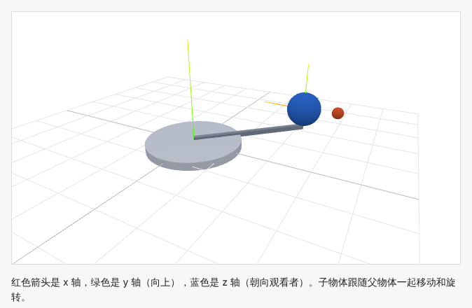

示例：[06-02-transform.html](示例/06-02-transform.html)

```js
const turntable = new THREE.Mesh(...);   // 父物体
scene.add(turntable);
const arm = new THREE.Group();
turntable.add(arm);                      // 子物体：跟随转盘
const planet = new THREE.Mesh(...);
planet.position.set(3, 0.5, 0);          // 相对于支臂的位置
arm.add(planet);

turntable.rotation.y += dt * 0.5;        // 转盘一转，支臂、球、卫星都跟着转
```

需要知道物体在世界中的真实位置时，使用 `getWorldPosition`。设计父子关系时，按“谁带着谁动”来组织：车轮是车身的子物体，门把手是门的子物体。

#### 02.4 变换的本质：矩阵

位置、旋转、缩放在内部被合成为一个 4 × 4 的**矩阵**。父子关系就是矩阵的相乘：子物体的世界矩阵 ＝ 父物体的世界矩阵 × 子物体的局部矩阵。日常使用中不必直接操作矩阵，但理解这一点，可以解释“为什么改变父物体会影响所有子物体”，也为学习着色器（见[《技术美术与实时效果》](07-技术美术与实时效果.md)）打下基础。矩阵的更多内容见[《图形与交互的数学基础》](20-图形与交互的数学基础.md)。

#### 02.5 透视：近大远小

**透视投影**模仿人眼：同样大小的物体，离得越远看起来越小。相机能看到的空间是一个被截掉顶端的四棱锥，称为**视锥体**：比近裁剪面更近、比远裁剪面更远的物体都不会被画出来。近裁剪面不要设得太小（例如 0.1 而不是 0.0001），否则远处的物体会出现闪烁的“深度冲突”。

#### 02.6 常见问题

- **物体不见了**：在相机背后、在视锥体之外，或者比近裁剪面还近。先把相机拉远，检查物体的位置。
- **物体旋转的中心不对**：物体绕自己的原点旋转。需要绕某一点旋转时，把物体放进一个位于该点的父物体中，旋转父物体。
- **缩放后光照异常**：负数或不均匀的缩放可能让表面的方向（法线）出错，尽量在建模时就确定尺寸。

**本章练习**：修改 `06-02-transform.html`，给卫星再加一颗绕它旋转的“小小卫星”，并解释它的运动由哪几层旋转组合而成。

<a id="ch03"></a>

### 03 第一个三维场景

一个最小的三维场景只需要七步。three.js 的官方手册从这些基础开始，逐步讲解场景的各个部分。[B02](#ref-b02)

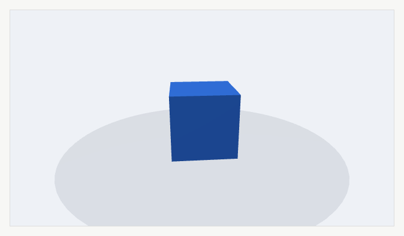

示例：[06-03-first-scene.html](示例/06-03-first-scene.html)

```js
import * as THREE from 'three';

// 1. 渲染器：高清屏最多按 2 倍渲染，控制性能
const renderer = new THREE.WebGLRenderer({ antialias: true });
renderer.setPixelRatio(Math.min(devicePixelRatio, 2));
stage.appendChild(renderer.domElement);

// 2. 场景　3. 相机：视野 45 度，近裁剪面 0.1，远裁剪面 100
const scene = new THREE.Scene();
const camera = new THREE.PerspectiveCamera(45, 1, 0.1, 100);
camera.position.set(2.4, 1.9, 3.2);
camera.lookAt(0, 0.5, 0);

// 4. 灯光：天空光提供柔和的整体照明，平行光提供方向与明暗
scene.add(new THREE.HemisphereLight('#ffffff', '#b0b4bc', 1.2));
const sun = new THREE.DirectionalLight('#ffffff', 2.5);
sun.position.set(-2, 5, 3);
scene.add(sun);

// 5. 物体 = 几何体（形状）＋ 材质（表面）
const cube = new THREE.Mesh(new THREE.BoxGeometry(1, 1, 1),
  new THREE.MeshStandardMaterial({ color: '#2f6fdb', roughness: 0.4 }));
scene.add(cube);

// 6. 尺寸：容器变化时同步更新渲染尺寸与相机宽高比
new ResizeObserver(() => {
  renderer.setSize(stage.clientWidth, stage.clientHeight);
  camera.aspect = stage.clientWidth / stage.clientHeight;
  camera.updateProjectionMatrix();
}).observe(stage);

// 7. 动画循环：按经过的时间旋转
const timer = new THREE.Timer();
timer.connect(document);                       // 页面不可见时暂停计时
renderer.setAnimationLoop(time => {
  timer.update(time);
  cube.rotation.y += timer.getDelta() * 0.6;
  renderer.render(scene, camera);
});
```

示例在页面中用“导入映射”指定 three.js 的地址，之后就可以用 `import * as THREE from 'three'` 引入：

```html
<script type="importmap">
{ "imports": { "three": "https://cdn.jsdelivr.net/npm/three@0.186.1/build/three.module.js",
               "three/addons/": "https://cdn.jsdelivr.net/npm/three@0.186.1/examples/jsm/" } }
</script>
```

固定版本号（例如 0.186.1）可以避免库升级后示例突然无法运行。three.js 的接口会随版本变化，例如本册使用的 `THREE.Timer` 代替了旧版本中的 `THREE.Clock`，阅读旧教程时要注意版本差异。

#### 03.1 常见问题

- **画面全黑**：没有灯光（`MeshStandardMaterial` 需要光照），或者相机没有朝向物体。
- **画面被拉伸**：容器尺寸变化后没有更新相机的宽高比。
- **画面模糊或很卡**：像素比过低会模糊，过高会很卡，限制在 2 以内是常见的折中。

**本章练习**：

1. 把立方体换成 `TorusKnotGeometry`，并让它同时绕两个轴旋转。
2. 添加第二个物体与第二盏灯，观察明暗的变化。
3. 在系统中开启“减少动态效果”，确认示例中的立方体停止旋转。

<a id="part-2"></a>

## 第二篇：八个方向

<a id="ch04"></a>

### 04 形体与建模

#### 04.1 是什么

三维形体由**顶点**和**面**组成。显卡只会画三角形，因此任何曲面最终都被分成许多小三角形。三角形越多，形状越精细，但计算与传输的成本也越高。

#### 04.2 核心概念

- **拓扑**：顶点与面之间的连接方式。好的拓扑让模型容易修改、变形时不出现褶皱。角色模型需要沿关节布置环形的边，产品模型需要在转折处保留足够的边。
- **法线**：表面朝向的方向，决定光照的明暗。同一位置的法线如果在相邻的面之间平均，表面看起来平滑；如果每个面各用自己的法线，表面看起来有棱角。
- **细分**：把每个面分成更多更小的面，让形状更圆滑。
- **雕刻**：像捏泥一样直接推拉高面数的表面，适合有机形体与细节。
- **比例**：产品、角色、建筑各有不同的结构与比例规律，建模前先收集参考并确定尺寸。

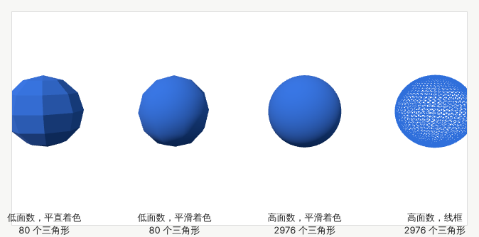

示例：[06-04-geometry.html](示例/06-04-geometry.html)

```js
const low = new THREE.SphereGeometry(1, 8, 6);     // 80 个三角形
const high = new THREE.SphereGeometry(1, 48, 32);  // 2976 个三角形
new THREE.MeshStandardMaterial({ color, flatShading: true }); // 平直着色：每个面一个方向
```

#### 04.3 为网页准备的模型

网页上的模型受下载大小、内存与手机性能限制。建模时就要考虑：

- **可见距离**：只在近处看到的细节，远处可以省略。
- **细节的重要性**：产品的标志、按钮值得多用三角形；看不到的底面可以简化。
- **可承受的资源量**：为每个场景设定三角形数量与贴图大小的预算（见 11 章）。
- **多级细节**：同一个模型准备高、中、低几个版本，远处使用低面数版本。three.js 的 `LOD` 对象可以按距离自动切换。

轮廓是否圆滑主要取决于面数，表面是否平滑主要取决于法线。很多时候，面数不高但法线正确、再配合法线贴图（见 05 章），就能得到足够好的效果。

#### 04.4 常见问题

- **表面出现奇怪的明暗块**：法线方向错误或没有计算法线。three.js 中可以调用 `geometry.computeVertexNormals()`。
- **硬边看起来软塌塌**：平滑着色把转折处也平均了。在转折处拆开顶点，或者在建模工具中标记硬边。
- **模型太大**：在内容制作工具中减面，或使用多级细节。

**本章练习**：用基础几何体（立方体、圆柱、球、圆环）拼出一个简单的产品，例如台灯，并统计它的三角形数量。

**继续深入**：硬表面建模中的倒角与支撑边；重拓扑；法线烘焙（把高面数模型的细节转存到低面数模型的法线贴图上）；程序化建模。

<a id="ch05"></a>

### 05 UV 纹理与材质

#### 05.1 UV：二维图像怎样贴到三维表面

想把一张图片贴到三维模型上，需要告诉程序：模型表面的每一点，对应图片上的哪一点。图片上的坐标称为 **UV**（u 向右、v 向上，范围 0 到 1）。为模型表面分配 UV 的过程称为 **UV 展开**，就像把一个纸盒拆开摊平。

检查 UV 最直接的方法是贴一张带编号的棋盘格：格子变形说明拉伸，编号断开说明有接缝。示例中，立方体的每个面都完整地贴了一张图；球体在两极附近格子被明显压缩，这是球面展开的固有问题。

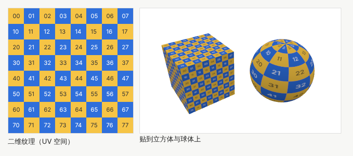

示例：[06-05-uv.html](示例/06-05-uv.html)

#### 05.2 基于物理的材质

现代实时渲染普遍使用**基于物理的渲染**（PBR）：用接近真实物理的参数描述材质，在不同的光照下都能得到可信的结果。最常用的参数：

| 参数 | 含义 | 取值 |
| --- | --- | --- |
| 基础颜色 | 物体本身的颜色 | 颜色或颜色贴图 |
| 金属度 | 是金属还是非金属 | 0 为非金属，1 为金属，中间值多用于过渡区域 |
| 粗糙度 | 表面的光滑程度 | 0 像镜面，1 完全漫反射 |
| 法线贴图 | 不增加面数而表现细小的凹凸 | 用颜色记录方向的贴图 |
| 环境遮蔽 | 缝隙与角落中光线被遮挡而变暗 | 灰度贴图 |
| 自发光 | 物体自己发出的光 | 颜色与强度 |
| 透明度 | 能否透过物体看到后面 | 0 到 1 |

粗糙度可以用“微表面”来理解：任何表面在显微镜下都由无数微小的镜面组成，越粗糙，这些镜面的朝向越混乱，反射就越模糊。LearnOpenGL 的 PBR 理论一章用图示讲解了这一原理。[B03](#ref-b03)

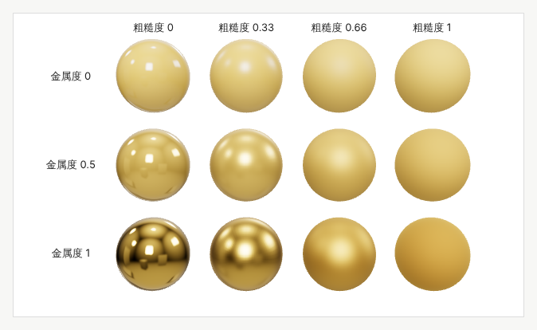

示例：[06-05-materials.html](示例/06-05-materials.html)

```js
new THREE.MeshStandardMaterial({ color: '#c8a04a', roughness: 0.33, metalness: 1 });
// 金属与光滑的表面需要有东西可以反射：用环境贴图提供周围的光照
scene.environment = new THREE.PMREMGenerator(renderer).fromScene(new RoomEnvironment(), 0.04).texture;
```

#### 05.3 色彩纹理与数据纹理

贴图分为两类，处理方式不同：

- **色彩纹理**：基础颜色、自发光颜色等，存储的是给人看的颜色，使用 sRGB 色彩空间。在 three.js 中需要设置 `texture.colorSpace = THREE.SRGBColorSpace`。
- **数据纹理**：法线、粗糙度、金属度、环境遮蔽等，存储的是数值，不能当作颜色处理，保持默认的“无色彩空间”。

把数据纹理错设为 sRGB，会让粗糙度、法线等数值被错误地转换，材质看起来发灰或发亮。three.js 手册的色彩管理一章说明了这些规则。[B04](#ref-b04) 在 glTF 格式中，粗糙度与金属度常合并在同一张贴图里：绿色通道存粗糙度，蓝色通道存金属度。[B05](#ref-b05)

#### 05.4 贴图分辨率

贴图的分辨率应当与它在屏幕上实际显示的大小相匹配：一个在屏幕上最多显示 300 像素宽的物体，配 4096 像素的贴图只会浪费下载时间与显存。显卡会为贴图自动生成逐级缩小的版本（多级渐远纹理），远处使用小版本，避免闪烁。

#### 05.5 常见问题

- **贴图颜色偏暗或偏亮**：色彩空间设置错误。
- **贴图出现明显的接缝**：UV 接缝两侧的贴图内容不连续。把接缝放在不显眼的位置，或在绘制贴图时跨接缝绘制。
- **金属看起来是黑的**：金属主要反射周围环境，场景中没有环境贴图时会显得很暗。

**本章练习**：

1. 修改 `06-05-uv.html`，把棋盘格改为 4 × 4，观察球体上格子的变化。
2. 修改 `06-05-materials.html`，把颜色改为银色，比较金属与非金属在同样粗糙度下的差别。
3. 给一个物体加上粗糙度贴图：用画布生成一张左黑右白的渐变图，观察表面从光滑到粗糙的过渡。

**继续深入**：UV 展开与纹理烘焙；三平面映射（不需要 UV）；透明材质的排序问题；次表面散射、清漆、织物光泽等进阶材质（`MeshPhysicalMaterial`）。

<a id="ch06"></a>

### 06 灯光与环境

#### 06.1 灯光让形体可读

同一个物体在不同的布光下差别很大。灯光的作用不只是“照亮”：它让形体的起伏可以被看出来，让材质的特征（光滑、粗糙、金属）表现出来，也营造气氛。

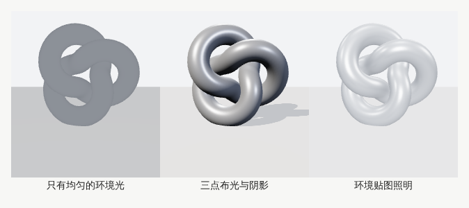

示例：[06-06-lighting.html](示例/06-06-lighting.html)

#### 06.2 常用灯光

| 灯光 | 特点 | 用途 |
| --- | --- | --- |
| 环境光 `AmbientLight` | 各处一样亮，没有方向 | 稍微提亮暗部，单独使用会显得扁平 |
| 天空光 `HemisphereLight` | 上方一种颜色，下方一种颜色 | 室外的天空与地面反光 |
| 平行光 `DirectionalLight` | 方向一致，像太阳 | 主光、产生阴影 |
| 点光源 `PointLight` | 从一点向四周发光 | 灯泡 |
| 聚光灯 `SpotLight` | 锥形光束 | 舞台灯、手电 |
| 环境贴图 | 用一张全景图照亮物体并产生反射 | 产品展示、真实感场景 |

#### 06.3 三点布光

摄影与影视中常用的基础布光方法：

1. **主光**：最亮，决定明暗的方向与影子，通常放在物体斜前上方。
2. **辅光**：较弱，放在另一侧，减轻主光造成的暗部。
3. **轮廓光**：从物体后方照射，在边缘形成亮线，把物体与背景分开。

#### 06.4 环境贴图

**环境贴图**（基于图像的照明）用一张记录了周围环境光照的全景图来照亮物体。它同时提供柔和的照明与真实的反射，是产品展示中最常用的布光方式。示例使用 three.js 自带的虚拟房间（`RoomEnvironment`），实际项目常用专门拍摄或制作的高动态范围全景图。

#### 06.5 阴影与色调映射

- **阴影**：需要分别开启渲染器、灯光（`castShadow`）、投射阴影的物体（`castShadow`）与接收阴影的物体（`receiveShadow`）。阴影贴图越大越清晰，但越耗性能；手机上可以只让主要物体投射阴影，或使用预先烘焙的阴影贴图。
- **色调映射**：真实世界的亮度范围远大于屏幕能显示的范围，色调映射把高亮度压缩到可以显示的范围，避免高光“爆白”。示例使用了 `ACESFilmicToneMapping`，可以配合曝光值调整整体亮度。

#### 06.6 常见问题

- **物体像剪纸一样扁平**：只有环境光，缺少有方向的主光。
- **阴影有锯齿或条纹**：阴影贴图分辨率不足或偏移量不合适，调整 `shadow.mapSize` 与 `shadow.bias`。
- **画面发灰**：色调映射与曝光不合适，或者颜色纹理的色彩空间设置错误。

**本章练习**：在 `06-06-lighting.html` 中，分别关闭主光、辅光、轮廓光，记录每盏灯的作用；再把主光移到物体正前方，比较立体感的变化。

**继续深入**：高动态范围全景图的制作；光照烘焙与光照贴图；实时全局光照；体积光与雾。

<a id="ch07"></a>

### 07 相机与构图

#### 07.1 透视相机与正交相机

- **透视相机**：近大远小，与人眼的观感一致，适合大多数场景。
- **正交相机**：没有近大远小，同样大小的物体无论远近看起来都一样大，适合工程图、等距视角的游戏与界面化的三维图形。

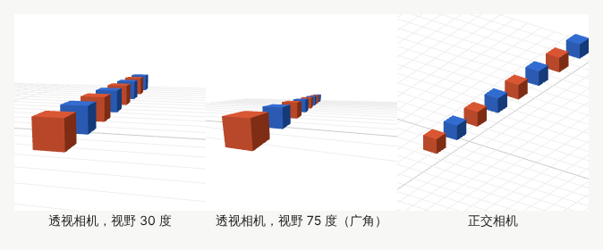

示例：[06-07-camera.html](示例/06-07-camera.html)

#### 07.2 视野与焦距

透视相机的**视野**（`fov`，单位是度）决定能看到多宽的范围，对应摄影中的焦距：

- **视野小（长焦）**：透视压缩，前后物体的大小差别小，画面平稳，适合产品特写。
- **视野大（广角）**：透视夸张，近处物体显得很大，画面有冲击力，但边缘容易变形。

产品展示常用 25 到 40 度的视野，并通过移动相机而不是改变视野来调整取景。

#### 07.3 构图：模型与页面一起设计

网页中的三维画面不是孤立的，标题、说明与按钮也在同一个画面中。构图时：

- 为文字留出位置：让模型偏向画面一侧，另一侧放说明（见 12 章的“平移”做法）。
- 保持视线的引导：重要的部件放在视觉中心附近。
- 不同的观察角度对应不同的说明内容，切换时相机平滑地移动。

#### 07.4 镜头运动

| 运动 | 做法 | 效果 |
| --- | --- | --- |
| 环绕 | 相机绕目标点旋转 | 展示物体的各个侧面 |
| 推拉 | 相机靠近或远离目标 | 聚焦细节或展示全貌 |
| 平移 | 相机与目标一起移动 | 改变画面中的位置 |
| 飞行 | 在两个机位之间插值 | 切换观察角度 |

镜头运动要有缓入缓出，并且允许用户随时接管；系统开启“减少动态效果”时，直接切换到新机位。

#### 07.5 手机上的构图

手机屏幕窄而高，把桌面版本的画面直接缩小，模型会变得很小，文字也会遮住模型。更有效的做法是**重新安排**：把说明移到画面下方，让相机后退或调整角度，使模型在窄画面中完整呈现。

**本章练习**：在 `06-07-camera.html` 中，把广角相机的视野改为 100 度，观察边缘的变形；再为同一个场景设计一个适合手机竖屏的机位。

**继续深入**：景深与焦外模糊；相机路径与样条曲线；电影镜头语言在交互作品中的运用。

<a id="ch08"></a>

### 08 角色与物体动画

#### 08.1 几种动画方式

| 方式 | 原理 | 适合 |
| --- | --- | --- |
| 程序动画 | 在动画循环中按时间计算位置、旋转 | 旋转展示、拆解、简单的循环动作 |
| 关键帧动画 | 在几个时间点设定数值，中间自动插值 | 开盖、展开等设计好的动作 |
| 骨骼动画 | 用一套“骨骼”带动模型表面变形 | 角色、动物、柔性物体 |
| 形变动画 | 在几个预先做好的形状之间混合 | 表情、简单的形状变化 |

**关键帧动画**在 three.js 中由动画剪辑（`AnimationClip`）描述，由动画混合器（`AnimationMixer`）播放；从 glTF 文件导入的动画也是这种形式。多个动作之间可以**混合**与**交叉淡入淡出**，例如从“走”平滑地过渡到“跑”。

**骨骼动画**中，模型的每个顶点被分配给一根或几根骨骼并带有权重，骨骼转动时，表面跟着变形（称为蒙皮）。

#### 08.2 产品拆解动画

机械产品的拆解与角色动作需要不同的控制方式。拆解动画的部件是刚体，只需要沿设计好的方向移动；用一个 0 到 1 的“拆解程度”控制全部部件，就能用滑块拖动、自动播放或与滚动关联。

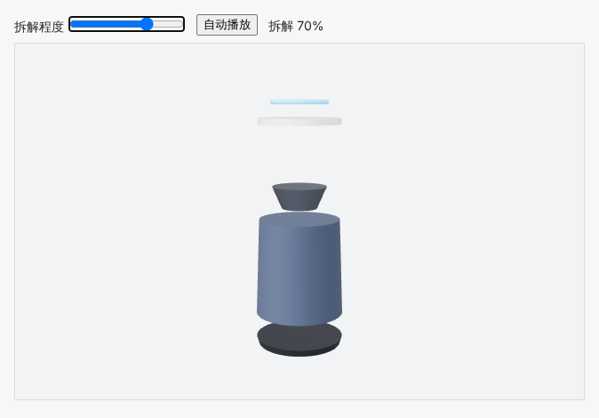

示例：[06-08-explode.html](示例/06-08-explode.html)

```js
const offsets = { 底座: -0.7, 外壳: 0, 扬声器单元: 1.9, 顶盖: 2.6, 灯环: 3.0 };
const ease = t => t < 0.5 ? 2 * t * t : 1 - Math.pow(-2 * t + 2, 2) / 2;  // 缓入缓出
amount += (target - amount) * Math.min(1, dt * 6);                          // 平滑地靠近目标
for (const p of parts) p.mesh.position.y = p.base + p.offset * ease(amount);
```

#### 08.3 动画的开始、停止与接管

为每一段动画回答三个问题：

- **何时开始**：页面加载后、进入视野时、用户点击时？
- **怎样停止**：播放一次、循环、停在某一帧？
- **用户输入如何接管**：用户拖动滑块或旋转模型时，自动播放立即让出控制权，并且不会在用户操作后突然“跳回”。

示例中，拖动滑块会停止自动播放；开启“减少动态效果”时，拆解程度直接跳到目标值。

**本章练习**：

1. 给 `06-08-explode.html` 增加“与页面滚动关联”：页面滚动到一半时拆解程度为 1。
2. 让拆解时各部件依次开始移动，而不是同时移动（提示：给每个部件不同的延迟）。

**继续深入**：动画状态机；反向动力学（让手脚自动够到目标位置）；动作捕捉数据的清理；程序化的二级运动（摆动、抖动）。

<a id="ch09"></a>

### 09 场景与环境设计

#### 09.1 组织空间

一个完整的场景由建筑、地形、植被、道具与路径组成。设计时关注：

- **视觉引导**：用光线、颜色、路径与地标，引导观众看向重要的地方。
- **空间层级**：前景、中景、远景层次分明；雾与大气透视让远处变淡，增加深度感。
- **方向感**：明显的地标、清楚的路径与导航提示，避免用户在空间中迷路。

#### 09.2 用规则生成环境

示例用噪声（见[《创意编程与二维图形》第 06 章](05-创意编程与二维图形.md#ch06)）生成起伏的地形：平面网格的每个顶点按噪声值抬高，并按高度着色（水面、沙地、草地、树林、岩石、积雪）；400 棵树只种在草地的高度范围内；远处用雾融入天空。

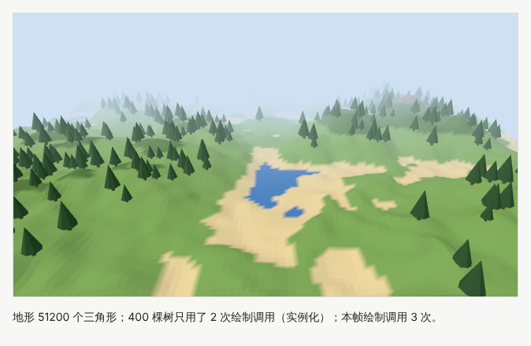

示例：[06-09-terrain.html](示例/06-09-terrain.html)

#### 09.3 实例化：一次画出许多相同的物体

画 400 棵树，如果每棵树都是一个独立的物体，渲染器要向显卡发出 400 次以上的绘制请求（**绘制调用**），这在手机上很慢。**实例化网格**（`InstancedMesh`）只用一次绘制调用就画出所有相同形状的物体，每个实例只需提供自己的位置、旋转与缩放。示例中，400 棵树只用了 2 次绘制调用（树冠与树干各一次）。

```js
const crown = new THREE.InstancedMesh(coneGeometry, material, trees.length);
trees.forEach(([x, h, z, k], i) => {
  crown.setMatrixAt(i, matrix.compose(position.set(x, h + 1.3 * k, z), quaternion, scale.set(k, k, k)));
});
```

#### 09.4 大场景

- **分区加载**：只加载用户附近的区域，离开后释放。
- **多级细节**：远处使用简化的模型或用图片代替（公告板）。
- **遮挡剔除**：被建筑挡住的物体不必绘制。
- **导航**：小地图、目的地列表、跳转按钮，让用户不必在空间中漫无目的地移动。

**本章练习**：修改 `06-09-terrain.html` 的随机种子与噪声参数，生成一片群岛；再给场景加一条从近处通向远处的小路，作为视觉引导。

**继续深入**：地形纹理混合；植被的风吹动画；程序化城市；空间叙事与数字展览在[《信息、数据与空间》](15-信息数据与空间.md)中继续展开。

<a id="ch10"></a>

### 10 三维交互

#### 10.1 常见的交互

| 交互 | 做法 |
| --- | --- |
| 旋转、缩放、平移视角 | 轨道控制（`OrbitControls`），设定距离与角度的限制 |
| 选取部件 | 射线拾取（`Raycaster`）：从相机穿过指针位置发出射线，找到最先碰到的物体 |
| 悬停提示 | 指针移动时进行射线拾取，高亮当前物体 |
| 拖动物体 | 把指针位置投射到一个平面上，物体沿平面移动 |
| 标注 | 把三维位置投影到屏幕上，放置 HTML 标签 |
| 恢复视角 | 相机与目标点平滑地回到初始位置 |

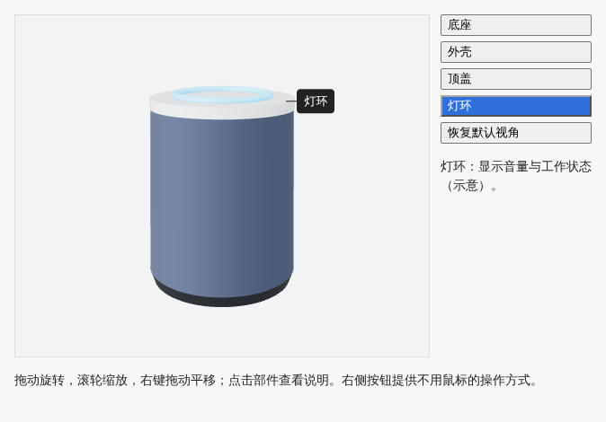

示例：[06-10-picking.html](示例/06-10-picking.html)

```js
// 只有“点击”才选中：按下与抬起的位置相差很小，才不是拖动旋转
renderer.domElement.addEventListener('pointerup', e => {
  if (Math.hypot(e.clientX - down.x, e.clientY - down.y) > 4) return;
  ndc.set((x / width) * 2 - 1, -(y / height) * 2 + 1);    // 换算为 -1 到 1 的坐标
  raycaster.setFromCamera(ndc, camera);
  const hit = raycaster.intersectObjects(pickable)[0];
  select(hit ? hit.object : null);
});

// 标签跟随部件：世界坐标 → 屏幕坐标
selected.getWorldPosition(anchor);
anchor.project(camera);
tag.style.left = `${(anchor.x + 1) / 2 * width}px`;
tag.style.top = `${(1 - anchor.y) / 2 * height}px`;
```

#### 10.2 让用户始终知道发生了什么

- **选中了什么**：高亮选中的部件，并显示名称。
- **改变了什么**：操作后给出可见的反馈。
- **如何恢复**：提供“恢复默认视角”，限制相机不能钻进模型内部或翻到地面以下。

#### 10.3 三维与二维界面配合

重要的信息不要只放在三维画面中：价格、参数、操作说明应当以普通的网页文字呈现，三维画面负责展示与探索。示例在画面旁边提供了部件按钮：它们与点击模型的效果相同，键盘与读屏软件用户也可以使用。

#### 10.4 常见问题

- **拖动旋转后误选了部件**：没有区分点击与拖动。
- **点不中细小的部件**：射线拾取的目标太小，可以用一个看不见的、更大的形状作为拾取目标。
- **标签抖动或在模型背面仍然显示**：每一帧更新标签位置，并在部件背向相机或被遮挡时隐藏标签（见 12 章）。

**本章练习**：给 `06-10-picking.html` 增加悬停高亮，并实现“双击部件时相机飞到该部件附近”。

**继续深入**：拖动约束与吸附；三维空间中的测量与标注工具；多选与框选；扩展现实中的手势与控制器输入（见[《人机交互与新型媒介》](12-人机交互与新型媒介.md)）。

<a id="ch11"></a>

### 11 资源制作与交付

#### 11.1 glTF：三维的通用交付格式

**glTF** 是 Khronos 组织制定的三维模型交付格式，常被称为“三维的 JPEG”。它包含几何、材质、贴图、动画与场景结构，有两种形式：`.gltf`（文本描述加外部文件）与 `.glb`（全部打包为一个二进制文件）。glTF 2.0 已成为国际标准 ISO/IEC 12113:2022。[B05](#ref-b05) 本册的[示例模型](示例/models/speaker.glb)就是一个 `.glb` 文件。

```js
import { GLTFLoader } from 'three/addons/loaders/GLTFLoader.js';
new GLTFLoader().load('models/speaker.glb',
  gltf => scene.add(gltf.scene),                       // 成功
  e => { bar.value = e.loaded / e.total * 100; },      // 进度
  () => { showFallback(); }                            // 失败
);
```

#### 11.2 压缩

| 对象 | 方法 | 效果 |
| --- | --- | --- |
| 几何 | Draco 或 meshopt 压缩 | 模型文件通常可以缩小数倍 |
| 贴图 | KTX 2.0 与 Basis Universal 压缩 | 下载更小，并以压缩形式留在显存中 |
| 贴图尺寸 | 按实际显示大小缩小 | 减少下载与显存 |
| 动画 | 减少关键帧、量化数值 | 减少文件大小 |

Draco 是 Google 开源的几何压缩库。[B06](#ref-b06) KTX 2.0 是 Khronos 的纹理容器格式，配合 Basis Universal 可以在不同设备上转换为显卡原生支持的压缩格式。[B07](#ref-b07) 压缩会增加解压的时间，需要在下载时间与处理时间之间权衡。

#### 11.3 资源预算与检查

为每个项目设定预算，并在交付前检查：

| 项目 | 预算示例（示意） |
| --- | --- |
| 首屏模型文件 | 不超过 2 MB（压缩后） |
| 三角形数量 | 手机上不超过 30 万 |
| 贴图 | 主要贴图不超过 2048 像素，总显存不超过 100 MB |
| 绘制调用 | 每帧不超过 100 次 |

Khronos 提供的 glTF 校验工具可以在浏览器中检查文件是否符合规范，并列出资源统计。[B08](#ref-b08) 建立固定的资产检查流程：命名规范、尺寸单位、面数、贴图尺寸与格式、动画名称、版本记录。

#### 11.4 加载、失败与低性能模式

三维资源的加载需要设计完整的状态：

- **加载前与加载中**：显示进度，而不是一片空白；页面的文字内容不应等待三维资源。
- **加载失败**：给出可以阅读的替代内容（产品图片、文字说明）与重试按钮，而不是一直转圈。
- **低性能模式**：设备较弱时降低像素比、关闭阴影与后期效果，或者只显示静态图片。

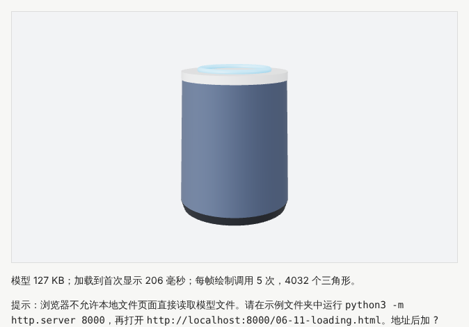

示例：[06-11-loading.html](示例/06-11-loading.html)（需要本地服务器；地址后加 `?fail=1` 演示加载失败）

#### 11.5 在目标设备上验证

场景能在开发用的电脑上流畅运行，不代表能在用户的手机上运行。交付前在目标设备（尤其是中低端手机）上实际测试：加载时间、帧率、发热、内存，以及触摸操作是否顺畅。

**本章练习**：用 glTF 校验工具检查 `示例/models/speaker.glb`，记录文件大小、三角形数量与材质数量；思考它的文件为什么有 127 KB，可以从哪些方面缩小。

**继续深入**：资源的自动化处理流水线；按需分块加载；内容分发网络与缓存；模型的版本管理与差异比较。

<a id="part-3"></a>

## 第三篇：综合实战与质量

<a id="ch12"></a>

### 12 综合项目：三维产品展示页

本章把前面的知识组合成一个完整作品：展示页包含模型旋转、三个观察角度、部件说明与恢复默认视角；每个观察角度都安排了相机与文字的布局；记录资源体积、首次可交互的时间与设备表现；模型没有加载时，产品信息仍然可以阅读。

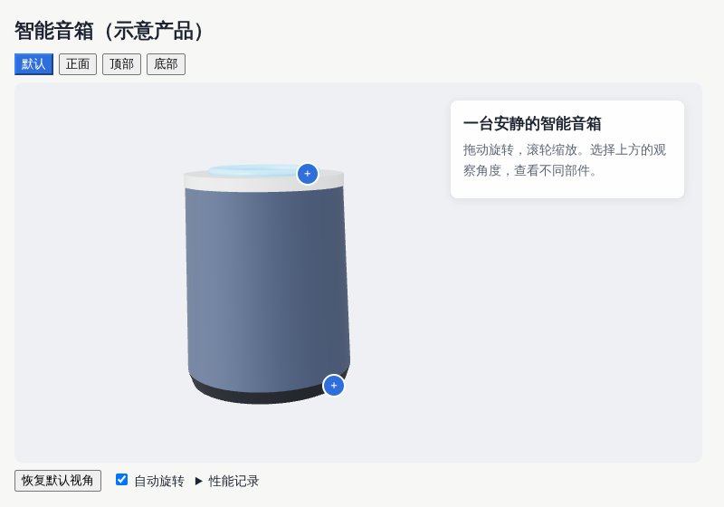

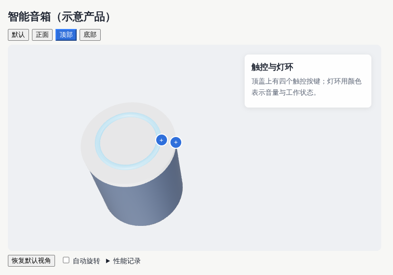

示例：[06-12-product.html](示例/06-12-product.html)（需要本地服务器）

#### 12.1 第一步：先写不依赖三维的内容

先用普通的 HTML 写出产品名称、产品信息与操作说明。三维画面是对这些内容的增强，而不是唯一的载体：模型加载失败、设备不支持或用户使用读屏软件时，页面仍然完整可用。

**检查**：关闭 JavaScript 或断开网络，产品信息仍然可以阅读。

#### 12.2 第二步：加载模型并显示进度

使用 `GLTFLoader` 加载模型，用进度条显示已下载的比例；失败时显示说明，并禁用依赖模型的按钮。

**检查**：通过本地服务器打开，进度条走完后出现模型；直接双击打开文件时，显示“暂时无法加载”的说明。

#### 12.3 第三步：设计观察角度

每个观察角度包含：相机位置、关注的中心、说明卡片的位置与内容、需要显示的标注。

```js
const VIEWS = {
  home:  { pos: [4.6, 3.0, 6.4], center: [0, 1.3, 0], shift: 1.1, card: 'right', title: '一台安静的智能音箱', spots: ['灯环', '底座'] },
  front: { pos: [0, 1.6, 7.2],   center: [0, 1.3, 0], shift: -1.2, card: 'left', title: '织物外壳', spots: ['外壳'] },
  top:   { pos: [0, 8.6, 3.6],   center: [0, 2.2, 0], shift: 1.3, card: 'right', title: '触控与灯环', spots: ['灯环', '顶盖'] }
};
```

**为说明卡片让出位置**：把相机和目标点一起沿“画面向右”的方向平移 `shift`，模型就会出现在画面的另一侧。“画面向右”的方向由视线方向与向上方向的叉积得到：

```js
const right = center.clone().sub(pos).cross(camera.up).normalize();
const target = center.clone().addScaledVector(right, shift);
pos.addScaledVector(right, shift);
```

**检查**：每个视角下，模型与说明卡片互不遮挡。

#### 12.4 第四步：相机飞行

切换视角时，相机位置与目标点在 0.8 秒内平滑地插值，使用缓入缓出；用户开始拖动时立即停止飞行，把控制权交给用户；开启“减少动态效果”时直接跳到新视角。

**检查**：快速连续点击不同的视角，相机不会抖动或跳回。

#### 12.5 第五步：部件标注

每个标注是一个 HTML 按钮，位置由部件表面外侧的一点投影到屏幕得到。部件转到背面时隐藏标注：比较“从模型中心指向标注点”与“从模型中心指向相机”两个方向，方向相反时说明标注点在背面。按钮带有文字说明，读屏软件可以读出。

**检查**：自动旋转时，转到背面的标注会隐藏，转回来时重新出现。

#### 12.6 第六步：自动旋转与用户接管

默认缓慢自动旋转，吸引注意；用户拖动、点击视角按钮或取消勾选时停止。开启“减少动态效果”时不自动旋转。

#### 12.7 第七步：手机上的重新构图

窄屏时，说明卡片移到画面下方（CSS 媒体查询），相机后退到原距离的 1.35 倍，并取消横向平移，让模型在窄画面中完整居中。

**检查**：在开发者工具中切换到手机尺寸，模型完整可见，卡片不遮挡模型。

#### 12.8 第八步：记录性能

页面的“性能记录”中显示：模型文件大小、从打开页面到首次显示模型的时间、每帧的绘制调用与三角形数量、帧率。在目标设备上记录这些数字，作为是否需要优化的依据。

#### 12.9 验收清单

- [ ] 模型未加载时，产品信息与说明完整可读。
- [ ] 加载有进度，失败有说明与替代内容。
- [ ] 三个观察角度都有对应的相机与文字布局，切换平滑、可以被用户打断。
- [ ] 部件标注位置正确，转到背面时隐藏，键盘可以访问。
- [ ] 有“恢复默认视角”，相机不会钻进模型或翻到地面以下。
- [ ] 手机上重新构图，模型完整可见。
- [ ] 记录了资源体积、首次可交互时间与目标设备上的帧率。
- [ ] 开启“减少动态效果”时没有自动旋转与相机飞行。

<a id="ch13"></a>

### 13 性能、可访问性与舒适度

#### 13.1 性能的主要因素

| 因素 | 说明 | 优化方法 |
| --- | --- | --- |
| 绘制调用 | 每次向显卡发出的绘制请求 | 合并材质与几何、使用实例化 |
| 三角形数量 | 显卡需要处理的面数 | 减面、多级细节 |
| 贴图显存 | 贴图占用的显卡内存 | 缩小尺寸、压缩纹理 |
| 像素数量 | 每帧需要计算的像素 | 限制像素比，复杂效果降低分辨率 |
| 阴影与后期效果 | 每一项都要额外渲染 | 只在需要时开启，手机上简化 |

`renderer.info` 提供每帧的绘制调用与三角形数量，示例页面都显示了这些数字。每帧的时间预算约为 16.7 毫秒（每秒 60 帧），超过就会掉帧。移除不再使用的模型时，调用几何体、材质与贴图的 `dispose()` 释放显存。

#### 13.2 可访问性

- 三维画面提供文字说明，重要信息以普通文字呈现。
- 所有操作都有键盘或按钮的替代方式。
- 标注与说明的文字与背景有足够的对比度。

#### 13.3 舒适度

部分用户在观看快速移动的镜头时会感到头晕。避免剧烈、突然的相机运动；自动旋转保持缓慢；尊重“减少动态效果”的设置；在扩展现实中，避免用户不期望的视角移动。

**本章练习**：在一台中低端手机上打开 `06-12-product.html`，记录帧率与加载时间，并尝试一项优化（例如把像素比限制为 1.5），比较前后的差别。

<a id="ch14"></a>

### 14 横向组合与继续深入

#### 14.1 横向组合

三维很少单独出现，常与其他方向组合成具体的作品：

| 作品 | 需要组合的方向 |
| --- | --- |
| 三维产品展示 | 品牌视觉、摄影式的布光与构图、产品文案 |
| 建筑与空间场景 | 空间叙事、地图与导航 |
| 教学模型 | 标注、剖面与切开观察、解释性图形 |
| 扩展现实原型 | 空间输入、身体尺度、舒适度 |

教学模型中的“切开观察”可以用裁剪平面实现：先设置 `renderer.localClippingEnabled = true`，再给材质的 `clippingPlanes` 指定一个平面（`THREE.Plane`），平面一侧的部分不再绘制；用滑块移动平面的位置，就能逐层剖开模型。切开后露出的截面是空的，需要填充截面时要用模板缓冲等进一步的技巧。

扩展现实中的空间输入与身体尺度需要进一步研究：网页可以通过 WebXR 设备接口进入头戴设备或手机的增强现实模式。[B09](#ref-b09)

#### 14.2 纵向深入

| 方向 | 入门 | 进阶 | 深入 |
| --- | --- | --- | --- |
| 形体与建模 | 基础几何体拼装 | 内容制作工具建模、法线与面数控制 | 重拓扑、法线烘焙、程序化建模 |
| UV 纹理与材质 | 颜色与粗糙度 | UV 检查、贴图与色彩空间 | 材质制作流程、进阶材质 |
| 灯光与环境 | 基本灯光 | 三点布光、环境贴图、阴影 | 光照烘焙、全局光照 |
| 相机与构图 | 透视与视野 | 机位设计、相机飞行 | 镜头语言、相机路径 |
| 角色与物体动画 | 程序动画 | 关键帧与混合 | 骨骼、反向动力学、动作捕捉 |
| 场景与环境 | 简单场景 | 实例化、雾、地形 | 大场景分区、程序化环境 |
| 三维交互 | 轨道控制 | 拾取、标注、恢复视角 | 编辑工具、扩展现实交互 |
| 资源制作与交付 | 加载模型 | 压缩、预算、失败处理 | 自动化资源流水线 |

#### 14.3 工具与资料

- **three.js**：本册使用的三维库。官方示例展示了大量可以直接观察的效果，是学习的重要资源。[B10](#ref-b10)
- **Blender**：免费开源的内容制作工具，用于建模、材质与动画。
- 其他常见的选择包括 Babylon.js 等三维引擎，以及专门用于展示单个模型的网页组件。

#### 14.4 下一步读什么

- 自定义着色器与特效：[《技术美术与实时效果》](07-技术美术与实时效果.md)。
- 渲染的原理与引擎结构：[《图形工程与渲染系统》](09-图形工程与渲染系统.md)。
- 物理与生成规则：[《生成艺术与物理仿真》](08-生成艺术与物理仿真.md)。
- 向量、矩阵与四元数：[《图形与交互的数学基础》](20-图形与交互的数学基础.md)。

<a id="appendix-a"></a>

## 附录 A：术语表

| 术语 | 含义 | 阅读位置 |
| --- | --- | --- |
| 场景图 | 物体按父子关系组成的树状结构 | 02 |
| 局部坐标与世界坐标 | 相对于父物体的坐标，与相对于整个场景的坐标 | 02 |
| 变换矩阵 | 合成位置、旋转与缩放的 4 × 4 矩阵 | 02 |
| 透视投影 | 近大远小的投影方式 | 02 |
| 视锥体 | 透视相机能看到的空间范围 | 02 |
| 近裁剪面与远裁剪面 | 相机能看到的最近与最远距离 | 02 |
| 顶点与面 | 组成三维形体的点与三角形 | 04 |
| 拓扑 | 顶点与面的连接方式 | 04 |
| 法线 | 表面朝向的方向，决定光照的明暗 | 04 |
| 多级细节 | 按距离切换不同精细程度的模型 | 04 |
| UV | 模型表面与贴图之间的对应坐标 | 05 |
| 基于物理的渲染 | 用接近物理的参数描述材质与光照的方法 | 05 |
| 粗糙度与金属度 | 描述表面光滑程度与金属性的参数 | 05 |
| 法线贴图 | 用贴图记录细小凹凸的方向 | 05 |
| 色彩纹理与数据纹理 | 存储颜色的贴图与存储数值的贴图 | 05 |
| 三点布光 | 主光、辅光与轮廓光组成的布光方法 | 06 |
| 环境贴图 | 用全景图提供照明与反射 | 06 |
| 色调映射 | 把高亮度压缩到屏幕可以显示的范围 | 06 |
| 正交投影 | 没有近大远小的投影方式 | 07 |
| 视野 | 相机能看到的角度范围 | 07 |
| 关键帧动画 | 在几个时间点设定数值，中间自动插值 | 08 |
| 骨骼动画与蒙皮 | 用骨骼带动模型表面变形 | 08 |
| 绘制调用 | 一次向显卡发出的绘制请求 | 09、13 |
| 实例化 | 一次绘制调用画出许多相同形状的物体 | 09 |
| 射线拾取 | 用射线找到指针指向的物体 | 10 |
| glTF | 三维模型的通用交付格式 | 11 |

<a id="appendix-b"></a>

## 附录 B：资料入口

以下资料用于核对方法来源和继续学习。资料核对日期：2026-10-25。

<a id="ref-b01"></a>
**B01 · Blender 用户手册。** [Blender Manual](https://docs.blender.org/manual/en/latest/)。对应 01 章，建模、材质、动画与导出的完整说明。

<a id="ref-b02"></a>
**B02 · three.js 手册。** [three.js manual](https://threejs.org/manual/)。对应 03 章，从基础概念讲解 three.js 的使用。

<a id="ref-b03"></a>
**B03 · LearnOpenGL：PBR 理论。** [PBR Theory](https://learnopengl.com/PBR/Theory)。对应 05 章，微表面、能量守恒与金属度工作流程。

<a id="ref-b04"></a>
**B04 · three.js 手册：色彩管理。** [Color management](https://threejs.org/manual/en/color-management.html)。对应 05 章，色彩纹理与数据纹理的色彩空间设置。

<a id="ref-b05"></a>
**B05 · Khronos：glTF 2.0 规范。** [glTF 2.0 Specification](https://registry.khronos.org/glTF/specs/2.0/glTF-2.0.html)。对应 05、11 章，三维资源交付格式，已成为国际标准 ISO/IEC 12113:2022。

<a id="ref-b06"></a>
**B06 · Google：Draco 几何压缩。** [Draco](https://google.github.io/draco/)。对应 11 章，开源的三维几何压缩库。

<a id="ref-b07"></a>
**B07 · Khronos：KTX 2.0 纹理格式。** [KTX 2.0 发布说明](https://www.khronos.org/news/press/khronos-ktx-2-0-textures-enable-compact-visually-rich-gltf-3d-assets)。对应 11 章，结合 Basis Universal 的通用压缩纹理。

<a id="ref-b08"></a>
**B08 · Khronos：glTF 校验工具。** [glTF Validator](https://github.khronos.org/glTF-Validator/)。对应 11 章，在浏览器中检查 glTF 文件并统计资源。

<a id="ref-b09"></a>
**B09 · MDN：WebXR 设备接口。** [WebXR Device API](https://developer.mozilla.org/en-US/docs/Web/API/WebXR_Device_API)。对应 14 章，在网页中进入虚拟现实与增强现实。

<a id="ref-b10"></a>
**B10 · three.js 官方示例。** [three.js examples](https://threejs.org/examples/)。对应 14 章，可以直接观察的效果与源码。

<a id="appendix-c"></a>

## 附录 C：与原手册的对应关系及修订记录

### C.1 与原手册的对应关系

本册由原《前端与 UI／UX 设计进阶全景手册》第 08 章“三维内容与空间设计”扩写而成，并吸收了其他章节中的相关内容：

| 原手册内容 | 本册位置 |
| --- | --- |
| 8.1 研究对象与先修要求：形体、表面、灯光、相机、动画与空间关系；三维坐标、向量、变换与透视；先在内容制作工具中理解场景 | 01、02、03 章 |
| 8.2 分支 1：形体与建模 | 04 章 |
| 8.2 分支 2：UV 纹理与材质 | 05 章 |
| 8.2 分支 3：灯光与环境 | 06 章 |
| 8.2 分支 4：相机与构图 | 07 章 |
| 8.2 分支 5：角色与物体动画 | 08 章 |
| 8.2 分支 6：场景与环境设计 | 09 章 |
| 8.2 分支 7：三维交互 | 10 章 |
| 8.2 分支 8：资源制作与交付 | 11 章 |
| 8.3 练习与验收：三维产品展示页 | 12 章 |
| 8.4 横向组合 | 14 章 |
| 8.3 参考入口：Three.js 示例 | 14 章、附录 B |
| 2.6 学习阶段 S4：先把一个物体展示好；记录模型大小、贴图资源、加载过程与设备表现 | 01、11、12 章 |
| 20.1 数学：向量与矩阵用于方向、距离、变换与相机 | 02 章 |

### C.2 修订记录

| 版本 | 日期 | 主要变化 |
| --- | --- | --- |
| 1.0 | 2026-10-25 | 初版：由原手册第 08 章扩写，新增 12 个可运行示例、示例模型与截图 |
