# 技术美术与实时效果

> 让美术目标变成可控制、可维护、可以实时运行的效果：从 GPU 怎样画出一帧、写出第一个着色器，到程序化材质、粒子、后处理、风格化渲染、资产工具、参数界面与质量分级。  
> 版本：1.0 · 整理日期：2026-10-25  
> 适用对象：已经能用 three.js 搭建三维场景、想亲手写效果的开发者与设计师。先修：读过[《三维内容与空间设计》](06-三维内容与空间设计.md)的 01—06 章（坐标、变换、材质、灯光）和[《创意编程与二维图形》](05-创意编程与二维图形.md)的 02 章（向量与动画循环）；不需要图形学基础。

**技术美术**负责让美术目标成为可控制、可维护、可运行的效果。美术说“水面要更通透”“画面要有电影感”“手机上也要流畅”，技术美术把这些话变成着色器、参数、工具和质量档位：设计者能调，程序能维护，设备能流畅运行。

做这件事需要对材质、灯光、动画、图形程序和资源流程都有基本的理解。学习时有一个重要的顺序：**先完成一套稳定的三维场景或二维图形，再开发自定义效果**。场景本身稳定，效果出了问题，就容易判断问题来自效果还是来自场景。

本册对每个主题都按同样的顺序讲：先说明它解决什么问题；再用白话解释核心概念；然后给出一个可以直接运行的示例，附运行截图；最后是常见问题、本章练习和继续深入的方向。所有示例都放在本目录的[示例](示例/)文件夹中，用浏览器直接打开即可运行（需要联网加载 three.js）；每个示例都已在浏览器中实际运行并逐项检查过。08 章的示例要读取模型文件，需要像[《三维内容与空间设计》](06-三维内容与空间设计.md) 01 章那样启动本地服务器；12 章的 WebGPU 部分需要支持 WebGPU 的浏览器，不支持时会显示说明。

测试使用的是不带显卡的服务器，浏览器用软件模拟 GPU。书中给出的毫秒数因此比真实设备大很多，**请关注同一组测量中的相对差别**，而不是绝对数值。

主线是：**理解 GPU 怎样画出一帧 → 写出第一个着色器 → 掌握着色器、程序化材质、粒子、后处理、风格化、资产工具、参数界面、质量分级八个方向 → 完成“图片被指针推开后恢复”的效果，并选择合适的工具。**

## 阅读导航

正文共 13 章（01—13），附 12 个可运行示例、3 组附录与 25 项资料入口。

- [第一篇：技术美术的基础](#part-1)
  - [01 技术美术做什么](#ch01)
  - [02 GPU 怎样画出一帧](#ch02)
- [第二篇：八个方向](#part-2)
  - [03 着色器编程](#ch03)
  - [04 程序化材质](#ch04)
  - [05 实时粒子与视觉特效](#ch05)
  - [06 画面后处理](#ch06)
  - [07 风格化渲染](#ch07)
  - [08 资产工具与制作流程](#ch08)
  - [09 效果参数与控制界面](#ch09)
  - [10 性能与质量分级](#ch10)
- [第三篇：综合项目与工具](#part-3)
  - [11 综合项目：图片被指针推开后恢复](#ch11)
  - [12 工具：ShaderMaterial、WebGPU 与节点材质](#ch12)
  - [13 继续深入与学习路线](#ch13)
- [附录 A：术语表](#appendix-a)
- [附录 B：资料入口](#appendix-b)
- [附录 C：与原手册的对应关系及修订记录](#appendix-c)

<a id="part-1"></a>

## 第一篇：技术美术的基础

<a id="ch01"></a>

### 01 技术美术做什么

#### 01.1 从美术目标到可运行的效果

| 美术目标 | 技术美术的工作 | 交付什么 |
| --- | --- | --- |
| “水面要更通透” | 写一个程序化的水面材质，把“通透”拆成颜色深浅、反光强弱、波纹大小 | 着色器 ＋ 三个有名字的参数 |
| “画面要有电影感” | 设计后处理：辉光、景深、调色、暗角，并决定顺序 | 后处理链 ＋ 可以单独开关的步骤 |
| “每个模型都要符合规范” | 写检查工具：面数、贴图尺寸、单位、命名 | 批量检查工具 ＋ 报告 |
| “手机上也要流畅” | 测量瓶颈，设计高、中、低档位，保证低档仍然传达关键内容 | 质量档位 ＋ 每档的视觉变化记录 |

三个关键词：**可控制**（设计者能用有意义的参数调整，而不必改代码）、**可维护**（别人接手时看得懂，资源变了不会悄悄出错）、**可运行**（在目标设备上流畅，失败时有回退）。

#### 01.2 需要了解的五个方面

| 方面 | 要知道什么 | 在哪里学 |
| --- | --- | --- |
| 材质 | 颜色、粗糙度、金属度、贴图与色彩空间 | 《三维内容与空间设计》05 章 |
| 灯光 | 光的方向与强弱、阴影、色调映射 | 《三维内容与空间设计》06 章 |
| 动画 | 动画循环、时间、缓动与弹簧 | 《动效与时间设计》05 章、本册 11 章 |
| 图形程序 | GPU 怎样画出一帧、着色器 | 本册 02、03 章 |
| 资源流程 | 模型与贴图从制作软件到网页的过程、格式与预算 | 《三维内容与空间设计》11 章、本册 08 章 |

#### 01.3 先稳定场景，再写效果

开始写一个效果之前，先确认三件事：场景能稳定运行、帧率正常；颜色空间设置正确，画面不发灰也不过亮；相机和灯光已经定好。然后**一次只加一个效果**，每加一个都和加之前比较。本册的每个示例都从一个最简单的场景开始，就是这个原因：效果出了问题时，可以确定问题来自效果本身。

**本章练习**：选一个你喜欢的网页三维作品，列出它用到的效果（例如辉光、粒子、景深），猜一猜每个效果在 01.1 的表格中属于哪一类工作。

<a id="ch02"></a>

### 02 GPU 怎样画出一帧

#### 02.1 从顶点到像素

GPU 画一个三角形分三步：

1. **顶点着色器**：对每个顶点运行一次，算出它在屏幕上的位置。
2. **光栅化**：GPU 找出三角形覆盖了哪些像素，每个被覆盖的像素称为一个**片元**。
3. **片元着色器**：对每个片元运行一次，算出它的颜色。

**着色器**就是运行在 GPU 上的小程序。网页中有两种着色语言：WebGL 使用 **GLSL**，WebGPU 使用 **WGSL**（12 章）。The Book of Shaders 用大量可以实时修改的例子讲解片元着色器，是很好的入门读物。[B01](#ref-b01) WebGL 的接口说明见 MDN。[B02](#ref-b02)

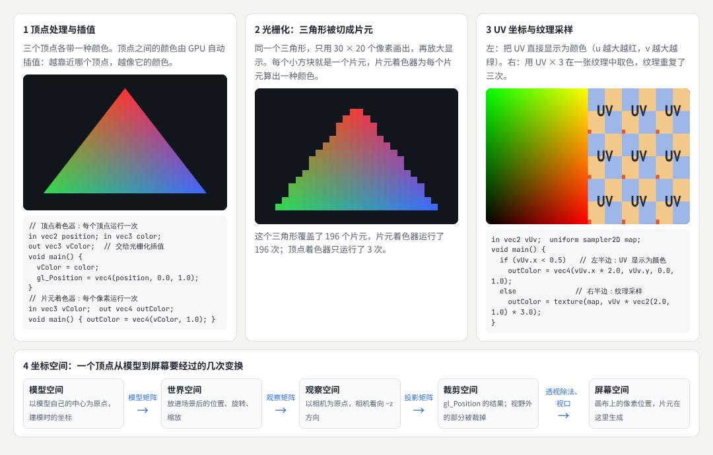

示例：[07-02-pipeline.html](示例/07-02-pipeline.html)（不使用任何库，直接调用 WebGL 2）

示例中的三角形只有 3 个顶点，顶点着色器运行 3 次；画成 30 × 20 像素时，它覆盖了 196 个片元，片元着色器运行了 196 次。画面越大，片元着色器运行的次数越多——这就是为什么**分辨率**对性能的影响往往最大（10 章的测量会再次看到这一点）。

#### 02.2 插值：顶点之间的值从哪里来

顶点着色器可以输出额外的值（例如颜色、UV、法线），光栅化时 GPU 会按片元到三个顶点的距离自动**插值**：越靠近哪个顶点，越接近它的值。示例的三角形三个角分别是红、绿、蓝，内部的颜色就是插值的结果。

```glsl
// 顶点着色器：每个顶点运行一次
in vec2 position; in vec3 color;
out vec3 vColor;            // 交给光栅化插值
void main() { vColor = color; gl_Position = vec4(position, 0.0, 1.0); }
// 片元着色器：每个像素运行一次
in vec3 vColor; out vec4 outColor;
void main() { outColor = vec4(vColor, 1.0); }
```

#### 02.3 UV 与纹理采样

**UV** 是贴图上的二维坐标，u 向右、v 向上，范围 0—1（见《三维内容与空间设计》05 章）。片元着色器用 UV 从纹理中取色，称为**纹理采样**。把 UV 乘以 3，纹理就重复三次（需要把纹理的环绕方式设为“重复”）。两个细节：图片的第一行在上方，而纹理的 v ＝ 0 在下方，上传时需要翻转；纹理在远处被缩得很小时，GPU 会使用预先生成的**多级渐远纹理**避免闪烁（04 章还会讲到）。

#### 02.4 坐标空间

一个顶点从模型到屏幕，要经过几次变换：

| 坐标空间 | 含义 | 变换到下一个空间 |
| --- | --- | --- |
| 模型空间 | 以模型自己的中心为原点，建模时的坐标 | 模型矩阵：位置、旋转、缩放 |
| 世界空间 | 放进场景后的坐标 | 观察矩阵：把相机放到原点 |
| 观察空间 | 以相机为原点，相机看向 −z 方向 | 投影矩阵：透视或正交 |
| 裁剪空间 | 顶点着色器输出的 `gl_Position`；视野外的部分被裁掉 | 透视除法与视口变换 |
| 屏幕空间 | 画布上的像素位置，片元在这里生成 | — |

写着色器时最常见的错误，是把两个不在同一坐标空间的量放在一起计算，例如用观察空间的法线和世界空间的光源方向求光照。03 章的示例特意把光源方向放在观察空间，与法线保持一致。

#### 02.5 常见问题

- **画面全黑或什么都没有**：着色器编译失败。打开浏览器的控制台查看错误；示例会把编译信息显示在页面上。
- **纹理上下颠倒**：上传图片时没有翻转。three.js 默认会处理；直接使用 WebGL 时要设置 `UNPACK_FLIP_Y_WEBGL`。
- **颜色发灰或发暗**：色彩空间处理不对（03、06 章）。

**本章练习**：

1. 在 `07-02-pipeline.html` 中把第二个画布改为 60 × 40 像素，记下三角形覆盖的片元数，说明它为什么大约变成了四倍。
2. 把 UV 示例中的 `* 3.0` 改为 `* 0.5`，观察纹理怎样变化。

<a id="part-2"></a>

## 第二篇：八个方向

<a id="ch03"></a>

### 03 着色器编程

#### 03.1 解决什么问题

当内置材质做不到想要的效果时，就要自己写着色器：学习**顶点处理、片元颜色、纹理采样、插值和坐标空间**。GLSL 常用于 WebGL；WGSL 是 WebGPU 的着色语言。框架还可能提供自己的**节点或表达层**，例如 three.js 的节点材质（TSL），用 JavaScript 组合节点，再由框架生成 GLSL 或 WGSL。使用这些表达层时，应当理解它与底层着色器程序的关系（12 章会看到框架生成的代码）。

#### 03.2 示例：一块起伏的布

three.js 的 `ShaderMaterial` 让你只写着色器的核心部分，矩阵、相机位置等常用的值由 three.js 自动提供。[B03](#ref-b03)

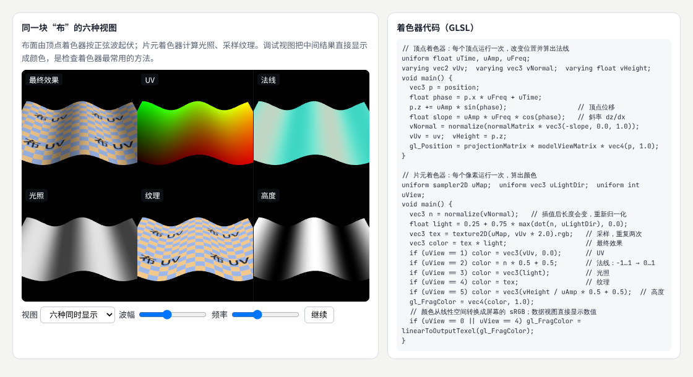

示例：[07-03-shader.html](示例/07-03-shader.html)（可以调整波幅、频率，切换单个视图）

```glsl
// 顶点着色器：改变位置，并算出新的法线
uniform float uTime, uAmp, uFreq;
varying vec2 vUv;  varying vec3 vNormal;  varying float vHeight;
void main() {
  vec3 p = position;
  float phase = p.x * uFreq + uTime;
  p.z += uAmp * sin(phase);                  // 顶点位移
  float slope = uAmp * uFreq * cos(phase);   // 斜率 dz/dx
  vNormal = normalize(normalMatrix * vec3(-slope, 0.0, 1.0));
  vUv = uv;  vHeight = p.z;
  gl_Position = projectionMatrix * modelViewMatrix * vec4(p, 1.0);
}
```

```glsl
// 片元着色器（节选，省略了调试视图）：光照 × 纹理
uniform sampler2D uMap;  uniform vec3 uLightDir;
void main() {
  vec3 n = normalize(vNormal);                 // 插值后长度会变，重新归一化
  float light = 0.25 + 0.75 * max(dot(n, uLightDir), 0.0);
  vec3 tex = texture2D(uMap, vUv * 2.0).rgb;   // 采样，重复两次
  gl_FragColor = linearToOutputTexel(vec4(tex * light, 1.0));   // 转换到屏幕的 sRGB
}
```

三类数据各有用途：

| 类别 | 例子 | 说明 |
| --- | --- | --- |
| `uniform` | 时间、波幅、光源方向、纹理 | 一次绘制中所有顶点、片元都相同，由 JavaScript 设置 |
| `attribute` | `position`、`normal`、`uv` | 每个顶点不同，来自几何体 |
| `varying` | `vUv`、`vNormal` | 顶点着色器输出，经过插值后交给片元着色器 |

顶点移动后，原来的法线就不对了。示例用正弦函数的导数算出每一点的斜率，再得到新的法线：起伏越陡，法线越倾斜，光照才会随波纹明暗变化。

#### 03.3 调试视图：把中间结果画出来

着色器不能打断点，也不能打印变量。最常用的办法是**把中间结果直接输出成颜色**：UV 显示为红绿渐变，法线从 −1—1 映射到 0—1 显示，光照显示为灰度。示例把同一块布同时画成六种视图，一眼就能看出问题在哪一步：如果“光照”视图没有明暗，问题在法线或光源方向；如果“UV”视图方向不对，问题在几何体。three.js 手册的调试 GLSL 一章介绍了更多技巧。[B04](#ref-b04)

一个细节：颜色要从线性空间转换到屏幕的 sRGB，而调试视图显示的是数值，不应转换——示例只对“最终效果”和“纹理”两种视图做了转换。

#### 03.4 GLSL 与 WGSL

WebGPU 是 WebGL 之后的新一代图形接口，[B05](#ref-b05) 着色语言是 WGSL。[B06](#ref-b06) 两种语言的思路相同，写法不同：WGSL 的类型写作 `f32`、`vec3f`，变量用 `let`（不可变）或 `var` 声明，输入输出通过带编号的结构体传递。12 章用同一个图案对照两种写法，并展示 three.js 的节点材质怎样按后端生成其中一种。[B07](#ref-b07)

#### 03.5 常见问题

- **光照随相机转动而变化**：法线和光源方向不在同一个坐标空间。
- **片元着色器里的法线长度不是 1**：插值会改变向量的长度，使用前要 `normalize`。
- **修改 uniform 没有效果**：改的是另一个材质的 uniform 对象，或者忘了在每一帧更新时间。

**本章练习**：

1. 在 `07-03-shader.html` 中把起伏改为同时沿 x 和 y 方向（`sin(p.x * f) * cos(p.y * f)`），并相应地算出法线的两个斜率。
2. 增加第七种调试视图：显示片元到相机的距离。

**继续深入**：`RawShaderMaterial`（不加任何预设代码，完全自己写）；用 `onBeforeCompile` 修改内置材质的着色器，保留光照与阴影；The Book of Shaders 的形状、噪声章节。[B01](#ref-b01)

<a id="ch04"></a>

### 04 程序化材质

#### 04.1 解决什么问题

**程序化材质**不使用贴图，而是用噪声、函数和参数生成纹理或表面变化，形成金属、岩石、水面或抽象材质。它的优点是无限细节、没有接缝、可以随时间变化、可以用参数调整；难点是需要控制尺度、重复规律和时间变化，确保材质适应不同模型与镜头距离。

#### 04.2 三种原料：噪声、函数、参数

- **噪声**：看起来随机、但连续变化的值。最简单的是**值噪声**：在整数格点上取随机数，格点之间平滑插值。把频率加倍、幅度减半的几层噪声叠加，就是**分形噪声**（fbm），可以同时有大的起伏和小的细节。[B08](#ref-b08)
- **函数**：`smoothstep` 做柔和的阈值，`sin` 做周期，`mix` 在两种颜色之间过渡，`fract` 做重复。
- **参数**：尺度、对比、颜色、速度。把它们做成 uniform，设计者就能调（09 章）。

```glsl
float fbm(vec3 p) {                         // 分形噪声：频率加倍、幅度减半，叠加 5 层
  float v = 0.0, a = 0.5;
  for (int i = 0; i < 5; i++) { v += a * noise(p); p = p * 2.03 + 1.7; a *= 0.5; }
  return v;
}
```

#### 04.3 示例：四种材质

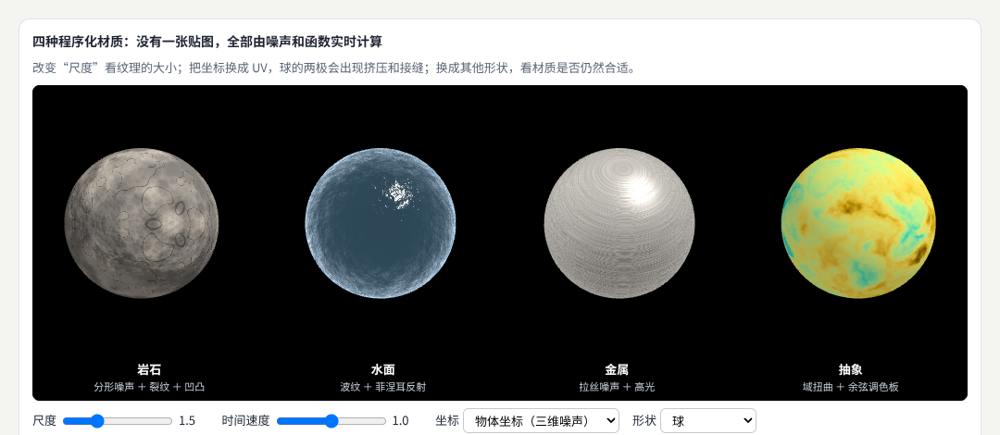

示例：[07-04-procedural.html](示例/07-04-procedural.html)（可以调整尺度、时间速度，切换坐标与形状）

| 材质 | 做法 | 关键参数 |
| --- | --- | --- |
| 岩石 | 分形噪声决定颜色深浅；噪声等于 0.5 的细线作为裂纹；用噪声的梯度扰动法线，做出凹凸 | 尺度、凹凸强度、裂纹宽度 |
| 水面 | 随时间流动的噪声扰动法线；**菲涅耳**效应：越斜着看越像镜子，反射更多天空颜色；一点尖锐的高光 | 波纹尺度、流速、深水与天空的颜色 |
| 金属 | 把噪声在一个方向拉长、另一个方向压缩，得到拉丝纹理；高光带有金属本身的颜色 | 拉丝方向与密度、高光大小 |
| 抽象 | **域扭曲**：用一个噪声去扭曲另一个噪声的输入坐标；[B09](#ref-b09) 用余弦函数生成平滑的**调色板**[B10](#ref-b10) | 扭曲强度、调色板、速度 |

“凹凸”并没有改变模型的形状，只是改变了法线，让光照产生起伏的错觉。这种做法成本很低，适合表现细小的表面变化；如果需要真正改变轮廓，就要在顶点着色器中移动顶点（03 章）。

#### 04.4 尺度、重复规律与时间变化

- **尺度**：噪声的输入坐标乘以多少，决定纹理有多大。拖动示例中的“尺度”，岩石的颗粒随之变大变小。
- **坐标的选择**：把噪声的输入从三维的物体坐标换成二维的 UV，球的两极立刻出现挤压和放射状的条纹——UV 在两极被压缩到一点。三维噪声直接在物体表面取值，没有接缝；代价是物体放大时纹理也跟着放大。

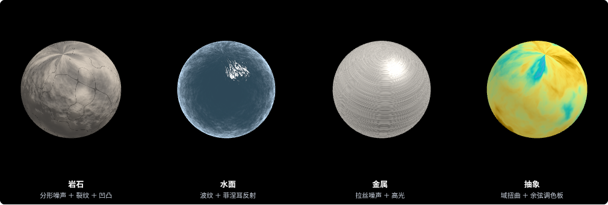

- **时间变化**：水面与抽象材质把时间加进噪声的坐标，图案就会流动。“时间速度”为 0 时画面静止；用户开启“减少动态效果”时，示例也会停止流动。
- **换一个形状**：示例可以把球换成圆环结和圆角立方体。同一个材质在不同形状上效果不同，例如立方体的平面上拉丝方向是否合适，要在目标模型上检查。

#### 04.5 适应镜头距离与打破重复

程序化图案有一个贴图没有的问题：**远处会闪烁**。一个像素在远处可能覆盖好几个格子，着色器只在像素中心取一次值，结果时黑时白，形成摩尔纹。贴图有多级渐远纹理自动处理这个问题，程序化图案要自己处理：用 `fwidth` 估计一个像素覆盖了多少图案，在这个宽度内取平均。[B11](#ref-b11) 示例中的金属拉丝在球的下缘也出现了摩尔纹，就是同样的原因。

```glsl
float filtered(vec2 p) {                     // 按一个像素覆盖的宽度取平均的黑白格
  vec2 w = fwidth(p) + 1e-4;
  vec2 i = 2.0 * (abs(fract((p - 0.5 * w) * 0.5) - 0.5) - abs(fract((p + 0.5 * w) * 0.5) - 0.5)) / w;
  return 0.5 - 0.5 * i.x * i.y;
}
```

另一个问题是**重复**：一张贴图平铺很多次，人眼很容易认出规律，尤其是其中显眼的斑点。常用的办法是换一个尺度和角度再采样一次、用噪声混合两次的结果，再叠加一层低频的明暗起伏。[B12](#ref-b12)

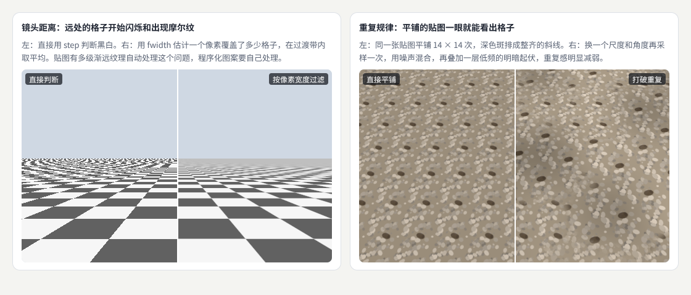

示例：[07-04-distance.html](示例/07-04-distance.html)

#### 04.6 常见问题

- **材质在两极或接缝处出错**：用了 UV 坐标。改用三维的物体坐标，或者用三向投影（从三个方向各取一次再按法线混合）。
- **远处闪烁**：图案的频率超过了像素能表现的程度。按像素宽度过滤，或者在远处淡出高频细节。
- **每个物体的花纹都一样**：所有物体使用同样的坐标。给每个物体一个随机的偏移量。

**本章练习**：

1. 给 `07-04-procedural.html` 的岩石增加“苔藓”：法线朝上、噪声较大的地方混入绿色。
2. 在 `07-04-distance.html` 中把左侧也改为过滤版本，观察摩尔纹是否消失。

**继续深入**：梯度噪声与单纯形噪声；Voronoi（细胞）图案；三向投影；把程序化结果烘焙成贴图（离线生成，运行时只采样）。

<a id="ch05"></a>

### 05 实时粒子与视觉特效

#### 05.1 解决什么问题

火花、烟雾、魔法、能量线、文字粒子……这些效果都由大量小的**粒子**组成。设计粒子要回答六个问题：粒子的生成、生命、速度、颜色、尺寸和消亡。火花、能量线和文字粒子可以共享部分机制，但应**分别设计形态与节奏**。粒子的数量和透明叠加会影响成本。

#### 05.2 示例：三种效果共用一套机制

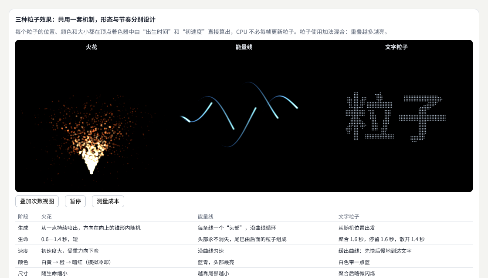

示例：[07-05-particles.html](示例/07-05-particles.html)

《创意编程与二维图形》中的粒子在 CPU 上逐个更新。这里换一种做法：每个粒子只记住**出生时刻**和**初速度**，位置在顶点着色器中直接算出来——CPU 不必每帧更新粒子，几万个粒子也没有负担。

```glsl
// 火花的顶点着色器（节选）
float age = mod(uTime + aOffset * aLife, aLife);   // 当前年龄：到达寿命后从 0 重新开始
float k = age / aLife;                              // 生命进度 0…1
vec2 p = start + aVel * age + 0.5 * vec2(0.0, -3.2) * age * age;   // 位置 ＝ 起点 ＋ 速度 × 时间 ＋ 重力
vColor = mix(vec3(1.0, 0.95, 0.7), mix(vec3(1.0, 0.45, 0.1), vec3(0.5, 0.05, 0.02), k), smoothstep(0.0, 0.5, k));
vAlpha = 1.0 - k;                                   // 消亡：逐渐透明
gl_PointSize = mix(7.0, 1.5, k) * uPixel;           // 尺寸：随生命缩小
```

| 阶段 | 火花 | 能量线 | 文字粒子 |
| --- | --- | --- | --- |
| 生成 | 从一点持续喷出，方向在向上的锥形内随机 | 每条线一个“头部”，沿曲线循环 | 从随机位置出发 |
| 生命 | 0.6—1.4 秒，短 | 头部一直存在，尾巴由后面的粒子组成 | 聚合 1.6 秒，停留 1.6 秒，散开 1.4 秒 |
| 速度 | 初速度大，受重力向下弯 | 沿曲线匀速 | 缓出：先快后慢地到达文字 |
| 颜色 | 白黄 → 橙 → 暗红，模拟冷却 | 蓝青，头部最亮 | 白色带一点蓝 |
| 尺寸 | 随生命缩小 | 越靠尾部越小 | 聚合后轻微闪烁 |
| 消亡 | 透明度降到 0 后重新出生 | 尾部逐渐透明 | 散开时淡出，然后重新聚合 |

三种效果用的是同一套“出生时刻 → 年龄 → 位置、颜色、尺寸”的机制，区别全在形态和节奏：火花短促、爆发、受重力；能量线连续、匀速、有方向；文字粒子有明确的“聚合—停留—散开”三段节奏。

#### 05.3 成本：数量与透明叠加

粒子通常是半透明的，而且使用**加法混合**：重叠的地方颜色相加，越叠越亮。加法混合不需要按远近排序，但每个粒子覆盖的每个像素都要计算一次。示例的“叠加次数视图”让每个粒子只加一点固定的红色，重叠越多越亮——火花的喷口处最亮，说明那里的像素被计算了很多次。

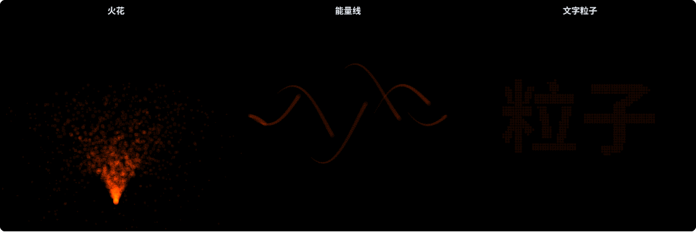

用“测量成本”按钮比较了四种情况（软件渲染，每帧毫秒，两次测量）：

| 粒子数 | 尺寸 | 每帧时间 |
| --- | --- | --- |
| 2637 | 1 倍 | 10.6—14.6 毫秒 |
| 25725 | 1 倍 | 52.8—68.4 毫秒 |
| 2637 | 4 倍 | 27.9—32.4 毫秒 |
| 25725 | 4 倍 | 226.2—239.2 毫秒 |

粒子数增加约 10 倍，或者尺寸增加 4 倍（覆盖的像素约为 16 倍），成本都明显上升；两者同时增加，成本成倍叠加。控制成本的办法：减小尺寸、减少数量、把粒子限制在需要的区域、远处的粒子画得更小或者不画。

#### 05.4 常见问题

- **粒子在画面边缘突然全部消失**：three.js 按几何体的包围盒判断物体是否在视野内，而粒子的位置是在着色器中算出的。设置 `frustumCulled = false`。
- **粒子是方块**：片元着色器中按到中心的距离 `discard` 圆外的部分，或使用圆形贴图。
- **半透明粒子前后顺序错乱**：普通混合需要从远到近排序；加法混合与顺序无关，并关闭深度写入（`depthWrite: false`）。

**本章练习**：

1. 给火花增加“风”：在位置公式中加一个随时间变化的水平力。
2. 把文字粒子的“停留”阶段改为轻微的呼吸缩放。

**继续深入**：需要粒子之间相互影响（例如群集、碰撞）时，位置无法由公式直接算出，要用浮点纹理保存状态、每帧在 GPU 上更新（three.js 的 GPGPU 示例，或 WebGPU 的计算着色器）；粒子运动的物理规律见《The Nature of Code》的粒子章节。[B13](#ref-b13)

<a id="ch06"></a>

### 06 画面后处理

#### 06.1 解决什么问题

**后处理**是对已渲染的图像进行辉光、景深、扭曲和色彩处理，就像给照片加滤镜，只是每一帧都要实时完成。要了解**每个处理步骤依赖哪些输入**，以及它们怎样与透明、色彩空间和其他处理配合。效果应可以**单独启停和比较**。

#### 06.2 示例：一条后处理链

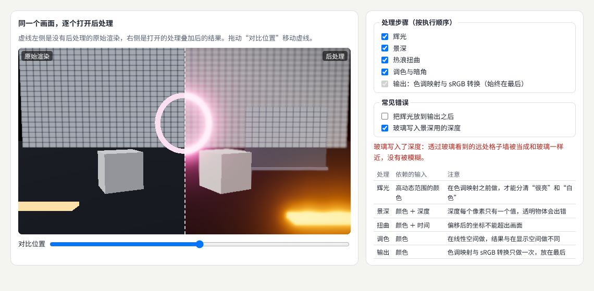

示例：[07-06-post.html](示例/07-06-post.html)（每个步骤都可以单独开关；拖动虚线比较）

three.js 用 `EffectComposer` 把后处理步骤串成一条链：[B14](#ref-b14)

```js
const composer = new EffectComposer(renderer);          // 中间结果默认使用半精度浮点，可以保存大于 1 的亮度
composer.addPass(new RenderPass(scene, camera));        // 1. 渲染场景
composer.addPass(new UnrealBloomPass(size, 0.3, 0, 0.8)); // 2. 辉光：强度、半径、阈值
composer.addPass(new BokehPass(scene, camera, { focus: 6, aperture: 0.004, maxblur: 0.01 }));   // 3. 景深
composer.addPass(haze);                                  // 4. 热浪扭曲（自定义）
composer.addPass(grade);                                 // 5. 调色与暗角（自定义）
composer.addPass(new OutputPass());                      // 6. 色调映射与 sRGB 转换，始终在最后
```

| 处理 | 依赖的输入 | 注意 |
| --- | --- | --- |
| 辉光 | 高动态范围的颜色 | 在色调映射之前做，才能分清“很亮”和“白色” |
| 景深 | 颜色 ＋ 深度 | 深度每个像素只有一个值，透明物体会出错 |
| 扭曲 | 颜色 ＋ 时间 | 偏移后的坐标不能超出画面 |
| 调色 | 颜色 | 在线性空间做，结果与在显示空间做不同 |
| 输出 | 颜色 | 色调映射与 sRGB 转换只做一次，放在最后 |

#### 06.3 与色彩空间、透明和其他处理的配合

渲染得到的颜色是**线性**的，而且可以大于 1：发光圆环的自发光强度是 3，被照亮的白色方块却不到 1。这种可以超过 1 的颜色称为**高动态范围**。最后的输出步骤做两件事：**色调映射**把高亮度压缩到屏幕能显示的范围；再把线性颜色转换成屏幕使用的 sRGB。[B15](#ref-b15)

顺序因此很重要。示例的“常见错误”提供了两个可以打开的错误：

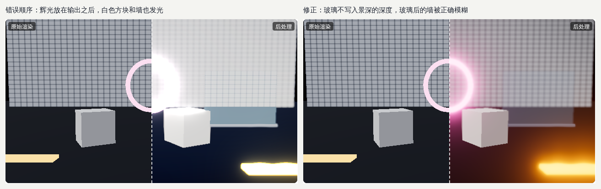

- **辉光放在输出之后**：输出之后所有亮度都被压缩到 0—1，阈值再也分不清“很亮”和“白色”，白色方块和格子墙也一起发光。辉光要放在色调映射之前。
- **透明物体与景深**：景深根据每个像素的深度决定模糊多少，而深度缓冲每个像素只能记录一个值。玻璃写入了深度，透过玻璃看到的远处格子墙就被当成和玻璃一样近，没有被模糊（默认截图中玻璃范围内的格子是清晰的）。不让玻璃写入景深用的深度，墙就被正确地模糊，代价是玻璃本身也按背景模糊。没有完美的办法，只能按画面需要取舍。
- **扭曲**：偏移后的取样坐标要限制在画面范围内，否则边缘会拉出条纹。
- **只输出一次**：如果在自定义步骤里又做了一次 sRGB 转换，画面会发灰发白。

#### 06.4 单独启停与比较

每个步骤都应当能单独关闭，并与关闭前比较，这样才能判断它是否值得它的成本（10 章）。示例用一条可以拖动的分界线，左边是原始渲染，右边是处理后的结果；调整参数时也应当随时打开、关闭对比。

#### 06.5 常见问题

- **整个画面都在发光**：阈值太低，或者辉光放在了输出之后。
- **画面发灰或过亮**：色彩空间转换做了两次或一次都没做。
- **景深的物体边缘出现光晕**：前景与背景的深度在边缘突变，模糊时颜色互相渗透。可以减小最大模糊，或者使用更好的景深算法。
- **手机上后处理很慢**：每个步骤都要处理整个画面的每个像素。降低后处理的分辨率，或在低档位关闭（10 章）。

**本章练习**：

1. 在 `07-06-post.html` 中关闭“调色与暗角”，再自己写一个“黑白”步骤，加在调色之前。
2. 把景深的对焦距离改为远处的墙，观察方块与玻璃的变化。

**继续深入**：环境光遮蔽（SSAO、GTAO）；抗锯齿（FXAA、SMAA）；用查找表（LUT）调色；运动模糊。three.js 的 `postprocessing` 目录中有这些步骤的实现。

<a id="ch07"></a>

### 07 风格化渲染

#### 07.1 解决什么问题

**风格化渲染**研究卡通、素描、水彩、版画等视觉表达，把风格的规则映射到**轮廓、阴影、纹理和色彩**。风格化需要同时调整资产、灯光、构图和运动，才能形成一致的作品。

#### 07.2 示例：同一组物体，四种风格

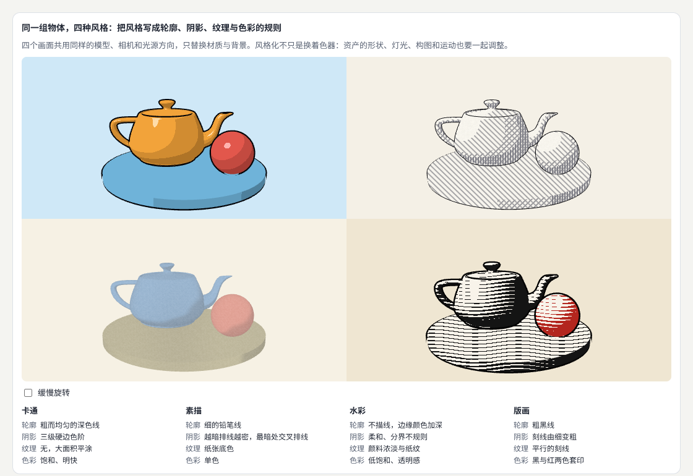

示例：[07-07-stylized.html](示例/07-07-stylized.html)

四个画面共用同样的模型、相机和光源方向，只替换材质与背景：

| 风格 | 轮廓 | 阴影 | 纹理 | 色彩 |
| --- | --- | --- | --- | --- |
| 卡通 | 粗而均匀的深色线 | 三级硬边色阶 | 无，大面积平涂 | 饱和、明快 |
| 素描 | 细的铅笔线 | 越暗排线越密，最暗处交叉排线 | 纸张底色 | 单色 |
| 水彩 | 不描线，边缘颜色加深 | 柔和、分界不规则 | 颜料浓淡与纸纹 | 低饱和、透明感 |
| 版画 | 粗黑线 | 刻线由细变粗 | 平行的刻线 | 黑与红两色套印 |

#### 07.3 轮廓

示例的轮廓用**反向外壳**：把模型沿法线方向“吹胀”一点，只画它的背面，涂成深色；正常的模型画在里面，露出的一圈边缘就是轮廓线。它简单、稳定，粗细可以控制。缺点是模型的法线在硬边处分开时，外壳会裂开；这时要为外壳准备一套平滑的法线。另一种做法是后处理：在屏幕上检测深度或法线突变的地方画线，可以画出模型内部的折线，但成本更高。

```glsl
// 反向外壳：只画背面，顶点沿法线外移
gl_Position = projectionMatrix * modelViewMatrix * vec4(position + normal * uThick, 1.0);
```

#### 07.4 阴影与纹理

- **卡通**：把光照强度分成几级，每级一种颜色，分界是硬边。three.js 的 `MeshToonMaterial` 用一张很小的渐变贴图做同样的事。[B16](#ref-b16) 一块硬边的高光让表面更有光泽。
- **素描**：在屏幕空间画平行线，光照越暗，叠加的方向越多：先斜线，再反向斜线，最暗处加横线。
- **水彩**：明暗只分两级，但分界线被噪声扰动，变得不规则；颜料的浓淡用低频噪声表现；物体边缘颜色加深，模仿颜料在纸上的堆积；最后叠加纸纹。
- **版画**：平行的刻线，线的粗细随光照变化——暗处线粗、亮处线细；两种墨色分别印在不同的物体上。

卡通着色的完整做法（硬边色阶、高光、边缘光）有很多教程，例如 Roystan 的卡通着色器文章。[B17](#ref-b17)

#### 07.5 不只是换着色器

| 方面 | 卡通 | 素描 | 水彩 | 版画 |
| --- | --- | --- | --- | --- |
| 资产 | 轮廓简单、比例夸张 | 结构清楚的形体 | 柔和的形体，避免锐利的细节 | 剪影清楚，适合大面积黑白 |
| 灯光 | 一个主光，明暗分界清楚 | 侧光，突出体积 | 柔和的散射光 | 强烈的单向光 |
| 构图 | 明快、主体突出 | 留白 | 大面积的留白与晕染 | 黑白面积的平衡 |
| 运动 | 干脆，可以用“一拍二”的停顿感 | 慢，避免排线闪烁 | 缓慢的漂移 | 少动或静止 |

一个常见的问题是屏幕空间的排线在物体移动时“游动”：线固定在屏幕上，物体在线下面滑过。示例中勾选“缓慢旋转”就能看到。需要物体移动时，要把纹理固定在物体表面上，或者使用按明暗预先绘制的笔触纹理。

#### 07.6 常见问题

- **轮廓线在近处很粗、远处很细**：外壳的厚度是物体空间的固定值。可以按到相机的距离调整厚度，让屏幕上的线宽一致。
- **卡通色阶的边缘有锯齿**：硬边阈值没有过渡。在阈值附近用 `smoothstep` 留一个像素宽的过渡带。
- **不同物体的风格不统一**：每个物体的颜色、线宽、色阶数不同。把这些规则写成共用的参数。

**本章练习**：

1. 给 `07-07-stylized.html` 增加第五种风格“像素画”：降低分辨率并把颜色限制为 8 种。
2. 让卡通风格的阴影分界随时间轻微晃动，观察是否仍然像卡通。

**继续深入**：后处理的边缘检测轮廓；按明暗预先绘制的笔触纹理；油画风格的 Kuwahara 滤镜；非真实感渲染的研究论文。

<a id="ch08"></a>

### 08 资产工具与制作流程

#### 08.1 解决什么问题

一个项目可能有几百个模型和贴图，由不同的人在不同的软件中制作。资产工具负责**检查、批处理、导出和预览**，帮助团队稳定地生产内容。一个工具应当说明**输入约束、输出结果、失败原因和版本关系**，减少重复劳动。

#### 08.2 示例：资产检查工具

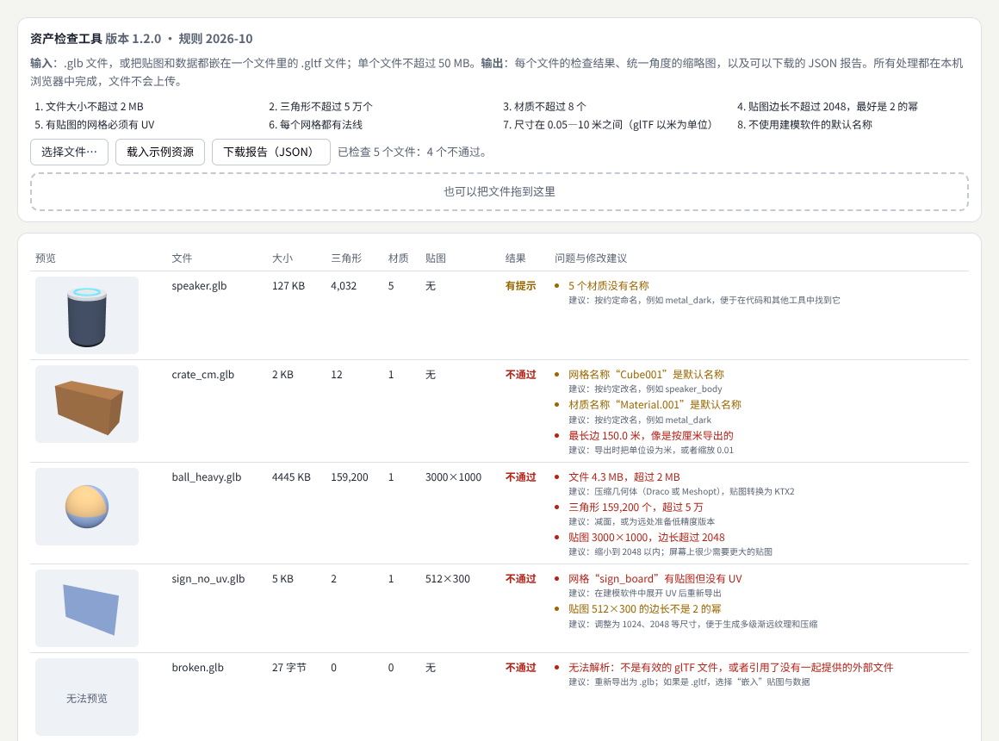

示例：[07-08-asset-check.html](示例/07-08-asset-check.html)（点击“载入示例资源”；通过本地服务器打开时还会检查《三维内容与空间设计》的音箱模型）

示例检查了五个文件：

| 文件 | 结果 | 发现的问题 |
| --- | --- | --- |
| speaker.glb | 有提示 | 5 个材质没有名称 |
| crate_cm.glb | 不通过 | 最长边 150 米，像是按厘米导出的；网格与材质使用默认名称 |
| ball_heavy.glb | 不通过 | 文件 4.3 MB、三角形 159200 个、贴图 3000 × 1000，三项都超出预算 |
| sign_no_uv.glb | 不通过 | 有贴图但没有 UV；贴图边长不是 2 的幂 |
| broken.glb | 不通过 | 无法解析，不是有效的 glTF 文件 |

第一个文件是《三维内容与空间设计》的示例模型——工具发现它的材质都没有命名。这正是工具的价值：人工检查时很容易忽略的问题，工具每次都会指出。

#### 08.3 一个工具要说明的四件事

| 事项 | 示例中的做法 |
| --- | --- |
| 输入约束 | 页面顶部写明：接受 .glb 和贴图、数据都嵌入的 .gltf，单个文件不超过 50 MB；文件只在本机处理，不上传 |
| 输出结果 | 每个文件一行：缩略图、统计数据、结果，以及每个问题的修改建议；可以下载 JSON 报告 |
| 失败原因 | 不说“检查失败”，而说“最长边 150.0 米，像是按厘米导出的”，并给出建议“导出时把单位设为米，或者缩放 0.01” |
| 版本关系 | 报告中记录工具版本、规则版本和每个文件的 SHA-256 哈希：以后可以确认“哪个版本的规则检查了哪个版本的文件” |

缩略图就是一个简单的预览工具，也是一种检查：所有资源用**同一个相机角度和灯光**渲染，放在一起比较，比例不对、朝向不对、颜色异常的资源一眼就能看出来。

```js
// 检查一个文件：每个问题都写明原因和修改建议
if (longest > LIMITS.maxSize) add('bad', `最长边 ${longest.toFixed(1)} 米，像是按厘米导出的`, '导出时把单位设为米，或者缩放 0.01');
if (textured && !g.attributes.uv) add('bad', `网格“${o.name}”有贴图但没有 UV`, '在建模软件中展开 UV 后重新导出');
```

#### 08.4 规则从哪里来，工具怎样接入流程

检查规则不是凭空定的：面数与贴图的预算来自目标设备上的测量（10 章）；单位与命名来自团队约定；格式要求来自 glTF 规范（glTF 以米为单位）。规则写下来、带上版本号，修改时说明原因。

工具接入流程的几种方式：制作者导出后在浏览器里自查；提交资源时自动运行检查，不通过就提示；定期对全部资源批量检查。批处理（压缩几何体、缩小贴图、转换格式）可以使用 glTF Transform 这样的命令行工具；[B18](#ref-b18) 格式本身是否合法，可以用 Khronos 的 glTF 验证器检查。[B19](#ref-b19) 批处理工具应当可以重复运行而不改变已经处理好的文件，并在真正修改之前先列出将要修改什么。

#### 08.5 常见问题

- **默认名称没有被检查出来**：测试中发现，加载器会去掉名称中的“.”，“Cube.001”读进来变成“Cube001”。示例的规则因此同时匹配两种写法。工具要用真实的导出文件测试，而不只是想象中的输入。
- **.gltf 文件加载失败**：它引用的 .bin 和贴图没有一起提供。要求导出为 .glb，或者把数据嵌入。
- **检查大文件时页面卡住**：解析在主线程进行。把检查放到网页工作线程（Web Worker）中。

**本章练习**：

1. 给 `07-08-asset-check.html` 增加一条规则：模型的最低点应当在 y ＝ 0 附近（放在地面上）。
2. 在报告中增加“修改前后”的比较：同一个文件名，哈希变了时列出问题的变化。

**继续深入**：在建模软件中用脚本批量导出；把检查接入版本控制的提交检查；用缩略图生成资源目录网页。

<a id="ch09"></a>

### 09 效果参数与控制界面

#### 09.1 解决什么问题

效果做出来以后，要交给设计者调整。参数应当**有意义**，例如波幅、恢复速度和颗粒密度，而不是 `uK`、`uC`；参数范围要**可以解释**；预设应当可以**保存与比较**；复杂效果需要明确**哪些参数能安全地实时修改**。

#### 09.2 示例：涟漪与颗粒

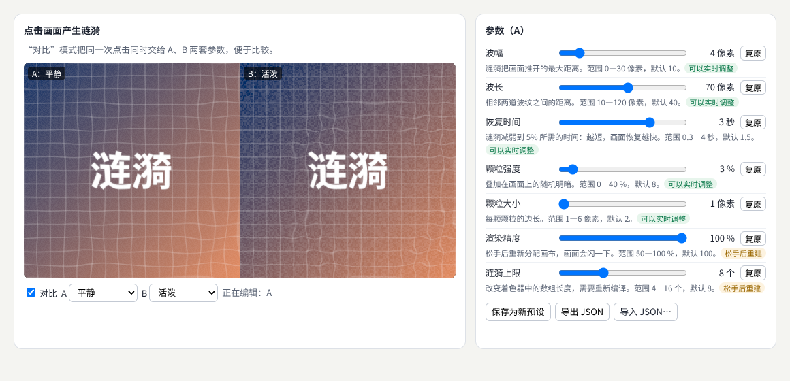

示例：[07-09-params.html](示例/07-09-params.html)（点击画面产生涟漪）

#### 09.3 参数用设计者的语言

| 界面上的参数 | 单位 | 内部换算 |
| --- | --- | --- |
| 波幅 | 像素 | 乘以设备像素比后交给着色器 |
| 波长 | 像素 | 同上 |
| 恢复时间 | 秒 | 衰减系数 ＝ 3 ÷ 恢复时间：经过“恢复时间”后，振幅剩 e⁻³ ≈ 5% |
| 颗粒强度 | % | 除以 100 |
| 颗粒大小 | 像素 | 乘以设备像素比 |

“恢复时间 1.5 秒”比“衰减系数 2”好理解得多：设计者知道它的含义，也能和动效规范中的时长对应。每个参数都写明了用途、范围和默认值，并有“复原”按钮。

#### 09.4 预设：保存、比较、导出

- 内置预设：默认、平静、活泼、复古胶片。
- **保存**：当前参数保存为新预设，存在浏览器的本地存储中；读写失败（例如隐私模式）时说明“关闭页面后会丢失”，页面照常工作。测试中，保存后重新加载页面，预设仍在。
- **比较**：对比模式把同一次点击同时交给 A、B 两套参数，左右并排。
- **导出与导入**：导出为 JSON 文件，便于分享和放进版本控制。导入时逐项检查：缺少的参数用默认值，超出范围的截断到范围内。测试导入了一个波幅为 999、波长为“abc”的预设，结果是波幅 30（最大值）、波长 40（默认值）。

#### 09.5 哪些参数可以实时修改

| 类别 | 例子 | 修改时发生什么 | 界面上怎样处理 |
| --- | --- | --- | --- |
| 可以实时调整 | 波幅、波长、恢复时间、颗粒 | 只改变 uniform 的值 | 拖动时立即生效 |
| 需要重建 | 渲染精度 | 画布要重新分配内存 | 松手后才生效，并提示 |
| 需要重新编译 | 涟漪上限（着色器中数组的长度） | 着色器重新编译，测试中用了 70—92 毫秒，画面停顿 | 松手后才生效，并说明停顿的原因 |

把这一区别写在界面上（示例用绿色的“可以实时调整”和橙色的“松手后重建”标签），设计者就不会在拖动滑块时遇到一连串的卡顿。

#### 09.6 常见问题

- **参数太多，不知道调哪个**：把参数分成“常用”和“高级”，常用的不超过五六个。
- **两个参数互相影响**：例如波幅和波长一起决定涟漪的陡峭程度。在说明中写清楚，或者合并成一个更有意义的参数。
- **预设在新版本中失效**：参数改了名字或范围。预设文件带上版本号，导入时做转换。

**本章练习**：

1. 给 `07-09-params.html` 增加一个参数“传播速度”（像素每秒），并判断它属于哪一类。
2. 增加“随机预设”按钮：在每个参数的范围内随机取值，帮助设计者探索。

**继续深入**：three.js 示例常用的 lil-gui 可以快速生成参数面板；[B20](#ref-b20) 参数随时间变化的关键帧编辑；把预设与设计令牌统一管理（见[《视觉设计与品牌表达》](02-视觉设计与品牌表达.md) 11 章）。

<a id="ch10"></a>

### 10 性能与质量分级

#### 10.1 解决什么问题

同一个效果要在高端电脑和普通手机上运行。**质量分级**根据设备能力和目标场景，调整粒子数、分辨率、阴影与后处理。原则是：**先测量瓶颈，再选择优化或简化**；记录每一档的视觉变化；确保**低质量模式仍然传达关键内容**。

#### 10.2 示例：四个档位

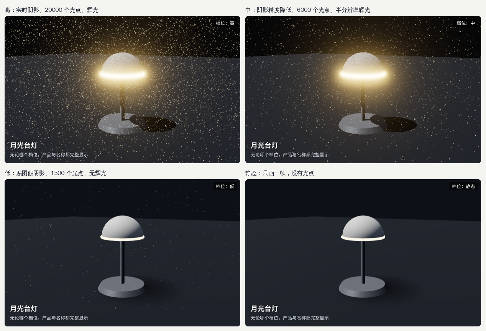

示例：[07-10-quality.html](示例/07-10-quality.html)

| 档位 | 分辨率 | 阴影 | 光点 | 辉光 | 动画 |
| --- | --- | --- | --- | --- | --- |
| 高 | 设备像素比，最多 2 倍 | 2048 实时阴影 | 20000 | 开 | 开 |
| 中 | 最多 1.25 倍 | 1024 实时阴影 | 6000 | 半分辨率 | 开 |
| 低 | 1 倍 | 贴图假阴影 | 1500 | 关 | 开 |
| 静态 | 1 倍 | 贴图假阴影 | 0 | 关 | 只画一帧 |

低档位用一张径向渐变的贴图代替实时阴影，几乎没有成本，台灯仍然“站在”地面上；静态档位供开启“减少动态效果”的用户和很弱的设备使用。四个档位中，产品与名称始终完整：名称用 HTML 文字放在画面上，不受渲染分辨率影响。

#### 10.3 先测量瓶颈

示例的“测瓶颈”按钮在当前档位下逐项减半或关闭，测量每帧的时间（软件渲染，设备像素比 2）：

| 改变 | 高档每帧 | 节省 | 低档每帧 | 节省 |
| --- | --- | --- | --- | --- |
| 当前设置 | 345.6 毫秒 | — | 35.9 毫秒 | — |
| 分辨率减半 | 116.7 毫秒 | 66% | 17.0 毫秒 | 53% |
| 光点减半 | 318.4 毫秒 | 8% | 31.0 毫秒 | 14% |
| 关闭辉光 | 148.4 毫秒 | 57% | — | — |
| 关闭实时阴影 | 273.5 毫秒 | 21% | — | — |

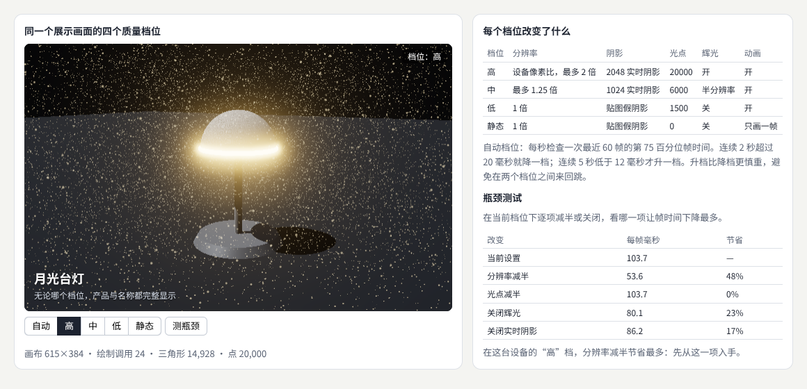

在这台测试机上，瓶颈是**像素**：分辨率减半和关闭辉光（辉光要处理整个画面的像素）节省最多，光点减半几乎没有作用——所以优化应当从分辨率入手，而不是减少光点。设备像素比为 1 时再测一次，分辨率减半仍然节省最多（46%），光点减半的变化在测量误差之内（−3%）。不同设备的瓶颈可能完全不同，所以**要在目标设备上测量，而不是凭经验猜测**。WebGL 的性能建议见 MDN。[B21](#ref-b21)

测量时要注意：GPU 的工作是排队执行的，JavaScript 调用渲染函数返回时，GPU 可能还没有画完。示例每帧读取一个像素，强制等待 GPU 完成，测出的才是真实的时间。

#### 10.4 自动档位

自动档位每秒检查一次最近 60 帧的**第 75 百分位**帧时间：连续 2 秒超过 20 毫秒就降一档；连续 5 秒低于 12 毫秒才升一档。升档比降档更慎重，这种“迟滞”避免在两个档位之间来回跳动。

测试中，自动档位从“高”开始，前 6 秒的帧时间一直显示为 16.7 毫秒，第 7—8 秒升到 50—200 毫秒，随后降到“中”。原因是 GPU 的工作在排队：一开始浏览器照常按每秒 60 次请求新的一帧，GPU 却越积越多，过了几秒才反映到帧时间上。所以自动档位要**持续观察**，不能只看开始的几帧；在已知较弱的设备上，可以直接从“中”开始。

#### 10.5 常见问题

- **切换档位时画面卡一下**：打开或关闭阴影会让材质重新编译。可以在加载时预先编译，或者只在用户不操作时切换。
- **降低分辨率后文字模糊**：把文字放在 HTML 中，不画进三维画面。
- **帧时间看起来正常，画面却很卡**：GPU 工作在排队（10.4），或者某些帧特别慢。看第 75、第 95 百分位，而不只看平均值。

**本章练习**：

1. 在 `07-10-quality.html` 中增加一个档位“极低”：分辨率 0.75 倍、没有光点。记录它的视觉变化。
2. 在你自己的设备上点击“测瓶颈”，比较结果与本章表格的差别。

**继续深入**：用 GPU 计时查询测量每个步骤的 GPU 时间；用浏览器扩展逐个检查绘制调用；“按需渲染”：画面不变时不重新渲染（三维展示页的常用技巧）。

<a id="part-3"></a>

## 第三篇：综合项目与工具

<a id="ch11"></a>

### 11 综合项目：图片被指针推开后恢复

#### 11.1 目标与验收

制作一个“图片被指针推开后恢复”的效果：记录 **UV 扰动、输入影响和恢复曲线**；提供**强度、范围和衰减控制**，以及**静态模式**；检查**触屏、窗口变化、连续操作、页面离开后的清理**，并比较**不同资源大小下的性能**。

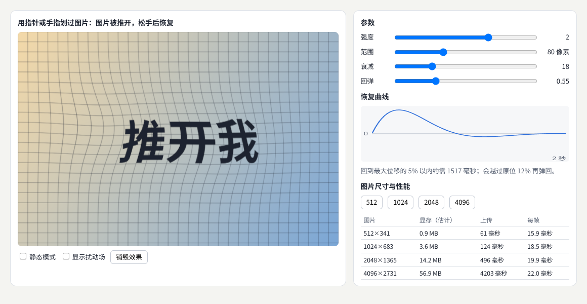

示例：[07-11-push.html](示例/07-11-push.html)

#### 11.2 第一步：扰动场

用一张低分辨率（160 × 107）的半精度浮点贴图记录画面每一处被推开了多少：红、绿通道存**位移**，蓝、透明通道存**速度**。每一帧读取上一帧的结果、计算新的结果，写入另一张贴图，下一帧再交换——称为**乒乓渲染**。扰动场的分辨率远低于画面，因为位移本身是平滑的，不需要每个像素都计算。

#### 11.3 第二步：输入影响

指针移动时，算出它的速度（每秒移动多少个画面宽度）。指针附近的点获得与指针移动方向相同的速度，影响随距离按高斯函数减弱，“范围”就是这个函数的宽度：

```glsl
vec2 diff = (vUv - uP[i]) * vec2(uAspect, 1.0);         // 按画面宽高比修正，影响范围是圆形
float f = exp(-dot(diff, diff) / (uRadius * uRadius));   // 离指针越远，影响越小
v += uV[i] * f * uStrength * uDt * 60.0;                 // 指针的速度传给附近的点
```

#### 11.4 第三步：恢复曲线

每个点都被一根看不见的弹簧拉回原位（与《动效与时间设计》05 章的弹簧相同）：

```glsl
v += (-uK * d - uC * v) * uDt;                           // 位移越大，拉回的力越大；阻尼让它停下
d += v * uDt;
float len = length(d);
if (len > 0.08) { d *= 0.08 / len; v *= 0.5; }           // 连续操作时限制最大位移
```

“衰减”控制弹簧的刚度，决定恢复多快；“回弹”控制阻尼比，决定会不会越过原位再弹回来。页面用同样的方程画出一次推开后的**恢复曲线**：默认参数（衰减 18、回弹 0.55）下，约 1517 毫秒回到最大位移的 5% 以内，会越过原位 12% 再弹回。测试中读回扰动场：快速划动后最大位移 0.050（画面宽度的 5%），1.3 秒后降到 0.0009，3.8 秒后为 0。

#### 11.5 第四步：UV 扰动

显示时，每个像素从“被推开之前”的位置取色：

```glsl
vec2 d = texture2D(uField, vUv).xy;
vec3 col = texture2D(uMap, vUv - d).rgb;                 // UV 扰动
```

勾选“显示扰动场”可以看到位移本身：向右推开的地方偏红，向上推开的地方偏绿。

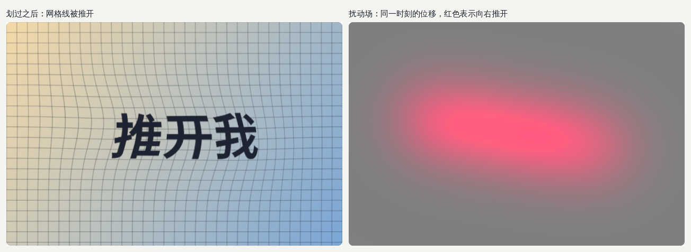

#### 11.6 第五步：静态模式

勾选“静态模式”或者系统开启“减少动态效果”时，循环停止，扰动场清零，只画一帧完整的图片，指针不再推动画面。图片的内容完全保留，只是没有了互动的动画。

#### 11.7 第六步：触屏、窗口变化与连续操作

- **触屏**：使用指针事件，鼠标、触摸、触控笔用同一套代码；画布设置 `touch-action: none`，手指在图片上划动时页面不会滚动；最多同时处理 4 根手指。测试用浏览器调试协议发送真实的触摸滑动，划动时记录到 1 个触点，松开后为 0。
- **窗口变化**：`ResizeObserver` 发现尺寸变化后，调整画布，并按新的宽高比重新创建扰动场。测试把窗口改窄后，画布随之变为 326 × 217。
- **连续操作**：位移被限制在 0.08 以内。测试把强度调到最大 3，连续快速划动 6 次，最大位移正好是 0.0800，没有越推越远；停止后同样能恢复。

#### 11.8 第七步：页面离开后的清理

页面隐藏时（切换标签页），停止循环，回来后继续；页面关闭或组件被移除时，释放所有 GPU 资源。three.js 的手册说明了哪些对象需要手动释放。[B22](#ref-b22)

```js
function destroy() {   // （节选）停止循环，释放 GPU 资源，移除事件
  stop();
  targets.forEach(t => t.dispose()); texture?.dispose(); simMat.dispose(); viewMat.dispose(); quad.dispose();
  renderer.dispose(); life.abort(); ro.disconnect();     // life 是 AbortController：一次移除所有事件监听
}
addEventListener('pagehide', destroy);
```

测试点击“销毁效果”后，渲染器报告剩余贴图 0 张、几何体 0 个。

#### 11.9 第八步：不同资源大小下的性能

| 图片 | 显存（估计） | 上传 | 每帧 |
| --- | --- | --- | --- |
| 512 × 341 | 0.9 MB | 61—74 毫秒 | 15.9—19.1 毫秒 |
| 1024 × 683 | 3.6 MB | 124—134 毫秒 | 18.3—19.7 毫秒 |
| 2048 × 1365 | 14.2 MB | 444—496 毫秒 | 18.1—20.4 毫秒 |
| 4096 × 2731 | 56.9 MB | 3394—4203 毫秒 | 19.1—22.0 毫秒 |

（三次测量的范围，软件渲染。）结论很清楚：**图片尺寸主要影响上传时间和显存，对每帧的时间几乎没有影响**——有多级渐远纹理时，GPU 只从合适大小的那一级取色。4096 的图片上传要几秒，期间画面停顿，而且显存是 1024 的 16 倍。所以：图片不要超过实际显示需要的尺寸；大图在用户开始操作之前上传；需要大量贴图时，使用 GPU 能直接读取的压缩格式（KTX2）。

#### 11.10 验收清单

- [ ] 指针、触摸和触控笔都能推开图片，停止后恢复。
- [ ] 强度、范围、衰减（以及回弹）都有清楚的单位或说明，恢复曲线与实际效果一致。
- [ ] 静态模式与“减少动态效果”下，图片完整显示，没有动画。
- [ ] 窗口变化后效果正常，没有拉伸或错位。
- [ ] 连续快速操作时位移有上限，画面不会撕裂。
- [ ] 页面隐藏时停止循环；离开或销毁后，贴图和几何体都被释放。
- [ ] 记录了不同图片尺寸下的显存、上传时间和每帧时间，并据此选择图片尺寸。

<a id="ch12"></a>

### 12 工具：ShaderMaterial、WebGPU 与节点材质

#### 12.1 工具的位置

| 工具 | 适合 | 说明 |
| --- | --- | --- |
| three.js 的 `ShaderMaterial` | 大多数自定义效果 | 只写着色器的核心，常用的矩阵与值自动提供；本册多数示例使用它[B03](#ref-b03) |
| 直接使用 WebGL 2 | 学习原理、极小的效果 | 完全控制，代码量大 |
| 直接使用 WebGPU | 需要计算着色器、完全控制的项目 | 新一代接口，着色语言为 WGSL[B05](#ref-b05) |
| three.js 的 `WebGPURenderer` 与节点材质（TSL） | 新项目 | 同一份节点描述，WebGPU 可用时生成 WGSL，否则自动退回 WebGL 2 生成 GLSL[B23](#ref-b23) |
| 辅助工具 | 参数面板、资源处理 | lil-gui、glTF Transform、glTF 验证器（09、08 章） |

WebGPU 已在 Chrome 与 Edge 113 起（Windows、macOS、ChromeOS；Linux 从 144 起部分支持）、安卓上的 Chrome 121 起、Safari 26 起和 Windows 上的 Firefox 141 起提供，但还不是所有浏览器和平台都支持，MDN 将它标为“有限可用”；而且只能在 HTTPS 等安全环境中使用。**使用 WebGPU 时一定要准备回退。**

#### 12.2 示例：同一个图案的三种写法

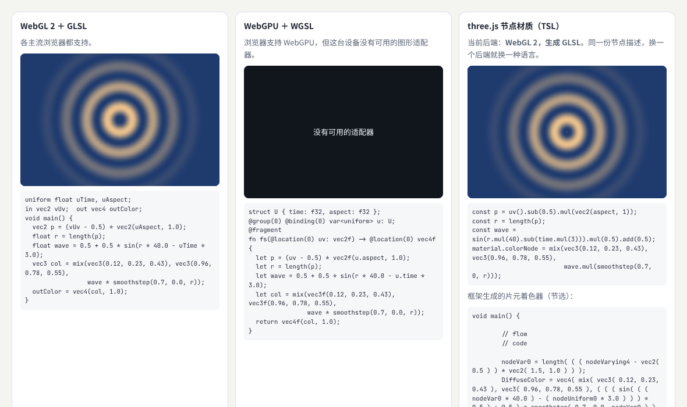

示例：[07-12-webgpu.html](示例/07-12-webgpu.html)

截图来自没有可用 WebGPU 适配器的环境：中间一栏显示了说明，左右两栏照常工作——这就是回退。在启用了 WebGPU 的环境中另外做了测试：把 WGSL 版本和 GLSL 版本在同一时刻各画一张 120 × 80 的图并逐像素比较，**两者完全相同**（最大差值为 0）；节点材质此时生成的是 WGSL。

```wgsl
struct U { time: f32, aspect: f32 };
@group(0) @binding(0) var<uniform> u: U;
@fragment
fn fs(@location(0) uv: vec2f) -> @location(0) vec4f {
  let p = (uv - 0.5) * vec2f(u.aspect, 1.0);
  let r = length(p);
  let wave = 0.5 + 0.5 * sin(r * 40.0 - u.time * 3.0);
  let col = mix(vec3f(0.12, 0.23, 0.43), vec3f(0.96, 0.78, 0.55), wave * smoothstep(0.7, 0.0, r));
  return vec4f(col, 1.0);
}
```

```js
// 节点材质：用 JavaScript 组合节点
const p = uv().sub(0.5).mul(vec2(aspect, 1));
const r = length(p);
const wave = sin(r.mul(40).sub(time.mul(3))).mul(0.5).add(0.5);
material.colorNode = mix(vec3(0.12, 0.23, 0.43), vec3(0.96, 0.78, 0.55), wave.mul(smoothstep(0.7, 0, r)));
```

框架为这份节点描述生成的代码（节选），WebGPU 后端：

```wgsl
nodeVar0 = length( ( ( nodeVarying4 - vec2<f32>( 0.5 ) ) * vec2<f32>( 1.5, 1.0 ) ) );
DiffuseColor = vec4<f32>( mix( vec3<f32>( 0.12, 0.23, 0.43 ), vec3<f32>( 0.96, 0.78, 0.55 ), ( ( ( sin( ( ( nodeVar0 * 40.0 ) - ( object.nodeUniform0 * 3.0 ) ) ) * 0.5 ) + 0.5 ) * smoothstep( 0.7, 0.0, nodeVar0 ) ) ), 1.0 );
```

WebGL 2 后端：

```glsl
nodeVar0 = length( ( ( nodeVarying4 - vec2( 0.5 ) ) * vec2( 1.5, 1.0 ) ) );
DiffuseColor = vec4( mix( vec3( 0.12, 0.23, 0.43 ), vec3( 0.96, 0.78, 0.55 ), ( ( ( sin( ( ( nodeVar0 * 40.0 ) - ( nodeUniform0 * 3.0 ) ) ) * 0.5 ) + 0.5 ) * smoothstep( 0.7, 0.0, nodeVar0 ) ) ), 1.0 );
```

两段代码的计算完全一样，只是语法不同。节点材质的好处是一份描述适用于两种后端；代价是出问题时要读框架生成的代码——`renderer.debug.getShaderAsync()` 可以取出它，示例就是这样显示的。

#### 12.3 GLSL 与 WGSL 的主要差别

| 方面 | GLSL（WebGL 2） | WGSL（WebGPU） |
| --- | --- | --- |
| 数值类型 | `float`、`vec3`、`mat4` | `f32`、`vec3f`（或 `vec3<f32>`）、`mat4x4f` |
| 变量 | `float x = 1.0;` | `let x = 1.0;`（不可变）、`var x = 1.0;`（可变） |
| 入口 | 固定叫 `main` | 任意名称，用 `@vertex`、`@fragment` 标注 |
| 输入输出 | `in`、`out`、`varying` | 函数参数与返回值，用 `@location(n)` 标注 |
| uniform | `uniform float uTime;` | `@group(0) @binding(0) var<uniform> u: U;`，通过绑定组提供 |
| 计算着色器 | 没有 | 有 `@compute`，可以在 GPU 上做通用计算 |

#### 12.4 怎样选择

1. 需要在所有浏览器中运行的产品效果：先用 `ShaderMaterial`。
2. 新项目，想为将来做准备：考虑 `WebGPURenderer` 与节点材质，它会自动退回 WebGL 2。
3. 需要在 GPU 上模拟大量粒子、做物理或图像计算：WebGPU 的计算着色器，并准备回退方案。
4. 无论哪种，都要在目标设备上测试，并记录使用的库版本（本册示例使用 three.js 0.186.1）。

<a id="ch13"></a>

### 13 继续深入与学习路线

#### 13.1 八个方向的纵向深入

| 方向 | 入门 | 进阶 | 深入 |
| --- | --- | --- | --- |
| 着色器编程 | 改颜色、改位置 | 光照、纹理、调试视图 | 修改内置材质、节点材质、WGSL |
| 程序化材质 | 噪声与颜色 | 凹凸、菲涅耳、域扭曲 | 过滤、三向投影、烘焙 |
| 实时粒子与视觉特效 | 发射与生命 | GPU 上计算的无状态粒子 | 需要相互作用的 GPU 模拟、计算着色器 |
| 画面后处理 | 辉光、调色 | 景深、扭曲、顺序与色彩空间 | 环境光遮蔽、时间抗锯齿 |
| 风格化渲染 | 卡通色阶与轮廓 | 排线、水彩、版画 | 笔触纹理、绘画滤镜 |
| 资产工具与制作流程 | 检查脚本 | 批量处理与报告 | 接入提交流程、资源目录 |
| 效果参数与控制界面 | 滑块 | 预设与对比 | 关键帧、与设计令牌统一 |
| 性能与质量分级 | 帧率计数 | 瓶颈测试与档位 | GPU 计时、按设备自动调整 |

#### 13.2 横向连接

- 三维场景的基础：[《三维内容与空间设计》](06-三维内容与空间设计.md)。
- 噪声、流场与物理仿真：[《生成艺术与物理仿真》](08-生成艺术与物理仿真.md)。
- 渲染管线、资源与 GPU 的工程问题：[《图形工程与渲染系统》](09-图形工程与渲染系统.md)。
- 渲染算法的研究：[《图形学与视觉计算研究》](10-图形学与视觉计算研究.md)。
- 常见效果的拆解（辉光、扭曲、粒子、玻璃）：[《常见视觉效果拆解》](19-常见视觉效果拆解.md)。
- 向量、矩阵、插值与噪声的数学：[《图形与交互的数学基础》](20-图形与交互的数学基础.md)。
- 性能预算与质量流程：[《质量、性能与设计运营》](18-质量性能与设计运营.md)。

#### 13.3 学习资源

WebGPU Fundamentals 和 WebGL2 Fundamentals 从零讲解两种接口，每一步都有可以运行的例子，适合在本册之后系统学习。[B24](#ref-b24) [B25](#ref-b25)

<a id="appendix-a"></a>

## 附录 A：术语表

| 术语 | 含义 | 阅读位置 |
| --- | --- | --- |
| 技术美术 | 让美术目标成为可控制、可维护、可运行的效果的工作 | 01 |
| 着色器 | 运行在 GPU 上的小程序 | 02、03 |
| 顶点着色器 | 对每个顶点运行一次，算出它在屏幕上的位置 | 02 |
| 光栅化 | 找出三角形覆盖了哪些像素 | 02 |
| 片元 | 光栅化得到的、被三角形覆盖的像素 | 02 |
| 片元着色器 | 对每个片元运行一次，算出它的颜色 | 02 |
| 插值 | 按片元到顶点的距离计算顶点之间的值 | 02 |
| UV | 贴图上的二维坐标 | 02、04 |
| 纹理采样 | 用坐标从纹理中取色 | 02 |
| 多级渐远纹理 | 预先缩小的一系列纹理，远处使用较小的一级 | 02、04、11 |
| 坐标空间 | 模型、世界、观察、裁剪、屏幕等参照系 | 02 |
| GLSL | WebGL 使用的着色语言 | 03、12 |
| WGSL | WebGPU 使用的着色语言 | 03、12 |
| uniform | 一次绘制中所有顶点、片元都相同的值 | 03 |
| 调试视图 | 把着色器的中间结果显示成颜色 | 03 |
| 程序化材质 | 用噪声、函数和参数生成的材质 | 04 |
| 值噪声 | 在格点取随机数、格点之间平滑插值的噪声 | 04 |
| 分形噪声 | 多层频率加倍、幅度减半的噪声叠加 | 04 |
| 域扭曲 | 用一个噪声扭曲另一个噪声的输入坐标 | 04 |
| 菲涅耳效应 | 越斜着看，表面反射越强 | 04 |
| 摩尔纹 | 图案频率超过像素能表现的程度时出现的杂乱条纹 | 04 |
| 加法混合 | 重叠的颜色相加，越叠越亮 | 05 |
| 叠加次数 | 同一个像素被重复计算的次数 | 05 |
| 后处理 | 对已渲染的图像再做处理 | 06 |
| 高动态范围 | 可以超过 1 的亮度 | 06 |
| 色调映射 | 把高亮度压缩到屏幕能显示的范围 | 06 |
| 景深 | 按深度模糊对焦范围以外的部分 | 06 |
| 风格化渲染 | 卡通、素描、水彩、版画等非写实的表现 | 07 |
| 反向外壳 | 沿法线放大模型、只画背面得到轮廓 | 07 |
| 资产检查 | 按规则检查模型与贴图是否符合要求 | 08 |
| 预设 | 一组保存下来的参数值 | 09 |
| 质量分级 | 按设备能力调整效果的档位 | 10 |
| 瓶颈 | 限制整体速度的那一部分工作 | 10 |
| 迟滞 | 升档比降档更慎重，避免来回跳动 | 10 |
| 扰动场 | 记录画面每一处位移的贴图 | 11 |
| 乒乓渲染 | 两张贴图交替读写，逐帧更新状态 | 11 |
| 节点材质 | 用节点组合描述材质，由框架生成着色器 | 03、12 |

<a id="appendix-b"></a>

## 附录 B：资料入口

以下资料用于核对方法来源和继续学习。资料核对日期：2026-10-25。

<a id="ref-b01"></a>
**B01 · The Book of Shaders。** [The Book of Shaders](https://thebookofshaders.com/)。对应 02、03 章，用可以实时修改的例子讲解片元着色器。

<a id="ref-b02"></a>
**B02 · MDN：WebGL API。** [WebGL API](https://developer.mozilla.org/en-US/docs/Web/API/WebGL_API)。对应 02 章，WebGL 的接口与教程。

<a id="ref-b03"></a>
**B03 · three.js 文档：ShaderMaterial。** [ShaderMaterial](https://threejs.org/docs/pages/ShaderMaterial.html)。对应 03、12 章，自定义着色器材质。

<a id="ref-b04"></a>
**B04 · three.js 手册：调试 GLSL。** [Debugging GLSL](https://threejs.org/manual/pages/debugging-glsl.html)。对应 03 章，把中间结果显示成颜色等调试技巧。

<a id="ref-b05"></a>
**B05 · MDN：WebGPU API。** [WebGPU API](https://developer.mozilla.org/en-US/docs/Web/API/WebGPU_API)。对应 03、12 章，新一代图形接口与浏览器支持情况。

<a id="ref-b06"></a>
**B06 · W3C：WGSL 规范。** [WebGPU Shading Language](https://www.w3.org/TR/WGSL/)。对应 03、12 章，WGSL 的完整定义。

<a id="ref-b07"></a>
**B07 · three.js 文档：TSL。** [Three.js Shading Language](https://threejs.org/docs/pages/TSL.html)。对应 03、12 章，节点材质的写法。

<a id="ref-b08"></a>
**B08 · Inigo Quilez：分形噪声。** [fBM](https://iquilezles.org/articles/fbm/)。对应 04 章，分形噪声的原理与参数。

<a id="ref-b09"></a>
**B09 · Inigo Quilez：域扭曲。** [Domain Warping](https://iquilezles.org/articles/warp/)。对应 04 章。

<a id="ref-b10"></a>
**B10 · Inigo Quilez：余弦调色板。** [Palettes](https://iquilezles.org/articles/palettes/)。对应 04 章，用余弦函数生成平滑的调色板。

<a id="ref-b11"></a>
**B11 · Inigo Quilez：可过滤的程序化图案。** [Filterable Procedurals](https://iquilezles.org/articles/filterableprocedurals/)。对应 04 章，按像素宽度过滤，避免远处闪烁。

<a id="ref-b12"></a>
**B12 · Inigo Quilez：减少贴图重复。** [Texture Repetition](https://iquilezles.org/articles/texturerepetition/)。对应 04 章。

<a id="ref-b13"></a>
**B13 · The Nature of Code：粒子系统。** [Particle Systems](https://natureofcode.com/particles/)。对应 05 章，粒子的生成、生命与力。

<a id="ref-b14"></a>
**B14 · three.js 手册：后处理。** [How to use post-processing](https://threejs.org/manual/pages/how-to-use-post-processing.html)。对应 06 章，`EffectComposer` 的用法。

<a id="ref-b15"></a>
**B15 · three.js 手册：色彩管理。** [Color management](https://threejs.org/manual/pages/color-management.html)。对应 06 章，线性空间、sRGB 与输出。

<a id="ref-b16"></a>
**B16 · three.js 文档：MeshToonMaterial。** [MeshToonMaterial](https://threejs.org/docs/pages/MeshToonMaterial.html)。对应 07 章，卡通色阶材质。

<a id="ref-b17"></a>
**B17 · Roystan：卡通着色器。** [Toon Shader](https://roystan.net/articles/toon-shader/)。对应 07 章，硬边色阶、高光与边缘光的完整做法。

<a id="ref-b18"></a>
**B18 · glTF Transform。** [glTF Transform](https://gltf-transform.dev/)。对应 08 章，批量处理 glTF 的命令行工具与程序库。

<a id="ref-b19"></a>
**B19 · Khronos：glTF 验证器。** [glTF Validator](https://github.khronos.org/glTF-Validator/)。对应 08 章，检查 glTF 文件是否符合规范。

<a id="ref-b20"></a>
**B20 · lil-gui。** [lil-gui](https://lil-gui.georgealways.com/)。对应 09 章，快速生成参数面板的小型库。

<a id="ref-b21"></a>
**B21 · MDN：WebGL 最佳实践。** [WebGL best practices](https://developer.mozilla.org/en-US/docs/Web/API/WebGL_API/WebGL_best_practices)。对应 10 章，WebGL 的性能建议。

<a id="ref-b22"></a>
**B22 · three.js 手册：释放对象。** [How to dispose of objects](https://threejs.org/manual/pages/how-to-dispose-of-objects.html)。对应 11 章，哪些对象需要手动释放。

<a id="ref-b23"></a>
**B23 · three.js 文档：WebGPURenderer。** [WebGPURenderer](https://threejs.org/docs/pages/WebGPURenderer.html)。对应 12 章，WebGPU 渲染器与自动回退。

<a id="ref-b24"></a>
**B24 · WebGPU Fundamentals。** [WebGPU Fundamentals](https://webgpufundamentals.org/)。对应 13 章，从零讲解 WebGPU。

<a id="ref-b25"></a>
**B25 · WebGL2 Fundamentals。** [WebGL2 Fundamentals](https://webgl2fundamentals.org/)。对应 13 章，从零讲解 WebGL 2。

<a id="appendix-c"></a>

## 附录 C：与原手册的对应关系及修订记录

### C.1 与原手册的对应关系

本册由原《前端与 UI／UX 设计进阶全景手册》第 09 章“技术美术与实时效果”扩写而成：

| 原手册内容 | 本册位置 |
| --- | --- |
| 9.1 研究对象与先修要求 | 01、02 章 |
| 9.2 分支 1：着色器编程 | 03 章 |
| 9.2 分支 2：程序化材质 | 04 章 |
| 9.2 分支 3：实时粒子与视觉特效 | 05 章 |
| 9.2 分支 4：画面后处理 | 06 章 |
| 9.2 分支 5：风格化渲染 | 07 章 |
| 9.2 分支 6：资产工具与制作流程 | 08 章 |
| 9.2 分支 7：效果参数与控制界面 | 09 章 |
| 9.2 分支 8：性能与质量分级 | 10 章 |
| 9.3 练习与验收：图片被指针推开后恢复 | 11 章 |
| 参考入口：Three.js ShaderMaterial、WebGPU API | 03、12 章，附录 B 的 B03、B05 |

### C.2 修订记录

| 版本 | 日期 | 主要变化 |
| --- | --- | --- |
| 1.0 | 2026-10-25 | 初版：由原手册第 09 章扩写，新增 12 个可运行示例与截图 |
