# 生成艺术与物理仿真

> 用规则和参数生成作品，用模型近似描述运动：从可以重现的随机、图案与生长，到群体、力场、布料与流体，再到用数据驱动作品、从大量结果中策展出一个系列。  
> 版本：1.0 · 整理日期：2026-10-25  
> 适用对象：会写 JavaScript、想用规则和模拟做作品的开发者、设计师与学生。先修：读过[《创意编程与二维图形》](05-创意编程与二维图形.md)的 02 章（向量与动画循环）和 06 章（随机种子与噪声）；12 章的 GPU 部分需要[《技术美术与实时效果》](07-技术美术与实时效果.md) 02 章的基础。

**生成艺术**通过规则和参数产生作品：作者设计的是“产生作品的系统”，而不是某一张具体的图。**物理仿真**通过模型近似描述运动与相互作用：小球怎样落下，布怎样飘，烟怎样卷起。

两者经常结合——用布料模拟做一张会飘动的海报，用群体运动做一件装置——但它们的评价重点不同。艺术规则可以服务于表达，不必符合物理；物理模型如果用于教学或分析，就需要**说明近似条件与有效范围**：它在什么情况下可信，在什么情况下会出错。

本册对每个主题都按同样的顺序讲：先说明它解决什么问题；再用白话解释核心概念；然后给出一个可以直接运行的示例，附运行截图；最后是常见问题、本章练习和继续深入的方向。所有示例都放在本目录的[示例](示例/)文件夹中，用浏览器直接打开即可运行；每个示例都已在浏览器中实际运行，书中的数字来自这些运行。测试环境没有显卡，浏览器用软件模拟 GPU，毫秒数请只看同一组测量中的相对差别。

主线是：**掌握状态、时间步长与积分 → 学会随机、图案、生长、群体、力场、流体与布料、数据驱动、策展八个方向 → 完成一个可调、可比较、可记录的群体运动作品。**

## 阅读导航

正文共 13 章（01—13），附 12 个可运行示例、3 组附录与 22 项资料入口。

- [第一篇：共同的基础](#part-1)
  - [01 两种工作，两种标准](#ch01)
  - [02 状态、时间步长与数值积分](#ch02)
- [第二篇：八个方向](#part-2)
  - [03 随机与受控变化](#ch03)
  - [04 几何与图案生成](#ch04)
  - [05 生长与扩散](#ch05)
  - [06 群体与智能体](#ch06)
  - [07 粒子与力场](#ch07)
  - [08 流体、布料与软体](#ch08)
  - [09 声音、数据与环境驱动](#ch09)
  - [10 生成系统的策展](#ch10)
- [第三篇：综合项目与工具](#part-3)
  - [11 综合项目：可调的群体运动](#ch11)
  - [12 工具：库、物理引擎与 GPU](#ch12)
  - [13 继续深入与学习路线](#ch13)
- [附录 A：术语表](#appendix-a)
- [附录 B：资料入口](#appendix-b)
- [附录 C：与原手册的对应关系及修订记录](#appendix-c)

<a id="part-1"></a>

## 第一篇：共同的基础

<a id="ch01"></a>

### 01 两种工作，两种标准

#### 01.1 评价重点不同

| 方面 | 生成艺术 | 物理仿真 |
| --- | --- | --- |
| 目的 | 表达：形成有风格、有变化的作品 | 描述：近似真实世界的运动与相互作用 |
| 规则从哪里来 | 作者的选择，可以违反物理 | 物理定律，以及为了计算而做的简化 |
| 怎样算好 | 好看、有变化又统一、能重现、能控制 | 稳定、在说明的范围内足够准确、算得起 |
| 必须说明什么 | 种子、参数、版本，以便重现 | 近似条件与有效范围；用于教学或分析时，还要验证精度 |

一个作品可以同时用到两者：例如 11 章的群体运动，规则来自对鸟群的观察（仿真），参数却按作品想要的气质来选（艺术）。关键是**说清楚哪部分是模拟、哪部分是艺术选择**（09 章）。

#### 01.2 一个生成系统由什么组成

| 部分 | 例子 |
| --- | --- |
| 输入 | 随机种子、参数、外部数据、用户操作 |
| 规则 | 分布、几何规则、力、行为规则 |
| 状态与更新 | 每个粒子的位置与速度；每一步怎样变化 |
| 输出 | 图像、动画、打印文件 |
| 记录 | 种子、参数、版本与结果图像，以便重现与比较（10 章） |

**本章练习**：选一件你喜欢的生成艺术或模拟作品，按 01.2 的表格写出它的输入、规则、状态与输出。

<a id="ch02"></a>

### 02 状态、时间步长与数值积分

#### 02.1 状态与更新

模拟中的每个物体都有**状态**（位置、速度），每一步按规则**更新**：力决定加速度，加速度改变速度，速度改变位置。“一步”对应的时间长度称为**时间步长**。用一小步一小步的计算去近似连续的运动，称为**数值积分**。积分方法和时间步长选得不好，模拟会越来越不准，甚至失控。[B01](#ref-b01)

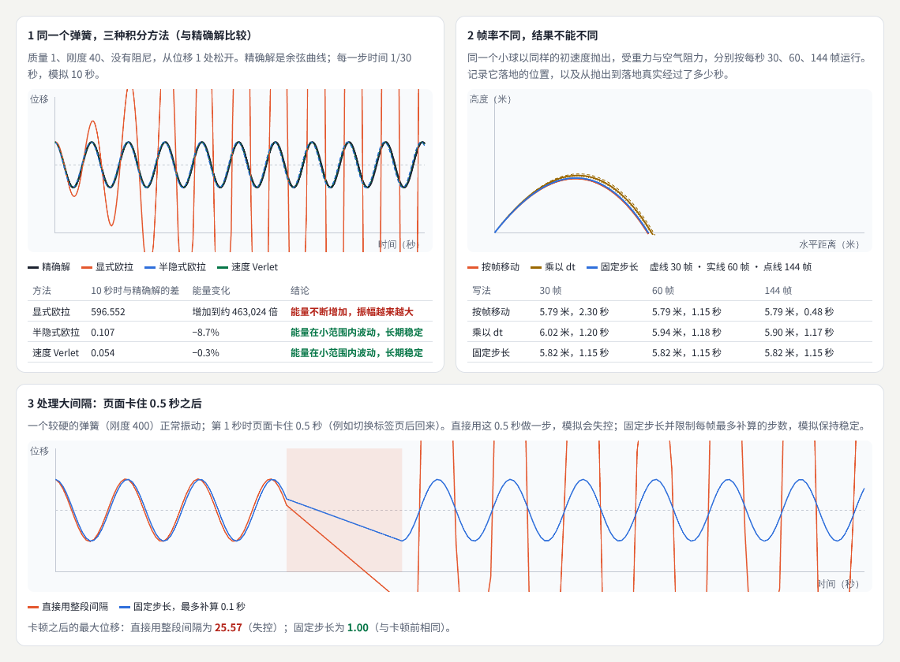

示例：[08-02-timestep.html](示例/08-02-timestep.html)

#### 02.2 三种积分方法

示例模拟一个没有阻尼的弹簧（质量 1、刚度 40），时间步长 1/30 秒，模拟 10 秒，并与精确解（余弦曲线）比较：

```js
// 显式欧拉：用旧速度更新位置
x += v * dt; v += a * dt;
// 半隐式欧拉：先更新速度，再用新速度更新位置
v += a * dt; x += v * dt;
// 速度 Verlet：用新旧加速度的平均更新速度
x += v * dt + 0.5 * a * dt * dt; const a2 = -k * x / m; v += 0.5 * (a + a2) * dt;
```

| 方法 | 10 秒时与精确解的差 | 能量变化 | 结论 |
| --- | --- | --- | --- |
| 显式欧拉 | 596.552 | 增加到约 463024 倍 | 能量不断增加，振幅越来越大 |
| 半隐式欧拉 | 0.107 | −8.7% | 能量在小范围内波动，长期稳定 |
| 速度 Verlet | 0.054 | −0.3% | 能量在小范围内波动，长期稳定 |

只是调换了两行代码的顺序，结果就从“失控”变成“稳定”。没有特别理由时，用半隐式欧拉或 Verlet。

#### 02.3 帧率不同，结果不能不同

同一个小球以同样的初速度抛出，分别按每秒 30、60、144 帧运行：

| 写法 | 30 帧 | 60 帧 | 144 帧 |
| --- | --- | --- | --- |
| 每帧移动固定的量 | 5.79 米，2.30 秒 | 5.79 米，1.15 秒 | 5.79 米，0.48 秒 |
| 乘以每帧的时间 dt | 6.02 米，1.20 秒 | 5.94 米，1.18 秒 | 5.90 米，1.17 秒 |
| 固定步长 | 5.82 米，1.15 秒 | 5.82 米，1.15 秒 | 5.82 米，1.15 秒 |

“每帧移动固定的量”在高刷新率的屏幕上快了将近 5 倍；“乘以 dt”速度对了，但步长随帧率变化，落点仍差了 0.12 米；**固定步长**——物理计算总是用同样的小步长（例如 1/120 秒），每帧按经过的时间补算若干步——在任何帧率下结果都相同。[B02](#ref-b02)

```js
acc += Math.min(frameDt, 0.1);                 // 一帧最多补算 0.1 秒
while (acc >= h) { step(h); acc -= h; }        // 够一步就算一步，h 固定
```

#### 02.4 处理大间隔

切换标签页再回来、页面被阻塞，都会让一帧的时间突然变得很长。示例在第 1 秒插入一帧 0.5 秒的卡顿：直接用这 0.5 秒做一步，一个较硬的弹簧振幅从 1 涨到 25.57；固定步长并限制每帧最多补算 0.1 秒，振幅保持 1.00。超过上限的时间直接丢弃：画面慢了一点，但模拟不会失控。

#### 02.5 验证：和已知的答案比较

02.2 能判断哪种方法更准，是因为弹簧有精确解。用于教学或分析的模拟，都应当找一个有已知答案的情况来验证：简单摆的周期、自由落体的时间、守恒的能量。视觉作品可以不做这一步，但要明白自己做的是近似。

#### 02.6 常见问题

- **模拟在快的电脑上跑得快**：按帧更新，而不是按时间。改用固定步长。
- **模拟一段时间后越来越剧烈**：显式欧拉让能量不断增加。换成半隐式欧拉，或者减小步长。
- **切回页面时物体飞走了**：大间隔被当作一步计算。限制每帧补算的时间。

**本章练习**：

1. 在 `08-02-timestep.html` 中把弹簧的步长从 1/30 改为 1/120，比较显式欧拉的误差。
2. 给弹簧加上阻尼，观察三种方法的能量是否都会减少。

<a id="part-2"></a>

## 第二篇：八个方向

<a id="ch03"></a>

### 03 随机与受控变化

#### 03.1 解决什么问题

生成作品需要变化，但不能失控。三个工具：使用**随机种子**、**概率分布**和噪声组织差异。随机种子用于**复现一个结果**，参数范围用于**控制作品风格**。用它们可以制作系列海报、变化纹理和可生成的视觉身份。

#### 03.2 概率分布：同样是“随机”，形状不同

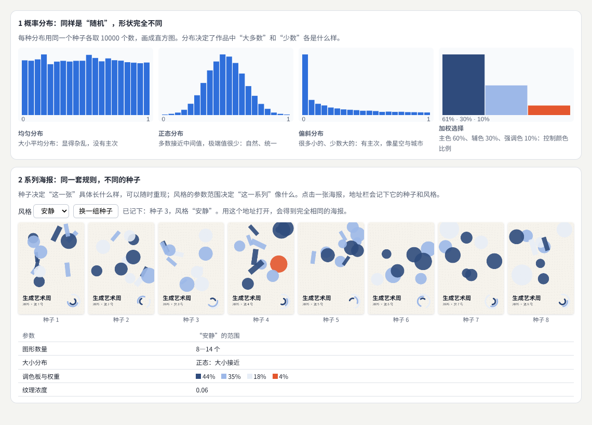

示例：[08-03-variation.html](示例/08-03-variation.html)

| 分布 | 做法 | 在作品中的效果 |
| --- | --- | --- |
| 均匀 | 直接取 0—1 的随机数 | 大小平均分布，显得杂乱，没有主次 |
| 正态 | 两个均匀随机数经 Box-Muller 变换 | 多数接近中间值、极端值很少：自然、统一 |
| 偏斜 | 随机数的 3 次方 | 很多小的、少数大的：有主次，像星空与城市 |
| 加权选择 | 按权重挑选 | 主色 60%、辅色 30%、强调色 10%，控制颜色比例 |

用 10000 个样本测试，加权选择得到的比例是 61%、30%、10%。Tyler Hobbs 的文章详细讨论了生成艺术中常用的分布。[B03](#ref-b03)

#### 03.3 种子复现一张，范围决定一系列

示例的“生成艺术周”海报系统：每张海报由一个种子决定，种子相同，画面逐像素相同（测试中重复生成比较，结果一致）；点击一张海报，地址栏会记下 `?seed=3&style=quiet`，用这个地址打开就能得到同一张。风格由参数范围决定：

| 参数 | “安静” | “热闹” |
| --- | --- | --- |
| 图形数量 | 8—14 个 | 28—46 个 |
| 大小分布 | 正态：大小接近 | 偏斜：少数很大 |
| 调色板与权重 | 冷色为主，强调色 4% | 暖色为主，四色都多 |
| 纹理浓度 | 淡 | 浓 |

同一风格的 8 张海报各不相同，放在一起却明显属于同一个系列。

#### 03.4 噪声组织差异，以及可生成的视觉身份

纯随机的差异是杂乱的；用噪声组织差异，相邻的元素相似、远处的不同，就有了“流动”的质感（见《创意编程与二维图形》06 章）。示例海报的背景纹理由噪声决定方向，每张都不同，质感却一致——这就是**变化纹理**。

海报右下角的标志由三段圆弧组成，角度和长度由种子决定：每张海报的标志都不同，但规则相同，一眼能认出是同一个活动。这种做法称为**可生成的视觉身份**：品牌不是一个固定的图形，而是一套生成图形的规则。

#### 03.5 常见问题

- **系列里每张都差不多**：参数范围太窄，或者种子只影响了不显眼的部分。
- **系列里有几张明显不好**：范围太宽。收窄范围，或者在 10 章的策展中挑选。
- **同一个种子在别人电脑上不一样**：使用了 `Math.random()` 或依赖设备的值（例如窗口宽度）。所有随机都要来自种子，尺寸要固定或按比例计算。

**本章练习**：

1. 给 `08-03-variation.html` 增加第三种风格“简洁”：只有 3—5 个大图形、两种颜色。
2. 把大小分布从正态改为偏斜，比较“安静”风格的变化。

**继续深入**：泊松圆盘采样（点之间保持最小距离的随机分布）；多层噪声；《The Nature of Code》的随机一章。[B04](#ref-b04)

<a id="ch04"></a>

### 04 几何与图案生成

#### 04.1 解决什么问题

探索分形、铺砌、曲面、对称及其扰动。学习规则之间的组合，并观察局部变化怎样影响整体。作品应当保留可以理解的参数和生成过程。

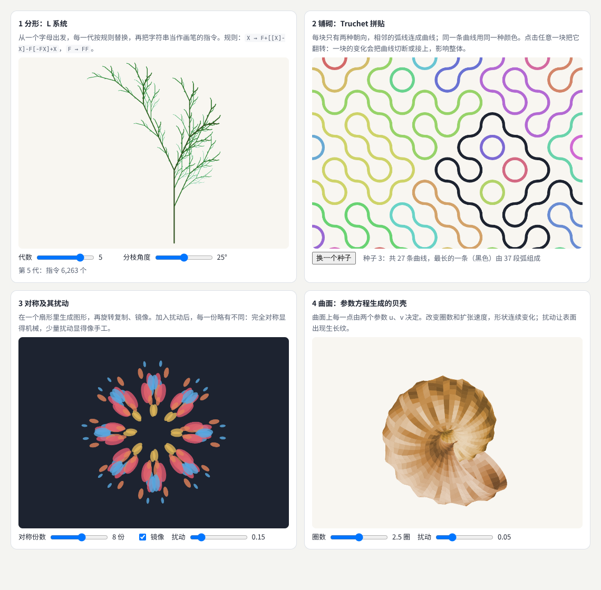

示例：[08-04-patterns.html](示例/08-04-patterns.html)

#### 04.2 分形：L 系统

**L 系统**从一个字母出发，每一代按规则替换，再把得到的字符串当作画笔的指令：`F` 向前画一段，`+`、`−` 转一个角度，`[`、`]` 记住和恢复画笔的位置（于是有了分枝）。[B05](#ref-b05)

```js
const RULES = { X: 'F+[[X]-X]-F[-FX]+X', F: 'FF' };
let s = 'X';
for (let i = 0; i < n; i++) s = [...s].map(c => RULES[c] ?? c).join('');   // 每一代：逐字替换
```

规则只有两条，第 5 代就有 6263 个指令。整株植物的每一部分都和整体相似——这就是**分形**。分枝角度改变 5 度，整棵树的姿态随之改变：规则在每一层都被重复应用，局部的小变化被放大到了整体。

#### 04.3 铺砌：Truchet 拼贴

每块方砖上画两段四分之一圆弧，只有两种朝向。相邻的弧线在边的中点相接，连成一条条曲线。示例用并查集找出连在一起的弧线，同一条曲线涂同一种颜色，最长的一条涂成黑色。

点击任意一块翻转它：测试中翻转一块，曲线从 27 条变成 28 条，最长的一条从 37 段变成 33 段。**一块砖的变化，改变了好几条曲线的走向**——这就是“局部变化影响整体”最直观的例子。

#### 04.4 对称及其扰动

在一个扇形里生成图形，再旋转复制、镜像。完全的对称显得机械；给每一份加一点不同的偏移和大小（**扰动**），就像手工绘制的一样。扰动为 0 时是严格对称，0.1—0.2 时手工感最明显，超过 0.5 时对称几乎看不出来了。

#### 04.5 曲面：参数方程

曲面上每一点由两个参数 u、v 决定。示例的贝壳：v 沿螺旋前进，u 绕截面一圈，越往外截面越大。改变“圈数”，贝壳的形状连续变化；再加入沿生长方向的小扰动，表面出现生长纹。绘制时把每个小四边形按远近排序，先画远的（画家算法），并按法线方向计算明暗。

#### 04.6 常见问题

- **L 系统画面一片漆黑**：代数太多，指令数按指数增长。限制代数，或者降低线宽。
- **Truchet 图案看起来太规则**：两种朝向的概率都是 50%；改变概率，或者引入第三种砖。
- **对称图案的中心挤成一团**：靠近中心的元素在复制后重叠。让元素离中心有最小距离。

**本章练习**：

1. 给 L 系统增加一条随机规则：`F` 有 50% 的机会替换为 `FF`，50% 替换为 `F[+F]F`，并用种子控制。
2. 在 Truchet 拼贴中，只给最长的曲线上色，其余画成浅灰，观察整体的“路径”。

**继续深入**：《The Nature of Code》的分形一章；[B06](#ref-b06) 彭罗斯铺砌与非周期铺砌；Voronoi 图与 Delaunay 三角剖分；壁纸群（平面上全部 17 种对称方式）。

<a id="ch05"></a>

### 05 生长与扩散

#### 05.1 解决什么问题

用分枝、扩散、迭代规则和场生成植物或抽象形态。每个生长系统都要定义**初始条件、边界、终止条件和资源限制**。模拟自然外观时，还应说明采用了什么简化。

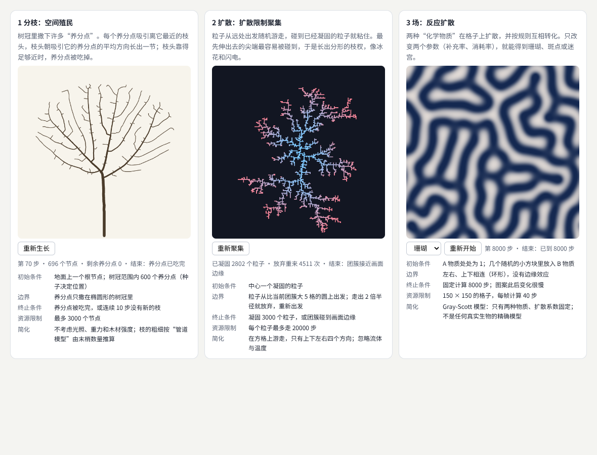

示例：[08-05-growth.html](示例/08-05-growth.html)

#### 05.2 三个系统

- **分枝：空间殖民。** 树冠里撒下 600 个“养分点”，每个养分点吸引离它最近的枝头，枝头朝吸引它的养分点的平均方向长出一节；枝头靠得足够近时，养分点被吃掉。[B07](#ref-b07) 枝的粗细按“管道模型”推算：一节树枝承载的末梢越多就越粗。测试中，第 70 步养分点被吃完，树有 696 个节点。
- **扩散：扩散限制聚集（DLA）。** 粒子从远处出发随机游走，碰到已经凝固的粒子就粘住。最先伸出去的尖端最容易被碰到，于是长出分形的枝杈，像冰花和闪电。[B08](#ref-b08) 测试中凝固了 2802 个粒子后团簇接近画面边缘，期间有 4511 个粒子走得太远被放弃、重新出发。
- **场：反应扩散。** 两种“化学物质”在格子上扩散，并按规则互相转化（Gray-Scott 模型）。只改变补充率和消耗率两个参数，就能得到珊瑚、斑点或迷宫。[B09](#ref-b09)

#### 05.3 写清楚四个条件和简化

| 条件 | 空间殖民 | 扩散限制聚集 | 反应扩散 |
| --- | --- | --- | --- |
| 初始条件 | 一个根节点；600 个养分点 | 中心一个凝固的粒子 | A 处处为 1；几个小方块里放入 B |
| 边界 | 养分点只在椭圆形树冠里 | 从比团簇大 5 格的圆上出发；走出 2 倍半径就放弃 | 上下、左右相连（环形） |
| 终止条件 | 养分点吃完，或连续 10 步没有新枝 | 3000 个粒子，或接近画面边缘 | 固定 8000 步 |
| 资源限制 | 最多 3000 个节点 | 每个粒子最多走 20000 步 | 150 × 150 格，每帧 40 步 |
| 简化 | 不考虑光照、重力与木材强度 | 只在方格上四个方向游走 | 只有两种物质，系数固定 |

没有终止条件，系统可能永远运行；没有资源限制，一个不幸的种子就可能让页面卡死。示例在每一帧只计算一小段，页面不会卡住；开启“减少动态效果”时直接显示最终结果。

#### 05.4 常见问题

- **树长得很稀疏或很乱**：影响距离太小，枝头找不到养分；或者每节长度太大。
- **DLA 运行越来越慢**：粒子从太远处出发。让出发圆跟着团簇半径变化，并限制游走步数。
- **反应扩散只剩一片平坦的颜色**：参数落在“死区”，图案消失。补充率和消耗率要在合适的范围内成对调整。

**本章练习**：

1. 把空间殖民的树冠从椭圆改成心形，观察树形怎样变化。
2. 在反应扩散中，让补充率从左到右逐渐变化，得到一张从斑点过渡到迷宫的图。

**继续深入**：差异生长（曲线不断分裂、互相排斥，形成褶皱）；元胞自动机；物理上更真实的植物模型。

<a id="ch06"></a>

### 06 群体与智能体

#### 06.1 解决什么问题

让个体根据邻居、目标和环境调整行为，形成鸟群、鱼群和人群等效果。可以研究**局部规则与整体组织**之间的关系；规模扩大后，需要考虑**邻域查询的效率**。Craig Reynolds 的 Boids 是这类模型的起点。[B10](#ref-b10)

#### 06.2 示例：人群疏散

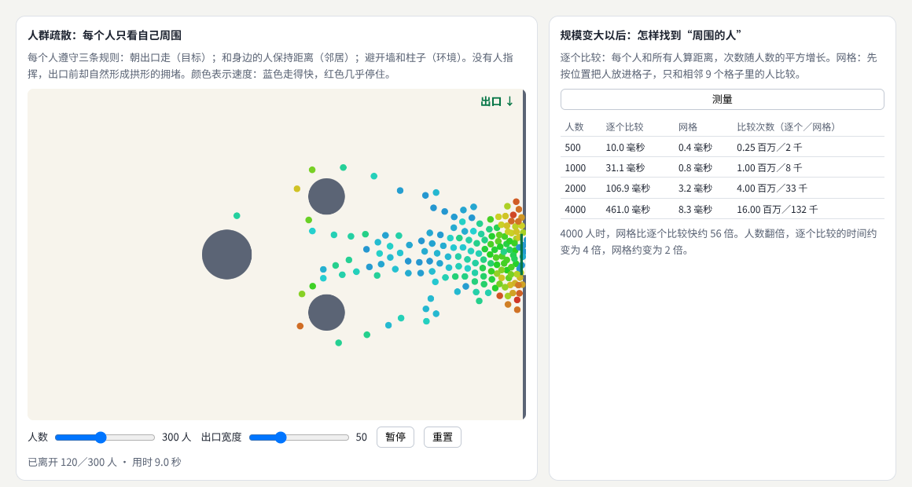

示例：[08-06-agents.html](示例/08-06-agents.html)

每个人只遵守三条规则：**朝出口走**（目标）；**和身边的人保持距离**（邻居）；**避开墙和柱子**（环境）。这类“社会力”模型常用于研究人群疏散。[B11](#ref-b11) 没有人指挥，出口前却自然形成了拱形的拥堵。

300 人在不同出口宽度下离开房间的时间：

| 出口宽度 | 一半人离开 | 90% 的人离开 | 全部离开 |
| --- | --- | --- | --- |
| 30 | 11.5 秒 | 17.5 秒 | 23 秒 |
| 50 | 9.5 秒 | 14 秒 | 19 秒 |
| 90 | 9 秒 | 12 秒 | 19 秒 |

出口从 30 加宽到 50，90% 的人离开的时间缩短了 20%；再加宽到 90，又缩短了 14%；但最后一个人离开的时间不再变化——它取决于走得最慢、离得最远的人，而不是出口。这就是从局部规则中“长”出来的整体规律。

#### 06.3 邻域查询：从逐个比较到网格

每个人都要找到“周围的人”。逐个比较时，每个人要和所有人算距离，次数随人数的平方增长。把空间划分成边长等于邻居范围的格子，每个人只和相邻 9 个格子里的人比较：

| 人数 | 逐个比较 | 网格 | 比较次数（逐个／网格） |
| --- | --- | --- | --- |
| 500 | 7.3—10.0 毫秒 | 0.4 毫秒 | 0.25 百万／2 千 |
| 1000 | 26.1—31.1 毫秒 | 0.8—1.0 毫秒 | 1.00 百万／8 千 |
| 2000 | 106.9—116.9 毫秒 | 2.4—3.2 毫秒 | 4.00 百万／33 千 |
| 4000 | 390.6—461.0 毫秒 | 6.8—8.3 毫秒 | 16.00 百万／132 千 |

（两次测量的范围。）人数翻倍，逐个比较的时间约变为 4 倍，网格约变为 2 倍；4000 人时网格快 56—57 倍。

```js
// 网格：把每个人放进边长为 NEAR 的格子，查询时只看周围 9 格
list.forEach((a, i) => { const k = (Math.floor(a.y / NEAR) + 1) * cols + Math.floor(a.x / NEAR) + 1; (cells.get(k) || cells.set(k, []).get(k)).push(i); });
```

#### 06.4 常见问题

- **人卡在柱子后面不动**：朝目标的力与柱子的推力抵消。可以给目标加一点随机偏移，或者用路径规划绕开障碍。
- **人互相穿过**：推力太弱或时间步长太大。增大推力，每帧分几小步计算。
- **人数一多就卡**：仍在逐个比较。使用网格或其他空间索引。

**本章练习**：

1. 在 `08-06-agents.html` 中增加第二个出口，比较疏散时间。
2. 去掉中间的大柱子，观察拱形拥堵是否变化。

**继续深入**：路径规划（A* 与流场寻路）；鱼群中的捕食者与逃逸；多种角色的人群（例如有人逆行）。

<a id="ch07"></a>

### 07 粒子与力场

#### 07.1 解决什么问题

用位置、速度、加速度和外力更新系统。常见的力包括吸引、排斥、弹簧和阻尼。要选择合适的时间步长并处理大间隔，避免运行速度变化导致结果失控（02 章）。《The Nature of Code》的力一章是很好的入门。[B12](#ref-b12)

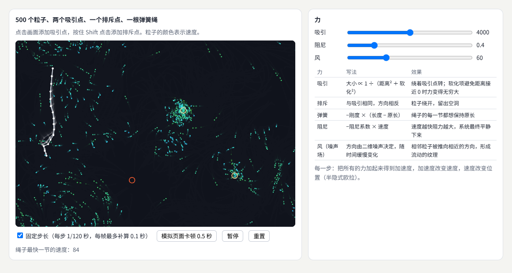

示例：[08-07-forces.html](示例/08-07-forces.html)（点击添加吸引点，按住 Shift 点击添加排斥点）

#### 07.2 五种力

| 力 | 写法 | 效果 |
| --- | --- | --- |
| 吸引 | 大小 ∝ 1 ÷（距离² ＋ 软化²） | 绕着吸引点转；软化项避免距离接近 0 时力变得无穷大 |
| 排斥 | 与吸引相同，方向相反 | 粒子绕开，留出空洞 |
| 弹簧 | −刚度 ×（长度 − 原长） | 绳子的每一节都想保持原长 |
| 阻尼 | −阻尼系数 × 速度 | 速度越快阻力越大，系统最终平静下来 |
| 风（噪声场） | 方向由二维噪声决定，随时间缓慢变化 | 相邻粒子被推向相近的方向，形成流动的纹理 |

```js
for (const k of wells) {                       // 吸引（s > 0）与排斥（s < 0）
  const dx = k.x - p.x, dy = k.y - p.y, d2 = dx * dx + dy * dy + SOFT * SOFT, f = G * k.s / (d2 * Math.sqrt(d2));
  ax += dx * f; ay += dy * f;
}
ax -= c * p.vx; ay -= c * p.vy;                // 阻尼
p.vx += ax * h; p.vy += ay * h; p.x += p.vx * h; p.y += p.vy * h;   // 半隐式欧拉
```

#### 07.3 卡顿时会发生什么

示例的“模拟页面卡顿 0.5 秒”按钮让主线程忙 0.5 秒。用同样的初始状态测试：

| 写法 | 卡顿前：绳子最长一节 | 卡顿后：绳子最长一节 | 最快的粒子 |
| --- | --- | --- | --- |
| 固定步长（最多补算 0.1 秒） | 原长的 1.40 倍 | 1.43 倍 | 132 → 136 |
| 直接用这一帧的时间 | 1.40 倍 | 6.23 倍 | 132 → 227 |

一帧之内，绳子的一节被拉到原长的 6 倍多，粒子被甩出去。固定步长的写法几乎没有变化。

#### 07.4 常见问题

- **粒子靠近吸引点时突然飞走**：距离接近 0，力变得极大。加软化项，并限制最大速度。
- **系统越来越“热”，停不下来**：没有阻尼，或者积分方法让能量增加（02 章）。
- **弹簧绳像橡皮筋一样越拉越长**：刚度太小或步长太大。增大刚度时要减小步长，或者改用 08 章的约束。

**本章练习**：

1. 给示例增加一个“旋涡”力：方向垂直于粒子到中心的连线。
2. 把绳子的弹簧刚度改为 3000，分别用 1/120 与 1/30 秒的步长运行，记录哪一种会失控。

**继续深入**：引力多体模拟；用四叉树加速大量粒子之间的相互作用；流场中的粒子轨迹作为绘画（10 章的生成器就是这样）。

<a id="ch08"></a>

### 08 流体、布料与软体

#### 08.1 解决什么问题

流体、布料和软体是物理仿真中较难的部分。要**根据目标选择模型**，逐步学习数值积分、约束、碰撞和稳定性。视觉演示可以使用简化模型；工程或科学应用则需要验证精度。真实感与计算成本需要明确取舍。

| 对象 | 常用的简化模型 | 本章示例 |
| --- | --- | --- |
| 布料 | 点 ＋ 距离约束（位置的 Verlet 积分） | 挂起的布被圆球顶起 |
| 软体 | 一圈点 ＋ 边上的弹簧 ＋ 内部压力 | 落地后被压扁再恢复 |
| 流体（烟、染料） | 网格上的速度场（稳定流体方法） | 两股烟向上翻卷 |
| 流体（水花、液体） | 粒子（光滑粒子流体动力学） | — |

#### 08.2 布料：约束与碰撞

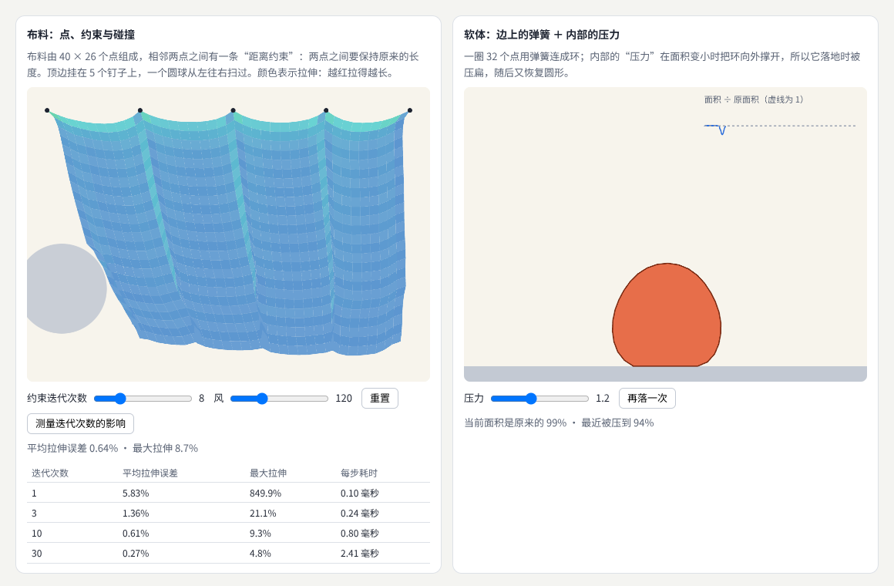

示例：[08-08-cloth.html](示例/08-08-cloth.html)

布料由 40 × 26 个点组成，相邻两点之间有一条**距离约束**：两点之间要保持原来的长度。每一步先让所有点按惯性和外力移动（位置 Verlet：速度隐含在本步位置与上步位置之差中），再**反复修正**约束：每条约束把两端拉回原长。修正一条约束会破坏相邻的约束，所以要迭代多次。碰撞也是一种约束：在球里的点被推到球面上。[B13](#ref-b13)

```js
for (let k = 0; k < iters; k++) {
  for (const [a, b] of links) {                    // 每条约束把两端拉回原长
    const p = pts[a], q = pts[b], dx = q.x - p.x, dy = q.y - p.y, d = Math.hypot(dx, dy), diff = (d - REST) / d;
    p.x += dx * diff * 0.5; p.y += dy * diff * 0.5; q.x -= dx * diff * 0.5; q.y -= dy * diff * 0.5;
  }
  for (const p of pts) { /* 碰撞：在圆球里的点推到球面上 */ }
}
```

迭代次数决定精度与成本：

| 迭代次数 | 平均拉伸误差 | 最大拉伸 | 每步耗时 |
| --- | --- | --- | --- |
| 1 | 5.83% | 849.9% | 0.10 毫秒 |
| 3 | 1.36% | 21.1% | 0.24 毫秒 |
| 10 | 0.61% | 9.3% | 0.80 毫秒 |
| 30 | 0.27% | 4.8% | 2.41 毫秒 |

只迭代 1 次时，被圆球顶起的地方局部被拉到原长的 8 倍多，布像被戳穿一样；迭代 30 次误差最小，但成本是 3 次的 10 倍。示例默认用 8 次，视觉上已经足够。

#### 08.3 软体：弹簧与压力

一圈 32 个点用弹簧连成环，内部的**压力**在面积变小时把环向外撑开。测试：

| 压力 | 落地后面积最小降到 |
| --- | --- |
| 0 | 0%（完全塌掉，像一根橡皮筋） |
| 1.2 | 94% |
| 3 | 98% |

压力越大，越像充满气的球；压力为 0 时，只剩一圈弹簧，形状无法保持。

#### 08.4 流体：稳定流体方法

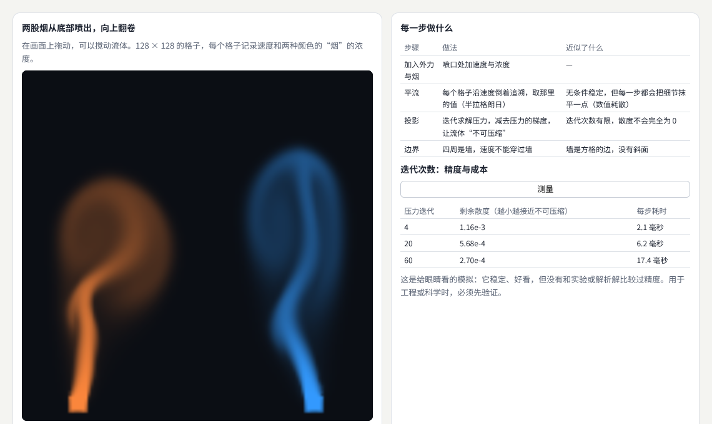

示例：[08-08-fluid.html](示例/08-08-fluid.html)（在画面上拖动可以搅动流体）

Jos Stam 的稳定流体方法在 128 × 128 的格子上记录速度和烟的浓度，每一步做三件事：[B14](#ref-b14)

| 步骤 | 做法 | 近似了什么 |
| --- | --- | --- |
| 平流 | 每个格子沿速度倒着追溯，取那里的值 | 无条件稳定，但每一步都把细节抹平一点（数值耗散） |
| 投影 | 迭代求解压力，让流体“不可压缩” | 迭代次数有限，散度不会完全为 0 |
| 边界 | 四周是墙，速度不能穿过墙 | 墙只能是方格的边 |

| 压力求解迭代 | 剩余散度 | 每步耗时 |
| --- | --- | --- |
| 4 | 1.16 × 10⁻³ | 2.1—3.2 毫秒 |
| 20 | 5.68 × 10⁻⁴ | 6.2—7.7 毫秒 |
| 60 | 2.70 × 10⁻⁴ | 17.4—18.4 毫秒 |

迭代越多越接近不可压缩，成本也成倍增加。这个模拟稳定、好看，适合视觉演示，但没有和实验或解析解比较过精度——用于工程或科学时，必须先验证。

#### 08.5 常见问题

- **布料抖动不停**：约束迭代次数不够，或者没有阻尼。
- **布料穿过物体**：每步的移动距离大于物体的厚度。减小步长，或在约束迭代中多次处理碰撞。
- **烟很快就糊成一片**：平流的数值耗散。提高分辨率，或者使用耗散更小的平流方法。

**本章练习**：

1. 给布料增加“撕裂”：拉伸超过原长 3 倍的约束被删除。
2. 在流体示例中把喷口改为从中间向上，并在中间放一个圆形障碍。

**继续深入**：位置约束动力学（PBD）与 XPBD；光滑粒子流体动力学（SPH）；在 GPU 上求解流体（12 章）。

<a id="ch09"></a>

### 09 声音、数据与环境驱动

#### 09.1 解决什么问题

用输入数据控制生成过程，需要设计**映射、平滑和边界**。输入缺失或突变时，作品应当有**可以解释的行为**。作品还应当清楚地区分**实测数据、模拟数据与艺术性变换**。声音驱动视觉的具体做法见[《创意编程与二维图形》](05-创意编程与二维图形.md) 09 章，摄像头与传感器见同册 10 章；本章讲的原则对它们同样适用。

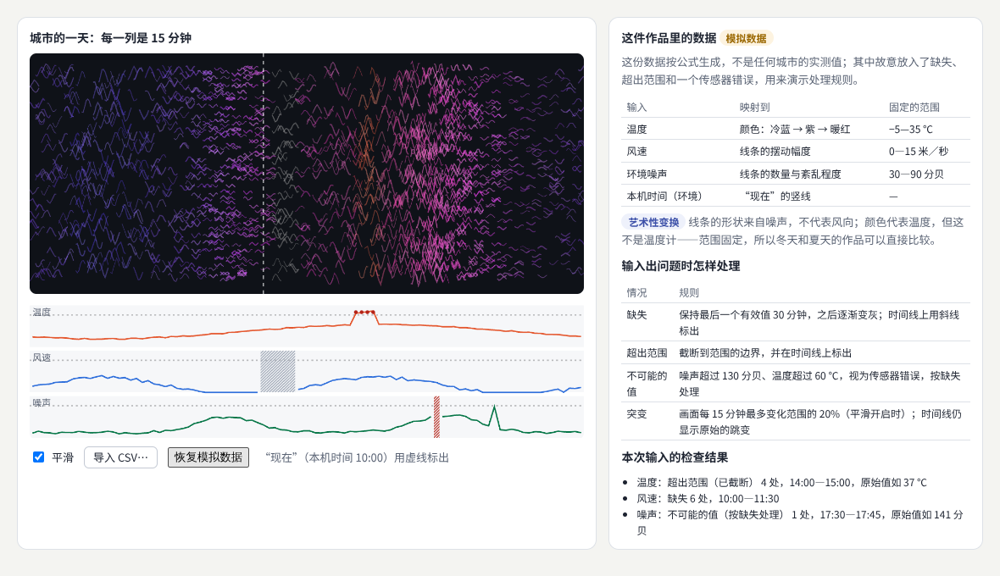

示例：[08-09-data.html](示例/08-09-data.html)（可以导入自己的 CSV 文件）

#### 09.2 映射：用固定的范围

| 输入 | 映射到 | 固定的范围 |
| --- | --- | --- |
| 温度 | 颜色：冷蓝 → 紫 → 暖红 | −5—35 ℃ |
| 风速 | 线条的摆动幅度 | 0—15 米／秒 |
| 环境噪声 | 线条的数量与紊乱程度 | 30—90 分贝 |
| 本机时间（环境） | “现在”的竖线 | — |

两个细节：范围是**固定的**，而不是按当天数据的最小值、最大值计算——否则冬天最冷和夏天最冷都会显示成最深的蓝色，作品之间无法比较。颜色从蓝经紫到红，而不是彩虹色：彩虹色在中间出现明亮的黄绿，会让人误以为那里有特别的变化。

#### 09.3 平滑、边界、缺失与突变

| 情况 | 规则 |
| --- | --- |
| 缺失 | 保持最后一个有效值 30 分钟，之后逐渐变灰；时间线上用斜线标出 |
| 超出范围 | 截断到范围的边界，并在时间线上标出 |
| 不可能的值 | 噪声超过 130 分贝、温度超过 60 ℃，视为传感器错误，按缺失处理 |
| 突变 | 画面每 15 分钟最多变化范围的 20%；时间线仍显示原始的跳变 |

测试中，噪声在两个相邻时段从 88 分贝跳到 45 分贝：开启平滑时，画面上的变化被限制为范围的 20%；关闭平滑时是 72%。导入一份带空值、风速 99 米／秒和噪声 −10 分贝的 CSV，检查结果正确地报告了“温度缺失 1 处”“风速不可能的值 1 处”“噪声超出范围 1 处”。

**平滑只改变画面，不改变记录**：时间线始终显示原始数据。观众应当能看到数据本来的样子。

#### 09.4 区分实测、模拟与艺术性变换

示例在显眼的位置写明：

- **模拟数据**：“这份数据按公式生成，不是任何城市的实测值。”导入文件后，标签变为“导入的数据”，并说明数据的可靠程度要由提供者说明。
- **艺术性变换**：“线条的形状来自噪声，不代表风向；颜色代表温度，但这不是温度计。”

数据驱动的作品很容易被当成数据图表来读。写清楚哪些是数据、哪些是艺术选择，是对观众的诚实，也保护作者不被误解。

#### 09.5 常见问题

- **画面一直在剧烈闪动**：输入的抖动直接映射到画面。加平滑，或者降低更新频率。
- **数据断了，作品也“死”了**：没有处理缺失。保持最后的值，并在一段时间后明确显示“输入中断”。
- **同样的温度在两件作品里颜色不同**：使用了按数据自动计算的范围。改为固定的范围。

**本章练习**：

1. 准备一份自己城市一天的数据（或从公开数据下载），导入 `08-09-data.html`，检查报告的问题。
2. 给“现在”的竖线增加动画：随本机时间每 15 分钟移动一格。

**继续深入**：声音特征（音量、频谱、节拍）的提取与平滑；传感器融合；数据伦理与隐私（见[《包容、国际化与多感官》](16-包容国际化与多感官.md)）。

<a id="ch10"></a>

### 10 生成系统的策展

#### 10.1 解决什么问题

生成系统能产出无数张图，但不是每一张都好。**策展**要比较多组结果、选择参数区域、建立系列和呈现方式。随机结果经过选择、编排和解释才能形成完整作品。保存种子、参数、版本和图像，有助于后续复现与改进。

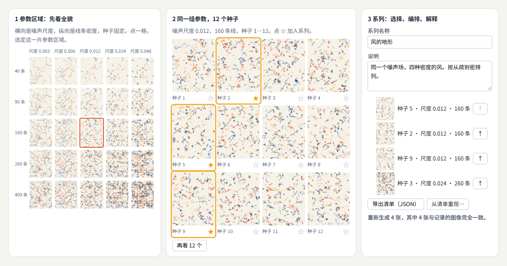

示例：[08-10-curate.html](示例/08-10-curate.html)

#### 10.2 四个步骤

1. **看全貌，选参数区域**：固定种子，把两个最重要的参数（噪声尺度、线条密度）各取 5 个值，排成 5 × 5 的地图。一眼就能看出哪一片区域是“风”，哪一片是“乱麻”。示例的生成器是流场中的线条，Tyler Hobbs 的文章介绍了这种做法。[B15](#ref-b15)
2. **比较多组结果**：选定区域后，同一组参数看 12 个种子，挑出满意的加星标。
3. **编排与解释**：把选中的作品排成一个系列，调整顺序，写上名称与说明——例如“同一个噪声场，四种密度的风，按从疏到密排列”。
4. **记录**：导出清单。

#### 10.3 清单：让系列可以重现

```json
{
  "generator": { "name": "风的地形", "version": "1.0.0" },
  "title": "风的地形",
  "works": [
    { "order": 1, "seed": 5, "params": { "scale": 0.012, "density": 160 }, "size": [480, 600], "imageSha256": "cd11486d…" }
  ]
}
```

每件作品记录种子、参数、尺寸和图像的哈希；整个系列记录生成器的名称与版本。测试中，导出 4 件作品的清单，重新加载页面后“从清单重现”：4 张全部与记录的图像完全一致。把其中一个哈希改掉、版本改为 0.9.0 再导入，结果显示“4 张中 3 张一致（清单来自 0.9.0 版，当前是 1.0.0 版）”——不一致和版本差异都能被发现。

两个注意：换浏览器或浏览器版本，抗锯齿等细节可能让像素略有不同，所以清单里同时保存参数和最终的图像文件；生成器改了算法，就要改版本号，旧的清单才能说明它对应哪个版本。

#### 10.4 呈现方式

同一组作品，呈现方式不同，意义也不同：按参数顺序排列，展示的是“系统”；按视觉节奏排列，展示的是“作品”；与生成过程（地图、草稿）一起展出，展示的是“方法”。在说明中写清楚选择的标准，观众才能理解作品与随机之间的关系。

#### 10.5 常见问题

- **挑来挑去都差不多**：参数区域太窄。回到地图，扩大范围再看。
- **过了几个月无法重现**：只保存了图片，没有保存种子、参数和版本。
- **系列看起来零散**：每张都好，但放在一起没有关系。确定一个主题，按它选择和排序。

**本章练习**：

1. 用 `08-10-curate.html` 做一个 6 张的系列，写下你的选择标准。
2. 把参数区域地图的纵轴改为调色板，比较哪个参数对作品气质的影响更大。

<a id="part-3"></a>

## 第三篇：综合项目与工具

<a id="ch11"></a>

### 11 综合项目：可调的群体运动

#### 11.1 目标与验收

完成一个可调的群体运动作品，提供个体数、邻域半径、聚集和分离强度等控制。用相同的初始条件比较参数变化，记录每组结果和运行成本。用户应能暂停、恢复和重置，并理解每个参数大致改变什么。

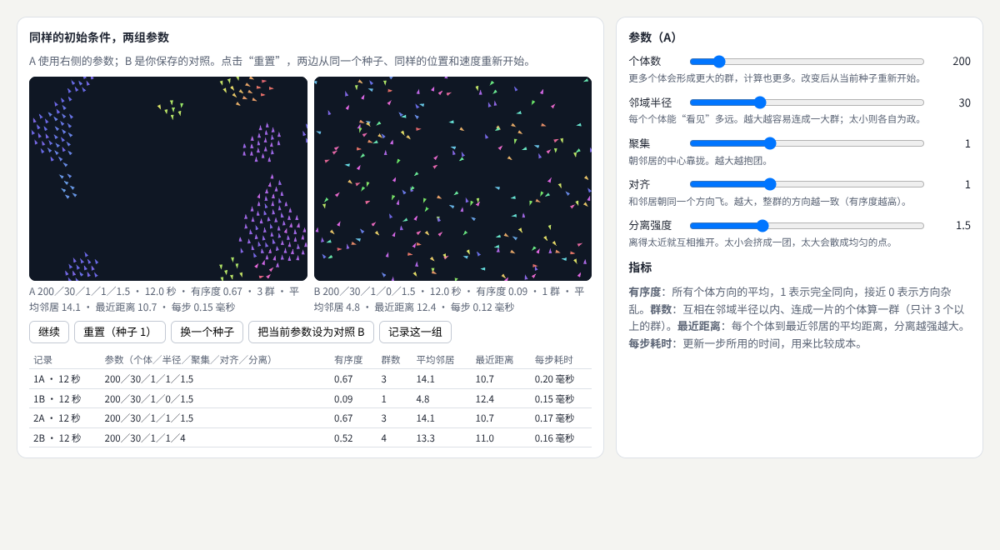

示例：[08-11-flock.html](示例/08-11-flock.html)

#### 11.2 第一步：同样的初始条件

两个模拟使用同一个种子生成初始位置与速度。测试：两边参数相同时，运行 5 秒后所有个体的位置仍然完全相同——比较的差别只来自参数，而不是运气。

#### 11.3 第二步：三条规则

每个个体只看邻域半径以内的邻居：[B16](#ref-b16)

```js
eachNeighbor(g, birds, i, j => {
  const o = birds[j], dx = wrapD(o.x - b.x, W), dy = wrapD(o.y - b.y, H), d2 = dx * dx + dy * dy;
  if (d2 > R2) return;
  n++; cx += dx; cy += dy; avx += o.vx; avy += o.vy;          // 聚集与对齐：统计邻居的位置与速度
  if (d2 < S2 && d2 > 0) { sx -= dx / d2; sy -= dy / d2; }    // 分离：越近推得越强
});
ax += coh * cx / n * 1.2 + ali * (avx / n - b.vx) * 1.5 + sep * sx * 900;   // 三条规则按权重相加
```

邻居用 06 章的网格查找；世界的上下、左右相连，距离取最短的一边。

#### 11.4 第三步：让结果可以比较的指标

| 指标 | 含义 |
| --- | --- |
| 有序度 | 所有个体方向的平均：1 表示完全同向，接近 0 表示方向杂乱 |
| 群数 | 互相在邻域半径以内、连成一片的个体算一群（只计 3 个以上的群） |
| 平均邻居 | 每个个体在邻域内有几个邻居 |
| 最近距离 | 每个个体到最近邻居的平均距离 |
| 每步耗时 | 更新一步所用的时间 |

运行 15 秒后的对比（200 个个体；默认参数为邻域半径 30、聚集 1、对齐 1、分离 1.5）：

| 参数 | 有序度 | 群数 | 平均邻居 | 最近距离 |
| --- | --- | --- | --- | --- |
| 默认 | 0.80 | 2 | 16.6 | 10.5 |
| 对齐为 0 | 0.06 | 4 | 4.9 | 13.0 |
| 分离为 4 | 0.51 | 3 | 14.6 | 10.9 |
| 邻域半径为 15 | 0.36 | 15 | 6.2 | 6.9 |
| 聚集为 0 | 0.74 | 3 | 8.2 | 13.5 |

对齐决定方向是否一致：去掉它，有序度从 0.80 降到 0.06。邻域半径决定能否连成大群：缩小一半，群从 2 个变成 15 个。去掉聚集，个体之间松散了（平均邻居从 16.6 降到 8.2）。这些数字就是界面上参数说明的依据。

#### 11.5 第四步：运行成本

| 个体数 | 每步耗时 |
| --- | --- |
| 200 | 0.11 毫秒 |
| 600 | 0.70 毫秒 |
| 1500 | 3.35 毫秒 |

使用网格后，成本大致随个体数和平均邻居数增长。示例的“记录这一组”会把参数、指标和每步耗时一起写进表格。

#### 11.6 第五步：暂停、恢复、重置与说明

- **暂停／继续**：停止更新，但画面保留，可以仔细观察。
- **重置**：两边从当前种子重新开始；**换一个种子**：检查结论是否只在某个种子下成立。
- **把当前参数设为对照 B**：保存一组参数作为基准，再调整 A。
- 每个参数下方用一句话说明它大致改变什么，例如“对齐：和邻居朝同一个方向飞。越大，整群的方向越一致”。颜色表示飞行方向，同色说明同向。
- 开启“减少动态效果”时不自动运行。

#### 11.7 验收清单

- [ ] 五个参数都可以调整，并有一句话说明。
- [ ] 同样的种子和参数，两次运行结果完全相同。
- [ ] 可以把一组参数设为对照，与当前参数并排比较。
- [ ] 每次比较都记录了参数、指标和运行时间。
- [ ] 暂停、继续、重置、换种子都正常。
- [ ] 个体数增加到 1500 时仍然流畅，或者明确说明设备的上限。

<a id="ch12"></a>

### 12 工具：库、物理引擎与 GPU

#### 12.1 工具的位置

| 工具 | 适合 | 说明 |
| --- | --- | --- |
| 原生 Canvas 与 JavaScript | 学习原理、中小规模的作品 | 本册多数示例使用它 |
| p5.js | 快速原型与教学 | 面向创作者的绘图库[B17](#ref-b17) |
| Matter.js、Rapier | 刚体碰撞、关节、堆叠 | 现成的物理引擎，不必自己写碰撞[B18](#ref-b18) [B19](#ref-b19) |
| d3-force | 网络与图的布局 | 用力模拟排布节点[B20](#ref-b20) |
| three.js 的 GPU 计算 | 几万到几十万个粒子 | 把状态存在浮点贴图中，用着色器更新 |

原手册给出的两个参考展示值得打开观察：Three.js 鸟群用 GPU 计算数千只鸟的群体运动，[B21](#ref-b21) Three.js 星系用 WebGPU 与节点材质生成旋转的星系。[B22](#ref-b22) 这些展示用于观察方法与效果，实际运行表现取决于浏览器、设备和版本。

#### 12.2 示例：把模拟搬到 GPU

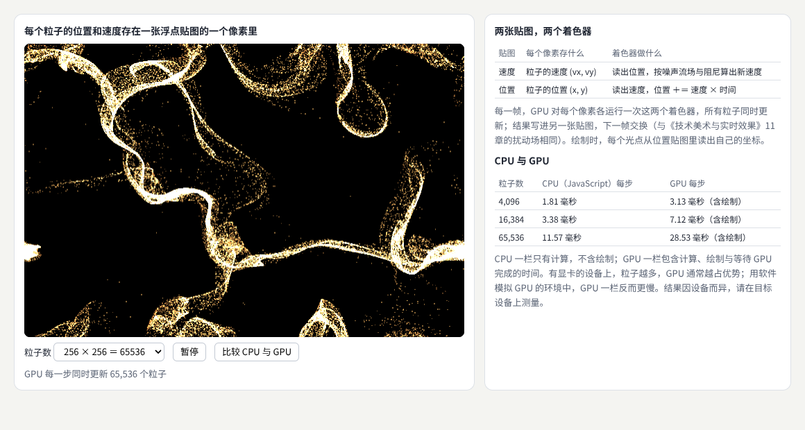

示例：[08-12-gpu.html](示例/08-12-gpu.html)

每个粒子的位置和速度存在一张浮点贴图的一个像素里。每一帧，GPU 对每个像素各运行一次两个着色器：速度着色器读出位置，按噪声流场与阻尼算出新速度；位置着色器读出速度，更新位置。结果写进另一张贴图，下一帧交换（与《技术美术与实时效果》11 章的扰动场相同）。

```js
const gpu = new GPUComputationRenderer(256, 256, renderer);         // 256 × 256 ＝ 65536 个粒子
velVar = gpu.addVariable('textureVelocity', VEL, v0);
posVar = gpu.addVariable('texturePosition', POS, p0);
gpu.setVariableDependencies(velVar, [velVar, posVar]);
gpu.setVariableDependencies(posVar, [velVar, posVar]);
gpu.init();
// 每一帧
gpu.compute();
points.material.uniforms.uPos.value = gpu.getCurrentRenderTarget(posVar).texture;
```

| 粒子数 | CPU（JavaScript，只计算） | GPU（计算 ＋ 绘制） |
| --- | --- | --- |
| 4096 | 1.61—1.81 毫秒 | 3.13—3.67 毫秒 |
| 16384 | 2.74—3.38 毫秒 | 7.12—8.93 毫秒 |
| 65536 | 11.57—14.73 毫秒 | 28.53—29.50 毫秒 |

这组数字需要谨慎解读：测试环境没有显卡，GPU 是用 CPU 模拟的，所以 GPU 一栏反而更慢，而且它还包括了绘制。在有显卡的设备上，GPU 能同时处理大量相同的计算，粒子越多通常越占优势。这恰好说明了本册反复强调的一点：**在目标设备上测量，再决定是否把计算搬到 GPU**。

#### 12.3 怎样选择

1. 几百到几千个对象：先用 JavaScript 写清楚规则，配合空间网格。
2. 需要可靠的刚体碰撞、关节：使用物理引擎，不要自己从头写。
3. 几万个以上、规则相同的粒子：考虑 GPU 计算；需要粒子之间相互作用时，规则要能改写成“每个像素读邻近像素”的形式。
4. 无论哪种，都保留种子、参数与版本，并在目标设备上测量。

<a id="ch13"></a>

### 13 继续深入与学习路线

#### 13.1 八个方向的纵向深入

| 方向 | 入门 | 进阶 | 深入 |
| --- | --- | --- | --- |
| 随机与受控变化 | 种子与均匀随机 | 分布、噪声、风格范围 | 泊松圆盘采样、可生成的品牌系统 |
| 几何与图案生成 | 重复与对称 | L 系统、Truchet、参数曲面 | 非周期铺砌、壁纸群、形式文法 |
| 生长与扩散 | 递归分枝 | 空间殖民、DLA、反应扩散 | 差异生长、元胞自动机 |
| 群体与智能体 | 三条规则 | 空间网格、指标与对比 | 路径规划、多角色人群 |
| 粒子与力场 | 力与积分 | 固定步长、弹簧与阻尼 | 多体问题、四叉树加速 |
| 流体、布料与软体 | 质点弹簧 | 约束迭代、稳定流体 | PBD／XPBD、SPH、GPU 求解 |
| 声音、数据与环境驱动 | 映射与平滑 | 缺失与突变的规则 | 传感器融合、实时演出系统 |
| 生成系统的策展 | 多看几个种子 | 参数地图与系列 | 清单、版本与展览呈现 |

#### 13.2 横向连接

- 随机、噪声与画布的基础：[《创意编程与二维图形》](05-创意编程与二维图形.md)。
- 着色器与 GPU 上的效果：[《技术美术与实时效果》](07-技术美术与实时效果.md)。
- 动画的弹簧与节奏：[《动效与时间设计》](04-动效与时间设计.md)。
- 向量、积分与数值方法：[《图形与交互的数学基础》](20-图形与交互的数学基础.md)。
- 渲染与仿真算法的研究：[《图形学与视觉计算研究》](10-图形学与视觉计算研究.md)。
- 生成式设计工具：[《计算设计与创作工具》](11-计算设计与创作工具.md)。
- 常见效果的拆解（粒子聚合成文字、流动背景）：[《常见视觉效果拆解》](19-常见视觉效果拆解.md)。

#### 13.3 学习资源

《The Nature of Code》系统讲解了随机、力、振荡、粒子、智能体、物理库、分形和元胞自动机，每章都有可以运行的例子，是本册之后最好的读物。[B12](#ref-b12) 关于时间步长与积分，Gaffer On Games 的两篇文章是游戏行业的经典。[B01](#ref-b01) [B02](#ref-b02)

<a id="appendix-a"></a>

## 附录 A：术语表

| 术语 | 含义 | 阅读位置 |
| --- | --- | --- |
| 生成艺术 | 通过规则和参数产生作品 | 01 |
| 物理仿真 | 通过模型近似描述运动与相互作用 | 01 |
| 状态 | 模拟中描述物体当前情况的数据，例如位置与速度 | 02 |
| 时间步长 | 每一步计算对应的时间长度 | 02 |
| 数值积分 | 用一小步一小步的计算近似连续的运动 | 02 |
| 显式欧拉 | 用旧速度更新位置的积分方法，容易失控 | 02 |
| 半隐式欧拉 | 先更新速度、再用新速度更新位置，长期稳定 | 02 |
| Verlet 积分 | 用位置（或新旧加速度的平均）更新的积分方法 | 02、08 |
| 固定步长 | 物理计算总是用同样的步长，按经过的时间补算 | 02、07 |
| 随机种子 | 伪随机数生成器的起点，相同则结果相同 | 03 |
| 概率分布 | 随机值落在各处的可能性 | 03 |
| 可生成的视觉身份 | 用一套规则生成、每次不同的品牌图形 | 03 |
| L 系统 | 按替换规则生成字符串、再画成图形的方法 | 04 |
| 分形 | 局部与整体相似的形状 | 04、05 |
| Truchet 拼贴 | 由几种朝向的方砖拼成连续图案的铺砌 | 04 |
| 扰动 | 在规则的结果上加小的随机偏移 | 04 |
| 空间殖民 | 养分点吸引枝头生长的分枝算法 | 05 |
| 扩散限制聚集 | 随机游走的粒子碰到团簇就粘住的生长过程 | 05 |
| 反应扩散 | 物质扩散并互相转化而形成花纹的模型 | 05 |
| 终止条件 | 系统停止生长或计算的条件 | 05 |
| 智能体 | 按自身规则行动、并对邻居和环境作出反应的个体 | 06 |
| 邻域查询 | 找出某个个体周围的其他个体 | 06、11 |
| 空间网格 | 按位置把对象分进格子，加速邻域查询 | 06、11 |
| 软化 | 在距离上加一个常数，避免力在距离为 0 时无穷大 | 07 |
| 阻尼 | 与速度成正比、方向相反的阻力 | 07 |
| 距离约束 | 要求两点保持固定距离的条件 | 08 |
| 数值耗散 | 计算方法让细节逐步被抹平的现象 | 08 |
| 散度 | 流体在某处“流出多于流入”的程度，不可压缩时为 0 | 08 |
| 映射 | 把输入数据转换成视觉属性的规则 | 09 |
| 艺术性变换 | 作者为了表达而做的、不代表数据含义的变换 | 09 |
| 策展 | 比较、选择、编排与解释生成的结果 | 10 |
| 清单 | 记录系列中每件作品的种子、参数、版本与图像哈希的文件 | 10 |
| 有序度 | 群体中个体方向一致的程度 | 11 |

<a id="appendix-b"></a>

## 附录 B：资料入口

以下资料用于核对方法来源和继续学习。资料核对日期：2026-10-25。

<a id="ref-b01"></a>
**B01 · Gaffer On Games：积分基础。** [Integration Basics](https://gafferongames.com/post/integration_basics/)。对应 02、13 章，显式欧拉、半隐式欧拉等积分方法的比较。

<a id="ref-b02"></a>
**B02 · Gaffer On Games：固定你的时间步长。** [Fix Your Timestep!](https://gafferongames.com/post/fix_your_timestep/)。对应 02、13 章，固定步长与补算的方法。

<a id="ref-b03"></a>
**B03 · Tyler Hobbs：给算法艺术家的概率分布。** [Probability Distributions for Algorithmic Artists](https://www.tylerxhobbs.com/words/probability-distributions-for-algorithmic-artists)。对应 03 章。

<a id="ref-b04"></a>
**B04 · The Nature of Code：随机。** [Randomness](https://natureofcode.com/random/)。对应 03 章，随机数、分布与噪声。

<a id="ref-b05"></a>
**B05 · Prusinkiewicz 与 Lindenmayer：植物的算法之美。** [The Algorithmic Beauty of Plants](https://algorithmicbotany.org/papers/abop/abop.pdf)。对应 04 章，L 系统的经典著作。

<a id="ref-b06"></a>
**B06 · The Nature of Code：分形。** [Fractals](https://natureofcode.com/fractals/)。对应 04 章，递归、分形树与 L 系统。

<a id="ref-b07"></a>
**B07 · Runions 等：用空间殖民算法模拟树。** [Modeling Trees with a Space Colonization Algorithm](https://algorithmicbotany.org/papers/colonization.egwnp2007.html)。对应 05 章。

<a id="ref-b08"></a>
**B08 · Paul Bourke：扩散限制聚集。** [DLA - Diffusion Limited Aggregation](https://paulbourke.net/fractals/dla/)。对应 05 章。

<a id="ref-b09"></a>
**B09 · Karl Sims：反应扩散教程。** [Reaction-Diffusion Tutorial](https://www.karlsims.com/rd.html)。对应 05 章，Gray-Scott 模型的公式与参数。

<a id="ref-b10"></a>
**B10 · Craig Reynolds：Boids。** [Boids](https://www.red3d.com/cwr/boids/)。对应 06 章，群体运动的三条规则。

<a id="ref-b11"></a>
**B11 · Helbing 等：模拟紧急疏散的动态特征。** [Simulating dynamical features of escape panic](https://www.nature.com/articles/35035023)。对应 06 章，社会力模型。

<a id="ref-b12"></a>
**B12 · The Nature of Code：力。** [Forces](https://natureofcode.com/forces/)。对应 07、13 章，力、质量与加速度。

<a id="ref-b13"></a>
**B13 · Thomas Jakobsen：高级角色物理。** [Advanced Character Physics](https://www.cs.cmu.edu/afs/cs/academic/class/15462-s13/www/lec_slides/Jakobsen.pdf)。对应 08 章，位置 Verlet 与约束迭代。

<a id="ref-b14"></a>
**B14 · Jos Stam：游戏中的实时流体。** [Real-Time Fluid Dynamics for Games](https://www.dgp.toronto.edu/people/stam/reality/Research/pdf/GDC03.pdf)。对应 08 章，稳定流体方法。

<a id="ref-b15"></a>
**B15 · Tyler Hobbs：流场。** [Flow Fields](https://www.tylerxhobbs.com/words/flow-fields)。对应 10 章，流场线条的生成方法。

<a id="ref-b16"></a>
**B16 · The Nature of Code：自主智能体。** [Autonomous Agents](https://natureofcode.com/autonomous-agents/)。对应 11 章，转向行为与群体。

<a id="ref-b17"></a>
**B17 · p5.js。** [p5.js](https://p5js.org/)。对应 12 章。

<a id="ref-b18"></a>
**B18 · Matter.js。** [Matter.js](https://brm.io/matter-js/)。对应 12 章，二维刚体物理引擎。

<a id="ref-b19"></a>
**B19 · Rapier。** [Rapier](https://rapier.rs/)。对应 12 章，二维与三维物理引擎。

<a id="ref-b20"></a>
**B20 · d3-force。** [d3-force](https://d3js.org/d3-force)。对应 12 章，力导向布局。

<a id="ref-b21"></a>
**B21 · three.js 示例：GPGPU 鸟群。** [Three.js 鸟群](https://threejs.org/examples/webgl_gpgpu_birds.html)。对应 12 章。

<a id="ref-b22"></a>
**B22 · three.js 示例：TSL 星系。** [Three.js 星系](https://threejs.org/examples/webgpu_tsl_galaxy.html)。对应 12 章。

<a id="appendix-c"></a>

## 附录 C：与原手册的对应关系及修订记录

### C.1 与原手册的对应关系

本册由原《前端与 UI／UX 设计进阶全景手册》第 10 章“生成艺术与物理仿真”扩写而成：

| 原手册内容 | 本册位置 |
| --- | --- |
| 10.1 研究对象与先修要求 | 01、02 章 |
| 10.2 分支 1：随机与受控变化 | 03 章 |
| 10.2 分支 2：几何与图案生成 | 04 章 |
| 10.2 分支 3：生长与扩散 | 05 章 |
| 10.2 分支 4：群体与智能体 | 06 章 |
| 10.2 分支 5：粒子与力场 | 07 章（时间步长见 02 章） |
| 10.2 分支 6：流体、布料与软体 | 08 章 |
| 10.2 分支 7：声音、数据与环境驱动 | 09 章 |
| 10.2 分支 8：生成系统的策展 | 10 章 |
| 10.3 练习与验收：可调的群体运动 | 11 章 |
| 参考展示：Three.js 鸟群、Three.js 星系 | 12 章，附录 B 的 B21、B22 |

### C.2 修订记录

| 版本 | 日期 | 主要变化 |
| --- | --- | --- |
| 1.0 | 2026-10-25 | 初版：由原手册第 10 章扩写，新增 12 个可运行示例与截图 |
