# 图形工程与渲染系统

> 理解一帧画面怎样被计算、组织和绘制：从帧预算与渲染步骤的依赖，到阴影、颜色、可见性、资源、GPU 计算、性能剖析与引擎接口，再到在固定条件下比较两种方案，并看清实时与离线渲染的边界。  
> 版本：1.0 · 整理日期：2026-10-25  
> 适用对象：已经能用 three.js 搭建场景、写过简单着色器，想理解“渲染系统怎样运转、怎样测量和改进”的开发者。先修：读过[《三维内容与空间设计》](06-三维内容与空间设计.md)的 01—06 章（坐标、变换、材质、灯光）和[《技术美术与实时效果》](07-技术美术与实时效果.md)的 02、03、06、10 章（GPU 怎样画一帧、着色器、后处理、质量分级）；会读简单的向量与矩阵运算（见[《图形与交互的数学基础》](20-图形与交互的数学基础.md)）。

**图形工程**处理场景怎样被计算、组织和绘制。技术美术关心“一个效果好不好看、能不能调”；图形工程关心“整个画面由哪些步骤组成、数据在步骤之间怎样流动、时间和内存花在哪里、出了问题怎样定位”。

需要的先修知识有五样：**向量矩阵**（位置、方向和变换的表示）、**坐标变换**（模型、世界、相机、裁剪空间之间的换算）、**图形管线**（顶点怎样变成像素）、**资源管理**（贴图、模型和缓冲区从哪里来、什么时候释放）和**性能分析**（怎样测量、怎样判断瓶颈）。前三样在前面几册已经接触过，本册会在用到时简短复习。

学习图形工程，最好**从一个小型渲染模块开始**：先让一个场景稳定地画出来，再逐步加入阴影、调试视图、更多物体和更多效果。每加一样东西，都测量它的代价。本册的每个示例都是这样一个可以独立运行、可以测量的小模块。

本册对每个主题都按同样的顺序讲：先说明它解决什么问题；再用白话解释核心概念；然后给出一个可以直接运行的示例，附运行截图；接着是常见问题和本章练习；最后是一张**进阶学习卡**，列出这个方向的技术栈、要掌握的高阶词汇（附英文，方便搜索英文资料）、搜索关键词、值得去看的在线实例，以及从入门到深入的四级阶梯：

| 级别 | 含义 |
| --- | --- |
| L1 入门 | 能运行并解释本章示例，说出每个概念的作用 |
| L2 熟练 | 能在自己的小项目里正确使用，完成本章练习 |
| L3 进阶 | 能比较几种做法的取舍，用测量结果做选择，处理边界情况 |
| L4 深入 | 能读论文或引擎源码，实现或改进一种方法，并说明它的适用条件 |

四级是本手册的教学结构，用来安排学习顺序，不对应任何公司的职级。

所有示例都放在本目录的[示例](示例/)文件夹中，用浏览器直接打开即可运行（需要联网加载 three.js）；每个示例都已在浏览器中实际运行。08 章的示例需要支持 WebGPU 的浏览器，不支持时会显示说明并只运行 CPU 部分。测试使用的是不带显卡的服务器，浏览器用软件模拟 GPU，书中的毫秒数比真实设备大很多，**请只看同一组测量中的相对差别**；有些差别（例如 08 章的数据布局）在软件模拟中不明显，书中会说明原因。

主线是：**理解一帧怎样组织 → 掌握渲染流程、光照阴影、材质颜色、可见性、资源、GPU 计算、性能剖析、引擎接口八个方向 → 在固定条件下完成一次方案比较，并说明结论成立的条件。**

## 阅读导航

正文共 13 章（01—13），附 10 个可运行示例、3 组附录与 26 项资料入口。

- [第一篇：共同的基础](#part-1)
  - [01 图形工程做什么](#ch01)
  - [02 一帧是怎样组织起来的](#ch02)
- [第二篇：八个方向](#part-2)
  - [03 渲染流程与管线组织](#ch03)
  - [04 光照与阴影](#ch04)
  - [05 材质与颜色管理](#ch05)
  - [06 场景结构与可见性](#ch06)
  - [07 资源加载与内存](#ch07)
  - [08 GPU 并行计算](#ch08)
  - [09 性能剖析与平台适配](#ch09)
  - [10 引擎接口与调试工具](#ch10)
- [第三篇：综合项目、边界与路线](#part-3)
  - [11 综合项目：在固定条件下比较两种阴影方案](#ch11)
  - [12 实时与离线渲染的边界](#ch12)
  - [13 工具、技术栈与学习路线](#ch13)
- [附录 A：术语表](#appendix-a)
- [附录 B：资料入口](#appendix-b)
- [附录 C：与原手册的对应关系及修订记录](#appendix-c)

<a id="part-1"></a>

## 第一篇：共同的基础

<a id="ch01"></a>

### 01 图形工程做什么

#### 01.1 三个问题：计算、组织、绘制

把一个三维场景变成屏幕上的画面，要回答三个问题：

- **场景怎样被计算**：物体的位置、动画、粒子、物理每帧怎样更新；哪些计算放在 CPU，哪些放在 GPU。
- **场景怎样被组织**：成千上万个物体怎样分组，才能快速找出“当前画面需要画的那些”；贴图和模型怎样共享、何时加载、何时释放。
- **场景怎样被绘制**：一帧由哪几个步骤组成（阴影、主渲染、后处理……），每一步读什么、写什么，按什么顺序执行。

图形工程师的日常工作，就是让这三件事在**时间预算**（每帧多少毫秒）和**内存预算**（显存多少兆字节）之内稳定地完成，并且在出问题时能说清楚问题出在哪一步。

#### 01.2 与相邻方向的分工

| 方向 | 关心什么 | 典型产出 |
| --- | --- | --- |
| 三维内容与空间设计（06 册） | 场景好不好用、好不好看 | 场景、相机、交互 |
| 技术美术与实时效果（07 册） | 单个效果的观感与可调性 | 着色器、材质、粒子、后处理 |
| **图形工程与渲染系统（本册）** | **整帧的组织、成本与可靠性** | **渲染流程、资源管理、剖析工具、引擎接口** |
| 图形学与视觉计算研究（10 册） | 新算法与新表示 | 论文、原型、评价方法 |

分工并不绝对：小团队里一个人往往同时做这几件事。区分它们的意义在于**评价标准不同**——效果的标准是“像不像、好不好调”，工程的标准是“稳不稳、快不快、能不能定位问题”。

#### 01.3 本册的路线

1. 先看清一帧的结构和时间去向（02 章）。
2. 再分八个方向逐一深入（03—10 章），每章一个可以测量的示例。
3. 最后把这些能力合在一起：在固定条件下比较两种阴影方案，写出带条件的结论（11 章）；并了解电影级离线渲染与实时渲染的边界（12 章）。

<a id="ch02"></a>

### 02 一帧是怎样组织起来的

#### 02.1 帧预算

屏幕每秒刷新 60 次时，每一帧只有 **16.7 毫秒**；120 赫兹的屏幕只有 8.3 毫秒。这段时间要完成更新、组织、绘制全部工作，还要给浏览器自己的排版和合成留出余量。超出预算，画面就会掉帧；偶尔一帧特别慢，用户就会感到“卡了一下”（09 章称为**尖峰**）。

#### 02.2 CPU 与 GPU 的分工

| 阶段 | 在哪里执行 | 做什么 |
| --- | --- | --- |
| 更新 | CPU（JavaScript） | 动画、物理、交互，算出每个物体的新位置 |
| 可见性 | CPU | 判断哪些物体在画面里（06 章），挑选细节层次 |
| 组织绘制列表 | CPU | 按材质、透明与否排序，合并能合并的物体 |
| 提交 | CPU → GPU | 每次**绘制调用**告诉 GPU“用这个材质画这批三角形” |
| 顶点处理 | GPU | 把顶点从模型坐标变换到屏幕 |
| 光栅化与片元着色 | GPU | 决定覆盖哪些像素，计算每个像素的颜色 |
| 后处理与合成 | GPU | 色调映射、描边、辉光等全屏处理，输出到屏幕 |

CPU 和 GPU 是**并行**工作的：CPU 把命令放进队列后就去准备下一帧，GPU 按顺序执行队列里的命令。所以帧时间由两者中**较慢的一方**决定：CPU 准备得慢，GPU 就空等；GPU 画得慢，命令就在队列里积压。测量时要分开看两边（09 章）。

#### 02.3 一帧不只画一次

一个看似简单的画面，往往由多个**渲染步骤**（render pass）组成：先从光源的角度画一次深度，得到阴影贴图；再从相机的角度画出带光照的画面；然后对整个画面做后处理。每一步把结果写进一张**渲染目标**（一张不显示在屏幕上的贴图），下一步再读取它。这些步骤之间的读写关系，就是 03 章“渲染流程”要组织的东西。

#### 02.4 常见问题

- **帧率显示 60，画面却不流畅**：平均值掩盖了尖峰。要看最长帧和第 95 百分位（09 章）。
- **加了一个效果，所有设备都变慢了**：先测这个效果单独花了多少时间（03 章的逐步计时），再决定是优化它，还是只在高档位开启（[《技术美术与实时效果》](07-技术美术与实时效果.md) 10 章）。
- **不知道一帧有几个步骤**：用浏览器扩展或调试视图把每一步的结果画出来（03、10 章）。

**本章练习**：

1. 打开[《技术美术与实时效果》](07-技术美术与实时效果.md) 10 章的示例，记录高档与低档每帧的时间，算出它们各占 16.7 毫秒预算的百分之几。
2. 列出你熟悉的一个三维页面每帧可能包含的步骤，并标出每一步读什么、写什么。

<a id="part-2"></a>

## 第二篇：八个方向

<a id="ch03"></a>

### 03 渲染流程与管线组织

#### 03.1 解决什么问题

理解几何、材质、相机和灯光怎样参与**一次绘制**，并组织多个绘制步骤之间的**资源依赖**。流程组织得好，加入阴影、反射、后处理和调试视图都只是“再加一个步骤”；组织得不好，每加一样东西都要改动好几处代码，还容易把顺序弄错。

#### 03.2 核心概念：步骤只声明读写

一次绘制需要四样东西：**几何**（三角形）、**材质**（着色器与参数）、**相机**（从哪里看）和**灯光**（被材质读取的参数）。一个**步骤**由若干次绘制组成，写入一张渲染目标。

**渲染图**（render graph，游戏引擎中也叫 frame graph）的思路是：每个步骤只声明“我读哪些资源、写哪些资源”，由渲染图自动完成三件事：

1. **排序**：一个步骤要等它读取的资源都写好之后才能运行。
2. **裁剪**：从要输出的资源倒推，只运行对它有贡献的步骤。
3. **管理资源**：知道每张渲染目标从第几步开始使用、到第几步不再使用，就可以复用内存。

#### 03.3 示例：五个步骤组成一帧

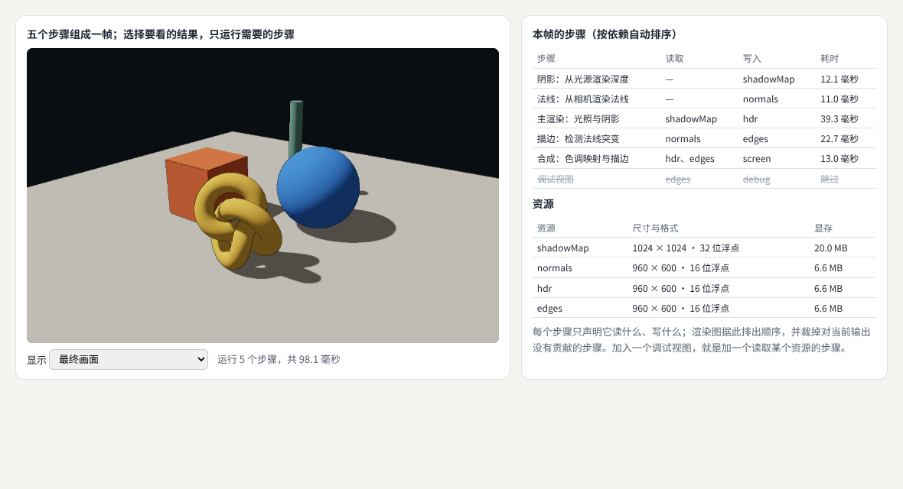

示例：[09-03-rendergraph.html](示例/09-03-rendergraph.html)

| 步骤 | 读取 | 写入 | 耗时 |
| --- | --- | --- | --- |
| 阴影：从光源渲染深度 | — | shadowMap | 12.1 毫秒 |
| 法线：从相机渲染法线 | — | normals | 11.0 毫秒 |
| 主渲染：光照与阴影 | shadowMap | hdr | 39.3 毫秒 |
| 描边：检测法线突变 | normals | edges | 22.7 毫秒 |
| 合成：色调映射与描边 | hdr、edges | screen | 13.0 毫秒 |

渲染图的核心只有二十多行：

```js
compile(output) {
  const need = new Set(), stack = [output];
  // 从要输出的资源倒推：谁写了它？那个步骤又读了什么？
  while (stack.length) {
    const r = stack.pop();
    for (const p of this.passes)
      if (p.writes.includes(r) && !need.has(p)) { need.add(p); stack.push(...p.reads); }
  }
  // 拓扑排序：一个步骤要等它读取的资源都被写好之后才能运行
  const order = [], done = new Set();
  const visit = p => {
    if (done.has(p)) return; done.add(p);
    for (const r of p.reads) for (const q of need) if (q !== p && q.writes.includes(r)) visit(q);
    order.push(p);
  };
  [...need].forEach(visit);
  return order;
}
```

页面下方的下拉框可以选择“要看哪个资源”。选择后，渲染图只运行对它有贡献的步骤：

| 要看的结果 | 运行的步骤 | 本帧耗时 |
| --- | --- | --- |
| 最终画面 | 5 步 | 98—102 毫秒 |
| 只看阴影贴图 | 阴影 ＋ 调试视图，2 步 | 63 毫秒 |
| 只看法线 | 法线 ＋ 调试视图，2 步 | 39 毫秒 |
| 只看光照结果（HDR） | 阴影、主渲染 ＋ 调试视图，3 步 | 65 毫秒 |
| 只看描边 | 法线、描边 ＋ 调试视图，3 步 | 48 毫秒 |

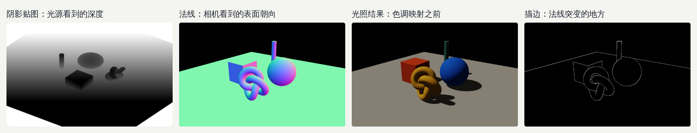

**调试视图就是一个读取某个资源的步骤**：它不改动任何已有步骤，只是把中间结果画到屏幕上。这样就能说清楚“这张图来自哪一步”。

#### 03.4 资源的格式决定内存

示例的资源表也暴露了一个常见的浪费：阴影贴图用了 1024 × 1024 的 RGBA 32 位浮点格式，加上深度缓冲共约 20.0 MB，而阴影只需要一个通道的深度。960 × 600 的半精度目标每张约 6.6 MB。选择渲染目标格式时，先问“这一步要存什么”：只存深度就用深度纹理；颜色在 0—1 之间就用 8 位；需要高动态范围才用半精度浮点。

#### 03.5 反射、后处理也是步骤

- **平面反射**：从镜像位置的相机再画一次场景，写进一张贴图，镜面材质读取它（three.js 的 `Reflector`）。
- **屏幕空间反射**：读取深度、法线和颜色，在画面里沿反射方向查找。它只能反射画面中已有的东西。
- **后处理**：每一个全屏处理都是一个读一张图、写一张图的步骤（[《技术美术与实时效果》](07-技术美术与实时效果.md) 06 章）。

更大的引擎还会区分**前向渲染**（每个物体画一次，直接算光照）与**延迟渲染**（先把位置、法线、材质写进几张贴图，即 G-buffer，再统一计算光照）。后者适合灯光很多的场景，但透明物体和抗锯齿要另外处理。

#### 03.6 常见问题

- **步骤顺序写死在代码里，加一个效果要改很多地方**：改为声明读写，让程序排序。
- **调试时临时改了主渲染的着色器，忘了改回去**：调试视图应当是独立的步骤，而不是修改已有步骤。
- **画面上什么都没有**：逐个查看中间资源。阴影贴图全白通常是光源相机的范围不对；法线全黑通常是步骤没有运行或写错了目标。
- **每一步都很快，加起来却超出预算**：全屏步骤的成本与像素数成正比，分辨率翻倍，所有全屏步骤一起变慢。

**本章练习**：

1. 在示例中加一个“雾”步骤：读取 hdr 和深度，写入 hdrFog，并让合成步骤改读 hdrFog。观察渲染图自动排出的顺序。
2. 把阴影贴图改成只存一个通道，记录显存的变化。

#### 03.7 进阶学习卡

| 级别 | 目标 | 怎样检验 |
| --- | --- | --- |
| L1 入门 | 能说出一帧的步骤及每步的读写 | 画出示例的依赖图 |
| L2 熟练 | 能给已有项目加一个调试视图或后处理步骤 | 完成本章练习 1 |
| L3 进阶 | 能用资源生命周期复用渲染目标，比较前向与延迟渲染 | 显存下降且画面不变 |
| L4 深入 | 能设计带自动资源分配、异步计算的渲染图 | 读懂一篇引擎渲染图的设计说明并复述其取舍 |

- **技术栈**：three.js 的 `WebGLRenderTarget`（[文档](https://threejs.org/docs/pages/WebGLRenderTarget.html)）、`EffectComposer` 与 `Pass`；WebGL 2 的帧缓冲；WebGPU 的渲染通道（render pass）。
- **高阶词汇**：渲染步骤（render pass）、渲染目标（render target）、渲染图／帧图（render graph／frame graph）、资源别名复用（resource aliasing）、G 缓冲（G-buffer）、前向渲染（forward rendering）、延迟渲染（deferred rendering）、分块前向渲染（tiled／clustered forward）、屏幕空间反射（SSR）。
- **搜索关键词**：`render graph frame graph`、`frostbite frame graph`、`deferred vs forward rendering`、`clustered forward shading`、`three.js EffectComposer custom pass`、`渲染图 资源依赖`。
- **值得看的实例**：[three.js 描边后处理](https://threejs.org/examples/webgl_postprocessing_outline.html)——看描边是怎样作为一个独立步骤加入的；[three.js 屏幕空间反射（WebGPU）](https://threejs.org/examples/webgpu_postprocessing_ssr.html)——观察反射只包含画面里可见的物体。

<a id="ch04"></a>

### 04 光照与阴影

#### 04.1 解决什么问题

深入**直接照明**、**间接照明**、**环境光**和**阴影算法**。比较不同方法的**精度**、**噪声**、**内存**和**时间成本**，并把**镜头移动**、**物体运动**和**薄表面**作为测试条件——很多阴影问题只在这三种情况下出现。

#### 04.2 核心概念

- **直接照明**：光从光源直接照到表面。平行光、点光、聚光灯算的都是直接照明。
- **间接照明**：光在其他表面反弹后再照过来。红墙旁边的白墙会泛红，就是间接照明。实时渲染通常用近似方法补上它（环境贴图、光照探针、烘焙光照贴图、环境光遮蔽）。
- **环境光**：最简单的近似是加一个常数亮度；更好的做法是**基于图像的照明**：用一张环境贴图（例如一张 HDR 全景照片）照亮场景，three.js 用 `PMREMGenerator` 把它预处理成不同粗糙度对应的模糊程度。
- **阴影贴图**：从光源的位置画一张深度图；画相机视角时，把每个像素换算到光源视角，比较它的深度与阴影贴图中的深度——更远就说明被挡住了。

阴影贴图的分辨率有限，深度精度也有限，于是有了几种典型问题和对应的滤波方法：

| 方法 | 做法 | 优点 | 代价 |
| --- | --- | --- | --- |
| Basic | 每个像素比较一次 | 最快 | 边缘有锯齿 |
| PCF | 在周围比较多次，取平均 | 边缘柔和 | 比较次数越多越慢 |
| VSM | 保存深度的均值与方差，可以模糊 | 很柔和 | 要额外的贴图和模糊；物体重叠处可能漏光 |
| PCSS | 先估计遮挡物距离，再决定模糊范围 | 接触处锐利、远处柔和 | 每个像素要搜索遮挡物 |
| 级联阴影（CSM） | 按距离把视野分成几段，各用一张阴影贴图 | 大场景近处清楚 | 多画几次深度；段与段之间可能有接缝 |

#### 04.3 示例：同一个场景，六种设置

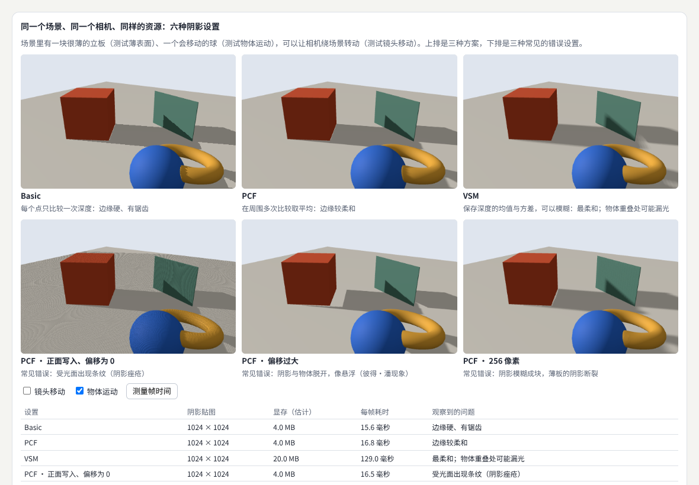

示例：[09-04-shadows.html](示例/09-04-shadows.html)

场景里有一块只有 2 厘米厚的**薄板**、一个会移动的球，相机可以绕场景转动。三次测量的范围如下（软件渲染）：

| 设置 | 阴影贴图 | 显存（估计） | 每帧 | 观察到的问题 |
| --- | --- | --- | --- | --- |
| Basic | 1024 × 1024 | 4.0 MB | 12.9—15.6 毫秒 | 边缘有锯齿 |
| PCF | 1024 × 1024 | 4.0 MB | 14.6—16.8 毫秒 | 边缘较柔和 |
| VSM | 1024 × 1024 | 20.0 MB | 115.6—129.0 毫秒 | 最柔和；重叠处漏光 |
| PCF · 正面写入、偏移为 0 | 1024 × 1024 | 4.0 MB | 14.8—16.5 毫秒 | 受光面布满条纹（阴影痤疮） |
| PCF · 偏移过大 | 1024 × 1024 | 4.0 MB | 15.0—16.1 毫秒 | 阴影与物体脱开，像悬浮 |
| PCF · 256 像素 | 256 × 256 | 0.3 MB | 12.3—14.6 毫秒 | 阴影成块，薄板的阴影断裂 |

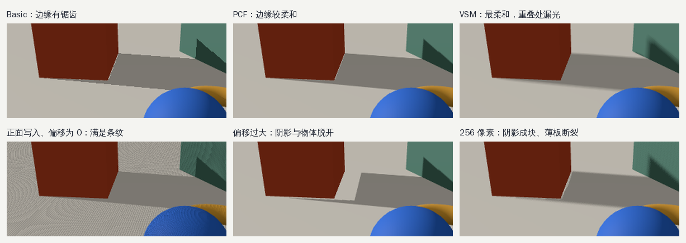

几点观察：

- **阴影痤疮**（shadow acne）：表面和自己的阴影贴图比较深度时，因为精度有限，一部分像素判断为“被自己挡住”，形成条纹。three.js 默认把物体的**背面**写进阴影贴图，大部分情况已经避开；示例改为写入正面（`shadowSide = THREE.FrontSide`）并把偏移设为 0，问题才出现。
- **偏移过大**：为了消除痤疮把深度偏移调得太大，阴影就会从物体脚下“脱开”，这叫**彼得·潘现象**（peter panning）。薄板最容易暴露这个问题。更稳妥的做法是同时使用较小的深度偏移和**法线偏移**（沿表面法线方向挪一点再比较）。
- **VSM 的成本**：在这台测试机上，VSM 要多画两张半精度贴图并做模糊，时间是 PCF 的七倍多、显存是五倍。真实显卡上差距会小，但“多出模糊步骤”的结构性成本不会消失。
- **分辨率不够**：256 像素的阴影贴图覆盖 14 米宽的范围，每个像素约 5 厘米，2 厘米的薄板就会“时有时无”。

#### 04.4 把三种情况当作测试条件

- **镜头移动**：阴影边缘随着相机移动而闪烁（像素在阴影贴图中的位置不断变化）。级联阴影常把阴影相机的位置对齐到阴影贴图的像素网格上，减少闪烁。
- **物体运动**：实时阴影每帧重画，物体动阴影跟着动；烘焙阴影只计算一次，物体一动就不对了（11 章）。
- **薄表面**：检查偏移是否让薄物体的阴影消失或脱开，检查光线是否从缝隙漏过来。

#### 04.5 常见问题

- **阴影只有一部分，像被切掉了**：阴影相机的范围（`shadow.camera` 的 left、right、top、bottom）没有覆盖到物体。用 `CameraHelper` 把范围画出来。
- **阴影很模糊、成块**：阴影相机的范围太大或贴图太小。先缩小范围，再考虑加大贴图。
- **出现条纹**：加一点 `bias` 或 `normalBias`，并确认没有误改 `shadowSide`。
- **软阴影的边缘有颗粒感**：采样次数少的柔化方法会产生噪声，可以增加采样或在时间上累积。

**本章练习**：

1. 在示例中给 PCF 设置加入 `normalBias = 0.02`，偏移设为 0，观察条纹是否消失、薄板阴影是否仍然贴着板。
2. 打开“镜头移动”，比较 Basic 与 PCF 边缘的闪烁程度。

#### 04.6 进阶学习卡

| 级别 | 目标 | 怎样检验 |
| --- | --- | --- |
| L1 入门 | 能为场景开启阴影并调整阴影相机范围 | 阴影完整、不被切掉 |
| L2 熟练 | 能诊断痤疮、悬浮、成块，并用偏移与分辨率修正 | 完成本章练习 |
| L3 进阶 | 能为大场景配置级联阴影，为产品展示选择 PCSS 或接触阴影 | 用 11 章的方法给出带条件的比较 |
| L4 深入 | 能实现一种新的阴影滤波或虚拟阴影贴图，并分析其误差 | 与参考图做误差比较 |

- **技术栈**：three.js 的 `LightShadow`（[文档](https://threejs.org/docs/pages/LightShadow.html)）、`CSM` 附加模块、`PMREMGenerator`、`RectAreaLight`；WebGL 2 深度纹理与比较采样。
- **高阶词汇**：直接照明（direct lighting）、间接照明（indirect lighting）、全局光照（global illumination）、基于图像的照明（image-based lighting, IBL）、阴影贴图（shadow mapping）、阴影痤疮（shadow acne）、彼得·潘现象（peter panning）、法线偏移（normal offset）、百分比渐近过滤（percentage-closer filtering, PCF）、方差阴影贴图（variance shadow maps, VSM）、PCSS（percentage-closer soft shadows）、级联阴影贴图（cascaded shadow maps, CSM）、光照探针（light probe）、环境光遮蔽（ambient occlusion）。
- **搜索关键词**：`shadow acne peter panning normal bias`、`cascaded shadow maps stabilization`、`PCSS soft shadows`、`variance shadow maps light bleeding`、`three.js CSM`、`阴影贴图 偏移`。
- **值得看的实例**：[three.js 级联阴影](https://threejs.org/examples/webgl_shadowmap_csm.html)——拉远相机，观察近处与远处的阴影清晰度；[PCSS 软阴影](https://threejs.org/examples/webgl_shadowmap_pcss.html)——看接触处与远处的柔和度差别；[VSM 阴影](https://threejs.org/examples/webgl_shadowmap_vsm.html)；[阴影贴图查看器](https://threejs.org/examples/webgl_shadowmap_viewer.html)——直接看到阴影贴图本身。
- **资料**：Learn OpenGL 的阴影映射教程一步步实现并修正痤疮与悬浮[B01](#ref-b01)；微软的《改进阴影深度贴图的常用技术》系统讲解了偏移、范围贴合与级联[B02](#ref-b02)。

<a id="ch05"></a>

### 05 材质与颜色管理

#### 05.1 解决什么问题

研究**表面反射**、**透明**、**体积介质**和**色彩转换**。理解**线性空间**与显示输出之间的关系，让**纹理**、**灯光**和**后处理正确配合**。一个重要的经验是：**视觉问题有时来自颜色流程，而不是参数大小**——画面发灰、发暗、颜色不对，先检查颜色流程，再去调灯光和材质。

#### 05.2 核心概念

- **表面反射**：现在常用的“基于物理的材质”（PBR）用几个参数描述表面：基础颜色、金属度、粗糙度。光照到表面，一部分在表面直接反射（高光），一部分进入表面后散射出来（漫反射）。金属几乎没有漫反射，所以没有环境贴图时，金属看起来会发黑（10 章的示例遇到过）。
- **线性空间**：光的叠加是线性的，两盏灯的亮度应当直接相加。但图片文件里的颜色值是按 **sRGB** 编码的，为了让暗部有更多级数，数值与亮度不成正比。所以：**颜色贴图读入时要从 sRGB 解码到线性，光照在线性空间里计算，最后再编码回 sRGB 输出到屏幕。**
- **数据贴图不转换**：法线贴图、粗糙度贴图存的是数据，不是颜色，不能做 sRGB 解码。
- **色调映射**：光照计算的结果可以远大于 1（太阳、发光体），屏幕只能显示 0—1。色调映射把高动态范围压缩到屏幕范围内，同时尽量保持颜色关系。

three.js 中对应的设置是：颜色贴图 `texture.colorSpace = THREE.SRGBColorSpace`；输出 `renderer.outputColorSpace = THREE.SRGBColorSpace`（默认值）；色调映射 `renderer.toneMapping`。[B03](#ref-b03)

#### 05.3 示例：颜色流程、色调映射与透明

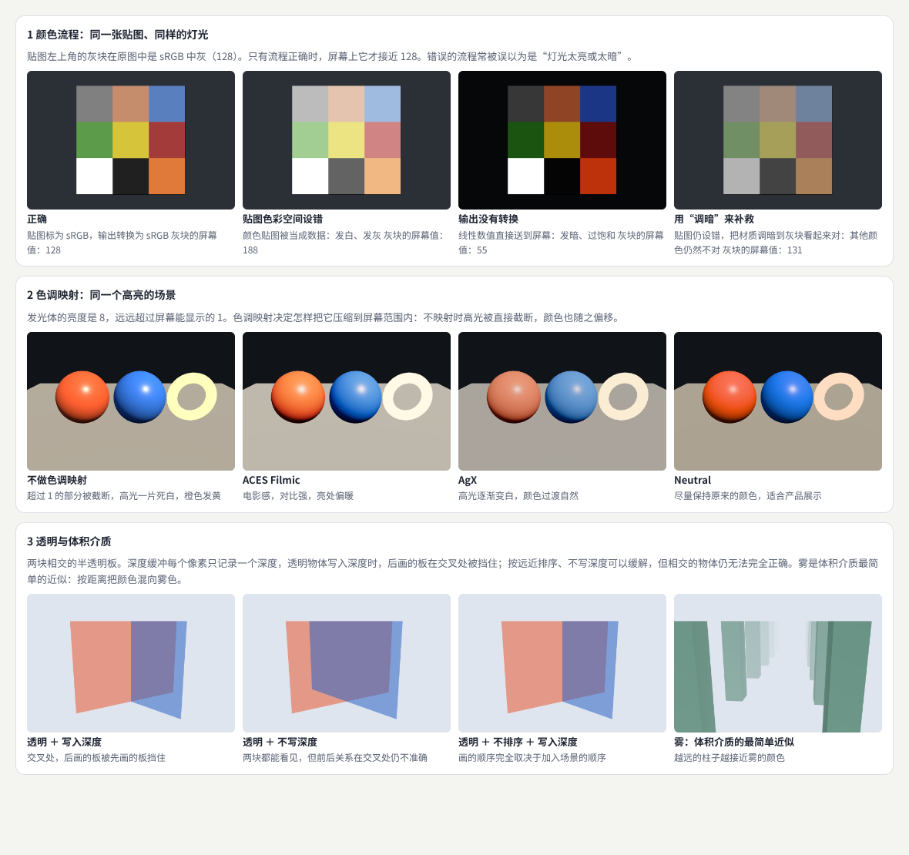

示例：[09-05-color.html](示例/09-05-color.html)

色卡左上角的灰块在原图中是 sRGB 中灰（128）。示例读出它在屏幕上的数值：

| 颜色流程 | 灰块的屏幕值 | 看起来 |
| --- | --- | --- |
| 正确：贴图标为 sRGB，输出转换为 sRGB | 128 | 与原图一致 |
| 贴图色彩空间设错：颜色贴图被当成数据 | 188 | 发白、发灰 |
| 输出没有转换：线性数值直接送到屏幕 | 55 | 发暗、过饱和 |
| 用“调暗”补救：贴图仍设错，把材质调暗 | 131 | 灰块对了，其他颜色仍然不对 |

第四种情况最值得注意：只盯着一个颜色调参数，可以把它“调对”，但整张图的颜色关系仍然是错的。**流程错误不能靠参数补救。**

第二行比较了四种色调映射。不做色调映射时，超过 1 的部分被直接截断，发光的圆环一片死白，橙色发黄；ACES Filmic 对比强、亮处偏暖；AgX 让高光逐渐变白，过渡自然；Neutral 尽量保持原来的颜色，适合产品展示。选择哪一种是艺术决定，但**一定要选一种**，并让整个项目保持一致。

#### 05.4 透明与体积介质

深度缓冲每个像素只记录一个深度，而透明需要“看到后面的东西”，二者天然冲突：

| 设置 | 结果 |
| --- | --- |
| 透明 ＋ 写入深度 | 交叉处，后画的板被先画的板挡住 |
| 透明 ＋ 不写深度 ＋ 按远近排序 | 两块都能看见，但交叉处的前后关系仍不准确 |
| 透明 ＋ 不排序 ＋ 写入深度 | 画的顺序完全取决于加入场景的顺序 |

常用的对策是：透明物体不写深度、按远近从后往前画（three.js 默认会排序）；能用**透明裁切**（alpha test，像素要么完全不透明、要么完全透明）就不用半透明；物体相交或层数很多时，考虑**与顺序无关的透明**（OIT）方法，例如加权混合 OIT。[B04](#ref-b04)

**体积介质**是充满空间的半透明物质：雾、烟、云、水下。最简单的近似是**雾**：按距离把颜色混向雾色（示例第三行最后一张）。更真实的做法是**光线步进**（ray marching）：沿视线一小步一小步地累积吸收和散射，成本高得多。

#### 05.5 后处理要放在正确的位置

辉光、景深等后处理要读取**线性、高动态范围**的画面，最后才做色调映射和 sRGB 编码。如果先做了色调映射再做辉光，亮部已经被压缩，辉光会显得灰暗。three.js 的后处理链在最后用 `OutputPass` 统一完成色调映射与颜色转换。

#### 05.6 常见问题

- **整个画面发灰、像蒙了一层雾**：颜色贴图没有标为 sRGB，或者做了两次 sRGB 编码。
- **画面很暗，调亮灯光后高光又爆掉**：输出没有转换，或者没有色调映射。
- **从设计稿取的颜色在三维里不一样**：材质颜色要按 sRGB 解释（three.js 默认如此），而光照、色调映射也会改变最终颜色；对照时关掉色调映射，或者用不受光照影响的材质比较。
- **半透明物体闪烁**：两个透明物体距离接近，排序结果每帧变化。可以手动设置 `renderOrder`。

**本章练习**：

1. 把示例第二行的发光强度从 8 改为 2 和 30，比较四种色调映射的差别。
2. 在第三行加入第三块板，观察“不写深度 ＋ 排序”在三块板相交时的问题。

#### 05.7 进阶学习卡

| 级别 | 目标 | 怎样检验 |
| --- | --- | --- |
| L1 入门 | 能正确设置颜色贴图、数据贴图与输出的色彩空间 | 灰块的屏幕值为 128 |
| L2 熟练 | 能为项目选定色调映射与曝光，处理常见的透明排序问题 | 完成本章练习 |
| L3 进阶 | 能解释 PBR 参数的物理含义，用环境贴图与参考照片对照调材质 | 同一材质在三种光照下都合理 |
| L4 深入 | 能实现与顺序无关的透明或体积光照，并说明其近似误差 | 与参考渲染比较 |

- **技术栈**：three.js 的颜色管理（`ColorManagement`、`colorSpace`、`outputColorSpace`）、`MeshStandardMaterial`／`MeshPhysicalMaterial`、`toneMapping`、`OutputPass`；glTF 2.0 的金属度—粗糙度材质。
- **高阶词汇**：基于物理的渲染（physically based rendering, PBR）、双向反射分布函数（BRDF）、菲涅耳效应（Fresnel effect）、能量守恒（energy conservation）、线性工作流（linear workflow）、sRGB 传递函数（sRGB transfer function）、高动态范围（HDR）、色调映射（tone mapping）、曝光（exposure）、色域（color gamut）、透明裁切（alpha test）、与顺序无关的透明（order-independent transparency, OIT）、参与介质（participating media）、光线步进（ray marching）。
- **搜索关键词**：`linear workflow sRGB texture colorspace`、`three.js color management`、`AgX tone mapping`、`Khronos PBR Neutral`、`weighted blended order-independent transparency`、`volumetric fog ray marching`、`线性空间 色彩管理`。
- **值得看的实例**：[three.js 色调映射对比](https://threejs.org/examples/webgl_tonemapping.html)——切换方法，观察高光与饱和度；[透射材质](https://threejs.org/examples/webgl_materials_physical_transmission.html)——观察透明材质与环境的关系；[体积云（WebGPU）](https://threejs.org/examples/webgpu_volume_cloud.html)——观察光线步进的体积效果。
- **资料**：Filament 的材质文档完整推导了实时 PBR 的公式与参数含义[B05](#ref-b05)；Khronos 的 PBR Neutral 色调映射说明了“尽量保持原色”的设计目标[B06](#ref-b06)。

<a id="ch06"></a>

### 06 场景结构与可见性

#### 06.1 解决什么问题

管理**场景层级**、**包围体**、**裁剪**、**实例化**和**细节层次**。核心是**让计算集中到当前画面需要的内容上**，同时保持变化平滑，避免细节切换突兀。

#### 06.2 核心概念

- **场景层级**：物体按父子关系组织，子物体随父物体移动（一辆车和它的四个轮子）。层级也是组织可见性的天然单位。
- **包围体**：用一个简单形状（球或长方体）包住物体。判断“在不在画面里”时，先测包围体，比测每个三角形快得多。
- **视锥剔除**：相机能看到的空间是一个截头的四棱锥（视锥）。包围体完全在视锥外的物体直接跳过。three.js 默认对每个物体做这一步。
- **遮挡剔除**：被其他物体完全挡住的东西也不画。它比视锥剔除复杂，通常需要 GPU 的遮挡查询或预先计算。
- **实例化**：同一个模型画很多份（树、楼、粒子）时，一次绘制调用画出全部副本，每份只有自己的位置、颜色等少量数据。
- **细节层次**（LOD）：远处的物体用更简单的模型。为了避免在切换距离附近来回跳动，切换要有**迟滞**：远离到一个距离才换成简单模型，靠近到另一个更近的距离才换回来。

#### 06.3 示例：4096 栋楼的三种组织方式

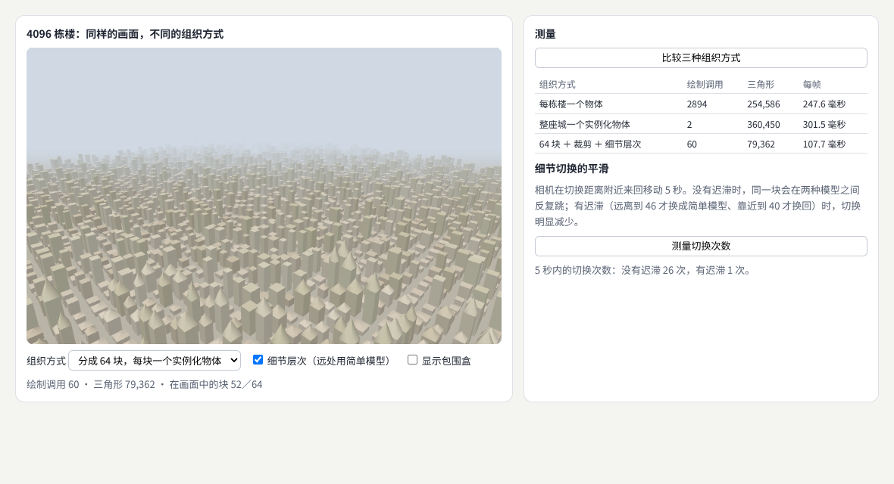

示例：[09-06-visibility.html](示例/09-06-visibility.html)

| 组织方式 | 绘制调用 | 三角形 | 每帧（软件渲染） |
| --- | --- | --- | --- |
| 每栋楼一个物体 | 2894 | 254,586 | 247.6 毫秒 |
| 整座城一个实例化物体 | 2 | 360,450 | 301.5 毫秒 |
| 分成 64 块 ＋ 视锥剔除 ＋ 细节层次 | 60 | 79,362 | 107.7 毫秒 |

读这张表要看两个方向：

- **每栋楼一个物体**：4096 栋中约 1200 栋被视锥剔除，剩下的楼每栋一次绘制调用（加上地面共 2894 次），CPU 的提交成本很高。
- **整座城一个实例化物体**：绘制调用降到 2 次（城市与地面），但整座城是一个物体，只能整体剔除——视野外的楼也全部画了，三角形反而最多。在这台用软件模拟 GPU 的机器上，三角形数量的代价超过了绘制调用节省的时间，所以它最慢；在真实显卡上，它通常比第一种快，但仍然浪费了视野外的计算。
- **分块**：把城市分成 64 块，每块一个实例化物体，有自己的包围体；远处的块换成简单模型。绘制调用和三角形都降下来了。按包围盒计算，视野内有 52 块；three.js 剔除时用的是包围球，它比包围盒松，所以实际画了 59 块，加上地面共 60 次调用。**包围体越贴合，剔除越精确。**

**分块是在“少提交”和“少画”之间取平衡**：块太大，剔除不精细；块太小，又回到绘制调用过多。

#### 06.4 细节切换的平滑

相机在切换距离附近来回移动 5 秒：没有迟滞时，同一块在两种模型之间切换了 26 次，画面不停闪动；有迟滞（远离到 46 才换成简单模型、靠近到 40 才换回）时只切换了 1 次。更平滑的做法还有：切换时用半透明或抖动图案做短暂的**交叉淡化**；让简单模型与精细模型的轮廓尽量一致。

#### 06.5 常见问题

- **物体在画面边缘突然消失**：包围体没有更新。用顶点动画改变了形状的物体，需要重新计算包围体或关闭剔除（`frustumCulled = false`）。
- **实例化后性能没有提升**：瓶颈可能在像素而不在绘制调用（09 章），或者所有实例都在视野外也照样被画了。
- **远处的模型切换时“跳”一下**：加迟滞，或者让切换发生在物体足够小的时候。
- **需要不同形状的物体也合并绘制**：three.js 的 `BatchedMesh` 可以把不同几何体放在一次绘制中，并对每个实例单独剔除。[B07](#ref-b07)

**本章练习**：

1. 把示例的分块从 64 改为 16 和 256，记录绘制调用、三角形和帧时间，找出这台设备上最合适的块数。
2. 把迟滞的两个距离改为 42／44，再测一次切换次数。

#### 06.6 进阶学习卡

| 级别 | 目标 | 怎样检验 |
| --- | --- | --- |
| L1 入门 | 能用实例化画大量相同物体，读懂绘制调用与三角形统计 | 在 `renderer.info` 中看到绘制调用下降 |
| L2 熟练 | 能按空间分块，并配置带迟滞的细节层次 | 完成本章练习 |
| L3 进阶 | 能用层次包围体加速拾取与剔除，使用 `BatchedMesh` | 拾取与剔除时间随物体数近似对数增长 |
| L4 深入 | 能实现 GPU 驱动的剔除（在 GPU 上决定画什么） | 绘制调用不随物体数增长 |

- **技术栈**：three.js 的 `InstancedMesh`（[文档](https://threejs.org/docs/pages/InstancedMesh.html)）、`BatchedMesh`、`LOD`（[文档](https://threejs.org/docs/pages/LOD.html)）、`Frustum`、`Box3`；three-mesh-bvh（层次包围体加速库）[B08](#ref-b08)。
- **高阶词汇**：场景图（scene graph）、包围球（bounding sphere）、轴对齐包围盒（AABB）、视锥剔除（frustum culling）、遮挡剔除（occlusion culling）、层次深度缓冲（Hi-Z）、层次包围体（bounding volume hierarchy, BVH）、八叉树（octree）、实例化（instancing）、批处理（batching）、细节层次（level of detail, LOD）、迟滞（hysteresis）、交叉淡化（cross-fade）、GPU 驱动渲染（GPU-driven rendering）。
- **搜索关键词**：`three.js InstancedMesh frustum culling`、`BatchedMesh per instance culling`、`LOD hysteresis popping`、`Hi-Z occlusion culling`、`GPU driven rendering pipeline`、`three-mesh-bvh raycast`、`遮挡剔除`。
- **值得看的实例**：[实例化性能对比](https://threejs.org/examples/webgl_instancing_performance.html)——切换合并、实例化、独立物体三种方式；[细节层次](https://threejs.org/examples/webgl_lod.html)；[BatchedMesh 与层次包围体](https://threejs.org/examples/webgl_batch_lod_bvh.html)——大量不同物体的剔除与细节层次；[遮挡剔除（WebGPU）](https://threejs.org/examples/webgpu_occlusion.html)。

<a id="ch07"></a>

### 07 资源加载与内存

#### 07.1 解决什么问题

规划**纹理**、**模型**、**缓冲区**、**压缩**和**缓存**。研究**按需加载**、**资源复用**、**释放**与**重新加载**。在**长时间运行**、**频繁切换场景**和**设备资源不足时**，程序也需要有可预期的行为。

#### 07.2 核心概念

- **显存估算**：一张贴图在 GPU 上大约占用“宽 × 高 × 4”字节，生成多级渐远纹理（mipmap）再多三分之一。一张 4096 × 4096 的贴图约 64 MB，加上多级渐远纹理约 85 MB。
- **文件大小不等于显存**：JPEG、PNG 只在下载时是压缩的，上传到 GPU 前要解码成原始像素。1 MB 的 JPEG 可能占几十 MB 显存。**GPU 压缩纹理格式**（通过 KTX2 容器与 Basis Universal 编码分发，在设备上转成该设备支持的 BC、ETC 或 ASTC 格式）在显存中也保持压缩，通常只占原始大小的四分之一到八分之一。[B09](#ref-b09)
- **模型压缩**：glTF 模型可以用 Draco 或 meshoptimizer 压缩几何数据，减少下载量；顶点数据还可以量化（用更少的位数存储）。
- **释放**：从场景中移除物体**不会**释放它的 GPU 资源。three.js 中要显式调用几何体、材质、贴图和渲染目标的 `dispose()`。[B10](#ref-b10)
- **复用与缓存**：几个场景共用的贴图只加载一次；最近用过的场景保留一段时间，切回来时不必重新加载。
- **上下文丢失**：显存不足、驱动重置或系统休眠时，浏览器可能收回 WebGL 上下文，GPU 上的所有资源都会失效。页面要监听 `webglcontextlost` 和 `webglcontextrestored` 事件，暂停绘制，恢复后重新上传资源。[B11](#ref-b11)

#### 07.3 示例：三个展厅来回切换

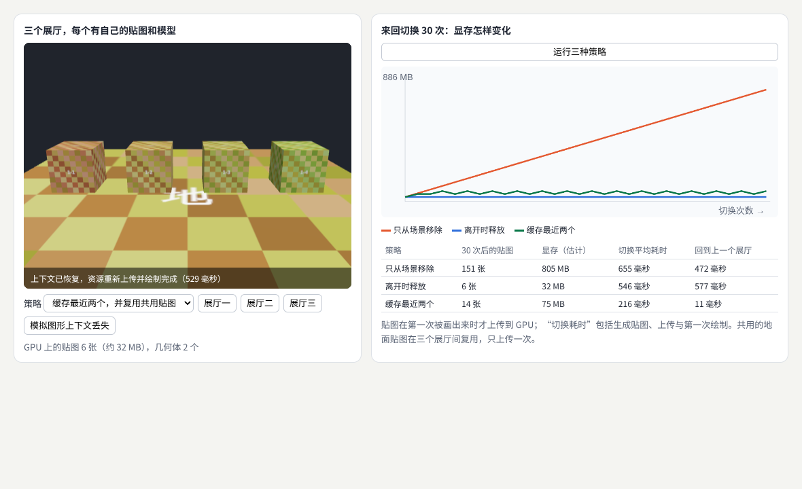

示例：[09-07-resources.html](示例/09-07-resources.html)

每个展厅有 4 张 1024 × 1024 的贴图和几个模型，三个展厅共用一张地面贴图。在三个展厅之间来回切换 30 次：

| 策略 | 30 次后的贴图 | 显存（估计） | 切换平均耗时 | 回到上一个展厅 |
| --- | --- | --- | --- | --- |
| 只从场景移除 | 151 张 | 约 805 MB | 655 毫秒 | 472 毫秒 |
| 离开时释放 | 6 张 | 约 32 MB | 546 毫秒 | 577 毫秒 |
| 缓存最近两个，并复用共用贴图 | 14 张 | 约 75 MB | 216 毫秒 | 11 毫秒 |

- **只从场景移除**：每次切换都新建贴图，旧的从未释放，显存一路上涨。在内存小的设备上，这会导致上下文丢失或标签页崩溃。另一次测量中切换平均耗时为 482 毫秒，但显存的增长趋势完全相同。
- **离开时释放**：显存稳定，但每次切换都要重新生成和上传，回到刚离开的展厅也一样慢。
- **缓存**：多占一些显存，换来切回时几乎即时（11 毫秒）。缓存的大小要有上限（示例只留最近两个），超出时释放最久没用的那个——这就是 **LRU**（最近最少使用）策略。

点击“模拟图形上下文丢失”后，示例暂停绘制；上下文恢复后，three.js 重新初始化，并在下一次绘制时用仍保存在内存中的图片重新上传贴图，用时 519—529 毫秒。**如果原始图片已经被释放，就要重新下载或重新生成**，所以需要决定哪些数据在 CPU 一侧保留副本。

#### 07.4 按需加载与长时间运行

- **按需加载**：先加载首屏需要的低精度资源，用户靠近或停留时再加载高精度版本（渐进式加载）。
- **预算**：给贴图、模型分别设定显存上限，加载新资源前先检查。
- **长时间运行**：定时记录 `renderer.info.memory` 中的贴图与几何体数量。数量只升不降，就是泄漏（10 章的诊断面板）。
- **解码不阻塞主线程**：用 `createImageBitmap` 在后台解码图片，避免切换时界面卡住。

#### 07.5 常见问题

- **切换几次后页面越来越卡，最后崩溃**：资源没有释放。检查是否只是从场景中移除了物体。
- **调用了 `dispose()`，显存数字还是没降**：同一张贴图还被别的材质引用着，或者释放后又被画了一次（再次上传）。10 章用引用计数解决这个问题。
- **切换时画面卡住一两秒**：生成、解码与上传集中在一帧完成。分帧上传，或者先显示低精度版本。
- **手机上贴图模糊**：设备的最大贴图尺寸或显存限制更小，加载器降级了。要为不同档位准备不同尺寸的资源。

**本章练习**：

1. 把示例的缓存上限改为 1 和 3，记录显存与“回到上一个展厅”的时间，画出二者的取舍曲线。
2. 计算：如果展厅的 4 张贴图改为 2048 × 2048，“缓存最近两个”策略大约要多少显存？

#### 07.6 进阶学习卡

| 级别 | 目标 | 怎样检验 |
| --- | --- | --- |
| L1 入门 | 能估算贴图显存，正确调用 `dispose()` | 切换 30 次后贴图数量不增长 |
| L2 熟练 | 能实现共用资源与有上限的缓存，处理上下文丢失 | 完成本章练习，丢失后能恢复 |
| L3 进阶 | 能建立资源管线：压缩纹理、模型压缩、按档位分发 | 下载量与显存都有明确预算并被检查 |
| L4 深入 | 能实现流式加载与虚拟纹理，按视野与距离调度资源 | 在固定显存预算内浏览远大于预算的场景 |

- **技术栈**：three.js 的 `KTX2Loader`（[文档](https://threejs.org/docs/pages/KTX2Loader.html)）、`GLTFLoader` 配合 `DRACOLoader`／`MeshoptDecoder`、`dispose()`、`renderer.info.memory`；glTF Transform（命令行处理与压缩 glTF）[B12](#ref-b12)；`createImageBitmap`；HTTP 缓存。
- **高阶词汇**：多级渐远纹理（mipmap）、GPU 压缩纹理（GPU texture compression）、块压缩格式（BCn、ETC2、ASTC）、超压缩（supercompression）、几何压缩（Draco、meshopt）、顶点量化（quantization）、引用计数（reference counting）、最近最少使用（LRU）、渐进式加载（progressive loading）、流式加载（streaming）、虚拟纹理（virtual texturing）、上下文丢失（context loss）。
- **搜索关键词**：`KTX2 Basis Universal three.js`、`gltf-transform optimize`、`three.js dispose memory leak`、`webglcontextlost restore`、`texture streaming virtual texturing`、`压缩纹理 显存`。
- **值得看的实例**：[KTX2 压缩纹理](https://threejs.org/examples/webgl_loader_texture_ktx2.html)——比较不同编码的画质；[glTF 渐进式细节层次](https://threejs.org/examples/webgl_loader_gltf_progressive_lod.html)——先显示粗模型、再逐步换成精细模型。

<a id="ch08"></a>

### 08 GPU 并行计算

#### 08.1 解决什么问题

理解**线程**、**工作组**、**数据布局**、**同步**和**带宽**。选择适合并行的问题，例如**粒子更新**和**图像处理**。并行化需要考虑**数据搬运与同步成本**，并**通过测量判断收益**——不是所有计算搬到 GPU 都会变快。

#### 08.2 核心概念

GPU 有成千上万个简单的计算单元，适合“对很多数据做同样的事”。WebGPU 的**计算着色器**让我们直接使用这种能力，不必借道画三角形。[B13](#ref-b13)

- **线程**（invocation）：计算着色器的一次执行，通常处理一个数据元素。
- **工作组**（workgroup）：一组线程，大小在着色器里用 `@workgroup_size` 声明。同组线程可以共享一块快速的**工作组内存**，并用**屏障**互相等待。
- **派发**（dispatch）：一次启动多少个工作组。线程总数 ＝ 工作组数 × 工作组大小。
- **数据布局**：同一组线程同时读取相邻地址时，GPU 可以把它们合并成少数几次内存访问。所以“每个粒子的所有字段挨着放”（AoS，结构体数组）和“每个字段单独成一个连续数组”（SoA，数组的结构体）性能可能不同。
- **同步**：很多线程写同一个位置时要用**原子操作**；工作组内的线程要等彼此完成某一步，要用 `workgroupBarrier()`。
- **带宽与搬运**：数据从 CPU 上传到 GPU、结果再读回 CPU，都要花时间。

#### 08.3 示例：直方图、粒子与搬运成本

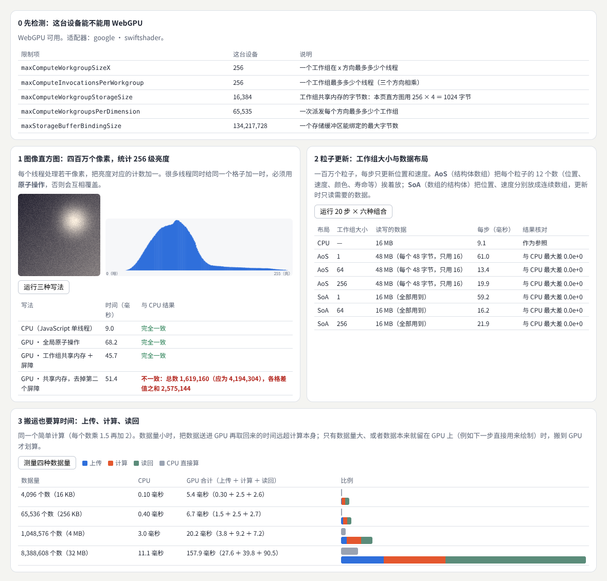

示例：[09-08-compute.html](示例/09-08-compute.html)

页面先检测 WebGPU：没有 `navigator.gpu`、不是安全上下文、找不到适配器时，分别给出说明，只运行 CPU 部分。测试环境的适配器是软件实现的 SwiftShader：一个工作组最多 256 个线程，工作组共享内存 16,384 字节，一个存储缓冲区最大 128 MiB。

**实验 1：四百万像素的亮度直方图**。每个线程处理若干像素，给亮度对应的计数加一。亮度用整数系数计算（54 ＋ 183 ＋ 19 ＝ 256），GPU 与 CPU 能得到完全相同的结果，便于核对。

| 写法 | 时间 | 与 CPU 结果 |
| --- | --- | --- |
| CPU（JavaScript 单线程） | 9.0 毫秒 | 作为参照 |
| GPU · 全局原子操作 | 68.2 毫秒 | 完全一致 |
| GPU · 工作组共享内存 ＋ 屏障 | 45.7 毫秒 | 完全一致 |
| GPU · 共享内存，去掉第二个屏障 | 51.4 毫秒 | **不一致**：总数 1,619,160，应为 4,194,304 |

```wgsl
var<workgroup> local: array<atomic<u32>, 256>;   // 工作组内共享，只有组内线程能看到
@compute @workgroup_size(WG)
fn main(@builtin(global_invocation_id) gid: vec3u, @builtin(local_invocation_index) li: u32,
        @builtin(num_workgroups) nw: vec3u) {
  for (var b = li; b < 256u; b += WG) { atomicStore(&local[b], 0u); }
  workgroupBarrier();                              // 等全组清零完毕
  for (var i = gid.x; i < arrayLength(&pixels); i += nw.x * WG) {
    atomicAdd(&local[luma(pixels[i])], 1u);        // 只和本组的线程争抢
  }
  workgroupBarrier();                              // 等全组统计完毕，再合并
  for (var b = li; b < 256u; b += WG) {
    let c = atomicLoad(&local[b]);
    if (c > 0u) { atomicAdd(&bins[b], c); }        // 每组只向全局写 256 次
  }
}
```

- **共享内存减少争抢**：所有线程都向同一组 256 个全局计数做原子加，互相等待；先在组内统计，再每组合并一次，减少了全局争抢，时间从 68.2 降到 45.7 毫秒。
- **屏障不能省**：去掉第二个 `workgroupBarrier()` 后，一部分线程在别的线程还没统计完时就开始合并，结果少了一大半。这类错误**不会报错**，只能靠与 CPU 结果核对发现。
- **软件模拟的 GPU 比 CPU 慢**：这里的“GPU”其实在 CPU 上模拟执行，所以比 JavaScript 还慢。在真实显卡上，比较的结论要重新测量。

**实验 2：一百万个粒子**。每步只更新位置和速度（重力、移动、碰到边界反弹），运行 20 步，与 CPU 的结果逐个比较：

| 布局 | 工作组大小 1 | 64 | 256 | 与 CPU 最大差 |
| --- | --- | --- | --- | --- |
| AoS（每个粒子 48 字节，只用 16） | 61.0 毫秒 | 13.4 毫秒 | 19.9 毫秒 | 0 |
| SoA（只读需要的数组） | 59.2 毫秒 | 16.2 毫秒 | 21.9 毫秒 | 0 |

- **工作组大小为 1 时慢了约四倍**：每个工作组只有一个线程，硬件的并行宽度被浪费。工作组大小通常取 64 或 256 这样的值，最佳值要在目标设备上测。
- **两种布局在这里差别不大**：软件模拟在 CPU 上执行，48 字节的结构体落在同一条缓存行里，读取它和读取两个紧凑数组的成本相近；把结构体扩大到 128 字节再测，结果也一样。在独立显卡上，同一组线程读取相邻地址会被合并成少数几次内存访问，只读部分字段时 SoA 通常明显更快。[B14](#ref-b14) **这正是要在目标设备上测量的原因**：在一台设备上得出的布局结论，不能直接推广到另一台。

**实验 3：搬运也要算时间**。同一个简单计算（每个数乘 1.5 再加 2）：

| 数据量 | CPU 直接算 | GPU：上传 ＋ 计算 ＋ 读回 |
| --- | --- | --- |
| 4,096 个数（16 KB） | 0.1 毫秒 | 0.3 ＋ 2.5 ＋ 2.6 ＝ 5.4 毫秒 |
| 65,536 个数（256 KB） | 0.4 毫秒 | 1.5 ＋ 2.5 ＋ 2.7 ＝ 6.7 毫秒 |
| 1,048,576 个数（4 MB） | 3.0 毫秒 | 3.8 ＋ 9.2 ＋ 7.2 ＝ 20.2 毫秒 |
| 8,388,608 个数（32 MB） | 11.1 毫秒 | 27.6 ＋ 39.8 ＋ 90.5 ＝ 157.9 毫秒 |

即使在真实显卡上计算本身快得多，**上传和读回的固定成本**也不会消失。所以 GPU 计算最适合：数据量大、计算量大，而且**结果留在 GPU 上直接用于绘制**的任务（例如粒子位置直接给顶点着色器读取，见[《生成艺术与物理仿真》](08-生成艺术与物理仿真.md) 12 章），而不是“算完再读回 CPU”。

#### 08.4 常见问题

- **结果偶尔不对，而且每次不一样**：缺少原子操作或屏障，线程之间发生了竞争。
- **派发报错**：每个方向的工作组数有上限（这台设备为 65,535）。用“网格跨步循环”让每个线程处理多个元素，或者使用二维派发。
- **计时显示 0 毫秒**：提交命令后立刻计时，GPU 还没有执行。要等 `queue.onSubmittedWorkDone()`，或者使用时间戳查询。[B15](#ref-b15)
- **浏览器支持 WebGPU，却拿不到适配器**：驱动不在许可名单中或被禁用。要准备 WebGL 或 CPU 的替代路径。

**本章练习**：

1. 把直方图的工作组大小改为 64，比较全局原子与共享内存两种写法的时间。
2. 在实验 3 中增加“计算 10 次再读回”，观察计算与搬运的比例怎样变化。

#### 08.5 进阶学习卡

| 级别 | 目标 | 怎样检验 |
| --- | --- | --- |
| L1 入门 | 能写出一个计算着色器，检测支持情况并降级 | 不支持时页面仍可用 |
| L2 熟练 | 能正确使用原子操作、工作组内存与屏障，并与 CPU 结果核对 | 结果逐项一致 |
| L3 进阶 | 能用时间戳查询分段计时，按设备选择工作组大小与数据布局 | 给出两台设备的对比数据 |
| L4 深入 | 能实现前缀和、排序、归约等并行原语，用于剔除或模拟 | 与 CPU 版本比较正确性与加速比 |

- **技术栈**：WebGPU（`GPUDevice`、`createComputePipeline`、`dispatchWorkgroups`、`mapAsync`）与 WGSL；three.js 的 `WebGPURenderer` 与节点材质（TSL）中的计算节点；WebGL 2 下的替代：渲染到浮点纹理（`GPUComputationRenderer`）。
- **高阶词汇**：计算着色器（compute shader）、线程（invocation）、工作组（workgroup）、子组（subgroup）、派发（dispatch）、工作组内存（workgroup memory）、屏障（barrier）、原子操作（atomic operation）、竞争条件（race condition）、合并访存（memory coalescing）、结构体数组与数组的结构体（AoS／SoA）、占用率（occupancy）、并行归约（parallel reduction）、前缀和（prefix sum／scan）、双调排序（bitonic sort）、时间戳查询（timestamp query）。
- **搜索关键词**：`WebGPU compute shader tutorial`、`WGSL workgroupBarrier atomic histogram`、`memory coalescing AoS vs SoA`、`GPU prefix sum`、`WebGPU timestamp-query`、`计算着色器 工作组`。
- **值得看的实例**：[GPU 计算粒子（WebGPU）](https://threejs.org/examples/webgpu_compute_particles.html)——数十万个粒子在 GPU 上更新；[双调排序（WebGPU）](https://threejs.org/examples/webgpu_compute_sort_bitonic.html)——观察排序的每一轮；[鸟群（WebGL 渲染到纹理）](https://threejs.org/examples/webgl_gpgpu_birds.html)——没有计算着色器时的替代做法。
- **资料**：WebGPU Fundamentals 的计算着色器与直方图两课逐步讲解了本章的写法[B16](#ref-b16)；MDN 的 WebGPU 页面说明了浏览器支持情况[B13](#ref-b13)。

<a id="ch09"></a>

### 09 性能剖析与平台适配

#### 09.1 解决什么问题

区分 **CPU**、**GPU**、**网络**和**内存瓶颈**；**固定测试条件**，记录帧时间和**尖峰**。**WebGPU** 等能力应依据目标平台检测，并设计合适的替代路径。

#### 09.2 核心概念

- **固定测试条件**：同样的相机路径、同样的随机种子、同样的画面尺寸，先预热（编译着色器、首次上传）再测量；只改变一个因素。
- **帧时间分布**：平均值、中位数、第 95 百分位、最长帧，以及超过预算的帧数。平均值掩盖尖峰。
- **判断瓶颈的两个实验**：把渲染分辨率减半，时间明显下降，说明受**片元**（像素）限制；减少物体或计算，CPU 提交时间明显下降，说明受 **CPU** 限制。
- **网络瓶颈**不在帧时间里，而在“多久才能开始画”：资源大小、请求数、缓存。
- **内存瓶颈**表现为尖峰（上传、垃圾回收）和长时间运行后的崩溃（07 章）。

#### 09.3 示例：五种情况的帧时间

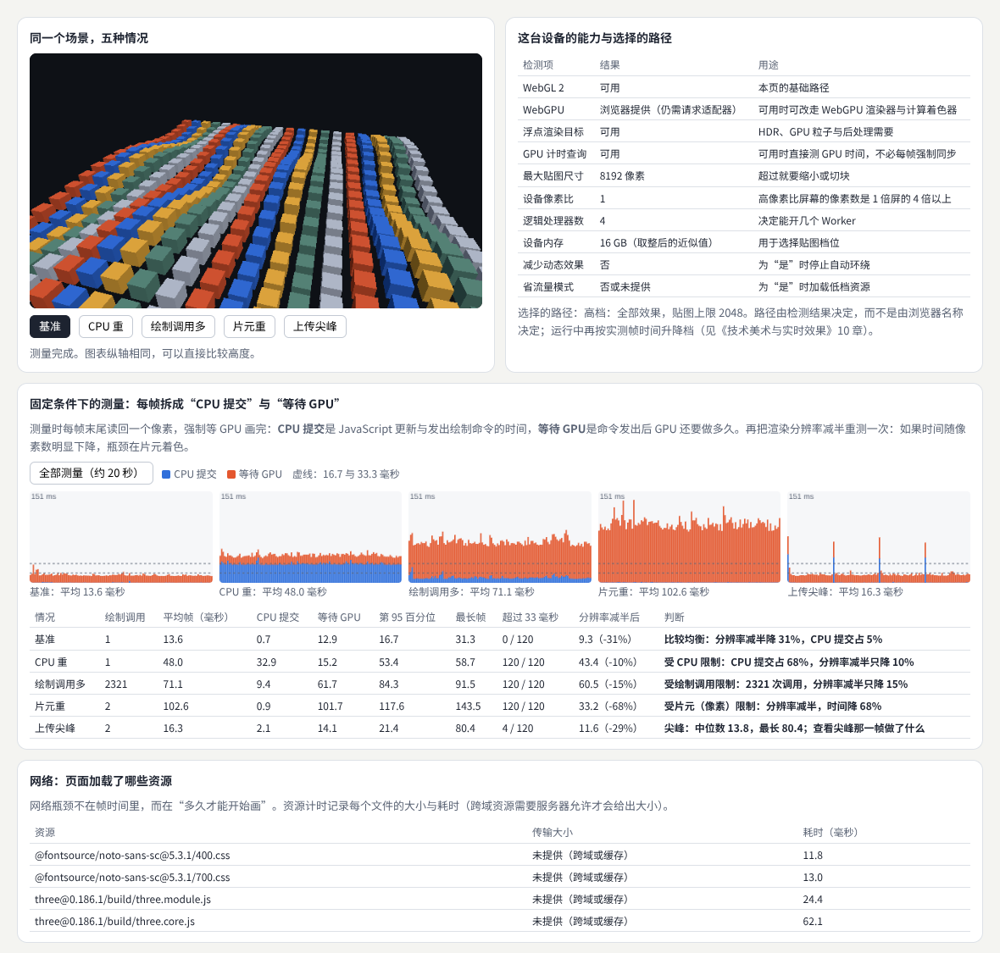

示例：[09-09-profile.html](示例/09-09-profile.html)

每种情况按固定的相机路径运行 120 帧。每帧末尾读回一个像素，强制等 GPU 画完：**CPU 提交**是 JavaScript 更新与发出绘制命令的时间，**等待 GPU** 是命令发出后 GPU 还要做多久。

| 情况 | 绘制调用 | 平均帧 | CPU 提交 | 等待 GPU | 最长帧 | 分辨率减半后 | 判断 |
| --- | --- | --- | --- | --- | --- | --- | --- |
| 基准：400 个方块，一次实例化绘制 | 1 | 13.6 毫秒 | 0.7 | 12.9 | 31.3 | 9.3（−31%） | 比较均衡 |
| CPU 重：每帧额外的 JavaScript 计算 | 1 | 48.0 毫秒 | 32.9 | 15.2 | 58.7 | 43.4（−10%） | 受 CPU 限制 |
| 绘制调用多：再加 3000 个独立网格 | 2321 | 71.1 毫秒 | 9.4 | 61.7 | 91.5 | 60.5（−15%） | 受绘制调用限制 |
| 片元重：全屏噪声层 | 2 | 102.6 毫秒 | 0.9 | 101.7 | 143.5 | 33.2（−68%） | 受片元限制 |
| 上传尖峰：每 30 帧上传一张 2048 贴图 | 2 | 16.3 毫秒 | 2.1 | 14.1 | 80.4 | 11.6（−29%） | 尖峰 |

（时间单位均为毫秒；软件渲染。）

- **CPU 重**：分辨率减半几乎无效，CPU 提交占 68%——优化要从 JavaScript 入手（减少计算、移到 Worker 或 GPU）。
- **片元重**：分辨率减半，时间降 68%——降低渲染分辨率、简化着色器或只在部分区域计算。
- **绘制调用多**：3000 个网格中有一部分被视锥剔除，实际 2321 次调用。值得注意的是，这些调用的成本大多出现在“等待 GPU”一栏：Chrome 中 WebGL 命令由单独的 GPU 进程执行，驱动处理每次调用的开销算在那边。判断依据是**分辨率减半只降 15%**，而调用次数极多——对策是实例化、合并或分块（06 章）。
- **上传尖峰**：中位数 13.8 毫秒，最长帧 80.4 毫秒；120 帧中有 4 帧超过 33 毫秒，正好是 4 次上传。平均值（16.3）几乎看不出问题，**只看平均值会漏掉它**。

#### 09.4 能力检测与替代路径

示例右上角检测了 WebGL 2、WebGPU、浮点渲染目标、GPU 计时查询、最大贴图尺寸、设备像素比、逻辑处理器数、设备内存、减少动态效果与省流量偏好，并据此选择档位。原则是：**按能力检测，而不是按浏览器名称判断**；运行中再根据实测帧时间升降档。

WebGPU 已在 Chrome 与 Edge 113 起（Windows、macOS、ChromeOS；Linux 从 144 起部分支持）、安卓上的 Chrome 121 起、Safari 26 起和 Windows 上的 Firefox 141 起提供，MDN 将它标为“有限可用”，并且只能在 HTTPS 等安全上下文中使用。[B13](#ref-b13) 所以 WebGPU 路径必须配一条 WebGL 2 的替代路径（three.js 的 `WebGPURenderer` 在 WebGPU 不可用时会自动退回 WebGL 2）。

测试环境中 `EXT_disjoint_timer_query_webgl2` 可用：它能直接测量 GPU 执行某段命令的时间，不必像示例那样每帧强制同步（强制同步会让 CPU 与 GPU 不能并行，测出的总时间偏大）。[B17](#ref-b17)

#### 09.5 网络

示例底部用资源计时接口列出了页面加载的文件与耗时。[B18](#ref-b18) 跨域资源只有在服务器允许时才会给出传输大小。对图形页面来说，常见的网络问题是：模型和贴图太大（07 章的压缩）、首屏就加载了全部资源（按需加载）、没有利用缓存。

#### 09.6 常见问题

- **在自己的电脑上很流畅，用户说卡**：用户的设备、分辨率、像素比都不同。在目标设备上测，并记录测试条件（11 章）。
- **剖析器里看不出问题，但画面卡顿**：可能是垃圾回收或上传造成的尖峰，看最长帧和帧时间图，而不是平均值。
- **降低分辨率后画面糊**：文字和界面放在 HTML 里，三维画面单独降分辨率（[《技术美术与实时效果》](07-技术美术与实时效果.md) 10 章）。
- **WebGPU 版本在某台设备上打不开**：检测失败时自动走 WebGL 路径，并把失败原因记录下来。

**本章练习**：

1. 在示例中加入第六种情况“阴影”：开启 2048 的实时阴影。判断它属于哪一类瓶颈。
2. 用浏览器开发者工具的性能面板录制“上传尖峰”，找到尖峰那一帧里耗时的函数。[B19](#ref-b19)

#### 09.7 进阶学习卡

| 级别 | 目标 | 怎样检验 |
| --- | --- | --- |
| L1 入门 | 能固定条件测帧时间，读懂平均值、百分位与最长帧 | 两次测量结果接近 |
| L2 熟练 | 能用分辨率与负载实验区分 CPU、GPU、调用与尖峰 | 完成本章练习 1 |
| L3 进阶 | 能用 GPU 计时查询、性能面板与帧捕获工具定位到具体步骤与函数 | 给出一份带截图的剖析报告 |
| L4 深入 | 能建立持续的性能回归测试，在多种设备上自动比较 | 性能下降时自动报警 |

- **技术栈**：Chrome 开发者工具的性能面板[B19](#ref-b19)；Spector.js（逐个查看 WebGL 绘制调用的浏览器扩展）[B20](#ref-b20)；`EXT_disjoint_timer_query_webgl2`；WebGPU 的 `timestamp-query`；`renderer.info`；资源计时接口；`navigator.deviceMemory`、`hardwareConcurrency`。
- **高阶词汇**：帧时间（frame time）、帧预算（frame budget）、百分位（percentile）、尖峰（spike／hitch）、CPU 受限（CPU-bound）、GPU 受限（GPU-bound）、填充率（fill rate）、绘制调用开销（draw call overhead）、GPU 计时查询（timer query）、帧捕获（frame capture）、能力检测（feature detection）、渐进增强（progressive enhancement）、性能回归测试（performance regression testing）。
- **搜索关键词**：`WebGL performance best practices`、`EXT_disjoint_timer_query_webgl2 example`、`spector.js capture`、`CPU bound vs GPU bound`、`frame time percentile`、`three.js renderer.info draw calls`、`性能剖析 帧时间`。
- **值得看的实例**：[按需渲染](https://threejs.org/manual/pages/rendering-on-demand.html)——画面不变时不重画；[大量物体的优化](https://threejs.org/manual/pages/optimize-lots-of-objects.html)——把很多物体合并后绘制调用的变化。
- **资料**：MDN 的 WebGL 最佳实践列出了常见的性能陷阱[B21](#ref-b21)。

<a id="ch10"></a>

### 10 引擎接口与调试工具

#### 10.1 解决什么问题

设计**材质接口**、**场景接口**、**渲染配置**、**资源生命周期**和**诊断界面**。自研系统的价值应对应一个明确需求，例如专门的**二维编辑**、**科学体数据**或**大规模产品场景**——如果现成的引擎已经能满足需求，自研往往得不偿失。

#### 10.2 核心概念：业务代码不直接碰底层

在项目里直接到处调用 three.js，开始很快，后来会遇到三类问题：资源不知道谁在用、什么时候能释放；参数写错没有任何提示；想看中间结果时只能临时改代码。**引擎接口**在业务代码和底层库之间加一层：

| 接口 | 负责 |
| --- | --- |
| 渲染配置 | 阴影、色调映射、像素比、调试视图等全局设置；检查取值范围 |
| 材质接口 | 只暴露设计者需要的参数，检查参数名与取值 |
| 场景接口 | 添加、删除物体；删除时释放它占用的资源 |
| 资源生命周期 | 登记每个资源的引用数与大小，引用降到 0 时释放 |
| 诊断界面 | 绘制调用、三角形、资源表、警告日志、调试视图 |

#### 10.3 示例：一个最小的展示引擎

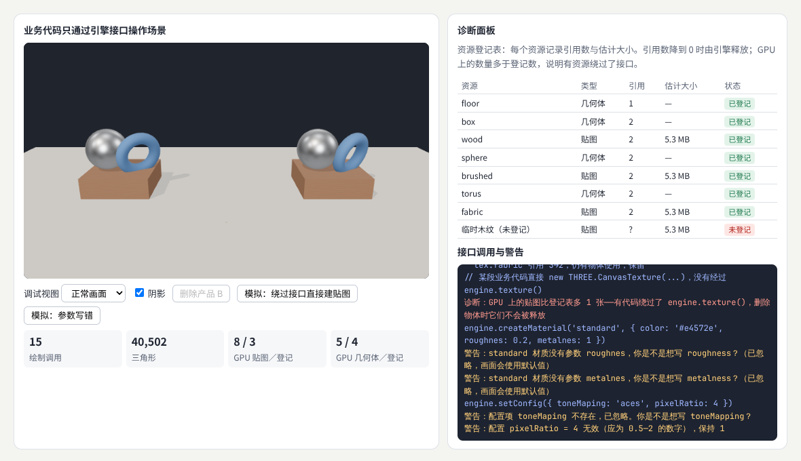

示例：[09-10-engine.html](示例/09-10-engine.html)

引擎约 150 行，业务代码只调用 `engine.*`：

```js
const engine = new Engine(canvas, { pixelRatio: 1, shadows: true, toneMapping: 'agx', debugView: 'none' });
const product = (name, wood) => engine.createNode({ name, parts: [
  { geometry: 'box', material: 'standard', params: { map: wood, roughness: 0.7 } },
  { geometry: 'sphere', material: 'standard', params: { map: 'brushed', metalness: 1, roughness: 0.35 } },
  { geometry: 'torus', material: 'standard', params: { map: 'fabric', roughness: 0.8 } }] });
engine.add(product('产品 B', 'oak'), [0, 0, 0]);
```

示例依次演示了四件事：

1. **引用计数**：三件产品共用几何体和两张贴图。删除产品 B 后，日志显示：它独有的 `oak` 贴图被释放；共用的几何体与贴图引用数从 3 降到 2，继续保留。
2. **发现绕过接口的资源**：某段代码直接 `new THREE.CanvasTexture(...)`。诊断面板比较 GPU 上的贴图数（来自 `renderer.info.memory`）与登记表：多出 1 张，提示“有代码绕过了 `engine.texture()`，删除物体时它们不会被释放”。比较时要扣除渲染器和场景自用的贴图（阴影贴图、环境贴图等，启动时记为基线）。
3. **参数检查**：`roughnes`、`metalnes`、`toneMaping` 这类拼写错误，底层库会静默忽略；引擎接口用编辑距离给出“你是不是想写 roughness”，并拒绝超出范围的 `pixelRatio: 4`。
4. **配置的副作用**：开关阴影会改变着色器，日志提示“12 个材质需要重新编译，下一帧会稍慢”——这类信息对排查“偶尔卡一下”很有用。

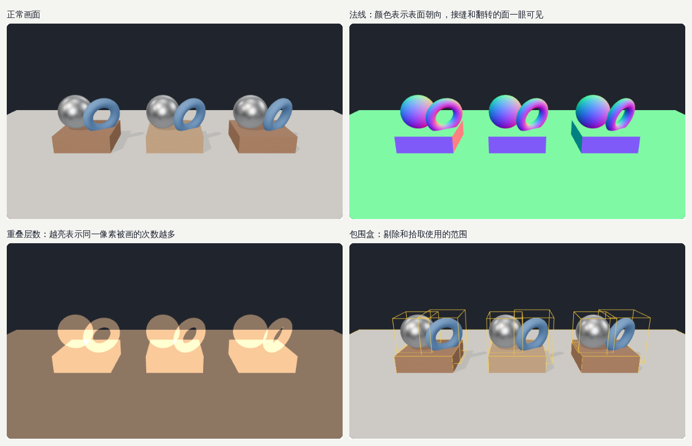

调试视图用 `scene.overrideMaterial` 一次替换所有材质：**法线**用来检查接缝与翻转的面；**重叠层数**用叠加混合显示同一个像素被画了几次，帮助发现透明物体和大面积重叠造成的浪费；**包围盒**显示剔除与拾取使用的范围。

示例开发中还遇到两个真实的问题，都由诊断面板发现：用 `RoomEnvironment` 生成环境贴图后没有调用它的 `dispose()`，GPU 上的几何体比登记表多了一个；金属球没有环境贴图时发黑（05 章）。

#### 10.4 什么时候值得自研

| 需求 | 现成引擎的不足 | 自研或扩展的方向 |
| --- | --- | --- |
| 专门的二维编辑（矢量、排版） | 三维引擎的文字、矢量与命中检测不够精细 | 专用的二维渲染与编辑数据模型（[《计算设计与创作工具》](11-计算设计与创作工具.md)） |
| 科学体数据（医学影像、气象） | 通用引擎没有体绘制、传递函数编辑 | 三维纹理 ＋ 光线步进（05 章）＋ 专用交互 |
| 大规模产品场景（工厂、城市） | 百万级零件超出常规的剔除与内存能力 | 分块、层次包围体、流式加载、GPU 驱动剔除 |

即使决定自研，也常常是**在现成库上加一层接口**，而不是从零写渲染器。判断标准是：自研的部分能否对应一个说得清楚的需求，以及团队能否长期维护它。

#### 10.5 常见问题

- **接口越加越多，最后和底层库一样复杂**：接口只暴露项目真正需要的东西，其余保持在内部。
- **引用计数对不上**：释放和获取不是成对出现的。让“创建物体”和“删除物体”成为唯一能获取、释放资源的地方。
- **调试视图影响了正常画面**：调试视图必须能完全关闭，关闭后不留任何状态（示例中切回正常画面时会移除包围盒辅助线并释放它们）。

**本章练习**：

1. 在示例的材质接口中加入 `unlit` 材质的参数检查，故意传入 `metalness`，确认会给出警告。
2. 为诊断面板加一项“每张贴图最后一次被画是在第几帧”，找出长时间没有使用的贴图。

#### 10.6 进阶学习卡

| 级别 | 目标 | 怎样检验 |
| --- | --- | --- |
| L1 入门 | 能用 `renderer.info` 和 `overrideMaterial` 做简单诊断 | 能切换法线与线框视图 |
| L2 熟练 | 能为项目写一层带参数检查与引用计数的接口 | 完成本章练习，删除物体后资源数正确 |
| L3 进阶 | 能设计诊断面板与调试视图体系，让团队成员独立定位问题 | 新成员能用面板找到一个故意埋下的泄漏 |
| L4 深入 | 能为特定需求（体数据、二维编辑、超大场景）设计专用渲染架构 | 写出需求、约束与取舍的设计文档 |

- **技术栈**：three.js 的 `renderer.info`、`scene.overrideMaterial`、`BoxHelper`、`CameraHelper`、`dispose()`；lil-gui（参数面板）；Spector.js（帧捕获）；TypeScript 类型（让接口在编辑器里就能检查参数）。
- **高阶词汇**：抽象层（abstraction layer）、渲染硬件接口（RHI）、引用计数（reference counting）、资源句柄（resource handle）、配置模式校验（schema validation）、调试视图（debug view）、过度绘制（overdraw）、帧捕获（frame capture）、热重载（hot reload）、体绘制（volume rendering）、传递函数（transfer function）。
- **搜索关键词**：`three.js dispose renderer.info memory`、`overdraw visualization`、`game engine architecture rendering abstraction`、`volume rendering transfer function webgl`、`three.js overrideMaterial debug view`、`引擎架构 渲染抽象`。
- **值得看的实例**：[三维纹理体绘制](https://threejs.org/examples/webgl_texture3d.html)——科学体数据的基础；[阴影贴图查看器](https://threejs.org/examples/webgl_shadowmap_viewer.html)——把内部资源直接画出来的调试思路。

<a id="part-3"></a>

## 第三篇：综合项目、边界与路线

<a id="ch11"></a>

### 11 综合项目：在固定条件下比较两种阴影方案

#### 11.1 任务

在同一场景中对比两种材质或阴影方案，**固定相机**、**资源**与**设备**，记录**画面差异**、**帧时间**和**内存**。建立调试视图，说明数据来自哪个阶段。**结论应注明条件，避免把单个设备结果推广为所有平台表现。**

本章比较一个产品展示中很常见的选择：

- **方案 A：实时阴影贴图**（PCF，2048 × 2048）。每帧从光源画一次深度，阴影随光源方向变化，物体之间、物体自身都有阴影。
- **方案 B：烘焙的接触阴影**（512 × 512）。加载时从上往下看一次场景：离地越近越暗，再模糊两次，作为一张半透明贴图铺在地面上。只算一次，之后几乎没有成本。

#### 11.2 示例

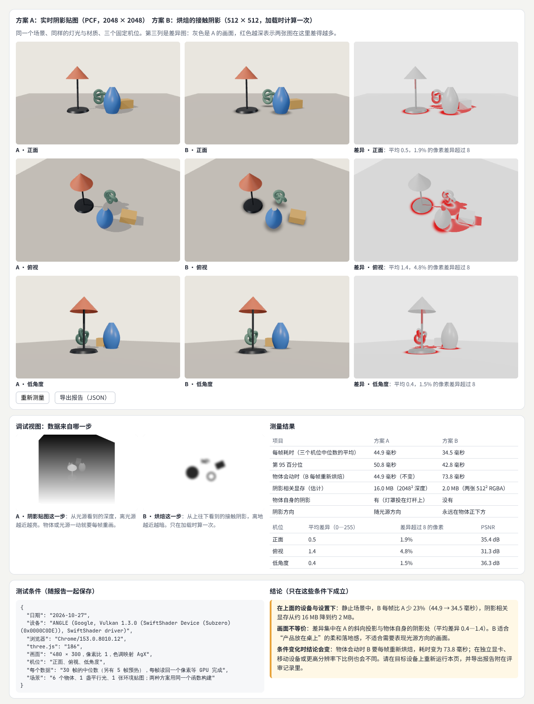

示例：[09-11-compare.html](示例/09-11-compare.html)

**固定条件**是这个项目的核心：

- **同一个场景**：两种方案用同一个函数构建，物体、材质、灯光、环境贴图完全相同，只在阴影部分不同。
- **固定相机**：三个机位（正面、俯视、低角度）写在代码里。
- **固定测量方法**：每个数据是 30 帧的中位数，另有 5 帧预热；每帧读回一个像素，等 GPU 完成。
- **记录设备**：页面读出显卡名称（`WEBGL_debug_renderer_info`，部分浏览器出于隐私只给出概括信息）、浏览器版本、three.js 版本、画面尺寸，和结果一起导出为 JSON 报告。

#### 11.3 结果

| 项目 | 方案 A | 方案 B |
| --- | --- | --- |
| 每帧耗时（三个机位中位数的平均） | 44.9 毫秒 | 34.5 毫秒 |
| 第 95 百分位 | 50.8 毫秒 | 42.8 毫秒 |
| 物体会动时（B 每帧重新烘焙） | 44.9 毫秒（不变） | 73.8 毫秒 |
| 阴影相关显存（估计） | 16.0 MB | 2.0 MB |
| 物体自身的阴影 | 有 | 没有 |
| 阴影方向 | 随光源方向 | 永远在物体正下方 |

| 机位 | 平均差异（0—255） | 差异超过 8 的像素 | PSNR |
| --- | --- | --- | --- |
| 正面 | 0.5 | 1.9% | 35.4 dB |
| 俯视 | 1.4 | 4.8% | 31.3 dB |
| 低角度 | 0.4 | 1.5% | 36.3 dB |

另外几次运行中，A 为 44.4—48.8 毫秒，B 为 35.0—37.6 毫秒，B 每帧重新烘焙为 74.9—80.6 毫秒；首次烘焙用时 31.8—53.4 毫秒。

**差异图**把 A 的画面变灰，再用红色标出两张图亮度差异大的地方。红色集中在 A 的斜向投影和物体自身的阴影处——这正是两种方案的本质区别。PSNR（峰值信噪比）是常用的图像差异指标，数值越高越接近；但它只是一个数字，**一定要配合差异图看差在哪里**。

#### 11.4 调试视图说明数据来自哪一步

- **A · 阴影贴图这一步**：从光源看到的深度，离光源越近越亮。物体或光源一动，这一步就要每帧重做。
- **B · 烘焙这一步**：从上往下看到的接触阴影，离地越近越暗。只在加载时运行一次。

调试视图让评审者看到“这个阴影是从哪里来的”。如果有人问“为什么 B 的台灯没有投影到花瓶上”，答案就在烘焙视图里：它只记录了离地高度，不知道光从哪里来。

#### 11.5 结论要写明条件

示例自动生成的结论分三段：

1. **在这台设备与设置下**：静止场景中，B 每帧比 A 少 23%（44.9 → 34.5 毫秒），阴影相关显存从约 16 MB 降到约 2 MB。
2. **画面不等价**：差异集中在 A 的斜向投影与物体自身的阴影处。B 适合“产品放在桌上”的柔和落地感，不适合需要表现光源方向的画面。
3. **条件变化时结论会变**：物体会动时 B 要每帧重新烘焙，耗时变为 73.8 毫秒，反而比 A 慢；在独立显卡、移动设备或更高分辨率下，比例也会不同。请在目标设备上重新运行，并把导出的报告附在评审记录里。

这就是“结论注明条件”的含义：不写“B 比 A 快 23%”，而写“**在什么设备、什么场景、什么设置下**，B 比 A 快多少；**在什么情况下这个结论不成立**”。

#### 11.6 验收清单

- [ ] 两种方案共用同一份场景构建代码，只有比较的部分不同。
- [ ] 相机、画面尺寸、像素比、色调映射固定。
- [ ] 每个时间数据说明了帧数、预热与同步方式，并给出中位数与第 95 百分位。
- [ ] 有差异图，并能指出差异集中在哪里、为什么。
- [ ] 有调试视图，说明关键数据来自哪一步、每帧还是一次。
- [ ] 报告记录了设备、浏览器、库版本与日期。
- [ ] 结论写明了成立的条件和不成立的情况。

**本章练习**：

1. 让示例中的花瓶缓慢移动，比较 A 与“B 每帧重新烘焙”的画面与时间。
2. 把方案 B 改为“接触阴影 ＋ 一盏不投射阴影的平行光”，与 A 再比较一次，写出你的结论与条件。
3. 在两台不同的设备上运行示例，导出两份报告，比较结论是否一致。

<a id="ch12"></a>

### 12 实时与离线渲染的边界

#### 12.1 两种目标

**实时展示**要在交互节奏内持续更新：每帧十几毫秒，用户随时在操作。**电影等离线制作**可以为单帧投入更多计算：一帧算几分钟甚至几小时都可以接受，因为观众看到的是事先渲染好的结果。两者可以共享光照和材质原理，但**质量目标**、**时间预算**和**生产流程不同**。

| | 实时渲染 | 离线渲染 |
| --- | --- | --- |
| 时间预算 | 每帧约 16.7 毫秒或更少 | 每帧数分钟到数小时 |
| 主要方法 | 光栅化 ＋ 各种近似（阴影贴图、环境贴图、屏幕空间效果） | 路径追踪：模拟光线在场景中的多次反弹 |
| 间接光 | 预计算、探针、屏幕空间近似 | 直接模拟 |
| 噪点 | 一般没有（近似方法是确定的） | 采样不足时有，靠更多采样与降噪消除 |
| 生产流程 | 资源要压缩、分级，适应各种设备 | 资源可以极其精细，在渲染农场上批量计算 |

#### 12.2 示例：同一个房间的两种画法

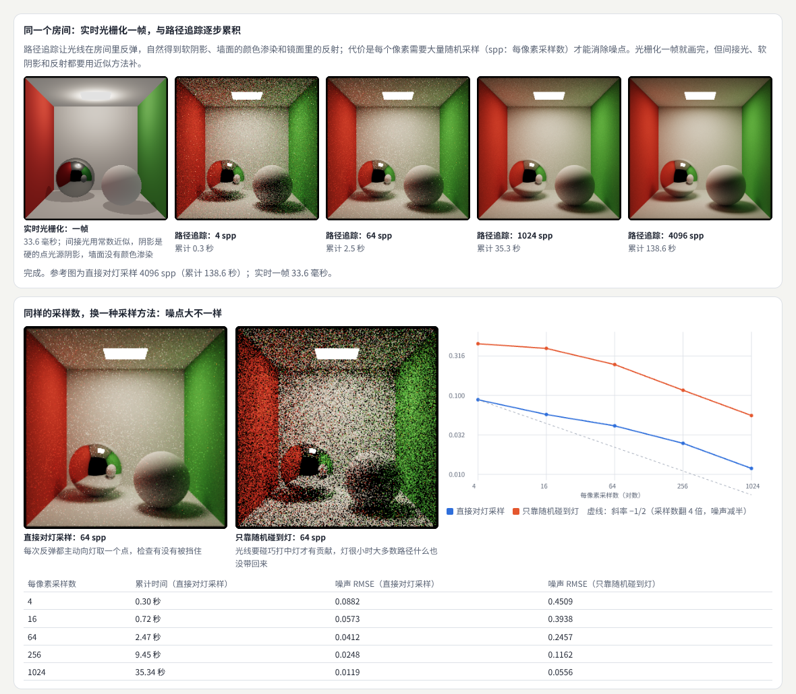

示例：[09-12-pathtrace.html](示例/09-12-pathtrace.html)

示例在一个着色器里实现了最简单的**路径追踪**：从相机向每个像素发出光线，碰到表面就随机选一个方向继续反弹，碰到灯就把亮度带回来。每一帧给每个像素增加 4 个样本，与之前的结果累加平均——这叫**渐进式累积**。

| 每像素采样数 | 累计时间 | 噪声（直接对灯采样） | 噪声（只靠随机碰到灯） |
| --- | --- | --- | --- |
| 4 | 0.30 秒 | 0.0882 | 0.4509 |
| 16 | 0.72 秒 | 0.0573 | 0.3938 |
| 64 | 2.47 秒 | 0.0412 | 0.2457 |
| 256 | 9.45 秒 | 0.0248 | 0.1162 |
| 1024 | 35.34 秒 | 0.0119 | 0.0556 |

（256 × 256 的画面，软件渲染；噪声是与 4096 次采样的参考图相比的均方根误差，在色调映射后的 0—1 数值上计算。实时光栅化一帧为 33.6 毫秒。）

- **画面差别**：路径追踪自然得到了软阴影、红绿墙面渗到地面和球上的颜色、镜面球里的完整反射；光栅化版本的阴影是硬的，间接光只用一个常数近似，墙面没有颜色渗染。
- **时间差别**：在这台测试机上，路径追踪要几十秒才基本消除噪点，而光栅化一帧只要 33.6 毫秒。在真实显卡上两者都快得多，但数量级的差距依然存在。
- **噪声的规律**：噪声大致与采样数的平方根成反比——采样数翻 4 倍，噪声减半。图中的虚线就是这个斜率。
- **采样方法比采样数更重要**：“直接对灯采样”在每次反弹时主动向灯上随机取一点，检查是否被挡住；“只靠随机碰到灯”要等光线碰巧打中小小的灯。前者 64 次采样（噪声 0.0412）就比后者 1024 次采样（0.0556）更干净。这类方法统称**重要性采样**，是离线渲染器的核心技术之一。

#### 12.3 哪些思想可以迁移到实时

学习电影渲染器时，应明确哪些思想能够迁移到网页实时场景：

| 离线渲染的思想 | 在实时场景中的形态 |
| --- | --- |
| 基于物理的材质与光照单位 | PBR 材质、物理灯光强度（05 章） |
| 统一的颜色管理与色调映射 | 线性工作流、色调映射（05 章） |
| 预先计算昂贵的光照 | 烘焙光照贴图、接触阴影（11 章）、环境贴图 |
| 渐进式累积 | 画面静止时逐帧累积，得到更好的软阴影或环境光遮蔽（three.js 的渐进式阴影示例） |
| 重要性采样与降噪 | 实时光线追踪中每像素一两个样本 ＋ 时间累积 ＋ 降噪 |
| 大规模场景的排序与批处理 | 按材质排序绘制、实例化、分块（06 章） |

**不能直接迁移的**是时间预算：离线渲染器可以“为了正确多算一会儿”，实时渲染必须“在预算内尽量好看”。

#### 12.4 一个电影渲染器的例子：Disney Hyperion

迪士尼动画工作室的 Hyperion 是一个用于电影制作的路径追踪渲染器。[B22](#ref-b22) 它要处理的场景远大于实时应用能承受的规模，需要大量光线在场景中反弹。为了在这种规模下高效地追踪光线，Hyperion 的一个重要设计是**把光线分批排序后再处理**，让相邻处理的光线访问相近的场景数据，提高缓存效率。[B23](#ref-b23)

这个思想与 06 章的分块、08 章的数据布局是同一个道理：**让一起处理的数据在内存中也挨在一起**。不同的是规模和时间预算。

#### 12.5 常见问题

- **网页上能做路径追踪吗**：可以，three-gpu-pathtracer 等库在浏览器中实现了渐进式路径追踪，适合产品渲染图、静态展示。[B24](#ref-b24) 但交互时要先显示光栅化画面，静止后再逐步累积。
- **实时光线追踪和路径追踪是什么关系**：实时光线追踪用硬件加速求交，通常只用光线追踪做阴影、反射等部分效果，每像素样本很少，再靠降噪；完整的路径追踪仍主要用于离线。
- **噪声消不掉，画面总有亮点**：亮点（萤火虫噪点）来自极少数概率很低、能量很高的路径，需要更好的重要性采样或对亮度做限制。

**本章练习**：

1. 把示例中灯的边长从 0.56 缩小到 0.2，比较两种采样方法的噪声差距是变大还是变小，并解释原因。
2. 在光栅化版本中加一盏不投射阴影的低强度红色点光源放在红墙附近，模仿颜色渗染，与路径追踪结果对比。

#### 12.6 进阶学习卡

| 级别 | 目标 | 怎样检验 |
| --- | --- | --- |
| L1 入门 | 能说出实时与离线渲染在预算、方法与流程上的区别 | 解释示例两行画面的差别 |
| L2 熟练 | 能写出最小的路径追踪器并加入直接光采样 | 噪声曲线符合平方根规律 |
| L3 进阶 | 能在网页中用渐进式路径追踪生成产品图，并与光栅化画面衔接 | 交互时流畅、静止后收敛 |
| L4 深入 | 能实现多重重要性采样、降噪或层次包围体加速，并量化效果 | 同样时间下噪声更低 |

- **技术栈**：WebGL 2 着色器与浮点渲染目标；three-gpu-pathtracer[B24](#ref-b24)；three-mesh-bvh（光线求交加速）[B08](#ref-b08)；Mitsuba、Blender Cycles 等离线渲染器。
- **高阶词汇**：光栅化（rasterization）、光线追踪（ray tracing）、路径追踪（path tracing）、渲染方程（rendering equation）、蒙特卡洛积分（Monte Carlo integration）、每像素采样数（samples per pixel, spp）、渐进式渲染（progressive rendering）、重要性采样（importance sampling）、直接光采样／下一事件估计（next event estimation）、多重重要性采样（multiple importance sampling, MIS）、俄罗斯轮盘（Russian roulette）、降噪（denoising）、萤火虫噪点（fireflies）、颜色渗染（color bleeding）、康奈尔盒子（Cornell box）。
- **搜索关键词**：`ray tracing in one weekend`、`path tracing next event estimation`、`multiple importance sampling explained`、`three-gpu-pathtracer`、`monte carlo noise sqrt samples`、`Disney Hyperion sorted deferred shading`、`路径追踪 重要性采样`。
- **值得看的实例**：[three.js 路径追踪](https://threejs.org/examples/webgl_renderer_pathtracer.html)——观察静止后画面逐步收敛；[渐进式阴影](https://threejs.org/examples/webgl_shadowmap_progressive.html)——实时场景中借用“逐帧累积”的思想。
- **资料**：《Ray Tracing in One Weekend》系列从零写出一个路径追踪器[B25](#ref-b25)；《Physically Based Rendering》第 4 版在线免费阅读，是离线渲染的系统教材[B26](#ref-b26)。

<a id="ch13"></a>

### 13 工具、技术栈与学习路线

#### 13.1 工具的位置

| 任务 | 工具 | 说明 |
| --- | --- | --- |
| 组织渲染步骤与资源 | three.js 的 `WebGLRenderTarget`、`EffectComposer` | 本册 03 章用它们实现渲染图 |
| 计算着色器 | WebGPU 与 WGSL；three.js 的 `WebGPURenderer`（TSL） | 不支持时退回 WebGL 2 或 CPU |
| 剖析帧时间 | Chrome 性能面板、GPU 计时查询、`renderer.info` | 先固定条件再测量 |
| 逐个检查绘制调用 | Spector.js | 看每次调用用了什么着色器、贴图和状态 |
| 资源处理 | glTF Transform、KTX2 工具 | 压缩、合并、生成不同档位的资源 |
| 加速结构 | three-mesh-bvh | 拾取、剔除、路径追踪的光线求交 |
| 离线参考 | Blender Cycles、Mitsuba、three-gpu-pathtracer | 生成参考图，评估实时近似的误差 |

#### 13.2 八个方向的进阶阶梯

| 方向 | L1 入门 | L2 熟练 | L3 进阶 | L4 深入 |
| --- | --- | --- | --- | --- |
| 渲染流程 | 说出每步读写 | 加调试视图与后处理 | 资源复用、前向与延迟 | 渲染图与异步计算 |
| 光照与阴影 | 开启并调范围 | 诊断痤疮与悬浮 | 级联阴影、PCSS | 新滤波、虚拟阴影贴图 |
| 材质与颜色 | 色彩空间设置 | 色调映射与透明排序 | PBR 参数与参考对照 | OIT、体积光照 |
| 可见性 | 实例化 | 分块与迟滞 LOD | BVH、BatchedMesh | GPU 驱动剔除 |
| 资源与内存 | 估算与释放 | 缓存与上下文丢失 | 压缩管线与预算 | 流式加载与虚拟纹理 |
| GPU 计算 | 检测与降级 | 原子、共享内存、屏障 | 分段计时与布局选择 | 并行原语 |
| 性能剖析 | 固定条件测量 | 区分四类瓶颈 | 计时查询与帧捕获 | 持续回归测试 |
| 引擎接口 | `info` 与覆盖材质 | 参数检查与引用计数 | 诊断体系 | 专用渲染架构 |

**建议的学习顺序**：先完成 L1 的全部八格（约等于把本册示例都跑一遍、读懂），再按项目需要把一两个方向推进到 L2、L3。综合项目（11 章）是从 L2 走向 L3 的标志：能在固定条件下比较、能写出带条件的结论。

#### 13.3 横向连接

- 着色器、后处理与质量分级：[《技术美术与实时效果》](07-技术美术与实时效果.md)。
- 场景、相机与材质的基础：[《三维内容与空间设计》](06-三维内容与空间设计.md)。
- GPU 上的粒子与模拟：[《生成艺术与物理仿真》](08-生成艺术与物理仿真.md) 12 章。
- 新的渲染算法与评价方法：[《图形学与视觉计算研究》](10-图形学与视觉计算研究.md)。
- 编辑器与创作工具的渲染：[《计算设计与创作工具》](11-计算设计与创作工具.md)。
- 向量、矩阵与采样的数学：[《图形与交互的数学基础》](20-图形与交互的数学基础.md)。
- 感知性能与质量验收：[《质量性能与设计运营》](18-质量性能与设计运营.md)。

<a id="appendix-a"></a>

## 附录 A：术语表

| 术语 | 英文 | 含义 | 阅读位置 |
| --- | --- | --- | --- |
| 帧预算 | frame budget | 每帧可用的时间，60 赫兹时为 16.7 毫秒 | 02 |
| 绘制调用 | draw call | CPU 让 GPU 用某个材质画一批三角形的一次命令 | 02、06、09 |
| 渲染步骤 | render pass | 写入同一个渲染目标的一组绘制 | 02、03 |
| 渲染目标 | render target | 不直接显示在屏幕上、供后续步骤读取的贴图 | 02、03 |
| 渲染图 | render graph | 按步骤声明的读写自动排序、裁剪并管理资源的结构 | 03 |
| 调试视图 | debug view | 把某一步的中间结果画到屏幕上的步骤 | 03、10、11 |
| 延迟渲染 | deferred rendering | 先把表面信息写进 G 缓冲，再统一计算光照 | 03 |
| 直接照明 | direct lighting | 光从光源直接照到表面 | 04 |
| 间接照明 | indirect lighting | 光在其他表面反弹后再照过来 | 04、12 |
| 基于图像的照明 | image-based lighting | 用环境贴图照亮场景 | 04 |
| 阴影贴图 | shadow map | 从光源视角画出的深度图，用于判断是否被挡住 | 04、11 |
| 阴影痤疮 | shadow acne | 表面错误地被自己的阴影遮挡而出现的条纹 | 04 |
| 彼得·潘现象 | peter panning | 偏移过大导致阴影与物体脱开 | 04 |
| PCF | percentage-closer filtering | 在周围多次比较深度并取平均的柔化方法 | 04 |
| VSM | variance shadow maps | 保存深度均值与方差、可以模糊的阴影方法 | 04 |
| 级联阴影 | cascaded shadow maps | 按距离分段、每段一张阴影贴图 | 04 |
| 接触阴影 | contact shadow | 按离地高度烘焙的柔和地面阴影 | 11 |
| 线性空间 | linear space | 数值与光的强度成正比的颜色表示，光照在其中计算 | 05 |
| 色调映射 | tone mapping | 把高动态范围的亮度压缩到屏幕可显示的范围 | 05 |
| 与顺序无关的透明 | order-independent transparency | 不依赖绘制顺序得到正确透明结果的方法 | 05 |
| 体积介质 | participating media | 雾、烟、云等充满空间的半透明物质 | 05 |
| 光线步进 | ray marching | 沿视线逐步累积吸收与散射的计算方法 | 05、10 |
| 包围体 | bounding volume | 包住物体的简单形状，用于快速判断 | 06 |
| 视锥剔除 | frustum culling | 跳过完全在相机视野外的物体 | 06 |
| 遮挡剔除 | occlusion culling | 跳过被其他物体完全挡住的物体 | 06 |
| 实例化 | instancing | 一次绘制调用画出同一模型的多个副本 | 06、09 |
| 细节层次 | level of detail | 远处用更简单的模型 | 06 |
| 迟滞 | hysteresis | 切换与切回使用不同阈值，避免来回跳动 | 06 |
| 层次包围体 | bounding volume hierarchy | 包围体组成的树，用于加速剔除与求交 | 06、12 |
| 多级渐远纹理 | mipmap | 贴图的一系列缩小版本，远处采样更稳定 | 07 |
| GPU 压缩纹理 | GPU texture compression | 在显存中仍保持压缩的贴图格式 | 07 |
| 引用计数 | reference counting | 记录资源被多少物体使用，降到 0 时释放 | 07、10 |
| LRU | least recently used | 超出上限时先释放最久没有使用的资源 | 07 |
| 上下文丢失 | context loss | 浏览器收回图形上下文，GPU 资源全部失效 | 07 |
| 计算着色器 | compute shader | 不经过绘制、直接在 GPU 上做通用计算的程序 | 08 |
| 工作组 | workgroup | 一组可以共享内存、互相同步的计算线程 | 08 |
| 原子操作 | atomic operation | 多个线程同时修改同一位置时保证不丢失的操作 | 08 |
| 屏障 | barrier | 让一组线程等彼此都到达某一步的同步点 | 08 |
| AoS／SoA | array of structures／structure of arrays | 按对象存放字段，或按字段存放连续数组 | 08 |
| 尖峰 | spike | 远长于平常的某一帧 | 09 |
| 第 95 百分位 | 95th percentile | 95% 的帧不超过的时间 | 09、11 |
| 能力检测 | feature detection | 按设备实际提供的能力选择路径 | 09 |
| 过度绘制 | overdraw | 同一个像素被画了多次 | 10 |
| PSNR | peak signal-to-noise ratio | 衡量两张图差异的指标，数值越高越接近 | 11 |
| 路径追踪 | path tracing | 模拟光线多次反弹的渲染方法 | 12 |
| 每像素采样数 | samples per pixel | 路径追踪中每个像素累积的样本数 | 12 |
| 重要性采样 | importance sampling | 按贡献大小安排采样，以更少样本降低噪声 | 12 |

<a id="appendix-b"></a>

## 附录 B：资料入口

以下资料用于核对方法来源和继续学习。资料核对日期：2026-10-27。W3C 的 WebGPU 与 WGSL 规范是最权威的定义，地址分别为 `https://www.w3.org/TR/webgpu/` 与 `https://www.w3.org/TR/WGSL/`。

<a id="ref-b01"></a>
**B01 · Learn OpenGL：阴影映射。** [Shadow Mapping](https://learnopengl.com/Advanced-Lighting/Shadows/Shadow-Mapping)。对应 04 章，从零实现阴影贴图，逐个解决痤疮、悬浮与范围问题。

<a id="ref-b02"></a>
**B02 · Microsoft Learn：改进阴影深度贴图的常用技术。** [Common Techniques to Improve Shadow Depth Maps](https://learn.microsoft.com/en-us/windows/win32/dxtecharts/common-techniques-to-improve-shadow-depth-maps)。对应 04 章，偏移、范围贴合、级联与闪烁的系统说明。

<a id="ref-b03"></a>
**B03 · three.js 手册：颜色管理。** [Color management](https://threejs.org/manual/pages/color-management.html)。对应 05 章，色彩空间、输入与输出的设置。

<a id="ref-b04"></a>
**B04 · McGuire 与 Bavoil：加权混合的与顺序无关的透明。** [Weighted Blended Order-Independent Transparency](https://jcgt.org/published/0002/02/09/)。对应 05 章，Journal of Computer Graphics Techniques，2013 年。

<a id="ref-b05"></a>
**B05 · Google Filament：基于物理的渲染。** [Physically Based Rendering in Filament](https://google.github.io/filament/Filament.html)。对应 05 章，实时 PBR 材质与光照的完整推导。

<a id="ref-b06"></a>
**B06 · Khronos：PBR Neutral 色调映射。** [KhronosGroup/ToneMapping](https://github.com/KhronosGroup/ToneMapping)。对应 05 章，保持基础颜色的色调映射设计说明与参考实现。

<a id="ref-b07"></a>
**B07 · three.js 文档：BatchedMesh。** [BatchedMesh](https://threejs.org/docs/pages/BatchedMesh.html)。对应 06 章，不同几何体合并绘制并逐实例剔除。

<a id="ref-b08"></a>
**B08 · three-mesh-bvh。** [gkjohnson/three-mesh-bvh](https://github.com/gkjohnson/three-mesh-bvh)。对应 06、12 章，为 three.js 网格建立层次包围体，加速拾取与光线求交。

<a id="ref-b09"></a>
**B09 · Khronos：KTX 2.0 规范。** [KTX File Format Specification](https://github.khronos.org/KTX-Specification/ktxspec.v2.html)。对应 07 章，GPU 纹理容器与 Basis Universal 超压缩。

<a id="ref-b10"></a>
**B10 · three.js 手册：怎样释放对象。** [How to dispose of objects](https://threejs.org/manual/pages/how-to-dispose-of-objects.html)。对应 07 章，哪些对象需要调用 `dispose()`。

<a id="ref-b11"></a>
**B11 · MDN：WEBGL_lose_context。** [WEBGL_lose_context](https://developer.mozilla.org/en-US/docs/Web/API/WEBGL_lose_context)。对应 07 章，模拟上下文丢失与恢复，测试资源重建。

<a id="ref-b12"></a>
**B12 · glTF Transform。** [glTF Transform](https://gltf-transform.dev/)。对应 07 章，用命令行或脚本压缩、合并与优化 glTF 资源。

<a id="ref-b13"></a>
**B13 · MDN：WebGPU API。** [WebGPU API](https://developer.mozilla.org/en-US/docs/Web/API/WebGPU_API)。对应 08、09 章，接口说明与浏览器支持情况（有限可用，需要安全上下文）。

<a id="ref-b14"></a>
**B14 · NVIDIA：CUDA C++ 最佳实践指南。** [CUDA C++ Best Practices Guide](https://docs.nvidia.com/cuda/cuda-c-best-practices-guide/index.html)。对应 08 章，其中“合并访问全局内存”一节解释了数据布局对带宽的影响；概念同样适用于其他 GPU 计算接口。

<a id="ref-b15"></a>
**B15 · WebGPU Fundamentals：计时。** [WebGPU Timing Performance](https://webgpufundamentals.org/webgpu/lessons/webgpu-timing.html)。对应 08 章，用时间戳查询测量 GPU 时间。

<a id="ref-b16"></a>
**B16 · WebGPU Fundamentals：计算着色器与直方图。** [WebGPU Compute Shader Basics](https://webgpufundamentals.org/webgpu/lessons/webgpu-compute-shaders.html)、[Image Histogram](https://webgpufundamentals.org/webgpu/lessons/webgpu-compute-shaders-histogram.html)。对应 08 章，工作组、原子操作与工作组内存的逐步讲解。

<a id="ref-b17"></a>
**B17 · MDN：EXT_disjoint_timer_query。** [EXT_disjoint_timer_query](https://developer.mozilla.org/en-US/docs/Web/API/EXT_disjoint_timer_query)。对应 09 章，在 WebGL 中测量 GPU 执行时间。

<a id="ref-b18"></a>
**B18 · MDN：资源计时。** [Resource timing](https://developer.mozilla.org/en-US/docs/Web/API/Performance_API/Resource_timing)。对应 09 章，读取每个资源的加载耗时与大小。

<a id="ref-b19"></a>
**B19 · Chrome 开发者工具：性能面板。** [Analyze runtime performance](https://developer.chrome.com/docs/devtools/performance)。对应 09 章，录制并分析每一帧的主线程与 GPU 活动。

<a id="ref-b20"></a>
**B20 · Spector.js。** [Spector.js](https://spector.babylonjs.com/)。对应 09、10 章，捕获一帧中的全部 WebGL 调用并逐个查看。

<a id="ref-b21"></a>
**B21 · MDN：WebGL 最佳实践。** [WebGL best practices](https://developer.mozilla.org/en-US/docs/Web/API/WebGL_API/WebGL_best_practices)。对应 09 章，常见性能陷阱与建议。

<a id="ref-b22"></a>
**B22 · Walt Disney Animation Studios：Hyperion。** [Hyperion](https://www.disneyanimation.com/technology/hyperion/)。对应 12 章，迪士尼的电影路径追踪渲染器介绍。

<a id="ref-b23"></a>
**B23 · Eisenacher 等：用于电影路径追踪的排序延迟着色。** [Sorted Deferred Shading for Production Path Tracing](https://doi.org/10.1111/cgf.12158)。对应 12 章，Computer Graphics Forum，2013 年，Hyperion 中光线分批排序的思路。

<a id="ref-b24"></a>
**B24 · three-gpu-pathtracer。** [gkjohnson/three-gpu-pathtracer](https://github.com/gkjohnson/three-gpu-pathtracer)。对应 12 章，在浏览器中对 three.js 场景做渐进式路径追踪。

<a id="ref-b25"></a>
**B25 · Peter Shirley 等：Ray Tracing in One Weekend 系列。** [Ray Tracing in One Weekend](https://raytracing.github.io/)。对应 12 章，从零写出一个路径追踪器。

<a id="ref-b26"></a>
**B26 · Pharr、Jakob、Humphreys：Physically Based Rendering 第 4 版。** [Physically Based Rendering: From Theory to Implementation](https://pbr-book.org/4ed/contents)。对应 12 章，离线渲染的系统教材，在线免费阅读。

<a id="appendix-c"></a>

## 附录 C：与原手册的对应关系及修订记录

### C.1 与原手册的对应关系

本册由原《前端与 UI／UX 设计进阶全景手册》第 11 章“图形工程与渲染系统”扩写而成：

| 原手册内容 | 本册位置 |
| --- | --- |
| 11.1 研究对象与先修要求 | 01、02 章 |
| 11.2 分支 1：渲染流程与管线组织 | 03 章 |
| 11.2 分支 2：光照与阴影 | 04 章 |
| 11.2 分支 3：材质与颜色管理 | 05 章 |
| 11.2 分支 4：场景结构与可见性 | 06 章 |
| 11.2 分支 5：资源加载与内存 | 07 章 |
| 11.2 分支 6：GPU 并行计算 | 08 章 |
| 11.2 分支 7：性能剖析与平台适配 | 09 章 |
| 11.2 分支 8：引擎接口与调试工具 | 10 章 |
| 11.3 练习与验收 | 11 章 |
| 11.4 实时与离线渲染的边界 | 12 章 |
| 参考入口：WebGPU API、Disney Hyperion | 08、09、12 章，附录 B 的 B13、B22 |

### C.2 修订记录

| 版本 | 日期 | 主要变化 |
| --- | --- | --- |
| 1.0 | 2026-10-25 | 初版：由原手册第 11 章扩写，新增 10 个可运行示例与截图；每章附进阶学习卡（技术栈、高阶词汇、搜索关键词、在线实例、L1—L4 阶梯） |
