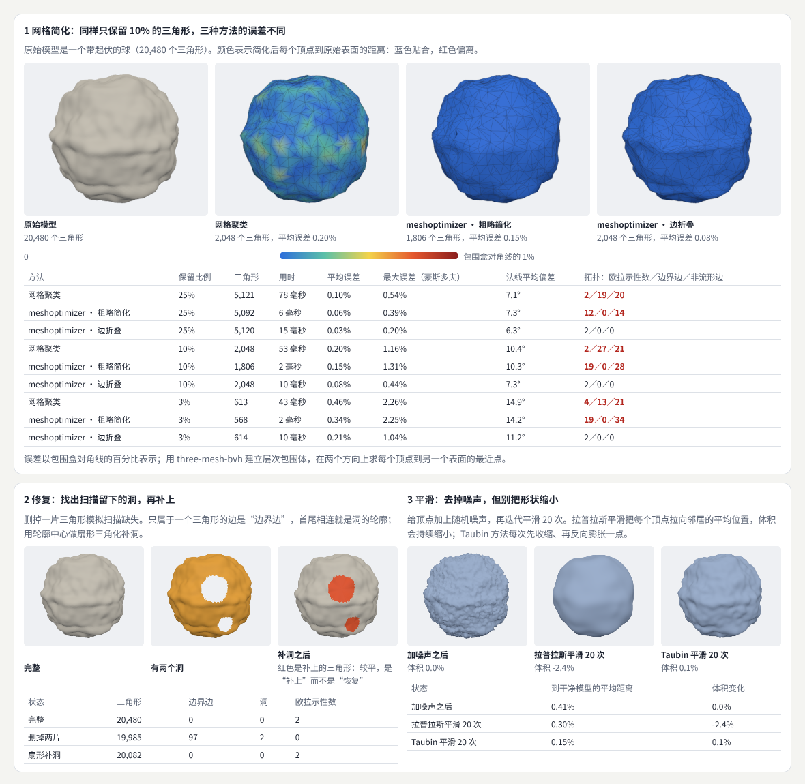
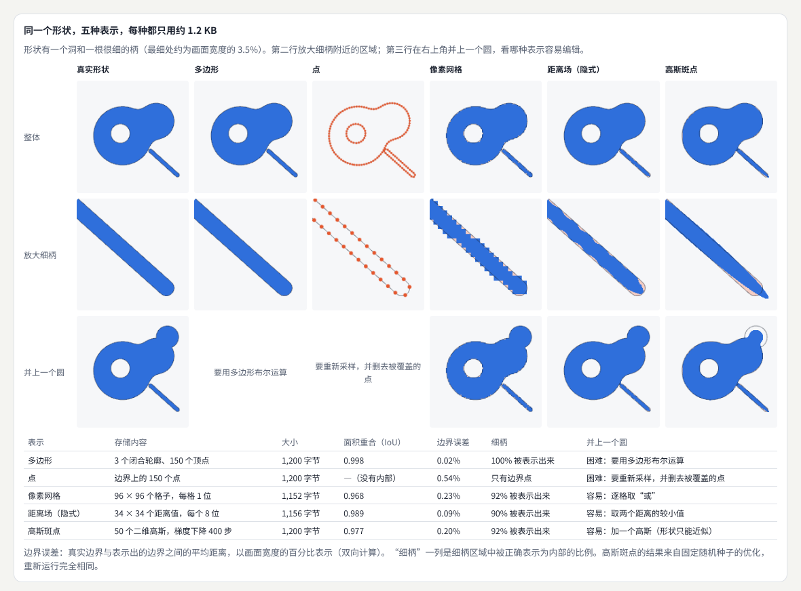
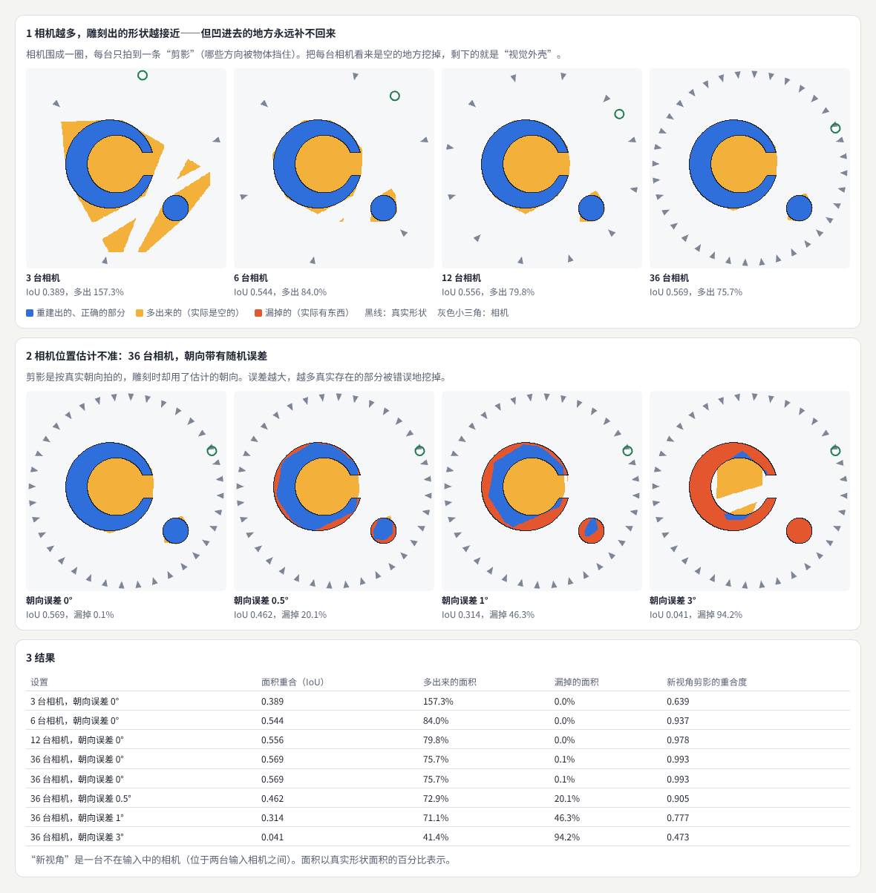
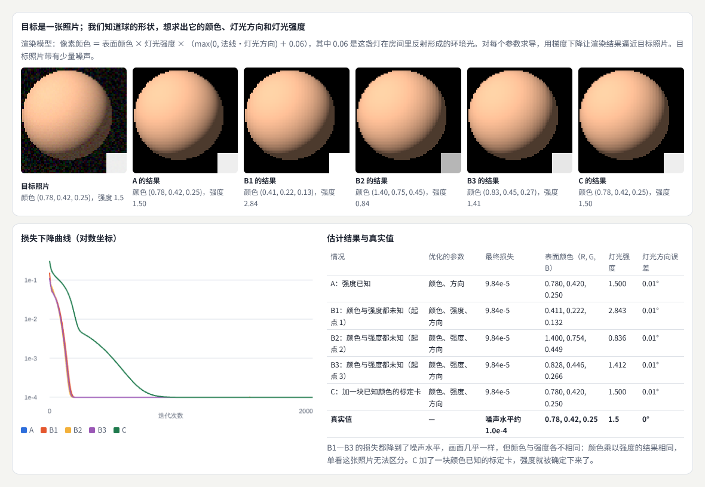
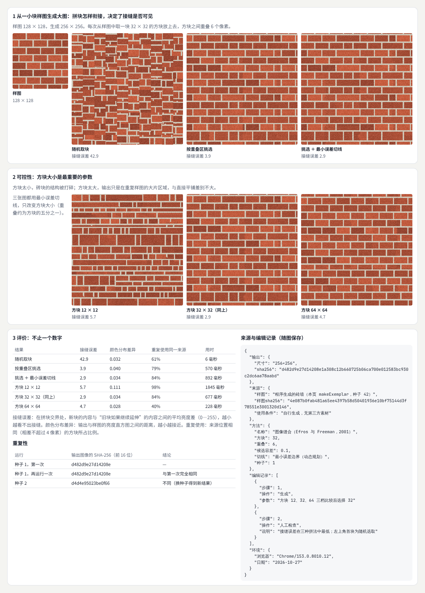
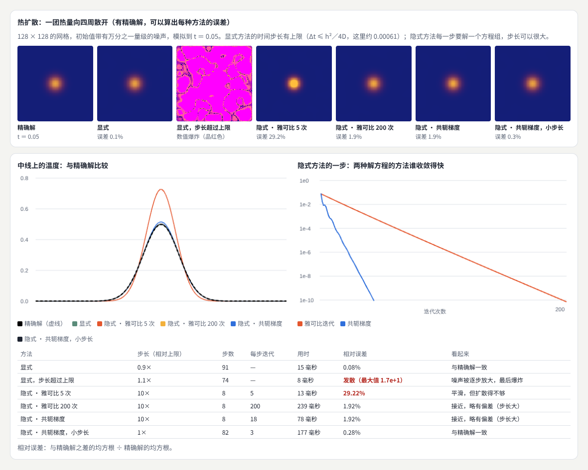
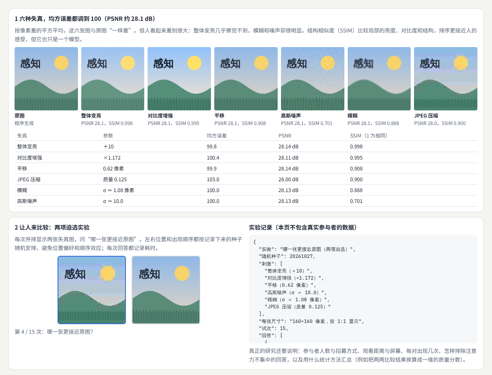
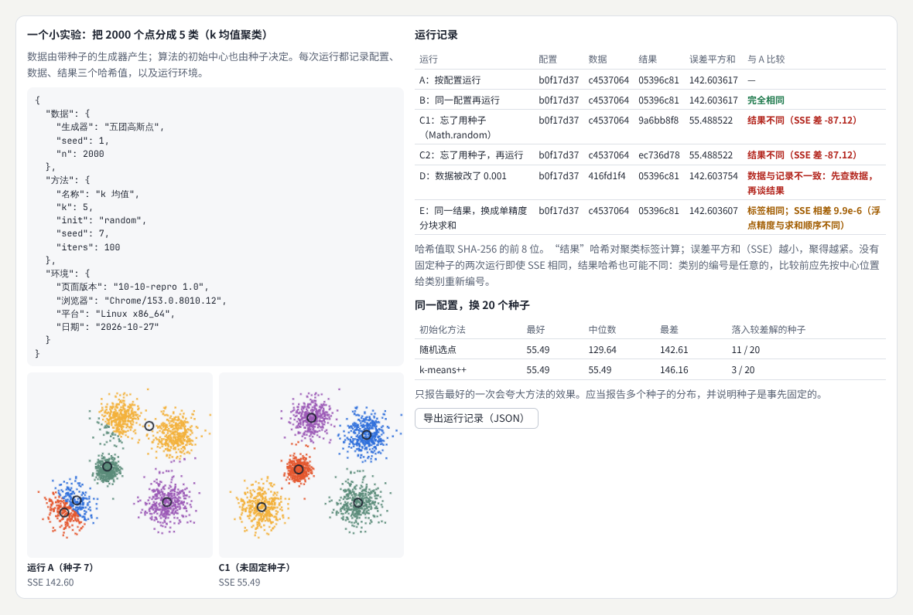
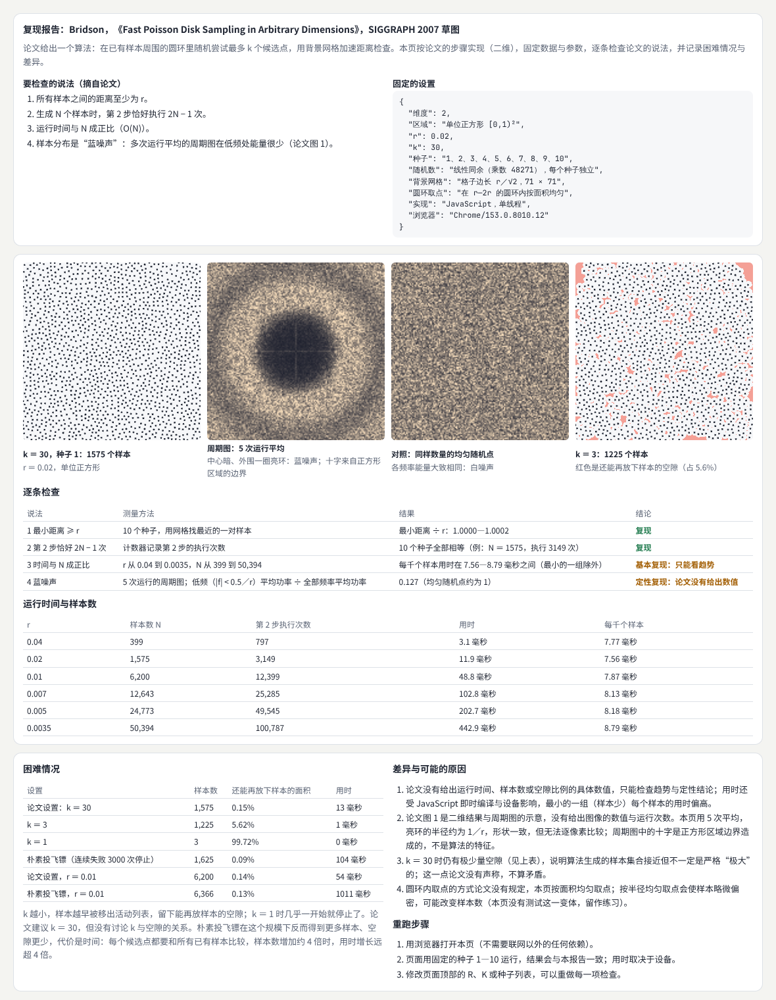

# 图形学与视觉计算研究

> 学会用研究的方式看待图形方法：从一个可以复现的小问题开始，弄清数据、假设、算法、评价与适用条件之间的关系；经过几何、表示、重建、逆向渲染、生成、模拟、感知评价与复现工具八个方向，最后亲手复现一篇论文，写出说明差异的复现报告。  
> 版本：1.0 · 整理日期：2026-10-25  
> 适用对象：已经能写交互图形程序，想读懂图形学论文、复现方法、比较方法优劣的开发者、设计师与学生。先修：读过[《图形工程与渲染系统》](09-图形工程与渲染系统.md)的 01—05 章；会用向量、矩阵和简单的求导（见[《图形与交互的数学基础》](20-图形与交互的数学基础.md)）；不需要机器学习背景。

**图形学与视觉计算研究**关注现有方法的局限与改进。工程问的是“怎样把它做出来、做得又快又稳”；研究问的是“这个方法为什么有效、在什么条件下有效、能不能更好”。

这需要四种能力同时使用：**数学**（描述问题和推导方法）、**程序实现**（把方法变成能运行、能测量的代码）、**文献阅读**（知道别人做过什么、声称了什么）和**实验设计**（怎样比较才公平、结论才可靠）。建议从可复现的小问题入手，**逐步理解数据**、**假设**、**算法**、**评价**与**适用条件之间的关系**。能够清楚地复现并解释一个方法，本身就是有价值的阶段成果——很多研究者的第一个项目就是复现。

本册每章都按同样的顺序讲：先说明它解决什么问题；再用白话解释核心概念；然后给出一个可以直接运行的示例与运行截图；接着是常见问题和本章练习；最后是一张**进阶学习卡**：技术栈、要掌握的高阶词汇（附英文，方便搜索论文）、搜索关键词、值得看的在线实例，以及从入门到深入的四级阶梯。研究方向的四级含义如下：

| 级别 | 含义 |
| --- | --- |
| L1 入门 | 能运行并解释本章示例，说出方法的输入、输出与假设 |
| L2 熟练 | 能用开源工具在自己的数据上跑通方法，并正确报告结果 |
| L3 进阶 | 能复现一篇论文的核心结果，设计对比实验，说明差异与限制 |
| L4 深入 | 能提出改进，设计评价，写出完整的研究报告或论文 |

四级是本手册的教学结构，不对应学位或职级。

所有示例都放在本目录的[示例](示例/)文件夹中，用浏览器直接打开即可运行；每个示例都已在浏览器中实际运行，书中的数字来自这些运行。研究方向的很多方法需要 GPU 和 Python 环境（例如 12 章介绍的三个参考项目），本册的示例刻意选用**能在浏览器里几秒钟跑完的小问题**——它们保留了方法的核心，让你能看清每一个数字从哪里来。

主线是：**学会研究项目的最小结构 → 在八个方向上各做一个小实验 → 复现一篇论文，写出说明成功、困难与差异的复现报告。**

## 阅读导航

正文共 13 章（01—13），附 9 个可运行示例、3 组附录与 24 项资料入口。

- [第一篇：共同的基础](#part-1)
  - [01 研究做什么](#ch01)
  - [02 研究项目的最小结构](#ch02)
- [第二篇：八个方向](#part-2)
  - [03 几何处理](#ch03)
  - [04 场景表示](#ch04)
  - [05 重建与新视角合成](#ch05)
  - [06 逆向与可微渲染](#ch06)
  - [07 图像生成与编辑](#ch07)
  - [08 高效模拟与计算](#ch08)
  - [09 感知质量与评价](#ch09)
  - [10 复现与研究工具](#ch10)
- [第三篇：综合项目与路线](#part-3)
  - [11 综合项目：复现一篇论文](#ch11)
  - [12 三个参考项目怎样入手](#ch12)
  - [13 工具、技术栈与学习路线](#ch13)
- [附录 A：术语表](#appendix-a)
- [附录 B：资料入口](#appendix-b)
- [附录 C：与原手册的对应关系及修订记录](#appendix-c)

## 第一篇：共同的基础

### 01 研究做什么

#### 01.1 从“能用”到“知道为什么”

同样是“网格简化”，工程上的问题是“把模型的三角形减少到一万个，看起来还不错”；研究上的问题是：

- 简化以后**误差有多大**，用什么量衡量？
- 不同方法在**什么样的模型**上表现不同？有没有失败的情况？
- 方法依赖什么**假设**（例如模型必须是封闭的）？假设不成立时会怎样？
- 能不能在同样的时间里得到更小的误差？

研究的产出不只是一段代码，而是**一组有证据支持、写明了条件的结论**。

#### 01.2 四种能力怎样配合

| 能力 | 在研究中的作用 | 本册在哪里练习 |
| --- | --- | --- |
| 数学 | 把问题写成可以计算的形式：误差、优化目标、方程 | 03、06、08 章 |
| 程序实现 | 让方法真正运行，并能测量每一个数字 | 全部示例 |
| 文献阅读 | 知道已有方法、它们的声称和限制 | 02、11、12 章 |
| 实验设计 | 固定条件、选择基线与指标、报告多次运行 | 02、09、10、11 章 |

#### 01.3 从小问题开始

刚开始做研究最常见的困难是问题太大。“改进三维重建”无法下手；“在只有 6 台相机时，视觉外壳多出来的体积有多少，相机朝向误差 1° 会让它怎样变化”就可以在一个下午做出结果（05 章）。**把问题缩小到能在一天内得到第一个数字**，再逐步扩大。

### 02 研究项目的最小结构

#### 02.1 七个部分

一份完整的小型研究报告应说明：

| 部分 | 回答的问题 | 常见的缺失 |
| --- | --- | --- |
| **问题** | 要解决什么，为什么重要 | 问题太大或不可测量 |
| **现有基线** | 现在最常用的方法是什么，表现如何 | 没有基线，只和“不做”比较 |
| **输入数据** | 用了哪些数据，从哪里来，有什么特点 | 只在一个精心挑选的例子上展示 |
| **方法** | 做了什么改变，依据是什么 | 一次改了好几处，不知道哪一处起作用 |
| **评价** | 用什么指标、什么条件比较 | 只有一个指标，或者指标与目标不符 |
| **结果** | 数字、图、失败案例 | 只报告最好的一次 |
| **限制** | 在什么情况下不适用 | 不写限制，结论被过度推广 |

#### 02.2 三条工作习惯

1. **先证明基线能在你的条件下运行**。拿到一个公开方法，先按原始说明跑出接近论文的结果，再动手改。如果基线都跑不通，后面的比较都不可信。
2. **一次只改变一个因素**。同时换了数据和参数，就无法知道变化来自哪里。
3. **保存失败案例**。方法在哪些输入上失败，能帮助界定它的边界——这往往比成功案例更有价值。

#### 02.3 怎样读一篇论文

1. 先读摘要和图，回答：**它声称了什么**？
2. 再读方法，回答：**它依赖什么假设**？输入是什么，输出是什么？
3. 读实验，回答：**用什么数据和指标证明了声称**？基线是什么？
4. 最后找限制（有时写在结论或补充材料里）：**它在哪里不行**？
5. 把声称写成可以检查的句子，例如“生成 N 个样本时第 2 步恰好执行 2N − 1 次”（11 章）。

#### 02.4 常见问题

- **论文太多，不知道读哪篇**：先读一个方向的综述或教程，再顺着引用找经典论文；参考项目（12 章）的项目页面通常列出了相关工作。
- **结果比论文差**：先确认数据、参数、评价方式是否与论文一致；差异本身就是值得记录的结果（11 章）。
- **不知道该用什么指标**：先问“这个方法要服务的任务是什么”，指标要能反映任务表现（09 章）。

**本章练习**：

1. 选一篇你感兴趣的图形论文，用 02.1 的七个部分为它写一页摘要，标出它没有写清楚的部分。
2. 把这篇论文的主要声称改写成三句“可以检查的句子”。

## 第二篇：八个方向

### 03 几何处理

#### 03.1 解决什么问题

研究**网格重建**、**简化**、**修复**、**参数化**和**变形**。需要同时观察**形状误差**、**拓扑**、**法线**和**计算成本**——只看一个方面，容易得出片面的结论。实际应用包括**模型处理**（为网页准备轻量模型）、**数字制造**（三维打印要求封闭、无自交的网格）、**动画**（变形与蒙皮）和**编辑工具**。

#### 03.2 核心概念

- **网格简化**：减少三角形数量，同时尽量保持形状。常用的**边折叠**每次把一条边的两个端点合并成一个点；**二次误差度量**（QEM）用一个 4 × 4 矩阵累积每个顶点到原始相邻平面的距离平方，选择误差最小的边先折叠。[B01](#ref-b01)
- **形状误差**：简化后的表面离原始表面有多远。常用**豪斯多夫距离**（两个表面之间“最远的那个最近距离”）和平均距离；要在两个方向上都算，否则会漏掉一侧的偏差。
- **拓扑**：网格的连接关系。封闭、无洞的网格，**欧拉示性数** V − E ＋ F 等于 2（球形）；只属于一个三角形的边是**边界边**（洞的边缘）；属于三个以上三角形的边是**非流形边**，很多算法和三维打印都无法处理。
- **修复**：找出洞、自交、重复面等问题并修正。
- **参数化**：把三维表面“摊平”到二维（例如生成贴图坐标），目标是尽量少拉伸。
- **变形**：在保持局部细节的前提下改变形状；平滑也是一种变形。

#### 03.3 示例：简化、修复与平滑

示例：[10-03-geometry.html](示例/10-03-geometry.html)

原始模型是一个带起伏和几道棱的球（20,480 个三角形）。三种简化方法：**网格聚类**（把落在同一个格子里的顶点合并，最简单）、meshoptimizer 的**粗略简化**（速度极快，不保证拓扑）和 meshoptimizer 的**边折叠**（基于二次误差度量，保持拓扑）。[B02](#ref-b02) 误差用 three-mesh-bvh 建立层次包围体，在两个方向上求最近点。[B03](#ref-b03)

| 方法（保留 10%） | 三角形 | 用时 | 平均误差 | 最大误差 | 法线偏差 | 欧拉示性数／边界边／非流形边 |
| --- | --- | --- | --- | --- | --- | --- |
| 网格聚类 | 2,048 | 51 毫秒 | 0.20% | 1.16% | 10.4° | 2／27／21 |
| meshoptimizer 粗略简化 | 1,806 | 2 毫秒 | 0.15% | 1.31% | 10.3° | 19／0／28 |
| meshoptimizer 边折叠 | 2,048 | 9 毫秒 | 0.08% | 0.44% | 7.3° | 2／0／0 |

（误差以包围盒对角线的百分比表示。保留 25% 和 3% 时排序相同：边折叠的平均误差分别为 0.03% 和 0.21%，也是唯一始终保持拓扑完好的方法。）

- **只看三角形数会被误导**：三种方法三角形数相近，误差却差了一倍以上。
- **只看平均误差也不够**：网格聚类的欧拉示性数恰好是 2，看起来“正常”，但它有 27 条边界边和 21 条非流形边——这样的模型不能直接用于三维打印或布尔运算。
- **速度与质量的取舍**：粗略简化最快，适合实时生成远处的细节层次；边折叠更适合离线准备资源。

另外两个小实验：

- **修复**：删掉两片三角形模拟扫描缺失后，网格有 97 条边界边、2 个洞，欧拉示性数变为 0。把边界边首尾相连得到两个洞的轮廓（38 和 59 个顶点），在轮廓中心加一个点做扇形三角化，边界边归零、欧拉示性数恢复为 2。但补上的部分是平的——**修复让网格“合法”，并没有恢复丢失的形状**。
- **平滑**：给顶点加上噪声（到干净模型的平均距离 0.41%）后平滑 20 次。拉普拉斯平滑把距离降到 0.30%，体积却缩小了 2.4%；Taubin 方法每次先收缩、再反向膨胀一点，距离降到 0.15%，体积只变化 ＋0.1%。[B04](#ref-b04)

#### 03.4 常见问题

- **简化后出现裂缝**：模型的顶点在贴图接缝处是分开的（位置相同但贴图坐标不同），简化算法把它们当成边界。先合并位置相同的顶点，或使用能处理属性的简化（three.js r186 的 `SimplifyModifier` 就是调用 meshoptimizer，并把法线和贴图坐标计入误差）。
- **误差数字很小，看起来却很糟**：平均误差掩盖了局部的大偏差，同时看最大误差和误差分布图。
- **三维打印软件拒绝模型**：检查边界边与非流形边，欧拉示性数不对通常意味着有洞或多余的连接。

**本章练习**：

1. 在示例中加入保留 1% 的一档，观察三种方法在拓扑上的差别。
2. 把平滑次数从 20 改为 100，记录两种方法的体积变化。

#### 03.5 进阶学习卡

| 级别 | 目标 | 怎样检验 |
| --- | --- | --- |
| L1 入门 | 能用现成工具简化模型，读懂三角形数与误差 | 说出示例表格每一列的含义 |
| L2 熟练 | 能用双向距离、法线与拓扑检查评价一个几何处理结果 | 为自己的模型写一份检查报告 |
| L3 进阶 | 能实现二次误差度量或参数化方法，并与开源实现对比 | 误差与开源实现在同一数量级 |
| L4 深入 | 能针对特定需求（保持特征线、带属性、超大模型）改进方法 | 在公开模型集上给出完整比较 |

- **技术栈**：meshoptimizer（简化、压缩，JavaScript 与 C++）[B02](#ref-b02)；three-mesh-bvh（最近点、射线求交）[B03](#ref-b03)；libigl（C++／Python 几何处理库，教程齐全）[B05](#ref-b05)；CGAL（计算几何算法库）；geometry-central 与 Polyscope（几何处理与可视化）；Blender 的修改器。
- **高阶词汇**：边折叠（edge collapse）、二次误差度量（quadric error metrics, QEM）、豪斯多夫距离（Hausdorff distance）、倒角距离（Chamfer distance）、欧拉示性数（Euler characteristic）、流形（manifold）、半边结构（half-edge data structure）、重新网格化（remeshing）、参数化（parameterization）、共形映射（conformal map）、拉普拉斯—贝尔特拉米算子（Laplace–Beltrami operator）、尽可能刚性变形（as-rigid-as-possible, ARAP）、Taubin 平滑（Taubin smoothing）、构造实体几何（CSG）。
- **搜索关键词**：`quadric error metrics mesh simplification`、`Hausdorff distance mesh comparison`、`libigl tutorial`、`as-rigid-as-possible deformation`、`mesh parameterization LSCM`、`non-manifold edge repair`、`网格简化 二次误差`。
- **值得看的实例**：[three.js 网格简化](https://threejs.org/examples/webgl_modifier_simplifier.html)——拖动滑块看三角形减少时轮廓的变化；[细分曲面](https://threejs.org/examples/webgl_modifier_subdivision.html)——与简化相反的操作；[构造实体几何](https://threejs.org/examples/webgl_geometry_csg.html)——网格之间的布尔运算。

### 04 场景表示

#### 04.1 解决什么问题

比较**网格**、**点**、**体积**、**隐式表示**、**辐射场**和**高斯表示怎样保存信息**。不同表示在**编辑**、**存储**、**渲染**、**重建**和**动态变化方面有不同特征**，应根据任务选择——没有一种表示在所有方面都最好。

#### 04.2 核心概念

| 表示 | 存什么 | 擅长 | 不擅长 |
| --- | --- | --- | --- |
| 网格 | 顶点与三角形 | 渲染快、精确的边界、工具成熟 | 拓扑变化、布尔运算要专门处理 |
| 点云 | 表面上的点 | 扫描设备直接输出 | 没有连接关系，不知道内外 |
| 体积（体素） | 规则格子里的占据或密度 | 编辑简单、适合医学和流体 | 分辨率受限，存储随尺寸立方增长 |
| 隐式表示（距离场） | 每个位置到表面的距离 | 布尔运算、平滑混合、碰撞查询 | 直接渲染需要光线步进 |
| 辐射场（NeRF 等） | 每个位置的密度与随方向变化的颜色 | 从照片重建复杂外观 | 编辑困难，训练与渲染成本高 |
| 三维高斯 | 大量带颜色的椭球形“斑点” | 从照片重建后能实时渲染 | 几何不精确，编辑与压缩仍在研究中 |

**辐射场**用一个函数（常用神经网络）表示空间中每一点的密度和颜色，通过对多视角照片做体渲染来训练。[B06](#ref-b06) **三维高斯溅射**用数百万个三维高斯代替神经网络，可以直接光栅化，实现了实时渲染。[B07](#ref-b07)

#### 04.3 示例：同一个形状的五种存法

示例：[10-04-representations.html](示例/10-04-representations.html)

为了看清每种表示的特点，示例用二维代替三维：一个有洞、带一根细柄（最细处约为画面宽度的 3.5%）的形状，每种表示都只用约 1200 字节，在 512 × 512 的网格上与真实形状比较：

| 表示 | 存储内容 | 面积重合（IoU） | 边界误差 | 细柄 | 并上一个圆 |
| --- | --- | --- | --- | --- | --- |
| 多边形 | 3 个闭合轮廓、150 个顶点 | 0.998 | 0.02% | 100% | 困难：要用多边形布尔运算 |
| 点 | 边界上的 150 个点 | —（没有内部） | 0.54% | 只有边界点 | 困难：要重新采样 |
| 像素网格 | 96 × 96，每格 1 位 | 0.968 | 0.23% | 92% | 容易：逐格取“或” |
| 距离场 | 34 × 34 个 8 位距离值 | 0.989 | 0.09% | 90% | 容易：取两个距离的较小值 |
| 高斯斑点 | 50 个二维高斯（梯度下降拟合） | 0.977 | 0.20% | 92.5% | 容易，但形状只能近似 |

- 对这个边界光滑的形状，**多边形最精确**，但编辑最难。
- **距离场**用很少的数据得到了光滑的边界，并且布尔运算只是一次取最小值；代价是细柄变窄后会出现起伏。
- **高斯斑点**通过优化得到（与三维高斯溅射同一思路，只是维度更低、数量更少），能表示任意形状，但边缘不锐利；加一个圆只能近似。
- **点**只记录了边界，不知道哪边是内部——这是点云重建要解决的第一个问题。

#### 04.4 常见问题

- **哪种表示最好**：取决于任务。要渲染快用网格；要频繁做布尔运算用距离场或体素；从照片重建外观用辐射场或高斯。
- **表示之间怎样转换**：距离场或体素 → 网格用“行进立方体”；点云 → 网格用泊松重建等方法；网格 → 距离场逐点计算到表面的距离。每次转换都会损失信息。
- **高斯表示能编辑吗**：可以移动、删除一组高斯，但“把椅子腿加长”这类语义编辑仍很困难，是活跃的研究问题。

**本章练习**：

1. 把每种表示的预算从 1200 字节改为 300 字节，重新比较，看哪种退化得最快。
2. 在示例中把“并上一个圆”改为“挖掉一个圆”，比较距离场与像素网格的写法。

#### 04.5 进阶学习卡

| 级别 | 目标 | 怎样检验 |
| --- | --- | --- |
| L1 入门 | 能说出六种表示各存什么、擅长什么 | 为三个任务各选一种表示并说明理由 |
| L2 熟练 | 能在表示之间转换，并测量转换误差 | 网格 → 距离场 → 网格后给出误差 |
| L3 进阶 | 能用开源代码训练辐射场或三维高斯，并比较存储、速度与画质 | 在同一数据上给出三项指标 |
| L4 深入 | 能为特定需求设计新的表示或压缩方法 | 在公开数据集上与已有表示比较 |

- **技术栈**：距离场的着色器实现（Inigo Quilez 的距离函数大全）[B08](#ref-b08)；three.js 的 `MarchingCubes`、点云加载器（PLY、PCD、XYZ）、`webgpu_gaussian_splat` 示例；Nerfstudio（辐射场与高斯溅射的训练框架）[B09](#ref-b09)；Instant-NGP（用多分辨率哈希编码加速辐射场）。
- **高阶词汇**：多边形网格（polygon mesh）、点云（point cloud）、体素（voxel）、有向距离场（signed distance field, SDF）、隐式曲面（implicit surface）、行进立方体（marching cubes）、泊松表面重建（Poisson surface reconstruction）、神经辐射场（neural radiance field, NeRF）、体渲染（volume rendering）、三维高斯溅射（3D Gaussian splatting）、球谐函数（spherical harmonics）、哈希编码（hash encoding）、交并比（intersection over union, IoU）。
- **搜索关键词**：`signed distance functions iquilezles`、`marching cubes explained`、`NeRF explained`、`3D gaussian splatting tutorial`、`nerfstudio splatfacto`、`poisson surface reconstruction`、`隐式表示 距离场`。
- **值得看的实例**：[三维高斯溅射（WebGPU）](https://threejs.org/examples/webgpu_gaussian_splat.html)——在浏览器中实时渲染重建好的高斯场景；[行进立方体](https://threejs.org/examples/webgl_marchingcubes.html)——从密度场实时生成网格；[点云加载](https://threejs.org/examples/webgl_loader_pcd.html)——扫描数据的原始形态。

### 05 重建与新视角合成

#### 05.1 解决什么问题

从多视图图像等输入**恢复场景**或**合成新的观察角度**。要关注**相机估计**、**遮挡**、**稀疏输入**和**未观测区域**。还要分清三个不同的任务：**重建外观**（新视角看起来像照片）、**恢复可编辑几何**（得到能用于制造或动画的网格）与**获得物理材质**（知道表面的颜色、粗糙度，能在新光照下重新渲染）——一个方法在第一项上表现好，不代表它在后两项上也好。

#### 05.2 核心概念

- **相机估计**：先要知道每张照片是从哪里、朝哪个方向拍的。常用**运动恢复结构**（SfM）：在照片之间匹配特征点，同时求出相机位置和稀疏的三维点。COLMAP 是最常用的开源工具。[B10](#ref-b10)
- **视觉外壳**：每台相机拍到物体的轮廓（剪影），把每台相机看来是“空”的地方都挖掉，剩下的就是视觉外壳。[B11](#ref-b11) 它是真实形状的“外包络”，永远不会比真实形状小（相机准确时），但**凹进去的地方无法恢复**。
- **新视角合成**：从已有照片生成一个没有拍过的角度的画面。辐射场与三维高斯（04 章）是目前的主流方法。

#### 05.3 示例：从轮廓雕刻出形状

示例：[10-05-reconstruction.html](示例/10-05-reconstruction.html)

场景是一个开口很窄、内部很深的 C 形物体和一个小圆。相机围成一圈，每台只拍到一条一维的剪影：

| 设置 | 面积重合（IoU） | 多出来的面积 | 漏掉的面积 | 新视角剪影的重合度 |
| --- | --- | --- | --- | --- |
| 3 台相机 | 0.389 | 157.3% | 0.0% | 0.639 |
| 6 台相机 | 0.544 | 84.0% | 0.0% | 0.937 |
| 12 台相机 | 0.556 | 79.8% | 0.0% | 0.978 |
| 36 台相机 | 0.569 | 75.7% | 0.1% | 0.993 |
| 36 台，朝向误差 0.5° | 0.462 | 72.9% | 20.1% | 0.905 |
| 36 台，朝向误差 1° | 0.314 | 71.1% | 46.3% | 0.777 |
| 36 台，朝向误差 3° | 0.041 | 41.4% | 94.2% | 0.473 |

（面积以真实形状面积的百分比表示；“新视角”是一台位于两台输入相机之间、不参与重建的相机。）

- **稀疏输入**：3 台相机时多出来的面积超过真实形状本身（157%），两个物体之间还出现了“幽灵”区域；新视角的剪影只有 64% 重合。
- **未观测区域**：即使有 36 台相机，C 形的内部仍然没有被挖掉——任何一台相机都看不到“里面是空的”。多出来的 75.7% 几乎都在这里。**增加同类观测不能弥补根本看不到的地方**，要换一种观测方式（例如从开口方向拍、用深度相机）。
- **相机估计**：36 台相机，每台朝向只差 0.5°，就有 20% 的真实部分被错误地挖掉；3° 时几乎全部消失。原因是雕刻取所有相机的交集：**任何一台相机出错都会挖掉正确的部分**。实际的重建系统会同时优化相机与场景（光束法平差），或者允许少数相机“投反对票”。
- **新视角**的误差随相机数减少而增大，但即使输入视角的剪影完全吻合，新视角仍然可能不对——这正是新视角合成要评价“没见过的角度”的原因。

#### 05.4 常见问题

- **重建结果有很多漂浮的碎片**：相机位置不准，或者照片之间光照、曝光差别太大。先检查 SfM 的重投影误差。
- **表面颜色看起来对，几何却是乱的**：新视角合成只要求“看起来像”，几何可能是错的。需要几何时，要加入深度或法线约束，或换用面向几何的方法。
- **只拍了正面，背面是乱的**：未观测区域无法凭空恢复；要么补拍，要么用先验（例如对称、生成模型补全），并在结果中标明哪些部分是推测的。

**本章练习**：

1. 在示例中把 C 形的开口转向一台相机，观察内部能否被挖掉。
2. 给相机位置（而不是朝向）加上误差，比较两种误差的影响。

#### 05.5 进阶学习卡

| 级别 | 目标 | 怎样检验 |
| --- | --- | --- |
| L1 入门 | 能说出相机估计、遮挡、稀疏输入与未观测区域分别影响什么 | 解释示例表格中的每一行 |
| L2 熟练 | 能用 COLMAP 从自己拍的照片得到相机位置与稀疏点云 | 重投影误差在合理范围 |
| L3 进阶 | 能训练辐射场或三维高斯，并用留出的视角评价新视角质量 | 报告留出视角上的 PSNR 与 SSIM |
| L4 深入 | 能改进稀疏视角、动态场景或几何质量中的一项 | 在公开数据集上与基线比较 |

- **技术栈**：COLMAP（运动恢复结构与多视图立体）[B10](#ref-b10)；Nerfstudio[B09](#ref-b09)；三维高斯溅射的官方实现[B07](#ref-b07)；OpenCV（相机标定）；Polycam、RealityScan 等手机扫描应用（快速获得数据）。
- **高阶词汇**：运动恢复结构（structure from motion, SfM）、多视图立体（multi-view stereo, MVS）、光束法平差（bundle adjustment）、重投影误差（reprojection error）、相机内参与外参（intrinsics／extrinsics）、视觉外壳（visual hull）、空间雕刻（space carving）、光度一致性（photo-consistency）、新视角合成（novel view synthesis）、留出视角（held-out views）、漂浮物（floaters）。
- **搜索关键词**：`COLMAP tutorial structure from motion`、`bundle adjustment explained`、`visual hull shape from silhouette`、`novel view synthesis sparse views`、`gaussian splatting floaters`、`多视图重建 相机标定`。
- **值得看的实例**：[三维高斯溅射项目页](https://repo-sam.inria.fr/fungraph/3d-gaussian-splatting/)——对比视频展示了不同方法在同一场景上的新视角质量；[NeRF 项目页](https://www.matthewtancik.com/nerf)——辐射场的原始演示。

### 06 逆向与可微渲染

#### 06.1 解决什么问题

渲染是“已知场景，求图像”；**逆向渲染**反过来，使用**图像和场景之间的关系估计材质**、**光照**或**形状**。困难在于：问题**可能存在多种解释**——不同的场景可以产生同一张图像，所以需要**约束**、**先验**和**合适数据**。动手之前，应明确**优化哪些参数，哪些条件保持已知**。

#### 06.2 核心概念

- **可微渲染**：把渲染过程看成一个函数，求出“图像对每个场景参数的导数”。有了导数，就可以用梯度下降不断调整参数，让渲染结果接近目标照片。[B12](#ref-b12)
- **损失函数**：衡量渲染结果与目标的差距，最常用的是逐像素差的平方平均。
- **不适定问题**：解不唯一或对噪声极其敏感。最经典的例子：表面颜色乘以灯光强度——颜色暗一半、灯光亮一倍，照片完全一样。
- **先验**：对答案的事先了解，例如“表面反射率不超过 1”“形状是光滑的”。
- **约束与额外数据**：加入一个已知颜色的标定卡、多拍一张不同光照的照片，都能排除一部分解释。

#### 06.3 示例：从一张照片反推颜色与灯光

示例：[10-06-inverse.html](示例/10-06-inverse.html)

渲染模型：像素颜色 ＝ 表面颜色 × 灯光强度 ×（max(0, 法线·灯光方向) ＋ 0.06）。球的形状已知，目标照片带有少量噪声；对每个参数手工推导导数，用 Adam 优化器迭代 2000 步：

| 情况 | 优化的参数 | 最终损失 | 表面颜色（R, G, B） | 灯光强度 | 方向误差 |
| --- | --- | --- | --- | --- | --- |
| A：强度已知 | 颜色、方向 | 9.84 × 10⁻⁵ | 0.780, 0.420, 0.250 | 1.500 | 0.01° |
| B1：都未知（起点 1） | 颜色、强度、方向 | 9.84 × 10⁻⁵ | 0.411, 0.222, 0.132 | 2.843 | 0.01° |
| B2：都未知（起点 2） | 颜色、强度、方向 | 9.84 × 10⁻⁵ | 1.400, 0.754, 0.449 | 0.836 | 0.01° |
| B3：都未知（起点 3） | 颜色、强度、方向 | 9.84 × 10⁻⁵ | 0.828, 0.446, 0.266 | 1.412 | 0.01° |
| C：加一块已知颜色的标定卡 | 颜色、强度、方向 | 9.84 × 10⁻⁵ | 0.780, 0.420, 0.250 | 1.500 | 0.01° |
| 真实值 | — | 噪声水平约 1.0 × 10⁻⁴ | 0.78, 0.42, 0.25 | 1.5 | 0° |

- **A**：强度已知时，颜色与方向都被准确求出——问题是适定的。
- **B1—B3**：三次优化的损失完全相同，都降到了噪声水平，画面也几乎一样；但颜色和强度各不相同，只有“颜色 × 强度”相同（都是 1.170, 0.630, 0.376）。**损失低不代表参数对**。
- **B2** 的红色通道是 1.40——真实表面不可能反射比照到它更多的光。“反射率不超过 1”这条**先验**可以排除它，但仍无法在 B1 与 B3 之间做出选择。
- **C**：加一块颜色已知（0.8 的灰）的标定卡后，强度被确定下来，解变成唯一的。注意截图中 B1、B2 的结果图里，标定卡的亮度与目标明显不同——**额外的已知数据暴露了歧义**。
- **方向**在所有情况下都被准确求出：明暗交界的位置只取决于方向，与颜色、强度无关。

另一个观察：C 在迭代 600 步时还没有收敛（强度停在 1.63），2000 步才到达真实值。**优化没收敛和问题有多解，从结果上看可能很像**，要画出损失曲线并从不同起点多运行几次。

#### 06.4 常见问题

- **形状也想一起优化**：形状改变会让物体的轮廓移动，轮廓处的像素从“物体”变成“背景”是不连续的，普通的求导在这里失效。可微渲染器用专门的方法处理边界（例如边缘采样、软光栅化），这是这个方向的核心技术难点之一。
- **损失降不下去**：检查导数是否正确（与有限差分比较）、学习率是否合适、参数是否有合理的取值范围。
- **结果对初值敏感**：说明有多个局部最优或者问题不适定。多起点运行，并加入先验或数据。

**本章练习**：

1. 在示例中把环境光 0.06 改为 0，观察 A 在阴影区域的表现。
2. 增加第二张照片：同一个球、已知的另一盏灯方向。不加标定卡，能否区分颜色与强度？

#### 06.5 进阶学习卡

| 级别 | 目标 | 怎样检验 |
| --- | --- | --- |
| L1 入门 | 能说出逆向渲染优化什么、已知什么，以及为什么会有多个解 | 解释 B1—B3 为什么损失相同 |
| L2 熟练 | 能用 Mitsuba 3 按官方教程恢复一面墙的颜色 | 重现教程中的收敛曲线 |
| L3 进阶 | 能设计实验区分“没收敛”与“不唯一”，并加入先验或数据 | 多起点结果一致 |
| L4 深入 | 能处理形状与可见性的导数，或把逆向渲染用于真实照片 | 在真实数据上报告误差与失败案例 |

- **技术栈**：Mitsuba 3（物理渲染器，支持自动求导）[B12](#ref-b12)；nvdiffrast（可微光栅化）；PyTorch3D（三维深度学习与可微渲染）；PyTorch 或 JAX（自动求导）。
- **高阶词汇**：逆向渲染（inverse rendering）、可微渲染（differentiable rendering）、自动微分（automatic differentiation）、梯度下降（gradient descent）、Adam 优化器（Adam optimizer）、损失函数（loss function）、不适定问题（ill-posed problem）、先验（prior）、正则化（regularization）、反射率（albedo）、双向反射分布函数（BRDF）、可见性不连续（visibility discontinuity）、边缘采样（edge sampling）、有限差分检查（finite-difference gradient check）。
- **搜索关键词**：`mitsuba 3 gradient based optimization tutorial`、`differentiable rendering visibility discontinuities`、`nvdiffrast`、`inverse rendering albedo lighting ambiguity`、`finite difference gradient check`、`可微渲染`。
- **值得看的实例**：[Mitsuba 3 梯度优化教程](https://mitsuba.readthedocs.io/en/stable/src/inverse_rendering/gradient_based_opt.html)——先渲染康奈尔盒子，再把一面墙改成蓝色，用梯度下降恢复原来的颜色，正好对应本章示例的情况 A。

### 07 图像生成与编辑

#### 07.1 解决什么问题

探索**生成模型**、**可控编辑**、**风格**和**一致性**。评价应包含**内容正确性**、**可控性**、**重复性**和**任务适配**。应用到设计时还需要保存**来源**、**编辑记录**和**素材使用条件**。

#### 07.2 核心概念

- **生成模型**：从样例或描述生成新的图像。早期的纹理合成从一小块样图生成大图；今天的扩散模型从文字描述生成整张图像。两者面对的评价问题是相通的。
- **可控性**：用户能不能通过参数、草图、参考图等方式控制结果。ControlNet 等方法给扩散模型加入了边缘、深度、姿态等条件。[B13](#ref-b13)
- **一致性**：同一组参数、同一个随机种子，能否得到同样的结果；多张图之间风格、角色是否一致。
- **来源记录**：生成图用了哪些素材、哪个模型、什么参数、经过了哪些编辑。C2PA（内容来源与真实性联盟）制定了把这些信息附在文件里的开放标准。[B14](#ref-b14)

#### 07.3 示例：纹理合成

示例：[10-07-synthesis.html](示例/10-07-synthesis.html)

示例实现了经典的**图像缝合**算法：从样图中挑选方块，让它和已经放好的内容在重叠区尽量吻合，再沿误差最小的曲线切开。[B15](#ref-b15)

| 结果 | 接缝误差 | 颜色分布差异 | 重复使用同一来源 | 用时 |
| --- | --- | --- | --- | --- |
| 随机取块 | 42.9 | 0.032 | 61% | 6 毫秒 |
| 按重叠区挑选 | 3.9 | 0.040 | 79% | 570 毫秒 |
| 挑选 ＋ 最小误差切线 | 2.9 | 0.034 | 84% | 892 毫秒 |
| 方块 12 × 12 | 5.7 | 0.111 | 98% | 1845 毫秒 |
| 方块 64 × 64 | 4.7 | 0.028 | 40% | 228 毫秒 |

（接缝误差：拼块交界处新块的内容与“旧块如果继续延伸”的内容之间的平均亮度差，0—255。用时为一次运行的结果，其他运行在同一数量级。）

- **内容正确性不能只看统计**：随机取块的颜色分布与样图非常接近（0.032），画面却满是错位的砖缝。统计相似是必要条件，不是充分条件。
- **可控性**：方块大小是最重要的参数。太小（12）时砖块的结构被打碎，太大（64）时只是在重复样图的大片区域。
- **重复性**：同一个种子运行两次，输出图像的 SHA-256 完全相同；换一个种子，得到不同的结果。生成工具应当**记录种子**，否则用户无法重现一张满意的结果。
- **来源与编辑记录**：页面右侧的记录包含样图的哈希值、使用条件（本例是自行程序生成的，没有第三方素材）、方法与全部参数、编辑步骤和运行环境。

#### 07.4 用到设计中时

- **任务适配**：生成结果要放进真实的版面里检查，看在实际尺寸、实际内容旁边是否合适。
- **素材使用条件**：生成模型的训练数据、样图、参考图都可能有使用限制。在记录中写明来源，交付前由负责人按适用规则确认。
- **人工编辑**：生成之后的修改也要记录，便于日后解释“这张图是怎样来的”。

#### 07.5 常见问题

- **每次生成都不一样，客户想要“上次那张”**：没有保存种子和完整参数。把它们和图一起存档。
- **评价分数高，设计师却不满意**：指标与任务不符。补充任务相关的检查，例如在版面中的可读性、品牌色是否准确。
- **看起来很像某个已有作品**：检查是否大面积复制了样图或训练素材；示例中“重复使用同一来源”一列就是一个简单的检查。

**本章练习**：

1. 把示例的样图换成一张你自己画的图案，找出最合适的方块大小。
2. 为来源记录增加一项“人工修改区域”，在生成图上手动修改一块后更新记录。

#### 07.6 进阶学习卡

| 级别 | 目标 | 怎样检验 |
| --- | --- | --- |
| L1 入门 | 能说出生成结果要从哪几个方面评价，会记录种子与参数 | 重新生成同一张图 |
| L2 熟练 | 能用开源生成工具完成一项带条件的生成任务，并保存来源记录 | 记录可以完整重现结果 |
| L3 进阶 | 能设计评价，区分统计相似、内容正确与任务适配 | 给出指标与人工评价的对照 |
| L4 深入 | 能改进可控性或一致性，并在公开基准上评价 | 与已有方法比较 |

- **技术栈**：扩散模型的开源实现与图形界面工具；ControlNet[B13](#ref-b13)；C2PA 内容凭证[B14](#ref-b14)；浏览器的 `crypto.subtle`（计算哈希，用于来源记录）。
- **高阶词汇**：纹理合成（texture synthesis）、图像缝合（image quilting）、最小误差边界切割（minimum error boundary cut）、扩散模型（diffusion model）、条件生成（conditional generation）、无分类器引导（classifier-free guidance）、图像修补（inpainting）、风格迁移（style transfer）、随机种子（random seed）、内容来源与真实性（content provenance）、内容凭证（content credentials）、训练数据记忆（memorization）。
- **搜索关键词**：`image quilting texture synthesis`、`ControlNet conditional control`、`diffusion model classifier-free guidance`、`C2PA content credentials`、`generative model memorization`、`纹理合成`。
- **值得看的实例**：[图像缝合项目页](https://people.eecs.berkeley.edu/~efros/research/quilting.html)——原作者给出的大量合成结果与纹理迁移示例。

### 08 高效模拟与计算

#### 08.1 解决什么问题

改进**模拟速度**、**稳定性**或**精度**，研究**并行方法**、**近似**与**混合方案**。每种简化都应说明适用情况；**视觉演示和科学分析需要各自的评价标准**——看起来对，不一定算得对。

#### 08.2 核心概念

- **显式方法**：用当前状态直接算出下一步，简单、每步便宜，但时间步长有上限，超过就会发散。
- **隐式方法**：下一步的状态出现在方程两边，每一步要解一个方程组；步长可以很大而不发散，但每步更贵，大步长会带来精度损失。
- **迭代求解**：方程组太大时，用迭代逐步逼近答案。**雅可比迭代**简单、容易并行，但收敛慢；**共轭梯度**在方程组对称正定时收敛快得多。[B16](#ref-b16)
- **混合方案**：例如用便宜的方法算大部分区域，只在关键区域用精确方法；或者先用粗网格算个大概，再在细网格上修正（多重网格）。

#### 08.3 示例：热扩散

示例：[10-08-simulation.html](示例/10-08-simulation.html)

一团热量在平面上散开，这个问题有精确解，可以算出每种方法的误差。128 × 128 的网格，初始值带有万分之一量级的噪声（真实数据总有噪声），显式方法的步长上限约为 0.00061：

| 方法 | 步长（相对上限） | 步数 | 每步迭代 | 用时 | 相对误差 |
| --- | --- | --- | --- | --- | --- |
| 显式 | 0.9× | 91 | — | 15 毫秒 | 0.08% |
| 显式，步长超过上限 | 1.1× | 74 | — | 8 毫秒 | 发散 |
| 隐式 · 雅可比 5 次 | 10× | 8 | 5 | 13 毫秒 | 29.22% |
| 隐式 · 雅可比 200 次 | 10× | 8 | 200 | 239 毫秒 | 1.92% |
| 隐式 · 共轭梯度 | 10× | 8 | 18 | 78 毫秒 | 1.92% |
| 隐式 · 共轭梯度，小步长 | 1× | 82 | 3 | 177 毫秒 | 0.28% |

- **稳定性**：步长只超过上限 10%，显式方法就发散了——噪声在每一步被放大约 1.2 倍，74 步后最大值达到 16.7。值得注意的是，如果初始值完全没有噪声，74 步内看不出问题（舍入误差太小）；**测试稳定性时要用带噪声的数据**。
- **看起来对 ≠ 算得对**：雅可比只迭代 5 次的结果是一团平滑的热量，作为视觉效果完全可以接受；但它扩散得不够，峰值是 0.73 而不是 0.50，误差 29%。用于游戏特效可能没问题，用于科学分析就是错的。
- **算法的选择比优化代码更重要**：达到同样精度，共轭梯度每步 18 次迭代，雅可比要 200 次左右，用时约为三分之一。右下图中，共轭梯度 24 次迭代就把残差降到 10⁻⁶。
- **大步长的代价**：隐式方法用 10 倍步长时，即使方程解得很准，仍有 1.92% 的误差——这是方法本身（向后欧拉是一阶方法）随步长增大的误差；步长缩小到 1 倍，误差降到 0.28%。

#### 08.4 常见问题

- **模拟偶尔爆炸**：步长接近稳定上限，或者某些区域的参数（例如刚度）特别大。降低步长、换隐式方法，或者对时间步做自适应调整。
- **并行化后结果和单线程不一样**：浮点数相加的顺序变了，结果在最后几位上不同（10 章）。比较时用误差容限，而不是逐位相等。
- **为了速度用了近似，不知道能不能用**：拿一个有精确解或高精度参考的情况，量化近似的误差，并写进说明。

**本章练习**：

1. 把显式方法的步长设为 1.0×、1.05×，记录它在多少步后开始发散。
2. 实现一个两层的混合方案：先在 64 × 64 网格上用共轭梯度求解，再插值到 128 × 128 作为初值，比较迭代次数。

#### 08.5 进阶学习卡

| 级别 | 目标 | 怎样检验 |
| --- | --- | --- |
| L1 入门 | 能说出显式与隐式方法的区别，知道稳定上限 | 解释示例中的发散 |
| L2 熟练 | 能为一个模拟选择方法与步长，并用精确解或参考解量化误差 | 给出误差随步长变化的曲线 |
| L3 进阶 | 能实现共轭梯度、多重网格或位置动力学，并在 GPU 上并行 | 与 CPU 版本比较正确性与速度 |
| L4 深入 | 能提出新的近似或混合方案，说明适用范围与误差界 | 在标准测试问题上比较 |

- **技术栈**：WebGPU 计算着色器（[《图形工程与渲染系统》](09-图形工程与渲染系统.md) 08 章）；Ten Minute Physics（位置动力学、流体、布料的短教程与代码）[B17](#ref-b17)；Taichi、JAX、NVIDIA Warp 等面向模拟的编程框架；SciPy 的稀疏求解器。
- **高阶词汇**：显式欧拉（explicit Euler）、隐式欧拉／向后欧拉（implicit／backward Euler）、稳定性条件（CFL condition）、刚性（stiffness）、雅可比迭代（Jacobi iteration）、高斯—赛德尔迭代（Gauss–Seidel）、共轭梯度（conjugate gradient）、预条件（preconditioning）、多重网格（multigrid）、位置动力学（position-based dynamics）、截断误差（truncation error）、收敛阶（order of convergence）、残差（residual）。
- **搜索关键词**：`conjugate gradient without the agonizing pain`、`CFL condition explicit stability`、`multigrid tutorial`、`position based dynamics ten minute physics`、`implicit integration cloth Baraff Witkin`、`隐式积分 稳定性`。
- **值得看的实例**：[GPU 计算布料（WebGPU）](https://threejs.org/examples/webgpu_compute_cloth.html)；[GPU 粒子流体（WebGPU）](https://threejs.org/examples/webgpu_compute_particles_fluid.html)——观察大规模并行模拟的视觉效果，并思考它们用了哪些近似。

### 09 感知质量与评价

#### 09.1 解决什么问题

结合**图像误差**、**任务表现**和**人的评价比较方法**。**一个数值指标只能反映部分差异**；主观实验应**控制展示方式与顺序**，并说明**参与者**和**样本范围**。

#### 09.2 核心概念

- **逐像素误差**：均方误差（MSE）和由它换算的峰值信噪比（PSNR）。计算简单，但与人的感受常常不一致。
- **结构相似度**（SSIM）：在局部窗口里比较亮度、对比度和结构，更接近人的判断。[B18](#ref-b18)
- **学习得到的感知指标**：例如 LPIPS，用神经网络的特征比较图像，在很多失真上与人的判断更一致。[B19](#ref-b19)
- **任务表现**：如果图像是为某个任务服务的（读出数值、找到目标），最直接的评价是任务完成得怎样。
- **主观实验**：让人来比较。**两项迫选**（2AFC）每次并排显示两个结果，问“哪一个更好”；需要随机化位置与顺序，记录观看条件。电视图像质量的主观评价有国际电联的推荐方法可以参考。[B20](#ref-b20)

#### 09.3 示例：同样的误差，看起来不一样

示例：[10-09-perception.html](示例/10-09-perception.html)

六种失真的均方误差都调到了约 100（PSNR 约 28.1 dB），按 SSIM 从高到低排列：

| 失真 | 参数 | 均方误差 | PSNR | SSIM |
| --- | --- | --- | --- | --- |
| 整体变亮 | 每个像素 ＋10 | 99.8 | 28.14 dB | 0.998 |
| 对比度增强 | × 1.172 | 100.4 | 28.11 dB | 0.995 |
| 平移 | 0.62 像素 | 99.9 | 28.14 dB | 0.908 |
| JPEG 压缩 | 质量 0.125 | 103.0 | 28.00 dB | 0.900 |
| 模糊 | σ ＝ 1.08 像素 | 100.0 | 28.13 dB | 0.888 |
| 高斯噪声 | σ ＝ 10 | 100.0 | 28.13 dB | 0.701 |

- 按 PSNR，这六张图“一样差”；但整体变亮几乎察觉不到，噪声和模糊却很明显。**同一个 PSNR 可以对应完全不同的观感。**
- SSIM 把变亮、对比度放在前面，把噪声放在最后，排序更接近一般人的感受。但它也只是一个模型：例如平移 0.62 像素，人几乎看不出来，SSIM 却把它排在第三。
- **用多个指标，并辅以人的评价**。

示例下半部分是一个两项迫选实验：6 种失真两两组合共 15 对，左右位置和出现顺序都由记录下来的种子随机安排，每次回答记录耗时。页面只演示流程和记录格式，**不包含真实参与者的数据**；真正的研究还要说明参与者人数与招募方式、观看距离与屏幕、每对出现几次、怎样排除注意力不集中的回答，以及用什么统计方法把两两比较汇总成质量分数。

#### 09.4 常见问题

- **论文里的 PSNR 比我的高，画面却不如我的**：PSNR 对模糊比较宽容，偏好“平均”的结果。补充 SSIM、LPIPS 和人工比较。
- **主观实验只请了组里的几个同事**：样本太小且有偏差（他们知道哪个是自己的方法）。至少要盲测，并说明参与者范围。
- **指标之间结论矛盾**：说明这些方法在不同方面各有优劣，如实报告，并结合任务说明哪个方面更重要。

**本章练习**：

1. 请三位朋友完成示例中的 15 次比较，把结果按“被选中的次数”排序，与 SSIM 的排序比较。
2. 在示例中加入第七种失真“颜色偏移”（只改变色相），观察 PSNR 与 SSIM（只算亮度）的反应。

#### 09.5 进阶学习卡

| 级别 | 目标 | 怎样检验 |
| --- | --- | --- |
| L1 入门 | 能计算并解释 MSE、PSNR、SSIM，知道它们的局限 | 说出示例中 PSNR 失效的原因 |
| L2 熟练 | 能为一个方法选择多种指标，并做一个小型盲测 | 报告指标与人工排序的一致程度 |
| L3 进阶 | 能设计符合规范的主观实验，并用统计方法汇总 | 说明参与者、条件与置信区间 |
| L4 深入 | 能为特定任务提出或验证新的质量指标 | 与人的判断比较相关性 |

- **技术栈**：SSIM 的参考实现[B18](#ref-b18)；LPIPS[B19](#ref-b19)；scikit-image 的 `metrics` 模块；PsychoPy、jsPsych（搭建心理物理实验）；ITU-R BT.500[B20](#ref-b20)。
- **高阶词汇**：均方误差（mean squared error, MSE）、峰值信噪比（PSNR）、结构相似度（SSIM）、多尺度 SSIM（MS-SSIM）、学习得到的感知相似度（LPIPS）、全参考与无参考评价（full-reference／no-reference）、两项迫选（two-alternative forced choice, 2AFC）、平均意见分（mean opinion score, MOS）、成对比较（pairwise comparison）、布拉德利—特里模型（Bradley–Terry model）、盲测（blind test）、刚好可察觉差异（just noticeable difference, JND）。
- **搜索关键词**：`SSIM structural similarity explained`、`LPIPS perceptual similarity`、`2AFC pairwise comparison scaling`、`ITU-R BT.500 subjective assessment`、`full reference image quality metrics`、`图像质量评价 主观实验`。
- **值得看的实例**：[LPIPS 项目页](https://richzhang.github.io/PerceptualSimilarity/)——展示了人与各种指标判断不一致的图像对。

### 10 复现与研究工具

#### 10.1 解决什么问题

管理**代码**、**依赖**、**数据**、**随机种子**、**训练**或**运行配置**。为每个实验保留可追踪的记录。发现无法复现的部分时，应记录差异和可能原因，再设计验证。

#### 10.2 核心概念

- **可追踪**：任何一个结果都能回答“用哪份代码、哪份数据、哪组参数、在什么环境下得到的”。
- **哈希值**：把一份数据压缩成一串固定长度的字符；数据改动一个字节，哈希值就完全不同。用它确认“这还是那份数据吗”。
- **随机种子**：伪随机数从种子出发计算，种子相同，序列就相同。
- **确定性与容差**：同样的计算换一种顺序（例如并行求和），浮点结果可能在最后几位不同。比较时要区分“逐位相同”和“在容差内相同”。
- **多次运行**：结果依赖随机初始化时，要报告多个种子的分布，而不是最好的一次。

#### 10.3 示例：让每次运行都可以追溯

示例：[10-10-repro.html](示例/10-10-repro.html)

实验是把 2000 个点分成 5 类（k 均值聚类）。每次运行记录配置、数据、结果三个哈希值与运行环境：

| 运行 | 配置 | 数据 | 结果 | 与 A 比较 |
| --- | --- | --- | --- | --- |
| A：按配置运行（种子 7） | b0f17d37 | c4537064 | 05396c81 | — |
| B：同一配置再运行 | b0f17d37 | c4537064 | 05396c81 | 完全相同 |
| C1、C2：忘了用种子 | b0f17d37 | c4537064 | 每次都不同 | 结果不同 |
| D：数据被改了 0.001 | b0f17d37 | 416fd1f4 | 05396c81 | 数据与记录不一致 |
| E：换成单精度分块求和 | b0f17d37 | c4537064 | 05396c81 | 标签相同，误差平方和差 9.9 × 10⁻⁶ |

- **固定种子可以逐位重现**（A 与 B）。但“可重现”不等于“好”：A 的误差平方和是 142.6，落入了把两团点合并的较差解，而最好的解是 55.5。
- **不固定种子**：C1、C2 每次打开页面结果都不同。截图中两次都碰巧得到了 55.49 的好结果，但结果哈希仍不相同——类别的编号是任意的，**比较前应先按中心位置给类别重新编号**。
- **数据被悄悄改了**：只改了一个坐标的 0.001，结果标签甚至没有变，但数据哈希立刻暴露了问题。**先确认数据，再讨论结果。**
- **浮点差异**：模拟 GPU 上的单精度分块求和，误差平方和在第 6 位有效数字上不同。这不是错误，比较时应使用容差。

同一配置换 20 个种子：

| 初始化方法 | 最好 | 中位数 | 最差 | 落入较差解的种子 |
| --- | --- | --- | --- | --- |
| 随机选点 | 55.49 | 129.64 | 142.61 | 11 / 20 |
| k-means++ | 55.49 | 55.49 | 146.16 | 3 / 20 |

如果只报告最好的一次，两种初始化“一样好”；看分布才知道 k-means++ 明显更可靠。

#### 10.4 常见问题

- **换了一台电脑结果就不一样**：依赖版本、硬件、浮点实现都可能不同。记录完整环境，并用容差比较。
- **几个月后自己都复现不了**：没有记录数据版本、参数和代码版本。每个结果都应能追溯到一次提交和一份配置。
- **实验太多，不知道哪个结果对应哪个设置**：用自动生成的记录（示例的导出功能）代替手写笔记。

**本章练习**：

1. 修改示例，把“按中心位置重新编号”加进结果哈希的计算，验证 C1 与 C2 在 SSE 相同时哈希也相同。
2. 为你自己的一个小项目写一份运行记录模板，包含代码版本、数据哈希、配置、种子与环境。

#### 10.5 进阶学习卡

| 级别 | 目标 | 怎样检验 |
| --- | --- | --- |
| L1 入门 | 能固定种子、记录参数，并用哈希确认数据 | 重新运行得到相同结果 |
| L2 熟练 | 能用版本控制、依赖锁定和配置文件管理实验 | 他人按说明可以重跑 |
| L3 进阶 | 能用实验管理工具记录大量运行，并报告多种子分布 | 结果附带置信区间或分布 |
| L4 深入 | 能为团队建立复现规范，打包可复现的研究成果 | 他人在新环境中复现关键结果 |

- **技术栈**：Git（代码版本）；依赖锁定文件（`package-lock.json`、`requirements.txt`、`environment.yml`）；容器（Docker）；数据版本工具（DVC、Git LFS）；实验记录工具（MLflow、Weights & Biases 等）；《The Turing Way》可复现研究指南[B21](#ref-b21)。
- **高阶词汇**：可复现性（reproducibility）、可重复性（repeatability）、确定性（determinism）、随机种子（random seed）、哈希（hash）、依赖锁定（dependency pinning）、实验追踪（experiment tracking）、消融实验（ablation study）、基线（baseline）、标签置换（label switching）、置信区间（confidence interval）、研究制品（research artifact）。
- **搜索关键词**：`reproducible research guide turing way`、`random seed reproducibility floating point determinism`、`ablation study how to`、`experiment tracking mlflow`、`k-means++ initialization`、`可复现 研究`。
- **值得看的实例**：[《The Turing Way》](https://book.the-turing-way.org/)——可复现、开放与合作研究的完整指南，有大量清单和案例。

## 第三篇：综合项目与路线

### 11 综合项目：复现一篇论文

#### 11.1 任务

选择一个公开图形算法或小型重建项目，**按原始说明运行**，**固定数据和参数**，至少记录一组成功与一组困难情况。说明**复现了哪些结果**、**有哪些差异**、**可能由什么造成**，并给出能够重跑的步骤。

本章复现 Bridson 在 SIGGRAPH 2007 发表的草图《Fast Poisson Disk Sampling in Arbitrary Dimensions》。[B22](#ref-b22) 选择它的原因：论文只有一页，算法清楚，声称可以检查，而且结果（均匀但不规则的点）在图形中用途广泛——采样、纹理、植物分布、[《生成艺术与物理仿真》](08-生成艺术与物理仿真.md)中的点阵。

#### 11.2 第一步：把论文的说法写成可以检查的句子

1. 所有样本之间的距离至少为 r。
2. 生成 N 个样本时，第 2 步恰好执行 2N − 1 次。
3. 运行时间与 N 成正比（O(N)）。
4. 样本分布是蓝噪声：多次运行平均的周期图在低频处能量很少（论文图 1）。

算法本身三步：建立格子边长为 r／√n 的背景网格；随机放第一个样本，加入“活动列表”；每次从活动列表中随机取一个样本，在它周围 r 到 2r 的圆环里最多尝试 k 个候选点（论文建议 k ＝ 30），找到合格的就加入，k 次都失败就把这个样本移出活动列表。

#### 11.3 示例：复现报告

示例：[10-11-reproduce.html](示例/10-11-reproduce.html)

页面本身就是一份复现报告：按论文步骤在二维单位正方形中实现，r ＝ 0.02，k ＝ 30，种子 1—10。

| 说法 | 测量方法 | 结果 | 结论 |
| --- | --- | --- | --- |
| 1 最小距离 ≥ r | 10 个种子，用网格找最近的一对样本 | 最小距离 ÷ r 为 1.0000—1.0002 | 复现 |
| 2 第 2 步恰好 2N − 1 次 | 计数器记录执行次数 | 10 个种子全部相等（例：N ＝ 1575，执行 3149 次） | 复现 |
| 3 时间与 N 成正比 | r 从 0.04 到 0.0035，N 从 399 到 50,394 | 每千个样本用时 7.6—8.8 毫秒 | 基本复现：只能看趋势 |
| 4 蓝噪声 | 周期图；低频平均功率 ÷ 全部频率平均功率 | 0.127（均匀随机点约为 1） | 定性复现：论文没有给出数值 |

| r | 样本数 N | 第 2 步执行次数 | 用时 | 每千个样本 |
| --- | --- | --- | --- | --- |
| 0.04 | 399 | 797 | 3.1 毫秒 | 7.77 毫秒 |
| 0.02 | 1,575 | 3,149 | 11.9 毫秒 | 7.56 毫秒 |
| 0.01 | 6,200 | 12,399 | 48.8 毫秒 | 7.87 毫秒 |
| 0.007 | 12,643 | 25,285 | 102.8 毫秒 | 8.13 毫秒 |
| 0.005 | 24,773 | 49,545 | 202.7 毫秒 | 8.18 毫秒 |
| 0.0035 | 50,394 | 100,787 | 442.9 毫秒 | 8.79 毫秒 |

另一次运行中，样本数最少的几组每千个样本用时为 10.0—10.4 毫秒：JavaScript 的即时编译和垃圾回收会影响小规模的计时，所以结论是“基本复现”，而不是精确的线性。

#### 11.4 困难情况

| 设置 | 样本数 | 还能再放下样本的面积 | 用时 |
| --- | --- | --- | --- |
| 论文设置：k ＝ 30 | 1,575 | 0.15% | 13 毫秒 |
| k ＝ 3 | 1,225 | 5.62% | 1 毫秒 |
| k ＝ 1 | 3 | 99.72% | 0 毫秒 |
| 朴素投飞镖（连续失败 3000 次停止） | 1,625 | 0.09% | 86—104 毫秒 |
| 论文设置，r ＝ 0.01 | 6,200 | 0.14% | 52—54 毫秒 |
| 朴素投飞镖，r ＝ 0.01 | 6,366 | 0.13% | 990—1011 毫秒 |

- **k 太小**：样本过早被移出活动列表，留下可以再放样本的空隙；k ＝ 1 时几乎一开始就停止了。论文建议 k ＝ 30，但没有讨论 k 与空隙的关系——这是复现中发现的、值得记录的边界。
- **与朴素方法比较**：朴素的“随机投点、逐个检查”在这个规模下反而得到更多样本、空隙更少，但样本数增加约 4 倍时，用时从约 90 毫秒增长到约 1000 毫秒（每个候选点要和所有已有样本比较）；论文的方法只从 13 增长到 52 毫秒。**论文的方法用少量的空隙换来了线性的时间。**

#### 11.5 差异与可能原因

1. 论文没有给出运行时间、样本数或空隙比例的具体数值，只能检查趋势与定性结论。
2. 论文图 1 是示意，没有给出运行次数与数值。本页用 5 次平均，亮环的半径约为 1／r，形状一致，但无法逐像素比较；周期图中的十字是正方形区域的边界造成的，不是算法的特征。
3. k ＝ 30 时仍有约 0.15% 的空隙，说明结果接近但不一定是严格“极大”的样本集合；论文没有这样声称，不算矛盾。
4. 在圆环内取点的方式论文没有规定，本页按面积均匀取点；按半径均匀取点会使候选点偏向内圈，可能改变样本数（留作练习）。

#### 11.6 验收清单

- [ ] 写出了要检查的说法，每一条都能对应一项测量。
- [ ] 固定了数据、参数与种子，并记录了运行环境。
- [ ] 每条说法给出了“复现”“部分复现”或“未复现”的明确结论。
- [ ] 至少有一组困难情况，并说明了它的含义。
- [ ] 列出了差异与可能原因，区分“论文没有说”和“与论文矛盾”。
- [ ] 他人可以按重跑步骤得到同样的结果。

**本章练习**：

1. 把圆环内取点改为按半径均匀，重新运行，比较样本数与空隙比例。
2. 把实现扩展到三维（论文的标题是“任意维度”），检查说法 1、2、3 是否仍然成立。
3. 选择另一篇短论文，按本章的格式写一份复现报告。

### 12 三个参考项目怎样入手

原手册给出了三个参考项目。它们都需要 GPU 和 Python 环境，适合在完成本册的小实验后，作为第一个“真实规模”的复现目标。

#### 12.1 三维高斯溅射

**是什么**：从多视角照片和相机位置出发，用大量三维高斯表示场景，通过可微光栅化优化每个高斯的位置、形状、颜色与不透明度，训练后可以实时渲染新视角。[B07](#ref-b07)

**怎样入手**：

1. 读项目页的对比视频，确认要复现的说法（画质、训练时间、渲染速度）。
2. 按官方仓库的说明准备环境，先用论文中的公开数据集跑通一个场景。[B23](#ref-b23)
3. 记录：数据集与场景名、训练迭代次数、显卡型号、训练时间、留出视角上的 PSNR／SSIM／LPIPS、渲染帧率。
4. 困难情况：用自己拍的照片（先用 COLMAP 求相机），观察漂浮物、背景与反光表面的问题（05 章）。

#### 12.2 Mitsuba 3

**是什么**：面向研究的物理渲染器，支持多种渲染算法和自动求导，可以做前向渲染，也可以做逆向渲染。[B24](#ref-b24)

**怎样入手**：先渲染自带的示例场景，调整采样数观察噪声（与[《图形工程与渲染系统》](09-图形工程与渲染系统.md) 12 章的路径追踪对照）；再用它为实时渲染生成参考图，评估实时近似的误差。

#### 12.3 Mitsuba 可微渲染教程

**是什么**：官方教程先渲染一张康奈尔盒子的参考图，再把一面墙改成别的颜色，用梯度下降从参考图中恢复原来的颜色。[B12](#ref-b12)

**怎样入手**：按教程跑通后，做三个扩展：同时优化墙的颜色与灯光强度（会遇到 06 章的歧义）；减少每次迭代的采样数，观察噪声对收敛的影响；从不同的初值出发，比较收敛结果。

### 13 工具、技术栈与学习路线

#### 13.1 工具的位置

| 任务 | 工具 | 说明 |
| --- | --- | --- |
| 几何处理 | libigl、CGAL、geometry-central、meshoptimizer | 前两者是 C++（libigl 有 Python 绑定） |
| 几何与点云可视化 | Polyscope、MeshLab、Blender | 检查中间结果 |
| 重建 | COLMAP、Nerfstudio、三维高斯溅射官方实现 | 需要 GPU |
| 物理渲染与逆向渲染 | Mitsuba 3、pbrt、nvdiffrast、PyTorch3D | 生成参考图、做可微渲染 |
| 模拟 | Taichi、JAX、NVIDIA Warp、WebGPU 计算着色器 | 并行与自动求导 |
| 评价 | scikit-image、LPIPS、jsPsych | 指标与主观实验 |
| 复现 | Git、依赖锁定、容器、实验追踪工具 | 让结果可以追溯 |
| 浏览器中的小实验 | 原生 JavaScript、three.js、three-mesh-bvh | 本册的全部示例 |

#### 13.2 八个方向的进阶阶梯

| 方向 | L1 入门 | L2 熟练 | L3 进阶 | L4 深入 |
| --- | --- | --- | --- | --- |
| 几何处理 | 简化与误差 | 双向距离、拓扑检查 | 实现 QEM、参数化 | 特征保持、超大模型 |
| 场景表示 | 六种表示的特点 | 表示转换与误差 | 训练辐射场或高斯 | 新表示或压缩 |
| 重建 | 视觉外壳的局限 | COLMAP 求相机 | 留出视角评价 | 稀疏视角、动态场景 |
| 逆向渲染 | 多解与先验 | 跑通 Mitsuba 教程 | 区分不收敛与不唯一 | 形状与可见性导数 |
| 图像生成 | 评价维度与种子 | 带条件生成与来源记录 | 指标与人工对照 | 可控性与一致性改进 |
| 模拟 | 显式与隐式 | 误差随步长曲线 | 共轭梯度、多重网格 | 新的近似方案 |
| 感知评价 | 指标与局限 | 小型盲测 | 规范的主观实验 | 新指标 |
| 复现 | 种子与哈希 | 版本与依赖管理 | 多种子分布 | 团队复现规范 |

**建议的学习顺序**：先完成 02 章与 10 章（研究结构与复现习惯），它们是其他方向的共同基础；然后选一个最感兴趣的方向推进到 L2；做完 11 章的复现项目，就达到了 L3 的起点。

#### 13.3 横向连接

- 渲染系统与路径追踪：[《图形工程与渲染系统》](09-图形工程与渲染系统.md)。
- 模拟的入门与视觉应用：[《生成艺术与物理仿真》](08-生成艺术与物理仿真.md)。
- 三维内容与资产：[《三维内容与空间设计》](06-三维内容与空间设计.md)。
- 生成工具与设计系统：[《计算设计与创作工具》](11-计算设计与创作工具.md)。
- 人的感知与实验方法：[《感知与认知》](13-感知与认知.md)。
- 向量、矩阵、优化与采样的数学：[《图形与交互的数学基础》](20-图形与交互的数学基础.md)。

## 附录 A：术语表

| 术语 | 英文 | 含义 | 阅读位置 |
| --- | --- | --- | --- |
| 基线 | baseline | 用来比较的现有方法 | 02、11 |
| 消融实验 | ablation study | 逐个去掉方法的组成部分，看各自的作用 | 02、10 |
| 边折叠 | edge collapse | 把一条边的两个端点合并成一个点的简化操作 | 03 |
| 二次误差度量 | quadric error metrics | 用矩阵累积顶点到相邻平面距离平方的简化代价 | 03 |
| 豪斯多夫距离 | Hausdorff distance | 两个形状之间“最远的那个最近距离” | 03 |
| 欧拉示性数 | Euler characteristic | V − E ＋ F，封闭的球形网格等于 2 | 03 |
| 边界边 | boundary edge | 只属于一个三角形的边，出现在洞的边缘 | 03 |
| 非流形边 | non-manifold edge | 属于三个以上三角形的边 | 03 |
| 参数化 | parameterization | 把三维表面摊平到二维 | 03 |
| Taubin 平滑 | Taubin smoothing | 交替收缩与膨胀、几乎不缩小体积的平滑方法 | 03 |
| 有向距离场 | signed distance field | 每个位置到表面的距离，内部为负 | 04 |
| 交并比 | intersection over union | 两个区域交集与并集的面积之比 | 04、05 |
| 神经辐射场 | neural radiance field | 用函数表示每个位置的密度与颜色，通过体渲染训练 | 04、05 |
| 三维高斯溅射 | 3D Gaussian splatting | 用大量三维高斯表示场景并直接光栅化 | 04、05、12 |
| 运动恢复结构 | structure from motion | 从多张照片同时求相机位置和三维点 | 05 |
| 光束法平差 | bundle adjustment | 同时优化相机与三维点，使重投影误差最小 | 05 |
| 视觉外壳 | visual hull | 所有相机剪影共同约束出的最大形状 | 05 |
| 新视角合成 | novel view synthesis | 生成没有拍过的角度的画面 | 05 |
| 逆向渲染 | inverse rendering | 从图像反推材质、光照或形状 | 06 |
| 可微渲染 | differentiable rendering | 能求出图像对场景参数导数的渲染 | 06、12 |
| 不适定问题 | ill-posed problem | 解不唯一或对噪声极其敏感的问题 | 06 |
| 先验 | prior | 对答案的事先了解，用来排除不合理的解 | 06 |
| 纹理合成 | texture synthesis | 从样图生成更大的、相似的纹理 | 07 |
| 内容来源 | content provenance | 生成内容用了什么素材、模型与编辑 | 07 |
| 显式方法 | explicit method | 用当前状态直接算下一步，步长有上限 | 08 |
| 隐式方法 | implicit method | 每步解方程组，可以用大步长 | 08 |
| 共轭梯度 | conjugate gradient | 求解对称正定方程组的快速迭代方法 | 08 |
| 残差 | residual | 当前近似解代入方程后剩下的误差 | 08 |
| 峰值信噪比 | PSNR | 由均方误差换算的图像差异指标 | 09 |
| 结构相似度 | SSIM | 比较局部亮度、对比度与结构的指标 | 09 |
| 两项迫选 | two-alternative forced choice | 每次在两个选项中必须选一个的实验方法 | 09 |
| 随机种子 | random seed | 伪随机数序列的起点，相同种子得到相同序列 | 07、10、11 |
| 哈希 | hash | 把数据压缩成固定长度的指纹，用于确认数据未变 | 07、10 |
| 标签置换 | label switching | 聚类结果的类别编号任意，导致相同结果看起来不同 | 10 |
| 泊松圆盘采样 | Poisson disk sampling | 样本之间至少相距 r 的随机采样 | 11 |
| 蓝噪声 | blue noise | 低频能量很少、分布均匀但不规则的随机分布 | 11 |
| 周期图 | periodogram | 点集在各个频率上的能量分布图 | 11 |

## 附录 B：资料入口

以下资料用于核对方法来源和继续学习。资料核对日期：2026-10-27。

**B01 · Garland 与 Heckbert：用二次误差度量简化曲面。** [Surface Simplification Using Quadric Error Metrics](https://doi.org/10.1145/258734.258849)。对应 03 章，SIGGRAPH 1997；作者主页有 PDF：`https://www.cs.cmu.edu/~garland/Papers/quadrics.pdf`。

**B02 · meshoptimizer。** [meshoptimizer](https://meshoptimizer.org/)。对应 03 章，网格简化、顶点缓存优化与压缩库，提供 JavaScript 版本；three.js r186 的 `SimplifyModifier` 基于它实现。

**B03 · three-mesh-bvh。** [gkjohnson/three-mesh-bvh](https://github.com/gkjohnson/three-mesh-bvh)。对应 03 章，为 three.js 网格建立层次包围体，用于最近点查询与射线求交。

**B04 · Taubin：光滑曲面设计的信号处理方法。** [A Signal Processing Approach to Fair Surface Design](https://doi.org/10.1145/218380.218473)。对应 03 章，SIGGRAPH 1995，提出交替收缩与膨胀的平滑方法。

**B05 · libigl 教程。** [libigl Tutorial](https://libigl.github.io/tutorial/)。对应 03 章，从网格读写到参数化、变形的系统教程。

**B06 · Mildenhall 等：NeRF。** [NeRF: Representing Scenes as Neural Radiance Fields for View Synthesis](https://www.matthewtancik.com/nerf)。对应 04 章，项目页含论文与演示；论文的 arXiv 编号为 2003.08934。

**B07 · Kerbl 等：三维高斯溅射。** [3D Gaussian Splatting for Real-Time Radiance Field Rendering](https://repo-sam.inria.fr/fungraph/3d-gaussian-splatting/)。对应 04、05、12 章，项目页含论文、视频与数据；论文发表于 ACM Transactions on Graphics，2023 年。

**B08 · Inigo Quilez：距离函数。** [Distance functions](https://iquilezles.org/articles/distfunctions/)。对应 04 章，常见形状的有向距离函数与组合方法。

**B09 · Nerfstudio。** [Nerfstudio Documentation](https://docs.nerf.studio/)。对应 04、05 章，辐射场与高斯溅射的训练、查看与导出框架。

**B10 · COLMAP。** [COLMAP](https://colmap.github.io/)。对应 05 章，运动恢复结构与多视图立体的开源工具与教程。

**B11 · Laurentini：视觉外壳概念。** [The Visual Hull Concept for Silhouette-Based Image Understanding](https://doi.org/10.1109/34.273735)。对应 05 章，IEEE Transactions on Pattern Analysis and Machine Intelligence，1994 年。

**B12 · Mitsuba 3：基于梯度的优化教程。** [Gradient-based optimization](https://mitsuba.readthedocs.io/en/stable/src/inverse_rendering/gradient_based_opt.html)。对应 06、12 章，用可微渲染从参考图恢复墙面颜色。

**B13 · Zhang 等：ControlNet。** [Adding Conditional Control to Text-to-Image Diffusion Models](https://arxiv.org/abs/2302.05543)。对应 07 章，给扩散模型加入边缘、深度、姿态等条件。

**B14 · C2PA：内容来源与真实性联盟。** [C2PA](https://c2pa.org/)。对应 07 章，把内容来源与编辑记录附在文件中的开放标准。

**B15 · Efros 与 Freeman：图像缝合。** [Image Quilting for Texture Synthesis and Transfer](https://people.eecs.berkeley.edu/~efros/research/quilting.html)。对应 07 章，SIGGRAPH 2001，项目页含论文与结果；DOI 为 10.1145/383259.383296。

**B16 · Shewchuk：不那么痛苦的共轭梯度入门。** [An Introduction to the Conjugate Gradient Method Without the Agonizing Pain](https://www.cs.cmu.edu/~quake-papers/painless-conjugate-gradient.pdf)。对应 08 章，用图解讲清共轭梯度的原理。

**B17 · Matthias Müller：Ten Minute Physics。** [Ten Minute Physics](https://matthias-research.github.io/pages/tenMinutePhysics/)。对应 08 章，位置动力学、流体、布料等模拟的短视频与 JavaScript 代码。

**B18 · Wang 等：SSIM。** [The SSIM Index for Image Quality Assessment](https://www.cns.nyu.edu/~lcv/ssim/)。对应 09 章，作者维护的说明与代码；论文为 IEEE Transactions on Image Processing，2004 年，DOI 10.1109/TIP.2003.819861。

**B19 · Zhang 等：LPIPS。** [The Unreasonable Effectiveness of Deep Features as a Perceptual Metric](https://richzhang.github.io/PerceptualSimilarity/)。对应 09 章，学习得到的感知相似度指标与人工判断数据集。

**B20 · ITU-R BT.500。** [Methodologies for the subjective assessment of the quality of television images](https://www.itu.int/rec/R-REC-BT.500)。对应 09 章，图像质量主观评价的推荐方法（观看条件、评分方式、统计处理）。

**B21 · 《The Turing Way》。** [The Turing Way](https://book.the-turing-way.org/)。对应 10 章，可复现、开放与合作研究的社区指南。

**B22 · Bridson：任意维度的快速泊松圆盘采样。** [Fast Poisson Disk Sampling in Arbitrary Dimensions](https://www.cs.ubc.ca/~rbridson/docs/bridson-siggraph07-poissondisk.pdf)。对应 11 章，SIGGRAPH 2007 草图，DOI 10.1145/1278780.1278807。

**B23 · 三维高斯溅射官方实现。** [graphdeco-inria/gaussian-splatting](https://github.com/graphdeco-inria/gaussian-splatting)。对应 12 章，训练、查看与评价代码，以及环境说明。

**B24 · Mitsuba 3。** [Mitsuba 3](https://www.mitsuba-renderer.org/)。对应 12 章，面向研究的可微物理渲染器。

## 附录 C：与原手册的对应关系及修订记录

### C.1 与原手册的对应关系

本册由原《前端与 UI／UX 设计进阶全景手册》第 12 章“图形学与视觉计算研究”扩写而成：

| 原手册内容 | 本册位置 |
| --- | --- |
| 12.1 研究对象与先修要求 | 01 章 |
| 12.2 分支 1：几何处理 | 03 章 |
| 12.2 分支 2：场景表示 | 04 章 |
| 12.2 分支 3：重建与新视角合成 | 05 章 |
| 12.2 分支 4：逆向与可微渲染 | 06 章 |
| 12.2 分支 5：图像生成与编辑 | 07 章 |
| 12.2 分支 6：高效模拟与计算 | 08 章 |
| 12.2 分支 7：感知质量与评价 | 09 章 |
| 12.2 分支 8：复现与研究工具 | 10 章 |
| 12.3 研究项目的最小结构 | 02 章 |
| 12.4 练习与验收 | 11 章 |
| 参考项目：3D Gaussian Splatting、Mitsuba 3、Mitsuba 可微渲染教程 | 12 章，附录 B 的 B07、B12、B23、B24 |

### C.2 修订记录

| 版本 | 日期 | 主要变化 |
| --- | --- | --- |
| 1.0 | 2026-10-25 | 初版：由原手册第 12 章扩写，新增 9 个可运行示例与截图；每章附进阶学习卡 |
