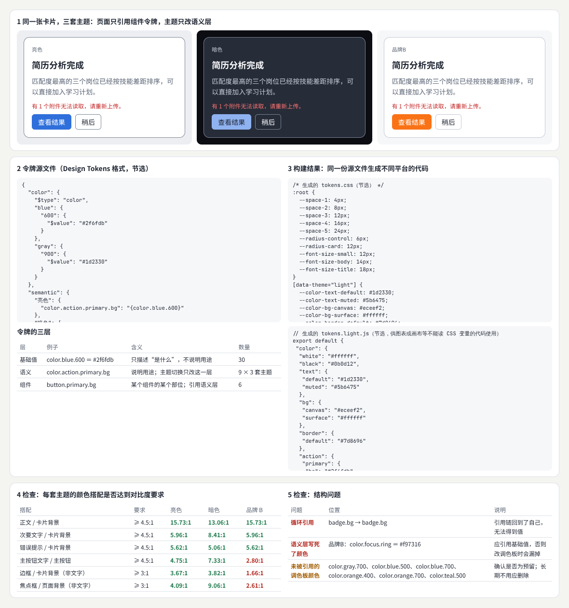
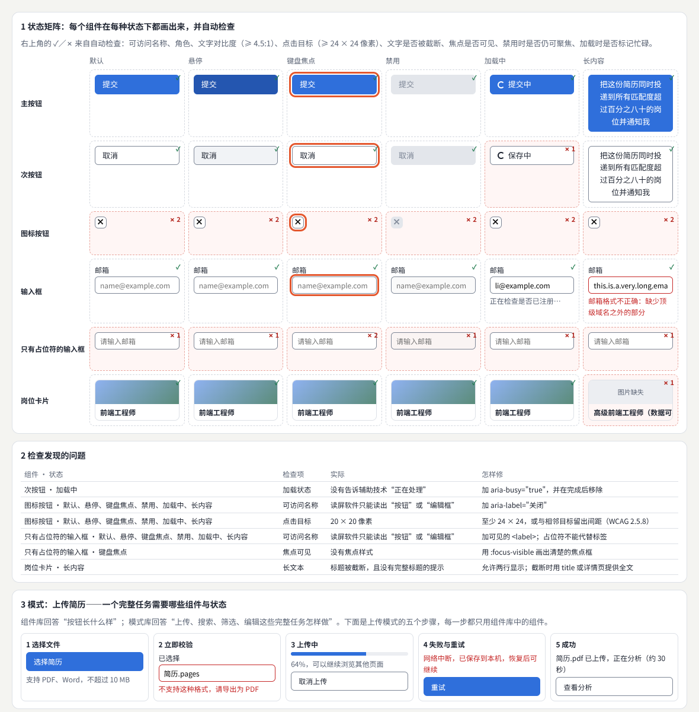
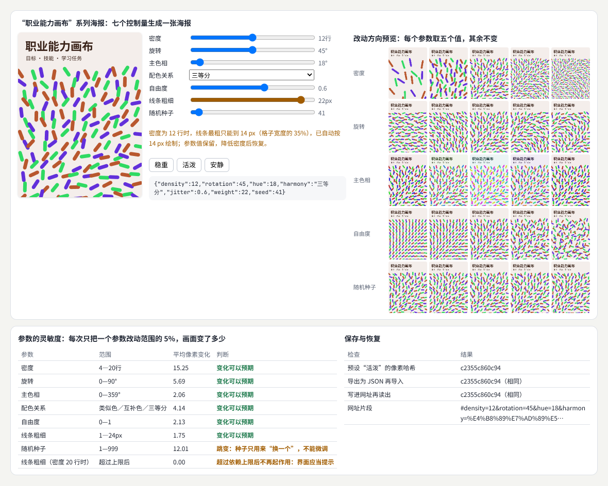
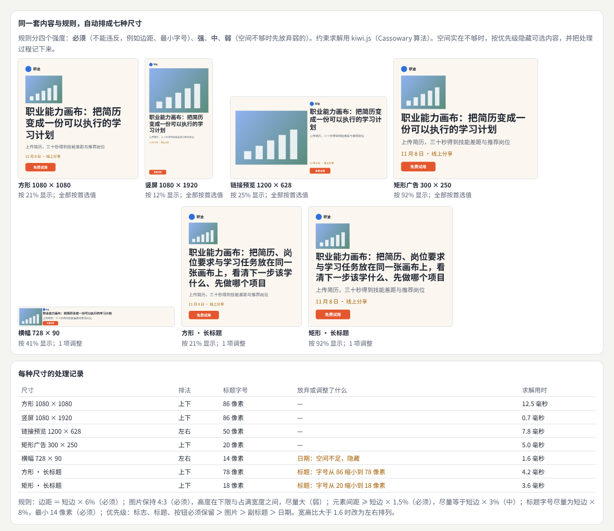
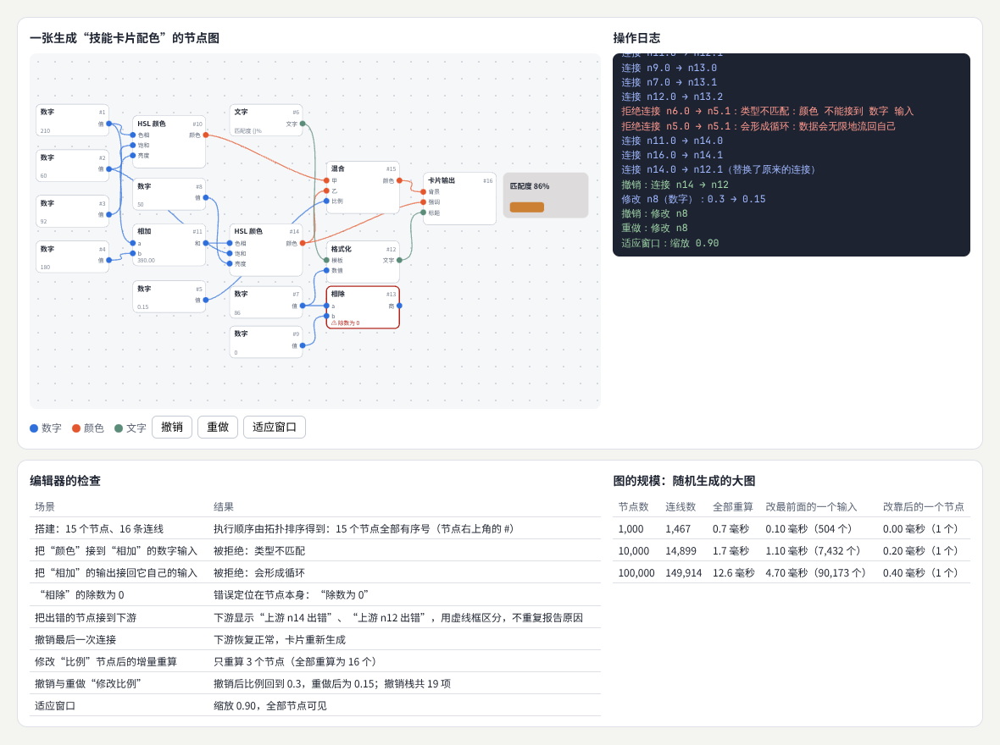
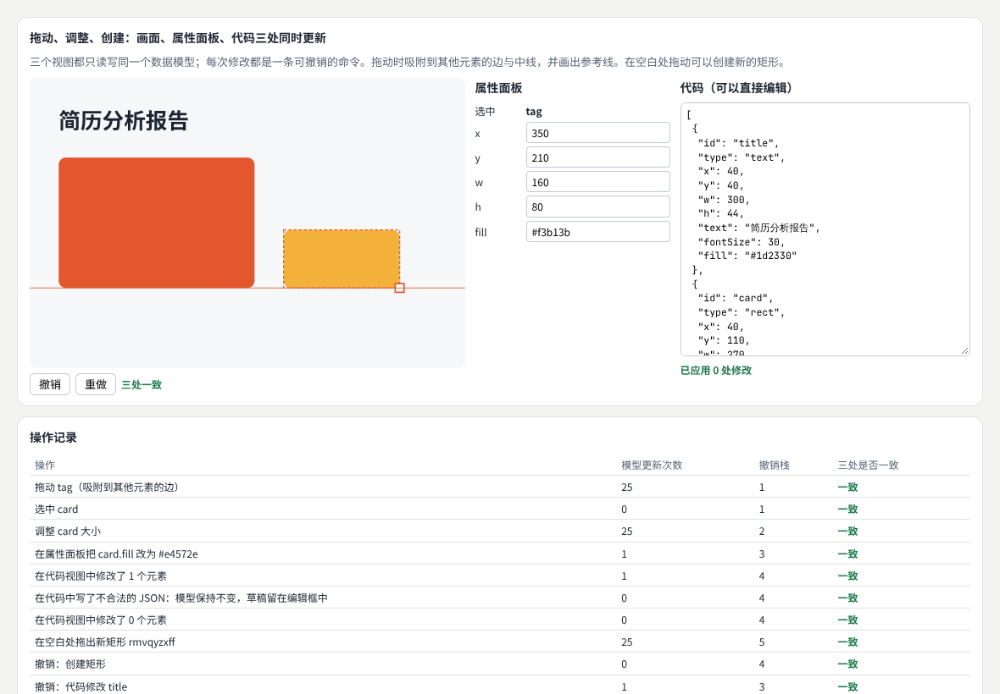
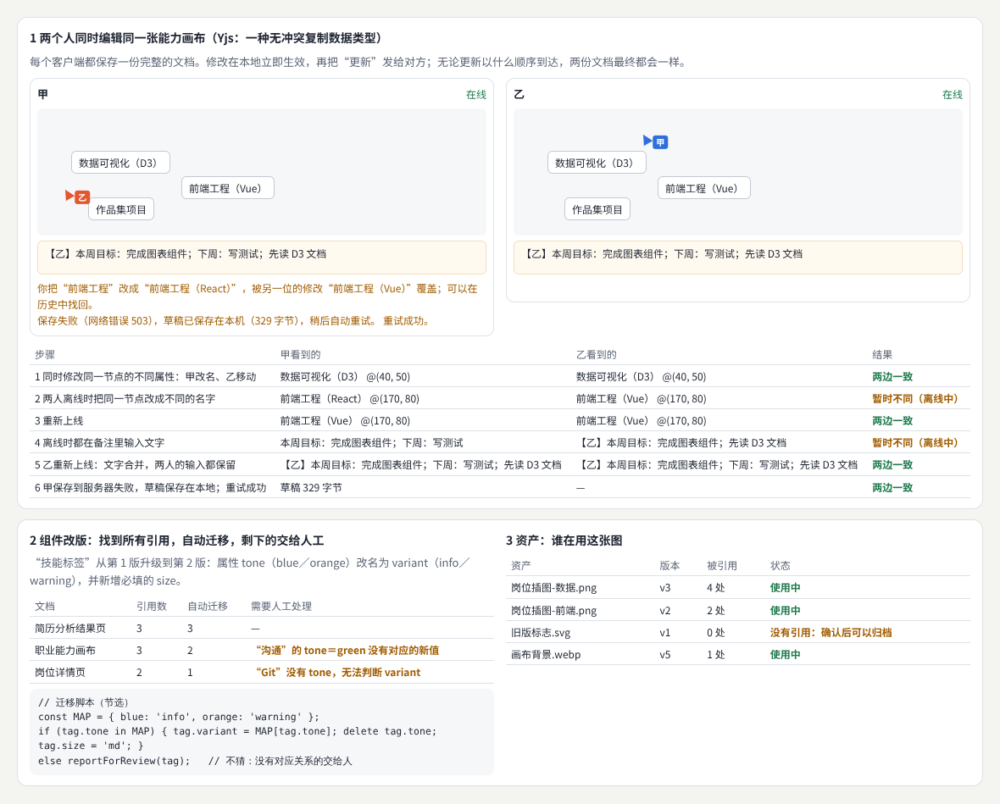
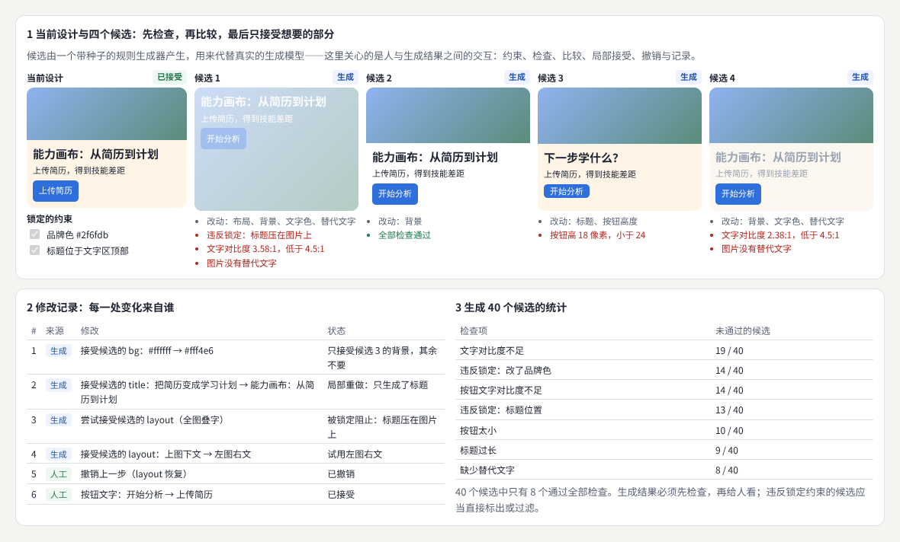
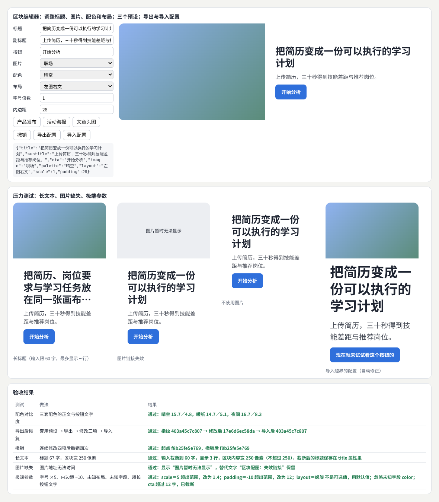
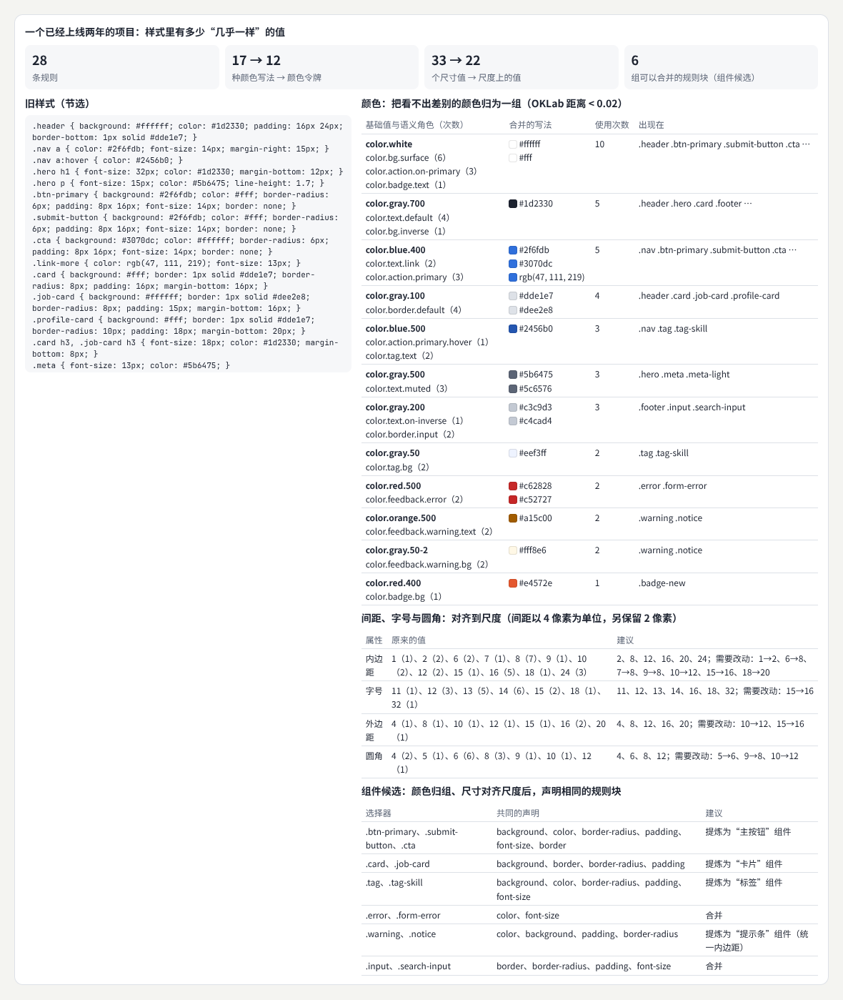

# 计算设计与创作工具

> 把设计规则变成别人可以直接使用的系统：从设计令牌、组件与模式库，到参数化设计、约束布局、节点编辑、直接操纵、版本协作与生成式辅助，最后亲手做一个可以保存、恢复、撤销并经得起压力测试的区块编辑器。  
> 版本：1.0 · 整理日期：2026-10-25  
> 适用对象：已经能写组件和页面，想做设计系统、模板工具或创作类产品的开发者与设计师。先修：读过[《前端界面工程》](01-前端界面工程.md)的 06、07 章（组件接口与应用状态）和[《视觉设计与品牌表达》](02-视觉设计与品牌表达.md)的 05、11 章（色彩系统与起步规则）。

这一领域**把设计规则变成可重复使用的系统**。三件事经常放在一起说，但它们解决的问题不同：

- **设计系统**解决**多页面**、**多团队的一致性**：同一个按钮在一百个页面上长得一样、行为一样，改一处就全部更新。
- **计算设计**用**参数和约束组织变化**：一套规则生成一系列海报、一组尺寸、一个品牌的各种应用。
- **创作工具**让其他人**直接操作这些规则**：编辑器、节点图、模板工具，把规则交到设计师、运营甚至用户手里。

学习时有一个重要的顺序：**先理解真实的制作过程，再决定哪些步骤适合抽象和自动化**。没有在真实项目里遇到过重复，就提炼不出好的组件；没有亲手排过几十张海报，就写不出好用的模板规则。

本册每章都按同样的顺序讲：先说明它解决什么问题；再用白话解释核心概念；然后给出一个可以直接运行的示例与运行截图；接着是常见问题和本章练习；最后是一张**进阶学习卡**：技术栈、要掌握的高阶词汇（附英文）、搜索关键词、值得去看的实例，以及四级进阶阶梯：

| 级别 | 含义 |
| --- | --- |
| L1 入门 | 能运行并解释本章示例，说出每个概念的作用 |
| L2 熟练 | 能在自己的项目里正确使用，完成本章练习 |
| L3 进阶 | 能比较几种做法的取舍，为团队设计规则并验证效果 |
| L4 深入 | 能设计并维护一套供他人长期使用的系统或工具 |

四级是本手册的教学结构，用来安排学习顺序，不对应任何公司的职级。

所有示例都放在本目录的[示例](示例/)文件夹中，用浏览器直接打开即可运行（需要联网加载字体与 kiwi.js、Yjs 等库）；每个示例都已在浏览器中实际运行并自动检查，书中的数字来自这些运行。

主线是：**理解创作工具的三层结构 → 掌握令牌、组件、参数、约束、节点、直接操纵、协作、生成式辅助八个方向 → 完成一个区块编辑器，并学会从已有项目中提炼系统。**

## 阅读导航

正文共 13 章（01—13），附 10 个可运行示例、3 组附录与 23 项资料入口。

- [第一篇：共同的基础](#part-1)
  - [01 计算设计做什么](#ch01)
  - [02 创作工具的三层：数据、规则、操作](#ch02)
- [第二篇：八个方向](#part-2)
  - [03 设计令牌](#ch03)
  - [04 组件与模式库](#ch04)
  - [05 参数化设计](#ch05)
  - [06 约束与自动布局](#ch06)
  - [07 节点式编辑](#ch07)
  - [08 直接操纵与所见即所得](#ch08)
  - [09 版本、资产与协作](#ch09)
  - [10 生成式辅助创作](#ch10)
- [第三篇：综合项目、系统化与路线](#part-3)
  - [11 综合项目：页面区块编辑器](#ch11)
  - [12 从个人规范到可用系统](#ch12)
  - [13 工具、技术栈与学习路线](#ch13)
- [附录 A：术语表](#appendix-a)
- [附录 B：资料入口](#appendix-b)
- [附录 C：与原手册的对应关系及修订记录](#appendix-c)

## 第一篇：共同的基础

### 01 计算设计做什么

#### 01.1 从“做一个”到“做一套”

设计师做一张海报，是在做“一个”；做一套海报模板、一个设计系统、一个编辑器，是在做“一套”——产出的不是某个结果，而是**产生结果的规则**。这时有三类使用者：

| 使用者 | 他们需要什么 | 本册对应 |
| --- | --- | --- |
| 开发者 | 一致的组件、清楚的令牌、可以自动检查的规则 | 03、04、12 章 |
| 设计师与运营 | 能调的参数、能套用的模板、尺寸自动适配 | 05、06、11 章 |
| 工具的最终用户 | 直接拖动、即时看到、可以撤销、可以协作 | 07—10 章 |

#### 01.2 什么时候值得抽象

抽象有成本：规则要设计、要文档、要维护，用的人还要学习。值得抽象的信号是：

- **同样的决定被重复做了很多次**（例如每个页面都在重新选按钮的颜色）。
- **不一致已经造成问题**（例如三种不同的蓝色、四种不同的卡片圆角，见 12 章的审计）。
- **变化的方式是可以描述的**（例如“同一张海报要出七种尺寸”，见 06 章）。

反过来，只出现过一次的需求、还在快速变化的探索阶段，都不急于抽象。

### 02 创作工具的三层：数据、规则、操作

#### 02.1 三层结构

本册的所有示例都可以拆成三层：

| 层 | 是什么 | 例子 |
| --- | --- | --- |
| **数据模型** | 文档的全部内容，能够保存、恢复、比较 | 令牌文件、区块配置、节点图、画布上的元素 |
| **规则** | 从数据得到结果，或检查数据是否合格 | 令牌解析、约束求解、节点执行、对比度检查 |
| **操作** | 用户怎样修改数据 | 拖动、属性面板、代码编辑、接受候选 |

一个常见的错误是让操作直接改画面（例如拖动时直接改 DOM 元素的位置），画面与数据从此不一致：保存不下来，撤销不回去，另一个视图也不会更新。**所有修改都应当先改数据，再由数据重新得到画面。**

#### 02.2 命令：让撤销、重做和记录成为可能

把每一次修改写成一条**命令**，命令知道怎样执行、怎样撤销。这样就自然得到：

- **撤销与重做**：把执行过的命令放进栈里。
- **合并**：拖动时鼠标移动了几十次，应当合并成一条命令，撤销一次就回到拖动前（08 章实测：一次拖动 25 次模型更新，撤销栈只多 1 条）。
- **记录与追踪**：每条命令记下来源（人工还是生成）与时间（10 章）。
- **协作**：把命令或它产生的数据变化发给其他人（09 章）。

#### 02.3 序列化：同样的数据，同样的结果

数据模型要能**完整地保存成文本**（通常是 JSON），再读回来得到**完全相同的结果**。示例中多次用“结果指纹”检查这一点：把渲染结果的每个元素的位置、尺寸、颜色算成一个哈希值，保存前后比较（05、11 章）。读入数据时要**清洗**：未知字段丢弃、越界的数值夹到范围内、超长文本截断，并告诉用户做了什么（11 章）。

**本章练习**：

1. 找一个你常用的编辑器（任意设计或文档工具），列出它的数据模型大致包含什么，哪些操作会合并成一次撤销。
2. 写出一个“卡片”区块的数据模型 JSON，标出每个字段的类型和允许范围。

## 第二篇：八个方向

### 03 设计令牌

#### 03.1 解决什么问题

把**色彩**、**字号**、**间距**、**圆角**和**运动**等规则保存为有含义的变量。要**区分基础值与语义角色**，支持**主题和品牌变化**。命名应帮助使用者**选择正确用途**，而不只描述一个颜色值——`color.action.primary.bg` 告诉你“主操作的背景用这个”，`blue-600` 只告诉你“这是一种蓝色”。

#### 03.2 核心概念：三层令牌

| 层 | 例子 | 含义 |
| --- | --- | --- |
| 基础值 | `color.blue.600 ＝ #2f6fdb` | 只描述“是什么”，构成调色板与尺度 |
| 语义 | `color.action.primary.bg → {color.blue.600}` | 说明用途；切换主题只改这一层 |
| 组件 | `button.primary.bg → {color.action.primary.bg}` | 某个组件的某个部位；引用语义层 |

令牌通常保存在一份与平台无关的文件中，再由构建工具生成 CSS 变量、JavaScript 对象、iOS 与安卓的资源。设计令牌社区组在 2025 年 10 月发布了令牌文件格式的第一个稳定版本（2025.10）：每个令牌用 `$value` 保存值、`$type` 说明类型，引用其他令牌写成 `{路径}`；它是社区组报告，不是 W3C 标准。[B01](#ref-b01) Style Dictionary 是常用的构建工具。[B02](#ref-b02)

#### 03.3 示例：三套主题、构建与检查

示例：[11-03-tokens.html](示例/11-03-tokens.html)

示例有 30 个基础值、9 个语义令牌 × 3 套主题、6 个组件令牌。页面里的卡片**只引用组件令牌和尺寸令牌**，切换主题时卡片代码一行都不用改。

构建之后自动做两类检查：

| 搭配 | 要求 | 亮色 | 暗色 | 品牌 B |
| --- | --- | --- | --- | --- |
| 正文 / 卡片背景 | ≥ 4.5:1 | 15.73:1 | 13.06:1 | 15.73:1 |
| 次要文字 / 卡片背景 | ≥ 4.5:1 | 5.96:1 | 8.41:1 | 5.96:1 |
| 错误提示 / 卡片背景 | ≥ 4.5:1 | 5.62:1 | 5.06:1 | 5.62:1 |
| 主按钮文字 / 主按钮 | ≥ 4.5:1 | 4.75:1 | 7.33:1 | **2.80:1** |
| 边框 / 卡片背景（非文字） | ≥ 3:1 | 3.67:1 | 3.82:1 | **1.66:1** |
| 焦点框 / 页面背景（非文字） | ≥ 3:1 | 4.09:1 | 9.06:1 | **2.61:1** |

（要求来自 WCAG 2.2 的 1.4.3 与 1.4.11。[B03](#ref-b03)）

- **品牌 B 的橙色按钮配白字只有 2.80:1**。品牌色本身没有错，错在语义映射：主按钮背景应当引用更深的 `color.orange.700`（#b4500d，白字 5.13:1）。**检查应当在每次构建时对每套主题自动运行**，而不是靠人眼。
- **结构检查**发现三个问题：`badge.bg` 引用了自己（循环引用，无法得到值）；品牌 B 的焦点色直接写成 `#f97316`（语义层写死了颜色，改调色板时会漏掉）；6 个调色板颜色没有被任何语义令牌引用（确认是否为预留，否则删除）。

#### 03.4 常见问题

- **令牌太多，没人记得住**：语义层的名字要按“用途”组织，并配上使用说明；基础值不直接给页面用。
- **设计工具与代码里的值不一样**：让两边都从同一份令牌文件生成，而不是手工同步。Figma 的变量可以与令牌文件互相导入导出。[B04](#ref-b04)
- **暗色主题就是把颜色反过来**：不是。暗色主题要重新检查每一组搭配的对比度，阴影和层级的表现方式也不同。
- **运动也是令牌吗**：是。时长和缓动曲线（例如 `duration.fast ＝ 150ms`）也应当统一管理（[《动效与时间设计》](04-动效与时间设计.md)）。

**本章练习**：

1. 修复品牌 B：把主按钮背景改为引用 `color.orange.700`，重新运行，记录三项对比度。
2. 增加第四套主题“高对比度”，让所有搭配都达到 7:1。

#### 03.5 进阶学习卡

| 级别 | 目标 | 怎样检验 |
| --- | --- | --- |
| L1 入门 | 能区分基础值、语义与组件三层，用 CSS 变量实现主题切换 | 切换主题时组件代码不改 |
| L2 熟练 | 能用令牌文件与构建工具生成多平台代码，并在构建时检查对比度 | 构建失败时能看到哪一组搭配不合格 |
| L3 进阶 | 能为多品牌、多主题设计令牌结构，管理废弃与迁移 | 新增一个品牌只需要改语义层 |
| L4 深入 | 能把令牌接入设计工具与代码的双向流程，并建立治理机制 | 设计与代码的令牌长期一致 |

- **技术栈**：设计令牌格式 2025.10[B01](#ref-b01)；Style Dictionary[B02](#ref-b02)；CSS 自定义属性；Figma 变量[B04](#ref-b04)；Material Design 3 的令牌体系[B05](#ref-b05)。
- **高阶词汇**：设计令牌（design token）、基础令牌（primitive／reference token）、语义令牌（semantic／system token）、组件令牌（component token）、别名（alias）、主题（theme）、多品牌（multi-brand）、模式（mode）、令牌构建（token build／transform）、对比度检查（contrast check）、废弃（deprecation）。
- **搜索关键词**：`design tokens format 2025.10`、`style dictionary dtcg`、`semantic tokens naming`、`multi brand design tokens`、`figma variables modes`、`设计令牌 语义层`。
- **值得看的实例**：[Material Design 3 的令牌说明](https://m3.material.io/foundations/design-tokens/overview)——参考令牌、系统令牌与组件令牌的分层；[Carbon 设计系统](https://carbondesignsystem.com/)——公开的主题与令牌。
- **资料**：格式与工具见 [B01](#ref-b01)、[B02](#ref-b02)；设计工具见 [B04](#ref-b04)；令牌分层实例见 [B05](#ref-b05)、[B06](#ref-b06)。

### 04 组件与模式库

#### 04.1 解决什么问题

维护**组件状态**、**组合方式**、**内容约束**和**使用说明**。**模式库**还应解释**搜索**、**上传**、**筛选**、**编辑**等完整任务——组件库回答“按钮长什么样”，模式库回答“上传简历这件事怎样做”。组件的**可访问性**和**数据边界**（长文本、空数据、图片缺失）应进入**验收标准**，而不是事后补。

#### 04.2 核心概念

- **状态矩阵**：把每个组件在每种状态下都画出来——默认、悬停、键盘焦点、禁用、加载中、错误、长内容。漏掉的状态往往就是线上问题所在。
- **自动验收**：对矩阵中的每一格运行检查，问题在组件库里被发现，而不是在一百个页面里各自被发现。
- **组件文档工具**：Storybook 等工具为每个组件的每种状态建立“故事”，并可以接入可访问性检查和截图对比。[B07](#ref-b07)

#### 04.3 示例：状态矩阵与自动验收

示例：[11-04-components.html](示例/11-04-components.html)

36 个格子中有 14 个没有通过检查：

| 组件 · 状态 | 检查项 | 实际 | 怎样修 |
| --- | --- | --- | --- |
| 图标按钮 · 全部 6 种 | 可访问名称 | 读屏软件只能读出“按钮” | 加 `aria-label="关闭"` |
| 图标按钮 · 全部 6 种 | 点击目标 | 20 × 20 像素 | 至少 24 × 24，或与相邻目标留出间距 |
| 只有占位符的输入框 · 全部 6 种 | 可访问名称 | 没有标签 | 加可见的 `<label>`，占位符不能代替标签 |
| 只有占位符的输入框 · 键盘焦点 | 焦点可见 | 没有焦点样式 | 用 `:focus-visible` 画出焦点框 |
| 次按钮 · 加载中 | 加载状态 | 没有告诉辅助技术“正在处理” | 加 `aria-busy="true"` |
| 岗位卡片 · 长内容 | 长文本 | 标题被截断，没有提示 | 允许两行；截断时提供全文 |

两个细节：主按钮的“加载中”标了 `aria-busy`，次按钮忘了——**同类组件的同一种状态，实现可能不一致**，只有矩阵能把它暴露出来。检查焦点样式时要看 `outline-style`，因为浏览器的默认 `outline-width` 是“medium”（3 像素），即使没有焦点框，宽度也不为 0。

页面下方的**上传模式**把一项任务拆成五步：选择文件（说明格式与大小）、立即校验（不支持的格式马上提示怎么办）、上传中（进度、可以取消、可以继续浏览）、失败与重试（说明原因，保留已选文件）、成功（告诉用户下一步）。每一步只用组件库中已有的组件。

#### 04.4 常见问题

- **组件越做越多变体**：每个变体都要回答“它解决什么问题、什么时候用”。说不清的变体应当合并。
- **组件库里一切正常，页面上却出问题**：组件的内容约束没有写清楚（例如标题最多几个字），或页面绕开了组件自己写样式。
- **可访问性检查都通过了**：自动检查只能发现一部分问题，还要用键盘和读屏软件实际操作（[《包容、国际化与多感官》](16-包容国际化与多感官.md)）。

**本章练习**：

1. 修好示例中的所有问题，让 36 格全部通过。
2. 为“搜索”任务写一份模式说明：输入、建议、无结果、加载、错误五种情况各用什么组件。

#### 04.5 进阶学习卡

| 级别 | 目标 | 怎样检验 |
| --- | --- | --- |
| L1 入门 | 能为一个组件列出全部状态并画出来 | 状态矩阵没有空格 |
| L2 熟练 | 能用 Storybook 等工具管理组件，接入自动的可访问性检查 | 每次提交自动检查所有故事 |
| L3 进阶 | 能写模式文档，把完整任务的流程、状态与文案规则讲清楚 | 新成员按模式文档做出一致的页面 |
| L4 深入 | 能为多个产品维护共享组件库，管理版本、破坏性变更与迁移 | 升级组件时有迁移说明与自动迁移脚本 |

- **技术栈**：Storybook 与它的视觉测试[B07](#ref-b07)；axe-core 等可访问性检查库；Playwright 截图对比；React／Vue 组件；无样式组件库（Radix、Headless UI 等）。
- **高阶词汇**：组件库（component library）、模式库（pattern library）、状态矩阵（state matrix）、组合（composition）、受控与非受控（controlled／uncontrolled）、无样式组件（headless component）、内容约束（content constraint）、可访问名称（accessible name）、视觉回归测试（visual regression testing）、破坏性变更（breaking change）。
- **搜索关键词**：`storybook accessibility testing`、`component state matrix`、`headless ui components`、`visual regression testing playwright`、`file upload ux pattern`、`组件库 状态`。
- **值得看的实例**：[Shopify Polaris](https://shopify.dev/docs/api/polaris)、[Atlassian Design System](https://atlassian.design/)、[GitHub Primer](https://primer.style/)、[美国政府设计系统 USWDS](https://designsystem.digital.gov/)——对照它们的组件文档，看每个组件写了哪些状态、内容规则与可访问性说明。
- **资料**：可访问性准则见 [B03](#ref-b03)；组件视觉测试见 [B07](#ref-b07)；公共设计系统见 [B08](#ref-b08)。

### 05 参数化设计

#### 05.1 解决什么问题

用**参数控制形状**、**布局**、**字体**和**图案**。要**选择有意义的控制量**，**明确范围和依赖**。使用者应能**预测改动方向**，并**保存与恢复**方案。

#### 05.2 核心概念

- **有意义的控制量**：用设计者的语言命名（“密度”“自由度”），而不是实现的语言（“rows”“jitterFactor”）。
- **范围与依赖**：每个参数有上下限；有些参数的范围取决于另一个参数（格子变小了，线条就不能那么粗）。依赖要在界面上说清楚，而不是静默地失效。
- **可预测**：改一点，画面就变一点，方向一致。可以用**灵敏度分析**检查：每次只把一个参数改动范围的 5%，测量画面变化了多少。
- **保存与恢复**：参数就是方案的全部信息，保存参数就能完整重现方案。

#### 05.3 示例：系列海报的七个参数

示例：[11-05-parametric.html](示例/11-05-parametric.html)

| 参数 | 范围 | 平均像素变化（改动范围的 5%） | 判断 |
| --- | --- | --- | --- |
| 密度 | 4—20 行 | 15.25 | 变化可以预期 |
| 旋转 | 0—90° | 5.69 | 变化可以预期 |
| 主色相 | 0—359° | 2.06 | 变化可以预期 |
| 配色关系 | 类似色／互补色／三等分 | 4.14 | 变化可以预期 |
| 自由度 | 0—1 | 2.13 | 变化可以预期 |
| 线条粗细 | 1—24 px | 1.75 | 变化可以预期 |
| 随机种子 | 1—999 | 12.01 | 跳变：种子只用来“换一个”，不能微调 |
| 线条粗细（密度 20 行时） | 超过上限后 | 0.00 | 超过依赖上限后不再起作用：界面应当提示 |

- **依赖**：线条最粗不超过格子宽度的 35%。密度为 12 行时上限是 14 像素，用户把粗细拉到 22 时，示例显示提示并按 14 像素绘制，同时保留用户设置的值（降低密度后恢复）。灵敏度表最后一行证明了提示的必要性：超过上限后，再怎么拖动滑块，画面都不变（变化 0.00）。
- **种子**的变化是跳变，它适合“再来一个”，不适合微调；界面上可以做成“换一个”按钮，而不是滑块。
- **改动方向预览**（右上角的缩略图）让用户不必一个个试，就能看出每个参数往哪个方向变。
- **保存与恢复**：预设“活泼”的像素哈希为 c2355c860c94；导出为 JSON 再导入、写进网址再读出，哈希都完全相同。

#### 05.4 常见问题

- **参数太多，用户不知道调哪个**：分成“常用”和“高级”；或者提供几个风格差别明显的预设作为起点。
- **某个参数几乎没用**：灵敏度分析中变化很小的参数，要么扩大范围，要么删掉。
- **用户改了一组参数，回不去了**：提供撤销与“恢复默认”，并让预设可以随时套用。

**本章练习**：

1. 把“随机种子”滑块改成“换一个”按钮，并保留最近 5 个种子的历史。
2. 为“主色相”增加一个依赖：配色关系为“类似色”时，色相变化的步长变为 5°。

#### 05.5 进阶学习卡

| 级别 | 目标 | 怎样检验 |
| --- | --- | --- |
| L1 入门 | 能用几个参数生成一组设计，并保存与恢复 | 恢复后结果完全相同 |
| L2 熟练 | 能为参数设定范围、依赖与预设，并提供改动预览 | 用户不看说明也能调出想要的方向 |
| L3 进阶 | 能用灵敏度分析检查参数设计，删除无效参数 | 每个参数都有可预期的影响 |
| L4 深入 | 能设计一套品牌级的参数化系统，覆盖多种媒介 | 运营人员独立产出合格的物料 |

- **技术栈**：Canvas 2D 与 SVG；p5.js（[《创意编程与二维图形》](05-创意编程与二维图形.md)）；lil-gui 等参数面板；`URLSearchParams`（参数写进网址）；Figma 插件与组件属性；Grasshopper、Houdini 等专业参数化工具。
- **高阶词汇**：参数化设计（parametric design）、生成式设计（generative design）、参数空间（parameter space）、预设（preset）、依赖（dependency）、灵敏度分析（sensitivity analysis）、可预测性（predictability）、随机种子（random seed）、可复现（reproducibility）、设计空间探索（design space exploration）。
- **搜索关键词**：`parametric design system brand`、`generative design parameters presets`、`sensitivity analysis parameters`、`design space exploration tool`、`lil-gui`、`参数化设计`。
- **值得看的实例**：[《Learnable Programming》](https://worrydream.com/LearnableProgramming/)——Bret Victor 关于“让参数的作用看得见”的经典文章。
- **资料**：[B09](#ref-b09)。

### 06 约束与自动布局

#### 06.1 解决什么问题

把**最小尺寸**、**对齐**、**优先级**、**比例**和**内容适应转化为规则**。遇到空间不足或约束冲突时，应有清楚的处理。适合**自动海报**、**文档**、**仪表盘**和**多尺寸模板**。

#### 06.2 核心概念

- **约束**：描述“应该满足什么”，而不是“怎样摆放”。例如“图片宽 ＝ 高 × 4/3”“元素之间至少 8 像素”。
- **强度**：约束分为“必须”和几档“尽量”。空间不够时，先放弃弱的，再放弃强的；“必须”的约束不能违反。
- **约束求解器**：Cassowary 算法可以高效地求解这类带强度的线性约束，是苹果 Auto Layout 的基础。[B10](#ref-b10) kiwi.js 是它的 JavaScript 实现。[B11](#ref-b11)
- **冲突处理**：“必须”的约束互相矛盾时，求解器报错。程序要按事先定好的顺序处理：缩小字号、隐藏低优先级内容、截断，并**记录处理过程**。

#### 06.3 示例：一个模板，七种尺寸

示例：[11-06-constraints.html](示例/11-06-constraints.html)

规则：边距 ＝ 短边 × 6%（必须）；图片保持 4:3（必须），高度在下限与占满宽度之间，尽量大（弱）；元素间距 ≥ 短边 × 1.5%（必须），尽量等于短边 × 3%（中）；标题字号尽量为短边 × 8%，最小 14 像素（必须）；标志、标题、按钮必须保留，优先级其次是图片、副标题、日期；宽高比大于 1.6 时改为左右排列。

| 尺寸 | 排法 | 标题字号 | 调整 | 求解用时 |
| --- | --- | --- | --- | --- |
| 方形 1080 × 1080 | 上下 | 86 像素 | — | 12.5 毫秒 |
| 竖屏 1080 × 1920 | 上下 | 86 像素 | — | 0.7 毫秒 |
| 链接预览 1200 × 628 | 左右 | 50 像素 | — | 7.8 毫秒 |
| 矩形广告 300 × 250 | 上下 | 20 像素 | — | 5.0 毫秒 |
| 横幅 728 × 90 | 左右 | 14 像素 | 隐藏日期 | 1.6 毫秒 |
| 方形 · 长标题 | 上下 | 78 像素 | 标题从 86 缩小到 78 | 4.2 毫秒 |
| 矩形 · 长标题 | 上下 | 18 像素 | 标题从 20 缩小到 18 | 3.6 毫秒 |

（第一次求解包含 JavaScript 的编译时间，所以最慢；用时每次运行略有不同，例如方形在多次运行中为 12—14 毫秒。）

- **规则会严格地给出你写下的结果**：竖屏尺寸中，多余的空间全部落在了按钮之前——因为规则只说了“间距尽量等于首选值”，没说多余的空间放在哪里。想要更好的效果，就要再加一条规则（例如允许竖屏换成竖版裁切的图片）。
- **横幅**的高度只有 90 像素，标题已经是最小字号 14 像素，日期被隐藏；如果连标题都放不下，示例会截断并把这一项标为“冲突，需要人工处理”。
- 每种尺寸的调整都被记录下来，运营人员可以据此判断哪些尺寸需要人工检查。

#### 06.4 常见问题

- **约束写多了，结果难以预料**：从少量“必须”的约束开始，逐步加入“尽量”的约束，每加一条都观察多种尺寸的结果。
- **求解器报错“无法满足”**：两条“必须”的约束互相矛盾。把其中一条降为“强”，或者设计冲突时的处理顺序。
- **网页布局也要用约束求解器吗**：大多数情况下，CSS 的 Flexbox 与 Grid 已经是很好的约束系统（[《前端界面工程》](01-前端界面工程.md) 03 章）。求解器适合画布、海报、多尺寸导出等 CSS 不方便处理的场景。

**本章练习**：

1. 为竖屏尺寸加一条规则：多余空间平均分配到标题上下两侧。
2. 增加一个尺寸 160 × 600（竖条广告），观察规则需要怎样调整。

#### 06.5 进阶学习卡

| 级别 | 目标 | 怎样检验 |
| --- | --- | --- |
| L1 入门 | 能用 Flexbox、Grid 或设计工具的自动布局做多尺寸适配 | 同一组件在三种宽度下都正确 |
| L2 熟练 | 能用约束求解器写带强度的规则，处理冲突并记录 | 七种尺寸自动生成，冲突有记录 |
| L3 进阶 | 能为一个模板系统设计规则与优先级，并用大量真实内容测试 | 百条真实文案中需要人工处理的比例很低 |
| L4 深入 | 能设计自动排版引擎或约束编辑界面 | 设计师可以自己编辑约束 |

- **技术栈**：kiwi.js（Cassowary）[B11](#ref-b11)；CSS Flexbox 与 Grid；苹果 Auto Layout[B12](#ref-b12)；Figma 的自动布局[B13](#ref-b13)；Canvas 文字测量（`measureText`）。
- **高阶词汇**：约束（constraint）、约束求解器（constraint solver）、Cassowary 算法（Cassowary algorithm）、强度／优先级（strength／priority）、必须约束（required constraint）、松弛（slack）、无法满足（unsatisfiable）、固有尺寸（intrinsic size）、内容适应（content-driven layout）、响应式模板（responsive template）。
- **搜索关键词**：`cassowary constraint solver explained`、`kiwi.js constraint`、`auto layout priorities`、`figma auto layout`、`automatic poster layout constraints`、`约束布局 优先级`。
- **值得看的实例**：[Cassowary 项目页](https://constraints.cs.washington.edu/cassowary/)——算法的原始论文与说明。
- **资料**：算法论文见 [B10](#ref-b10)；实现见 [B11](#ref-b11)；平台中的约束布局见 [B12](#ref-b12)、[B13](#ref-b13)。

### 07 节点式编辑

#### 07.1 解决什么问题

用**节点和连接表达数据**、**材质**、**动画**或**工作流**。需要处理**类型**、**连接有效性**、**执行顺序**、**错误定位**和**图规模**。编辑器本身也需要**缩放**、**选择**、**撤销**和**导航**。

#### 07.2 核心概念

- **端口类型**：每个输入和输出都有类型（数字、颜色、文字）。不匹配的连接在连线时就拒绝。
- **有向无环图**：数据只能单向流动，不能成环。连线时检查“目标节点能否到达起点”。
- **执行顺序**：按**拓扑排序**执行，保证每个节点执行时，它的输入都已经算好。
- **增量计算**：只重算受修改影响的节点（标记为“脏”的节点及其下游）。
- **错误定位**：错误显示在出错的节点上；下游节点只显示“上游出错”，不重复报告原因。

#### 07.3 示例：生成技能卡片配色的节点图

示例：[11-07-nodes.html](示例/11-07-nodes.html)

| 场景 | 结果 |
| --- | --- |
| 把“颜色”接到“相加”的数字输入 | 被拒绝：类型不匹配 |
| 把“相加”的输出接回它自己的输入 | 被拒绝：会形成循环 |
| “相除”的除数为 0 | 错误定位在节点本身：“除数为 0” |
| 把出错的节点接到下游 | 下游显示“上游 n14 出错”“上游 n12 出错”，用虚线框区分 |
| 撤销最后一次连接 | 下游恢复正常，卡片重新生成 |
| 修改“比例”节点 | 只重算 3 个节点（全部重算为 16 个） |
| 撤销与重做“修改比例” | 撤销后比例回到 0.3，重做后为 0.15 |

规模测试用随机生成的大图（每个节点从前面的节点中随机选 1—2 个作为输入）：

| 节点数 | 连线数 | 全部重算 | 改最前面的一个输入 | 改靠后的一个节点 |
| --- | --- | --- | --- | --- |
| 1,000 | 1,467 | 0.7 毫秒 | 0.10 毫秒（重算 504 个） | 0.00 毫秒（1 个） |
| 10,000 | 14,899 | 1.7 毫秒 | 1.10 毫秒（7,432 个） | 0.20 毫秒（1 个） |
| 100,000 | 149,914 | 12.6 毫秒 | 4.70 毫秒（90,173 个） | 0.40 毫秒（1 个） |

增量计算的收益取决于**改的是哪个节点**：改靠近起点的输入，几乎整张图都要重算；改靠近末端的节点，只算一个。真实的节点编辑器（例如材质编辑器）里，每个节点的计算可能很贵（生成一张贴图），这时增量计算和缓存就是必须的。

#### 07.4 常见问题

- **图越来越大，看不清**：提供分组（把一组节点折叠成一个）、搜索节点、“适应窗口”和小地图。
- **错误到处都是红的**：只在出错的源头标红，下游用不同的样式表示“受影响”。
- **用户想要循环（例如迭代计算）**：用专门的“循环”节点封装，在节点内部迭代，图本身仍然无环。

**本章练习**：

1. 增加一个“限制范围”节点（输入数字、最小值、最大值），并把它插到色相计算中。
2. 为规模测试增加“只重算看得见的节点”的策略，比较耗时。

#### 07.5 进阶学习卡

| 级别 | 目标 | 怎样检验 |
| --- | --- | --- |
| L1 入门 | 能读懂节点图的数据流，说出执行顺序 | 解释示例中每个节点的序号 |
| L2 熟练 | 能实现带类型检查、循环检测与撤销的节点编辑器 | 完成本章练习 1 |
| L3 进阶 | 能实现增量计算、缓存与错误传递，支持上万节点 | 大图交互流畅 |
| L4 深入 | 能为特定领域（材质、动画、数据处理）设计节点语言 | 用户能独立搭出新的效果 |

- **技术栈**：React Flow[B14](#ref-b14)、Rete.js（网页节点编辑器框架）；three.js 的节点材质（TSL）；Blender 的节点编辑器[B15](#ref-b15)；SVG 或 Canvas 绘制连线。
- **高阶词汇**：节点图（node graph）、数据流编程（dataflow programming）、端口（port／socket）、有向无环图（directed acyclic graph, DAG）、拓扑排序（topological sort）、脏标记（dirty flag）、增量计算（incremental computation）、记忆化（memoization）、子图（subgraph）、可视化编程（visual programming）。
- **搜索关键词**：`react flow custom nodes`、`rete.js`、`node editor topological sort dirty flag`、`blender shader nodes`、`three.js TSL node material`、`节点编辑器 实现`。
- **值得看的实例**：[three.js 的 TSL 编辑器](https://threejs.org/examples/webgpu_tsl_editor.html)——用节点语言写材质并实时预览；[Blender 节点手册](https://docs.blender.org/manual/en/latest/interface/controls/nodes/index.html)——成熟节点编辑器的选择、分组与导航方式。
- **资料**：[B14](#ref-b14)、[B15](#ref-b15)。

### 08 直接操纵与所见即所得

#### 08.1 解决什么问题

允许用户在**画面上拖动**、**调整**和**创建**，并即时看到结果。需要建立稳定的数据模型，让**视觉操作**、**属性面板**和**代码表示保持一致**。

#### 08.2 核心概念

**直接操纵**这个词来自 Shneiderman 1983 年的文章：对象始终可见，用拖动、点击代替输入命令，每一步都立即可见、可以撤销。[B16](#ref-b16) 实现时的关键是 02 章说的“一个数据模型、多个视图”：

- 画布、属性面板、代码三个视图都**只读写同一个模型**。
- 拖动时的连续更新**合并成一条命令**。
- **吸附**：拖动到其他元素的边或中线附近时，自动对齐并画出参考线。
- 代码视图可以直接编辑：合法时应用到模型；不合法时**模型保持不变**，草稿留在编辑框里并给出错误提示。

#### 08.3 示例：三处同时更新

示例：[11-08-direct.html](示例/11-08-direct.html)

测试脚本用真实的鼠标事件操作页面：

| 操作 | 模型更新次数 | 撤销栈 | 三处是否一致 |
| --- | --- | --- | --- |
| 拖动标签（黄色块，吸附到卡片的边） | 25 | 1 | 一致 |
| 选中卡片 | 0 | 1 | 一致 |
| 拖动卡片右下角调整大小 | 25 | 2 | 一致 |
| 在属性面板把卡片颜色改为 #e4572e | 1 | 3 | 一致 |
| 在代码视图中修改标题 | 1 | 4 | 一致 |
| 在代码中写了不合法的 JSON | 0 | 4 | 一致（模型不变，草稿留在编辑框中） |
| 把草稿改回合法的 JSON（内容没有变化） | 0 | 4 | 一致 |
| 在空白处拖出新矩形 | 25 | 5 | 一致 |
| 撤销：创建矩形 | — | 4 | 一致 |
| 撤销：代码中对标题的修改 | — | 3 | 一致 |

每一步之后，页面都检查画布上每个元素的位置与尺寸、属性面板的每个输入、代码视图解析出的 JSON 是否与模型完全相同。

#### 08.4 常见问题

- **拖动时卡顿**：每次鼠标移动都重新渲染全部视图。可以只在拖动结束时更新代码视图，或把渲染限制在每帧一次。
- **撤销一下只回退了一个像素**：连续更新没有合并成一条命令。
- **在代码里改了一半，画面就乱了**：代码视图的修改应当在失去焦点或明确提交时才应用，不合法时不改模型。
- **吸附太“粘”**：吸附距离要小（示例为 6 像素），并允许按住修饰键临时关闭。

**本章练习**：

1. 给示例增加“多选”：按住 Shift 点选多个元素，一起拖动，撤销一次全部回去。
2. 增加等距吸附：三个元素之间的间距相等时显示提示。

#### 08.5 进阶学习卡

| 级别 | 目标 | 怎样检验 |
| --- | --- | --- |
| L1 入门 | 能实现拖动、调整大小，并让属性面板同步 | 拖动后面板数值正确 |
| L2 熟练 | 能用命令实现撤销重做与连续操作的合并，加入吸附 | 一次拖动只占一条撤销 |
| L3 进阶 | 能让画布、面板、代码三个视图双向同步，并处理不合法的输入 | 任意视图修改后三处一致 |
| L4 深入 | 能设计大型画布编辑器的架构：选择、变换、分组、性能与扩展 | 上千个元素时操作仍流畅 |

- **技术栈**：Pointer Events 与 `setPointerCapture`；SVG 或 Canvas；tldraw（无限画布编辑器开发包）[B17](#ref-b17)；Penpot（开源设计工具）；three.js 编辑器（三维场景的直接操纵）。
- **高阶词汇**：直接操纵（direct manipulation）、所见即所得（WYSIWYG）、单一数据源（single source of truth）、命令模式（command pattern）、撤销合并（undo coalescing）、吸附（snapping）、参考线（smart guides）、变换控件（transform handles）、指针捕获（pointer capture）、双向绑定（two-way binding）。
- **搜索关键词**：`direct manipulation shneiderman`、`canvas editor undo coalescing`、`smart guides snapping algorithm`、`tldraw sdk`、`pointer events drag resize`、`所见即所得 编辑器 架构`。
- **值得看的实例**：[three.js 编辑器](https://threejs.org/editor/)——三维场景中的选择、拖动、属性面板与脚本；[tldraw](https://tldraw.dev/)——可以嵌入网页的无限画布。
- **资料**：概念来源见 [B16](#ref-b16)；画布开发包见 [B17](#ref-b17)。

### 09 版本、资产与协作

#### 09.1 解决什么问题

管理**组件变更**、**设计资源**、**引用关系**、**迁移**和**多人编辑**。协作工具应清楚表达他人的**位置**、**操作**与**冲突**，**保存失败时要保护草稿**。

#### 09.2 核心概念

- **无冲突复制数据类型**（CRDT）：每个客户端保存一份完整的文档，修改在本地立即生效，再把“更新”发给其他人；无论更新以什么顺序到达，所有副本最终都会一致。[B18](#ref-b18) Yjs 是网页上常用的实现。[B19](#ref-b19)
- **同时修改**：改的是不同属性时，两处修改都保留；改的是同一个属性时，CRDT 会确定性地选出一个（所有人看到的结果相同），**界面应当告诉被覆盖的一方**。
- **离线与合并**：离线时照常编辑，重新上线后自动合并；文字的并发插入会被逐字合并，两个人的输入都保留。
- **本地优先**：数据首先保存在用户自己的设备上，同步是额外的能力；这让离线编辑和保存失败时的草稿保护变得自然。[B20](#ref-b20)
- **引用与迁移**：组件改版时，先找出所有引用，能自动迁移的自动迁移，不能确定的交给人工，**不猜**。

#### 09.3 示例：两人编辑同一张能力画布

示例：[11-09-collab.html](示例/11-09-collab.html)

| 步骤 | 甲看到的 | 乙看到的 | 结果 |
| --- | --- | --- | --- |
| 1 同时修改同一节点：甲改名、乙移动 | 数据可视化（D3）@(40, 50) | 同左 | 两边一致，两处修改都保留 |
| 2 两人离线，把同一节点改成不同的名字 | 前端工程（React） | 前端工程（Vue） | 暂时不同 |
| 3 重新上线 | 前端工程（Vue） | 前端工程（Vue） | 一致；甲收到“被覆盖”的提示 |
| 4 离线时都在备注里输入文字 | 各自的版本 | 各自的版本 | 暂时不同 |
| 5 乙重新上线 | 【乙】本周目标：完成图表组件；下周：写测试；先读 D3 文档 | 同左 | 两人的输入都保留 |
| 6 甲保存到服务器失败 | 草稿 329 字节保存在本机，重试成功 | — | 服务器内容与本地一致 |

第 3 步中，Yjs 根据客户端编号确定性地保留了乙的修改。**算法保证了一致，但没有保证“对”**——甲的修改丢了，所以界面要主动告诉甲，并允许从历史中找回。

下半部分是另外两个日常问题：

| 文档 | 引用“技能标签”的次数 | 自动迁移 | 需要人工处理 |
| --- | --- | --- | --- |
| 简历分析结果页 | 3 | 3 | — |
| 职业能力画布 | 3 | 2 | “沟通”的 tone＝green 没有对应的新值 |
| 岗位详情页 | 2 | 1 | “Git”没有 tone，无法判断 variant |

资产表列出每张图被引用的次数；没有任何引用的“旧版标志.svg”被标出，确认后可以归档。

#### 09.4 常见问题

- **用“最后保存的覆盖前面的”不就行了**：多人同时编辑时，这会悄悄丢掉别人的工作。至少要检测冲突并提示。
- **离线编辑太久，合并结果很奇怪**：文字能合并，但语义上的冲突（两个人把同一段话改成不同意思）只能由人解决。要显示合并后的差异。
- **组件改版后页面坏了**：没有找全引用，或者迁移脚本“猜”了没有对应关系的值。
- **协作功能要自己实现吗**：通常不必。成熟的 CRDT 库与同步服务可以直接使用；需要理解的是它们保证什么、不保证什么。Figma 的工程博客介绍了他们为多人编辑做的取舍。[B21](#ref-b21)

**本章练习**：

1. 在示例中增加第三个客户端“丙”，三人同时修改同一个节点，观察结果并设计提示文案。
2. 为组件迁移增加一份“迁移报告”，列出每个文档改了什么，供人工复核。

#### 09.5 进阶学习卡

| 级别 | 目标 | 怎样检验 |
| --- | --- | --- |
| L1 入门 | 能说出同时编辑、离线、冲突三种情况的区别 | 解释示例每一步的结果 |
| L2 熟练 | 能用 Yjs 等库实现多人编辑与离线合并，显示他人位置 | 两个浏览器窗口实时同步 |
| L3 进阶 | 能设计冲突提示、历史与恢复，以及组件改版的迁移流程 | 被覆盖的修改能找回 |
| L4 深入 | 能设计本地优先的数据架构，处理权限、版本与大规模同步 | 离线一周后合并仍然可靠 |

- **技术栈**：Yjs[B19](#ref-b19) 与它的同步、离线存储插件；Automerge 等其他 CRDT 实现；IndexedDB（本地草稿）；Git（组件库的版本）；codemod 工具（批量迁移代码）。
- **高阶词汇**：无冲突复制数据类型（conflict-free replicated data type, CRDT）、操作变换（operational transformation, OT）、最终一致性（eventual consistency）、并发修改（concurrent edits）、本地优先（local-first）、在线状态（presence／awareness）、版本历史（version history）、迁移脚本（migration／codemod）、引用分析（reference analysis）、语义化版本（semantic versioning）。
- **搜索关键词**：`yjs collaborative editor tutorial`、`crdt vs operational transformation`、`local-first software`、`figma multiplayer technology`、`codemod component migration`、`协同编辑 冲突`。
- **值得看的实例**：[Yjs 协作编辑器入门](https://docs.yjs.dev/getting-started/a-collaborative-editor)——几十行代码搭出可以多人编辑的文本框；[crdt.tech](https://crdt.tech/)——CRDT 的资料与实现汇总。
- **资料**：CRDT 定义见 [B18](#ref-b18)；实现见 [B19](#ref-b19)；本地优先见 [B20](#ref-b20)；工程取舍见 [B21](#ref-b21)。

### 10 生成式辅助创作

#### 10.1 解决什么问题

用 **AI** 提供**候选布局**、**素材**或**代码**，再由用户**比较**、**修改**和**接受**。应能**局部重做**、**撤销**、**追踪改动**，并保留用户明确设置的约束。需要**验证生成结果的真实可用性**。

#### 10.2 核心概念

- **候选，而不是答案**：生成的结果以多个候选的形式出现，用户比较后选择，而不是直接替换当前设计。
- **锁定的约束**：用户明确设置的规则（品牌色、标题位置）必须被保留；违反锁定的候选直接标出，接受时被阻止。
- **先检查，再给人看**：对比度、点击目标、替代文字、文字长度——生成结果在展示前就自动检查。
- **局部接受与局部重做**：只接受候选的某一部分（例如背景色），或只重新生成某一部分（例如标题）。
- **来源记录**：每一处修改记录是人工还是生成，便于撤销和日后解释（与[《图形学与视觉计算研究》](10-图形学与视觉计算研究.md) 07 章的来源记录相通）。

#### 10.3 示例：候选、检查与局部接受

示例：[11-10-assist.html](示例/11-10-assist.html)

示例用一个带种子的规则生成器**代替**真实的生成模型——这里要研究的是人与生成结果之间的交互，而不是生成本身。

| # | 来源 | 修改 | 状态 |
| --- | --- | --- | --- |
| 1 | 生成 | 接受候选 3 的背景：#ffffff → #fff4e6 | 只接受背景，其余不要 |
| 2 | 生成 | 只重新生成标题：把简历变成学习计划 → 能力画布：从简历到计划 | 局部重做 |
| 3 | 生成 | 尝试接受“全图叠字”布局 | 被锁定阻止：标题压在图片上 |
| 4 | 生成 | 接受布局：上图下文 → 左图右文 | 试用 |
| 5 | 人工 | 撤销上一步（布局恢复） | 已撤销 |
| 6 | 人工 | 按钮文字：开始分析 → 上传简历 | 已接受 |

再生成 40 个候选，只有 8 个通过全部检查：

| 检查项 | 未通过的候选 |
| --- | --- |
| 文字对比度不足 | 19 / 40 |
| 违反锁定：改了品牌色 | 14 / 40 |
| 按钮文字对比度不足 | 14 / 40 |
| 违反锁定：标题位置 | 13 / 40 |
| 按钮太小 | 10 / 40 |
| 标题过长 | 9 / 40 |
| 缺少替代文字 | 8 / 40 |

这组数字来自示例的规则生成器，不代表任何真实模型的表现；但它说明了一点：**生成得越多，越需要自动检查来过滤**，否则用户要花大量时间排除不可用的结果。

#### 10.4 常见问题

- **生成的结果看起来很好，用起来不行**：文字放进真实内容就溢出、颜色对比度不够、图片没有替代文字。检查要用真实内容、在真实尺寸下做。
- **接受了一个候选，之前手工改的地方都没了**：应当只合并用户选择的部分，并保留锁定的内容。
- **用户不信任生成结果**：显示改动了什么、检查了什么、来源是什么；让撤销永远可用。
- **素材的使用条件不清楚**：记录生成工具、模型与输入素材，交付前由负责人按适用规则确认。

**本章练习**：

1. 在示例中加入“锁定标题”：用户锁定后，所有候选都不能改标题。
2. 为候选增加“与当前设计的差异图”，只高亮变化的区域。

#### 10.5 进阶学习卡

| 级别 | 目标 | 怎样检验 |
| --- | --- | --- |
| L1 入门 | 能说出生成式辅助的交互要求：候选、比较、撤销、记录 | 解释示例的修改记录 |
| L2 熟练 | 能把一个生成接口接入编辑器，实现局部接受与局部重做 | 只接受部分时其他内容不变 |
| L3 进阶 | 能设计锁定约束与自动检查，统计生成结果的可用率 | 给出每类问题的比例与改进 |
| L4 深入 | 能设计人机协作的创作流程，评价它对效率与质量的影响 | 有对照实验的数据 |

- **技术栈**：生成模型的接口（文本、图像、布局）；结构化输出（让模型按 JSON 格式返回候选）；本册 03、04 章的令牌与组件检查；C2PA 内容凭证（来源记录）[B22](#ref-b22)。
- **高阶词汇**：人在回路（human-in-the-loop）、候选（candidate／suggestion）、混合主动交互（mixed-initiative interaction）、局部重新生成（partial regeneration／inpainting）、约束生成（constrained generation）、结构化输出（structured output）、护栏（guardrails）、来源追踪（provenance）、可用率（acceptance rate）。
- **搜索关键词**：`mixed initiative interaction design`、`human in the loop generative design tool`、`constrained layout generation`、`structured output json schema`、`AI design tool provenance`、`生成式设计 人机协作`。
- **值得看的实例**：本册的示例刻意不依赖在线模型。可以对照你常用的生成式设计工具，检查它是否提供了本章列出的候选比较、局部重做、撤销和来源记录。
- **资料**：检查依据见 [B03](#ref-b03)；内容来源记录见 [B22](#ref-b22)。

## 第三篇：综合项目、系统化与路线

### 11 综合项目：页面区块编辑器

#### 11.1 任务

制作一个小型页面区块编辑器，允许调整**标题**、**图片**、**配色**和**布局**，提供三个预设，并支持导出配置。修改配置后应能恢复同一个结果。测试**长文本**、**图片缺失**、**极端参数**和**撤销**，观察规则是否稳定。

#### 11.2 示例

示例：[11-11-block-editor.html](示例/11-11-block-editor.html)

编辑器按 02 章的三层搭建：

- **数据**：8 个配置项，每项有类型、范围与默认值（标题最多 60 字、字号倍数 0.8—1.4、内边距 12—48 像素、布局三选一……）。
- **规则**：读入任何配置都先**清洗**；渲染只依赖配置。
- **操作**：表单、预设、撤销、导出与导入都通过同一个 `set()` 修改配置。

#### 11.3 验收结果

| 测试 | 做法 | 结果 |
| --- | --- | --- |
| 配色对比度 | 三套配色的正文与按钮文字 | 通过：晴空 15.7／4.8，暖纸 14.7／5.1，夜间 16.7／8.3 |
| 导出后恢复 | 套用预设 → 导出 → 修改三项 → 导入 | 通过：结果指纹 403a45c7c807 → 修改后 17e6d6ec58da → 导入后 403a45c7c807 |
| 撤销 | 连续修改四项后撤销四次 | 通过：回到起点 f8b25fe5e769 |
| 长文本 | 67 字的标题，区块宽 250 像素 | 通过：输入截断到 60 字，显示 3 行，没有横向溢出 |
| 图片缺失 | 图片地址无法访问 | 通过：显示“图片暂时无法显示”，替代文字保留 |
| 极端参数 | 字号 × 5、内边距 −10、未知布局、未知字段、超长按钮文字 | 通过：分别修正为 1.4、12、默认布局，忽略未知字段，按钮文字截断到 12 字 |

**结果指纹**是把渲染后每个元素的位置、尺寸、颜色和文字拼起来算出的 SHA-256 前 12 位。比较指纹而不是比较配置，是因为要验证的是“**结果**能恢复”，而不只是“数据能恢复”——如果渲染依赖了配置以外的东西（例如随机数、当前时间），配置相同而指纹不同，就能被发现。

#### 11.4 验收清单

- [ ] 每个配置项都有类型、范围与默认值，导入时清洗并告诉用户做了什么。
- [ ] 渲染结果只依赖配置；导出再导入后结果指纹相同。
- [ ] 所有修改都可以撤销，撤销到起点后结果指纹与起点相同。
- [ ] 三个预设都通过对比度检查。
- [ ] 长文本、图片缺失、不使用图片、极端参数都有可读、不溢出的结果。
- [ ] 截图记录了每种压力测试的样子。

**本章练习**：

1. 增加“导出为图片”：把区块渲染成 PNG，并在文件名中包含配置的指纹。
2. 增加第四种布局“两栏卡片”，补齐它的全部压力测试。

### 12 从个人规范到可用系统

#### 12.1 顺序：先发现重复，再提炼，再做工具

1. **在真实项目中发现重复**：同样的颜色、间距、规则块反复出现，或者“几乎一样”地出现。
2. **提炼组件与令牌**：把重复的值变成令牌，把重复的规则块变成组件。
3. **当多个场景存在相同规则时，再开发工具**：模板、编辑器、检查脚本。
4. **记录每条规则解决什么问题**，避免设计系统积累大量无人理解的参数。
5. **持续维护与收集使用反馈**：规则要随着产品变化而调整。

#### 12.2 示例：在旧样式中找出重复

示例：[11-12-audit.html](示例/11-12-audit.html)

示例分析了一个“上线两年的项目”的 28 条样式规则：

- **颜色**：17 种不同的写法，按感知上均匀的 OKLab 颜色空间计算距离[B23](#ref-b23)，把看不出差别的颜色（距离 < 0.02）归为一组，得到 12 组。例如主色有 `#2f6fdb`、`#3070dc`、`rgb(47, 111, 219)` 三种写法；错误色有 `#c62828` 与 `#c52727`。
- **同一个值，多种用途**：`#1d2330` 既是正文颜色（4 处），又是页脚背景（1 处）；`#ffffff` 用作卡片背景（6 处）、主按钮文字（3 处）和徽标文字（1 处）。这正是 03 章三层令牌的由来：一个基础值，多个语义角色。
- **尺寸**：33 个不同的尺寸值，对齐到尺度（间距以 4 像素为单位、另保留 2 像素给小元素；字号 11、12、13、14、16、18、24、32；圆角 4、6、8、12）后为 22 个。表格列出了每个需要改动的值，例如内边距 15 → 16、圆角 5 → 6。
- **组件候选**：颜色归组、尺寸对齐后，有 6 组规则块的声明相同：主按钮（`.btn-primary`、`.submit-button`、`.cta`）、卡片、标签、错误提示、提示条（`.warning` 与 `.notice` 只差 1 像素内边距）、输入框。

#### 12.3 记录规则解决什么问题

提炼出的每一条规则都应当附一句说明，例如：

| 规则 | 解决什么问题 | 来源 |
| --- | --- | --- |
| `color.action.primary` | 统一三种写法的主色，避免按钮在不同页面颜色略有不同 | 审计：5 处使用、3 种写法 |
| 间距尺度 2／4／8／12…… | 15、9、7 等零散值让对齐难以维护 | 审计：33 个值 |
| “提示条”组件 | `.warning` 与 `.notice` 重复，内边距不一致 | 审计：2 条规则 |

这份记录让后来的人知道规则为什么存在，也让规则在不再需要时可以被放心地删除。

#### 12.4 常见问题

- **一次性把所有值都改成令牌**：风险很大。先改最常用、最不一致的几组，用截图对比确认视觉没有意外变化。
- **审计出的“几乎相同”其实是故意的**：有些差异是有意的（例如某个页面要更醒目）。归并前要确认，并把有意的差异变成明确的语义令牌。
- **设计系统没人用**：规则太多、文档太难找、组件不好用。收集使用者的反馈，删掉不用的部分。

**本章练习**：

1. 把你自己项目的一个样式文件粘贴到示例中，记录颜色和尺寸的归并结果。
2. 为审计结果写一份迁移计划：先改哪几组、怎样验证、谁来确认。

### 13 工具、技术栈与学习路线

#### 13.1 工具的位置

| 任务 | 工具 | 说明 |
| --- | --- | --- |
| 令牌 | 设计令牌格式、Style Dictionary、Figma 变量 | 一份源文件，生成多平台代码 |
| 组件 | Storybook、无样式组件库、Playwright | 状态、文档与自动检查 |
| 参数化 | Canvas、SVG、p5.js、lil-gui | 生成与参数面板 |
| 约束布局 | CSS Grid／Flexbox、kiwi.js、Figma 自动布局 | 多尺寸适配 |
| 节点编辑 | React Flow、Rete.js、three.js 节点材质 | 数据流与可视化编程 |
| 画布编辑 | tldraw、Penpot、自建 SVG／Canvas 编辑器 | 直接操纵 |
| 协作 | Yjs、Automerge、IndexedDB | 多人编辑与离线 |
| 审计 | 自建脚本、OKLab 颜色距离 | 发现重复与不一致 |

#### 13.2 八个方向的进阶阶梯

| 方向 | L1 入门 | L2 熟练 | L3 进阶 | L4 深入 |
| --- | --- | --- | --- | --- |
| 设计令牌 | 三层与主题切换 | 构建与自动检查 | 多品牌结构 | 设计与代码双向流程 |
| 组件与模式 | 状态矩阵 | 组件工具与自动检查 | 模式文档 | 多产品组件库与迁移 |
| 参数化 | 参数与保存恢复 | 范围、依赖与预设 | 灵敏度分析 | 品牌级参数系统 |
| 约束布局 | 自动布局 | 求解器与冲突处理 | 真实内容批量测试 | 排版引擎 |
| 节点编辑 | 读懂数据流 | 类型、循环与撤销 | 增量计算与规模 | 领域节点语言 |
| 直接操纵 | 拖动与面板同步 | 命令与吸附 | 三视图双向同步 | 大型画布架构 |
| 协作 | 理解冲突类型 | 多人编辑与离线 | 冲突提示与迁移流程 | 本地优先架构 |
| 生成式辅助 | 交互要求 | 局部接受与重做 | 锁定与可用率 | 人机协作流程评价 |

**建议的学习顺序**：先做 03（令牌）和 04（组件），它们是其他方向的基础，也最快能在工作中用上；然后按项目需要选择参数化与约束（模板类产品）或者节点、直接操纵与协作（编辑器类产品）；最后完成 11 章的综合项目，并用 12 章的方法审计一个真实项目。

#### 13.3 横向连接

- 组件、状态与可访问性的实现：[《前端界面工程》](01-前端界面工程.md)。
- 视觉规则的起点：[《视觉设计与品牌表达》](02-视觉设计与品牌表达.md)。
- 动效令牌与时间：[《动效与时间设计》](04-动效与时间设计.md)。
- 生成艺术与参数的探索：[《生成艺术与物理仿真》](08-生成艺术与物理仿真.md)。
- 生成内容的评价与来源：[《图形学与视觉计算研究》](10-图形学与视觉计算研究.md)。
- 新型交互方式与原型：[《人机交互与新型媒介》](12-人机交互与新型媒介.md)。
- 设计运营与资产治理：[《质量性能与设计运营》](18-质量性能与设计运营.md)。

## 附录 A：术语表

| 术语 | 英文 | 含义 | 阅读位置 |
| --- | --- | --- | --- |
| 设计系统 | design system | 让多个页面、多个团队保持一致的规则、组件与文档 | 01 |
| 计算设计 | computational design | 用参数和约束组织设计变化 | 01、05、06 |
| 数据模型 | data model | 文档的全部内容，能保存、恢复与比较 | 02 |
| 命令 | command | 知道怎样执行、怎样撤销的一次修改 | 02、07、08 |
| 撤销合并 | undo coalescing | 把连续的小修改合并成一条可撤销的命令 | 02、08 |
| 清洗 | sanitization | 读入数据时丢弃未知字段、夹紧越界值、截断超长文本 | 02、11 |
| 结果指纹 | render fingerprint | 由渲染结果算出的哈希值，用于确认结果能否恢复 | 02、05、11 |
| 设计令牌 | design token | 有含义的设计变量，如颜色、字号、间距 | 03 |
| 基础值 | primitive token | 只描述“是什么”的令牌，构成调色板与尺度 | 03、12 |
| 语义令牌 | semantic token | 说明用途的令牌，切换主题只改这一层 | 03、12 |
| 组件令牌 | component token | 某个组件某个部位使用的令牌 | 03 |
| 状态矩阵 | state matrix | 把组件的每种状态都画出来并检查 | 04 |
| 模式库 | pattern library | 说明完整任务怎样完成的文档 | 04 |
| 可访问名称 | accessible name | 辅助技术读出的控件名称 | 04 |
| 灵敏度分析 | sensitivity analysis | 逐个改变参数，测量结果变化多少 | 05 |
| 约束求解器 | constraint solver | 根据带强度的约束计算布局的程序 | 06 |
| 约束强度 | constraint strength | 约束的优先级：必须、强、中、弱 | 06 |
| 有向无环图 | directed acyclic graph | 只能单向流动、没有环的图 | 07 |
| 拓扑排序 | topological sort | 保证每个节点在它的输入之后执行的排序 | 07 |
| 增量计算 | incremental computation | 只重算受修改影响的部分 | 07 |
| 直接操纵 | direct manipulation | 在画面上直接拖动、调整对象，并立即看到结果 | 08 |
| 吸附 | snapping | 拖动到其他元素附近时自动对齐 | 08 |
| 无冲突复制数据类型 | conflict-free replicated data type | 并发修改后各副本总能一致的数据结构 | 09 |
| 本地优先 | local-first | 数据首先保存在用户设备上，同步是额外能力 | 09 |
| 迁移脚本 | migration script／codemod | 批量把旧写法改成新写法的程序 | 09、12 |
| 锁定约束 | locked constraint | 用户明确设置、生成结果不能改变的规则 | 10 |
| 局部重做 | partial regeneration | 只重新生成设计的某一部分 | 10 |
| 来源记录 | provenance | 每处修改来自人工还是生成、依据什么 | 10 |
| OKLab | OKLab | 距离接近人眼感受差异的颜色空间 | 12 |
| 组件候选 | component candidate | 审计中发现的、可以合并成组件的重复规则块 | 12 |

## 附录 B：资料入口

以下资料用于核对方法来源和继续学习。资料核对日期：2026-10-28。

**B01 · 设计令牌社区组：设计令牌格式 2025.10。** [Design Tokens Format Module 2025.10](https://www.designtokens.org/TR/2025.10/format/)。对应 03 章，令牌文件格式的第一个稳定版本（社区组最终报告，2025 年 10 月，不是 W3C 标准）。

**B02 · Style Dictionary。** [Style Dictionary](https://styledictionary.com/)。对应 03 章，把令牌文件构建成多平台代码的工具，支持设计令牌格式。

**B03 · W3C：WCAG 2.2 快速参考。** [How to Meet WCAG (Quick Reference)](https://www.w3.org/WAI/WCAG22/quickref/)。对应 03、04 章，对比度（1.4.3、1.4.11）与目标尺寸（2.5.8）等成功准则。

**B04 · Figma：变量指南。** [Guide to variables in Figma](https://help.figma.com/hc/en-us/articles/15339657135383-Guide-to-variables-in-Figma)。对应 03 章，设计工具中的令牌、模式与主题。

**B05 · Material Design 3：设计令牌。** [Design tokens](https://m3.material.io/foundations/design-tokens/overview)。对应 03 章，参考令牌、系统令牌与组件令牌的分层实例。

**B06 · Carbon 设计系统。** [Carbon Design System](https://carbondesignsystem.com/)。对应 03 章，公开的主题、令牌与组件文档。

**B07 · Storybook：视觉测试。** [Visual tests](https://storybook.js.org/docs/writing-tests/visual-testing)。对应 04 章，为组件的每种状态建立故事并做截图对比。

**B08 · 美国政府设计系统 USWDS。** [U.S. Web Design System](https://designsystem.digital.gov/)。对应 04 章，组件、模式与可访问性说明齐全的公共设计系统。

**B09 · Bret Victor：Learnable Programming。** [Learnable Programming](https://worrydream.com/LearnableProgramming/)。对应 05 章，让参数与程序行为“看得见”的设计原则。

**B10 · Badros、Borning 与 Stuckey：Cassowary 算法。** [The Cassowary Linear Arithmetic Constraint Solving Algorithm](https://doi.org/10.1145/504704.504705)。对应 06 章，ACM Transactions on Computer-Human Interaction，2001 年。

**B11 · kiwi.js。** [IjzerenHein/kiwi.js](https://github.com/IjzerenHein/kiwi.js)。对应 06 章，Cassowary 算法的 JavaScript 实现。

**B12 · Apple：Auto Layout 指南。** [Auto Layout Guide](https://developer.apple.com/library/archive/documentation/UserExperience/Conceptual/AutolayoutPG/)。对应 06 章，约束、优先级与内容固有尺寸的系统说明。

**B13 · Figma：自动布局指南。** [Guide to auto layout in Figma](https://help.figma.com/hc/en-us/articles/360040451373-Guide-to-auto-layout-in-Figma)。对应 06 章，设计工具中的约束式布局。

**B14 · React Flow。** [React Flow](https://reactflow.dev/)。对应 07 章，网页节点编辑器的组件库与示例。

**B15 · Blender 手册：节点。** [Nodes](https://docs.blender.org/manual/en/latest/interface/controls/nodes/index.html)。对应 07 章，成熟节点编辑器的选择、连接、分组与导航。

**B16 · Shneiderman：直接操纵。** [Direct Manipulation: A Step Beyond Programming Languages](https://doi.org/10.1109/MC.1983.1654471)。对应 08 章，IEEE Computer，1983 年。

**B17 · tldraw。** [tldraw SDK](https://tldraw.dev/)。对应 08 章，可以嵌入网页的无限画布编辑器开发包。

**B18 · Shapiro 等：无冲突复制数据类型。** [Conflict-Free Replicated Data Types](https://doi.org/10.1007/978-3-642-24550-3_29)。对应 09 章，SSS 2011，CRDT 的经典定义。

**B19 · Yjs 文档。** [Yjs Docs](https://docs.yjs.dev/)。对应 09 章，共享数据类型、同步与离线存储。

**B20 · Ink & Switch：本地优先软件。** [Local-first software](https://www.inkandswitch.com/local-first/)。对应 09 章，本地优先的七个理想与实现经验。

**B21 · Figma：多人编辑技术。** [How Figma's multiplayer technology works](https://www.figma.com/blog/how-figmas-multiplayer-technology-works/)。对应 09 章，一家设计工具公司对多人编辑方案的取舍（商业博客，代表其自身的工程选择）。

**B22 · C2PA：内容来源与真实性联盟。** [Coalition for Content Provenance and Authenticity](https://c2pa.org/)。对应 10 章，为图像等内容附加来源记录（内容凭证）的开放技术规范。

**B23 · Björn Ottosson：OKLab。** [A perceptual color space for image processing](https://bottosson.github.io/posts/oklab/)。对应 12 章，OKLab 颜色空间的定义与转换公式。

## 附录 C：与原手册的对应关系及修订记录

### C.1 与原手册的对应关系

本册由原《前端与 UI／UX 设计进阶全景手册》第 13 章“计算设计、设计系统与创作工具”扩写而成：

| 原手册内容 | 本册位置 |
| --- | --- |
| 13.1 研究对象与先修要求 | 01、02 章 |
| 13.2 分支 1：设计令牌 | 03 章 |
| 13.2 分支 2：组件与模式库 | 04 章 |
| 13.2 分支 3：参数化设计 | 05 章 |
| 13.2 分支 4：约束与自动布局 | 06 章 |
| 13.2 分支 5：节点式编辑 | 07 章 |
| 13.2 分支 6：直接操纵与所见即所得 | 08 章 |
| 13.2 分支 7：版本、资产与协作 | 09 章 |
| 13.2 分支 8：生成式辅助创作 | 10 章 |
| 13.3 练习与验收 | 11 章 |
| 13.4 从个人规范到可用系统 | 12 章 |

### C.2 修订记录

| 版本 | 日期 | 主要变化 |
| --- | --- | --- |
| 1.0 | 2026-10-25 | 初版：由原手册第 13 章扩写，新增 10 个可运行示例与截图；每章附进阶学习卡 |
