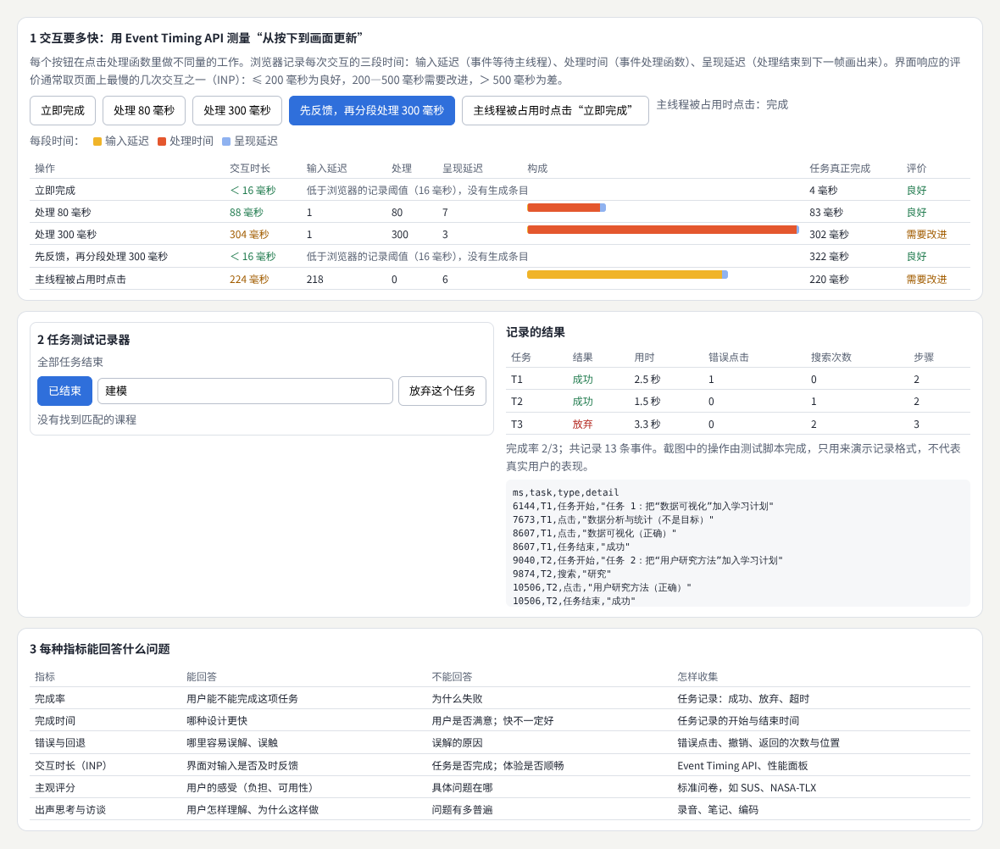
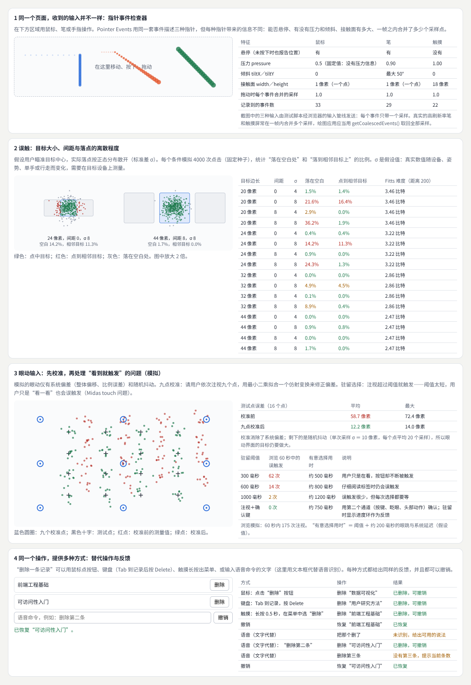
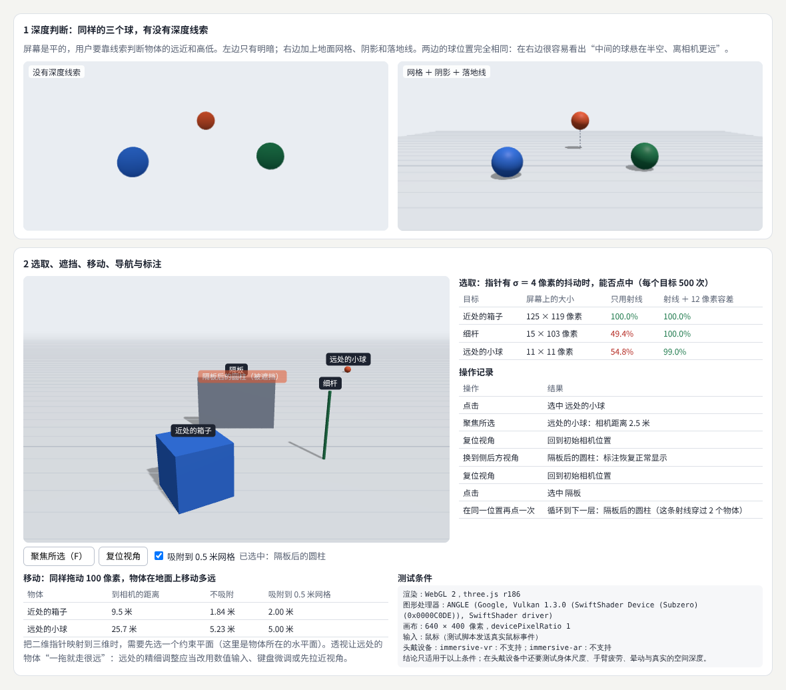
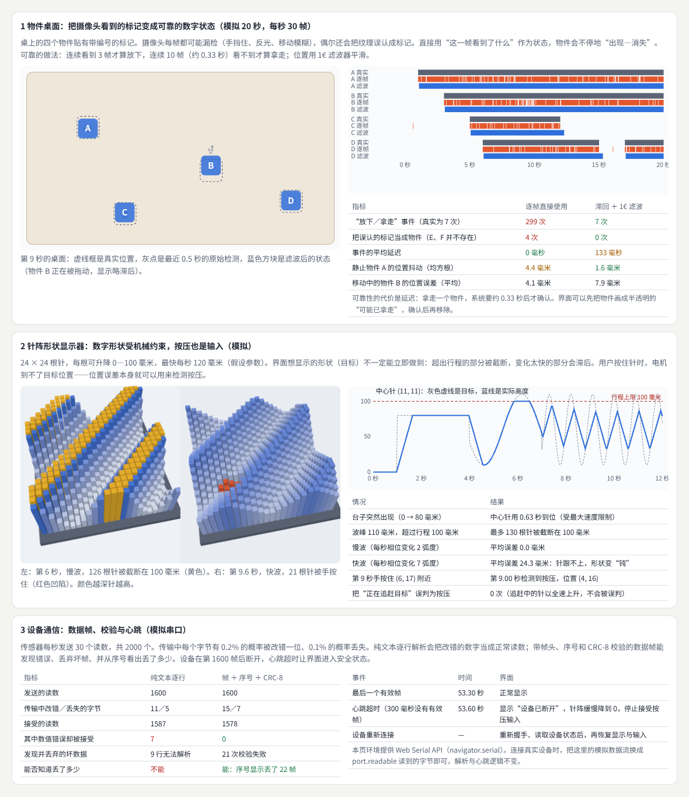
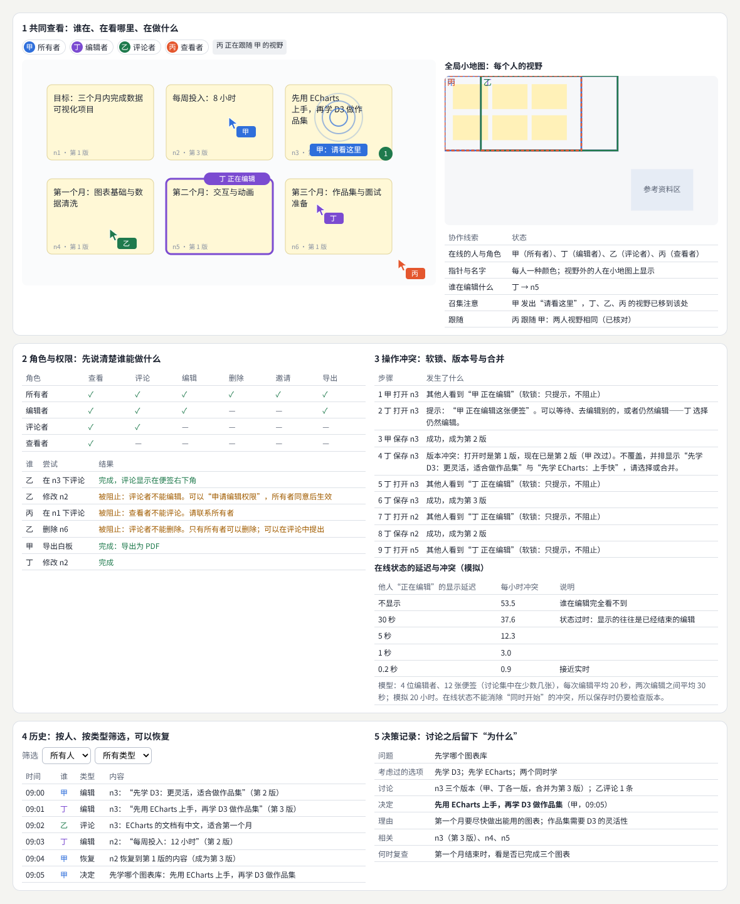
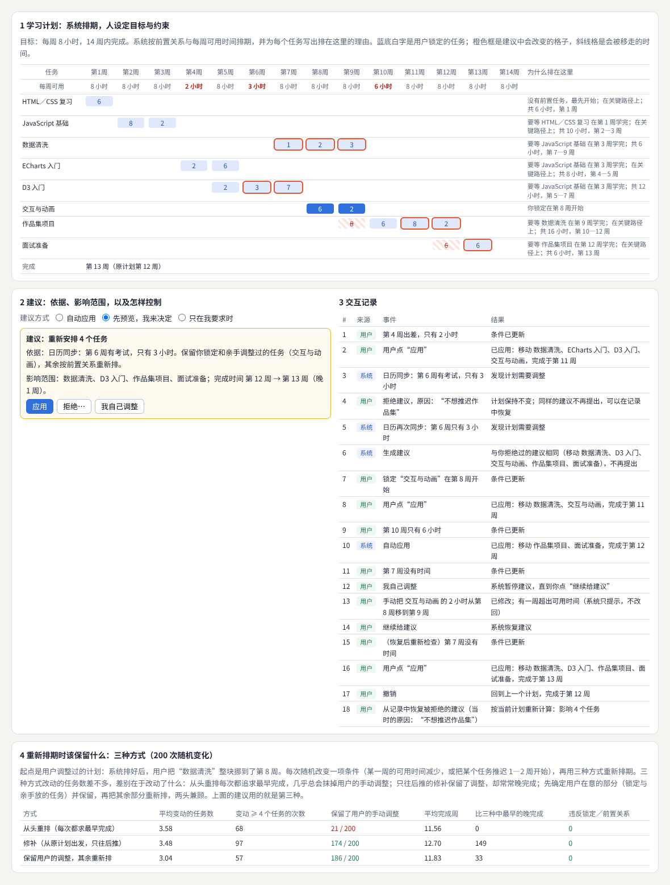
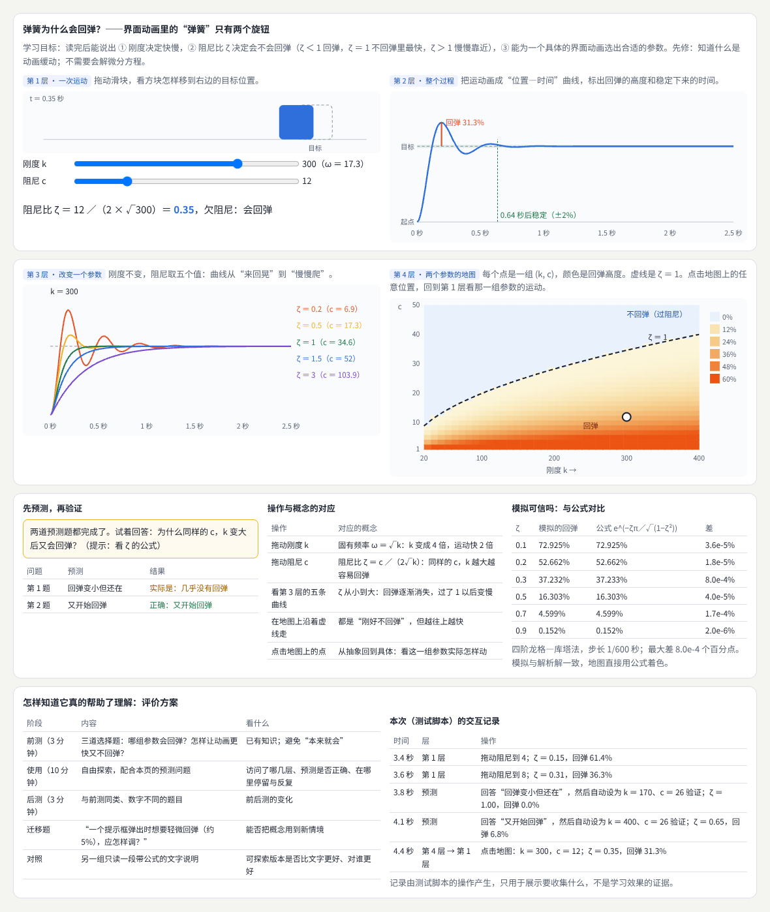
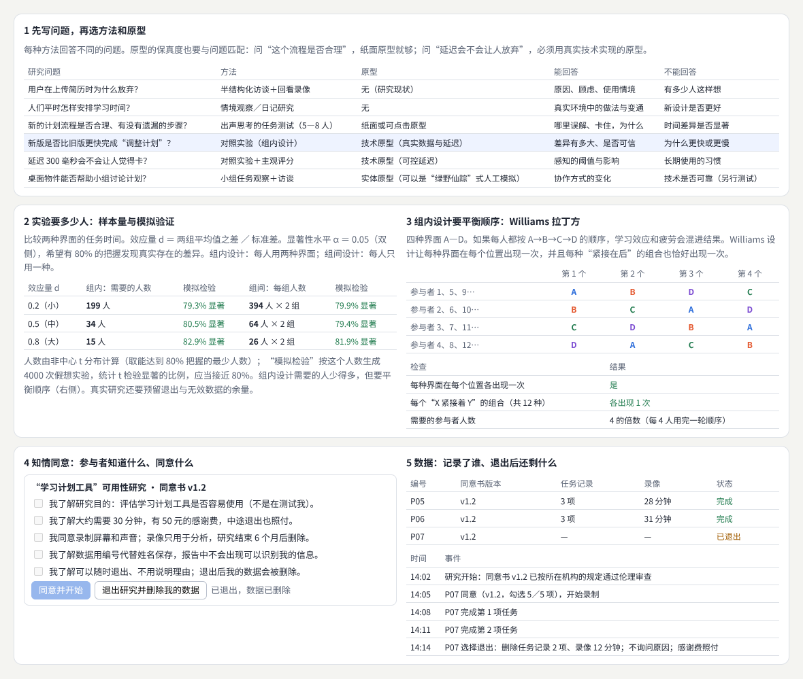
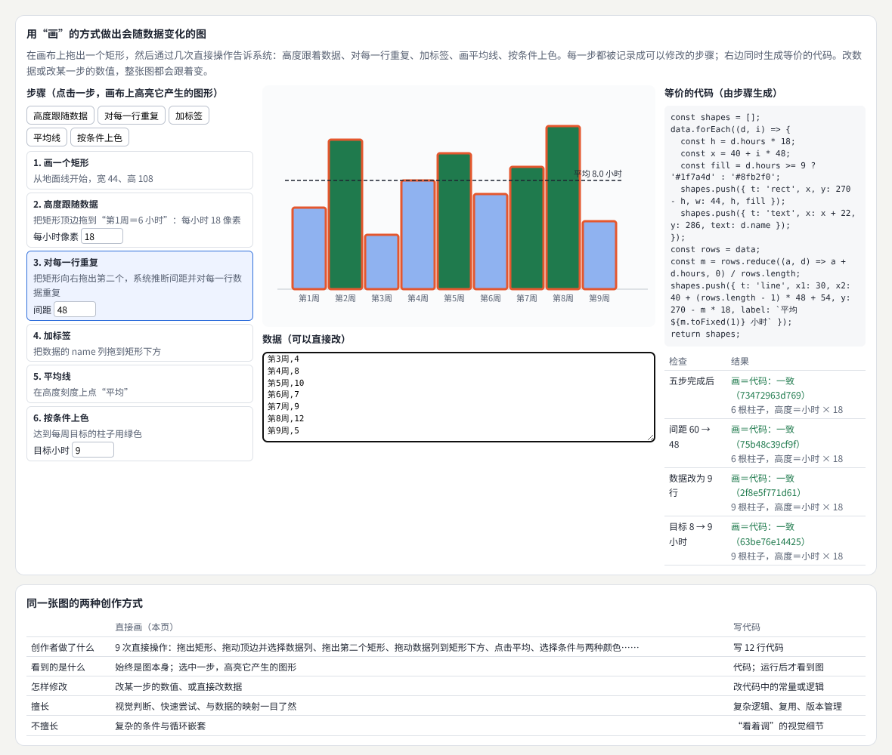
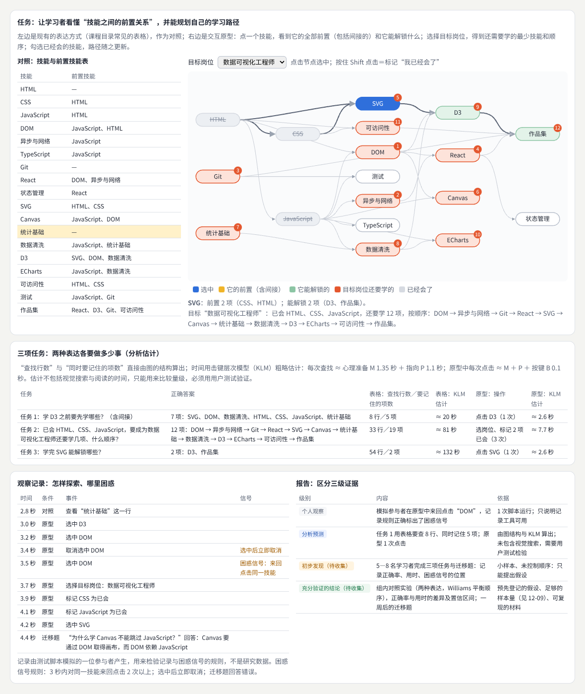

# 人机交互与新型媒介

> 研究人与计算系统怎样协作：从输入方式、空间交互、实体与可触交互、多人协作、人机共创、学习与解释工具，到原型与研究方法、媒介与创作方式；最后做一个帮助理解复杂关系的交互原型，并用对照、观察和分级证据来评价它。  
> 版本：1.0 · 整理日期：2026-10-25  
> 适用对象：已经能做交互页面，想研究“新的交互方式是否真的更好”、或者想设计屏幕以外交互的开发者、设计师与学生。先修：读过[《产品交互与用户体验》](03-产品交互与用户体验.md)的 03、07、10 章（用户与任务研究、反馈、评价与迭代）。

**人机交互**（HCI）研究人与计算系统**如何协作**。它联系计算机科学、设计、心理学和其他领域：计算机科学提供实现与度量，设计提供形式与体验，心理学提供感知、记忆和动作的规律，社会学、教育学等其他领域帮助理解使用的情境。

两件事决定了这个方向的学习方式：

- **网页原型可以成为研究载体**。浏览器能采集指针、触摸、笔、键盘、传感器和摄像头的输入，能渲染二维和三维画面，能连接串口设备——足够做大多数交互研究的原型。
- **交互不限于屏幕**。**实体材料**、**声音**和**空间**也可以进入交互：可以摆放的物件、会变形的表面、整个房间。

学习时要记住一个顺序：**先明确要支持的活动，再决定使用何种输入与媒介**。不是“我们有了眼动仪，能做什么”，而是“人在做什么、哪里困难，哪种输入和媒介能帮上忙”。

本册每章都按同样的顺序讲：先说明它解决什么问题；再用白话解释核心概念；然后给出一个可以直接运行的示例与运行截图；接着是常见问题和本章练习；最后是一张**进阶学习卡**：技术栈、要掌握的高阶词汇（附英文）、搜索关键词、值得去看的实例，以及四级进阶阶梯：

| 级别 | 含义 |
| --- | --- |
| L1 入门 | 能运行并解释本章示例，说出每个概念的作用 |
| L2 熟练 | 能在自己的原型里正确使用，完成本章练习 |
| L3 进阶 | 能比较几种做法的取舍，设计实验或观察来检验 |
| L4 深入 | 能提出新的交互技术或设计原则，并用可靠的证据支持 |

四级是本手册的教学结构，用来安排学习顺序，不对应任何公司的职级。

所有示例都放在本目录的[示例](示例/)文件夹中，用浏览器直接打开即可运行（需要联网加载字体与 three.js）；每个示例都已在无头浏览器中实际运行并自动检查。书中的数字有三种来源，正文会分别说明：**浏览器实际测得的**（例如事件时长）、**按模型模拟的**（例如误触率、眼动校准，参数是假设值）、**由结构直接算出的**（例如样本量、查找次数）。**示例里没有任何真实参与者的数据**：凡是涉及“用户怎样做”的记录，都由测试脚本产生，只用来展示要记录什么、怎样分析。

主线是：**从活动出发，学会度量 → 掌握八个横向方向 → 做一个交互原型，用对照、观察与分级证据评价它。**

## 阅读导航

正文共 13 章（01—13），附 10 个可运行示例、3 组附录与 29 项资料入口。

- [第一篇：共同的基础](#part-1)
  - [01 人机交互研究什么](#ch01)
  - [02 从活动出发：任务、指标与度量](#ch02)
- [第二篇：八个横向方向](#part-2)
  - [03 输入方式](#ch03)
  - [04 空间交互](#ch04)
  - [05 实体与可触交互](#ch05)
  - [06 多人协作](#ch06)
  - [07 人机共创](#ch07)
  - [08 学习与解释工具](#ch08)
  - [09 原型与研究方法](#ch09)
  - [10 媒介与创作方式](#ch10)
- [第三篇：综合项目、研究视野与路线](#part-3)
  - [11 综合项目：帮助理解复杂关系的交互原型](#ch11)
  - [12 研究的产出、社区与参考项目](#ch12)
  - [13 工具、技术栈与学习路线](#ch13)
- [附录 A：术语表](#appendix-a)
- [附录 B：资料入口](#appendix-b)
- [附录 C：与原手册的对应关系及修订记录](#appendix-c)

## 第一篇：共同的基础

### 01 人机交互研究什么

#### 01.1 一个跨学科的领域

ACM SIGCHI 是人机交互领域最大的专业组织，成员来自计算机科学、软件工程、心理学、交互设计、图形设计、社会学、信息科学、人类学等领域。[B01](#ref-b01) 这种组成说明了 HCI 的工作方式：同一个问题，要同时从“能不能做出来”“人能不能用好”“在真实情境中会怎样”三个角度看。

| 学科 | 带来什么 | 本册的例子 |
| --- | --- | --- |
| 计算机科学 | 实现、算法、度量 | 事件时长测量（02）、选取算法（04）、滤波与校验（05） |
| 设计 | 形式、体验、原型 | 建议卡片（07）、可探索解释（08）、用“画”创作（10） |
| 心理学 | 感知、动作、记忆与学习 | Fitts 定律（03）、深度线索（04）、先预测再验证（08） |
| 其他领域 | 社会、教育、伦理 | 协作中的角色与决策（06）、知情同意（09） |

#### 01.2 先说活动，再说技术

一个好的研究问题从活动开始：“学习者在规划学习路径时，很难看出技能之间的间接依赖”。有了活动，才能判断哪种输入、哪种媒介、哪种表达方式值得尝试，也才知道用什么来衡量“更好”（11 章正是这样一个项目）。

反过来的路线——“我们有一个新设备，找个地方用上它”——经常做出没有人需要的东西。新技术可以启发想法，但评价时仍要回到活动。

### 02 从活动出发：任务、指标与度量

#### 02.1 把活动变成可以观察的任务

活动是笼统的（“规划学习”），任务是具体的（“把‘数据可视化’加入学习计划”）。好的任务有明确的开始和结束、可以判断是否完成、不暗示操作方法。

每种指标回答不同的问题，没有哪一种能单独说明“好用”：

| 指标 | 能回答 | 不能回答 |
| --- | --- | --- |
| 完成率 | 能不能完成 | 为什么失败 |
| 完成时间 | 哪种设计更快 | 是否满意；快不一定好 |
| 错误与回退 | 哪里容易误解、误触 | 误解的原因 |
| 交互时长（INP） | 界面对输入是否及时反馈 | 任务是否完成 |
| 主观评分（SUS、NASA-TLX 等问卷） | 感受与负担 | 具体问题在哪 |
| 出声思考与访谈 | 怎样理解、为什么这样做 | 问题有多普遍 |

#### 02.2 示例：测量“从按下到画面更新”

示例：[12-02-measure.html](示例/12-02-measure.html)

浏览器的 Event Timing API 记录每次交互的三段时间：**输入延迟**（事件等待主线程）、**处理时间**（事件处理函数本身）、**呈现延迟**（处理结束到下一帧画出来）。[B02](#ref-b02) 网页的“交互到下一次绘制”（INP）取页面上最慢的几次交互之一，≤ 200 毫秒为良好，200—500 毫秒需要改进，＞ 500 毫秒为差。[B03](#ref-b03)

测试脚本用真实的鼠标事件点击五个按钮：

| 操作 | 交互时长 | 其中 | 任务真正完成 |
| --- | --- | --- | --- |
| 立即完成 | ＜ 16 毫秒（低于记录阈值） | — | 7 毫秒 |
| 处理 80 毫秒 | 88 毫秒 | 处理 80，呈现 7 | 83 毫秒 |
| 处理 300 毫秒 | 304 毫秒（需要改进） | 处理 300 | 303 毫秒 |
| 先反馈，再分 10 段处理 300 毫秒 | ＜ 16 毫秒 | — | 322 毫秒 |
| 主线程被 250 毫秒的长任务占用时点击 | 224 毫秒（需要改进） | 输入延迟 217 | 220 毫秒 |

两个结论：

- **交互时长衡量的是“是否及时反馈”，不是“任务多快完成”**。第 4 行的任务总共用了 322 毫秒，比第 3 行还慢，但它立刻显示“处理中”，并把工作拆成小段、把主线程还给浏览器，所以交互时长不到 16 毫秒。
- **慢的原因不一定在你的处理函数里**。第 5 行的处理函数什么都没做，却等了 217 毫秒——主线程正被别的长任务占着。

下半部分的**任务测试记录器**演示一次可用性测试要记录什么：参与者读完任务说明后点“开始”才计时；记录每次点击、搜索、放弃；最后汇总完成率、用时、错误点击与步骤数，并导出为 CSV。截图中的三项任务由测试脚本完成（两项成功、一项放弃，共 13 条事件），只用来展示记录格式。

#### 02.3 常见问题

- **只看完成时间**：用户可能因为放弃而“很快”结束。完成时间要和完成率、错误一起看。
- **在开发机上测性能**：开发机往往比用户的设备快得多。要在目标设备上测，或者用浏览器的性能限制功能模拟。
- **计时从页面打开开始**：参与者还在读任务说明。应当由参与者明确开始。

**本章练习**：

1. 为你的一个页面找出最慢的交互，用 Event Timing API 记录它的三段时间，并尝试“先反馈、再分段处理”。
2. 用任务测试记录器请两位同学完成三项任务，比较他们的步骤数与错误点击。

#### 02.4 进阶学习卡

| 级别 | 目标 | 怎样检验 |
| --- | --- | --- |
| L1 入门 | 能把一个活动写成三项可观察的任务，说出每种指标能回答什么 | 任务有明确的开始、结束与成功标准 |
| L2 熟练 | 能用 Event Timing API 与任务记录器收集数据 | 导出的记录能复算出完成率与用时 |
| L3 进阶 | 能为一个研究问题组合几种指标，并解释它们之间的矛盾 | 报告中说明“快但错多”之类的情况 |
| L4 深入 | 能设计新的度量方法，并检验它的可靠性 | 同一测量重复进行，结果一致 |

- **技术栈**：Event Timing API 与 `PerformanceObserver`[B02](#ref-b02)；web-vitals 库；浏览器性能面板；本册的任务记录器（可导出 CSV）。
- **高阶词汇**：任务分析（task analysis）、有效性／效率／满意度（effectiveness／efficiency／satisfaction）、完成率（task success rate）、交互到下一次绘制（Interaction to Next Paint, INP）、输入延迟（input delay）、长任务（long task）、出声思考（think-aloud）、系统可用性量表（System Usability Scale, SUS）、工作负荷量表（NASA-TLX）。
- **搜索关键词**：`interaction to next paint`、`event timing api processingStart`、`usability metrics task success time on task`、`think aloud protocol`、`SUS questionnaire`、`可用性测试 指标`。
- **值得看的实例**：[web.dev 的 INP 说明](https://web.dev/articles/inp)——三段时间的图解与优化方法。
- **资料**：[B02](#ref-b02)、[B03](#ref-b03)。

## 第二篇：八个横向方向

### 03 输入方式

#### 03.1 解决什么问题

比较**鼠标**、**触摸**、**笔**、**键盘**、**语音**、**手势**和**眼动**等输入的特征。考虑**精度**、**疲劳**、**环境**和**误触**。新输入方式需要明确的**校准**、**反馈**和**替代操作**。

| 输入 | 精度 | 疲劳与环境 | 常见问题 |
| --- | --- | --- | --- |
| 鼠标 | 高，能悬停 | 需要桌面 | 不适合移动场景 |
| 触摸 | 受手指大小限制，不能悬停 | 单手、行走时更差 | 误触、手指遮挡目标 |
| 笔 | 高，有压力与倾斜 | 需要拿笔 | 手掌误触 |
| 键盘 | 离散、可靠 | 需要记快捷键 | 可发现性差 |
| 语音 | 不需要手 | 噪声环境、公共场合不便 | 识别错误、隐私 |
| 手势（空中） | 低 | 手臂抬起容易累 | 与无意的动作难以区分 |
| 眼动 | 低（有抖动） | 需要校准 | 看一看就触发（Midas touch） |

#### 03.2 核心概念

- **Pointer Events**：用同一套事件描述鼠标、笔和触摸，并通过 `pointerType`、`pressure`、`tiltX`、`width` 等属性区分它们。[B04](#ref-b04)
- **Fitts 定律**：指向一个目标的时间随“难度指数” ID ＝ log₂（距离 ／ 宽度 ＋ 1）线性增加：目标越小、越远，越慢。[B05](#ref-b05) 它是 HCI 中被验证得最充分的规律之一，可以用来比较不同的布局和输入设备。[B06](#ref-b06)
- **目标尺寸**：WCAG 2.2 的 2.5.8 要求点击目标至少 24 × 24 CSS 像素，或者与相邻目标保持足够间距。[B07](#ref-b07)
- **校准**：眼动、空间追踪等输入有系统偏差，使用前要让用户注视或触碰几个已知位置，拟合出修正。
- **驻留选择与“看一看就触发”**：眼动没有“按下”的动作，常用“注视超过一定时间就触发”。但人看东西时眼睛本来就会停留，阈值太短就会误触发——这就是 Midas touch 问题。[B08](#ref-b08)

#### 03.3 示例：同一页面上的四种输入问题

示例：[12-03-input.html](示例/12-03-input.html)

**指针事件检查器**：测试脚本通过浏览器的输入管线分别发送鼠标、笔和触摸事件（与真实设备经过同一条事件路径）：

| 特征 | 鼠标 | 笔 | 触摸 |
| --- | --- | --- | --- |
| 悬停（未按下时也报告位置） | 有 | 有 | 没有 |
| 压力 `pressure` | 按下时固定为 0.5（没有压力信息） | 最大 0.90 | 1.00 |
| 倾斜 `tiltX`／`tiltY` | 0 | 最大 50° | 0 |
| 接触面 `width`／`height` | 1 像素 | 1 像素 | 18 像素 |

所以“悬停才显示的提示”在触摸屏上看不到，“按压力画粗细”的功能要先检查 `pointerType`。真实的高刷新率笔和触摸屏常常在一帧内合并多个采样，绘图应用要用 `getCoalescedEvents()` 取回全部采样。

**误触模拟**：假设用户瞄准目标中心，落点按正态分布散开（标准差 σ，这是假设值，真实数值要在目标设备上测）。每个条件模拟 4000 次：

| 目标边长 | 间距 | σ | 落在空白 | 点到相邻目标 | Fitts 难度（距离 200 像素） |
| --- | --- | --- | --- | --- | --- |
| 20 像素 | 0 | 8 | 21.6% | 16.4% | 3.46 比特 |
| 24 像素 | 0 | 4 | 0.4% | 0.4% | 3.22 比特 |
| 24 像素 | 0 | 8 | 14.2% | 11.3% | 3.22 比特 |
| 24 像素 | 8 | 8 | 24.3% | 1.3% | 3.22 比特 |
| 32 像素 | 0 | 8 | 4.9% | 4.5% | 2.86 比特 |
| 44 像素 | 0 | 8 | 0.9% | 0.8% | 2.47 比特 |
| 44 像素 | 8 | 8 | 1.7% | 0.0% | 2.47 比特 |

间距能把“点到相邻目标”从 11.3% 降到 1.3%，但点不中的总比例反而升高（落进了间隙）——**间距防止的是“点错”，只有加大目标才能减少“点不中”**。对删除、支付等后果严重的操作，“点错”比“点不中”更糟。

**眼动校准**（模拟：眼动仪有整体偏移、比例误差和 σ ＝ 10 像素的抖动）：九点校准用最小二乘拟合一个仿射变换，16 个测试点的平均误差从 **58.7 像素降到 12.2 像素**。剩下的是随机抖动，校准消除不了——眼动界面的目标仍然要做大。

**驻留阈值**（模拟浏览 60 秒、175 次注视）：

| 驻留阈值 | 误触发 | 有意选择用时 |
| --- | --- | --- |
| 300 毫秒 | 62 次 | 约 500 毫秒 |
| 600 毫秒 | 14 次 | 约 800 毫秒 |
| 1000 毫秒 | 2 次 | 约 1200 毫秒 |
| 注视 ＋ 确认键 | 0 次 | 约 750 毫秒 |

**替代操作**：“删除一条记录”可以用鼠标点按钮、键盘（Tab 到记录后按 Delete）、触摸长按 0.5 秒出菜单、或输入语音命令（示例用文本框代替语音识别）。每种方式给出同样的反馈，都可以撤销；语音命令没听懂时告诉用户可以怎么说，说了不存在的“第三条”时告诉用户现在有几条。

#### 03.4 常见问题

- **只在桌面浏览器上测试**：触摸、笔、单手、行走时的问题全都看不到。至少用真实手机测一遍。
- **新输入方式只有一种操作路径**：语音识别会出错、手势会疲劳、眼动需要校准。每个功能都要有可靠的替代操作。
- **没有反馈**：驻留选择要显示进度环；手势识别要显示“识别到了什么”；语音要显示听到的文字。

**本章练习**：

1. 在示例中把 σ 改为你用拇指在手机上实测的数值（让同学点 20 次目标中心，计算偏差的标准差），重新得到误触表。
2. 为一个眼动界面设计“注视 ＋ 确认”的第二通道，并说明为什么选它。

#### 03.5 进阶学习卡

| 级别 | 目标 | 怎样检验 |
| --- | --- | --- |
| L1 入门 | 能用 Pointer Events 区分三种指针，为触摸放大目标 | 页面在手机与桌面上都能用 |
| L2 熟练 | 能为一个功能提供多种输入方式和一致的反馈 | 只用键盘、只用触摸都能完成任务 |
| L3 进阶 | 能用 Fitts 定律或模拟比较不同布局，设计校准与阈值 | 给出误触率与速度的取舍 |
| L4 深入 | 能提出新的输入技术，并用对照实验评价 | 有可复现的实验与数据 |

- **技术栈**：Pointer Events[B04](#ref-b04)；`getCoalescedEvents()`／`getPredictedEvents()`；Web Speech API（语音）；MediaPipe 等手部与面部追踪库；WebGazer 等网页眼动估计库；浏览器开发者工具的触摸模拟。
- **高阶词汇**：指针事件（pointer events）、Fitts 定律（Fitts' law）、难度指数（index of difficulty）、吞吐量（throughput）、目标尺寸（target size）、校准（calibration）、驻留选择（dwell selection）、Midas touch 问题（Midas touch problem）、多模态输入（multimodal input）、替代输入（alternative input）。
- **搜索关键词**：`pointer events pressure tilt`、`fitts law index of difficulty`、`touch target size accuracy`、`eye tracking dwell time selection`、`midas touch problem`、`多模态交互`。
- **值得看的实例**：[MDN 的 Pointer Events 指南](https://developer.mozilla.org/en-US/docs/Web/API/Pointer_events)——多点触控、压力与倾斜的示例代码。
- **资料**：[B04](#ref-b04)—[B08](#ref-b08)。

### 04 空间交互

#### 04.1 解决什么问题

研究**三维选取**、**移动**、**旋转**、**导航**和**空间标注**。需要考虑**深度判断**、**遮挡**、**身体尺度**与**操作舒适度**。空间原型应说明使用的**设备和实际测试条件**。

#### 04.2 核心概念

- **深度线索**：屏幕是平的，人靠阴影、遮挡、透视、地面网格、物体落在地上的位置来判断远近与高低。
- **选取**：从相机穿过指针位置发出一条射线，第一个碰到的物体就是被选中的（three.js 的 `Raycaster`）。[B09](#ref-b09) 小而远的物体只占几个像素，射线很容易擦过；可以加一个屏幕空间的容差。
- **遮挡**：想选的物体被挡住了。可以“在同一位置再点一次，选到下一层”，或提供列表、透视模式。
- **约束平面**：二维的指针在三维中移动物体时，要先确定在哪个平面上移动（例如物体所在的水平面）。
- **身体尺度与舒适度**：在头戴设备中，常用的内容要放在身前、视线略下方、手臂自然能及的范围；长时间抬手操作会很累（gorilla arm）。WebXR 让网页可以进入头戴设备。[B10](#ref-b10)

#### 04.3 示例：选取、遮挡、移动、导航与标注

示例：[12-04-spatial.html](示例/12-04-spatial.html)

**选取**：瞄准每个物体的中心，指针有 σ ＝ 4 像素的抖动，各测 500 次：

| 目标 | 屏幕上的大小 | 只用射线 | 射线 ＋ 12 像素容差 |
| --- | --- | --- | --- |
| 近处的箱子 | 125 × 119 像素 | 100% | 100% |
| 细杆 | 15 × 103 像素 | 49.4% | 100% |
| 远处的小球 | 11 × 11 像素 | 54.8% | 99.0% |

**遮挡**：在“隔板后的圆柱”的位置点击，第一次选中的是隔板；在同一位置再点一次，循环到圆柱（这条射线穿过两个物体）。圆柱的标注显示为灰色“（被遮挡）”；换到侧后方视角后，标注恢复正常。

**移动**：拖动物体时，把指针的射线与物体所在的水平面求交。同样拖动 100 像素：

| 物体 | 到相机的距离 | 在地面上移动 | 吸附到 0.5 米网格后 |
| --- | --- | --- | --- |
| 近处的箱子 | 9.5 米 | 1.84 米 | 2.00 米 |
| 远处的小球 | 25.7 米 | 5.23 米 | 5.00 米 |

透视让远处的物体“一拖就走很远”。远处的精细调整应当改用数值输入、键盘微调，或者先“聚焦所选”（示例中按 F，把相机移到距离小球 2.5 米处）。

**测试条件**：示例自动列出渲染器（WebGL 2，three.js r186）、图形处理器（SwiftShader 软件渲染）、画布大小、输入方式和 WebXR 支持情况（本次运行不支持头戴设备）。**结论只适用于这些条件**；在头戴设备中还要测试身体尺度、手臂疲劳、晕动和真实的空间深度。

#### 04.4 常见问题

- **用户不知道物体离多远**：加阴影、地面网格、落地线，或者提供俯视的小地图。
- **小物体点不中**：加选取容差；或者提供“列表选择”的替代方式。
- **旋转搞不清绕哪个轴**：只开放最常用的一个轴（例如绕竖直轴），其余放在高级模式；用键盘按固定角度旋转（示例中 Q／E 每次 15°）。
- **在桌面上做的空间原型直接搬进头戴设备**：距离、尺度、输入方式都变了，要重新设计和测试（[《三维内容与空间设计》](06-三维内容与空间设计.md) 10、13 章）。

**本章练习**：

1. 为示例加一个“列表选择”面板，比较它与“再点一次循环”在找到隔板后圆柱时各需要几步。
2. 把拖动改为“在相机朝向的平面上移动”，比较与水平面约束的差别。

#### 04.5 进阶学习卡

| 级别 | 目标 | 怎样检验 |
| --- | --- | --- |
| L1 入门 | 能实现射线选取、轨道相机与基本的深度线索 | 用户能说出哪个物体更远 |
| L2 熟练 | 能处理遮挡、小目标与约束平面上的拖动，加空间标注 | 示例中的三类问题都有解决办法 |
| L3 进阶 | 能为头戴设备设计交互，考虑身体尺度与舒适度 | 在真实设备上完成测试并记录条件 |
| L4 深入 | 能提出新的三维选取或导航技术，并与已有技术对比 | 有对照实验的速度与错误率 |

- **技术栈**：three.js 的 `Raycaster`[B09](#ref-b09)、`OrbitControls`、`TransformControls`、`CSS2DRenderer`；WebXR Device API[B10](#ref-b10)；Immersive Web 工作组的 WebXR 示例。
- **高阶词汇**：射线选取（raycasting）、深度线索（depth cues）、遮挡（occlusion）、选取容差（picking tolerance）、约束平面（constraint plane）、空间标注（spatial annotation）、轨道导航（orbit navigation）、手臂疲劳（gorilla arm）、晕动症（motion sickness）、六自由度（6DoF）。
- **搜索关键词**：`three.js raycaster select`、`3d selection occlusion techniques`、`webxr hand interaction`、`depth cues 3d user interface`、`gorilla arm fatigue`、`三维交互 选取`。
- **值得看的实例**：[three.js 交互方块](https://threejs.org/examples/webgl_interactive_cubes.html)——最小的射线选取；[three.js 变换控件](https://threejs.org/examples/misc_controls_transform.html)——移动、旋转、缩放的手柄；[three.js 的 XR 拖动示例](https://threejs.org/examples/webxr_xr_dragging.html)——在头戴设备中抓取物体；[WebXR 示例集](https://immersive-web.github.io/webxr-samples/)。
- **资料**：[B09](#ref-b09)、[B10](#ref-b10)。

### 05 实体与可触交互

#### 05.1 解决什么问题

将**数字状态与真实物体**、**材料**或**形变**联系起来。用户可通过**摆放**、**触摸**或**操纵对象**参与计算。设计需要同时考虑**感知**、**机械约束**、**反馈**和**系统可靠性**。

#### 05.2 核心概念

- **可触用户界面**：Ishii 与 Ullmer 1997 年提出“可触比特”（Tangible Bits），让人直接用手操作代表数字信息的实体物件。[B11](#ref-b11)
- **形状显示器**：MIT 的 inFORM 用一阵列可升降的针把三维内容“显示”成实体形状，也能移动桌面上的物体，或者让远程参与者以实体形式出现。[B12](#ref-b12)
- **追踪的可靠性**：摄像头识别物件上的标记，每一帧都可能漏检或误认。需要**滞回**（连续看到几帧才算放下，连续几帧看不到才算拿走）和**滤波**。1€ 滤波器在慢速时强平滑去抖，快速时弱平滑减少滞后。[B13](#ref-b13)
- **设备通信**：浏览器可以通过 Web Serial API 与微控制器通信。[B14](#ref-b14) 串口会出错，数据要分帧、加序号与校验，并用心跳检测断开。

#### 05.3 示例：物件追踪、针阵显示器与设备通信

示例：[12-05-tangible.html](示例/12-05-tangible.html)（全部为模拟，参数是假设值）

**物件追踪**（20 秒，每秒 30 帧；四个物件真实地放下 5 次、拿走 2 次；每帧漏检 8%，移动时 40%；每帧有 1% 的概率误认出一个标记）：

| 指标 | 逐帧直接使用 | 滞回 ＋ 1€ 滤波 |
| --- | --- | --- |
| “放下／拿走”事件（真实为 7 次） | 299 次 | 7 次 |
| 把误认的标记当成物件 | 4 次 | 0 次 |
| 事件的平均延迟 | 0 毫秒 | 133 毫秒 |
| 静止物件的位置抖动 | 4.4 毫米 | 1.6 毫米 |
| 移动中物件的位置误差 | 4.1 毫米 | 7.9 毫米 |

**可靠性的代价是延迟与滞后**：拿走一个物件，系统要约 0.33 秒后才确认；滤波让静止的物件不再抖，却让移动中的物件跟得更慢。界面可以先把物件画成半透明的“可能已拿走”，确认后再移除。

**针阵显示器**（24 × 24 根针，行程 0—100 毫米，最快每秒 120 毫米，均为假设参数）：

| 情况 | 结果 |
| --- | --- |
| 台子突然出现（0 → 80 毫米） | 中心针用 0.63 秒到位 |
| 波峰 110 毫米，超过行程 | 最多 130 根针被截断在 100 毫米 |
| 慢波 | 平均误差 0.0 毫米 |
| 快波 | 平均误差 24.3 毫米：针跟不上，形状变“钝” |
| 手按住一片针（21 根） | 第 9.00 秒检测到按压 |
| 把“正在追赶目标”误判为按压 | 0 次 |

按压检测的思路很简单：针离目标还差 15 毫米以上，却没有以全速上升——说明有东西挡住了它。**机械约束既限制了输出，也提供了输入**。

**设备通信**（1600 个读数；每个字节 0.2% 的概率被改错一位、0.1% 的概率丢失）：

| 指标 | 纯文本逐行 | 帧 ＋ 序号 ＋ CRC-8 |
| --- | --- | --- |
| 数值错误却被接受 | 7 个 | 0 个 |
| 发现并丢弃的坏数据 | 9 行无法解析 | 21 次校验失败 |
| 能否知道丢了多少 | 不能 | 能：序号显示丢了 22 帧 |

纯文本的问题在于：换行符丢了，“512”和“530”就合成了“512530”，一个合法却错误的数字。设备在最后一个有效帧后 300 毫秒没有消息，心跳超时，界面显示“设备已断开”，针阵缓慢降到 0，停止接受按压输入。

#### 05.4 常见问题

- **只在理想条件下演示**：灯光、手的遮挡、桌面反光都会让追踪变差。要在真实环境中长时间运行，统计误判。
- **硬件一出问题，界面就“假装正常”**：要有心跳、超时和明确的“断开”状态，并让设备进入安全状态。
- **把实体交互当成“好玩的装饰”**：实体的价值在于手的技能、空间记忆和多人共同操作。要说清楚它支持了什么活动。

**本章练习**：

1. 在示例中把“拿走”的确认帧数从 10 改为 5 和 20，记录事件数与延迟，找出你认为合适的值。
2. 用一块开发板（例如 Arduino）和 Web Serial API，把一个旋钮的读数显示在网页上，并加上帧、校验和心跳。

#### 05.5 进阶学习卡

| 级别 | 目标 | 怎样检验 |
| --- | --- | --- |
| L1 入门 | 能说出可触界面的特点，读懂示例中的滞回与滤波 | 解释示例表格的每一行 |
| L2 熟练 | 能用 Web Serial 连接一个传感器，做出可靠的读数与断开处理 | 拔掉设备后界面在 1 秒内显示断开 |
| L3 进阶 | 能设计一个实体原型（可以先用人工模拟），并说明它支持的活动 | 小组任务观察有记录 |
| L4 深入 | 能做出新的实体交互技术，同时处理感知、机械与可靠性 | 长时间运行的可靠性数据 |

- **技术栈**：Web Serial API[B14](#ref-b14)、WebHID、Web Bluetooth；Arduino 等开发板；摄像头标记识别（如 ArUco 标记）；1€ 滤波器[B13](#ref-b13)；three.js（实体形状的数字孪生）。
- **高阶词汇**：可触用户界面（tangible user interface, TUI）、形状显示器（shape display）、可编程物质（programmable matter／radical atoms）、标记追踪（fiducial marker tracking）、滞回（hysteresis）、去抖（debouncing）、1€ 滤波器（1€ filter）、帧与校验（framing／checksum）、心跳（heartbeat）、绿野仙踪原型（Wizard of Oz prototype）。
- **搜索关键词**：`tangible user interface`、`shape display inform`、`one euro filter`、`web serial api arduino`、`fiducial marker tracking table`、`可触交互`。
- **值得看的实例**：[inFORM](https://tangible.media.mit.edu/project/inform/)——看视频中针阵怎样移动桌上的物体、怎样表现远程的人；[1€ 滤波器的主页](https://gery.casiez.net/1euro/)——可以在线调参数，看平滑与滞后的取舍。
- **资料**：[B11](#ref-b11)—[B14](#ref-b14)。

### 06 多人协作

#### 06.1 解决什么问题

支持**共同查看**、**讨论**、**编辑**和**决策**。研究**角色**、**权限**、**共享注意力**、**操作冲突**和**历史**。协作质量与**共同理解**相关，需要**观察多人真实任务**。

#### 06.2 核心概念

- **工作区感知**：协作者需要知道谁在、在看哪里、在做什么、刚刚改了什么。Gutwin 与 Greenberg 把这些问题整理为“工作区感知”的框架。[B15](#ref-b15)
- **在线状态**：指针、选区、“正在编辑”的标记、视野小地图。Yjs 等库提供专门的“感知”（awareness）通道传递这些临时信息。[B16](#ref-b16)
- **共享注意力**：“请看这里”的召集、“跟随某人的视野”。
- **角色与权限**：所有者、编辑者、评论者、查看者——先说清楚谁能做什么；被阻止时告诉用户怎样申请。
- **冲突**：软锁只提示不阻止；保存时比较版本号，发现冲突就并排显示，不覆盖。数据层面的合并见[《计算设计与创作工具》](11-计算设计与创作工具.md) 09 章。

#### 06.3 示例：四个人编辑同一块白板

示例：[12-06-together.html](示例/12-06-together.html)

四个人：甲（所有者）、丁（编辑者）、乙（评论者）、丙（查看者）。过程：

1. 甲打开便签 n3，其他人看到“甲正在编辑”。丁也打开 n3，收到提示“甲正在编辑这张便签”，选择仍然编辑。
2. 甲先保存，成为第 2 版。丁保存时发现：打开时是第 1 版，现在已是第 2 版——**不覆盖**，并排显示两个版本。丁重新打开，合并为“先用 ECharts 上手，再学 D3 做作品集”（第 3 版）。
3. 乙在 n3 下评论成功；乙想改 n2、丙想评论、乙想删除 n6，都被阻止，并告诉他们可以怎么做（申请编辑权限、在评论中提出）。
4. 甲发出“请看这里”，其他人的视野移到该处；丙选择跟随甲，两人视野一致。
5. 丁把 n2 改成“每周投入：12 小时”，甲把它恢复到第 1 版的内容——**恢复也是一次新的修改**（成为第 3 版），历史不会被抹掉。
6. 甲写下决策记录：问题、考虑过的选项、讨论、决定、理由、相关便签和复查时间。

**在线状态的延迟与冲突**（模拟：4 位编辑者、12 张便签，讨论集中在少数几张；每次编辑平均 20 秒，间隔平均 30 秒；20 小时）：

| “正在编辑”的显示延迟 | 每小时冲突 |
| --- | --- |
| 不显示 | 53.5 |
| 30 秒 | 37.6 |
| 5 秒 | 12.3 |
| 1 秒 | 3.0 |
| 0.2 秒 | 0.9 |

在线状态能大幅减少冲突，但**不能消除“同时开始”的冲突**，所以保存时仍然要检查版本。

#### 06.4 常见问题

- **把协作做成“谁最后保存谁赢”**：会悄悄丢掉别人的工作。
- **只做了技术同步，没有感知**：数据是一致的，但人不知道别人在做什么，还是会互相干扰。
- **讨论完了，没人记得为什么这样决定**：用决策记录写下问题、选项、理由和复查时间。
- **只在实验室里请两个人试**：协作的问题出现在真实的任务、真实的角色和时间压力下，要观察多人真实任务。

**本章练习**：

1. 在示例中加入“申请编辑权限”的流程：评论者申请，所有者同意或拒绝，并记入历史。
2. 设计一次观察：三人小组用白板规划一个月的学习，记录谁主导、谁很少发言、在哪里出现分歧。

#### 06.5 进阶学习卡

| 级别 | 目标 | 怎样检验 |
| --- | --- | --- |
| L1 入门 | 能说出工作区感知包括哪些信息 | 列出示例中的五种协作线索 |
| L2 熟练 | 能实现在线状态、角色权限与版本冲突提示 | 两个浏览器窗口中看到彼此的指针与编辑状态 |
| L3 进阶 | 能设计历史、恢复与决策记录，并观察真实小组 | 观察报告中有具体的冲突与解决过程 |
| L4 深入 | 能研究协作中的共同理解，提出新的协作支持方式 | 有对照的小组实验 |

- **技术栈**：Yjs 与它的 awareness 协议[B16](#ref-b16)；WebSocket／WebRTC；乐观并发控制（版本号）；本册第 11 册的 CRDT 示例。
- **高阶词汇**：计算机支持的协同工作（computer-supported cooperative work, CSCW）、群件（groupware）、工作区感知（workspace awareness）、在线状态（presence）、共享注意力（joint attention）、跟随模式（follow mode）、基于角色的访问控制（role-based access control）、乐观并发（optimistic concurrency）、决策记录（decision record）、共同基础（common ground）。
- **搜索关键词**：`workspace awareness groupware`、`yjs awareness cursors`、`optimistic concurrency version conflict ui`、`role based access control collaboration`、`CSCW field study`、`协同编辑 感知`。
- **值得看的实例**：[Yjs 的在线状态教程](https://docs.yjs.dev/getting-started/adding-awareness)——几十行代码加上他人的指针与名字。
- **资料**：[B15](#ref-b15)、[B16](#ref-b16)。

### 07 人机共创

#### 07.1 解决什么问题

设计**人的目标**、**系统建议**和**持续修正**之间的关系。让用户理解**建议依据**、**影响范围**和**控制方式**。**接管**、**拒绝**、**撤销**和**恢复**应成为完整交互的一部分。

#### 07.2 核心概念

- **混合主动**：人和系统都可以发起行动。Horvitz 1999 年提出了混合主动界面的原则：考虑不确定性、行动的代价、允许用户直接接管、记住用户的选择等。[B17](#ref-b17)
- **人与 AI 交互的指南**：Amershi 等人 2019 年整理了 18 条经过评估的指南，例如“说明系统为什么这样做”“支持高效地拒绝与纠正”“记住最近的交互”。[B18](#ref-b18) Google 的 People + AI Guidebook 提供了更多实践模式。[B19](#ref-b19)
- **保留用户在意的部分**：用户锁定的、亲手调整过的内容，是用户明确表达的意图，系统重新计算时应当最后才动它们。

#### 07.3 示例：共同规划学习计划

示例：[12-07-cocreate.html](示例/12-07-cocreate.html)

8 个学习任务共 72 小时，有前置关系；每周 8 小时。系统排期，并为每个任务写出**排在这里的理由**（要等哪个前置任务学完、是否在关键路径上、共几小时）。

| 交互 | 系统怎样做 |
| --- | --- |
| 用户：第 4 周出差，只有 2 小时 | 生成建议，先预览：影响 4 个任务，完成时间不变 → 用户应用 |
| 系统：日历同步，第 6 周有考试只有 3 小时 | 建议移动 5 个任务、完成时间从第 11 周变为第 12 周 → 用户拒绝（“不想推迟作品集”）：计划与条件都不变 |
| 系统：再次同步到同样的情况 | 与拒绝过的建议相同，不再提出 |
| 用户：锁定“交互与动画”在第 8 周开始 | 预览后应用 |
| 自动应用模式下，第 10 周只有 6 小时 | 直接应用，并在记录中写明“自动应用” |
| 用户点“我自己调整” | 系统暂停建议；用户手动把 2 小时挪到下一周（有一周超出，系统只提示、不改回），这项调整被记为“亲手放的” |
| 用户点“继续给建议”，然后撤销 | 恢复建议；撤销回到上一个计划 |
| 从记录中恢复被拒绝的建议 | 按**当前**计划重新计算影响，而不是照搬当时的结果 |

**重新排期时该保留什么**：从一个用户调整过的计划出发（用户把“数据清洗”整块挪到了第 8 周），随机改变 200 次条件，比较三种方式：

| 方式 | 平均变动的任务数 | 保留了用户的手动调整 | 平均完成周 | 比三种中最早的晚完成 |
| --- | --- | --- | --- | --- |
| 从头重排（每次求最早完成） | 3.58 | 21 / 200 | 11.56 | 0 次 |
| 修补（从原计划出发，只往后推） | 3.48 | 174 / 200 | 12.70 | 149 次 |
| 保留用户的调整，其余重新排 | 3.04 | 186 / 200 | 11.83 | 33 次 |

三种方式改动的任务数差不多，**差别在于改动了什么**：从头重排几乎总会抹掉用户的调整；只往后推的修补保留了调整，却常常晚完成；先保留用户在意的部分、再优化其余部分，两头兼顾。示例中的建议用的就是第三种。三种方式都没有违反锁定与前置关系。

#### 07.4 常见问题

- **建议只说“推荐这样做”**：要说明依据（因为什么条件变了）和影响范围（哪些任务会动、完成时间怎样变），让用户能判断。
- **用户拒绝后，系统换个说法又提一遍**：记住拒绝和原因，同样的情况不再提出，并允许用户从记录中找回。
- **自动化程度只有“开”和“关”**：提供“自动应用”“先预览”“只在我要求时”几档，并让用户随时接管。
- **生成式 AI 也是同样的问题**：候选、局部接受、来源记录见[《计算设计与创作工具》](11-计算设计与创作工具.md) 10 章。

**本章练习**：

1. 在示例中让“拒绝”提供三个常见原因的按钮，并据此调整下一次建议（例如“不想推迟作品集”时，优先压缩其他任务）。
2. 为一个你常用的智能功能（输入法联想、照片自动整理等）对照 Amershi 等人的指南，找出它做到和没做到的各三条。

#### 07.5 进阶学习卡

| 级别 | 目标 | 怎样检验 |
| --- | --- | --- |
| L1 入门 | 能说出一条好建议应包含的依据、影响与控制方式 | 评价一个现有产品的建议界面 |
| L2 熟练 | 能实现预览、应用、拒绝、接管、撤销与恢复 | 示例中八种交互都可完成 |
| L3 进阶 | 能设计“保留什么、重算什么”的策略，并用模拟或测试比较 | 给出类似 07.3 的比较表 |
| L4 深入 | 能研究人对系统建议的信任与依赖，提出新的交互原则 | 有对照实验或长期使用研究 |

- **技术栈**：规则或约束求解器（排期、布局）；生成模型的接口与结构化输出；命令与撤销栈；交互记录与来源标记。
- **高阶词汇**：混合主动交互（mixed-initiative interaction）、人在回路（human-in-the-loop）、可解释性（explainability）、影响预览（impact preview）、自动化程度（levels of automation）、接管（takeover）、过度依赖（overreliance）、校准的信任（calibrated trust）、稳定性（plan stability）。
- **搜索关键词**：`mixed initiative user interface principles`、`guidelines for human-ai interaction`、`people + ai guidebook`、`levels of automation`、`overreliance on ai`、`人机协同 设计原则`。
- **值得看的实例**：[People + AI Guidebook](https://pair.withgoogle.com/guidebook/)——“解释”“控制”“出错时怎么办”等章节都有具体的设计模式。
- **资料**：[B17](#ref-b17)—[B19](#ref-b19)。

### 08 学习与解释工具

#### 08.1 解决什么问题

用**可操作图形**、**模拟**和**反馈**帮助人探索概念。需要**确定学习目标**、**已有知识**、**操作与概念之间的映射**，并**评价是否促进理解**。

#### 08.2 核心概念

- **可探索的解释**：读者可以改变文中的数字和参数，立即看到结果。[B20](#ref-b20) explorabl.es 收集了大量这类作品。[B21](#ref-b21)
- **抽象阶梯**：Bret Victor 的《Up and Down the Ladder of Abstraction》展示了怎样从“一次具体的运动”，上升到“随时间的变化”“随一个参数的变化”“随两个参数的变化”，再回到具体。[B22](#ref-b22)
- **先预测，再验证**：让学习者先猜结果，再看模拟。猜错的地方正是要学的地方。
- **操作与概念的映射**：每一个操作都应当对应一个概念（拖动阻尼 → 阻尼比），否则学习者只是在“玩滑块”。

#### 08.3 示例：弹簧为什么会回弹

示例：[12-08-explain.html](示例/12-08-explain.html)

界面动画里的“弹簧”（[《动效与时间设计》](04-动效与时间设计.md) 05 章）只有两个旋钮：刚度 k 和阻尼 c。学习目标是说出：刚度决定快慢（固有频率 ω ＝ √k），阻尼比 ζ ＝ c ／（2√k）决定会不会回弹；并能为一个具体的动画选出参数。

| 层 | 看到什么 | 为什么需要它 |
| --- | --- | --- |
| 第 1 层 · 一次运动 | 方块移向目标 | 具体、直观 |
| 第 2 层 · 整个过程 | 位置—时间曲线，标出回弹高度与稳定时间 | 运动一闪而过，曲线可以停下来看 |
| 第 3 层 · 改变一个参数 | 同一刚度下 ζ ＝ 0.2、0.5、1、1.5、3 的五条曲线 | 看出“阻尼比”这一个量的作用 |
| 第 4 层 · 两个参数的地图 | 每个 (k, c) 的回弹高度，虚线是 ζ ＝ 1 | 一眼看到全部可能；点击任意一点回到第 1 层 |

测试脚本的一次操作：阻尼 4 → ζ ＝ 0.15，回弹 61.4%；阻尼 8 → ζ ＝ 0.31，回弹 36.3%。第一道预测题“把阻尼加到 26 会怎样”，脚本故意答“回弹变小但还在”，验证结果是 ζ ＝ 1.00、几乎没有回弹；第二道题“再把刚度加到 400”，答“又开始回弹”，正确（ζ ＝ 0.65，回弹 6.8%）——**同样的阻尼，刚度变大反而会回弹**，这正是第 4 层地图中虚线向上弯的原因。

**模拟可信吗**：用四阶龙格—库塔法模拟，与回弹的解析公式 e^(−ζπ ／ √(1 − ζ²)) 对比，ζ 从 0.1 到 0.9 的六个值最大相差 8.0 × 10⁻⁴ 个百分点。解释工具里的模拟必须先验证，否则教的可能是错的。

**怎样知道它帮助了理解**：示例给出了一套评价方案——前测、使用（记录访问了哪几层、预测是否正确）、后测、迁移题（“一个提示框弹出时想要约 5% 的轻微回弹，应怎样调？”）、对照组（只读一段带公式的文字说明）。截图中的交互记录由测试脚本产生，只展示要收集什么，**不是学习效果的证据**。

#### 08.4 常见问题

- **做了很多滑块，学习者不知道要看什么**：先写学习目标，每个可操作的部分都要对应目标中的一个概念。
- **只有具体，没有抽象**：只能“玩”一次一次的运动，看不到规律。加上随参数变化的曲线和地图。
- **只有抽象，没有具体**：一上来就是公式和地图。从一次具体的运动开始，并允许从地图回到具体。
- **“大家都说很好玩”**：好玩不等于学会了。用前后测和迁移题评价。

**本章练习**：

1. 为示例加一道“迁移题”：给出一个目标（回弹约 5%、0.4 秒内稳定），让学习者在地图上找到参数，并自动判断是否满足。
2. 选一个你熟悉的概念（例如复利、二分查找、颜色混合），按四层抽象阶梯设计一个可探索的解释。

#### 08.5 进阶学习卡

| 级别 | 目标 | 怎样检验 |
| --- | --- | --- |
| L1 入门 | 能写出一个概念的学习目标、先修知识与常见误解 | 学习目标可以被测验 |
| L2 熟练 | 能做出带预测提示与多层抽象的可探索解释，并验证模拟 | 模拟与公式或数据一致 |
| L3 进阶 | 能设计前后测、迁移题与对照，评价是否促进理解 | 有评价方案和试点数据 |
| L4 深入 | 能研究交互式表达对学习的作用，提出设计原则 | 有对照实验与长期效果 |

- **技术栈**：SVG 与 Canvas；数值积分（龙格—库塔）；D3（[《信息、数据与空间》](15-信息数据与空间.md)）；Observable 等交互式笔记本；本册的交互记录。
- **高阶词汇**：可探索的解释（explorable explanation）、抽象阶梯（ladder of abstraction）、预测—观察—解释（predict-observe-explain）、概念性理解（conceptual understanding）、迁移（transfer）、误解（misconception）、前测／后测（pre-test／post-test）、脚手架（scaffolding）、学习分析（learning analytics）。
- **搜索关键词**：`explorable explanations`、`ladder of abstraction bret victor`、`predict observe explain`、`interactive simulation learning evaluation`、`transfer of learning test`、`可交互 教学 可视化`。
- **值得看的实例**：[Up and Down the Ladder of Abstraction](https://worrydream.com/LadderOfAbstraction/)——本章示例结构的来源；[explorabl.es](https://explorabl.es/)——按主题浏览可探索的解释。
- **资料**：[B20](#ref-b20)—[B22](#ref-b22)。

### 09 原型与研究方法

#### 09.1 解决什么问题

使用**纸面**、**交互**、**技术**和**实体原型**验证不同假设。选择**访谈**、**观察**、**任务测试**或**实验**时，应说明**每种方法能回答什么问题**，并**尊重参与者的知情与退出选择**。

#### 09.2 核心概念

| 原型 | 适合验证 | 例子 |
| --- | --- | --- |
| 纸面原型 | 流程是否合理、有没有遗漏 | 手绘的几张界面，研究者“扮演电脑”翻页 |
| 交互原型 | 理解与操作是否顺畅 | 可点击的页面，数据是假的 |
| 技术原型 | 性能、延迟、真实数据下是否可行 | 真实实现的核心功能 |
| 实体原型 | 实体交互、空间、小组协作 | 纸盒、泡沫、或者由人在背后操作的“绿野仙踪”原型 |

| 方法 | 能回答 | 不能回答 |
| --- | --- | --- |
| 访谈 | 原因、顾虑、情境 | 有多少人这样想 |
| 观察（情境、日记研究） | 真实环境中的做法与变通 | 新设计是否更好 |
| 任务测试（出声思考）[B23](#ref-b23) | 哪里误解、卡住，为什么 | 差异是否显著 |
| 对照实验 | 差异有多大、是否可信 | 为什么 |

Nielsen Norman Group 按“态度—行为”“定性—定量”整理了常见的研究方法，可以帮助选择。[B24](#ref-b24)

- **样本量**：实验要有足够的人数，才有把握发现真实存在的差异。
- **组内设计与平衡**：每人都使用所有条件可以减少人数，但要平衡顺序，避免学习效应和疲劳混进结果。Williams 设计让每个条件在每个位置出现一次，每种“紧接在后”的组合也恰好出现一次。[B25](#ref-b25)
- **知情同意与退出**：参与者要知道研究目的、时间、录制内容、数据怎样保存；可以随时退出，不用说明理由，退出后数据被删除。

#### 09.3 示例：选方法、算人数、平衡顺序、同意与退出

示例：[12-09-methods.html](示例/12-09-methods.html)

**样本量**（比较两种界面的任务时间；α ＝ 0.05 双侧，80% 的把握）：

| 效应量 d | 组内设计：人数 | 模拟检验 | 组间设计：每组人数 | 模拟检验 |
| --- | --- | --- | --- | --- |
| 0.2（小） | 199 | 79.3% 显著 | 394 | 79.9% 显著 |
| 0.5（中） | 34 | 80.5% 显著 | 64 | 79.4% 显著 |
| 0.8（大） | 15 | 82.9% 显著 | 26 | 81.9% 显著 |

人数由非中心 t 分布计算；“模拟检验”按这个人数生成 4000 次假想实验，统计 t 检验显著的比例——都接近 80%，说明计算是对的。两个启示：**小效应需要的人数远超一般可用性测试**；**组内设计需要的人少得多**，但要平衡顺序。

**Williams 拉丁方**（四种界面 A—D）：顺序为 ABDC、BCAD、CDBA、DACB；每种界面在每个位置各出现一次，12 种“X 紧接着 Y”的组合各出现一次；参与者人数取 4 的倍数。

**同意与退出**：同意书 v1.2 的五项全部勾选后才能开始。参与者 P07 完成两项任务后选择退出：系统删除了 2 项任务记录和 12 分钟录像，只保留“已退出”这一状态；导出的数据只含 P05、P06；不询问原因，感谢费照付。

#### 09.4 常见问题

- **用 5 个人的测试证明“新版更快”**：5—8 人的任务测试擅长发现问题，不能证明差异显著。
- **原型保真度与问题不匹配**：用纸面原型问“延迟会不会让人放弃”、用技术原型问“流程是否合理”，都是浪费。
- **研究伦理只是一张表格**：参与者在研究中的任何时刻都可以退出，研究者要主动说明，并真正删除数据。具体流程按所在机构的规定执行。

**本章练习**：

1. 为 11 章的综合项目写一份研究计划：问题、方法、原型、人数与理由、顺序平衡、同意书。
2. 用示例计算：如果你预计效应量为 0.4，组内设计需要多少人？再考虑 15% 的无效数据，应招募多少人？

#### 09.5 进阶学习卡

| 级别 | 目标 | 怎样检验 |
| --- | --- | --- |
| L1 入门 | 能为一个研究问题选出合适的方法和原型保真度 | 说明能回答与不能回答什么 |
| L2 熟练 | 能组织一次 5—8 人的出声思考测试，写出知情同意书 | 有记录、有问题清单 |
| L3 进阶 | 能设计对照实验：样本量、平衡顺序、预先写下假设 | 研究计划经同伴审阅 |
| L4 深入 | 能综合多种方法，形成可靠的研究结论并发表 | 论文或报告经过同行评审 |

- **技术栈**：本册的任务记录器与样本量计算；G*Power 或 R 的 `pwr` 包；统计软件（R、Python 的 SciPy／statsmodels）；屏幕与声音录制工具。
- **高阶词汇**：原型保真度（prototype fidelity）、绿野仙踪（Wizard of Oz）、出声思考（think-aloud）、情境调查（contextual inquiry）、日记研究（diary study）、组内／组间设计（within-／between-subjects design）、效应量（effect size）、统计功效（statistical power）、平衡（counterbalancing）、拉丁方（Latin square）、知情同意（informed consent）、预先登记（preregistration）。
- **搜索关键词**：`which ux research method`、`think aloud usability test`、`power analysis paired t test`、`williams latin square counterbalancing`、`wizard of oz prototype`、`用户研究 方法 选择`。
- **值得看的实例**：[NN/g：何时使用哪种研究方法](https://www.nngroup.com/articles/which-ux-research-methods/)——方法的二维地图。
- **资料**：[B23](#ref-b23)—[B25](#ref-b25)。

### 10 媒介与创作方式

#### 10.1 解决什么问题

探索人怎样使用**动态画面**、**共享空间**或**物理材料表达思想**。研究成果可以是工具、交互技术、设计原则或对使用行为的发现。

#### 10.2 核心概念

- **动态画面**：Bret Victor 在 Dynamic Pictures 中提出，画面本身应当可以“动”和“被操作”，而不只是静态图片或者需要写代码才能动的程序。[B26](#ref-b26) 他在 Drawing Dynamic Visualizations 中演示了不写代码、用“画”的方式做出随数据变化的图。[B27](#ref-b27)
- **共享空间**：Dynamicland 是“一台是一个地方的计算机”：程序写在纸上，放在桌上、墙上，大家在真实空间里一起工作。[B28](#ref-b28)
- **新媒介的问题**：不是“它能做什么”，而是“人用它能想到、说出、做出什么原来做不到的事”。

#### 10.3 示例：用“画”的方式做出会随数据变化的图

示例：[12-10-media.html](示例/12-10-media.html)

测试脚本用真实的鼠标在画布上拖出一个矩形，然后依次告诉系统：高度跟随数据（每小时 18 像素）、对每一行重复（间距 60）、加标签、画平均线、按条件上色（达到每周 8 小时为绿色）。每一步都被记录成可以修改的步骤，右边同时生成 12 行等价的代码。

| 修改 | 画出来的 ＝ 代码运行出来的？ | 柱子 |
| --- | --- | --- |
| 五步完成后 | 一致（73472963d769） | 6 根，高度 ＝ 小时 × 18 |
| 把间距从 60 改为 48 | 一致（75b48c39cf9f） | 6 根 |
| 数据改为 9 行 | 一致（2f8e5f771d61） | 9 根 |
| 目标从 8 改为 9 小时 | 一致（63be76e14425） | 9 根 |

括号中是图形列表的哈希值：**直接画出来的和代码运行出来的，每次都完全相同**——这说明“画”是一种真正的编程方式，而不只是画一张静态图。选中第 3 步，画布高亮它产生的所有柱子，让创作者看到“步骤”和“画面”的对应。

两种方式各有所长：直接画擅长视觉判断、快速尝试，数据与图形的映射一目了然；写代码擅长复杂逻辑、复用和版本管理。研究新媒介，常常就是在寻找把两者结合起来的方式。

#### 10.4 常见问题

- **新媒介的演示很惊艳，自己却用不起来**：演示往往经过精心准备。要在真实任务中长期使用，记录人们实际用它做了什么。
- **把“不用写代码”当成目标**：目标是让人更好地思考和表达；代码、画、实体各有适合的地方。
- **只做工具，不研究使用**：研究成果也可以是对使用行为的发现——人们怎样用、在哪里卡住、产生了什么新的做法。

**本章练习**：

1. 为示例增加一个步骤“按条件显示数值标签”，并让代码生成器同步支持。
2. 观看 Dynamicland 的介绍视频，写下它与屏幕上的协作工具（06 章）在“共同查看”和“共享注意力”上的三点不同。

#### 10.5 进阶学习卡

| 级别 | 目标 | 怎样检验 |
| --- | --- | --- |
| L1 入门 | 能说出动态画面与共享空间的基本想法 | 解释示例中“画”与代码的对应 |
| L2 熟练 | 能做出一个“用操作代替代码”的小工具，并验证与代码等价 | 自动检查两者结果一致 |
| L3 进阶 | 能在真实任务中观察人们怎样使用新的创作方式 | 有使用记录与访谈 |
| L4 深入 | 能提出新的媒介或创作方式，并说明它让人能做什么新的事 | 作品、论文或长期的使用社区 |

- **技术栈**：SVG 与 Canvas；指针事件；代码生成与 `new Function`；投影仪 ＋ 摄像头（纸上交互）；Observable 等交互式笔记本。
- **高阶词汇**：动态媒介（dynamic medium）、示范编程（programming by demonstration）、直接操纵编程（direct manipulation programming）、实时编程（live programming）、终端用户编程（end-user programming）、可塑软件（malleable software）、具身交互（embodied interaction）、空间计算（spatial computing）。
- **搜索关键词**：`drawing dynamic visualizations`、`programming by demonstration`、`end user programming`、`dynamicland realtalk`、`malleable software`、`终端用户编程`。
- **值得看的实例**：[Dynamic Pictures](https://worrydream.com/DynamicPicturesMotivation/)、[Drawing Dynamic Visualizations](https://worrydream.com/DrawingDynamicVisualizationsTalk/)、[Dynamicland](https://dynamicland.org/)——按顺序看，从屏幕上的动态画面到房间大小的动态媒介。
- **资料**：[B26](#ref-b26)—[B28](#ref-b28)。

## 第三篇：综合项目、研究视野与路线

### 11 综合项目：帮助理解复杂关系的交互原型

#### 11.1 任务

设计一个帮助理解复杂关系的交互原型，写出用户应学会或完成的**具体任务**。准备一种**现有表达作为对照**，观察用户**怎样探索**、**哪里困惑**、**是否能迁移理解**。报告应区分**个人观察**、**初步发现**与**经过充分验证的结论**。

#### 11.2 示例

示例：[12-11-relations.html](示例/12-11-relations.html)

18 个技能、两个目标岗位。**对照**是课程目录常见的“技能｜前置技能”表格；**原型**是分层的关系图：点一个技能，高亮它的全部前置（含间接）和它能解锁的；选择目标岗位，标出还要学的技能和顺序；按住 Shift 点击，标记“我已经会了”。

**三项任务**与分析估计。查找行数与要记住的项数由图的结构直接算出；时间用击键层次模型（KLM）估计：心理准备 M 1.35 秒、指向 P 1.1 秒，鼠标按键记 0.1 秒。[B29](#ref-b29) 估计不包括视觉搜索与阅读，只用来比较量级：

| 任务 | 正确答案 | 表格：查找行数／要记住的项数 | 表格：估计 | 原型 | 原型：估计 |
| --- | --- | --- | --- | --- | --- |
| 1 学 D3 之前要先学哪些？（含间接） | 7 项 | 8 行／5 项 | ≈ 20 秒 | 点 D3（1 次） | ≈ 2.6 秒 |
| 2 已会 HTML、CSS、JavaScript，要成为数据可视化工程师还要学几项、什么顺序？ | 12 项，从 DOM 到作品集 | 33 行／19 项 | ≈ 81 秒 | 选岗位、标记 2 项（3 次） | ≈ 7.7 秒 |
| 3 学完 SVG 能解锁哪些？ | 2 项：D3、作品集 | 54 行／2 项 | ≈ 132 秒 | 点 SVG（1 次） | ≈ 2.6 秒 |

任务 3 在表格中特别费力：表格按“前置”组织，要反过来找“谁以它为前置”，只能把整张表看好几遍。**表达方式决定了哪些问题容易回答**。

**观察记录**：示例记录每次查看、点击、标记和迁移题的回答，并按规则标出困惑信号（3 秒内对同一技能来回点击、选中后立即取消、迁移题答错）。截图中的 17 条事件来自测试脚本模拟的参与者，只用来检验规则。

**三级证据**：

| 级别 | 本项目中的例子 | 依据 |
| --- | --- | --- |
| 个人观察 | 模拟参与者来回点击“DOM”，规则正确标出了困惑信号 | 1 次脚本运行，只说明记录工具可用 |
| 分析预测 | 任务 1 用表格要查 8 行、记住 5 项，原型 1 次点击 | 由结构与 KLM 算出，需用户测试检验 |
| 初步发现（待收集） | 5—8 名学习者完成三项任务与迁移题 | 小样本、未控制顺序：只能提出假设 |
| 充分验证的结论（待收集） | 组内对照实验（Williams 平衡顺序），正确率与用时的差异及置信区间，一周后的迁移题 | 预先登记的假设、足够的样本量（09 章）、可复现的材料 |

“分析预测”是本项目额外加入的一级：它比个人观察更系统，但没有任何用户数据，**不能写成“原型让用户快了 8 倍”**。

#### 11.3 验收清单

- [ ] 写出了要支持的活动和至少三项具体任务，每项有正确答案。
- [ ] 有一种现有表达作为对照，两种表达包含完全相同的信息。
- [ ] 原型记录了探索路径，并定义了困惑信号的规则。
- [ ] 有一道迁移题，检验理解能否用到新的情境。
- [ ] 有研究计划：方法、人数、顺序平衡、知情同意（09 章）。
- [ ] 报告区分个人观察、初步发现与经过充分验证的结论，没有把预测或个别观察写成结论。

**本章练习**：

1. 为示例增加一道迁移题：换一张“后端技能”的关系图，问同样的三类问题。
2. 请 3 位同学分别用表格和原型完成任务（各用一种，顺序交替），把结果写成“初步发现”，并说明还缺什么才能成为结论。

### 12 研究的产出、社区与参考项目

#### 12.1 研究成果是什么

HCI 的研究成果可以是：

| 成果 | 例子 |
| --- | --- |
| 工具 | 一个新的编辑器、原型工具、研究平台 |
| 交互技术 | 一种新的选取、输入、导航方法（例如“注视 ＋ 确认”） |
| 设计原则 | 经过检验的建议（例如人与 AI 交互的 18 条指南[B18](#ref-b18)） |
| 对使用行为的发现 | 人们实际上怎样协作、学习、使用某类工具 |

#### 12.2 社区与读论文

- **ACM SIGCHI** 主办 CHI（人机交互领域最大的会议）等会议；**UIST** 专注用户界面软件与技术，常有新的交互技术与工具。[B01](#ref-b01)
- 读一篇 HCI 论文，先看：研究问题、方法、参与者（多少人、什么人）、任务、指标、结果的不确定性、局限。再判断结论的证据级别（11 章）。
- 复现一个经典研究（例如 Fitts 定律实验）是很好的练习：你会发现论文里没写清楚的细节。

#### 12.3 屏幕以外的参考项目

- **Dynamic Pictures**[B26](#ref-b26)：为什么画面应当可以“动”和“被操作”。
- **MIT inFORM**[B12](#ref-b12)：会变形的实体显示器，能移动桌上的物体，也能让远程的人以实体形式出现。
- **Dynamicland**[B28](#ref-b28)：一台是一个地方的计算机，人们在真实空间里一起用纸上的程序工作。

后两个项目涉及屏幕以外的媒介，适合作为交互研究视野的拓展：它们提醒我们，“界面”不一定是一块屏幕。

### 13 工具、技术栈与学习路线

#### 13.1 工具的位置

| 任务 | 工具 | 说明 |
| --- | --- | --- |
| 度量 | Event Timing API、性能面板、任务记录器 | 02 章 |
| 输入 | Pointer Events、Web Speech、手部与眼动追踪库 | 03 章 |
| 空间 | three.js、WebXR | 04 章 |
| 实体 | Web Serial、WebHID、开发板、标记追踪 | 05 章 |
| 协作 | Yjs（含 awareness）、WebSocket、WebRTC | 06 章 |
| 共创 | 约束求解、生成模型接口、命令与撤销 | 07 章 |
| 解释 | SVG、Canvas、数值模拟、交互式笔记本 | 08 章 |
| 研究 | 统计软件、样本量计算、录制与编码工具 | 09 章 |

#### 13.2 八个方向的进阶阶梯

| 方向 | L1 入门 | L2 熟练 | L3 进阶 | L4 深入 |
| --- | --- | --- | --- | --- |
| 输入方式 | 区分指针、放大目标 | 多种输入与一致反馈 | Fitts 定律、校准与阈值 | 新输入技术与实验 |
| 空间交互 | 射线选取与深度线索 | 遮挡、容差、约束平面 | 头戴设备与舒适度 | 新的选取与导航技术 |
| 实体与可触 | 理解滞回与滤波 | 串口设备与断开处理 | 实体原型与小组观察 | 新的实体交互技术 |
| 多人协作 | 工作区感知 | 在线状态、权限、冲突 | 历史、决策与真实观察 | 共同理解的研究 |
| 人机共创 | 依据、影响与控制 | 预览、拒绝、接管、恢复 | 保留与重算的策略 | 信任与依赖的研究 |
| 学习与解释 | 学习目标与误解 | 多层抽象与预测 | 前后测与迁移评价 | 交互式表达对学习的作用 |
| 原型与方法 | 方法与保真度 | 出声思考测试与同意书 | 对照实验设计 | 多方法综合与发表 |
| 媒介与创作 | 动态画面与共享空间 | “画”与代码等价的小工具 | 真实任务中的使用观察 | 新的媒介与创作方式 |

**建议的学习顺序**：先读 02 和 09 章——度量与方法是所有方向的共同基础；再按兴趣选方向，每个方向都从示例开始、做本章练习；最后完成 11 章的综合项目，并按 09 章的计划真正请几位同学参与。

#### 13.3 横向连接

- 用户与任务研究、反馈与评价：[《产品交互与用户体验》](03-产品交互与用户体验.md)。
- 弹簧、手势与直接操纵：[《动效与时间设计》](04-动效与时间设计.md)。
- 三维交互与舒适度：[《三维内容与空间设计》](06-三维内容与空间设计.md)。
- 研究项目的结构与复现：[《图形学与视觉计算研究》](10-图形学与视觉计算研究.md)。
- 直接操纵、协作与生成式辅助的实现：[《计算设计与创作工具》](11-计算设计与创作工具.md)。
- 感知、注意与记忆：[《感知与认知》](13-感知与认知.md)。
- 无障碍与多感官交互：[《包容、国际化与多感官》](16-包容国际化与多感官.md)。

## 附录 A：术语表

| 术语 | 英文 | 含义 | 阅读位置 |
| --- | --- | --- | --- |
| 人机交互 | human-computer interaction, HCI | 研究人与计算系统如何协作 | 01 |
| 任务 | task | 有明确开始、结束和成功标准的具体活动 | 02、11 |
| 交互到下一次绘制 | Interaction to Next Paint, INP | 从输入到画面更新的时长，衡量反馈是否及时 | 02 |
| 输入延迟 | input delay | 事件等待主线程的时间 | 02 |
| 指针事件 | pointer events | 统一描述鼠标、笔与触摸的事件 | 03 |
| Fitts 定律 | Fitts' law | 指向时间随距离与目标宽度之比的对数增加 | 03 |
| 校准 | calibration | 用已知位置拟合出输入的系统偏差并修正 | 03 |
| 驻留选择 | dwell selection | 注视或停留超过一定时间就触发 | 03 |
| Midas touch 问题 | Midas touch problem | 看一看、碰一碰就被当成命令 | 03 |
| 替代操作 | alternative input | 同一功能的其他操作方式 | 03 |
| 射线选取 | raycasting | 从相机穿过指针发出射线，找到第一个物体 | 04 |
| 深度线索 | depth cues | 帮助判断远近的视觉信息，如阴影、遮挡、透视 | 04 |
| 约束平面 | constraint plane | 二维指针移动三维物体时所在的平面 | 04 |
| 可触用户界面 | tangible user interface | 用实体物件操作数字信息 | 05 |
| 形状显示器 | shape display | 用可升降的针阵显示实体形状 | 05 |
| 滞回 | hysteresis | 进入与退出用不同的条件，避免来回跳动 | 05 |
| 1€ 滤波器 | 1€ filter | 速度自适应的低通滤波，平衡抖动与滞后 | 05 |
| 心跳 | heartbeat | 定期消息；超时即判定断开 | 05 |
| 工作区感知 | workspace awareness | 对协作者在哪里、做什么的了解 | 06 |
| 共享注意力 | joint attention | 多人同时关注同一处 | 06 |
| 乐观并发 | optimistic concurrency | 先编辑，保存时检查版本，冲突时再处理 | 06 |
| 混合主动 | mixed initiative | 人和系统都可以发起行动 | 07 |
| 影响预览 | impact preview | 应用建议前显示会改变什么 | 07 |
| 可探索的解释 | explorable explanation | 读者可以改变参数、立即看到结果的解释 | 08 |
| 抽象阶梯 | ladder of abstraction | 从具体到随参数变化的逐层抽象 | 08 |
| 迁移 | transfer | 把学到的概念用到新的情境 | 08、11 |
| 原型保真度 | prototype fidelity | 原型与最终产品的接近程度 | 09 |
| 绿野仙踪原型 | Wizard of Oz prototype | 由人在背后模拟系统功能的原型 | 09 |
| 效应量 | effect size | 差异相对于离散程度的大小 | 09 |
| 统计功效 | statistical power | 真实差异存在时能发现它的概率 | 09 |
| 平衡 | counterbalancing | 安排条件的顺序，抵消顺序效应 | 09 |
| 知情同意 | informed consent | 参与者了解研究内容后自愿同意 | 09 |
| 示范编程 | programming by demonstration | 通过操作示范来定义程序 | 10 |
| 击键层次模型 | keystroke-level model, KLM | 用基本操作的时间估计任务用时 | 11 |
| 证据级别 | level of evidence | 区分个人观察、初步发现与经过验证的结论 | 11 |

## 附录 B：资料入口

以下资料用于核对方法来源和继续学习。资料核对日期：2026-10-28。

**B01 · ACM SIGCHI。** [About SIGCHI](https://sigchi.org/about/)。对应 01、12 章，人机交互领域最大的专业组织，主办 CHI 等会议。

**B02 · MDN：PerformanceEventTiming。** [PerformanceEventTiming](https://developer.mozilla.org/en-US/docs/Web/API/PerformanceEventTiming)。对应 02 章，Event Timing API 的字段与用法。

**B03 · web.dev：Interaction to Next Paint。** [Interaction to Next Paint (INP)](https://web.dev/articles/inp)。对应 02 章，交互时长的三段构成与评价阈值。

**B04 · MDN：Pointer events。** [Pointer events](https://developer.mozilla.org/en-US/docs/Web/API/Pointer_events)。对应 03 章，鼠标、笔、触摸的统一事件模型。

**B05 · Fitts：人类运动系统的信息容量。** [The information capacity of the human motor system in controlling the amplitude of movement](https://doi.org/10.1037/h0055392)。对应 03 章，Journal of Experimental Psychology，1954 年。

**B06 · MacKenzie：Fitts 定律作为 HCI 的研究与设计工具。** [Fitts' Law as a Research and Design Tool in Human-Computer Interaction](https://doi.org/10.1207/s15327051hci0701_3)。对应 03 章，Human–Computer Interaction，1992 年。

**B07 · W3C：WCAG 2.2 快速参考。** [How to Meet WCAG (Quick Reference)](https://www.w3.org/WAI/WCAG22/quickref/)。对应 03 章，2.5.8 目标尺寸（最小）等成功准则。

**B08 · Jacob：基于眼动的交互技术。** [What you look at is what you get: eye movement-based interaction techniques](https://doi.org/10.1145/97243.97246)。对应 03 章，CHI 1990，提出 Midas touch 问题。

**B09 · three.js 文档：Raycaster。** [Raycaster](https://threejs.org/docs/pages/Raycaster.html)。对应 04 章，射线选取的接口。

**B10 · MDN：WebXR Device API。** [WebXR Device API](https://developer.mozilla.org/en-US/docs/Web/API/WebXR_Device_API)。对应 04 章，网页进入虚拟现实与增强现实设备的接口。

**B11 · Ishii 与 Ullmer：可触比特。** [Tangible bits: towards seamless interfaces between people, bits and atoms](https://doi.org/10.1145/258549.258715)。对应 05 章，CHI 1997，可触用户界面的奠基论文。

**B12 · MIT 媒体实验室：inFORM。** [inFORM](https://tangible.media.mit.edu/project/inform/)。对应 05、12 章，动态形状显示器。

**B13 · Casiez、Roussel 与 Vogel：1€ 滤波器。** [1 € filter: a simple speed-based low-pass filter for noisy input in interactive systems](https://doi.org/10.1145/2207676.2208639)。对应 05 章，CHI 2012。

**B14 · MDN：Web Serial API。** [Web Serial API](https://developer.mozilla.org/en-US/docs/Web/API/Web_Serial_API)。对应 05 章，网页与串口设备通信。

**B15 · Gutwin 与 Greenberg：工作区感知框架。** [A Descriptive Framework of Workspace Awareness for Real-Time Groupware](https://doi.org/10.1023/A:1021271517844)。对应 06 章，Computer Supported Cooperative Work，2002 年。

**B16 · Yjs 文档：加入在线状态。** [Adding Awareness](https://docs.yjs.dev/getting-started/adding-awareness)。对应 06 章，指针、名字与选区的同步。

**B17 · Horvitz：混合主动界面的原则。** [Principles of mixed-initiative user interfaces](https://doi.org/10.1145/302979.303030)。对应 07 章，CHI 1999。

**B18 · Amershi 等：人与 AI 交互的指南。** [Guidelines for Human-AI Interaction](https://doi.org/10.1145/3290605.3300233)。对应 07、12 章，CHI 2019，18 条经过评估的指南。

**B19 · Google PAIR：People + AI Guidebook。** [People + AI Guidebook](https://pair.withgoogle.com/guidebook/)。对应 07 章，人与 AI 产品的设计模式（企业出版物，代表其自身的实践总结）。

**B20 · Bret Victor：可探索的解释。** [Explorable Explanations](https://worrydream.com/ExplorableExplanations/)。对应 08 章，可交互文本与解释的设想。

**B21 · explorabl.es。** [Explorable Explanations](https://explorabl.es/)。对应 08 章，可探索解释作品的汇集。

**B22 · Bret Victor：抽象阶梯。** [Up and Down the Ladder of Abstraction](https://worrydream.com/LadderOfAbstraction/)。对应 08 章，从具体到抽象的交互式探索方法。

**B23 · Nielsen Norman Group：出声思考。** [Thinking Aloud: The #1 Usability Tool](https://www.nngroup.com/articles/thinking-aloud-the-1-usability-tool/)。对应 09 章，出声思考测试的做法与优缺点。

**B24 · Nielsen Norman Group：何时使用哪种研究方法。** [When to Use Which User-Experience Research Methods](https://www.nngroup.com/articles/which-ux-research-methods/)。对应 09 章，研究方法的分类与选择。

**B25 · Williams：平衡残留效应的实验设计。** [Experimental Designs Balanced for the Estimation of Residual Effects of Treatments](https://doi.org/10.1071/CH9490149)。对应 09 章，Australian Journal of Scientific Research，1949 年。

**B26 · Bret Victor：Dynamic Pictures。** [Dynamic Pictures](https://worrydream.com/DynamicPicturesMotivation/)。对应 10、12 章，动态画面的动机。

**B27 · Bret Victor：Drawing Dynamic Visualizations。** [Drawing Dynamic Visualizations](https://worrydream.com/DrawingDynamicVisualizationsTalk/)。对应 10 章，用“画”的方式做出随数据变化的图。

**B28 · Dynamicland。** [Dynamicland](https://dynamicland.org/)。对应 10、12 章，在真实空间中协作的动态媒介。

**B29 · Card、Moran 与 Newell：击键层次模型。** [The keystroke-level model for user performance time with interactive systems](https://doi.org/10.1145/358886.358895)。对应 11 章，Communications of the ACM，1980 年。

## 附录 C：与原手册的对应关系及修订记录

### C.1 与原手册的对应关系

本册由原《前端与 UI／UX 设计进阶全景手册》第 14 章“人机交互与新型媒介”扩写而成：

| 原手册内容 | 本册位置 |
| --- | --- |
| 14.1 研究对象与先修要求 | 01、02 章 |
| 14.2 分支 1：输入方式 | 03 章 |
| 14.2 分支 2：空间交互 | 04 章 |
| 14.2 分支 3：实体与可触交互 | 05 章 |
| 14.2 分支 4：多人协作 | 06 章 |
| 14.2 分支 5：人机共创 | 07 章 |
| 14.2 分支 6：学习与解释工具 | 08 章 |
| 14.2 分支 7：原型与研究方法 | 09 章 |
| 14.2 分支 8：媒介与创作方式 | 10 章 |
| 14.3 练习与验收 | 11 章 |
| 14.3 参考入口（SIGCHI、Dynamic Pictures、inFORM、Dynamicland） | 12 章 |

### C.2 修订记录

| 版本 | 日期 | 主要变化 |
| --- | --- | --- |
| 1.0 | 2026-10-25 | 初版：由原手册第 14 章扩写，新增 10 个可运行示例与截图；每章附进阶学习卡 |
