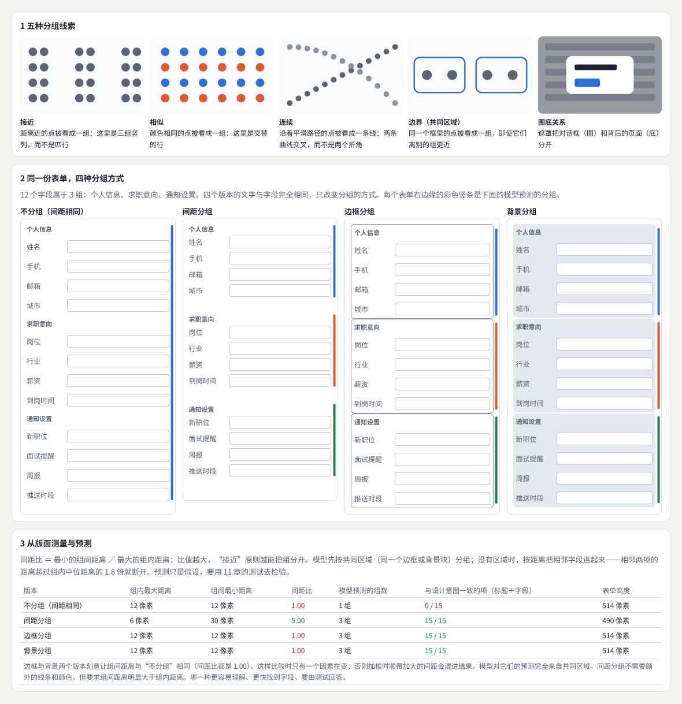
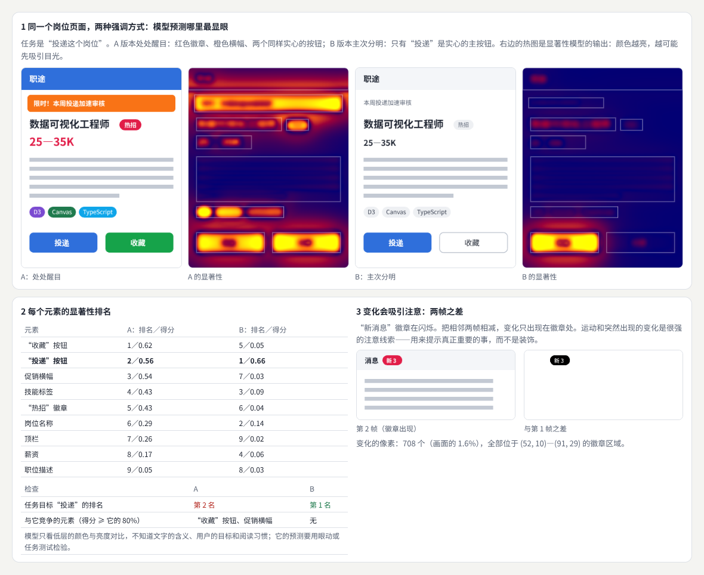
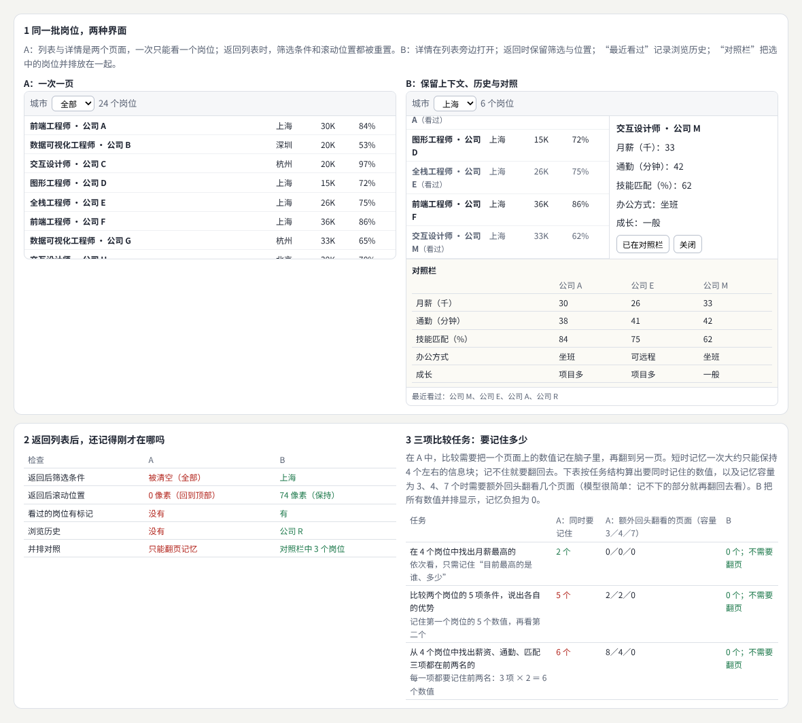
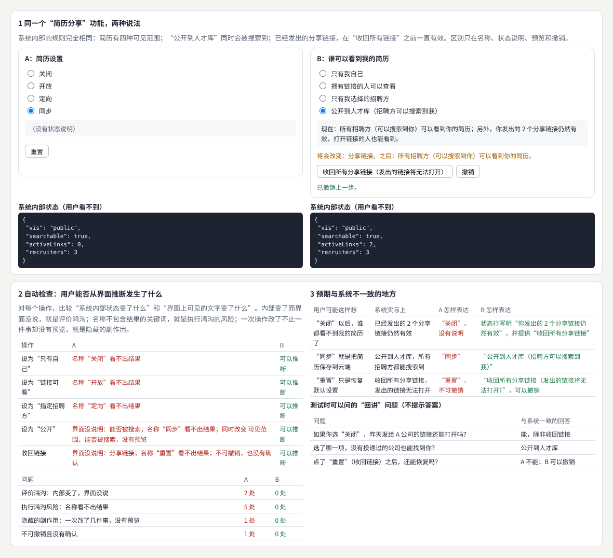
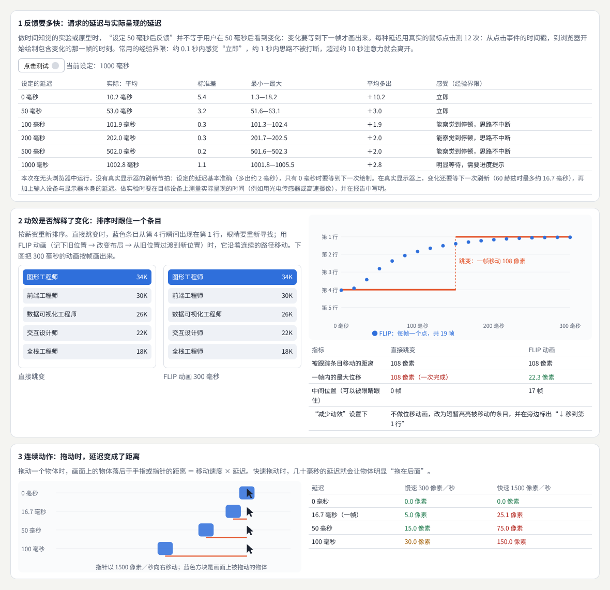
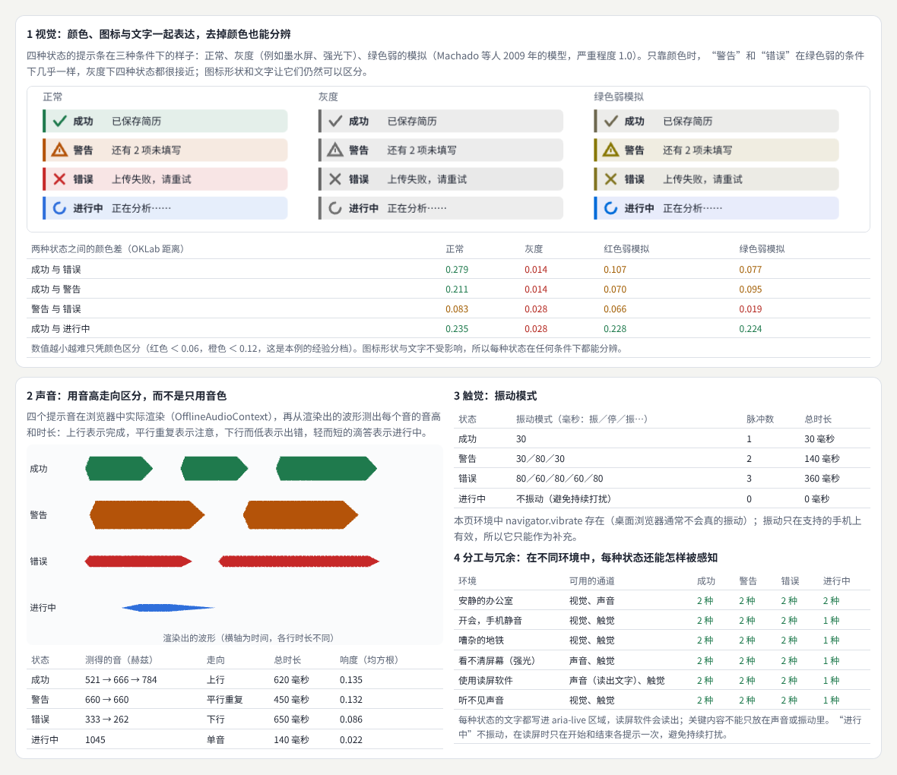
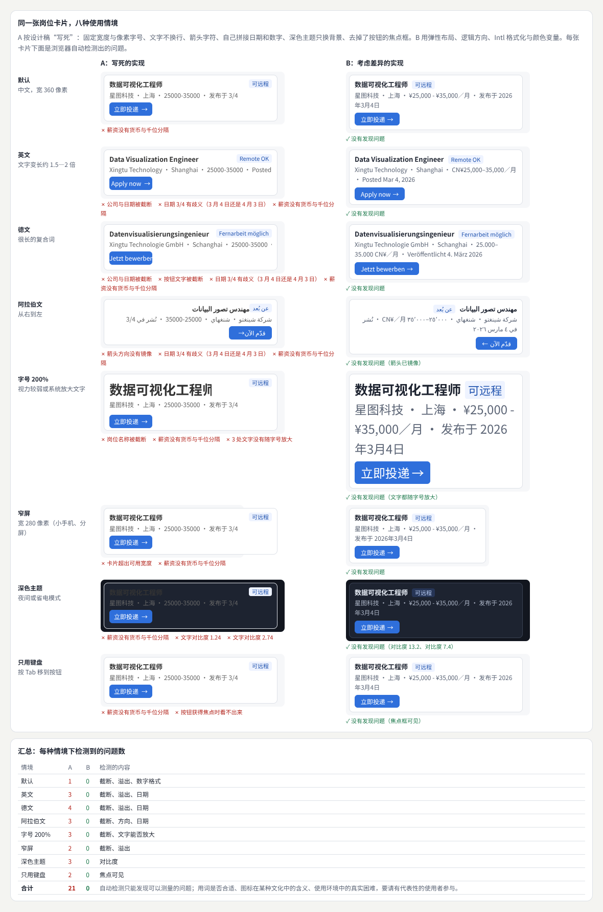
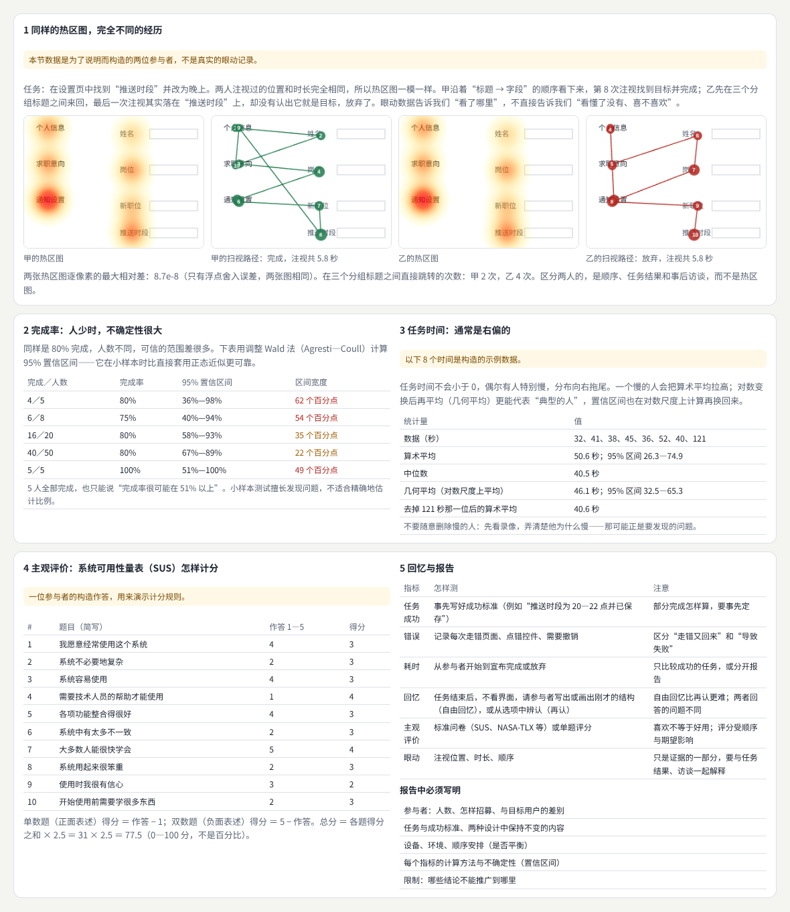
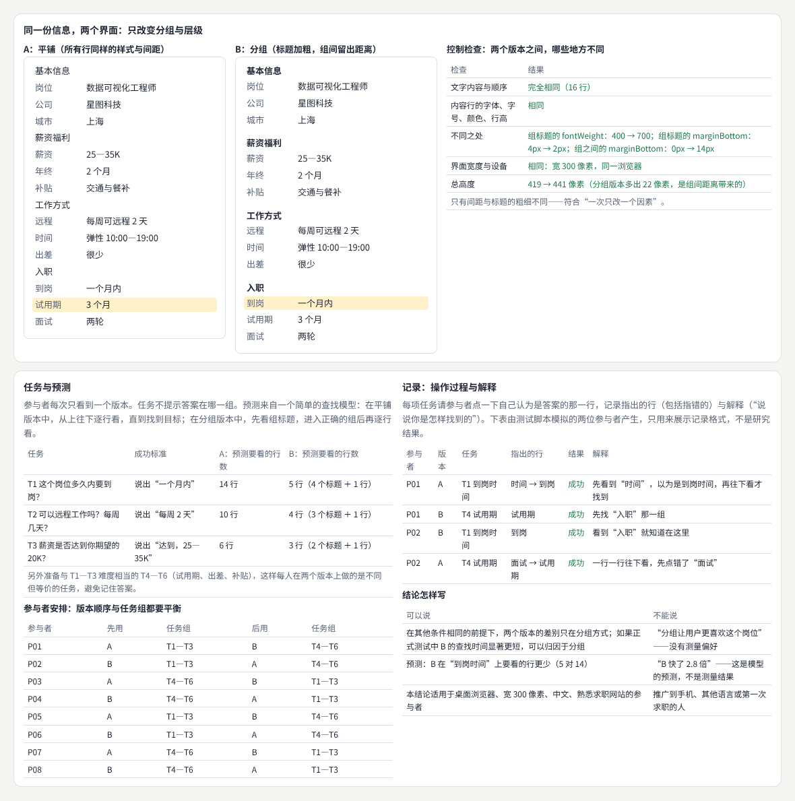

# 感知与认知

> 用感知与认知的知识解释人怎样识别信息、分配注意、形成理解和完成动作，再把它们变成可以检验的设计假设：从视觉分组、注意与显著性、记忆与外部表示、心智模型、动作与时间、多感官，到个体与文化差异和测量方法；最后用“只改变分组方式”的两个界面做一次控制得当的比较。  
> 版本：1.0 · 整理日期：2026-10-25  
> 适用对象：做界面设计、交互研究或前端开发，想知道“为什么这样设计更好”、并能用证据说明的人。先修：读过[《视觉设计与品牌表达》](02-视觉设计与品牌表达.md)的版式与层级部分，以及[《人机交互与新型媒介》](12-人机交互与新型媒介.md)的 02、09 章（度量与研究方法）。

感知与认知研究帮助解释人怎样**识别信息**、**分配注意**、**形成理解**和**完成动作**。用于设计时，有两条原则：

- **把理论转化为可观察的问题，并通过原型验证**。“格式塔原则说接近的东西会被看成一组”是理论；“把表单分成三组、组间距离是组内的 5 倍，用户找字段会更快吗”是可以观察的问题。
- **研究结论具有条件与边界**。实验室里用简单图形得到的规律，放到真实的界面上不一定成立；**具体用户**、**任务**和**环境仍然重要**。

本册每章都按同样的顺序讲：先说明它解决什么问题；再用白话解释核心概念；然后给出一个可以直接运行的示例与运行截图；接着是常见问题和本章练习；最后是一张**进阶学习卡**：技术栈、要掌握的高阶词汇（附英文）、搜索关键词、值得去看的实例，以及四级进阶阶梯：

| 级别 | 含义 |
| --- | --- |
| L1 入门 | 能运行并解释本章示例，说出每个概念的作用 |
| L2 熟练 | 能用这些知识检查自己的界面，完成本章练习 |
| L3 进阶 | 能把理论写成可检验的假设，设计控制得当的比较 |
| L4 深入 | 能做严谨的实验或观察，知道结论适用的范围 |

四级是本手册的教学结构，用来安排学习顺序，不对应任何公司的职级。

所有示例都放在本目录的[示例](示例/)文件夹中，用浏览器直接打开即可运行；每个示例都已在无头浏览器中实际运行并自动检查。和上一册一样，书中的数字分三类，正文会逐处说明：**浏览器实际测得的**（版面尺寸、计时、渲染出的声音）、**按模型算出的**（显著性、记忆负担、查找次数）、**为演示计算而构造的数据**（第 10 章）。**示例里没有真实参与者的数据**。

主线是：**从理论到假设 → 八个横向方向 → 一次只改变一个因素的比较 → 把认知知识用于设计实践。**

## 阅读导航

正文共 13 章（01—13），附 9 个可运行示例、3 组附录与 27 项资料入口。

- [第一篇：共同的基础](#part-1)
  - [01 感知与认知研究做什么](#ch01)
  - [02 从理论到可检验的假设](#ch02)
- [第二篇：八个横向方向](#part-2)
  - [03 视觉分组与组织](#ch03)
  - [04 注意与显著性](#ch04)
  - [05 记忆与外部表示](#ch05)
  - [06 理解与心智模型](#ch06)
  - [07 动作与时间知觉](#ch07)
  - [08 多感官关系](#ch08)
  - [09 个体、文化与情境差异](#ch09)
  - [10 测量与实验](#ch10)
- [第三篇：综合项目、实践与路线](#part-3)
  - [11 综合项目：只改变分组与层级的两个界面](#ch11)
  - [12 与设计实践的连接](#ch12)
  - [13 工具、技术栈与学习路线](#ch13)
- [附录 A：术语表](#appendix-a)
- [附录 B：资料入口](#appendix-b)
- [附录 C：与原手册的对应关系及修订记录](#appendix-c)

## 第一篇：共同的基础

### 01 感知与认知研究做什么

#### 01.1 从看到到做到

一个人使用界面，大致经过四步，每一步都对应本册的一组章节：

| 环节 | 问题 | 本册章节 |
| --- | --- | --- |
| 识别信息 | 看到了什么？哪些东西被看成一组？ | 03 视觉分组、08 多感官 |
| 分配注意 | 先看哪里？什么会把注意吸走？ | 04 注意与显著性 |
| 形成理解 | 记得住吗？以为系统会怎样？ | 05 记忆、06 心智模型 |
| 完成动作 | 点得准吗？反馈够快吗？变化看得懂吗？ | 07 动作与时间 |

再加上两章贯穿始终的内容：人与人之间的差异（09），以及怎样测量（10）。

#### 01.2 理论的用处与边界

理论帮助我们**提出更好的问题**，而不是直接给出答案。同一条规律在不同的条件下，效果可能完全不同：

- 格式塔原则在点阵图上很清楚；在一个有 40 个字段的真实表单上，几种线索同时起作用，哪个更强要试过才知道。
- “短时记忆约 4 个信息块”是平均情况；熟悉的人会把多个数值记成一块，疲劳的人记得更少。
- 实验室研究的参与者常常是大学生，结论不一定能推广到其他年龄、文化和能力的人（09 章）。

### 02 从理论到可检验的假设

#### 02.1 一个假设包含什么

| 部分 | 说明 | 例子 |
| --- | --- | --- |
| 理论依据 | 为什么这样猜 | 接近原则：距离近的元素被看成一组 |
| 改变什么（自变量） | 两个版本只差在哪里 | 组间距离：12 像素 → 30 像素 |
| 测量什么（因变量） | 怎样判断“更好” | 找到指定字段的时间、指错的次数 |
| 保持不变的 | 防止别的因素混进来 | 文字、字号、颜色、宽度、设备、任务 |
| 预期结果 | 事先写下 | 30 像素版本找字段更快、指错更少 |
| 适用范围 | 结论能推广到哪里 | 桌面浏览器、中文、熟悉表单的成年人 |

#### 02.2 一次只改变一个因素

两个版本若同时改了分组、字号和配色，就算新版本更好，也说不清是哪个改动起了作用。本册有两个例子专门处理这个问题：03 章发现“加边框”时容易顺带加大间距，于是刻意让间距保持相同；11 章用程序自动核对两个版本之间只有允许的样式不同。

#### 02.3 先预测，再测试

在测试之前，用模型或分析先做预测（显著性模型、记忆负担、查找次数），可以帮助选择值得测试的问题，也能在结果出来后检查自己的理解。**但预测不是证据**：本册所有的模型输出都要用真实参与者的测试检验（10、11 章）。

**本章练习**：

1. 为你正在做的一个界面，按 02.1 的表格写一个假设，特别注意“保持不变的”一栏。
2. 找一篇“A／B 测试证明某设计更好”的文章，指出它的两个版本之间还有哪些别的差异。

## 第二篇：八个横向方向

### 03 视觉分组与组织

#### 03.1 解决什么问题

研究**接近**、**相似**、**连续**、**边界**和**图底关系**怎样影响**结构识别**。应用到界面时，可以比较**间距**、**边框**和**背景分组**各自是否帮助用户理解。

#### 03.2 核心概念

格式塔心理学提出了一组知觉分组原则，至今仍是视觉组织研究的基础。[B01](#ref-b01)

| 原则 | 含义 | 界面中的例子 |
| --- | --- | --- |
| 接近 | 距离近的被看成一组 | 表单中，组内间距小、组间间距大 |
| 相似 | 颜色、形状、大小相似的被看成一组 | 同一类按钮用同样的样式 |
| 连续 | 沿着平滑路径的元素被看成一条线 | 步骤条、对齐的列 |
| 共同区域（边界） | 同一个框里的被看成一组，即使离别组更近 | 卡片、带背景的区块[B02](#ref-b02) |
| 图底关系 | 区分前景（图）和背景（底） | 对话框背后的遮罩 |

#### 03.3 示例：同一份表单，四种分组方式

示例：[13-03-grouping.html](示例/13-03-grouping.html)

表单有 12 个字段、3 个组标题，属于 3 组。页面从浏览器的实际版面测出每一项的位置，计算**间距比**（最小组间距离 ／ 最大组内距离），再用一个简单的模型预测会被看成几组：先按共同区域（边框或背景块）分组；没有区域时，相邻两项的距离超过中位距离的 1.8 倍就断开。

| 版本 | 组内最大距离 | 组间最小距离 | 间距比 | 模型预测 | 与设计意图一致 |
| --- | --- | --- | --- | --- | --- |
| 不分组（间距相同） | 12 像素 | 12 像素 | 1.00 | 1 组 | 0 / 15 |
| 间距分组 | 6 像素 | 30 像素 | 5.00 | 3 组 | 15 / 15 |
| 边框分组 | 12 像素 | 12 像素 | 1.00 | 3 组（共同区域） | 15 / 15 |
| 背景分组 | 12 像素 | 12 像素 | 1.00 | 3 组（共同区域） | 15 / 15 |

制作这个示例时遇到了一个典型的问题：给组加边框时，边框的内边距会**顺带加大组间距离**，于是“边框分组”同时改变了两个因素。示例中刻意让边框和背景版本的组间距离仍是 12 像素（内边距 5 ＋ 边框 1 ＋ 边框 1 ＋ 内边距 5），比较时才只有一个因素在变。间距分组不需要额外的线条和颜色，表单也最矮（490 像素，其他三个版本 514 像素）。

模型只能说明“版面上有没有分组线索”，**哪一种更容易理解、找字段更快，要由测试回答**（11 章）。

#### 03.4 常见问题

- **到处都加框**：框太多会让页面显得零碎，而且框本身也要占空间。先试试只用间距。
- **组内和组间距离差不多**：间距比接近 1 时，接近原则不起作用；一般要让组间距离明显大于组内距离。
- **标签离错了输入框**：标签与它的输入框之间的距离，要小于标签与上一个输入框之间的距离，否则标签会被看成属于上一项。

**本章练习**：

1. 测量你的一个表单的间距比；把它调到 3 以上，再比较前后的样子。
2. 在示例中加一个“相似”版本：每组的标题用不同的颜色，其余与“不分组”相同，看模型能否识别（提示：模型没有考虑相似，想想怎样加进去）。

#### 03.5 进阶学习卡

| 级别 | 目标 | 怎样检验 |
| --- | --- | --- |
| L1 入门 | 能说出五种分组线索，在页面上指出它们 | 为一个页面标出每一种线索 |
| L2 熟练 | 能用间距、边框、背景组织界面，并测量间距比 | 表单的间距比大于 3 |
| L3 进阶 | 能设计只改变一种分组线索的对照，并测试 | 两个版本只差一个因素 |
| L4 深入 | 能研究多种线索同时存在时的相互作用 | 有因子设计的实验 |

- **技术栈**：CSS 的间距令牌（[《计算设计与创作工具》](11-计算设计与创作工具.md) 03 章）；`getBoundingClientRect()` 版面测量；浏览器开发者工具的布局叠加显示。
- **高阶词汇**：格式塔（Gestalt）、知觉分组（perceptual grouping）、接近（proximity）、相似（similarity）、连续（good continuation）、共同区域（common region）、图底关系（figure–ground）、视觉层级（visual hierarchy）、留白（white space）。
- **搜索关键词**：`gestalt principles ui design`、`common region grouping`、`proximity form design spacing`、`visual hierarchy web`、`格式塔 原则 界面`。
- **值得看的实例**：[NN/g 关于接近原则的文章](https://www.nngroup.com/articles/gestalt-proximity/)——表单与卡片中的正反例。
- **资料**：[B01](#ref-b01)、[B02](#ref-b02)、[B03](#ref-b03)。

### 04 注意与显著性

#### 04.1 解决什么问题

观察用户**先看到什么**、**哪些变化会吸引注意**，以及注意是否**服务于任务**。过多高强调元素可能**相互竞争**，因此需要安排主次并测试。

#### 04.2 核心概念

- **显著性**：一个元素和周围有多“不同”——颜色、亮度、大小、方向的对比越大，越容易自动吸引目光。Itti、Koch 与 Niebur 1998 年的模型用多尺度的“中心—周边”差异计算显著性地图。[B04](#ref-b04)
- **引导注意的属性**：颜色、运动、方向、大小等属性能引导视觉注意；其中运动和突然出现的变化特别强。[B05](#ref-b05)
- **变化盲视**：如果变化发生时注意不在那里（例如页面闪了一下），人常常察觉不到相当明显的变化。[B06](#ref-b06) 所以重要的变化要被“看见”，不能只悄悄地改一个数字。

#### 04.3 示例：处处醒目，还是主次分明

示例：[13-04-salience.html](示例/13-04-salience.html)

示例在画布上画出同一个岗位页面的两个版本，再用简化的 Itti—Koch 模型（Lab 三个通道、两组中心—周边尺度、峰值越突出权重越大）计算显著性，取每个元素区域内的平均值排名。任务是“投递这个岗位”。

| 元素 | A：处处醒目 | B：主次分明 |
| --- | --- | --- |
| “投递”按钮 | 第 2 名（0.56） | **第 1 名（0.66）** |
| “收藏”按钮 | **第 1 名（0.62）** | 第 5 名（0.05） |
| 促销横幅 | 第 3 名（0.54） | 第 7 名（0.03） |
| “热招”徽章 | 第 5 名（0.43） | 第 6 名（0.04） |
| 岗位名称 | 第 6 名（0.29） | 第 2 名（0.14） |

A 中与任务目标竞争的元素（得分不低于它的 80%）有两个：“收藏”按钮和促销横幅；B 中没有。**过多的高强调元素会相互竞争**——两个同样实心、颜色鲜艳的按钮，模型甚至预测次要的那个更显眼。

右下方是“变化”的例子：“新消息”徽章闪烁时，两帧之间变化的 708 个像素（画面的 1.6%）全部集中在徽章区域。运动和闪烁会强烈地吸引注意，应当留给真正重要、需要立即处理的事。

模型只看低层的颜色与亮度对比，不懂文字的含义、用户的目标和阅读习惯；它的预测要用眼动或任务测试检验。

#### 04.4 常见问题

- **每个人都要求“把我的东西做醒目一点”**：结果什么都不醒目。为每个页面确定唯一的主要操作。
- **用动画吸引注意，结果打扰了阅读**：持续运动的元素会不断抢走注意。动画只在状态变化时出现一次。
- **重要的变化没人注意到**：配合位置（在用户正在看的地方）、动效（一次性的过渡）和文字说明。

**本章练习**：

1. 截取你的一个页面，用示例中的模型（把截图画到画布上）算显著性，看主要操作排第几。
2. 把示例 A 改到“投递”排第一，同时尽量少改动，记录你改了什么。

#### 04.5 进阶学习卡

| 级别 | 目标 | 怎样检验 |
| --- | --- | --- |
| L1 入门 | 能说出影响显著性的属性，识别页面上的主要操作 | 每页只有一个主要操作 |
| L2 熟练 | 能用模型或眯眼测试检查主次，减少竞争元素 | 主要操作的显著性排第一 |
| L3 进阶 | 能用眼动或首次点击测试验证注意的分配 | 有首次注视或首次点击的数据 |
| L4 深入 | 能研究任务、经验与显著性的相互作用 | 区分自下而上与自上而下的注意 |

- **技术栈**：Canvas 图像处理；显著性模型（Itti—Koch 及后来的深度学习模型）；首次点击测试；眼动仪或网页眼动估计。
- **高阶词汇**：视觉显著性（visual salience）、显著性地图（saliency map）、自下而上／自上而下注意（bottom-up／top-down attention）、视觉搜索（visual search）、弹出效应（pop-out）、变化盲视（change blindness）、非注意盲视（inattentional blindness）、首次点击测试（first-click testing）。
- **搜索关键词**：`itti koch saliency model`、`visual search guiding attributes`、`change blindness ui`、`first click testing`、`squint test design`、`视觉显著性 界面`。
- **值得看的实例**：[NN/g：视觉层级](https://www.nngroup.com/articles/visual-hierarchy-ux-definition/)——怎样用大小、颜色、对比安排主次。
- **资料**：[B04](#ref-b04)—[B06](#ref-b06)、[B07](#ref-b07)。

### 05 记忆与外部表示

#### 05.1 解决什么问题

研究**信息怎样被记住**、**比较**和**调用**。界面可以**保留上下文**、**历史**和**对照**，减少用户在多个页面之间记忆内容的负担。

#### 05.2 核心概念

- **短时记忆的容量**：Miller 1956 年的“7 ± 2”更多是比喻；后来的研究认为，人一次大约只能保持 4 个左右的信息块。[B08](#ref-b08)[B09](#ref-b09)
- **外部表示**：把要记的东西放在界面上，让“记住”变成“看到”。Zhang 与 Norman 指出，同一个问题用不同的外部表示，难度可以相差很多。[B10](#ref-b10)
- **再认比回忆容易**：从选项中认出比凭空想起容易得多——这也是“显示历史”“显示最近用过的”有用的原因。

#### 05.3 示例：一次一页，还是保留上下文、历史与对照

示例：[13-05-memory.html](示例/13-05-memory.html)

测试脚本在两个界面中各做一遍“筛选上海 → 向下滚动 → 打开一个岗位 → 返回”：

| 检查 | A：一次一页 | B：保留上下文 |
| --- | --- | --- |
| 返回后的筛选条件 | 被清空 | 保留“上海” |
| 返回后的滚动位置 | 回到顶部 | 保持 |
| 看过的岗位有标记 | 没有 | 有 |
| 浏览历史 | 没有 | 最近看过 |
| 并排对照 | 只能翻页记忆 | 对照栏中 3 个岗位 |

按任务结构计算的记忆负担（额外回头翻看的页面按“记不下的部分就翻回去看”估算）：

| 任务 | A：同时要记住 | A：额外翻看（记忆容量 3／4／7） | B |
| --- | --- | --- | --- |
| 在 4 个岗位中找出月薪最高的 | 2 个数值 | 0／0／0 | 0 |
| 比较两个岗位的 5 项条件 | 5 个 | 2／2／0 | 0 |
| 找出薪资、通勤、匹配三项都在前两名的 | 6 个 | 8／4／0 | 0 |

第一项任务很轻松——逐个看、记住“目前最高的”就够了；后两项超过了大多数人的记忆容量，在 A 中只能来回翻页。**界面能替用户记住的，就不要让用户记**。

#### 05.4 常见问题

- **“用户可以自己记下来”**：可以，但这是把界面的工作转给了用户，而且容易出错。
- **返回后丢失位置**：单页应用要主动保存与恢复滚动位置、筛选条件和展开状态。
- **对照功能做成了另一个页面**：并排才是关键；把对照放在一个可以随时看到的位置。

**本章练习**：

1. 找一个需要跨页面比较的真实任务（例如比较两款手机），数一数在现有网站上要记住几个数值。
2. 给示例 B 加上“对照栏中的差异高亮”：只高亮不同的数值，看看需要看的格子少了多少。

#### 05.5 进阶学习卡

| 级别 | 目标 | 怎样检验 |
| --- | --- | --- |
| L1 入门 | 能指出界面中让用户“记在脑子里”的地方 | 列出一项任务需要记住的数值 |
| L2 熟练 | 能实现上下文保留、历史与对照 | 返回、刷新后状态都能恢复 |
| L3 进阶 | 能分析任务的记忆负担，并设计外部表示 | 给出类似 05.3 的分析 |
| L4 深入 | 能研究不同外部表示对决策质量的影响 | 有对照实验的错误率与时间 |

- **技术栈**：History API 与 URL 状态；`sessionStorage`；滚动位置恢复；比较表与差异高亮。
- **高阶词汇**：工作记忆（working memory）、信息块（chunk）、认知负荷（cognitive load）、外部表示（external representation）、分布式认知（distributed cognition）、再认与回忆（recognition／recall）、上下文保留（context preservation）、比较视图（comparison view）。
- **搜索关键词**：`working memory capacity 4 chunks`、`recognition rather than recall`、`distributed cognition external representation`、`comparison table ux`、`restore scroll position spa`、`认知负荷 界面`。
- **值得看的实例**：[NN/g：再认优于回忆](https://www.nngroup.com/articles/recognition-and-recall/)——十条可用性原则之一的解释与例子。
- **资料**：[B08](#ref-b08)—[B10](#ref-b10)、[B11](#ref-b11)。

### 06 理解与心智模型

#### 06.1 解决什么问题

用户会根据经验推测系统怎样工作。通过**名称**、**结构**和**反馈**帮助其建立合理理解，尤其要检查**系统行为与用户预期不一致**的位置。

#### 06.2 核心概念

- **心智模型**：用户心里“这个东西怎样工作”的想法，基于过去的经验，不一定正确。[B12](#ref-b12)
- **执行鸿沟与评价鸿沟**：执行鸿沟是“我想做某事，但不知道该怎样做”；评价鸿沟是“我做了，但看不出发生了什么”。[B13](#ref-b13) 名称说明结果可以缩小前者，状态说明与反馈可以缩小后者。
- **回讲**：测试时请用户用自己的话讲出系统会怎样，暴露他的心智模型。

#### 06.3 示例：同一个分享功能，两种说法

示例：[13-06-mental-model.html](示例/13-06-mental-model.html)

两个版本背后的规则完全相同：简历有四种可见范围；“公开到人才库”同时会被搜索到；已经发出的分享链接，在收回之前一直有效。示例对五个操作自动检查：内部状态变了而界面没说（评价鸿沟）；名称不包含结果的关键词（执行鸿沟的风险）；一次改了几件事却没有预览（隐藏的副作用）；不可撤销也没有确认。

| 问题 | A | B |
| --- | --- | --- |
| 评价鸿沟：内部变了，界面没说 | 2 处 | 0 处 |
| 执行鸿沟风险：名称看不出结果 | 5 处 | 0 处 |
| 隐藏的副作用 | 1 处 | 0 处 |
| 不可撤销且没有确认 | 1 处 | 0 处 |

**预期与系统不一致的地方**最值得测试：

| 用户可能这样想 | 系统实际上 | B 怎样表达 |
| --- | --- | --- |
| “关闭”以后谁都看不到我的简历了 | 已经发出的 2 个分享链接仍然有效 | 状态行写明，并提供“收回所有分享链接” |
| “同步”就是保存到云端 | 公开到人才库，所有招聘方都能搜索到 | “公开到人才库（招聘方可以搜索到我）” |
| “重置”只是恢复默认设置 | 收回所有链接，发出的链接无法打开 | 名称写明后果，并可以撤销 |

测试时可以问的回讲问题，例如“如果你选‘关闭’，昨天发给 A 公司的链接还能打开吗？”——不提示答案，听用户怎样解释。

#### 06.4 常见问题

- **用内部术语命名**：“同步”“定向”对开发者有明确含义，对用户没有。用结果命名：“谁可以看到”。
- **反馈只说“操作成功”**：说清楚现在是什么状态。
- **只问“这个好用吗”**：用回讲和预测问题检查理解，而不是问感受。

**本章练习**：

1. 为一个你常用的设置页写出系统的真实规则，再写三个用户可能的误解，设计回讲问题。
2. 在示例中加一个“删除简历”操作，让 A、B 两版分别通过或不通过自动检查。

#### 06.5 进阶学习卡

| 级别 | 目标 | 怎样检验 |
| --- | --- | --- |
| L1 入门 | 能说出执行鸿沟与评价鸿沟，找出名称含糊的地方 | 改写三个按钮名称 |
| L2 熟练 | 能为状态变化写清楚反馈、预览与撤销 | 每个操作都能推断结果 |
| L3 进阶 | 能用回讲与预测问题研究用户的心智模型 | 记录并分类用户的误解 |
| L4 深入 | 能研究概念模型的设计与学习过程 | 长期使用中的理解变化 |

- **技术栈**：状态机建模（[《产品交互与用户体验》](03-产品交互与用户体验.md) 05 章）；自动化的状态—界面一致性检查；可用性测试中的回讲问题。
- **高阶词汇**：心智模型（mental model）、概念模型（conceptual model）、执行鸿沟（gulf of execution）、评价鸿沟（gulf of evaluation）、可见性（visibility）、映射（mapping）、回讲（teach-back）、副作用（side effect）。
- **搜索关键词**：`mental models ux`、`gulf of execution evaluation`、`conceptual model design`、`teach back usability`、`心智模型 交互设计`。
- **值得看的实例**：[NN/g：心智模型](https://www.nngroup.com/articles/mental-models/)——为什么用户会按自己的理解使用系统。
- **资料**：[B12](#ref-b12)、[B13](#ref-b13)。

### 07 动作与时间知觉

#### 07.1 解决什么问题

研究**操作距离**、**目标尺寸**、**反馈延迟**和**连续动作的体验**。动效是否让**人感觉系统响应**、是否**解释了对象变化**，都可以通过具体任务观察。

#### 07.2 核心概念

- **操作距离与目标尺寸**：Fitts 定律（[《人机交互与新型媒介》](12-人机交互与新型媒介.md) 03 章）。
- **响应时间的三个界限**：约 0.1 秒内感觉“立即”；约 1 秒内思路不被打断；超过约 10 秒注意力就会离开，需要进度提示。[B14](#ref-b14)
- **对象连续性**：东西换了位置，如果有连续的运动，眼睛可以跟住它；瞬间跳变则要重新寻找。FLIP 是网页上实现这种过渡的常用方法。[B15](#ref-b15)
- **拖动的滞后**：拖动时，画面落后于手指的距离 ＝ 速度 × 延迟。

#### 07.3 示例：延迟、连续性与拖动滞后

示例：[13-07-timing.html](示例/13-07-timing.html)

**请求的延迟与实际呈现**（真实鼠标点击，每种 12 次，从点击事件的时间戳到浏览器开始绘制包含变化的那一帧）：

| 设定 | 实际平均 | 范围 |
| --- | --- | --- |
| 0 毫秒 | 10.2 毫秒 | 1.3—18.2 |
| 50 毫秒 | 53.0 毫秒 | 51.6—63.1 |
| 100 毫秒 | 101.9 毫秒 | 101.3—102.4 |
| 200 毫秒 | 202.0 毫秒 | 201.7—202.5 |
| 500 毫秒 | 502.0 毫秒 | 501.6—502.3 |
| 1000 毫秒 | 1002.8 毫秒 | 1001.8—1005.5 |

本次在无头浏览器中运行，没有真实显示器的刷新节拍，所以设定的延迟基本准确。在真实显示器上，变化还要等下一次刷新（60 赫兹时最多约 16.7 毫秒），再加上输入设备与显示器本身的延迟。**做时间知觉实验时，要在目标设备上测量实际呈现的时间**（例如用光电传感器或高速摄像）。

制作这个示例时还踩了一个坑：第一次用 `requestAnimationFrame` 回调的时间参数作为“绘制时间”，结果设定 50 毫秒却测出 45 毫秒——那个参数是这一帧的垂直同步时间，可能早于变化发生的时刻。改为在回调里读 `performance.now()` 才得到合理的结果。

**对象连续性**：按薪资排序，“图形工程师”从第 4 行移到第 1 行（108 像素）。直接跳变时它在一帧内移动 108 像素，没有任何中间位置；300 毫秒的 FLIP 动画有 19 帧，一帧最多移动 22.3 像素，17 帧中间位置可以被眼睛跟住。在“减少动效”设置下，不做位移动画，而是短暂高亮被移动的条目，并标出“移到第 1 行”。

**拖动滞后**（速度 × 延迟）：

| 延迟 | 慢速 300 像素／秒 | 快速 1500 像素／秒 |
| --- | --- | --- |
| 16.7 毫秒（一帧） | 5.0 像素 | 25.1 像素 |
| 50 毫秒 | 15.0 像素 | 75.0 像素 |
| 100 毫秒 | 30.0 像素 | 150.0 像素 |

#### 07.4 常见问题

- **“反正只慢了一点点”**：对于拖动、手写、滚动这类连续动作，几十毫秒的延迟就会变成明显的距离。
- **动画越多越流畅**：动画应当解释变化（东西从哪来、到哪去），而不是装饰；并尊重用户的“减少动效”设置。
- **加载时什么都不显示**：超过 1 秒就要有反馈，超过 10 秒要有进度和可以做别的事的方式。

**本章练习**：

1. 在你的手机上打开示例，用慢动作视频拍摄点击与灯亮，估计真实的延迟，与浏览器记录的数字比较。
2. 为一个列表的“删除一项”设计过渡：被删的项怎样消失、其余的项怎样补位，并提供减少动效的版本。

#### 07.5 进阶学习卡

| 级别 | 目标 | 怎样检验 |
| --- | --- | --- |
| L1 入门 | 能说出三个响应时间界限，为长操作加反馈 | 每个超过 1 秒的操作都有反馈 |
| L2 熟练 | 能用 FLIP 解释布局变化，并支持减少动效 | 排序、插入、删除都有连续的过渡 |
| L3 进阶 | 能准确测量刺激的呈现时间，设计时间知觉的测试 | 报告中给出实际延迟及测量方法 |
| L4 深入 | 能研究延迟、动效与任务表现的关系 | 有控制良好的实验 |

- **技术栈**：Web Animations API[B16](#ref-b16)；FLIP[B15](#ref-b15)；`prefers-reduced-motion`[B17](#ref-b17)；`performance.now()` 与 `requestAnimationFrame`；Event Timing API。
- **高阶词汇**：响应时间（response time）、感知延迟（perceived latency）、端到端延迟（end-to-end latency）、对象恒常性（object constancy）、FLIP 动画（First-Last-Invert-Play）、拖动滞后（drag lag）、减少动效（reduced motion）、刺激呈现精度（stimulus timing accuracy）。
- **搜索关键词**：`response time limits 0.1 1 10 seconds`、`flip animation technique`、`touch latency perception`、`web animations api`、`prefers-reduced-motion`、`动效 对象连续性`。
- **值得看的实例**：[FLIP Your Animations](https://aerotwist.com/blog/flip-your-animations/)——FLIP 方法的原始说明。
- **资料**：[B14](#ref-b14)—[B17](#ref-b17)。

### 08 多感官关系

#### 08.1 解决什么问题

研究**视觉**、**声音**和**触觉怎样配合表达状态**或**空间**。各通道应有清楚分工，同时考虑环境和感官能力差异。**关键内容可以通过多种形式获得**。

#### 08.2 核心概念

- **冗余编码**：同一个信息用几种方式同时表达（颜色＋图标＋文字），任何一种失效时，其余的仍然有效。WCAG 要求不能只用颜色传达信息（1.4.1）。[B18](#ref-b18)
- **提示音的两种思路**：耳标（earcon）是抽象的音乐片段，靠音高、节奏的结构区分；[B19](#ref-b19) 听觉图标（auditory icon）模仿真实世界的声音（例如纸张揉皱表示删除）。[B20](#ref-b20)
- **色觉差异的模拟**：Machado 等人 2009 年的模型可以模拟红色弱、绿色弱等色觉差异。[B21](#ref-b21)

#### 08.3 示例：四种状态，三个通道

示例：[13-08-multisensory.html](示例/13-08-multisensory.html)

**视觉**：只看颜色时（OKLab 距离，越小越难区分）：

| 两种状态 | 正常 | 灰度 | 红色弱模拟 | 绿色弱模拟 |
| --- | --- | --- | --- | --- |
| 成功与错误 | 0.279 | 0.014 | 0.107 | 0.077 |
| 警告与错误 | 0.083 | 0.028 | 0.066 | 0.019 |
| 成功与进行中 | 0.235 | 0.028 | 0.228 | 0.224 |

在绿色弱的条件下，“警告”和“错误”的颜色几乎一样；灰度下四种状态都很接近。图标形状（对勾、三角、叉、圆弧）和文字不受影响，所以每种状态在任何条件下都能分辨。

**声音**：四个提示音在浏览器中实际渲染（OfflineAudioContext），再从波形测出音高和时长：

| 状态 | 测得的音（赫兹） | 走向 | 总时长 |
| --- | --- | --- | --- |
| 成功 | 521 → 666 → 784 | 上行 | 620 毫秒 |
| 警告 | 660 → 660 | 平行重复 | 450 毫秒 |
| 错误 | 333 → 262 | 下行 | 650 毫秒 |
| 进行中 | 1045 | 单音，很轻 | 140 毫秒 |

用音高走向区分，而不是只用音色；“进行中”的声音很轻、很短，避免持续打扰。

**触觉**：成功振动一下（30 毫秒），警告两下，错误三下，进行中不振动。示例环境中 `navigator.vibrate` 存在，但桌面浏览器不会真的振动，振动只能作为补充。

**分工与冗余**：在“开会，手机静音”“嘈杂的地铁”“看不清屏幕”“使用读屏软件”“听不见声音”等六种环境中，每种状态都至少还有一种通道可用；文字都写进 `aria-live` 区域，由读屏软件读出。

#### 08.4 常见问题

- **错误只用红色表示**：色觉差异者、黑白打印、强光下都看不出。加图标和文字。
- **只有声音提示**：静音、嘈杂、听力差异时就丢失了。声音只做提醒，内容在屏幕上。
- **每个操作都有声音和振动**：会变成噪声。只给重要的状态变化。

**本章练习**：

1. 用浏览器开发者工具的“模拟视觉缺陷”功能检查你的一个页面，找出只靠颜色区分的地方。
2. 为“上传进度 50%”设计一个提示音（例如音高随进度上升），并在示例中渲染、测量它。

#### 08.5 进阶学习卡

| 级别 | 目标 | 怎样检验 |
| --- | --- | --- |
| L1 入门 | 能做到状态不只靠颜色，关键内容有文字 | 灰度截图中状态仍可分辨 |
| L2 熟练 | 能设计有结构的提示音与振动模式，并支持关闭 | 每种状态在三个通道中可区分 |
| L3 进阶 | 能针对不同环境与感官能力设计通道分工，并测试 | 环境矩阵中没有空缺 |
| L4 深入 | 能研究多通道信息的整合与干扰 | 有对照实验 |

- **技术栈**：Web Audio API[B22](#ref-b22)；Vibration API；`aria-live`；浏览器的视觉缺陷模拟；OKLab 颜色距离。
- **高阶词汇**：冗余编码（redundant coding）、多感官整合（multisensory integration）、耳标（earcon）、听觉图标（auditory icon）、可听化（sonification）、触觉反馈（haptic feedback）、色觉差异（color vision deficiency）、通道分工（modality allocation）。
- **搜索关键词**：`earcons auditory icons`、`sonification design`、`haptic feedback patterns`、`color vision deficiency simulation machado`、`use of color wcag 1.4.1`、`多感官 交互`。
- **值得看的实例**：[MDN 的 Web Audio API 文档](https://developer.mozilla.org/en-US/docs/Web/API/Web_Audio_API)——从振荡器到离线渲染的完整说明。
- **资料**：[B18](#ref-b18)—[B22](#ref-b22)。

### 09 个体、文化与情境差异

#### 09.1 解决什么问题

**经验**、**语言**、**能力**、**设备**和**使用环境**会影响理解与判断。设计者应主动检查自己的默认假设，并邀请有代表性的使用者参与。

#### 09.2 核心概念

- **默认假设**：设计稿上的文字是中文、屏幕是 1440 像素、字号是默认值、光线很好、用户用鼠标——每一项都可能不成立。
- **研究对象的局限**：大量心理学研究的参与者来自西方、受过教育、工业化、富裕、民主的社会，它们的结论不一定适用于其他人群。[B23](#ref-b23)
- **国际化的技术基础**：用 Intl 按地区格式化日期、数字和货币；[B24](#ref-b24) 用 CSS 逻辑属性（`margin-inline-start` 等）让布局在从右到左的语言中自动镜像。[B25](#ref-b25)

#### 09.3 示例：同一张卡片，八种情境

示例：[13-09-context.html](示例/13-09-context.html)

A 按设计稿“写死”：固定宽度与像素字号、文字不换行、箭头字符“→”、自己拼接日期“3/4”和数字“25000-35000”、深色主题只换背景、去掉了按钮的焦点框。B 用弹性布局、两行截断加完整标题提示、逻辑方向、Intl 格式化、颜色变量和可见的焦点框。浏览器自动检测：

| 情境 | A | B | A 的问题 |
| --- | --- | --- | --- |
| 默认（中文） | 1 | 0 | 薪资没有货币与千位分隔 |
| 英文 | 3 | 0 | 公司与日期被截断、日期 3/4 有歧义 |
| 德文 | 4 | 0 | 再加按钮文字被截断 |
| 阿拉伯文（从右到左） | 3 | 0 | 箭头方向没有镜像 |
| 字号 200% | 3 | 0 | 岗位名称被截断、3 处文字没有随字号放大 |
| 窄屏 280 像素 | 2 | 0 | 卡片超出可用宽度 |
| 深色主题 | 3 | 0 | 文字对比度 1.24 与 2.74 |
| 只用键盘 | 2 | 0 | 按钮获得焦点时看不出来 |
| **合计** | **21** | **0** | |

B 的日期与薪资由 Intl 生成：英文“CN¥25,000–35,000 … Posted Mar 4, 2026”，德文“25.000–35.000 CN¥ … 4. März 2026”，阿拉伯文使用阿拉伯数字与本地的月份名称。“3/4”在美国读作 3 月 4 日，在许多欧洲国家读作 4 月 3 日——自己拼接日期就会出错。

**自动检测只能发现可以测量的问题**：用词是否合适、图标在某种文化中的含义、真实使用环境中的困难，要请有代表性的使用者参与。

#### 09.4 常见问题

- **只用设计稿上的文字测试**：真实的内容更长、更短、换了语言。用最长的翻译和真实数据测试。
- **把“国际化”留到最后**：日期、数字、方向、文字长度会影响组件的结构，越晚改越难。
- **招募的测试者都是同事**：同事和用户的经验、设备、能力都不一样。招募时说明样本的构成（10 章）。

**本章练习**：

1. 把你的一个组件放进示例的八种情境，记录问题并修复。
2. 列出你的产品的三个“默认假设”（例如“用户都有稳定的网络”），为每个设计一项检查。

#### 09.5 进阶学习卡

| 级别 | 目标 | 怎样检验 |
| --- | --- | --- |
| L1 入门 | 能说出至少五种情境差异，并在开发者工具中模拟 | 用三种情境检查一个页面 |
| L2 熟练 | 能用 Intl 和逻辑属性实现国际化，处理长文本与放大 | 八种情境都没有问题 |
| L3 进阶 | 能招募有代表性的参与者，并说明样本的局限 | 研究计划中有招募标准 |
| L4 深入 | 能研究文化与能力差异对界面理解的影响 | 跨文化或跨人群的比较研究 |

- **技术栈**：Intl（`DateTimeFormat`、`NumberFormat` 的 `formatRange`）[B24](#ref-b24)；CSS 逻辑属性与 `:dir()`[B25](#ref-b25)；伪本地化（pseudo-localization）；开发者工具的设备、语言与媒体特性模拟。
- **高阶词汇**：国际化与本地化（internationalization／localization, i18n／l10n）、从右到左（right-to-left, RTL）、伪本地化（pseudo-localization）、文字扩展（text expansion）、区域设置（locale）、情境限制（situational impairment）、WEIRD 样本（WEIRD samples）、包容性设计（inclusive design）。
- **搜索关键词**：`pseudo localization testing`、`intl datetimeformat numberformat`、`css logical properties rtl`、`text expansion translation ui`、`situational disability`、`国际化 界面 测试`。
- **值得看的实例**：[MDN 的 CSS 逻辑属性指南](https://developer.mozilla.org/en-US/docs/Web/CSS/Guides/Logical_properties_and_values)——为多种书写方向写一次布局。
- **资料**：[B23](#ref-b23)—[B25](#ref-b25)。更多内容见[《包容、国际化与多感官》](16-包容国际化与多感官.md)。

### 10 测量与实验

#### 10.1 解决什么问题

使用**任务成功**、**错误**、**耗时**、**回忆**、**主观评价**等指标回答问题。眼动等设备数据只是证据的一部分，**不能直接等同于理解或喜好**。报告应说明方法和限制。

#### 10.2 核心概念

- **小样本的不确定性**：完成率要给出置信区间。调整 Wald 法（Agresti—Coull）在小样本时比直接套用正态近似更可靠。[B26](#ref-b26)
- **任务时间是右偏的**：用几何平均（对数尺度上平均）代表典型用户，置信区间也在对数尺度上计算。
- **标准问卷**：系统可用性量表（SUS）有 10 道题，计分规则固定，结果是 0—100 分（不是百分比）。[B27](#ref-b27)
- **回忆与再认**：自由回忆（不看界面，写出或画出结构）比再认（从选项中辨认）更难，两者回答的问题不同。

#### 10.3 示例：热区图、置信区间、时间与问卷

示例：[13-10-measure.html](示例/13-10-measure.html)（本章示例的数据都是为了演示计算而构造的）

**同样的热区图，完全不同的经历**：两位参与者注视过的位置和时长完全相同（10 次注视，共 5.8 秒），所以热区图一模一样（逐像素的最大相对差 8.7 × 10⁻⁸，只是浮点误差）。但甲沿着“标题 → 字段”看下来，第 8 次注视找到目标并完成；乙在三个分组标题之间直接跳转了 4 次，最后一次注视其实落在目标上，却没有认出它，放弃了。**区分两人的是顺序、任务结果和事后访谈，而不是热区图**。

**完成率的 95% 置信区间**（调整 Wald 法）：

| 完成／人数 | 完成率 | 95% 区间 |
| --- | --- | --- |
| 4／5 | 80% | 36%—98% |
| 6／8 | 75% | 40%—94% |
| 16／20 | 80% | 58%—93% |
| 40／50 | 80% | 67%—89% |
| 5／5 | 100% | 51%—100% |

5 人全部完成，也只能说“完成率很可能在 51% 以上”。小样本测试擅长发现问题，不适合精确地估计比例。

**任务时间**（8 个构造的时间：32、41、38、45、36、52、40、121 秒）：算术平均 50.6 秒（95% 区间 26.3—74.9），中位数 40.5 秒，几何平均 46.1 秒（95% 区间 32.5—65.3）。一位 121 秒的参与者把算术平均拉高了约 10 秒；但不要随意删除他——先看录像，弄清楚为什么慢。

**SUS 计分**：单数题（正面表述）得分 ＝ 作答 − 1；双数题（负面表述）得分 ＝ 5 − 作答；总分 ＝ 各题得分之和 × 2.5。示例中一位参与者的作答得到 31 × 2.5 ＝ 77.5 分。

**报告中必须写明**：参与者（人数、怎样招募、与目标用户的差别）；任务与成功标准；两种设计中保持不变的内容；设备、环境、顺序安排；每个指标的计算方法与不确定性；限制——哪些结论不能推广到哪里。

#### 10.4 常见问题

- **把热区图当结论**：“大家都看了这里”不等于“大家都看懂了这里”。
- **只报告平均值**：要给出区间；人少时区间很宽，说明结论还不确定。
- **把 SUS 的 70 分说成 70%**：SUS 不是百分比，要与常模或自己的历史数据比较。

**本章练习**：

1. 用示例中的公式，计算你上一次可用性测试的完成率区间。
2. 写一份测试报告的“方法与限制”部分，对照 10.3 的清单检查是否完整。

#### 10.5 进阶学习卡

| 级别 | 目标 | 怎样检验 |
| --- | --- | --- |
| L1 入门 | 能说出五种指标各回答什么，计算 SUS | 正确计算一份问卷 |
| L2 熟练 | 能为完成率与时间给出合适的置信区间 | 报告中每个数字都有区间 |
| L3 进阶 | 能组合行为、主观与过程数据，并写清楚方法与限制 | 报告经同伴审阅 |
| L4 深入 | 能设计严谨的实验并做恰当的统计分析 | 预先登记的分析计划 |

- **技术栈**：本册的计算示例；R 或 Python（SciPy、statsmodels）；眼动分析软件；问卷工具。
- **高阶词汇**：任务成功率（task success rate）、置信区间（confidence interval）、调整 Wald 区间（adjusted Wald interval）、几何平均（geometric mean）、对数正态分布（log-normal distribution）、系统可用性量表（SUS）、自由回忆与再认（free recall／recognition）、注视与扫视路径（fixation／scanpath）、生态效度（ecological validity）。
- **搜索关键词**：`adjusted wald interval completion rate`、`geometric mean task time`、`sus score calculation`、`eye tracking heatmap limitations`、`usability report methods limitations`、`可用性 指标 置信区间`。
- **值得看的实例**：[SUS 的回顾文章](https://doi.org/10.1080/10447318.2018.1455307)——计分、常模与解释。
- **资料**：[B26](#ref-b26)、[B27](#ref-b27)。

## 第三篇：综合项目、实践与路线

### 11 综合项目：只改变分组与层级的两个界面

#### 11.1 任务

用同一份信息制作两个界面，**只改变分组方式或层级表达**。为参与者设置明确任务，**记录操作过程与解释**。**控制内容**、**设备**和**任务差异**，避免一次测试同时改动过多因素。

#### 11.2 示例

示例：[13-11-ab-grouping.html](示例/13-11-ab-grouping.html)

**控制检查**（页面自动比较两个版本的每一个元素）：

| 检查 | 结果 |
| --- | --- |
| 文字内容与顺序 | 完全相同（16 行） |
| 内容行的字体、字号、颜色、行高 | 相同 |
| 不同之处 | 组标题的粗细 400 → 700；组标题下方间距 4 → 2 像素；组之间的间距 0 → 14 像素 |
| 界面宽度与设备 | 相同 |
| 总高度 | 419 → 441 像素 |

**任务与预测**：查找模型——平铺版本从上往下逐行看，直到找到目标；分组版本先看组标题，进入正确的组后再逐行看：

| 任务 | 成功标准 | 平铺：预测要看的行数 | 分组 |
| --- | --- | --- | --- |
| T1 多久内要到岗？ | 说出“一个月内” | 14 | 5（4 个标题 ＋ 1 行） |
| T2 可以远程吗？每周几天？ | 说出“每周 2 天” | 10 | 4 |
| T3 薪资是否达到 20K？ | 说出“达到，25—35K” | 6 | 3 |

另外准备难度相当的 T4—T6，让每人在两个版本上做不同但等价的任务。**参与者安排**用 2 × 2 平衡：版本顺序（先平铺或先分组）× 任务组（先 T1—T3 或先 T4—T6），8 人一轮。

**记录**：每项任务请参与者点一下自己认为是答案的那一行，记录指出的行（包括指错的）与解释。示例中的 4 条记录由测试脚本模拟，例如“P01，平铺版本，T1：先指了‘时间’，以为是到岗时间，再往下看才找到”。

**结论怎样写**：

| 可以说 | 不能说 |
| --- | --- |
| 在其他条件相同的前提下，两个版本只差在分组方式；如果正式测试中分组版本的查找时间显著更短，可以归因于分组 | “分组让用户更喜欢这个岗位”——没有测量偏好 |
| 预测：分组版本在“到岗时间”上要看的行更少（5 对 14） | “分组版本快了 2.8 倍”——这是模型的预测，不是测量结果 |
| 结论适用于桌面浏览器、宽 300 像素、中文、熟悉求职网站的参与者 | 推广到手机、其他语言或第一次求职的人 |

#### 11.3 验收清单

- [ ] 两个界面的文字、顺序、字体、颜色、宽度相同，只有分组或层级不同，并有自动检查。
- [ ] 每项任务有明确的成功标准，任务不提示答案的位置。
- [ ] 有等价的第二组任务，版本顺序与任务组都做了平衡。
- [ ] 记录操作过程（包括指错的地方）与参与者的解释。
- [ ] 有事先写下的预测，以及测试后对预测的检验。
- [ ] 报告写明设备、参与者、限制，没有把预测写成结果。

**本章练习**：

1. 按示例的安排，请 4 位同学参与，比较两个版本的指错次数与时间，写成“初步发现”。
2. 改做一个只改变“层级表达”（字号与粗细）、不改变间距的版本，重复控制检查。

### 12 与设计实践的连接

#### 12.1 用认知知识提出假设

认知知识最有用的地方，是帮助提出**具体、可以检验的假设**，例如：

| 假设 | 依据 | 怎样检验 |
| --- | --- | --- |
| 把说明放在输入位置附近，可能更容易找到 | 接近原则；注意集中在当前操作处 | 比较说明在上方与在输入框旁时，找到说明的比例 |
| 把对比结果并排放在一起，可能减少比较错误 | 记忆容量有限；外部表示 | 比较翻页与并排两种方式的错误率 |
| 用结果命名按钮，可能减少误操作 | 执行鸿沟 | 回讲问题与误操作次数 |
| 排序时用连续的过渡，可能更容易找到原来的条目 | 对象连续性 | 排序后找到指定条目的时间 |

#### 12.2 理论指导问题，证据决定设计

理论可以指导问题的选择，**具体设计仍需面对实际使用证据**。同一条原则在不同的产品里可能有不同的结果：间距分组在简单表单里很好，在信息密集的仪表盘里可能不如背景分组。所以：

1. 用理论提出几个候选方案和预测。
2. 用快速的测试（5—8 人）找出明显的问题。
3. 对关键的决策，做控制得当的比较（11 章）。
4. 上线后继续观察真实使用数据，修正理解。

### 13 工具、技术栈与学习路线

#### 13.1 工具的位置

| 任务 | 工具 | 章节 |
| --- | --- | --- |
| 版面测量 | `getBoundingClientRect()`、开发者工具 | 03、11 |
| 显著性与注意 | 显著性模型、首次点击测试、眼动 | 04 |
| 上下文与对照 | History API、URL 状态、比较视图 | 05 |
| 一致性检查 | 状态机、自动化的状态—界面检查 | 06 |
| 时间与动效 | `performance.now()`、Web Animations、FLIP | 07 |
| 多感官 | Web Audio、Vibration、`aria-live`、色觉模拟 | 08 |
| 情境差异 | Intl、逻辑属性、伪本地化、设备模拟 | 09 |
| 统计 | 置信区间、几何平均、SUS | 10 |

#### 13.2 八个方向的进阶阶梯

| 方向 | L1 入门 | L2 熟练 | L3 进阶 | L4 深入 |
| --- | --- | --- | --- | --- |
| 视觉分组 | 认出五种线索 | 测量间距比 | 只改一种线索的对照 | 多线索的相互作用 |
| 注意与显著性 | 确定主要操作 | 减少竞争元素 | 首次点击或眼动验证 | 自上而下与自下而上 |
| 记忆与外部表示 | 找出要记住的地方 | 上下文、历史、对照 | 记忆负担分析 | 表示对决策的影响 |
| 心智模型 | 改写含糊的名称 | 反馈、预览、撤销 | 回讲研究误解 | 概念模型的学习 |
| 动作与时间 | 三个响应时间界限 | FLIP 与减少动效 | 准确测量呈现时间 | 延迟与表现的关系 |
| 多感官 | 不只靠颜色 | 有结构的声音与振动 | 环境与能力的分工 | 多通道整合 |
| 个体与情境 | 模拟五种情境 | Intl 与逻辑属性 | 有代表性的招募 | 跨文化比较 |
| 测量与实验 | 五种指标 | 置信区间 | 方法与限制完整的报告 | 严谨的实验与统计 |

**建议的学习顺序**：先读 02 章（假设）和 10 章（测量）；再按自己的工作挑方向——做表单和信息页从 03、05 开始，做交互从 06、07 开始，做国际化产品从 09 开始；最后完成 11 章的综合项目。

#### 13.3 横向连接

- 版式、层级与颜色：[《视觉设计与品牌表达》](02-视觉设计与品牌表达.md)。
- 任务、反馈与评价：[《产品交互与用户体验》](03-产品交互与用户体验.md)。
- 动效的时间与运动规律：[《动效与时间设计》](04-动效与时间设计.md)。
- 度量与研究方法：[《人机交互与新型媒介》](12-人机交互与新型媒介.md)。
- 数据可视化中的感知：[《信息、数据与空间》](15-信息数据与空间.md)。
- 无障碍、国际化与多感官的实践：[《包容、国际化与多感官》](16-包容国际化与多感官.md)。

## 附录 A：术语表

| 术语 | 英文 | 含义 | 阅读位置 |
| --- | --- | --- | --- |
| 自变量与因变量 | independent／dependent variable | 实验中改变的因素与测量的结果 | 02 |
| 混淆因素 | confounding variable | 与自变量同时变化、使结论不清的因素 | 02、03、11 |
| 知觉分组 | perceptual grouping | 视觉系统把元素组织成组的过程 | 03 |
| 共同区域 | common region | 同一个边界内的元素被看成一组 | 03 |
| 图底关系 | figure–ground | 区分前景与背景 | 03 |
| 间距比 | spacing ratio | 组间距离与组内距离之比 | 03 |
| 显著性 | salience | 元素与周围的差异有多大、多容易吸引注意 | 04 |
| 显著性地图 | saliency map | 画面上每一点显著性的分布 | 04 |
| 变化盲视 | change blindness | 注意不在时察觉不到明显的变化 | 04 |
| 工作记忆 | working memory | 暂时保持与处理信息的记忆，容量有限 | 05 |
| 信息块 | chunk | 记忆中作为一个单位的信息 | 05 |
| 外部表示 | external representation | 放在界面或环境中、替代记忆的信息 | 05 |
| 心智模型 | mental model | 用户心中“系统怎样工作”的想法 | 06 |
| 执行鸿沟 | gulf of execution | 不知道怎样操作才能达到目的 | 06 |
| 评价鸿沟 | gulf of evaluation | 看不出操作后发生了什么 | 06 |
| 回讲 | teach-back | 请用户用自己的话讲出系统会怎样 | 06 |
| 响应时间界限 | response time limits | 0.1 秒、1 秒、10 秒三个经验界限 | 07 |
| 对象恒常性 | object constancy | 物体移动时仍被看作同一个物体 | 07 |
| 冗余编码 | redundant coding | 同一信息用几种方式同时表达 | 08 |
| 耳标 | earcon | 用音乐结构表达信息的抽象提示音 | 08 |
| 听觉图标 | auditory icon | 模仿真实声音的提示音 | 08 |
| 色觉差异 | color vision deficiency | 对某些颜色的分辨能力较弱 | 08 |
| 区域设置 | locale | 语言与地区格式的组合 | 09 |
| 逻辑属性 | logical properties | 按书写方向而非左右定义的 CSS 属性 | 09 |
| 置信区间 | confidence interval | 在给定可信度下，真实值可能所在的范围 | 10 |
| 几何平均 | geometric mean | 对数尺度上的平均，适合右偏的时间数据 | 10 |
| 系统可用性量表 | System Usability Scale, SUS | 10 道题的标准可用性问卷 | 10 |
| 扫视路径 | scanpath | 注视点按时间的顺序 | 10 |
| 生态效度 | ecological validity | 研究条件与真实使用条件的接近程度 | 10、12 |

## 附录 B：资料入口

以下资料用于核对方法来源和继续学习。资料核对日期：2026-10-28。

**B01 · Wagemans 等：格式塔心理学的一个世纪。** [A century of Gestalt psychology in visual perception: I. Perceptual grouping and figure–ground organization](https://doi.org/10.1037/a0029333)。对应 03 章，Psychological Bulletin，2012 年，知觉分组研究的综述。

**B02 · Palmer：共同区域。** [Common region: A new principle of perceptual grouping](https://doi.org/10.1016/0010-0285%2892%2990014-S)。对应 03 章，Cognitive Psychology，1992 年。

**B03 · Nielsen Norman Group：接近原则。** [Proximity Principle in Visual Design](https://www.nngroup.com/articles/gestalt-proximity/)。对应 03 章。

**B04 · Itti、Koch 与 Niebur：显著性模型。** [A model of saliency-based visual attention for rapid scene analysis](https://doi.org/10.1109/34.730558)。对应 04 章，IEEE TPAMI，1998 年。

**B05 · Wolfe 与 Horowitz：引导视觉注意的属性。** [What attributes guide the deployment of visual attention and how do they do it?](https://doi.org/10.1038/nrn1411)。对应 04 章，Nature Reviews Neuroscience，2004 年。

**B06 · Simons 与 Levin：变化盲视。** [Change blindness](https://doi.org/10.1016/S1364-6613%2897%2901080-2)。对应 04 章，Trends in Cognitive Sciences，1997 年。

**B07 · Nielsen Norman Group：视觉层级。** [Visual Hierarchy in UX: Definition](https://www.nngroup.com/articles/visual-hierarchy-ux-definition/)。对应 04 章。

**B08 · Miller：神奇的数字七。** [The magical number seven, plus or minus two](https://doi.org/10.1037/h0043158)。对应 05 章，Psychological Review，1956 年。

**B09 · Cowan：神奇的数字四。** [The magical number 4 in short-term memory](https://doi.org/10.1017/S0140525X01003922)。对应 05 章，Behavioral and Brain Sciences，2001 年。

**B10 · Zhang 与 Norman：分布式认知任务中的表示。** [Representations in Distributed Cognitive Tasks](https://doi.org/10.1207/s15516709cog1801_3)。对应 05 章，Cognitive Science，1994 年。

**B11 · Nielsen Norman Group：再认优于回忆。** [Memory Recognition and Recall in User Interfaces](https://www.nngroup.com/articles/recognition-and-recall/)。对应 05 章。

**B12 · Nielsen Norman Group：心智模型。** [Mental Models](https://www.nngroup.com/articles/mental-models/)。对应 06 章，心智模型在设计中的含义。

**B13 · Nielsen Norman Group：执行鸿沟与评价鸿沟。** [The Two UX Gulfs: Evaluation and Execution](https://www.nngroup.com/articles/two-ux-gulfs-evaluation-execution/)。对应 06 章。

**B14 · Nielsen Norman Group：响应时间的三个界限。** [Response Times: The 3 Important Limits](https://www.nngroup.com/articles/response-times-3-important-limits/)。对应 07 章。

**B15 · Paul Lewis：FLIP。** [FLIP Your Animations](https://aerotwist.com/blog/flip-your-animations/)。对应 07 章，FLIP 动画方法。

**B16 · MDN：Web Animations API。** [Web Animations API](https://developer.mozilla.org/en-US/docs/Web/API/Web_Animations_API)。对应 07 章。

**B17 · MDN：prefers-reduced-motion。** [prefers-reduced-motion](https://developer.mozilla.org/en-US/docs/Web/CSS/Reference/At-rules/@media/prefers-reduced-motion)。对应 07 章，减少动效的媒体特性。

**B18 · W3C：WCAG 2.2 快速参考。** [How to Meet WCAG (Quick Reference)](https://www.w3.org/WAI/WCAG22/quickref/)。对应 08 章，1.4.1 颜色的使用等成功准则。

**B19 · Blattner、Sumikawa 与 Greenberg：耳标与图标。** [Earcons and Icons: Their Structure and Common Design Principles](https://doi.org/10.1207/s15327051hci0401_1)。对应 08 章，Human-Computer Interaction，1989 年。

**B20 · Gaver：听觉图标。** [Auditory Icons: Using Sound in Computer Interfaces](https://doi.org/10.1207/s15327051hci0202_3)。对应 08 章，Human-Computer Interaction，1986 年。

**B21 · Machado、Oliveira 与 Fernandes：色觉差异模拟。** [A Physiologically-based Model for Simulation of Color Vision Deficiency](https://doi.org/10.1109/TVCG.2009.113)。对应 08 章，IEEE TVCG，2009 年。

**B22 · MDN：Web Audio API。** [Web Audio API](https://developer.mozilla.org/en-US/docs/Web/API/Web_Audio_API)。对应 08 章，声音的合成、渲染与分析。

**B23 · Henrich、Heine 与 Norenzayan：WEIRD 样本。** [The weirdest people in the world?](https://doi.org/10.1017/S0140525X0999152X)。对应 09 章，Behavioral and Brain Sciences，2010 年。

**B24 · MDN：Intl。** [Intl](https://developer.mozilla.org/en-US/docs/Web/JavaScript/Reference/Global_Objects/Intl)。对应 09 章，按地区格式化日期、数字与货币。

**B25 · MDN：CSS 逻辑属性。** [CSS logical properties and values](https://developer.mozilla.org/en-US/docs/Web/CSS/Guides/Logical_properties_and_values)。对应 09 章。

**B26 · Agresti 与 Coull：二项比例的区间估计。** [Approximate is Better than "Exact" for Interval Estimation of Binomial Proportions](https://doi.org/10.1080/00031305.1998.10480550)。对应 10 章，The American Statistician，1998 年。

**B27 · Lewis：SUS 的过去、现在与未来。** [The System Usability Scale: Past, Present, and Future](https://doi.org/10.1080/10447318.2018.1455307)。对应 10 章，International Journal of Human–Computer Interaction，2018 年。

## 附录 C：与原手册的对应关系及修订记录

### C.1 与原手册的对应关系

本册由原《前端与 UI／UX 设计进阶全景手册》第 15 章“感知与认知研究”扩写而成：

| 原手册内容 | 本册位置 |
| --- | --- |
| 15.1 研究对象与先修要求 | 01、02 章 |
| 15.2 分支 1：视觉分组与组织 | 03 章 |
| 15.2 分支 2：注意与显著性 | 04 章 |
| 15.2 分支 3：记忆与外部表示 | 05 章 |
| 15.2 分支 4：理解与心智模型 | 06 章 |
| 15.2 分支 5：动作与时间知觉 | 07 章 |
| 15.2 分支 6：多感官关系 | 08 章 |
| 15.2 分支 7：个体、文化与情境差异 | 09 章 |
| 15.2 分支 8：测量与实验 | 10 章 |
| 15.3 练习与验收 | 11 章 |
| 15.4 与设计实践的连接 | 12 章 |

### C.2 修订记录

| 版本 | 日期 | 主要变化 |
| --- | --- | --- |
| 1.0 | 2026-10-25 | 初版：由原手册第 15 章扩写，新增 9 个可运行示例与截图；每章附进阶学习卡 |
