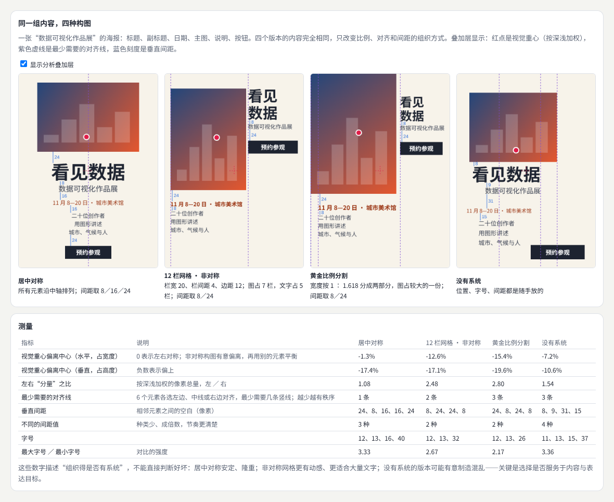
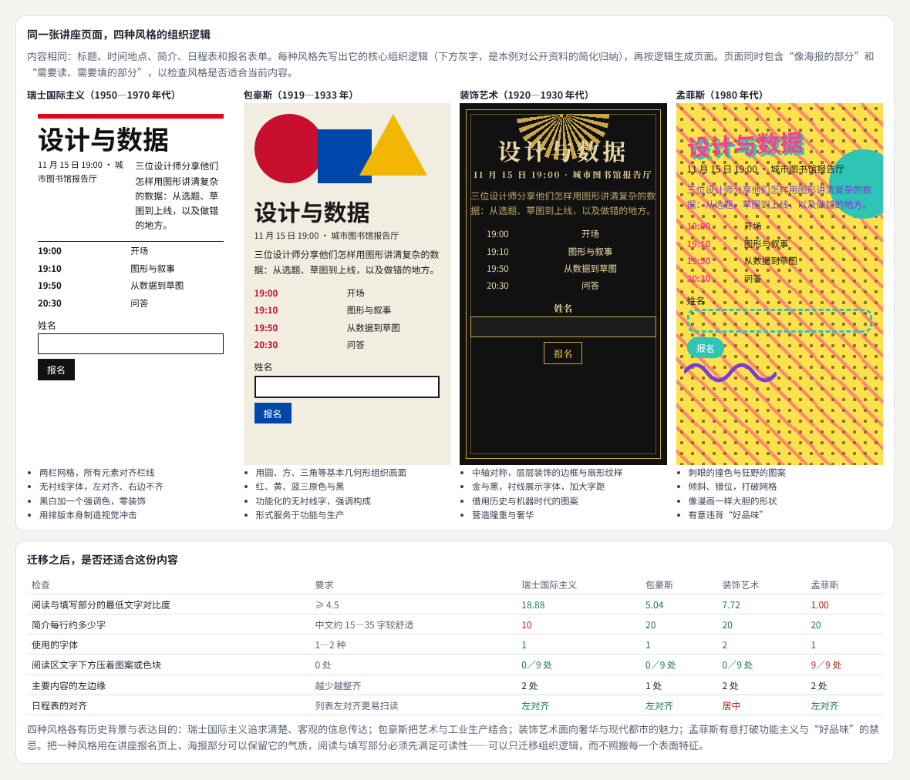
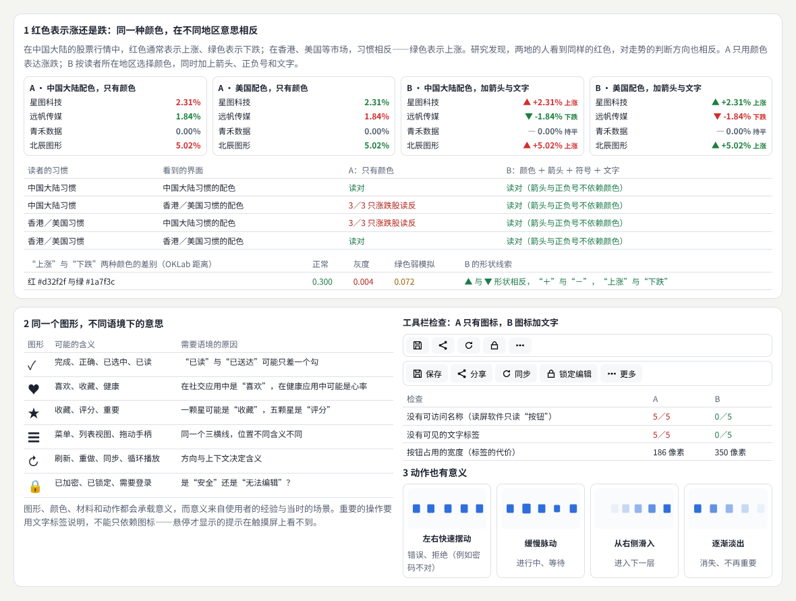
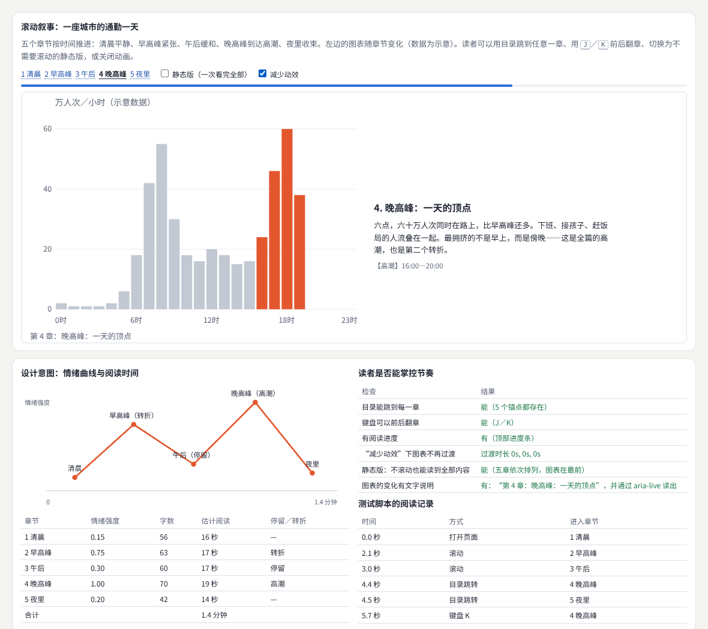
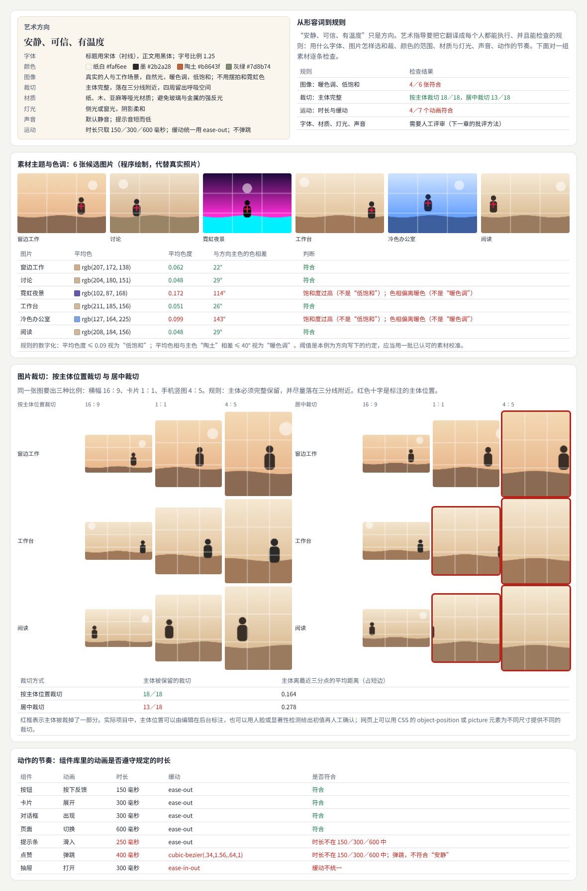
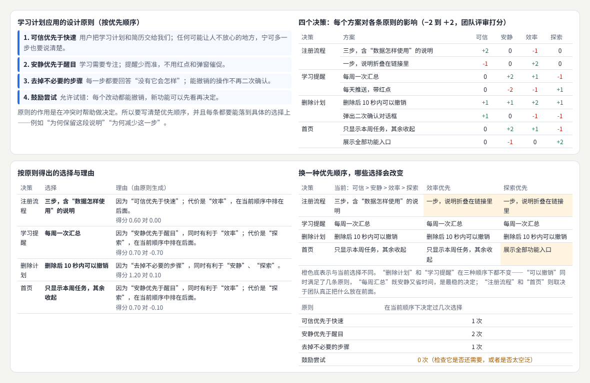
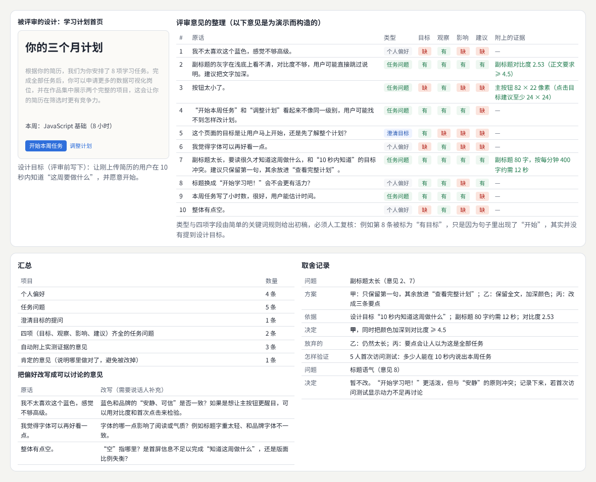
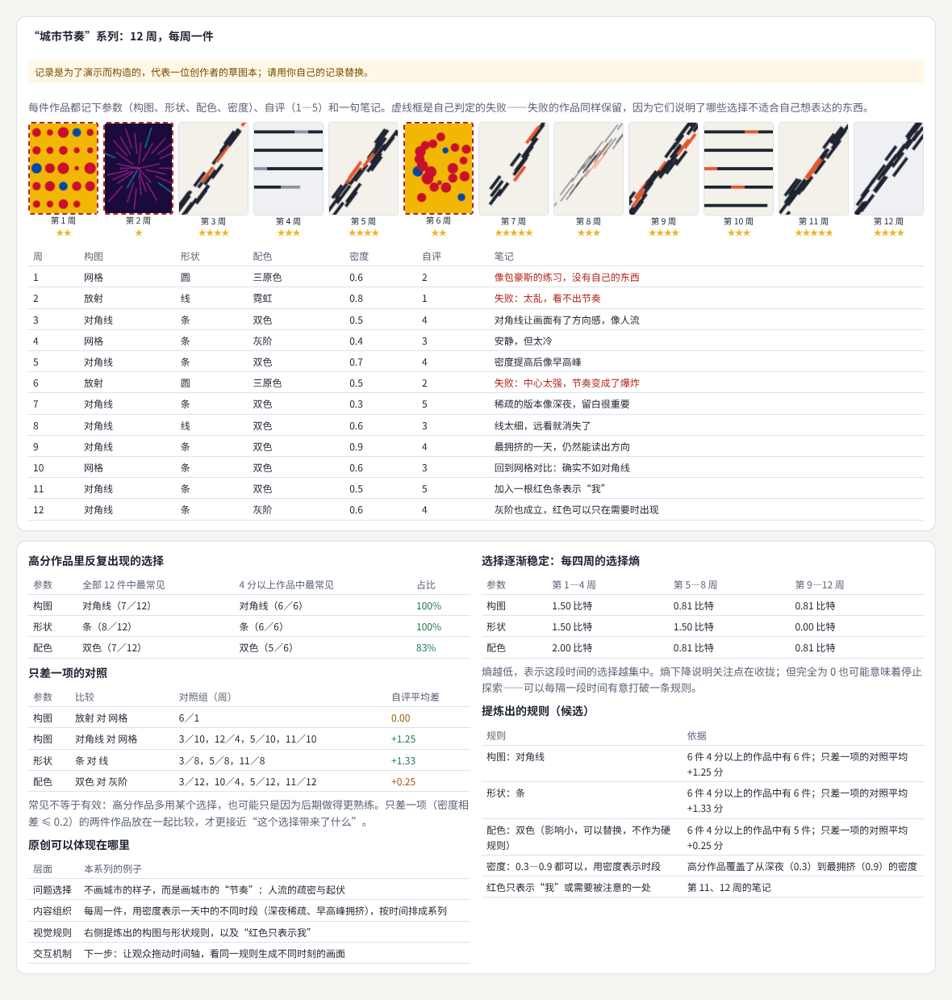
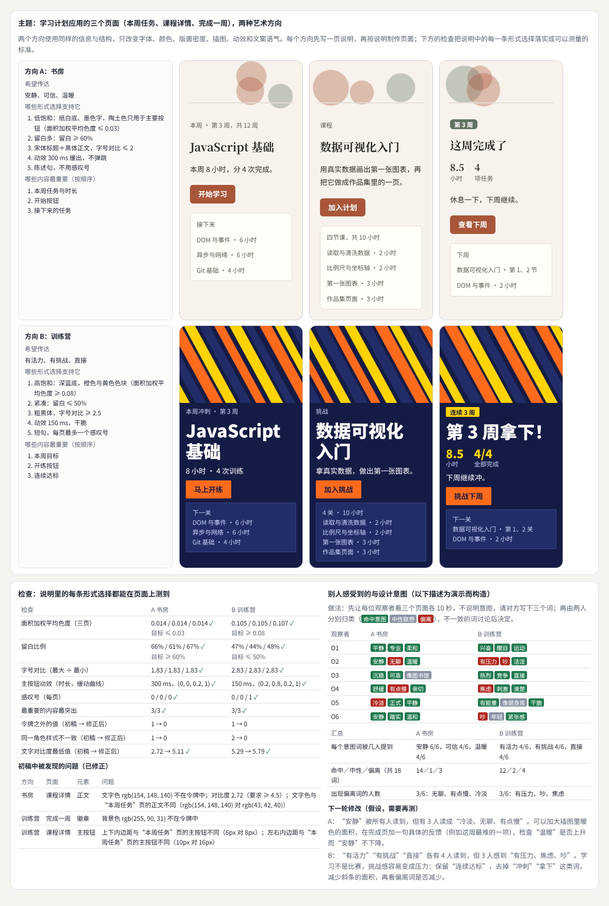

# 美学与艺术指导

> 研究作品表达什么、为什么采用某种形式，以及各部分怎样形成整体：从形式与构图、风格史与视觉文化、符号与意义、叙事与情绪，到艺术指导、设计原则、批评与评价和原创语言的长期实践；最后为同一主题建立两种艺术方向，把说明里的每一条形式选择落实成可以检查的规则，再比较别人感受到的与设计意图。  
> 版本：1.0 · 整理日期：2026-10-25  
> 适用对象：做视觉设计、品牌、产品设计或创意前端，想从“凭感觉好看”走到“能说清楚为什么、能交给团队执行、能检验效果”的人。先修：读过[《视觉设计与品牌表达》](02-视觉设计与品牌表达.md)的版式、颜色与品牌部分，[《动效与时间设计》](04-动效与时间设计.md)的时长与缓动部分，以及[《感知与认知》](13-感知与认知.md)的 03、04、10 章。

这一领域关注**作品表达什么**、**为什么采用某种形式**，以及**各部分怎样形成整体**。可以从观察和分析作品开始，学习**设计史**、**艺术史**、**摄影**、**电影**和**视觉文化**。实践中需要形成明确的**设计命题**，并通过具体页面检验。本册有两条贯穿始终的做法：

- **把形容词翻译成规则**。“安静”“有活力”只是方向；艺术指导要把它们写成每个人都能执行、并且能检查的规则：用什么字体、颜色的范围、图片怎样裁、动画多长。
- **分清能测的与要问人的**。对比度、色度、留白、动画时长、样式是否一致，可以由程序测量；“看起来是否安静”“有没有温度”只能请人描述，再与设计意图比较。

本册每章都按同样的顺序讲：先说明它解决什么问题；再用白话解释核心概念；然后给出一个可以直接运行的示例与运行截图；接着是常见问题和本章练习；最后是一张**进阶学习卡**：技术栈、要掌握的高阶词汇（附英文）、搜索关键词、值得去看的实例，以及四级进阶阶梯：

| 级别 | 含义 |
| --- | --- |
| L1 入门 | 能运行并解释本章示例，说出每个概念的作用 |
| L2 熟练 | 能用这些概念分析作品，并在自己的页面中有意识地使用 |
| L3 进阶 | 能把表达目标写成可执行、可检查的规则，并组织评审 |
| L4 深入 | 能形成自己的设计命题与长期的创作方法，并用研究检验效果 |

四级是本手册的教学结构，用来安排学习顺序，不对应任何公司的职级。

所有示例都放在本目录的[示例](示例/)文件夹中，用浏览器直接打开即可运行；每个示例都已在无头浏览器中实际运行并自动检查。书中的数字分三类，正文会逐处说明：**浏览器实际测得的**（版面位置、对比度、像素的色度、元素的计算样式）、**按规则或模型算出的**（加权评分、关键词分类、选择熵、阅读时间的估计）、**为演示而构造的数据**（08 章的评审打分、09 章的评审意见、10 章的创作记录、11 章的观察者描述）。06 章的通勤人数是示意数据。**示例里没有真实参与者的数据**。

主线是：**从命题到形式 → 八个横向方向 → 两种艺术方向的综合项目 → 在艺术指导、工程与研究之间往返。**

## 阅读导航

正文共 13 章（01—13），附 9 个可运行示例、3 组附录与 35 项资料入口。

- [第一篇：共同的基础](#part-1)
  - [01 美学与艺术指导研究什么](#ch01)
  - [02 设计命题：从形容词到规则](#ch02)
- [第二篇：八个横向方向](#part-2)
  - [03 形式与构图](#ch03)
  - [04 风格史与视觉文化](#ch04)
  - [05 符号与意义](#ch05)
  - [06 叙事与情绪](#ch06)
  - [07 艺术指导](#ch07)
  - [08 设计原则与价值取舍](#ch08)
  - [09 批评与评价](#ch09)
  - [10 原创语言与长期实践](#ch10)
- [第三篇：综合项目、实践与路线](#part-3)
  - [11 综合项目：同一主题的两种艺术方向](#ch11)
  - [12 与工程和研究的关系](#ch12)
  - [13 工具、技术栈与学习路线](#ch13)
- [附录 A：术语表](#appendix-a)
- [附录 B：资料入口](#appendix-b)
- [附录 C：与原手册的对应关系及修订记录](#appendix-c)

## 第一篇：共同的基础

### 01 美学与艺术指导研究什么

#### 01.1 三个问题

| 问题 | 例子 | 本册章节 |
| --- | --- | --- |
| 作品表达什么 | 一个学习应用想让人感到“安静、可信”，还是“有活力、有挑战” | 02、08、11 |
| 为什么采用某种形式 | 为什么用宋体标题、为什么留白多、为什么动画不弹跳 | 03、04、05、07 |
| 各部分怎样形成整体 | 字体、图片、颜色、动作、文字语气是否指向同一个方向；多个页面是否一致 | 06、07、10、11 |

另外两章贯穿始终：怎样评价一件作品（09），以及艺术指导怎样与工程和研究配合（12）。

#### 01.2 从观察和分析作品开始

分析一件作品，可以按四步走，前一步做完再做下一步：

1. **描述**：看到了什么——元素、颜色、文字、位置。先不评价。
2. **分析**：这些元素怎样组织——比例、节奏、平衡、对比（03 章）。
3. **解释**：它想表达什么，依据是什么——符号、历史语境（04、05 章）。
4. **判断**：在它的目标与条件下是否成功，限制在哪里（09 章）。

很多争论来自跳过了前两步，直接从“我喜欢”开始。下面这些领域都能提供观察的方法：

| 领域 | 学什么 | 可以从哪里开始 |
| --- | --- | --- |
| 设计史 | 风格怎样随技术、媒介和社会需求变化 | 04 章的四种风格；博物馆的设计藏品 |
| 艺术史 | 构图、色彩、形式语言与观看的方式 | 泰特美术馆的艺术术语表[B01](#ref-b01) |
| 摄影 | 构图、光线、裁切、景深 | 07 章的图片裁切与素材主题 |
| 电影 | 镜头语言、剪辑节奏、情绪的起伏 | 06 章的叙事、07 章的镜头语言 |
| 视觉文化 | 图像与符号在社会中怎样获得意义 | 05 章的符号与意义 |

#### 01.3 判断与证据

美学判断不能全部变成数字，但其中很多部分可以检查：

| 可以由程序测量 | 需要请人判断 |
| --- | --- |
| 对比度、字号、间距、对齐线；颜色的色度与色相；动画的时长与缓动；样式是否只用规定的值、各页是否一致 | 是否“安静”“有温度”；是否理解了隐喻；是否觉得被尊重；是否喜欢 |

本册的示例把前一类做成自动检查，后一类用构造的数据演示怎样收集和比较人的描述（11 章）。

### 02 设计命题：从形容词到规则

#### 02.1 设计命题包含什么

**设计命题**是一个可以被检验的主张：为了让**谁**在**什么情境**下感到或做到**什么**，我们采用**哪些形式**，因为**什么理由**；用**什么方法**检验。

| 部分 | 说明 | 例子（11 章的方向 A） |
| --- | --- | --- |
| 对象与情境 | 谁、在什么时候用 | 刚开始转行学习的人，每周几个晚上 |
| 希望传达什么 | 两三个关键词 | 安静、可信、温暖 |
| 哪些形式选择支持它 | 每个关键词对应的形式 | 纸白底与墨色字、宋体标题、留白多、动画 300 毫秒缓出 |
| 哪些内容最重要 | 按顺序 | 本周任务与时长 → 开始按钮 → 接下来的任务 |
| 怎样检验 | 测量与请人描述 | 色度、留白、对比度自动检查；请人用三个词描述 |
| 不做什么 | 明确放弃的 | 不用红点和倒计时，不用感叹号 |

#### 02.2 从形容词到规则

一个形容词要变成几条规则，每条规则再配一种检查：

| 形容词 | 规则 | 检查 |
| --- | --- | --- |
| 安静 | 低饱和：面积加权平均色度 ≤ 0.03；动画不弹跳 | 按面积取样测色度；读取缓动曲线 |
| 可信 | 文字对比度 ≥ 4.5；重要的说明不折叠 | 对比度检查；评审 |
| 有活力 | 高饱和的大色块；字号对比 ≥ 2.5 | 色度；最大字号与最小字号之比 |
| 直接 | 短句；按钮用动词开头 | 字数与文案检查 |

数字阈值是团队为这个方向写下的约定，不是普遍规律；应当用一批大家认可的页面或素材来校准（07 章）。

#### 02.3 一次只问一个问题

比较两种方向时，信息与结构要相同，只改变与表达有关的形式；否则观察者感受到的差异，可能来自内容而不是风格（11 章，以及《感知与认知》的 02 章）。

**本章练习**：

1. 为你正在做的一个产品，按 02.1 的表格写一个设计命题，特别注意“不做什么”一栏。
2. 从命题里挑一个形容词，写出三条规则，每条注明怎样检查。

## 第二篇：八个横向方向

### 03 形式与构图

#### 03.1 解决什么问题

研究**比例**、**节奏**、**平衡**、**重复**、**对比**和**变化**，观察这些选择如何影响阅读与感受。**固定比例和网格是可以选择的工具**，使用方式应由内容与表达目标决定。

#### 03.2 核心概念

| 概念 | 含义 | 在页面上 |
| --- | --- | --- |
| 比例 | 各部分大小之间的关系 | 图与文字各占多少；标题与正文的字号之比 |
| 节奏 | 重复的元素与它们之间的间隔 | 间距只取 8／16／24 这类成倍数的值 |
| 平衡 | 视觉“分量”在画面中的分布，可以对称，也可以不对称 | 左边一大块深色的图，用右侧粗大的标题与深色按钮来平衡 |
| 重复 | 同样的形、颜色或间距反复出现，形成统一 | 所有卡片用同样的圆角和内边距 |
| 对比 | 大小、明暗、粗细、疏密的差异，制造层级与焦点 | 标题 40 像素、正文 13 像素 |
| 变化 | 在重复中引入差异，避免单调 | 一组卡片里有一张特别大 |

一个元素的“分量”（**视觉重量**）不只取决于面积：位置、颜色深浅、形状是否规则、周围是否空旷都会影响它。阿恩海姆的《艺术与视知觉》系统讨论了平衡、重量与方向[B02](#ref-b02)；界面设计中常用的视觉原则也包括比例、层级、平衡与对比[B03](#ref-b03)。

关于**黄金比例**：常见的说法——古代建筑与名画都用了它、人最喜欢 1 ∶ 1.618 的矩形——大多经不起核对[B04](#ref-b04)。它和 12 栏网格、2 ∶ 3 一样，只是可以选择的比例之一。

#### 03.3 示例：同一张海报，四种构图

示例：[14-03-composition.html](示例/14-03-composition.html)

海报 300 × 420 像素，有六个元素：标题、副标题、日期、主图、说明、按钮。四个版本的内容完全相同；前三个版本由同一个排版函数按各自的栏宽和间距值生成，“没有系统”的版本是随手摆放的。页面从画布上实际测量：

- **视觉重心**：按像素的深浅加权求出的中心，相对画面中心的偏移（占宽度、高度的百分比）；**左右分量比**是左半边与右半边的加权像素总量之比。
- **最少对齐线**：每个元素可以用左边、中线或右边对齐，穷举 3⁶ = 729 种选择，找出最少需要几条竖线（相差 2 像素以内算同一条）。
- **垂直间距**与**字号**：相邻元素之间的空白，以及用到的所有字号。

| 版本 | 重心偏移（水平／垂直） | 左右分量比 | 最少对齐线 | 垂直间距（像素） | 间距种类 | 字号 | 最大 ／ 最小字号 |
| --- | --- | --- | --- | --- | --- | --- | --- |
| 居中对称 | −1.3% ／ −17.4% | 1.08 | 1 条 | 24、8、16、16、24 | 3 | 12、13、16、40 | 3.33 |
| 12 栏网格 · 非对称 | −12.6% ／ −17.1% | 2.48 | 2 条 | 8、24、24、8 | 2 | 12、13、32 | 2.67 |
| 黄金比例分割 | −15.4% ／ −19.6% | 2.80 | 3 条 | 24、8、24、8 | 2 | 12、13、26 | 2.17 |
| 没有系统 | −7.2% ／ −10.6% | 1.54 | 3 条 | 8、9、31、15 | 4 | 11、13、15、37 | 3.36 |

怎样读这张表：

- 居中对称版左右几乎相等（1.08），一条中轴就对齐了所有元素，安定、隆重。
- 两个非对称版本把大图放在左边，左右分量比达到 2.48 和 2.80；它们用右侧粗大的标题和深色按钮来平衡。四个版本的重心都偏上，因为主图在上方。
- “没有系统”的版本用了 4 种间距，其中 9 和 31 不成倍数；11、13、15 三个字号太接近，看起来“差不多但不齐”。

制作这个示例时有两处修正，都说明“测量也要检查”：最初把“两个元素边缘相差 2 像素以内”算作一次对齐，结果随手摆放的版本因为巧合最多而得分最好，于是改成“最少需要几条竖线”的穷举；网格版的日期最初用 16 像素，超出了 7 栏的宽度，是间距测量发现的，后来改为 12 像素。

**这些数字描述“组织得是否有系统”，不能直接判断好坏**：非对称网格更有动感、更适合大量文字；没有系统的版本也可能是有意制造的混乱。关键是选择是否服务于内容与表达目标。

#### 03.4 常见问题

- **把网格当成目的**：网格帮助对齐和重复，但内容不适合时（例如一张必须完整显示的竖图），可以让元素跨栏或打破网格。
- **间距随手调**：9、15、31 这类值多了，节奏就乱了。先定一组成倍数的值，再只从中选择。
- **只有重复没有变化**：每张卡片都一样大，页面会单调，也找不到重点；变化要少而有目的。
- **以为几何中心就是视觉中心**：深色的大图会把重心拉过去；同样大小的元素，放在上方比放在下方显得更重。
- **迷信某个比例**：先问内容需要什么，再选比例。

**本章练习**：

1. 在示例中加第五个版本，例如把主图放在三分线的交点上，比较测量结果。
2. 列出你的一个页面用到的全部间距，把它们归并成 3—4 个成倍数的值，比较修改前后的样子。

#### 03.5 进阶学习卡

| 级别 | 目标 | 怎样检验 |
| --- | --- | --- |
| L1 入门 | 能说出六个形式概念，并在海报上指出它们 | 为一张海报写出比例、节奏、平衡的描述 |
| L2 熟练 | 能用网格与间距尺度组织页面 | 间距只用 3—4 个值，对齐线少 |
| L3 进阶 | 能为内容与表达目标选择构图，并说明理由 | 同一内容的两种构图，各附理由 |
| L4 深入 | 能发展自己的版面系统，并研究构图对阅读的影响 | 有测量与观察的比较 |

- **技术栈**：CSS Grid 与 `grid-template-columns`；间距令牌（[《计算设计与创作工具》](11-计算设计与创作工具.md) 03 章）；Canvas 的 `getImageData()` 读取像素；`getBoundingClientRect()` 版面测量。
- **高阶词汇**：构图（composition）、比例（proportion）、节奏（rhythm）、平衡（balance）、视觉重量（visual weight）、对称与不对称（symmetry／asymmetry）、重复（repetition）、对比（contrast）、变化（variation）、版式网格（typographic grid）、模块化比例（modular scale）、黄金比例（golden ratio）、三分法（rule of thirds）。
- **搜索关键词**：`visual weight balance design`、`swiss grid poster`、`modular scale typography`、`golden ratio myth design`、`版式 网格 系统`。
- **值得看的实例**：[Poster House《The Swiss Grid》展览网站](https://swissgrid.posterhouse.org/)——看网格海报中图与文字怎样在不对称中取得平衡。
- **资料**：[B01](#ref-b01)、[B02](#ref-b02)、[B03](#ref-b03)、[B04](#ref-b04)、[B05](#ref-b05)。

### 04 风格史与视觉文化

#### 04.1 解决什么问题

理解不同风格的**历史背景**、**媒介条件**和**表达目的**。迁移一种风格时，要识别它的**核心组织逻辑**，并检查它是否适合当前内容与用户。

#### 04.2 核心概念

一种风格不是一组颜色和图形，而是在某种条件下回答某个问题的方式。下表是本例对公开资料的简化归纳：

| 风格 | 时间 | 历史背景与表达目的 | 媒介条件 | 核心组织逻辑 |
| --- | --- | --- | --- | --- |
| 瑞士国际主义 | 1950—1970 年代 | 追求清楚、客观的信息传达；构图精确理性，不用装饰[B06](#ref-b06)[B05](#ref-b05) | 印刷海报与出版物 | 版式网格、无衬线字体、左对齐右边不齐、黑白摄影 |
| 包豪斯 | 1919—1933 年 | 德国的艺术学校，把艺术家、建筑师与工匠结合在一起[B07](#ref-b07) | 作坊与工业生产 | 基本几何形、原色、形式服务于功能 |
| 装饰艺术 | 1920—1930 年代 | 面向奢华与现代都市的魅力，吸收多种来源；“Art Deco”这个名称到 1960 年代才出现[B08](#ref-b08) | 建筑、家具、海报；机器时代 | 中轴对称、层叠的几何装饰、贵重材料的质感 |
| 孟菲斯 | 1980 年代 | 1980／81 年冬在 Ettore Sottsass 周围成立，用刺眼的颜色与狂野的图案打破“好品味”的禁忌[B09](#ref-b09) | 家具与产品 | 有意违背功能主义，图案与颜色本身就是表达 |

迁移风格时要分开两件事：**可以迁移的组织逻辑**（网格、对称、几何构成）与**必须满足的当前条件**（这是一个要读、要填的页面）。

#### 04.3 示例：同一张讲座页面，四种风格

示例：[14-04-style.html](示例/14-04-style.html)

内容相同：标题、时间地点、简介、日程表和报名表单。每种风格先写出它的核心组织逻辑，再按逻辑生成页面。页面同时包含“像海报的部分”和“需要读、需要填的部分”，检查风格是否适合这份内容：

| 检查 | 要求 | 瑞士国际主义 | 包豪斯 | 装饰艺术 | 孟菲斯 |
| --- | --- | --- | --- | --- | --- |
| 阅读与填写部分的最低文字对比度 | ≥ 4.5 | 18.88 | 5.04 | 7.72 | 1.00 |
| 简介每行约多少字 | 中文约 15—35 字较舒适 | 10 | 20 | 20 | 20 |
| 使用的字体 | 1—2 种 | 1 | 1 | 2 | 1 |
| 阅读区文字下方压着图案或色块 | 0 处 | 0／9 | 0／9 | 0／9 | 9／9 |
| 主要内容的左边缘 | 越少越整齐 | 2 处 | 1 处 | 2 处 | 2 处 |
| 日程表的对齐 | 左对齐更易扫读 | 左对齐 | 左对齐 | 居中 | 左对齐 |

- 瑞士版的两栏网格在这个宽度下太窄，简介每行只有 10 个字：网格的逻辑需要足够的宽度。
- 孟菲斯版的粉色时间压在粉色条纹上，对比度只有 1.00：刺眼的图案在海报部分是表达，在阅读部分就成了障碍。
- 装饰艺术版的日程表沿中轴居中，好看但不利于扫读。

所以，**可以只迁移组织逻辑，而不照搬每一个表面特征**：海报部分保留风格的气质，阅读与填写部分先满足可读性。

#### 04.4 常见问题

- **只搬颜色和图形**：用了包豪斯的红黄蓝，却没有用几何构成组织版面，得到的只是“像”。
- **忽略语境**：孟菲斯的刺眼，是对当时功能主义的反叛；放进报名表单，只剩下读不清。
- **几种风格无主次地混搭**：先确定一种组织逻辑为主，其他只作点缀。
- **把风格当作时代标签**：同一时期有多种风格并存，同一风格在不同国家也不一样。

**本章练习**：

1. 为示例加第五种风格（例如构成主义），先写出三条核心组织逻辑，再生成页面并跑一遍检查。
2. 把瑞士版改成单栏，看每行字数的变化，并说明这是否还符合它的组织逻辑。

#### 04.5 进阶学习卡

| 级别 | 目标 | 怎样检验 |
| --- | --- | --- |
| L1 入门 | 能说出四种风格的时代与特征 | 为每种风格找三件作品并标出特征 |
| L2 熟练 | 能写出一种风格的组织逻辑，并据此做页面 | 页面与逻辑逐条对应 |
| L3 进阶 | 能把风格迁移到新的内容，并检查可读性与语境 | 迁移后的检查表全部通过 |
| L4 深入 | 能研究风格与它的技术、社会条件之间的关系 | 有史料依据的分析 |

- **技术栈**：CSS 自定义属性组织主题；网页字体加载（`@fontsource`）；对比度计算与 `getComputedStyle()`。
- **高阶词汇**：风格（style）、视觉文化（visual culture）、国际主义风格（International Typographic Style）、包豪斯（Bauhaus）、装饰艺术（Art Deco）、孟菲斯（Memphis Group）、功能主义（functionalism）、后现代主义（postmodernism）、拼贴与混成（pastiche）、语境（context）。
- **搜索关键词**：`international typographic style posters`、`bauhaus design principles`、`art deco graphic design`、`memphis group sottsass`、`设计史 风格 演变`。
- **值得看的实例**：[哈佛艺术博物馆的包豪斯特藏](https://harvardartmuseums.org/publications/special-collections/the-bauhaus)——看作品与教学材料怎样体现“形式服务于功能”。
- **资料**：[B05](#ref-b05)、[B06](#ref-b06)、[B07](#ref-b07)、[B08](#ref-b08)、[B09](#ref-b09)。

### 05 符号与意义

#### 05.1 解决什么问题

研究**图形**、**颜色**、**材料**和**动作怎样承载意义**。符号解释可能因文化和场景变化，重要信息应提供清楚语境，并通过用户反馈验证。

#### 05.2 核心概念

皮尔士把符号按它与所指之物的关系分为三类[B10](#ref-b10)：

| 类型 | 与所指的关系 | 界面中的例子 |
| --- | --- | --- |
| 图像符号 | 靠相似 | 打印机图标表示打印、相机图标表示拍照 |
| 指示符号 | 靠因果或邻近 | 转圈表示“正在处理”；红点表示有新消息 |
| 象征符号 | 靠约定 | 红色表示涨或跌；☰ 表示菜单 |

象征符号的意义完全来自约定，所以最容易因文化而变：中国大陆的行情用红色表示上涨，香港和美国等市场用绿色表示上涨。研究发现，颜色对股价走势判断的影响方向随这种习惯而不同[B11](#ref-b11)。

同一个符号还有两层意义：**外延**是字面所指（心形按钮表示“收藏”），**内涵**是联想（亲密、健康）。材料与动作也一样：哑光的纸张质感让人联想到安静和手作，玻璃与金属的高光让人联想到科技与冷静；左右快速摆动常被理解为“不对”。

因此，重要的信息要**冗余编码**：颜色之外再加形状与文字；图标要配文字标签[B12](#ref-b12)；不能只靠颜色传达信息[B13](#ref-b13)。

#### 05.3 示例：涨跌的颜色、图形的语境、动作的意义

示例：[14-05-symbol.html](示例/14-05-symbol.html)

**涨跌的颜色**：四只股票（+2.31%、−1.84%、0.00%、+5.02%）。读者的习惯与界面的配色交叉组合：

| 读者的习惯 | 界面配色 | A：只有颜色 | B：颜色 ＋ 箭头 ＋ 正负号 ＋ 文字 |
| --- | --- | --- | --- |
| 中国大陆 | 中国大陆 | 读对 | 读对 |
| 中国大陆 | 香港／美国 | 3／3 只涨跌股读反 | 读对 |
| 香港／美国 | 中国大陆 | 3／3 只涨跌股读反 | 读对 |
| 香港／美国 | 香港／美国 | 读对 | 读对 |

红 #d32f2f 与绿 #1a7f3c 在 OKLab 空间中的距离：正常视觉 0.300，转成灰度后 0.004，绿色弱模拟 0.072。也就是说，打印成黑白或对色觉有差异的人，几乎分不出涨跌；B 的箭头 ▲▼、正负号和“上涨／下跌”不依赖颜色。

**图形的语境**：✓ 可以是完成、正确、已选中或已读；♥ 在社交应用中是“喜欢”，在健康应用中可能是心率；★ 一颗是“收藏”，五颗是“评分”；☰ 可以是菜单、列表视图或拖动手柄；↻ 可以是刷新、重做、同步或循环播放；锁可以是“已加密”，也可以是“无法编辑”。

**工具栏检查**（五个按钮：保存、分享、同步、锁定编辑、更多）：

| 检查 | A：只有图标 | B：图标加文字 |
| --- | --- | --- |
| 没有可访问名称（读屏软件只读“按钮”） | 5／5 | 0／5 |
| 没有可见的文字标签 | 5／5 | 0／5 |
| 按钮占用的宽度 | 186 像素 | 350 像素 |

文字标签的代价是宽度几乎翻倍；空间不够时，宁可把次要按钮收进“更多”，也不要去掉主要按钮的文字。

**动作的意义**：左右快速摆动——错误、拒绝（例如密码不对）；缓慢脉动——进行中、等待；从右侧滑入——进入下一层；逐渐淡出——消失、不再重要。

#### 05.4 常见问题

- **以为图标是通用的**：除了极少数（放大镜、关闭的 ×），大多数图标都需要文字，悬停才显示的提示在触摸屏上看不到。
- **只用颜色表达状态**：黑白打印、强光下的屏幕和色觉差异都会让信息消失。
- **不同场景用同一符号表示不同的事**：同一个产品里，锁最好只表示一种意思。
- **把自己的文化习惯当成默认**：面向多个地区的产品，要按地区设置配色，或者用不依赖颜色的表达。

**本章练习**：

1. 列出你的产品中所有只靠图标的按钮，为每个写一个文字标签，并测量工具栏宽度的变化。
2. 请三位不同背景的人说出六个图标的含义，与你的设计意图比较。

#### 05.5 进阶学习卡

| 级别 | 目标 | 怎样检验 |
| --- | --- | --- |
| L1 入门 | 能区分图像、指示、象征三类符号 | 为十个图标分类 |
| L2 熟练 | 能用冗余编码表达重要状态 | 黑白与色觉模拟下仍能区分 |
| L3 进阶 | 能根据文化与场景选择符号，并用用户反馈验证 | 有理解测试的记录 |
| L4 深入 | 能研究符号意义怎样随文化与时间变化 | 跨文化的比较研究 |

- **技术栈**：`aria-label` 与可见文字标签；SVG 图标；OKLab 颜色距离与色觉模拟（[《感知与认知》](13-感知与认知.md) 08 章）；按地区格式化的 `Intl`。
- **高阶词汇**：符号学（semiotics）、符号（sign）、图像符号（icon）、指示符号（index）、象征符号（symbol）、外延（denotation）、内涵（connotation）、文化约定（cultural convention）、冗余编码（redundant coding）、可访问名称（accessible name）。
- **搜索关键词**：`peirce icon index symbol`、`icon usability text labels`、`color meaning culture stock market red green`、`wcag use of color`、`符号学 设计 图标`。
- **值得看的实例**：[Material Symbols 图标库](https://fonts.google.com/icons)——同一个图形有几个名称、在不同场景下怎样配文字。
- **资料**：[B10](#ref-b10)、[B11](#ref-b11)、[B12](#ref-b12)、[B13](#ref-b13)。

### 06 叙事与情绪

#### 06.1 解决什么问题

安排信息出现的**顺序**、**情绪变化**、**停留**和**转折**。**网页中的滚动**、**章节**和**交互**可以成为叙事手段，但阅读者也需要选择和控制自己的节奏。

#### 06.2 核心概念

- **情绪曲线**：按章节写下预期的情绪强度（0—1），看哪里是转折、哪里让读者停下来喘口气、哪里是高潮。平的曲线意味着没有起伏。
- **作者驱动与读者驱动**：Segel 与 Heer 把叙事可视化分为杂志式、带注释的图表、分格海报、流程图、连环画、幻灯片、影片等体裁，并讨论作者安排的顺序与读者自由探索之间的平衡[B14](#ref-b14)。
- **框架效应**：同一组数据，选择什么、强调什么、用什么标题，会改变读者的理解[B15](#ref-b15)。叙事不能为了戏剧性而夸大数据。
- **滚动驱动的叙事**：随滚动切换图表与文字，能把复杂的数据分步讲清楚；但滚动也容易变得难以控制，要想清楚它是否真的比普通的分步更好[B16](#ref-b16)。
- **读者的控制**：目录、键盘翻章、进度提示、可以关闭的动效[B17](#ref-b17)，以及不需要滚动也能读完的静态版。

#### 06.3 示例：一座城市的通勤一天

示例：[14-06-narrative.html](示例/14-06-narrative.html)

五个章节按时间推进：清晨平静、早高峰紧张、午后缓和、晚高峰到达高潮、夜里收束。左边的图表随章节变化（数据为示意：晚高峰每小时 60 万人次，比早高峰的 55 万还多——“最拥挤的不是早上，而是傍晚”是全篇的高潮）。阅读时间按每分钟 400 字、每章看图 8 秒估计：

| 章节 | 情绪强度 | 字数 | 估计阅读 | 作用 |
| --- | --- | --- | --- | --- |
| 1 清晨 | 0.15 | 56 | 16 秒 | 开场 |
| 2 早高峰 | 0.75 | 63 | 17 秒 | 转折 |
| 3 午后 | 0.30 | 60 | 17 秒 | 停留 |
| 4 晚高峰 | 1.00 | 70 | 19 秒 | 高潮 |
| 5 夜里 | 0.20 | 42 | 14 秒 | 收束 |
| 合计 | | | 1.4 分钟 | |

测试脚本模拟了一位读者：打开页面（第 1 章）→ 2.1 秒滚动到第 2 章 → 3.0 秒到第 3 章 → 用目录跳到第 5 章（4.4 秒途经第 4 章，4.5 秒到达）→ 5.7 秒按键盘 K 回到第 4 章 → 打开“减少动效”。

**读者是否能掌控节奏**：

| 检查 | 结果 |
| --- | --- |
| 目录能跳到每一章 | 能（5 个锚点都存在） |
| 键盘可以前后翻章 | 能（J／K） |
| 有阅读进度 | 有（顶部进度条） |
| “减少动效”下图表不再过渡 | 过渡时长 0 秒 |
| 静态版：不滚动也能读到全部内容 | 能（五章依次排列，图表在最前） |
| 图表的变化有文字说明 | 有，例如“第 4 章：晚高峰：一天的顶点”，通过 `aria-live` 读出 |

#### 06.4 常见问题

- **劫持滚动**：改变滚动的速度或方向，让读者失去控制，也常常破坏键盘与读屏软件的使用。
- **只能按作者的顺序读**：提供目录与静态版，让赶时间的人直接看结论。
- **动效让人不适**：大面积的移动、缩放和视差会让部分读者头晕；尊重系统的“减少动态效果”设置。
- **情绪没有起伏**：每一章都同样紧张，高潮就不成立；安排停留，让读者消化。
- **为了戏剧性夸大数据**：截断的坐标轴和挑选的时段能制造“惊人”的结论，但会损害可信。

**本章练习**：

1. 为你的一份报告画情绪曲线，标出转折、停留和高潮，再调整章节的顺序。
2. 在示例中加一个“只看结论”的入口，并检查它是否破坏了情绪曲线。

#### 06.5 进阶学习卡

| 级别 | 目标 | 怎样检验 |
| --- | --- | --- |
| L1 入门 | 能说出顺序、停留、转折、高潮在作品中的位置 | 为一篇长文画情绪曲线 |
| L2 熟练 | 能做有目录、进度与静态版的滚动叙事 | 读者控制的检查全部通过 |
| L3 进阶 | 能平衡作者驱动与读者驱动，并避免误导 | 评审中没有“被带着走”的意见 |
| L4 深入 | 能研究叙事形式对理解与记忆的影响 | 有对照的阅读研究 |

- **技术栈**：`IntersectionObserver` 判断章节进入视口；锚点链接与键盘事件；`matchMedia('(prefers-reduced-motion: reduce)')`；`aria-live` 区域；Scrollama 等滚动叙事库。
- **高阶词汇**：叙事（narrative）、情绪曲线（emotional arc）、滚动叙事（scrollytelling）、作者驱动与读者驱动（author-driven／reader-driven）、框架效应（framing effect）、节奏控制（pacing）、转折点（turning point）、高潮（climax）、渐进揭示（progressive disclosure）、滚动劫持（scroll hijacking）。
- **搜索关键词**：`scrollytelling best practices`、`narrative visualization genres`、`scroll hijacking usability`、`emotional arc storytelling`、`滚动叙事 数据新闻`。
- **值得看的实例**：[The Pudding](https://pudding.cool/)——看长篇数据叙事怎样用滚动、章节和交互；[《纽约时报》Snow Fall](https://www.nytimes.com/projects/2012/snow-fall/index.html)——早期多媒体长篇叙事的代表作。
- **资料**：[B14](#ref-b14)、[B15](#ref-b15)、[B16](#ref-b16)、[B17](#ref-b17)。

### 07 艺术指导

#### 07.1 解决什么问题

统一**字体**、**图像**、**颜色**、**材质**、**灯光**、**声音**和**运动**。把抽象目标转化为能够执行的规则，例如**镜头语言**、**图片裁切**、**素材主题**和**动画节奏**。

#### 07.2 核心概念

艺术指导的工作，是把一个方向写成团队里每个人都能执行的规则，再决定每条规则怎样检查：

| 方面 | 规则写什么 | 怎样检查 |
| --- | --- | --- |
| 字体 | 标题与正文用哪种字体、字号比例 | 程序：读取计算样式 |
| 素材主题 | 拍什么、不拍什么（真实场景，不用摆拍） | 人工评审，配合色调统计 |
| 镜头语言 | 景别（远景、中景、近景、特写）、角度、景深 | 人工评审 |
| 图片裁切 | 主体完整，落在三分线附近 | 程序：主体标注 ＋ 裁切计算 |
| 颜色 | 主色、辅助色，色度与色相的范围 | 程序 |
| 材质与灯光 | 哑光、侧光、阴影柔和 | 人工评审 |
| 声音 | 默认静音，提示音短而低 | 人工评审，配合音量测量 |
| 运动与动画节奏 | 时长只取几个值，缓动统一 | 程序：读取动画定义 |

成熟的设计系统都把这些写成规范：图片的风格与用法[B18](#ref-b18)；动画的时长与缓动令牌[B19](#ref-b19)；有的系统区分两种运动风格——日常操作的动作要快而不打扰，重要时刻的动作可以更有表现力[B20](#ref-b20)。文字的语气同样属于艺术指导：同一句话可以正式或随和、热情或平实[B21](#ref-b21)[B22](#ref-b22)。

#### 07.3 示例：“安静、可信、有温度”

示例：[14-07-art-direction.html](示例/14-07-art-direction.html)

**方向说明**：

| 方面 | 规则 |
| --- | --- |
| 字体 | 标题用宋体（衬线），正文用黑体；字号比例 1.25 |
| 颜色 | 纸白 #faf6ee、墨 #2b2a28、陶土 #b8643f、灰绿 #7d8b74 |
| 图像 | 真实的人与工作场景，自然光，暖色调，低饱和；不用摆拍和霓虹色 |
| 裁切 | 主体完整，落在三分线附近，四周留出呼吸空间 |
| 材质 | 纸、木、亚麻等哑光材质；避免玻璃与金属的强反光 |
| 灯光 | 侧光或窗光，阴影柔和 |
| 声音 | 默认静音；提示音短而低 |
| 运动 | 时长只取 150／300／600 毫秒；缓动统一用 ease-out；不弹跳 |

**素材主题与色调**：六张候选图片（程序绘制，代替真实照片）。规则的数字化：平均色度 ≤ 0.09 视为“低饱和”，平均色与主色“陶土”的色相差 ≤ 40° 视为“暖色调”：

| 图片 | 平均色度 | 与主色的色相差 | 判断 |
| --- | --- | --- | --- |
| 窗边工作 | 0.062 | 22° | 符合 |
| 讨论 | 0.048 | 29° | 符合 |
| 霓虹夜景 | 0.172 | 114° | 饱和度过高；色相偏离暖色 |
| 工作台 | 0.051 | 26° | 符合 |
| 冷色办公室 | 0.099 | 143° | 饱和度过高；色相偏离暖色 |
| 阅读 | 0.048 | 29° | 符合 |

六张中有 4 张符合。阈值是本例为方向写下的约定，应当用一批已经认可的素材校准。

**图片裁切**：同一张图要出三种比例——横幅 16 ∶ 9、卡片 1 ∶ 1、手机竖图 4 ∶ 5，六张图共 18 次裁切。按标注的主体位置裁切，18 次都保留了完整的主体，主体离最近的三分点平均 0.164 个短边；居中裁切只有 13 次保留了主体，平均距离 0.278。网页上可以用 CSS 的 `object-position` 或 `<picture>` 元素为不同尺寸提供不同的裁切。

**动作的节奏**：组件库里的七个动画，有 4 个符合规则；提示条用了 250 毫秒，点赞用了 400 毫秒且曲线 `cubic-bezier(.34, 1.56, .64, 1)` 会弹跳（不符合“安静”），抽屉用了 ease-in-out（缓动不统一）。

字体、材质、灯光与声音仍需要人工评审（09 章）。

#### 07.4 常见问题

- **只有形容词清单**：“高级、简洁、有温度”无法执行，每个词都要写成规则。
- **只管图片，不管动作和声音**：页面上最先打破气质的，常常是一个弹跳的动画或一声响亮的提示音。
- **阈值拍脑袋**：先收集一批团队认可的样本，测出它们的范围，再定阈值。
- **一律居中裁切**：主体在边上的照片会被裁掉头或手，要在素材上标注主体位置。
- **例外太多**：每一个“这次特殊”都会削弱方向；确有需要时修改规则本身。

**本章练习**：

1. 为你的产品写一页方向说明，覆盖八个方面，每条注明怎样检查。
2. 收集 10 张团队认可的图片，测出它们的色度与色相范围，再用这个范围检查新素材。

#### 07.5 进阶学习卡

| 级别 | 目标 | 怎样检验 |
| --- | --- | --- |
| L1 入门 | 能说出艺术指导覆盖的八个方面 | 分析一个品牌网站的八个方面 |
| L2 熟练 | 能把方向写成可执行的规则 | 一页方向说明，每条可执行 |
| L3 进阶 | 能为规则配上自动或人工的检查，并用样本校准 | 检查能发现不符合的素材 |
| L4 深入 | 能在多个产品与媒介之间维持并演进一个方向 | 跨渠道的一致性评审 |

- **技术栈**：CSS 自定义属性与设计令牌；`object-fit`、`object-position` 与 `<picture>`；Canvas 的色调统计；集中定义的动画时长与缓动。
- **高阶词汇**：艺术指导（art direction）、视觉语言（visual language）、情绪板（mood board）、风格指南（style guide）、镜头语言（cinematic language）、景别（shot size）、三分法（rule of thirds）、主体感知裁切（subject-aware cropping）、色调（tone）、动效令牌（motion tokens）、缓动（easing）、语气（tone of voice）。
- **搜索关键词**：`art direction web design`、`responsive images art direction picture element`、`mood board to style guide`、`motion design tokens duration easing`、`艺术指导 品牌 视觉规范`。
- **值得看的实例**：[Apple 人机界面指南](https://developer.apple.com/design/human-interface-guidelines/)——看图像、字体、动作怎样写成可以执行的规范。
- **资料**：[B18](#ref-b18)、[B19](#ref-b19)、[B20](#ref-b20)、[B21](#ref-b21)、[B22](#ref-b22)。

### 08 设计原则与价值取舍

#### 08.1 解决什么问题

明确产品重视效率、探索、可信、安静或其他目标，并据此处理冲突。原则应能够**解释具体选择**，例如**为何减少步骤**、**为何保留某段说明**。

#### 08.2 核心概念

好的设计原则有四个特点：

1. **有取舍**：“可信优先于快速”是原则，因为它的反面“快速优先于可信”也是合理的选择；“以用户为中心”不是，因为没有人会反对它。
2. **有顺序**：原则之间会冲突，要事先写下谁优先。
3. **能落到具体的选择上**：每条原则都应当能解释至少一个决定。
4. **数量少**：三到五条，团队记得住。

英国政府数字服务的设计原则是常被引用的例子，例如“从用户需求出发”“做得更少”“一致，而不是统一”[B23](#ref-b23)；也有人收集了大量组织公开的设计原则，便于比较[B24](#ref-b24)。

把原则用于决定时，可以做一个**决策矩阵**：团队评审每个方案对每条原则的影响（−2 到 ＋2），按优先顺序加权求和。数字本身并不精确，它的作用是**把分歧摆到桌面上**，并能回答“换一种优先顺序，哪些选择会变”。

#### 08.3 示例：学习计划应用的四个决策

示例：[14-08-principles.html](示例/14-08-principles.html)

四条原则按顺序：**可信优先于快速**、**安静优先于醒目**、**去掉不必要的步骤**（效率）、**鼓励尝试**（探索），当前权重 0.4、0.3、0.2、0.1。评审打分是为演示而构造的。按原则得出的选择，理由由程序根据得分自动生成：

| 决策 | 选择 | 理由 | 得分（选中／放弃） |
| --- | --- | --- | --- |
| 注册流程 | 三步，含“数据怎样使用”的说明 | 因为“可信优先于快速”；代价是效率 | 0.60 对 0.00 |
| 学习提醒 | 每周一次汇总 | 因为“安静优先于醒目”，同时有利于效率；代价是探索 | 0.70 对 −0.70 |
| 删除计划 | 删除后 10 秒内可以撤销 | 因为“去掉不必要的步骤”，同时有利于安静与探索 | 1.20 对 0.10 |
| 首页 | 只显示本周任务，其余收起 | 因为“安静优先于醒目”，同时有利于效率；代价是探索 | 0.70 对 −0.10 |

“为何保留这段说明”（注册流程）和“为何减少这一步”（删除时不再二次确认）都能由原则解释。

**换一种优先顺序**：如果效率优先（权重 0.15、0.15、0.55、0.15），注册流程变成“一步，说明折叠在链接里”；如果探索优先（0.15、0.15、0.2、0.5），注册流程同样变成一步，首页变成“展示全部功能入口”。“删除计划”和“学习提醒”在三种顺序下都不变——可以撤销同时满足了几条原则，每周汇总既安静又省时间，是最稳的决定；注册流程和首页则取决于团队真正把什么放在前面。

**每条原则决定过几次选择**：可信 1 次、安静 2 次、效率 1 次、探索 0 次。一条从未决定过任何选择的原则，要检查它是否还需要，或者是否写得太空泛。

#### 08.4 常见问题

- **原则太空泛**：“简单”“好用”无法帮助做任何决定。
- **没有顺序**：两条原则冲突时，会议就变成了谁的声音大。
- **写完就不再用**：在每次评审的记录里写明“依据哪条原则”，原则才会活着。
- **原则与实际选择矛盾**：说“安静”，却每天推送带红点的提醒；用户会相信行为而不是口号。
- **把打分当成精确计算**：分数是评审意见的整理，敏感性分析比总分更有用。

**本章练习**：

1. 为你的产品写三到五条带取舍的原则，并为每条找一个它能解释的真实决定。
2. 在示例中加一个决策（例如“是否显示学习排行榜”），评分后看三种优先顺序下的选择。

#### 08.5 进阶学习卡

| 级别 | 目标 | 怎样检验 |
| --- | --- | --- |
| L1 入门 | 能区分有取舍的原则与口号 | 改写三条空泛的原则 |
| L2 熟练 | 能用原则解释具体的设计选择 | 每条原则至少解释一个决定 |
| L3 进阶 | 能用决策矩阵与敏感性分析处理冲突 | 团队对优先顺序达成一致并记录 |
| L4 深入 | 能让原则随产品演进，并检查行为与原则是否一致 | 定期的原则复查 |

- **技术栈**：决策矩阵（表格或脚本）；设计决策记录；敏感性分析。
- **高阶词汇**：设计原则（design principles）、价值取舍（trade-off）、优先顺序（prioritization）、决策矩阵（decision matrix）、加权评分（weighted scoring）、敏感性分析（sensitivity analysis）、产品价值观（product values）、暗黑模式（dark patterns）。
- **搜索关键词**：`design principles examples`、`government design principles`、`weighted decision matrix`、`design trade-offs prioritization`、`设计原则 产品 价值观`。
- **值得看的实例**：[英国政府设计原则](https://www.gov.uk/guidance/government-design-principles)——看每条原则怎样写成一句可以引用的话，并附上为什么。
- **资料**：[B23](#ref-b23)、[B24](#ref-b24)。

### 09 批评与评价

#### 09.1 解决什么问题

学会描述作品目标、**形式**、**效果**和**限制**，用具体证据提出修改。区分**个人偏好**与**任务问题**，让评审能够推动改进，并**记录不同方案的取舍**。

#### 09.2 核心概念

一条能推动改进的意见包含四项：

| 项 | 回答 | 例子 |
| --- | --- | --- |
| 目标 | 这个页面要达到什么 | “10 秒内知道这周要做什么” |
| 观察 | 看到了什么（可以核实） | 副标题有 80 个字，灰色文字对比度 2.53 |
| 影响 | 对目标有什么影响 | 读完约需 12 秒，用户可能直接跳过 |
| 建议 | 可以怎样改 | 只保留第一句，其余放进“查看完整计划” |

意见大致分三类：**个人偏好**（“我不太喜欢这个蓝色”）、**任务问题**（妨碍了目标）、**澄清目标的提问**（“这个页面是让人马上开始，还是先了解整个计划？”）。偏好不是没有价值，但需要说话人补充它影响了什么。

结构化的评审方法可以减少“评审变成辩论”：主持人、展示者与评审者各有分工，意见围绕目标[B25](#ref-b25)；舞蹈家 Liz Lerman 的“关键回应流程”先请回应者说出作品中有意义的地方，再由作者提问，然后回应者提中立的问题，最后在作者同意后才给出意见[B26](#ref-b26)。评审的结论应当写成**取舍记录**：问题、方案、依据、决定、放弃的方案与理由、怎样验证——与软件工程中的架构决策记录相似[B27](#ref-b27)。

#### 09.3 示例：学习计划首页的一次评审

示例：[14-09-critique.html](示例/14-09-critique.html)

设计目标（评审前写下）：让刚上传简历的用户在 10 秒内知道“这周要做什么”，并愿意开始。十条评审意见是为演示而构造的。页面从被评审的设计上实测证据：副标题对比度 2.53（正文要求 ≥ 4.5）；主按钮 82 × 22 像素（点击目标建议至少 24 × 24）；副标题 80 个字，按每分钟 400 字约需 12 秒。

| 汇总 | 数量 |
| --- | --- |
| 个人偏好 | 4 条 |
| 任务问题 | 5 条 |
| 澄清目标的提问 | 1 条 |
| 目标、观察、影响、建议四项齐全的任务问题 | 2 条 |
| 自动附上实测证据的意见 | 3 条 |
| 肯定的意见（说明哪里做对了，避免被改掉） | 1 条 |

三条偏好被改写成可以讨论的问题，例如“我不太喜欢这个蓝色，感觉不够高级”改成“蓝色和品牌的‘安静、可信’是否一致？如果是想让主按钮更醒目，可以用对比度和首次点击来检验”。

**取舍记录**：

| 项 | 内容 |
| --- | --- |
| 问题 | 副标题太长（意见 2、7） |
| 方案 | 甲：只保留第一句，其余放进“查看完整计划”；乙：保留全文，加深颜色；丙：改成三条要点 |
| 依据 | 设计目标“10 秒内知道这周做什么”；副标题 80 字约需 12 秒；对比度 2.53 |
| 决定 | 甲，同时把颜色加深到对比度 ≥ 4.5 |
| 放弃的 | 乙：仍然太长；丙：要点会让人以为这就是全部任务 |
| 怎样验证 | 5 人首次访问测试：多少人能在 10 秒内说出本周任务 |

另一条意见建议把标题换成“开始学习吧！”。记录的决定是**暂不改**：它更活泼，但与“安静”的原则冲突（08 章）；如果首次访问测试显示动力不足，再讨论。

类型与四项字段由简单的关键词规则给出初稿，**必须人工复核**：例如第 8 条被标为“有目标”，只是因为句子里出现了“开始”，其实并没有提到设计目标。

#### 09.4 常见问题

- **评审变成投票**：多数人喜欢不等于达成了目标；回到写下的目标。
- **没有先写目标**：没有目标，就无法区分偏好与任务问题。
- **只批评，不肯定**：说清楚哪里做对了，下一版才不会把它改掉。
- **作者忙着辩护**：先听完、问清楚，再决定接受哪些意见。
- **不留记录**：同样的争论会在下一次评审重演。

**本章练习**：

1. 主持一次 20 分钟的评审，先写目标，评审后按四项整理意见，统计偏好与任务问题各有几条。
2. 为一个你做过的决定写取舍记录，特别写清楚“放弃的方案”和“怎样验证”。

#### 09.5 进阶学习卡

| 级别 | 目标 | 怎样检验 |
| --- | --- | --- |
| L1 入门 | 能按“描述、分析、解释、判断”分析一件作品 | 一页书面分析 |
| L2 熟练 | 能给出四项齐全、附证据的意见 | 意见能被对方直接执行 |
| L3 进阶 | 能主持评审，把偏好转化为可以检验的问题 | 评审后有取舍记录 |
| L4 深入 | 能建立团队的评审文化与决策档案 | 记录被后续决定引用 |

- **技术栈**：评审模板；对比度与尺寸的测量；Markdown 或架构决策记录模板写取舍记录；协作白板的评论功能。
- **高阶词汇**：设计评审（design critique）、可执行的反馈（actionable feedback）、个人偏好（personal preference）、证据（evidence）、取舍记录（decision record）、关键回应流程（Critical Response Process）、艺术批评（art criticism）、主持人（facilitator）。
- **搜索关键词**：`design critique framework`、`critical response process liz lerman`、`actionable design feedback`、`architecture decision record template`、`设计评审 反馈 方法`。
- **值得看的实例**：[架构决策记录的模板与示例](https://adr.github.io/)——看背景、决定与后果怎样写成一页，可以直接借用来记录设计取舍。
- **资料**：[B25](#ref-b25)、[B26](#ref-b26)、[B27](#ref-b27)。

### 10 原创语言与长期实践

#### 10.1 解决什么问题

通过**系列作品**逐步形成稳定的**关注点**、**规则**和**表达方式**。原创可以**体现在问题选择**、**内容组织**、**视觉规则**或**交互机制**。**持续积累草图**、**失败实验**和**制作记录**。

#### 10.2 核心概念

- **系列**：在同一个主题和一组约束下反复创作，每一件都是一次实验。单件作品可能是偶然，系列才能显出规律。
- **制作记录**：每件作品都记下参数（用了什么构图、形状、配色……）、自评和一句笔记。**失败的作品同样保留**——它们说明了哪些选择不适合自己想表达的东西。
- **常见不等于有效**：高分作品多用某个选择，也可能只是因为后期做得更熟练。把只差一个参数的两件作品放在一起比较，才更接近“这个选择带来了什么”。
- **选择逐渐稳定**：可以用香农熵 H = −Σ p log₂ p 描述一段时间内选择的分散程度[B28](#ref-b28)。熵下降说明关注点在收拢；但熵为 0 也可能意味着停止了探索。
- 不少用程序创作的艺术家会公开自己的创作过程与方法，可以从中看到系列、约束与迭代怎样一起工作[B29](#ref-b29)。

#### 10.3 示例：“城市节奏”系列，十二周

示例：[14-10-practice.html](示例/14-10-practice.html)

记录是为了演示而构造的，代表一位创作者的草图本。作品由程序按记录中的参数绘制：构图（网格、放射、对角线）、形状（圆、线、条）、配色（双色、三原色、霓虹、灰阶）与密度。第 1、2、6 周的自评在 2 分以下，判定为失败，仍然保留；例如第 1 周的笔记是“像包豪斯的练习，没有自己的东西”。

**高分作品里反复出现的选择**（4 分以上的 6 件：第 3、5、7、9、11、12 周）：构图都是对角线（6／6，全部作品中 7／12）；形状都是条（6／6，全部 8／12）；配色 5 件是双色（5／6，全部 7／12）。

**只差一项的对照**（其余参数相同、密度相差不超过 0.2）：

| 参数 | 比较 | 对照组（周） | 自评平均差 |
| --- | --- | --- | --- |
| 构图 | 放射对网格 | 6／1 | 0.00 |
| 构图 | 对角线对网格 | 3／10、12／4、5／10、11／10 | +1.25 |
| 形状 | 条对线 | 3／8、5／8、11／8 | +1.33 |
| 配色 | 双色对灰阶 | 3／12、10／4、5／12、11／12 | +0.25 |

频率说“双色占 83%”，对照却说配色的影响很小——灰阶的版本也成立。于是提炼出的候选规则是：构图用对角线（表示人流的方向）；形状用条；配色默认双色，但可以替换，**不作为硬规则**；密度 0.3—0.9 都可以，用来表示一天中的不同时段；红色只表示“我”或需要被注意的一处（第 11 周的画面里只有一根红色条）。

**每四周的选择熵**（比特）：

| 参数 | 第 1—4 周 | 第 5—8 周 | 第 9—12 周 |
| --- | --- | --- | --- |
| 构图 | 1.50 | 0.81 | 0.81 |
| 形状 | 1.50 | 1.50 | 0.00 |
| 配色 | 2.00 | 0.81 | 0.81 |

**原创可以体现在哪里**：

| 层面 | 本系列的例子 |
| --- | --- |
| 问题选择 | 不画城市的样子，而是画城市的“节奏”：人流的疏密与起伏 |
| 内容组织 | 每周一件，用密度表示一天中的不同时段，按时间排成系列 |
| 视觉规则 | 上面提炼出的构图与形状规则，以及“红色只表示我” |
| 交互机制 | 下一步：让观众拖动时间轴，看同一规则生成不同时刻的画面 |

这些结论有明显的限制：样本只有 12 件；自评是主观的；第 11 周的 5 分也包含了“红色条表示我”这个新想法，对照并不纯粹。它们是下一阶段的工作假设，不是定论。

#### 10.4 常见问题

- **只保留成功的作品**：失败作品与它的笔记，是规则从哪里来的证据。
- **事后补记录**：记忆会把过程改写得更合理；每做完一件就记。
- **一次改很多参数**：想知道某个选择的作用，下一件只改它。
- **把规则当成牢笼**：熵降到 0 后，可以每隔一段时间有意打破一条规则，看看会发生什么。
- **把模仿当原创**：临摹是学习的好方法，但要在记录里写清楚，并问“我的问题是什么”。

**本章练习**：

1. 用八周时间，每周做一件同一主题的小作品，按示例的字段记录，第八周提炼三条规则。
2. 在示例的记录中加四周你设计的对照（每件只改一个参数），看规则是否需要修改。

#### 10.5 进阶学习卡

| 级别 | 目标 | 怎样检验 |
| --- | --- | --- |
| L1 入门 | 能坚持记录草图与失败实验 | 连续四周的记录 |
| L2 熟练 | 能完成一个有约束的系列 | 至少八件作品与制作记录 |
| L3 进阶 | 能从记录中提炼规则，并用对照检验 | 规则附有对照证据 |
| L4 深入 | 能形成可辨认的个人语言，并持续演进 | 多个系列之间的关系清楚 |

- **技术栈**：带种子的生成程序（[《创意编程与二维图形》](05-创意编程与二维图形.md)、[《生成艺术与物理仿真》](08-生成艺术与物理仿真.md)）；JSON 或表格形式的制作记录；用 Git 保存每个版本；缩略图墙。
- **高阶词汇**：原创性（originality）、视觉语言（visual language）、系列作品（series）、约束（constraint）、草图本（sketchbook）、制作记录（process log）、对照比较（controlled comparison）、香农熵（Shannon entropy）、刻意练习（deliberate practice）。
- **搜索关键词**：`generative art series process`、`design sketchbook practice`、`creative constraints design`、`artist process journal`、`系列作品 创作 方法`。
- **值得看的实例**：[Are.na](https://www.are.na/)——很多设计师用它长期收集参考与草图，按主题整理成频道。
- **资料**：[B28](#ref-b28)、[B29](#ref-b29)。

## 第三篇：综合项目、实践与路线

### 11 综合项目：同一主题的两种艺术方向

#### 11.1 任务

为一个主题建立两种艺术方向，各自写一页说明：**希望传达什么**、**哪些形式选择支持它**、**哪些内容最重要**。制作至少三个关联页面或场景，再请他人描述感受到的特征，比较其理解与设计意图。

#### 11.2 示例

示例：[14-11-two-directions.html](示例/14-11-two-directions.html)

主题是学习计划应用的三个页面：本周任务、课程详情、完成一周。两个方向使用**同样的信息与结构**，只改变字体、颜色、版面密度、插图、动效和文案语气。

**两页说明**：

| | A 书房 | B 训练营 |
| --- | --- | --- |
| 希望传达什么 | 安静、可信、温暖 | 有活力、有挑战、直接 |
| 哪些形式选择支持它 | 低饱和：纸白底、墨色字，陶土色只用于主要按钮（面积加权平均色度 ≤ 0.03）；留白 ≥ 60%；宋体标题＋黑体正文，字号对比 ≤ 2；动效 300 毫秒缓出，不弹跳；陈述句，不用感叹号 | 高饱和：深蓝底，橙色与黄色色块（平均色度 ≥ 0.08）；紧凑：留白 ≤ 50%；粗黑体，字号对比 ≥ 2.5；动效 150 毫秒，干脆；短句，每页最多一个感叹号 |
| 哪些内容最重要 | 本周任务与时长 → 开始按钮 → 接下来的任务 | 本周目标 → 开练按钮 → 连续达标 |

**令牌**：页面里的颜色、字号、字体、圆角和动画时长只能来自这些值：

| 令牌 | A 书房 | B 训练营 |
| --- | --- | --- |
| 颜色 | 底 #f7f3ec、表面 #fffdf8、文字 #2b2a28、次要文字 #625c55、线 #e4ddd2、陶土 #a8553a、灰绿 #5f7360 | 底 #141b45、表面 #222c66、文字 #ffffff、次要文字 #c8cff5、线 #3a4585、橙 #ff6b1a、黄 #ffd400 |
| 字体与字号 | 宋体 700 标题，黑体正文；22／18／14／12 像素 | 黑体 900 标题，黑体正文；34／22／14／12 像素 |
| 圆角、间距、行高 | 6 像素、18 像素、1.8 | 2 像素、8 像素、1.4 |
| 插图 | 几个半透明的圆与一条水平线，高 96 像素 | 斜向的橙、黄色条，高 150 像素 |
| 动效 | 300 毫秒，`cubic-bezier(0, 0, 0.2, 1)` | 150 毫秒，`cubic-bezier(0.2, 0.8, 0.2, 1)` |
| 文案 | “本周 8 小时，分 4 次完成。”“这周完成了”“休息一下，下周继续。” | “8 小时 · 4 次训练”“第 3 周拿下！”“马上开练” |

**检查**：页面先检查初稿，修正后再检查一次：

| 检查 | A 书房 | B 训练营 |
| --- | --- | --- |
| 面积加权平均色度（三页） | 0.014 ／ 0.014 ／ 0.014，目标 ≤ 0.03 | 0.105 ／ 0.105 ／ 0.107，目标 ≥ 0.08 |
| 留白比例 | 66% ／ 61% ／ 67%，目标 ≥ 60% | 47% ／ 44% ／ 48%，目标 ≤ 50% |
| 字号对比（最大 ÷ 最小） | 1.83 | 2.83 |
| 主按钮动效 | 300 毫秒，不弹跳 | 150 毫秒 |
| 感叹号（每页） | 0 ／ 0 ／ 0 | 0 ／ 0 ／ 1 |
| 最重要的内容最突出 | 3／3 | 3／3 |
| 令牌之外的值（初稿 → 修正后） | 1 → 0 | 1 → 0 |
| 同一角色样式不一致（初稿 → 修正后） | 1 → 0 | 2 → 0 |
| 文字对比度最低值（初稿 → 修正后） | 2.72 → 5.11 | 5.29 → 5.79 |

各项怎样测：

- **面积加权平均色度**：每隔 3 像素用 `elementFromPoint()` 找到最上层的元素，取它实际显示的背景色（插图取画布上的像素），换算到 OKLab 求色度后平均。
- **留白**：文字的行框、插图、按钮与徽章之外的面积所占的比例。
- **最突出**：突出度 ＝ 字号 × 字重系数（600 以上为 1.3）× 对比度系数（对比度最多计到 7，再除以 7）；说明中“最重要”的标题必须严格排第一。
- **令牌之外的值**与**同一角色样式**：读取每个元素的计算样式（`getComputedStyle()`），颜色、字号、字体、圆角、动画时长必须来自令牌；三页上同一角色（标题、正文、主按钮……）的样式必须相同。

**初稿中被发现的问题**（初稿里故意留下的三处，都是真实项目中常见的情况）：

| 方向 | 页面 | 元素 | 问题 |
| --- | --- | --- | --- |
| 书房 | 课程详情 | 正文 | 文字色 #9a948c 不在令牌中；对比度 2.72；与“本周任务”页的正文颜色不同 |
| 训练营 | 完成一周 | 徽章 | 背景色 #ff5a1f 不在令牌中——它和令牌里的橙 #ff6b1a 很接近，肉眼几乎看不出 |
| 训练营 | 课程详情 | 主按钮 | 内边距 6／10 像素，与“本周任务”页的 8／16 像素不同 |

**说明反过来推动了设计**。第一次测量时，留白并不符合两份说明：

| 修改 | A 的留白（三页） | B 的留白（三页） |
| --- | --- | --- |
| 初版：两边行高都是 1.6；A 间距 14，B 插图高 96 | 60% ／ 54% ／ 68% | 57% ／ 53% ／ 62% |
| A 行高 1.8、间距 18；B 行高 1.4、插图加高到 150 | 65% ／ 59% ／ 70% | 48% ／ 45% ／ 54% |
| A 卡片内行距 4 → 8，B 卡片内行距 4 → 2；两个方向的完成页都加上“下周”列表 | 66% ／ 61% ／ 67% | 47% ／ 44% ／ 48% |

另一处是排版细节：B 的 34 像素标题“数据可视化入门”在“门”字处换行，最后一个字单独成行。修正的办法是给标题加 `word-break: keep-all`，并在“数据可视化”与“入门”之间放一个 `<wbr>`，让中文标题只在指定的位置断行[B30](#ref-b30)。

**别人感受到的与设计意图**。以下描述是为演示而构造的。做法：先让每位观察者看三个页面各 10 秒，**不说明意图**，请对方写下三个词；再由两人分别把词归类为“命中意图”“中性联想”“偏离”，不一致的词讨论后决定：

| 汇总 | A 书房 | B 训练营 |
| --- | --- | --- |
| 每个意图词被几人提到（共 6 人） | 安静 6、可信 4、温暖 4 | 有活力 4、有挑战 4、直接 4 |
| 命中／中性／偏离（共 18 个词） | 14／1／3 | 12／2／4 |
| 出现偏离词的人数 | 3：无聊、有点慢、冷淡 | 3：有压力、吵、焦虑 |

下一轮修改的假设：

- **A**：“安静”所有人都读到了，但有 3 人读成了“冷淡、无聊、有点慢”。可以加大插图里暖色的面积，在完成页加一句具体的反馈（例如这周最难的一项），再测“温暖”是否上升、“安静”是否不下降。
- **B**：三个意图词各有 4 人读到，但 3 人感到“有压力、焦虑、吵”。学习不是比赛，挑战感容易变成压力：保留“连续达标”，去掉“冲刺”“拿下”这类词，减少斜条的面积，再看偏离词是否减少。

收集感受有几种成熟的方法：语义差异量表让人在“安静—热闹”“冷—暖”这类成对的形容词之间打分[B31](#ref-b31)；产品反应卡给出一组固定的词，请人挑出最符合的几个[B32](#ref-b32)；自由描述（本例的做法）最少引导，但需要两人分别归类，并用一致性系数检查归类是否可靠[B33](#ref-b33)。

#### 11.3 验收清单

- [ ] 两个方向使用同样的信息与结构，只改变与表达有关的形式。
- [ ] 每个方向有一页说明：希望传达什么、哪些形式选择支持它、哪些内容最重要。
- [ ] 说明中的形式选择尽量写成可以检查的标准，并有自动检查。
- [ ] 至少三个关联页面；同一角色的样式在各页一致，没有令牌之外的值。
- [ ] 最重要的内容在每一页上都最突出；文字对比度达标。
- [ ] 请至少 5 位观察者在不知道意图的情况下描述感受，由两人分别归类。
- [ ] 比较理解与意图，写出偏离与下一轮修改的假设。

**本章练习**：

1. 按示例的做法，为你的产品做两个方向，请 5 位同学描述，统计命中与偏离。
2. 在示例中加方向 C（例如“专业、精确、冷静”），写说明与检查标准，看三个方向在色度、留白、字号对比上是否明显分开。

### 12 与工程和研究的关系

#### 12.1 三种能力的分工

艺术指导帮助确定**值得实现的体验**；工程让**表达稳定运行**；研究帮助**理解效果和边界**。高阶实践需要在这几种能力之间往返：

| 能力 | 回答的问题 | 本册中的例子 |
| --- | --- | --- |
| 艺术指导 | 应该是什么样子，为什么 | 07 章的方向与规则；11 章的两页说明 |
| 工程 | 怎样让它在每个页面、每种设备上都成立 | 设计令牌；令牌之外的值与同一角色的一致性检查；中文标题的断行控制 |
| 研究 | 它是否真的被这样感受，对谁成立 | 11 章的观察者描述；[《感知与认知》](13-感知与认知.md)的测量方法 |

#### 12.2 把抽象判断落实到文字、操作、素材和系统行为

“安静”“可信”这样的判断，最终都要变成用户能接触到的具体东西：

| 落实到 | 例子 | 章节 |
| --- | --- | --- |
| 文字 | “这周完成了”与“第 3 周拿下！”；不用感叹号 | 11 |
| 操作 | 删除后 10 秒内可以撤销，而不是二次确认 | 08 |
| 素材 | 暖色调、低饱和、主体完整的图片 | 07 |
| 系统行为 | 动画只用三个时长；“减少动效”时去掉过渡；提醒每周一次汇总 | 06、07、08 |

工程上，最可靠的做法是把这些规则写成**设计令牌**——用名称表示的颜色、字号、间距、时长——并在代码里只使用令牌。设计令牌已有跨工具交换的格式规范[B34](#ref-b34)，主流设计系统也用令牌组织颜色、字体与动效[B35](#ref-b35)。

#### 12.3 往返的节奏

1. 艺术指导写下命题与规则（02、07 章）。
2. 工程把规则做成令牌与自动检查（11 章）。
3. 研究请人描述与测试（11 章；[《人机交互与新型媒介》](12-人机交互与新型媒介.md)的 09 章）。
4. 根据偏离修改命题或规则，回到第 1 步。

**本章练习**：

1. 为你的产品选一个形容词，写出它在文字、操作、素材和系统行为上各一个落实点。
2. 把你的一个页面里写死的颜色与时长全部换成令牌，并写一个脚本检查“令牌之外的值”。

### 13 工具、技术栈与学习路线

#### 13.1 工具的位置

| 任务 | 工具 | 章节 |
| --- | --- | --- |
| 版面与构图测量 | Canvas `getImageData()`、`getBoundingClientRect()`、开发者工具的网格叠加 | 03 |
| 风格的组织逻辑 | CSS 自定义属性、网页字体、对比度计算 | 04 |
| 符号与语境 | 图标库与 `aria-label`、色觉模拟、`Intl` | 05 |
| 叙事与节奏 | `IntersectionObserver`、锚点与键盘、`prefers-reduced-motion`、`aria-live` | 06 |
| 艺术指导 | 情绪板、风格指南、设计令牌、图片色调统计、`object-position` | 07 |
| 原则与评审 | 决策矩阵、评审模板、取舍记录 | 08、09 |
| 长期实践 | 带种子的生成程序、制作记录、Git | 10 |
| 一致性与意图检验 | `getComputedStyle()`、`elementFromPoint()`、观察者描述与归类 | 11 |

#### 13.2 八个方向的进阶阶梯

| 方向 | L1 入门 | L2 熟练 | L3 进阶 | L4 深入 |
| --- | --- | --- | --- | --- |
| 形式与构图 | 认出六个形式概念 | 网格与间距尺度 | 按表达目标选择构图 | 自己的版面系统 |
| 风格史与视觉文化 | 四种风格的特征 | 按组织逻辑做页面 | 迁移并检查语境 | 风格与条件的研究 |
| 符号与意义 | 三类符号 | 冗余编码 | 按文化选择并验证 | 跨文化比较 |
| 叙事与情绪 | 画情绪曲线 | 读者能掌控的滚动叙事 | 平衡作者与读者 | 叙事效果研究 |
| 艺术指导 | 八个方面 | 可执行的规则 | 检查与校准 | 跨产品维持方向 |
| 设计原则与价值取舍 | 区分原则与口号 | 用原则解释选择 | 决策矩阵与敏感性分析 | 原则的演进与复查 |
| 批评与评价 | 四步分析 | 四项齐全的意见 | 主持评审与记录 | 团队的评审文化 |
| 原创语言与长期实践 | 坚持记录 | 有约束的系列 | 提炼并检验规则 | 可辨认的个人语言 |

**建议的学习顺序**：先读 01、02 章（命题）；再读 03 章（形式）和 07 章（艺术指导），这是日常工作中用得最多的；然后按兴趣读 04、05、06；08、09 章适合开始带团队或参加评审时读；10 章需要长期坚持；最后完成 11 章的综合项目。

#### 13.3 横向连接

- 版式、颜色与品牌：[《视觉设计与品牌表达》](02-视觉设计与品牌表达.md)。
- 动画的时长、缓动与运动规律：[《动效与时间设计》](04-动效与时间设计.md)。
- 生成系统、设计令牌与参数化设计：[《计算设计与创作工具》](11-计算设计与创作工具.md)、[《生成艺术与物理仿真》](08-生成艺术与物理仿真.md)。
- 感知、注意与测量：[《感知与认知》](13-感知与认知.md)。
- 数据叙事与可视化：[《信息、数据与空间》](15-信息数据与空间.md)。
- 包容与多感官的表达：[《包容、国际化与多感官》](16-包容国际化与多感官.md)。

## 附录 A：术语表

| 术语 | 英文 | 含义 | 阅读位置 |
| --- | --- | --- | --- |
| 设计命题 | design proposition | 可以被检验的“为谁、表达什么、用什么形式、怎样检验”的主张 | 02、11 |
| 构图 | composition | 画面中各元素的组织方式 | 03 |
| 视觉重量 | visual weight | 元素在画面中显得多“重”，受面积、深浅、位置影响 | 03 |
| 版式网格 | typographic grid | 用栏与间距组织版面的系统 | 03、04 |
| 黄金比例 | golden ratio | 约 1 ∶ 1.618 的比例，常被夸大其作用 | 03 |
| 视觉文化 | visual culture | 图像在社会中怎样被制作、观看和理解 | 01、04 |
| 国际主义风格 | International Typographic Style | 以网格、无衬线字体和客观传达为特征的瑞士设计风格 | 04 |
| 功能主义 | functionalism | 主张形式服务于功能的设计思想 | 04 |
| 符号学 | semiotics | 研究符号及其意义的学科 | 05 |
| 图像符号 | icon | 靠相似与所指相联系的符号 | 05 |
| 指示符号 | index | 靠因果或邻近与所指相联系的符号 | 05 |
| 象征符号 | symbol | 靠约定与所指相联系的符号 | 05 |
| 外延与内涵 | denotation／connotation | 符号的字面所指与联想意义 | 05 |
| 冗余编码 | redundant coding | 同一信息用颜色、形状、文字等几种方式同时表达 | 05 |
| 情绪曲线 | emotional arc | 叙事中情绪强度随章节的变化 | 06 |
| 滚动叙事 | scrollytelling | 随滚动推进内容与图表的叙事形式 | 06 |
| 框架效应 | framing effect | 选择与强调的方式改变读者的理解 | 06 |
| 艺术指导 | art direction | 统一视觉、声音与运动等表达，并把方向写成可执行规则的工作 | 07 |
| 情绪板 | mood board | 收集参考图像以确定方向的拼贴 | 07 |
| 镜头语言 | cinematic language | 景别、角度、运动与景深等影像表达手段 | 07 |
| 设计令牌 | design token | 用名称表示的颜色、字号、间距、时长等设计值 | 07、11、12 |
| 设计原则 | design principles | 有取舍、有顺序、能解释选择的指导性陈述 | 08 |
| 决策矩阵 | decision matrix | 按准则对方案评分并加权的表格 | 08 |
| 敏感性分析 | sensitivity analysis | 改变权重后观察结论是否变化 | 08 |
| 设计评审 | design critique | 围绕目标对作品提出意见的活动 | 09 |
| 取舍记录 | decision record | 记录问题、方案、决定、放弃的方案与验证方式的文档 | 09 |
| 制作记录 | process log | 创作过程中参数、结果与笔记的记录 | 10 |
| 香农熵 | Shannon entropy | 描述选择或信息分散程度的量 | 10 |
| 语义差异量表 | semantic differential | 在成对的反义形容词之间打分的测量方法 | 11 |
| 产品反应卡 | product reaction cards | 让人从一组固定词语中挑选描述的测量方法 | 11 |
| 评分者一致性 | inter-rater agreement | 两人分别归类时结果一致的程度 | 11 |

## 附录 B：资料入口

以下资料用于核对方法来源和继续学习。资料核对日期：2026-10-28。

**B01 · 泰特美术馆：构图。** [Composition – Art Term](https://www.tate.org.uk/art/art-terms/c/composition)。对应 01、03 章，泰特美术馆艺术术语表中的条目，可以由此浏览其他术语。

**B02 · 阿恩海姆：《艺术与视知觉》。** [Art and Visual Perception: A Psychology of the Creative Eye](https://www.ucpress.edu/book/9780520243835/art-and-visual-perception)。对应 03 章，加利福尼亚大学出版社，讨论平衡、视觉重量与方向。

**B03 · Nielsen Norman Group：视觉设计的原则。** [5 Principles of Visual Design in UX](https://www.nngroup.com/articles/principles-visual-design/)。对应 03 章。

**B04 · Markowsky：关于黄金比例的误解。** [Misconceptions about the Golden Ratio](https://doi.org/10.1080/07468342.1992.11973428)。对应 03 章，The College Mathematics Journal，1992 年。

**B05 · Poster House：瑞士网格。** [The Swiss Grid](https://posterhouse.org/exhibition/the-swiss-grid/)。对应 03、04 章，纽约海报博物馆的展览介绍。

**B06 · 瑞士国家图书馆：国际主义风格。** [The International Style 1950–1970](https://www.nb.admin.ch/en/the-international-style-1950-1970)。对应 04 章，列出这一风格的主要特征。

**B07 · 哈佛艺术博物馆：包豪斯特藏。** [The Bauhaus](https://harvardartmuseums.org/publications/special-collections/the-bauhaus)。对应 04 章。

**B08 · 维多利亚与艾伯特博物馆：装饰艺术。** [An introduction to Art Deco](https://www.vam.ac.uk/articles/an-introduction-to-art-deco)。对应 04 章。

**B09 · 维特拉设计博物馆：孟菲斯。** [Memphis – 40 Years of Kitsch and Elegance](https://www.design-museum.de/en/exhibitions/detailpages/memphis-40-years-of-kitsch-and-elegance.html)。对应 04 章，孟菲斯小组的成立与特征。

**B10 · 斯坦福哲学百科：皮尔士的符号理论。** [Peirce's Theory of Signs](https://plato.stanford.edu/entries/peirce-semiotics/)。对应 05 章，图像、指示与象征三类符号。

**B11 · Jiang 等：文化与颜色怎样影响判断。** [Up or Down? How Culture and Color Affect Judgments](https://doi.org/10.1002/bdm.1800)。对应 05 章，Journal of Behavioral Decision Making，2014 年。

**B12 · Nielsen Norman Group：图标的可用性。** [Icon Usability](https://www.nngroup.com/articles/icon-usability/)。对应 05 章，图标需要文字标签。

**B13 · W3C：理解成功准则 1.4.1“颜色的使用”。** [Understanding Success Criterion 1.4.1: Use of Color](https://www.w3.org/WAI/WCAG22/Understanding/use-of-color.html)。对应 05 章。

**B14 · Segel 与 Heer：叙事可视化。** [Narrative Visualization: Telling Stories with Data](https://doi.org/10.1109/TVCG.2010.179)。对应 06 章，IEEE TVCG，2010 年。

**B15 · Hullman 与 Diakopoulos：可视化修辞。** [Visualization Rhetoric: Framing Effects in Narrative Visualization](https://doi.org/10.1109/TVCG.2011.255)。对应 06 章，IEEE TVCG，2011 年。

**B16 · Mike Bostock：怎样使用滚动。** [How To Scroll](https://bost.ocks.org/mike/scroll/)。对应 06 章，滚动驱动叙事的利弊与做法。

**B17 · MDN：prefers-reduced-motion。** [prefers-reduced-motion](https://developer.mozilla.org/en-US/docs/Web/CSS/Reference/At-rules/@media/prefers-reduced-motion)。对应 06 章，减少动效的媒体特性。

**B18 · Material Design：图像。** [Imagery](https://m2.material.io/design/communication/imagery.html)。对应 07 章，图片的风格、用法与裁切。

**B19 · Material Design 3：缓动与时长令牌。** [Easing and duration – tokens & specs](https://m3.material.io/styles/motion/easing-and-duration/tokens-specs)。对应 07、11 章。

**B20 · Carbon Design System：动效。** [Motion](https://www.carbondesignsystem.com/building-blocks/foundations/motion/overview)。对应 07 章，效率型与表现型两种运动风格。

**B21 · Mailchimp：语气指南。** [Voice and Tone](https://styleguide.mailchimp.com/voice-and-tone/)。对应 07 章，品牌的声音与随场景变化的语气。

**B22 · Nielsen Norman Group：语气的四个维度。** [The Four Dimensions of Tone of Voice](https://www.nngroup.com/articles/tone-of-voice-dimensions/)。对应 07、11 章。

**B23 · 英国政府数字服务：设计原则。** [Government Design Principles](https://www.gov.uk/guidance/government-design-principles)。对应 08 章。

**B24 · Jeremy Keith：设计原则合集。** [Design Principles](https://principles.adactio.com/)。对应 08 章，收集了许多组织公开的设计原则。

**B25 · Nielsen Norman Group：设计评审。** [Design Critiques](https://www.nngroup.com/articles/design-critiques/)。对应 09 章。

**B26 · Liz Lerman：关键回应流程。** [Critical Response Process](https://lizlerman.com/critical-response-process/)。对应 09 章。

**B27 · 架构决策记录。** [Architectural Decision Records](https://adr.github.io/)。对应 09 章，决策记录的模板与工具。

**B28 · Shannon：通信的数学理论。** [A Mathematical Theory of Communication](https://doi.org/10.1002/j.1538-7305.1948.tb01338.x)。对应 10 章，Bell System Technical Journal，1948 年。

**B29 · Tyler Hobbs：关于生成艺术的文章。** [Words](https://www.tylerxhobbs.com/words)。对应 10 章，一位生成艺术家关于创作过程与方法的文章。

**B30 · MDN：word-break。** [word-break](https://developer.mozilla.org/en-US/docs/Web/CSS/Reference/Properties/word-break)。对应 11 章，`keep-all` 对中日韩文字断行的影响。

**B31 · Osgood：意义的本质与测量。** [The nature and measurement of meaning](https://doi.org/10.1037/h0055737)。对应 11 章，Psychological Bulletin，1952 年，语义差异量表。

**B32 · Nielsen Norman Group：微软的“合意性工具包”。** [Using the Microsoft Desirability Toolkit to Test Visual Appeal](https://www.nngroup.com/articles/microsoft-desirability-toolkit/)。对应 11 章，产品反应卡。

**B33 · Cohen：名义尺度的一致性系数。** [A Coefficient of Agreement for Nominal Scales](https://doi.org/10.1177/001316446002000104)。对应 11 章，Educational and Psychological Measurement，1960 年。

**B34 · W3C 设计令牌社区组。** [Design Tokens Community Group](https://www.designtokens.org/)。对应 12 章，设计令牌的交换格式。

**B35 · Material Design 3：设计令牌。** [Design tokens](https://m3.material.io/foundations/design-tokens/overview)。对应 12 章。

## 附录 C：与原手册的对应关系及修订记录

### C.1 与原手册的对应关系

本册由原《前端与 UI／UX 设计进阶全景手册》第 16 章“美学、艺术指导与设计哲学”扩写而成：

| 原手册内容 | 本册位置 |
| --- | --- |
| 16.1 研究对象与先修要求 | 01、02 章 |
| 16.2 分支 1：形式与构图 | 03 章 |
| 16.2 分支 2：风格史与视觉文化 | 04 章 |
| 16.2 分支 3：符号与意义 | 05 章 |
| 16.2 分支 4：叙事与情绪 | 06 章 |
| 16.2 分支 5：艺术指导 | 07 章 |
| 16.2 分支 6：设计原则与价值取舍 | 08 章 |
| 16.2 分支 7：批评与评价 | 09 章 |
| 16.2 分支 8：原创语言与长期实践 | 10 章 |
| 16.3 练习与验收 | 11 章 |
| 16.4 与工程和研究的关系 | 12 章 |

### C.2 修订记录

| 版本 | 日期 | 主要变化 |
| --- | --- | --- |
| 1.0 | 2026-10-25 | 初版：由原手册第 16 章扩写，新增 9 个可运行示例与截图；每章附进阶学习卡 |
