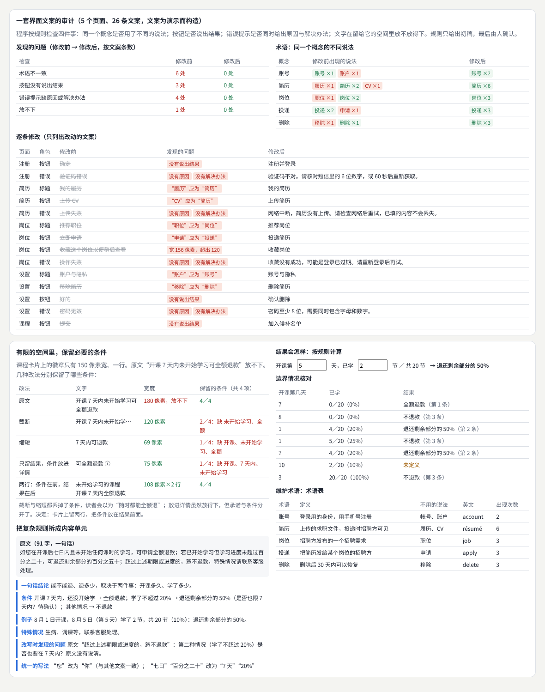
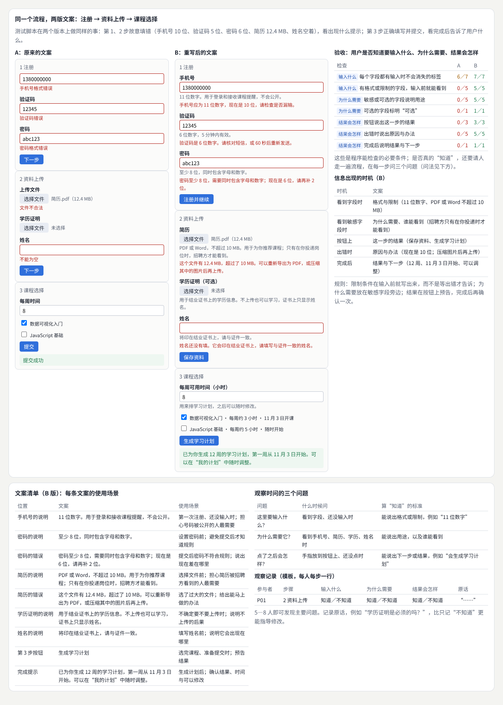
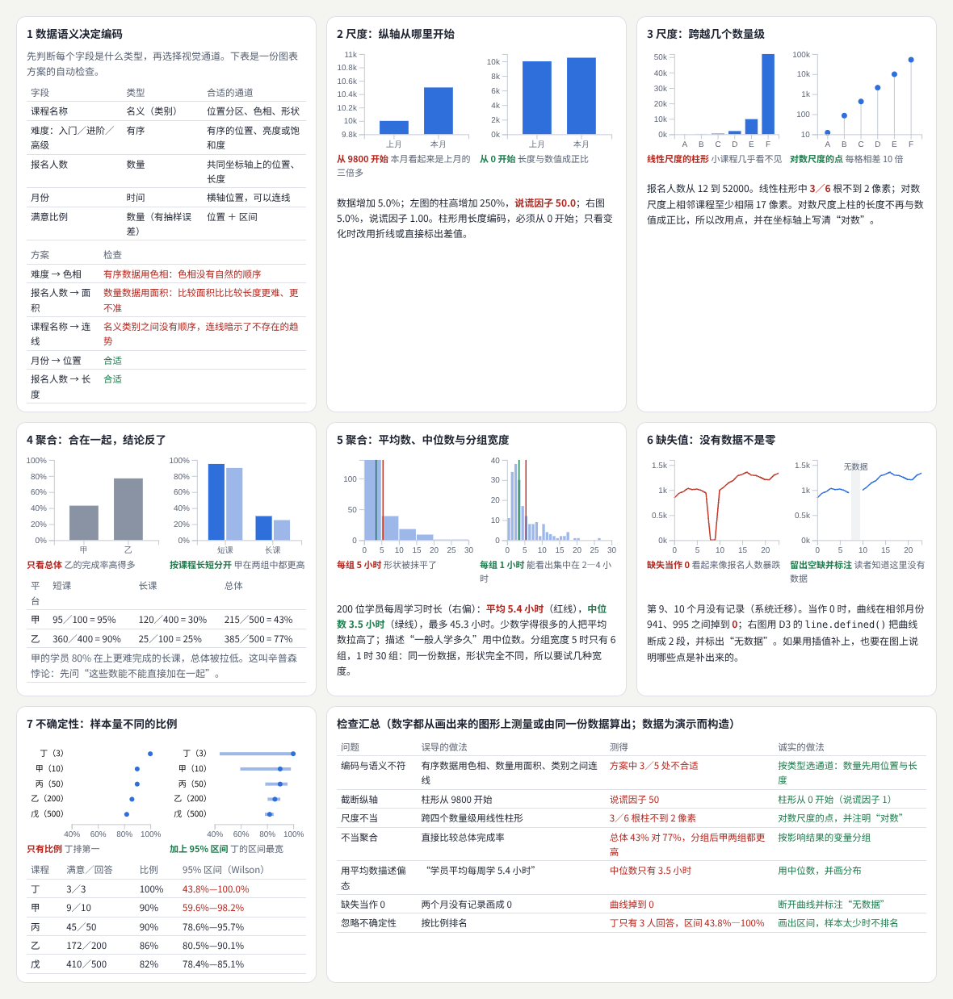
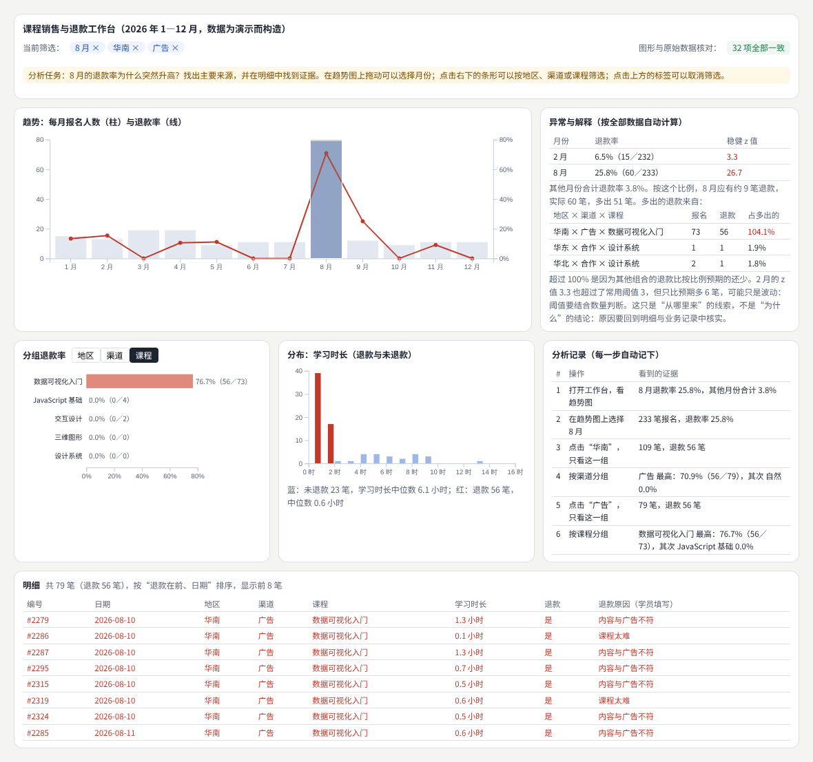
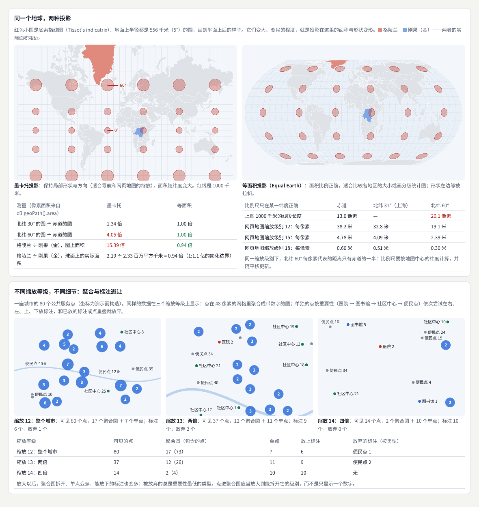
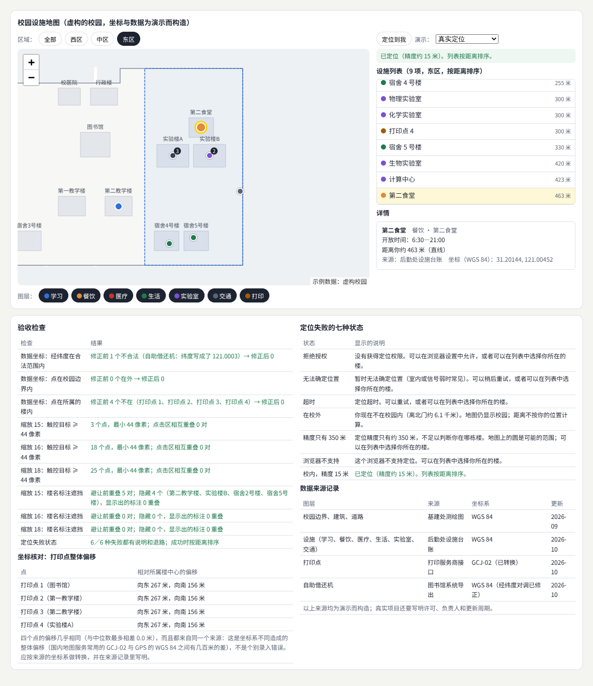
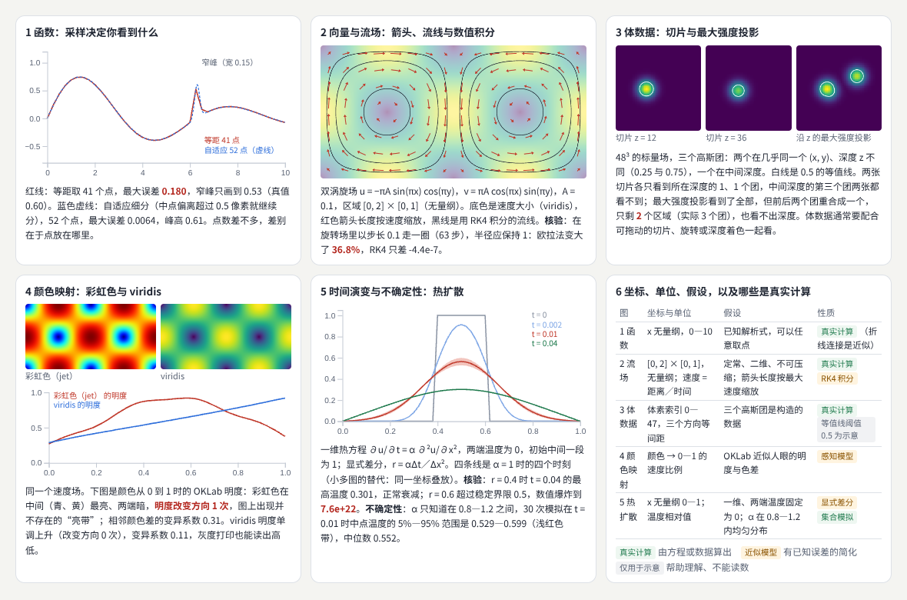
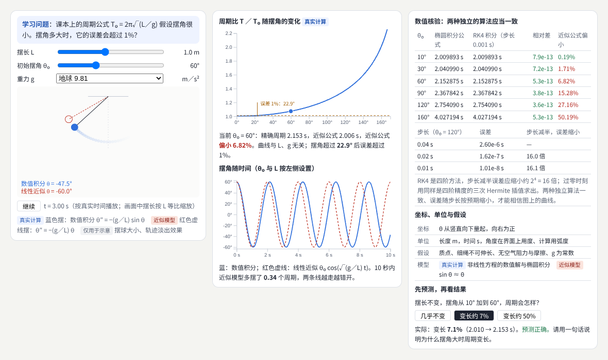
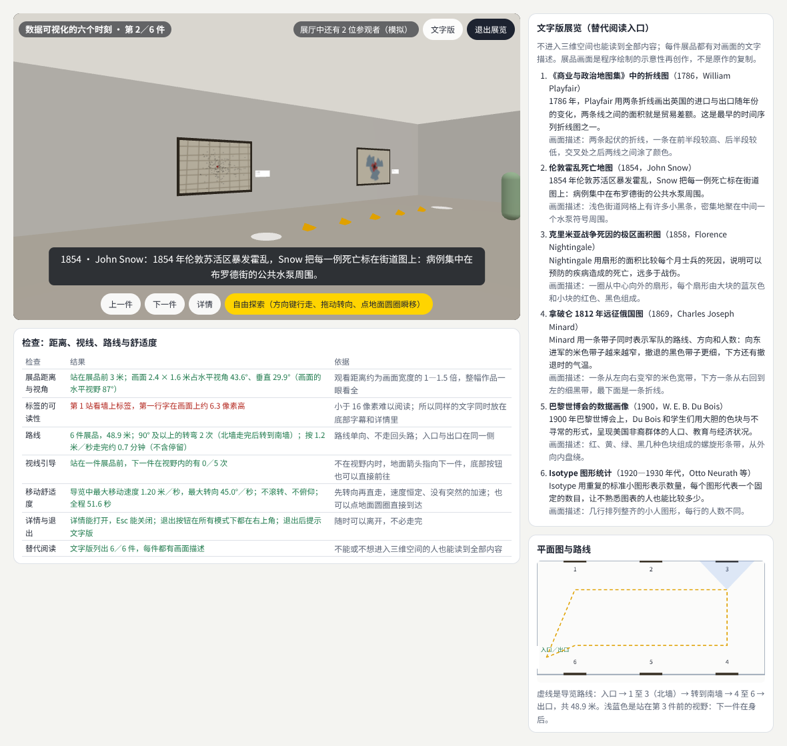

# 信息、数据与空间

> 五个按实际问题组织的横向方向：内容设计与信息编辑、数据可视化与可视分析、地图与地理空间交互、科学可视化与交互解释、空间计算与数字展览。每个方向先讲概念与方法，再做一个可以验收的项目：重写一套注册流程、做一个联动的数据工作台、做一张校园设施地图、做一个可调参数的物理解释工具、布置一个小型虚拟展览。  
> 版本：1.0 · 整理日期：2026-10-25  
> 适用对象：已经能做界面和图表，想把“信息怎样被理解”做扎实的前端开发、设计师和数据背景的同学。先修：读过[《前端界面工程》](01-前端界面工程.md)的表单与状态部分、[《创意编程与二维图形》](05-创意编程与二维图形.md)的数据图表部分，以及[《感知与认知》](13-感知与认知.md)的 04、10 章。

这五个方向可以接入前面的多个领域。它们按实际问题组织，适合用来**发现新的项目题材**、**补足产品能力**或**发展长期专长**。它们有三个共同点：

- **从真实问题出发**。文案要让人知道“输入什么、为什么、结果怎样”；图表要支持比较、定位、追踪和验证；地图要表达位置与范围；科学图形要与科学意义一致；展览要让人找得到路、看得清、随时能离开。
- **数据要能核对**。图上的每个数都应当能回到原始数据；地图上的每个点都要有来源与坐标系；模拟的结果要用另一种独立的算法核验。
- **给不同的人留入口**。地图配列表，三维展览配文字版，图表配明细，动画配静态版。

本册每章都按同样的顺序讲：先说明它解决什么问题；再用白话解释核心概念；然后给出一个可以直接运行的示例与运行截图；接着是常见问题和本章练习；最后是一张**进阶学习卡**：技术栈、要掌握的高阶词汇（附英文）、搜索关键词、值得去看的实例，以及四级进阶阶梯：

| 级别 | 含义 |
| --- | --- |
| L1 入门 | 能运行并解释本章示例，说出每个概念的作用 |
| L2 熟练 | 能在自己的项目中正确使用这些方法，完成本章练习 |
| L3 进阶 | 能做完整的项目，并用核对、测量和观察验收 |
| L4 深入 | 能处理真实规模的数据与场景，研究方法的效果与边界 |

四级是本手册的教学结构，用来安排学习顺序，不对应任何公司的职级。

所有示例都放在本目录的[示例](示例/)文件夹中，用浏览器直接打开即可运行；每个示例都已在无头浏览器中实际运行并自动检查。书中的数字分三类，正文会逐处说明：**浏览器实际测得的**（文字宽度、画出来的柱高、投影后的面积、元素的计算样式、相机的运动）、**按规则或模型算出的**（关键词规则、稳健 z 值、置信区间、数值积分）、**为演示而构造的数据**（文案、课程销售与退款记录、校园与城市服务点、虚拟展厅）。**示例里没有真实参与者的数据**。

主线是：**从问题出发 → 五个方向各做一次“概念 ＋ 项目” → 方向之间的连接。**

## 阅读导航

正文共 13 章（01—13），附 9 个可运行示例、3 组附录与 42 项资料入口。

- [第一篇：共同的基础](#part-1)
  - [01 这一册研究什么](#ch01)
  - [02 共同的方法：任务、来源与核验](#ch02)
- [第二篇：五个方向](#part-2)
  - [03 内容设计：术语、按钮、错误提示与内容单元](#ch03)
  - [04 内容设计项目：重写注册、资料上传与课程选择流程](#ch04)
  - [05 数据可视化：语义、尺度、聚合、缺失值与不确定性](#ch05)
  - [06 可视分析项目：联动的数据工作台](#ch06)
  - [07 地图：投影、比例尺、标注与聚合](#ch07)
  - [08 地图项目：校园设施地图](#ch08)
  - [09 科学可视化：函数、向量、流场、体数据与时间演变](#ch09)
  - [10 交互解释项目：单摆的小角度近似何时失效](#ch10)
  - [11 空间计算与数字展览](#ch11)
- [第三篇：连接与路线](#part-3)
  - [12 五个方向的连接](#ch12)
  - [13 工具、技术栈与学习路线](#ch13)
- [附录 A：术语表](#appendix-a)
- [附录 B：资料入口](#appendix-b)
- [附录 C：与原手册的对应关系及修订记录](#appendix-c)

## 第一篇：共同的基础

### 01 这一册研究什么

| 方向 | 核心问题 | 本册的项目 | 主要连接 |
| --- | --- | --- | --- |
| 内容设计与信息编辑 | 用户是否知道要做什么、为什么、结果怎样 | 重写注册、资料上传与课程选择流程（04） | 视觉排版、UX、国际化 |
| 数据可视化与可视分析 | 图形能否支持真实的分析问题，并与原始数据一致 | 筛选、趋势、分布与明细联动的数据工作台（06） | 统计、数据工程 |
| 地图与地理空间交互 | 位置与范围是否准确表达，不同缩放等级是否给出合适的细节 | 校园设施地图（08） | 地理数据、无障碍、移动端 |
| 科学可视化与交互解释 | 科学意义与视觉编码是否一致，计算是否可信 | 可调参数的物理解释工具（10） | 数值计算、教育 |
| 空间计算与数字展览 | 在三维空间里能否找到路、看清内容、舒适地参观 | 小型虚拟展览（11） | 三维、声音、叙事 |

前四个方向各用两章：先讲概念与方法，再做项目；第五个方向用一章同时讲概念与项目。

### 02 共同的方法：任务、来源与核验

#### 02.1 从任务出发

先写下用户要用这份信息完成什么任务，再决定形式。数据可视化常见的四类任务也适用于其他方向：

| 任务 | 数据可视化 | 地图 | 内容设计 |
| --- | --- | --- | --- |
| 比较 | 两个地区的退款率谁高 | 两个食堂哪个更近 | 两种套餐有什么不同 |
| 定位 | 哪个月出现了异常 | 打印点在哪栋楼 | 退款条件写在哪里 |
| 追踪 | 一个指标随时间怎样变化 | 从宿舍到图书馆怎么走 | 申请走到哪一步了 |
| 验证 | 图上的数是否与原始数据一致 | 坐标是否在所属的楼内 | 用户能否说出结果会怎样 |

#### 02.2 记录来源

每一份数据都要记下**来源**、**更新时间**、**坐标系或单位**，以及**做过哪些处理**（例如修正了填反的经纬度）。来源记录让别人能核对、能更新，也让读者知道该相信到什么程度（08 章）。

#### 02.3 区分真实计算、近似模型和仅用于示意的图形

科学图形和交互解释尤其需要标明：哪些由方程或数据**真实计算**得到，哪些是有已知误差的**近似模型**，哪些**仅用于示意**、不能读数（09、10 章）。

#### 02.4 给不同的人留入口

| 主要形式 | 替代入口 | 章节 |
| --- | --- | --- |
| 地图 | 可以按距离排序的列表 | 08 |
| 三维展览 | 文字版，每件展品附画面描述 | 11 |
| 图表 | 明细表 | 06 |
| 动画 | 静态的对照图与数值表 | 10 |

**本章练习**：

1. 为你正在做的一个页面，按 02.1 的表格写出四类任务各一个例子。
2. 为它用到的每一份数据写一行来源记录：来源、更新时间、单位或坐标系、处理。

## 第二篇：五个方向

### 03 内容设计：术语、按钮、错误提示与内容单元

#### 03.1 解决什么问题

内容设计负责**标题、说明、按钮、错误提示、帮助与引导之间的一致性**，也涉及**信息出现的时机**。要学习如何把复杂概念拆成用户能够理解的**内容单元**，如何在**有限空间保留必要条件**，以及如何**维护术语**[B01](#ref-b01)[B02](#ref-b02)。

#### 03.2 核心概念

| 概念 | 含义 | 例子 |
| --- | --- | --- |
| 术语一致 | 同一个概念只用一种说法 | “简历”不要同时叫“履历”“CV” |
| 按钮说出结果 | 按钮文字是动作和结果，而不是“确定” | “注册并登录”“加入候补名单” |
| 错误提示 | 同时说出原因与解决办法[B03](#ref-b03) | “验证码不对。请核对短信里的 6 位数字，或 60 秒后重新获取。” |
| 内容单元 | 把一段长文拆成结论、条件、例子、例外 | 退款规则拆成一句结论和一张条件表 |
| 必要条件 | 承诺旁边必须看得到的限制 | “全额退款”旁边的“开课 7 天内、未开始学习” |
| 术语表 | 记录术语、定义、不用的说法与英文 | 也是翻译与国际化的起点 |

写作风格指南（例如英国政府与微软的指南）都把这些整理成了可以检查的规则[B01](#ref-b01)[B04](#ref-b04)。

#### 03.3 示例：一套文案的审计与一条退款规则的拆分

示例：[15-03-content.html](示例/15-03-content.html)

文案是为演示而构造的。程序按规则检查四件事，文字宽度用 Canvas 的 `measureText()` 在浏览器里实际测量：

| 检查（按文案条数） | 修改前 | 修改后 |
| --- | --- | --- |
| 术语不一致 | 6 处 | 0 处 |
| 按钮没有说出结果 | 3 处（确定、好的、提交） | 0 处 |
| 错误提示缺原因或解决办法 | 4 处（验证码错误、上传失败、操作失败、密码无效） | 0 处 |
| 放不下 | 1 处（“收藏这个岗位以便稍后查看”宽 156 像素，按钮只有 120） | 0 处 |

不一致的术语有五组：账号／账户、简历／履历／CV、岗位／职位、投递／申请、删除／移除。规则只给出初稿，最后由人确认。

**有限的空间里保留必要的条件**：课程卡片上的徽章只有 150 像素宽、一行，原文“开课 7 天内未开始学习可全额退款”宽 180 像素：

| 改法 | 宽度 | 保留的条件（共 4 项：开课、7 天内、未开始学习、全额） |
| --- | --- | --- |
| 原文 | 180 像素，放不下 | 4／4 |
| 截断：“开课 7 天内未开始学…” | 120 像素 | 2／4 |
| 缩短：“7 天内可退款” | 69 像素 | 1／4 |
| 只留结果，条件放进详情：“可全额退款 ⓘ” | 75 像素 | 1／4 |
| 两行：“未开始学习的课程／开课 7 天内全额退款” | 108 像素 × 2 行 | 4／4 |

截断与缩短都丢掉了条件，读者会以为随时都能全额退；放进详情虽然放得下，但承诺与条件分开了。决定是卡片上留两行，**把条件放在结果前面**。

**把复杂规则拆成内容单元**：原文是一句 91 字的话。拆成一句话结论、条件表、例子、特殊情况后，改写时发现原文有一处没说清：“超过上述期限或进度的，恕不退款”——第二种情况（学了不超过 20%）是否也要在 7 天内？页面上的计算器按原文逐句翻译成规则，对边界情况逐一核对：

| 开课第几天 | 已学 | 结果 |
| --- | --- | --- |
| 7 | 0／20 | 全额退款 |
| 8 | 0／20 | 不退款 |
| 1 | 4／20（20%） | 退还剩余部分的 50% |
| 1 | 5／20（25%） | 不退款 |
| 7 | 4／20（20%） | 退还剩余部分的 50% |
| 10 | 2／20（10%） | **规则没有定义**，要问规则的负责人 |
| 3 | 20／20 | 不退款 |

改写还统一了写法：“您”改为“你”，与其他文案一致；“七日”“百分之二十”改为“7 天”“20%”。最后整理出一张术语表：术语、定义、不用的说法、英文与出现次数。

#### 03.4 常见问题

- **一个概念几种说法**：团队里不同的人写不同页面时最常见；先有术语表，再写文案。
- **按钮只写“确定”**：用户要读完整个对话框才知道会发生什么；按钮文字应当能单独读懂。
- **错误提示只说“失败”**：说出原因（网络中断、文件太大）和下一步（重试、压缩后上传），并告诉用户已填的内容是否还在。
- **为了放下而删掉条件**：宁可换行、调整版面，也不要让承诺失去条件。
- **写规则时才发现规则本身不清楚**：这正是内容设计的价值；把问题交还给规则的负责人，而不是自己猜。

**本章练习**：

1. 导出你的产品的全部界面文字，用示例的四条规则检查一遍，统计问题数。
2. 找一段 80 字以上的规则说明，拆成结论、条件表、例子和例外，并写出边界情况表。

#### 03.5 进阶学习卡

| 级别 | 目标 | 怎样检验 |
| --- | --- | --- |
| L1 入门 | 能写出说出结果的按钮和带解决办法的错误提示 | 改写十条文案 |
| L2 熟练 | 能维护术语表，审计一个产品的文案 | 审计报告与修改清单 |
| L3 进阶 | 能把复杂规则拆成内容单元，并发现规则本身的漏洞 | 边界情况表全部有定义 |
| L4 深入 | 能建立团队的内容规范与检查流程，并支持多语言 | 规范、自动检查与翻译流程 |

- **技术栈**：Canvas `measureText()` 测量文字宽度；界面文字集中管理（i18n 资源文件，例如 i18next）；简单的规则检查脚本；术语表。
- **高阶词汇**：内容设计（content design）、用户体验写作（UX writing）、微文案（microcopy）、语气（voice and tone）、术语表（glossary）、内容单元（content chunk）、渐进披露（progressive disclosure）、可执行的错误信息（actionable error message）。
- **搜索关键词**：`content design guide`、`ux writing button labels`、`error message guidelines`、`terminology consistency glossary`、`内容设计 文案 规范`。
- **值得看的实例**：[Mailchimp 内容风格指南](https://styleguide.mailchimp.com/)——看语气、术语和各类界面文字的写法怎样写成团队规范。
- **资料**：[B01](#ref-b01)、[B02](#ref-b02)、[B04](#ref-b04)、[B03](#ref-b03)、[B05](#ref-b05)。

### 04 内容设计项目：重写注册、资料上传与课程选择流程

#### 04.1 任务

**重写一套注册**、**资料上传**或**课程选择流程**，为每条文案说明使用场景。验收时观察**用户是否知道要输入什么**、**为什么需要**、**结果会怎样**。**该方向连接视觉排版**、**UX** 和**国际化**：文案的长度影响版面，文案的时机影响流程，术语表是翻译的基础。

#### 04.2 示例

示例：[15-04-flow.html](示例/15-04-flow.html)

测试脚本在两个版本上做同样的事：第 1、2 步故意填错（手机号 10 位、验证码 5 位、密码 6 位、简历 12.4 MB、姓名空着），看出现什么提示；第 3 步正确填写并提交，看完成后告诉了用户什么。

| 检查 | 对应的问题 | A：原来的文案 | B：重写后 |
| --- | --- | --- | --- |
| 每个字段都有输入时不会消失的标签 | 输入什么 | 6／7（手机号只有占位符[B06](#ref-b06)） | 7／7 |
| 有格式或限制的字段，输入前就能看到 | 输入什么 | 0／5 | 5／5 |
| 敏感或可选的字段说明用途 | 为什么需要 | 0／5 | 5／5 |
| 可选的字段标明“可选” | 为什么需要 | 0／1 | 1／1 |
| 按钮说出这一步的结果 | 结果会怎样 | 0／3（下一步、下一步、提交） | 3／3（注册并继续、保存资料、生成学习计划） |
| 出错时说出原因与办法 | 结果会怎样 | 0／5 | 5／5 |
| 完成后说明结果与下一步 | 结果会怎样 | 0／1（“提交成功”） | 1／1 |

几条重写后的提示：“手机号应为 11 位数字，现在是 10 位，请检查是否漏输。”“密码至少 8 位，需要同时包含字母和数字；现在是 6 位，请再补 2 位。”“这个文件有 12.4 MB，超过了 10 MB。可以重新导出为 PDF，或压缩其中的图片后再上传。”完成提示：“已为你生成 12 周的学习计划，第一周从 11 月 3 日开始。可以在‘我的计划’中随时调整。”这些做法与无障碍标准中“标签或说明”“错误建议”两条要求一致[B07](#ref-b07)[B08](#ref-b08)。

**信息出现的时机**：限制条件在输入前就写出来，而不是等出错才告诉；“为什么需要”放在敏感字段旁边（简历：“只有在你投递岗位时，招聘方才能看到”）；结果在按钮上预告，完成后再确认一次。

**文案清单**：页面列出了 B 版 9 条文案和它们的**使用场景**，例如“手机号的说明——第一次注册、还没输入时；担心号码被公开的人最需要”“学历证明的说明——不确定要不要上传时；说明不上传的后果”。

**观察**：程序检查只是必要条件。是否真的“知道”，要请 5—8 人走一遍流程，在每一步问三个问题：看到字段、还没输入时问“这里要输入什么”；看到敏感字段时问“为什么需要它”；手指放到按钮上、还没点时问“点了之后会怎样”。记录原话，例如“学历证明是必须的吗？”。示例只提供记录模板，没有收集数据。

#### 04.3 验收清单

- [ ] 每个字段有不会消失的标签；格式与限制在输入前可见。
- [ ] 敏感或可选的字段说明用途，以及谁能看到。
- [ ] 每个按钮说出这一步的结果；完成后说明结果与下一步。
- [ ] 每种错误都说出原因与解决办法，并已用错误输入实际触发过。
- [ ] 每条文案都有使用场景说明。
- [ ] 请至少 5 人走一遍流程，记录三个问题的回答原话。

#### 04.4 常见问题

- **用占位符代替标签**：一输入就消失，用户回头检查时不知道这一格是什么。
- **把所有说明堆在页面顶部**：用户填到具体字段时已经忘了；说明要放在用到它的地方。
- **完成提示只有“成功”**：用户不知道接下来去哪里、什么时候生效、能不能改。
- **只在自己的电脑上看过**：长文案在窄屏和其他语言中会换行或放不下（《感知与认知》09 章的情境检查）。

**本章练习**：

1. 按示例的做法重写你的产品中的一个流程，写出文案清单与使用场景。
2. 用错误输入把每一条错误提示都实际触发一遍，截图存档。

#### 04.5 进阶学习卡

| 级别 | 目标 | 怎样检验 |
| --- | --- | --- |
| L1 入门 | 能为一个表单写标签、说明与错误提示 | 七项检查全部通过 |
| L2 熟练 | 能为整个流程写文案清单与使用场景 | 清单覆盖所有文案 |
| L3 进阶 | 能用三个问题组织观察，并据此修改 | 两轮观察的对比 |
| L4 深入 | 能把检查做成自动测试，纳入发布流程 | 测试在持续集成中运行 |

- **技术栈**：表单的 `<label>` 与 `aria-describedby`；客户端验证与错误状态；端到端测试（Playwright）自动填错并截图。
- **高阶词汇**：表单设计（form design）、内联验证（inline validation）、占位符（placeholder）、可访问名称（accessible name）、使用场景（usage context）、文案清单（content inventory）、出声思考（think-aloud）。
- **搜索关键词**：`form design best practices labels`、`placeholder text usability`、`inline validation error messages`、`content inventory template`、`表单 文案 设计`。
- **值得看的实例**：[英国政府设计系统的“问题页”模式](https://design-system.service.gov.uk/patterns/question-pages/)——一页一个问题、标签与提示的写法；[错误信息组件](https://design-system.service.gov.uk/components/error-message/)。
- **资料**：[B03](#ref-b03)、[B06](#ref-b06)、[B07](#ref-b07)、[B08](#ref-b08)。

### 05 数据可视化：语义、尺度、聚合、缺失值与不确定性

#### 05.1 解决什么问题

数据可视化与可视分析要**从图表类型进一步扩展到数据语义**、**交互筛选**、**联动视图**、**异常解释**和**分析流程**。关键是让图形支持真实问题，例如**比较**、**定位**、**追踪**和**验证**。需要学习**尺度**、**聚合**、**缺失值**和**不确定性表达**。本章讲前一半的基础，06 章做交互的工作台。

#### 05.2 核心概念

- **数据语义决定编码**。字段可以是名义（类别）、有序、数量或时间。对数量数据，人们比较位置和长度最准，角度、面积、颜色深浅依次变差[B09](#ref-b09)[B10](#ref-b10)。
- **尺度**：柱形用长度编码，必须从 0 开始；数值跨越几个数量级时用对数尺度，但对数尺度上长度不再与数值成正比，改用点。图形的变化幅度与数据的变化幅度之比叫**说谎因子**[B11](#ref-b11)。
- **聚合**：分组求和、平均会改变结论。各组都更好、合在一起却更差，叫辛普森悖论[B12](#ref-b12)；偏态数据的平均数被少数大值拉高，描述“一般情况”用中位数；直方图的分组宽度会改变分布的形状。
- **缺失值**：没有数据不是零。曲线要断开并标注，插值补出的点要说明。
- **不确定性**：比例来自样本时要画出区间，样本少的组不排名[B13](#ref-b13)[B14](#ref-b14)。

#### 05.3 示例：七个误导与诚实的对照

示例：[15-05-encoding.html](示例/15-05-encoding.html)

数据为演示而构造，图形用 D3 绘制，数字都从画出来的图形上测量或由同一份数据算出：

| 问题 | 误导的做法 | 测得 | 诚实的做法 |
| --- | --- | --- | --- |
| 编码与语义不符 | 难度（有序）用色相、报名人数用面积、课程名称之间连线 | 方案 5 条中 3 处不合适 | 数量先用位置与长度 |
| 截断纵轴 | 上月 10000、本月 10500，柱形从 9800 开始 | 数据增加 5.0%，柱高增加 250%，说谎因子 50.0 | 从 0 开始，说谎因子 1.00 |
| 尺度不当 | 报名人数 12 到 52000，用线性柱形 | 6 根柱中 3 根不到 2 像素 | 对数尺度的点，相邻至少相隔 17 像素 |
| 不当聚合 | 直接比较总体完成率 | 平台甲 43% 对乙 77% | 按课程长短分组：甲的短课 95% 对 90%、长课 30% 对 25%，两组都更高 |
| 用平均数描述偏态 | “学员平均每周学 5.4 小时” | 200 人的中位数只有 3.5 小时，最多 45.3 | 用中位数，并画分布；分组宽度 5 时只有 6 组，1 时 30 组 |
| 缺失当作 0 | 第 9、10 个月没有记录，画成 0 | 曲线在 941 与 995 之间掉到 0 | 用 `line.defined()` 断成 2 段并标“无数据”[B15](#ref-b15) |
| 忽略不确定性 | 按满意比例排名 | 丁只有 3 人回答，100% 排第一 | 画出 Wilson 95% 区间：丁 43.8%—100%，戊（500 人）78.4%—85.1% |

辛普森悖论的原因在数据里：甲的学员 80% 在上更难完成的长课，总体完成率被拉低。所以先问“这些数能不能直接加在一起”。

#### 05.4 常见问题

- **默认图表库怎么画就怎么用**：纵轴范围、颜色、聚合方式都要按数据语义重新检查。
- **饼图比较很多类别**：角度和面积难以比较；类别多时改用排序后的条形图。
- **只给平均数**：同时给出中位数、样本量和分布。
- **把插值画得和真实数据一样**：用不同的样式标出补出来的点。
- **小样本排名**：先看区间是否重叠，再决定是否排名。

**本章练习**：

1. 找一张新闻或报告中的图表，按示例的七项逐一检查，写出改法。
2. 在示例的不确定性卡片中把丁的样本增加到 30 人（27 人满意），观察区间与排名的变化。

#### 05.5 进阶学习卡

| 级别 | 目标 | 怎样检验 |
| --- | --- | --- |
| L1 入门 | 能按数据类型选择图表与通道 | 为五个字段写出合适的编码 |
| L2 熟练 | 能正确处理尺度、聚合、缺失值 | 七项检查全部通过 |
| L3 进阶 | 能表达不确定性，并发现聚合带来的误导 | 报告中附区间与分组分析 |
| L4 深入 | 能研究编码与不确定性表达对判断的影响 | 有对照的实验 |

- **技术栈**：D3（`d3-scale`、`d3-axis`、`d3-shape` 的 `line().defined()`、`d3-array` 的 `bin()`）；Vega-Lite 或 Observable Plot；Python 的 pandas 与 matplotlib 用于核对。
- **高阶词汇**：图形感知（graphical perception）、视觉通道（visual channel）、有效性排序（effectiveness ranking）、说谎因子（lie factor）、对数尺度（log scale）、辛普森悖论（Simpson's paradox）、偏态分布（skewed distribution）、分组宽度（bin width）、缺失值（missing data）、置信区间（confidence interval）、不确定性可视化（uncertainty visualization）。
- **搜索关键词**：`graphical perception cleveland mcgill`、`truncated y axis bar chart`、`simpson's paradox visualization`、`wilson score interval`、`uncertainty visualization`、`数据可视化 误导 图表`。
- **值得看的实例**：[Gapminder 工具](https://www.gapminder.org/tools/)——看对数尺度、动画与气泡大小怎样一起表达跨越几个数量级的数据。
- **资料**：[B09](#ref-b09)、[B10](#ref-b10)、[B11](#ref-b11)、[B12](#ref-b12)、[B13](#ref-b13)、[B14](#ref-b14)、[B15](#ref-b15)。

### 06 可视分析项目：联动的数据工作台

#### 06.1 任务

做**一个包含筛选**、**趋势**、**分布**和**明细联动的数据工作台**。验收时给用户设置分析任务，检查是否能够找到证据，并核对图形与原始数据一致。大数据专业背景可以在这一方向发挥作用：数据清洗、聚合与核对，正是工作台可信的基础。

#### 06.2 核心概念

- **先概览，再缩放和筛选，需要时看细节**：这是信息检索界面的经典原则[B16](#ref-b16)。
- **刷选与联动**：在一个视图中选择一部分数据，其他视图同步只显示这部分[B17](#ref-b17)[B18](#ref-b18)。常见做法是“每个视图应用除自己以外的所有筛选”，这样被筛选的视图仍能显示上下文。
- **异常解释**：先找出异常（例如用中位数和绝对中位差计算的稳健 z 值），再分解“多出来的部分来自哪里”。这只给出线索，原因要回到明细与业务记录中核实。
- **核对**：工作台上的每个数，都应当能用另一条代码路径从原始数据重新算出。

#### 06.3 示例

示例：[15-06-workbench.html](示例/15-06-workbench.html)

数据为演示而构造：2026 年 2341 笔课程报名，其中 8 月在华南有一组广告把“数据可视化入门”说得过于轻松，带来 70 笔报名、退款率 70%。分析任务是：**8 月的退款率为什么突然升高？找出主要来源，并在明细中找到证据。**

**异常与解释**（按全部数据自动计算）：8 月退款率 25.8%（60／233），稳健 z 值 26.7；其他月份合计 3.8%，按这个比例 8 月应有约 9 笔退款，实际 60 笔，多出 51 笔。多出的退款中，“华南 × 广告 × 数据可视化入门”这一组合占 104.1%（超过 100% 是因为其他组合的退款比预期还少）。2 月的 z 值 3.3 也超过了常用阈值 3，但只比预期多 6 笔，可能只是波动——阈值要结合数量判断。

**测试脚本用真实的鼠标完成了分析**，工作台自动记下每一步：

| 步骤 | 操作 | 看到的证据 |
| --- | --- | --- |
| 1 | 打开工作台，看趋势图 | 8 月退款率 25.8%，其他月份合计 3.8% |
| 2 | 在趋势图上拖动选择 8 月 | 233 笔报名，退款率 25.8% |
| 3 | 点击“华南” | 109 笔，退款 56 笔 |
| 4 | 按渠道分组 | 广告 70.9%（56／79），其他渠道 0% |
| 5 | 点击“广告” | 79 笔，退款 56 笔 |
| 6 | 按课程分组 | 数据可视化入门 76.7%（56／73） |

明细中 56 笔退款的原因：“内容与广告不符”48 笔、“课程太难”5 笔、“时间不够”3 笔；退款学员的学习时长中位数只有 0.6 小时，未退款的是 6.1 小时。

**核对图形与原始数据**：每次交互后，工作台用逐行循环重新数一遍，与图上的数比较：每根柱子绑定的数与柱高、选中月份之和与明细条数、分组条形与明细条数、每组的退款数、直方图的总数——共 32 项，全部一致。

#### 06.4 验收清单

- [ ] 筛选、趋势、分布与明细四类视图联动，当前筛选随时可见、可以逐项取消。
- [ ] 有明确的分析任务；测试中能沿着视图找到证据，并在明细中看到原始记录。
- [ ] 每次交互后自动核对图形与原始数据，核对失败时明确提示。
- [ ] 异常检测说明方法与阈值，并提醒“线索不等于原因”。
- [ ] 分析过程被记录下来，可以复现。

#### 06.5 常见问题

- **联动后看不到上下文**：被筛选的视图如果也应用自己的筛选，就只剩选中的部分；保留未选部分的浅色。
- **只给图不给明细**：分析的终点是具体的记录。
- **异常检测只看比例**：小组的比例波动很大，要同时看数量与区间。
- **前端聚合与数据库不一致**：时区、去重、退款的统计口径不同，都会让两边的数对不上；把口径写进说明。

**本章练习**：

1. 在示例中加一个“按周”的趋势视图，并把它纳入核对。
2. 给自己设一个新的分析任务（例如“哪个渠道的学员学得最久”），记录找到证据的步骤。

#### 06.6 进阶学习卡

| 级别 | 目标 | 怎样检验 |
| --- | --- | --- |
| L1 入门 | 能做筛选与明细联动的两个视图 | 筛选后明细正确 |
| L2 熟练 | 能做刷选、交叉筛选与当前筛选的展示 | 四类视图联动 |
| L3 进阶 | 能自动核对图形与原始数据，并解释异常 | 核对全部一致，异常有解释 |
| L4 深入 | 能处理大规模数据（服务端聚合、增量计算），并研究分析流程 | 百万级数据仍可交互 |

- **技术栈**：D3 的 `d3-brush`、`d3-array`（`rollup`、`bin`）；交叉筛选库（crossfilter）；DuckDB-Wasm 或服务端 SQL 做聚合；端到端测试模拟分析路径。
- **高阶词汇**：可视分析（visual analytics）、刷选与联动（brushing and linking）、交叉筛选（cross-filtering）、协调多视图（coordinated multiple views）、下钻（drill-down）、异常检测（anomaly detection）、稳健 z 值（robust z-score）、绝对中位差（median absolute deviation）、分析溯源（analytic provenance）。
- **搜索关键词**：`coordinated multiple views`、`brushing and linking d3`、`crossfilter dashboard`、`robust z score mad`、`analytic provenance`、`联动 筛选 数据看板`。
- **值得看的实例**：[D3 官方网站的示例](https://d3js.org/)——刷选、缩放和联动的写法。
- **资料**：[B16](#ref-b16)、[B17](#ref-b17)、[B18](#ref-b18)。

### 07 地图：投影、比例尺、标注与聚合

#### 07.1 解决什么问题

地图设计涉及**投影**、**比例尺**、**地理数据**、**图层**、**标注**、**聚合**和**空间筛选**。不同缩放等级应提供不同细节，位置与范围应准确表达。地图适合处理空间关系，普通列表和图表可以承担精确比较与阅读。

#### 07.2 核心概念

- **投影**：把球面画到平面上必然有变形。墨卡托投影保持局部的形状与方向，适合导航和网页地图的缩放，但面积随纬度变大；等面积投影（例如 Equal Earth）面积比例正确，适合比较大小和画分级统计图[B19](#ref-b19)[B20](#ref-b20)。底索指线圈（Tissot's indicatrix）把地面上同样大的圆画到地图上，直观显示每个位置的变形。
- **比例尺**：在墨卡托投影上，比例尺只在某一纬度正确。网页地图每像素代表的距离约为 `156543.03 × cos(纬度) ÷ 2^缩放级别`，单位是米[B21](#ref-b21)。
- **地理数据与图层**：底图、区域、点、线分成图层，可以分别显示与筛选；数据要记下坐标系与来源[B22](#ref-b22)。
- **标注与聚合**：点太密时，在网格中聚合成带数字的圆；单独的点按重要性依次尝试几个位置放标注，放不下就隐藏[B23](#ref-b23)。
- **空间筛选**：按区域、按当前视野或按距离筛选，结果同步到列表。

#### 07.3 示例：两种投影，三个缩放等级

示例：[15-07-projection.html](示例/15-07-projection.html)

世界边界来自 world-atlas 的 1:1.1 亿简化数据，用 D3 的地理投影绘制；面积用 `d3.geoPath().area()` 在画出来的图形上测量：

| 测量 | 墨卡托 | 等面积 |
| --- | --- | --- |
| 北纬 30° 的圆 ÷ 赤道的圆（面积） | 1.34 倍 | 1.00 倍 |
| 北纬 60° 的圆 ÷ 赤道的圆 | 4.05 倍 | 1.00 倍 |
| 格陵兰 ÷ 刚果（金），图上面积 | 15.39 倍 | 0.94 倍 |
| 格陵兰 ÷ 刚果（金），球面上的实际面积 | 2.19 ÷ 2.33 百万平方千米 = 0.94 倍 | |

**比例尺只在某一纬度正确**：墨卡托图上，1000 千米的东西向线段在赤道画出 13.0 像素，在北纬 60° 画出 26.1 像素。网页地图每像素代表的米数：

| 缩放级别 | 赤道 | 北纬 31°（上海） | 北纬 60° |
| --- | --- | --- | --- |
| 12 | 38.2 米 | 32.8 米 | 19.1 米 |
| 15 | 4.78 米 | 4.09 米 | 2.39 米 |
| 18 | 0.60 米 | 0.51 米 | 0.30 米 |

**聚合与标注避让**：一座城市的 80 个公共服务点（医院 5、图书馆 10、社区中心 25、便民点 40，坐标为构造）。点在 48 像素的网格里聚合；单独的点按重要性依次尝试在右、左、上、下放标注：

| 缩放等级 | 可见的点 | 聚合圆（包含的点） | 单点 | 放上标注 | 放弃 |
| --- | --- | --- | --- | --- | --- |
| 12：整个城市 | 80 | 17（73） | 7 | 6 | 便民点 1 |
| 13：两倍 | 37 | 12（26） | 11 | 9 | 便民点 2 |
| 14：四倍 | 14 | 2（4） | 10 | 10 | 无 |

放大以后，聚合圆拆开、单点变多，能放下的标注也变多；被放弃的总是重要性最低的类型。

#### 07.4 常见问题

- **用墨卡托比较面积**：高纬度地区被放大很多；比较面积或画分级统计图时换等面积投影。
- **固定的比例尺**：平移到不同纬度后比例尺就错了，要按地图中心重新计算。
- **所有点同时标注**：标注互相压住时一个都读不清；按重要性取舍，放大后再显示。
- **只有地图没有列表**：精确比较（哪个最近、哪个开得最晚）用列表更好；地图负责空间关系。

**本章练习**：

1. 在示例中加一个北纬 75° 的底索指线圈行，预测墨卡托上的面积比，再看测量结果。
2. 把标注避让改成同时考虑聚合圆，统计三个缩放等级的放弃数量变化。

#### 07.5 进阶学习卡

| 级别 | 目标 | 怎样检验 |
| --- | --- | --- |
| L1 入门 | 能说出墨卡托与等面积投影的区别 | 选对投影并说明理由 |
| L2 熟练 | 能做分级显示、聚合与标注避让 | 各缩放等级无重叠标注 |
| L3 进阶 | 能处理地理数据的投影、坐标系与精度 | 数据核对与来源记录完整 |
| L4 深入 | 能研究地图的认知与大规模地理数据的渲染 | 矢量瓦片或服务端渲染 |

- **技术栈**：D3 的 `d3-geo`（投影、`geoPath`、`geoArea`、`geoCircle`）；TopoJSON（`topojson-client`）；Leaflet、MapLibre GL；矢量瓦片；PostGIS 等空间数据库。
- **高阶词汇**：地图投影（map projection）、墨卡托投影（Mercator projection）、等面积投影（equal-area projection）、底索指线圈（Tissot's indicatrix）、网页墨卡托（Web Mercator）、比例尺（scale bar）、分级统计图（choropleth）、点聚合（point clustering）、标注放置（label placement）、地理编码（geocoding）。
- **搜索关键词**：`tissot indicatrix projection distortion`、`equal earth projection`、`web mercator meters per pixel`、`point label placement algorithm`、`marker clustering zoom`、`地图 投影 变形`。
- **值得看的实例**：[OpenStreetMap](https://www.openstreetmap.org/)——放大缩小时观察不同缩放等级显示的细节、标注怎样取舍。
- **资料**：[B19](#ref-b19)、[B20](#ref-b20)、[B21](#ref-b21)、[B23](#ref-b23)、[B22](#ref-b22)。

### 08 地图项目：校园设施地图

#### 08.1 任务

做一张**校园设施**、**公共服务**或**实验站点地图**，支持**区域筛选**、**对象详情**和**列表联动**。验收应检查**数据坐标**、**标注遮挡**、**触屏操作**和**定位失败状态**，并记录数据来源。

#### 08.2 示例

示例：[15-08-campus-map.html](示例/15-08-campus-map.html)

用 Leaflet 绘制一座虚构的校园（1200 × 800 米，15 栋楼，29 个设施；坐标与数据为构造）[B24](#ref-b24)。不加载在线底图，只画校园边界、建筑与道路。

**数据坐标核对**：

| 检查 | 修正前 | 修正后 |
| --- | --- | --- |
| 经纬度在合法范围内 | 1 个不合法：自助借还机的纬度写成了 121.0003（经纬度填反） | 0 |
| 点在校园边界内 | 0 个在外 | 0 |
| 点在所属的楼内 | 4 个不在：打印点 1—4 | 0 |

四个打印点都来自同一个来源（打印服务商接口），而且相对所属楼的中心偏移完全相同：向东 267 米、向南 156 米。这是**坐标系不同**造成的整体偏移，不是个别录入错误：国内地图服务常用的 GCJ-02 坐标与 GPS 的 WGS 84 之间有几百米的差[B25](#ref-b25)。应按来源的坐标系做正式转换，并在来源记录里写明（示例为演示，减去了中位偏移）。

**不同缩放等级的细节与触屏操作**：每个设施点的点击区是 44 × 44 像素（中间显示 14 像素的点），符合触控目标的建议[B26](#ref-b26)：

| 缩放等级 | 显示方式 | 点数 | 点击区相互重叠 | 楼名标注 |
| --- | --- | --- | --- | --- |
| 15 | 按区域合并（带数字） | 3 | 0 对 | 避让前重叠 5 对，隐藏 4 个（第二教学楼、实验楼 B、宿舍 2 号楼、宿舍 5 号楼） |
| 16 | 按楼合并 | 18 | 0 对 | 无重叠 |
| 18 | 同一栋楼的设施绕楼中心展开 | 25 | 0 对 | 无重叠 |

制作时的一处修正：最初展开的半径是 34 像素，四个设施时相邻的方形点击区仍有 4 对重叠；改为 46 像素后为 0。楼名放在楼的上沿，避免与楼中心的点重叠。

**区域筛选与列表联动**：点“东区”后，地图移到东区并画出范围，列表只剩 9 项；悬停列表项会高亮地图上的点，点击地图上的点会滚动并高亮列表项；详情显示开放时间、距离、来源与坐标。

**定位失败的七种状态**：用浏览器的 Geolocation API 定位[B27](#ref-b27)，示例中可以模拟每一种结果（错误码见[B28](#ref-b28)）：

| 状态 | 显示的说明 |
| --- | --- |
| 拒绝授权 | 没有获得定位权限。可以在浏览器设置中允许，或者在列表中选择你所在的楼。 |
| 无法确定位置 | 暂时无法确定位置（室内或信号弱时常见）。可以稍后重试，或者在列表中选择你所在的楼。 |
| 超时 | 定位超时。可以重试，或者在列表中选择你所在的楼。 |
| 在校外 | 你现在不在校园内（离北门约 6.1 千米）。地图仍显示校园；距离不按你的位置计算。 |
| 精度只有 350 米 | 不足以判断你在哪栋楼。地图上的圆是可能的范围；可以在列表中选择你所在的楼。 |
| 浏览器不支持 | 这个浏览器不支持定位。可以在列表中选择你所在的楼。 |
| 校内，精度 15 米 | 已定位，列表按距离排序（第二食堂约 463 米） |

不定位也能使用全部功能；每种失败都给出说明和退路。

**数据来源记录**：校园边界、建筑与道路来自基建处测绘图（WGS 84）；设施来自后勤处设施台账（WGS 84）；打印点来自打印服务商接口（GCJ-02，已转换）；自助借还机来自图书馆系统导出（经纬度对调已修正）。以上来源为演示而构造；真实项目还要写明许可、负责人和更新周期。

#### 08.3 验收清单

- [ ] 所有坐标经过范围、边界与所属对象的核对；系统性偏移查到了来源的坐标系。
- [ ] 每个缩放等级的点击区不小于 44 像素、互不重叠；标注没有遮挡。
- [ ] 区域筛选、图层开关、列表与地图双向联动，详情可以从两边打开。
- [ ] 定位的每种失败都有说明与退路；不定位也能完成所有任务。
- [ ] 有数据来源记录：来源、坐标系、更新时间、处理。

#### 08.4 常见问题

- **把不同来源的坐标直接叠在一起**：几百米的偏移足以让点落到隔壁楼里。
- **经纬度顺序写反**：GeoJSON 的坐标顺序是 `[经度, 纬度]`，Leaflet 的 `L.latLng` 是 `(纬度, 经度)`，混用最容易出错。
- **只在桌面上测试**：手指比鼠标粗，密集的点在手机上很难点中。
- **定位失败时一片空白**：用户不知道发生了什么，也不知道还能怎么用。

**本章练习**：

1. 用你的学校或社区的公开数据做一张设施地图，按 08.3 验收。
2. 在示例中加“只看当前视野内”的空间筛选，并让列表同步。

#### 08.5 进阶学习卡

| 级别 | 目标 | 怎样检验 |
| --- | --- | --- |
| L1 入门 | 能用 Leaflet 显示点、面与弹窗 | 地图与列表能互相定位 |
| L2 熟练 | 能做分级显示、区域筛选与定位的全部状态 | 验收清单全部通过 |
| L3 进阶 | 能核对与转换坐标，维护数据来源 | 多来源数据对齐 |
| L4 深入 | 能做离线地图、室内地图或大规模空间数据 | 矢量瓦片、楼层切换 |

- **技术栈**：Leaflet 或 MapLibre GL；GeoJSON；Geolocation API；`turf.js` 做空间计算；PostGIS；坐标系转换库（proj4）。
- **高阶词汇**：地理空间（geospatial）、图层（layer）、空间筛选（spatial filter）、地理围栏（geofence）、坐标参考系（coordinate reference system）、WGS 84、GCJ-02、定位精度（accuracy）、触控目标（touch target）、点展开（spiderfy）。
- **搜索关键词**：`leaflet geojson tutorial`、`geolocation api error handling`、`wgs84 gcj02 offset`、`touch target size map markers`、`marker spiderfy`、`校园 地图 设施 交互`。
- **值得看的实例**：[Leaflet 官方教程](https://leafletjs.com/examples.html)——GeoJSON、图层控制、移动端的写法。
- **资料**：[B24](#ref-b24)、[B27](#ref-b27)、[B28](#ref-b28)、[B26](#ref-b26)、[B25](#ref-b25)。

### 09 科学可视化：函数、向量、流场、体数据与时间演变

#### 09.1 解决什么问题

研究**如何表达函数**、**向量**、**流场**、**体数据**、**时间演变**和**不确定性**。核心要求是**科学意义与视觉编码一致**。**模型输入**、**坐标**、**单位**和**假设**需要清楚，颜色和动画也应支持理解。

#### 09.2 核心概念

- **采样**：画函数就是取点再连线；点放在哪里比点有多少更重要，自适应细分把点放在变化剧烈的地方。
- **向量与流场**：箭头直接表示方向与大小，但密了会乱；流线沿着场积分，更容易看出结构。积分方法决定流线是否可信：欧拉法误差大，RK4 是常用的四阶方法。
- **体数据**：三维网格上的标量。切片看得准但只看一层；最大强度投影看得全但丢掉深度；更完整的方法是体绘制[B29](#ref-b29)。
- **颜色映射**：彩虹色的明度不单调，会制造并不存在的边界；viridis 这类映射明度单调、感知均匀[B30](#ref-b30)[B31](#ref-b31)。
- **时间演变与不确定性**：用小多图或动画表示时间；参数不确定时，用多次模拟的范围表示结果的不确定性[B14](#ref-b14)。

#### 09.3 示例：六张卡片

示例：[15-09-scivis.html](示例/15-09-scivis.html)

| 卡片 | 做法 | 测得 |
| --- | --- | --- |
| 函数 | f(x) = e^(−x／5) sin x 加一个宽 0.15 的窄峰，等距取 41 点对比自适应细分 | 等距：最大误差 0.180，窄峰只画到 0.53（真值 0.60）；自适应 52 点：误差 0.0064，峰高 0.61 |
| 向量与流场 | 双涡旋场[B32](#ref-b32)，速度底色 ＋ 箭头 ＋ RK4 流线 | 核验：在旋转场里以步长 0.1 走一圈（63 步），半径应保持 1——欧拉法变大 36.8%，RK4 只差 4.4 × 10⁻⁷ |
| 体数据 | 48³ 网格中三个高斯团，两个在同一 (x, y)、不同深度 | 两张切片各只看到 1 个团，中间深度的看不到；最大强度投影只剩 2 个区域（实际 3 个团） |
| 颜色映射 | 同一个速度场分别用彩虹色和 viridis | 彩虹色明度改变方向 1 次，相邻色差的变异系数 0.31；viridis 明度单调，变异系数 0.11 |
| 时间演变 | 一维热方程的显式差分，四个时刻叠在同一坐标中 | r = 0.4 时正常衰减（t = 0.04 最高 0.301）；r = 0.6 超过稳定界限 0.5，数值爆炸到 7.6 × 10²² |
| 不确定性 | 扩散系数只知道在 0.8—1.2 之间，30 次模拟 | t = 0.01 时中点温度的 5%—95% 范围是 0.529—0.599，中位数 0.552 |

最后一张卡片列出每张图的坐标与单位、假设，以及它属于**真实计算**、**近似模型**还是**仅用于示意的图形**，例如“等值线阈值 0.5 为示意”“OKLab 近似人眼的明度与色差”。

#### 09.4 常见问题

- **等距采样画窄峰**：峰被削平甚至消失；用自适应采样，或在已知的特征处加密。
- **用彩虹色表示数量**：读者会在青色和黄色处看到并不存在的边界；改用明度单调的映射，发散数据用双色映射。
- **只看一张投影图**：体数据要配合可拖动的切片、旋转或深度着色。
- **数值方法不核验**：步长太大或方法不稳定时，图形看起来合理，却是错的。

**本章练习**：

1. 把示例的热方程改成 r = 0.5，观察是否稳定，并说明为什么 0.5 是界限。
2. 为一个你熟悉的物理量选择颜色映射，并画出它的明度曲线。

#### 09.5 进阶学习卡

| 级别 | 目标 | 怎样检验 |
| --- | --- | --- |
| L1 入门 | 能画函数、向量场和带颜色映射的标量场 | 图上标明坐标与单位 |
| L2 熟练 | 能选择合适的采样、积分方法与颜色映射 | 核验与明度曲线 |
| L3 进阶 | 能表达体数据、时间演变与不确定性 | 切片、动画与区间齐全 |
| L4 深入 | 能做大规模科学数据的交互可视化 | GPU 体绘制、流场纹理 |

- **技术栈**：D3（`d3-contour`、`d3-scale-chromatic`）；Canvas `ImageData`；WebGL 与 three.js 的体绘制；ParaView、VTK；Python 的 NumPy 与 Matplotlib 用于核对。
- **高阶词汇**：科学可视化（scientific visualization）、自适应采样（adaptive sampling）、向量场（vector field）、流线（streamline）、龙格—库塔法（Runge–Kutta method）、标量场（scalar field）、等值线（isocontour）、体绘制（volume rendering）、最大强度投影（maximum intensity projection）、感知均匀的颜色映射（perceptually uniform colormap）、集合模拟（ensemble simulation）。
- **搜索关键词**：`streamline visualization rk4`、`rainbow colormap harmful`、`viridis colormap`、`maximum intensity projection volume`、`ensemble uncertainty visualization`、`科学可视化 流场 颜色映射`。
- **值得看的实例**：[earth.nullschool.net](https://earth.nullschool.net/)——全球风场的粒子流动画，看流场、颜色映射与投影怎样一起工作。
- **资料**：[B14](#ref-b14)、[B30](#ref-b30)、[B31](#ref-b31)、[B29](#ref-b29)、[B32](#ref-b32)。

### 10 交互解释项目：单摆的小角度近似何时失效

#### 10.1 任务

做一个**可调参数的数学或物理解释工具**。先定义一个明确的学习问题，再设计交互。通过**数值核验**与**用户解释**验证结果，区分**真实计算**、**近似模型**和**仅用于示意的图形**[B33](#ref-b33)。

#### 10.2 示例

示例：[15-10-pendulum.html](示例/15-10-pendulum.html)

**学习问题**：课本上的周期公式 T₀ = 2π√(L／g) 假设摆角很小。摆角多大时，它的误差会超过 1%？

页面有三种算法：用 RK4 对 θ″ = −(g／L) sin θ 做数值积分（**真实计算**）；用第一类完全椭圆积分写出的精确周期 T = 4√(L／g) K(sin(θ₀／2))，K 用算术—几何平均法计算[B34](#ref-b34)（**真实计算**）；以及小角度公式 T₀（**近似模型**）。

**答案**：误差（按真实周期计）在摆角超过 **22.9°** 后超过 1%；这条曲线与摆长和重力无关。

**数值核验：两种独立的算法应当一致**（L = 1 米，g = 9.81 米／秒²）：

| θ₀ | 椭圆积分公式 | RK4 积分（步长 0.001 秒） | 相对差 | 近似公式偏小 |
| --- | --- | --- | --- | --- |
| 10° | 2.009893 秒 | 2.009893 秒 | 7.9 × 10⁻¹³ | 0.19% |
| 30° | 2.040990 秒 | 2.040990 秒 | 7.2 × 10⁻¹³ | 1.71% |
| 60° | 2.152875 秒 | 2.152875 秒 | 5.3 × 10⁻¹³ | 6.82% |
| 90° | 2.367842 秒 | 2.367842 秒 | 3.8 × 10⁻¹³ | 15.28% |
| 120° | 2.754090 秒 | 2.754090 秒 | 3.6 × 10⁻¹³ | 27.16% |
| 160° | 4.027194 秒 | 4.027194 秒 | 5.3 × 10⁻¹³ | 50.19% |

**步长收敛**（θ₀ = 120°）：步长 0.04 秒误差 2.60 × 10⁻⁶ 秒；0.02 秒 1.62 × 10⁻⁷（缩小 16.0 倍）；0.01 秒 1.01 × 10⁻⁸（缩小 16.1 倍），与 RK4 是四阶方法的预期（2⁴ = 16）一致。制作中的一处修正：最初用角速度过零点的线性插值求周期，步长减半误差只缩小 1.6 倍和 8.7 倍——插值误差盖过了积分误差；改用同样是四阶精度的三次 Hermite 插值求过最低点的时刻后，才得到 16 倍。

**时间上的对照**：θ₀ = 60° 时精确周期 2.153 秒，近似公式 2.006 秒（偏小 6.82%），10 秒内近似模型多摆了 0.34 个周期。截图中动画停在 t = 3.0 秒：数值积分的摆角 −47.5°，线性近似 −60.0°。

**用户解释**：页面先请学习者预测“摆长不变，摆角从 10° 加到 60°，周期会怎样”，再给出实际结果（变长 7.1%，2.010 → 2.153 秒），并请对方用一句话说明原因。测试脚本选择了“变长约 7%”。

**坐标、单位与假设**：θ 从竖直向下量起、向右为正；长度用米、时间用秒，界面上角度用度、计算用弧度；假设质点、细绳不可伸长、无空气阻力与摩擦、g 为常数。每个视觉元素都标了性质：蓝色摆与曲线是真实计算，红色虚线摆是近似模型，摆球大小与轨迹淡出仅用于示意。

#### 10.3 验收清单

- [ ] 有一个明确的学习问题，交互围绕它设计。
- [ ] 至少两种独立的算法互相核验，并检查步长收敛。
- [ ] 坐标、单位、假设写在页面上。
- [ ] 每个视觉元素标明是真实计算、近似模型还是仅用于示意。
- [ ] 有预测与解释环节，记录学习者的回答。

#### 10.4 常见问题

- **只有动画没有问题**：好看的模拟不等于解释；先问“学完要能回答什么”。
- **数值结果没有核验**：没有第二种算法或解析解对照，就无法知道图形是否正确。
- **近似与真实混在一起**：读者会把示意的轨迹当成数据。
- **只让人看，不让人预测**：先预测再看结果，能暴露并纠正错误的理解。

**本章练习**：

1. 把示例改成“月球上的单摆”，验证 1% 的界限是否改变，并解释原因。
2. 为另一个物理现象（例如抛体的空气阻力）设计一个学习问题与核验方法。

#### 10.5 进阶学习卡

| 级别 | 目标 | 怎样检验 |
| --- | --- | --- |
| L1 入门 | 能做带滑块的参数化模拟 | 参数变化时图形正确更新 |
| L2 熟练 | 能写出学习问题，并标明真实计算与近似 | 页面上的标注齐全 |
| L3 进阶 | 能用独立算法与收敛检查核验 | 核验表与收敛比 |
| L4 深入 | 能用前测、后测与迁移题评估学习效果 | 有对照的学习研究 |

- **技术栈**：数值积分（RK4、自适应步长）；特殊函数（椭圆积分、算术—几何平均）；D3 或 Canvas 绘图；`requestAnimationFrame` 动画。
- **高阶词汇**：交互解释（explorable explanation）、学习问题（learning question）、小角度近似（small-angle approximation）、椭圆积分（elliptic integral）、算术—几何平均（arithmetic–geometric mean）、收敛阶（order of convergence）、三次 Hermite 插值（cubic Hermite interpolation）、预测—观察—解释（predict–observe–explain）。
- **搜索关键词**：`explorable explanations`、`pendulum period elliptic integral`、`rk4 convergence order test`、`predict observe explain`、`交互 解释 物理 模拟`。
- **值得看的实例**：[Nicky Case 的交互解释作品](https://ncase.me/)——看学习问题、交互与解释文字怎样配合。
- **资料**：[B34](#ref-b34)、[B33](#ref-b33)。

### 11 空间计算与数字展览

#### 11.1 解决什么问题

**把三维**、**空间导航**、**声音**、**多人体验**和**实体环境结合起来**。可以研究**展品距离**、**视线引导**、**字幕**、**导览**和**空间标注**。空间体验应在适合的设备或场景中测试，尤其关注**方向感**与**舒适度**。

可做项目：一个小型虚拟展览，限定展品数量，设计**路线**、**自由探索**、**详情查看**和**退出**。将空间布局与展览叙事共同评审，并提供清楚的**替代阅读入口**。

#### 11.2 核心概念

| 概念 | 设计要点 |
| --- | --- |
| 展品距离 | 观看距离约为画面宽度的 1—1.5 倍，整件作品一眼看全；标签的字号要按观看距离设计[B35](#ref-b35) |
| 视线引导 | 站在一件展品前时，下一件常在视野之外；用地面箭头、灯光或声音指向下一件 |
| 字幕与声音 | 语音导览同步显示字幕；声音来源的位置可以帮助定向 |
| 导览与自由探索 | 导览按顺序带人走；自由探索允许自己走，但要随时能回到导览 |
| 空间标注 | 地面编号、墙上标签、展区名称，让人知道自己在哪里 |
| 舒适度 | 速度恒定、没有突然的加速、地平线保持水平；提供瞬移，减少晕动[B36](#ref-b36)[B37](#ref-b37) |
| 多人体验 | 显示其他参观者的位置，避免互相遮挡 |
| 实体环境 | 在真实展厅中用手机或头显叠加信息时，还要考虑人流、光线与安全；网页上的沉浸式体验可以用 WebXR[B38](#ref-b38) |

#### 11.3 示例：数据可视化的六个时刻

示例：[15-11-exhibition.html](示例/15-11-exhibition.html)

用 three.js 布置一个 24 × 12 米的展厅[B39](#ref-b39)，北墙和南墙各三件展品，按时间顺序：Playfair 的折线图（1786）、Snow 的伦敦霍乱死亡地图（1854）、Nightingale 的极区面积图（1858）、Minard 的拿破仑远征图（1869）、Du Bois 为巴黎世博会制作的数据画像（1900）、Neurath 等人的 Isotype 图形统计（1920—1930 年代）[B40](#ref-b40)[B41](#ref-b41)[B42](#ref-b42)。展品画面是程序绘制的示意性再创作，不是原作的复制。

功能：导览（上一件、下一件，相机按计划的路线移动）；字幕（底部同步显示讲解文字，`aria-live` 读出）；详情（按钮或点击展品打开，Esc 关闭）；自由探索（方向键行走、拖动转向、点击地面圆圈瞬移）；视线引导（地面箭头指向下一件）；空间标注（地面编号、墙上标签）；模拟的两位其他参观者；随时可见的“退出展览”与“文字版”。

| 检查 | 结果 |
| --- | --- |
| 展品距离与视角 | 站在展品前 3 米；画面 2.4 × 1.6 米占水平视角 43.6°、垂直 29.9°（画面的水平视野 87°） |
| 标签的可读性 | 第 1 站看墙上标签，第一行字在画面上只有约 6.3 像素高，**不合格**；所以同样的文字同时放在底部字幕和详情里 |
| 路线 | 入口 → 北墙 1—3 → 南墙 4—6 → 出口，48.9 米；90° 及以上的转弯 2 次；按 1.2 米／秒走完约 0.7 分钟（不含停留） |
| 视线引导 | 站在一件展品前，下一件在视野内的有 0／5 次：全部依靠地面箭头和“下一件”按钮 |
| 移动舒适度 | 导览中最大移动速度 1.20 米／秒，最大转向 45.0°／秒；不滚转、不俯仰；全程移动 51.6 秒 |
| 详情与退出 | 详情能打开，Esc 能关闭；退出按钮在所有模式下都在右上角，退出后提示文字版 |
| 替代阅读 | 文字版列出 6／6 件，每件都有讲解和画面描述 |

导览的移动先原地转向路线方向、再直线行走、最后转向展品，三段都限速。测试脚本还以 1 秒为间隔采样了一段真实的导览动画：第 1 秒相机转到 −44.6°，随后以 1.2 米／秒向东走，到达后再转回正对展品。

#### 11.4 验收清单

- [ ] 展品数量有限，路线单向、不走回头路，入口与出口清楚。
- [ ] 观看距离与视角经过计算；标签读不清时有字幕或详情补足。
- [ ] 每一站都有到下一站的视线引导。
- [ ] 移动速度与转向速度有上限，不滚转；提供瞬移。
- [ ] 随时可以打开详情、退出展览；有完整的文字版。
- [ ] 空间布局与展览叙事一起评审：顺序是否讲出了想讲的故事。

#### 11.5 常见问题

- **展品太多**：参观者走到一半就累了；限定数量，宁可少而精。
- **只能自由走**：不熟悉三维操作的人会迷路；默认提供导览。
- **镜头突然加速、旋转**：最容易引起晕动；限速，并尽量用瞬移代替连续移动。
- **文字只写在三维空间里**：远看读不清，读屏软件也读不到；字幕、详情与文字版一样都不能少。
- **没有退出**：参观者不知道怎样离开，只能关掉页面。

**本章练习**：

1. 把墙上标签放大到在 3 米处至少 16 像素高，计算需要的字高，并评估它对墙面布局的影响。
2. 重新布置展品，让每一站都能看到下一件，比较路线长度的变化。

#### 11.6 进阶学习卡

| 级别 | 目标 | 怎样检验 |
| --- | --- | --- |
| L1 入门 | 能用 three.js 布置展厅并做导览 | 上一件、下一件、退出都能用 |
| L2 熟练 | 能计算观看距离、视角与标签可读性 | 检查表全部有数 |
| L3 进阶 | 能设计舒适的移动、视线引导与替代阅读 | 测速、测转向，文字版完整 |
| L4 深入 | 能做多人、带声音、结合实体展厅的体验，并在目标设备上测试 | WebXR、空间音频、真实展厅的测试 |

- **技术栈**：three.js（`PerspectiveCamera`、`Raycaster`、`CanvasTexture`）；WebXR Device API；Web Audio 的空间音频（`PannerNode`）；多人同步（WebSocket、Yjs）。
- **高阶词汇**：空间计算（spatial computing）、虚拟展览（virtual exhibition）、导览（guided tour）、自由探索（free exploration）、寻路（wayfinding）、视线引导（gaze guidance）、晕动症（cybersickness）、瞬移（teleportation locomotion）、空间音频（spatial audio）、替代文本（alternative text）。
- **搜索关键词**：`virtual museum ux`、`vr locomotion comfort teleport`、`cybersickness causes`、`exhibition label text size viewing distance`、`webxr three.js`、`虚拟展览 导览 设计`。
- **值得看的实例**：[Google 艺术与文化](https://artsandculture.google.com/)——看博物馆的线上展览怎样组织导览、详情与街景式的空间浏览。
- **资料**：[B40](#ref-b40)、[B41](#ref-b41)、[B42](#ref-b42)、[B35](#ref-b35)、[B36](#ref-b36)、[B37](#ref-b37)、[B38](#ref-b38)、[B39](#ref-b39)。

## 第三篇：连接与路线

### 12 五个方向的连接

#### 12.1 方向之间怎样互相支撑

| 从 | 到 | 例子 |
| --- | --- | --- |
| 内容设计 | 所有方向 | 图表的标题与注释、地图的定位失败说明、展览的字幕与文字版，都是内容设计 |
| 数据可视化 | 地图 | 分级统计图需要等面积投影；地图上的点也要聚合与核对 |
| 地图 | 数据工作台 | 地区筛选可以是一张地图，与趋势和明细联动 |
| 科学可视化 | 交互解释 | 先保证计算可信，再设计学习问题与交互 |
| 叙事 | 展览、数据 | 展品的顺序就是叙事；数据报告也有转折与高潮（[《美学与艺术指导》](14-美学与艺术指导.md) 06 章） |

#### 12.2 与视觉排版、UX 和国际化的连接

内容设计方向连接视觉排版、UX 和国际化：文案长度决定按钮与卡片的宽度（03 章的徽章）；文案出现的时机决定流程（04 章）；术语表是翻译的起点，也决定了不同语言版本能否一致。地图与数据的格式（日期、数字、货币、单位）同样要按地区设置（[《感知与认知》](13-感知与认知.md) 09 章的 `Intl`）。

#### 12.3 数据背景的同学从哪里入手

有大数据或统计背景的同学，可以从 05、06 章开始：数据清洗、聚合口径、核对与不确定性，是很多可视化项目最薄弱的地方；把核对做成自动的，工作台才值得信任。

### 13 工具、技术栈与学习路线

#### 13.1 工具的位置

| 任务 | 工具 | 章节 |
| --- | --- | --- |
| 文案测量与检查 | Canvas `measureText()`、规则脚本、i18n 资源文件 | 03、04 |
| 表单与流程测试 | `<label>`、`aria-describedby`、Playwright | 04 |
| 静态图表 | D3、Vega-Lite、Observable Plot | 05 |
| 联动分析 | `d3-brush`、crossfilter、DuckDB-Wasm | 06 |
| 投影与地理绘图 | `d3-geo`、TopoJSON | 07 |
| 交互地图 | Leaflet、MapLibre GL、Geolocation API、turf.js | 08 |
| 科学可视化 | `d3-contour`、Canvas `ImageData`、three.js、VTK／ParaView | 09 |
| 数值核验 | RK4、椭圆积分、收敛检查 | 10 |
| 三维展览 | three.js、WebXR、Web Audio | 11 |

#### 13.2 五个方向的进阶阶梯

| 方向 | L1 入门 | L2 熟练 | L3 进阶 | L4 深入 |
| --- | --- | --- | --- | --- |
| 内容设计与信息编辑 | 按钮与错误提示 | 术语表与文案审计 | 内容单元与流程重写 | 团队规范与多语言 |
| 数据可视化与可视分析 | 按语义选编码 | 尺度、聚合、缺失值 | 联动工作台与核对 | 大规模数据与分析研究 |
| 地图与地理空间交互 | 投影与比例尺 | 分级显示与标注 | 坐标核对与定位状态 | 矢量瓦片与室内地图 |
| 科学可视化与交互解释 | 函数、向量、颜色映射 | 采样与积分方法 | 数值核验与学习问题 | 大规模科学数据与学习研究 |
| 空间计算与数字展览 | 展厅与导览 | 距离、视角与标签 | 舒适的移动与替代阅读 | 多人、声音与实体展厅 |

**建议的学习顺序**：先读 02 章；从最接近自己工作的方向开始做“概念 ＋ 项目”的两章——做产品的从 03、04 开始，做数据的从 05、06 开始；地图、科学可视化和展览可以按兴趣选择；最后读 12 章，把方向连起来。

#### 13.3 横向连接

- 表单、状态与组件：[《前端界面工程》](01-前端界面工程.md)。
- 版式、颜色与品牌：[《视觉设计与品牌表达》](02-视觉设计与品牌表达.md)。
- 二维图形与数据图表的基础：[《创意编程与二维图形》](05-创意编程与二维图形.md)。
- 三维场景与相机：[《三维内容与空间设计》](06-三维内容与空间设计.md)。
- 物理仿真与数值方法：[《生成艺术与物理仿真》](08-生成艺术与物理仿真.md)。
- 新型媒介与空间交互：[《人机交互与新型媒介》](12-人机交互与新型媒介.md)。
- 感知、注意与测量：[《感知与认知》](13-感知与认知.md)。
- 无障碍、国际化与多感官：[《包容、国际化与多感官》](16-包容国际化与多感官.md)。

## 附录 A：术语表

| 术语 | 英文 | 含义 | 阅读位置 |
| --- | --- | --- | --- |
| 内容设计 | content design | 设计用户在界面中读到的所有文字及其出现的时机 | 03、04 |
| 微文案 | microcopy | 按钮、标签、提示等短小的界面文字 | 03 |
| 术语表 | glossary | 记录术语、定义、不用的说法与译名 | 03 |
| 内容单元 | content chunk | 可以独立理解的一小段内容，例如结论、条件、例子 | 03 |
| 使用场景 | usage context | 一条文案在什么时候、对谁、为什么出现 | 04 |
| 图形感知 | graphical perception | 人从图形中读取数量的准确程度 | 05 |
| 说谎因子 | lie factor | 图形的变化幅度与数据的变化幅度之比 | 05 |
| 辛普森悖论 | Simpson's paradox | 各组的趋势在合并后反转 | 05 |
| 置信区间 | confidence interval | 在给定可信度下，真实值可能所在的范围 | 05 |
| 刷选与联动 | brushing and linking | 在一个视图中选择，其他视图同步显示 | 06 |
| 交叉筛选 | cross-filtering | 每个视图应用除自己以外的所有筛选 | 06 |
| 稳健 z 值 | robust z-score | 用中位数和绝对中位差计算的标准化偏离 | 06 |
| 地图投影 | map projection | 把球面坐标转换为平面坐标的方法 | 07 |
| 底索指线圈 | Tissot's indicatrix | 显示投影在各处的面积与形状变形的小圆 | 07 |
| 网页墨卡托 | Web Mercator | 网页地图通用的墨卡托投影变体 | 07 |
| 点聚合 | point clustering | 把邻近的点合成一个带数字的符号 | 07、08 |
| 标注放置 | label placement | 为点选择不重叠的标注位置 | 07、08 |
| 坐标参考系 | coordinate reference system | 坐标值所依据的基准与投影，例如 WGS 84 | 08 |
| 触控目标 | touch target | 可以用手指点中的区域 | 08 |
| 自适应采样 | adaptive sampling | 在变化剧烈的地方多取点 | 09 |
| 流线 | streamline | 处处与流场方向相切的曲线 | 09 |
| 龙格—库塔法 | Runge–Kutta method | 常用的高阶数值积分方法，RK4 为四阶 | 09、10 |
| 最大强度投影 | maximum intensity projection | 沿视线取最大值，把体数据压成一张图 | 09 |
| 感知均匀的颜色映射 | perceptually uniform colormap | 数值的等量变化对应感知上等量的颜色变化 | 09 |
| 集合模拟 | ensemble simulation | 用不同参数多次模拟，表达结果的不确定性 | 09 |
| 交互解释 | explorable explanation | 让读者通过操作参数理解概念的作品 | 10 |
| 收敛阶 | order of convergence | 步长减小时误差缩小的速度 | 10 |
| 寻路 | wayfinding | 在空间中确定位置并找到目的地 | 11 |
| 晕动症 | cybersickness | 虚拟环境中的视觉运动引起的不适 | 11 |
| 瞬移 | teleportation locomotion | 直接跳到目标位置的移动方式，可减少晕动 | 11 |

## 附录 B：资料入口

以下资料用于核对方法来源和继续学习。资料核对日期：2026-10-28。

**B01 · 英国政府：按 GOV.UK 标准写作。** [Writing to GOV.UK standards](https://guidance.publishing.service.gov.uk/writing-to-gov-uk-standards/)。对应 03 章，内容设计与写作规范。

**B02 · Material Design 3：内容设计。** [Content design](https://m3.material.io/foundations/content-design/overview)。对应 03 章。

**B03 · Nielsen Norman Group：错误信息的写法。** [Error-Message Guidelines](https://www.nngroup.com/articles/error-message-guidelines/)。对应 03、04 章。

**B04 · 微软写作风格指南。** [Microsoft Writing Style Guide](https://learn.microsoft.com/en-us/style-guide/welcome/)。对应 03 章，术语、语气与界面文字。

**B05 · Content Design London。** [Content Design London](https://contentdesign.london/)。对应 03 章，内容设计的方法与培训资料。

**B06 · Nielsen Norman Group：表单中的占位符。** [Placeholders in Form Fields Are Harmful](https://www.nngroup.com/articles/form-design-placeholders/)。对应 04 章。

**B07 · W3C：理解成功准则 3.3.2“标签或说明”。** [Understanding Labels or Instructions](https://www.w3.org/WAI/WCAG22/Understanding/labels-or-instructions.html)。对应 04 章。

**B08 · W3C：理解成功准则 3.3.3“错误建议”。** [Understanding Error Suggestion](https://www.w3.org/WAI/WCAG22/Understanding/error-suggestion.html)。对应 04 章。

**B09 · Cleveland 与 McGill：图形感知。** [Graphical Perception: Theory, Experimentation, and Application to the Development of Graphical Methods](https://doi.org/10.1080/01621459.1984.10478080)。对应 05 章，Journal of the American Statistical Association，1984 年。

**B10 · Munzner：《可视化分析与设计》。** [Visualization Analysis and Design](https://www.cs.ubc.ca/~tmm/vadbook/)。对应 05 章，数据类型、任务与视觉通道。

**B11 · Tufte：《定量信息的视觉展示》。** [The Visual Display of Quantitative Information](https://www.edwardtufte.com/book/the-visual-display-of-quantitative-information/)。对应 05 章，说谎因子等概念。

**B12 · Bickel、Hammel 与 O'Connell：伯克利的研究生录取。** [Sex Bias in Graduate Admissions: Data from Berkeley](https://doi.org/10.1126/science.187.4175.398)。对应 05 章，Science，1975 年，辛普森悖论的经典案例。

**B13 · Wilson：比例的区间估计。** [Probable Inference, the Law of Succession, and Statistical Inference](https://doi.org/10.1080/01621459.1927.10502953)。对应 05 章，Journal of the American Statistical Association，1927 年。

**B14 · Hullman 等：不确定性可视化评估的综述。** [In Pursuit of Error: A Survey of Uncertainty Visualization Evaluation](https://doi.org/10.1109/TVCG.2018.2864889)。对应 05、09 章，IEEE TVCG，2019 年。

**B15 · D3：线生成器。** [d3-shape: Lines](https://d3js.org/d3-shape/line)。对应 05 章，`line.defined()` 处理缺失值。

**B16 · Shneiderman：信息可视化的任务与数据类型分类。** [The eyes have it: a task by data type taxonomy for information visualizations](https://doi.org/10.1109/VL.1996.545307)。对应 06 章，IEEE Symposium on Visual Languages，1996 年。

**B17 · Becker 与 Cleveland：散点图的刷选。** [Brushing Scatterplots](https://doi.org/10.1080/00401706.1987.10488204)。对应 06 章，Technometrics，1987 年。

**B18 · D3：刷选。** [d3-brush](https://d3js.org/d3-brush)。对应 06 章。

**B19 · Snyder：《地图投影工作手册》。** [Map Projections: A Working Manual](https://pubs.usgs.gov/publication/pp1395)。对应 07 章，美国地质调查局，1987 年。

**B20 · Šavrič、Patterson 与 Jenny：Equal Earth 投影。** [The Equal Earth map projection](https://doi.org/10.1080/13658816.2018.1504949)。对应 07 章，International Journal of Geographical Information Science，2019 年。

**B21 · OpenStreetMap Wiki：缩放级别。** [Zoom levels](https://wiki.openstreetmap.org/wiki/Zoom_levels)。对应 07 章，每像素代表的距离。

**B22 · Natural Earth。** [Natural Earth](https://www.naturalearthdata.com/)。对应 07 章，公有领域的世界地理数据，world-atlas 的数据来源。

**B23 · Christensen、Marks 与 Shieber：点标注放置算法的实证研究。** [An empirical study of algorithms for point-feature label placement](https://doi.org/10.1145/212332.212334)。对应 07 章，ACM Transactions on Graphics，1995 年。

**B24 · Leaflet：接口参考。** [Leaflet API reference](https://leafletjs.com/reference.html)。对应 08 章。

**B25 · 维基百科：中国的地理数据限制。** [Restrictions on geographic data in China](https://en.wikipedia.org/wiki/Restrictions_on_geographic_data_in_China)。对应 08 章，GCJ-02 与 WGS 84 的偏移。

**B26 · W3C：理解成功准则 2.5.8“目标尺寸（最小）”。** [Understanding Target Size (Minimum)](https://www.w3.org/WAI/WCAG22/Understanding/target-size-minimum.html)。对应 08 章。

**B27 · MDN：Geolocation API。** [Geolocation API](https://developer.mozilla.org/en-US/docs/Web/API/Geolocation_API)。对应 08 章。

**B28 · MDN：GeolocationPositionError。** [GeolocationPositionError](https://developer.mozilla.org/en-US/docs/Web/API/GeolocationPositionError)。对应 08 章，三种错误码。

**B29 · Levoy：体数据的表面显示。** [Display of surfaces from volume data](https://doi.org/10.1109/38.511)。对应 09 章，IEEE Computer Graphics and Applications，1988 年。

**B30 · Borland 与 Taylor：彩虹色映射（仍然）有害。** [Rainbow Color Map (Still) Considered Harmful](https://doi.org/10.1109/MCG.2007.323435)。对应 09 章，IEEE Computer Graphics and Applications，2007 年。

**B31 · Matplotlib 的新默认颜色映射。** [A Better Default Colormap for Matplotlib](https://bids.github.io/colormap/)。对应 09 章，viridis 的设计。

**B32 · Shadden、Lekien 与 Marsden：拉格朗日相干结构。** [Definition and properties of Lagrangian coherent structures from finite-time Lyapunov exponents in two-dimensional aperiodic flows](https://doi.org/10.1016/j.physd.2005.10.007)。对应 09 章，Physica D，2005 年，双涡旋场的常用定义。

**B33 · Bret Victor：交互解释。** [Explorable Explanations](https://worrydream.com/ExplorableExplanations/)。对应 10 章。

**B34 · NIST 数学函数数字图书馆：算术—几何平均。** [DLMF §19.8](https://dlmf.nist.gov/19.8)。对应 10 章，用算术—几何平均计算完全椭圆积分。

**B35 · 史密森学会：无障碍展陈设计指南。** [Smithsonian Guidelines for Accessible Exhibition Design](https://www.sifacilities.si.edu/sites/default/files/Files/Accessibility/accessible-exhibition-design1.pdf)。对应 11 章，标签、观看距离与路线。

**B36 · LaViola：虚拟环境中的晕动症。** [A discussion of cybersickness in virtual environments](https://doi.org/10.1145/333329.333344)。对应 11 章，ACM SIGCHI Bulletin，2000 年。

**B37 · Bozgeyikli 等：指向与瞬移。** [Point & Teleport Locomotion Technique for Virtual Reality](https://doi.org/10.1145/2967934.2968105)。对应 11 章，CHI PLAY，2016 年。

**B38 · W3C：WebXR Device API。** [WebXR Device API](https://www.w3.org/TR/webxr/)。对应 11 章。

**B39 · three.js 文档。** [three.js docs](https://threejs.org/docs/)。对应 11 章。

**B40 · Friendly：数据可视化简史。** [A Brief History of Data Visualization](https://doi.org/10.1007/978-3-540-33037-0_2)。对应 11 章，Handbook of Data Visualization，2008 年。

**B41 · The Public Domain Review：Du Bois 的手绘数据图。** [W. E. B. Du Bois' Hand-Drawn Infographics of African-American Life (1900)](https://publicdomainreview.org/collection/w-e-b-du-bois-hand-drawn-infographics-of-african-american-life-1900/)。对应 11 章。

**B42 · Isotype Revisited。** [Isotype Revisited](https://isotyperevisited.org/)。对应 11 章，雷丁大学关于 Isotype 的研究资料。

## 附录 C：与原手册的对应关系及修订记录

### C.1 与原手册的对应关系

本册由原《前端与 UI／UX 设计进阶全景手册》第 17 章“十八个横向拓展方向”中的五个方向扩写而成：

| 原手册内容 | 本册位置 |
| --- | --- |
| 17 章引言 | 本册引言、01 章 |
| 17.1 内容设计与信息编辑 | 03、04 章 |
| 17.2 数据可视化与可视分析 | 05、06 章 |
| 17.3 地图与地理空间交互 | 07、08 章 |
| 17.4 科学可视化与交互解释 | 09、10 章 |
| 17.13 空间计算与数字展览 | 11 章 |

其余 13 个方向分别写入[《包容、国际化与多感官》](16-包容国际化与多感官.md)、[《产品形态专题》](17-产品形态专题.md)与[《质量、性能与设计运营》](18-质量性能与设计运营.md)。

### C.2 修订记录

| 版本 | 日期 | 主要变化 |
| --- | --- | --- |
| 1.0 | 2026-10-25 | 初版：由原手册第 17 章的五个方向扩写，新增 9 个可运行示例与截图；每章附进阶学习卡 |
