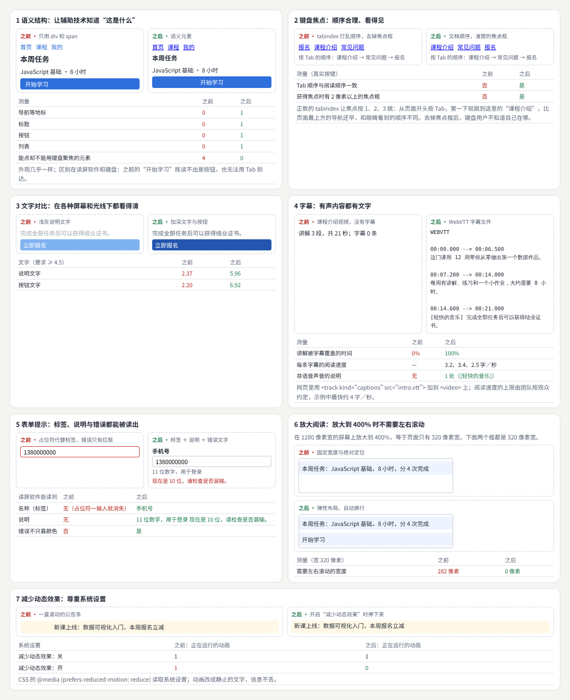
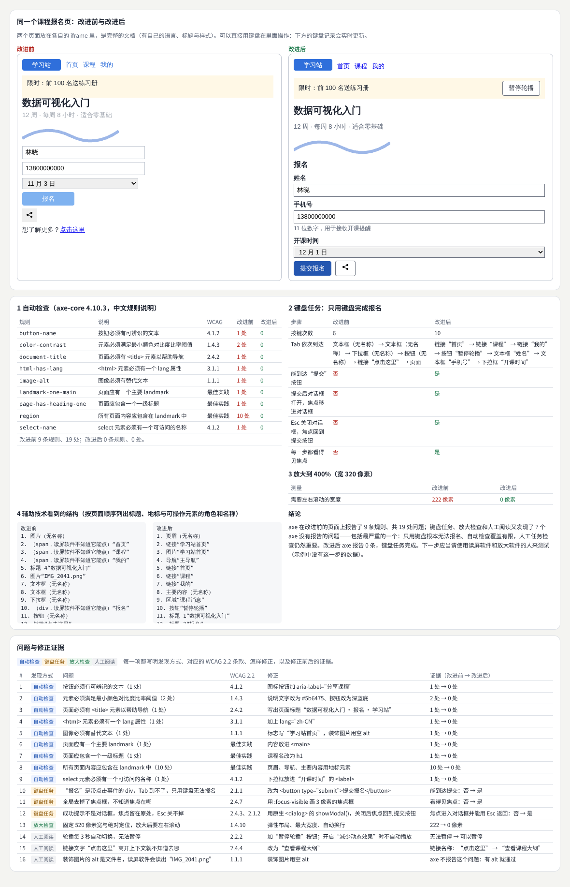
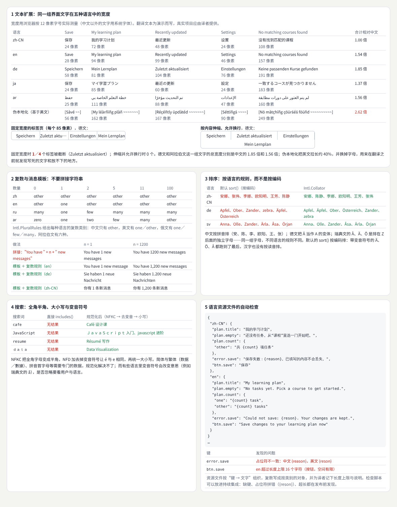
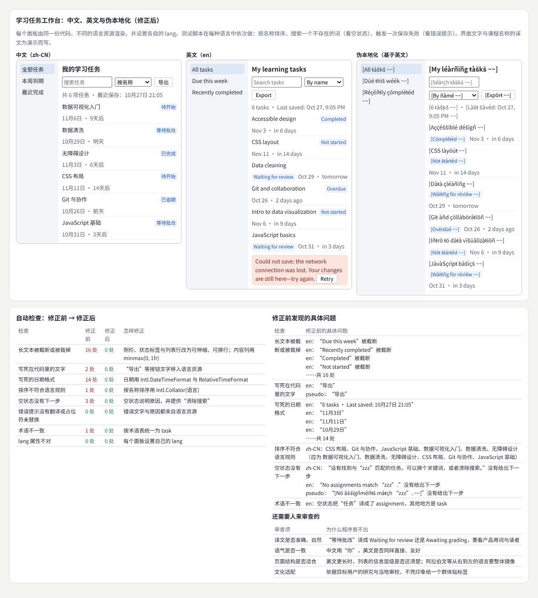
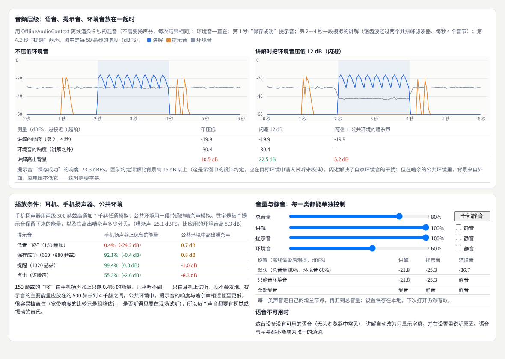
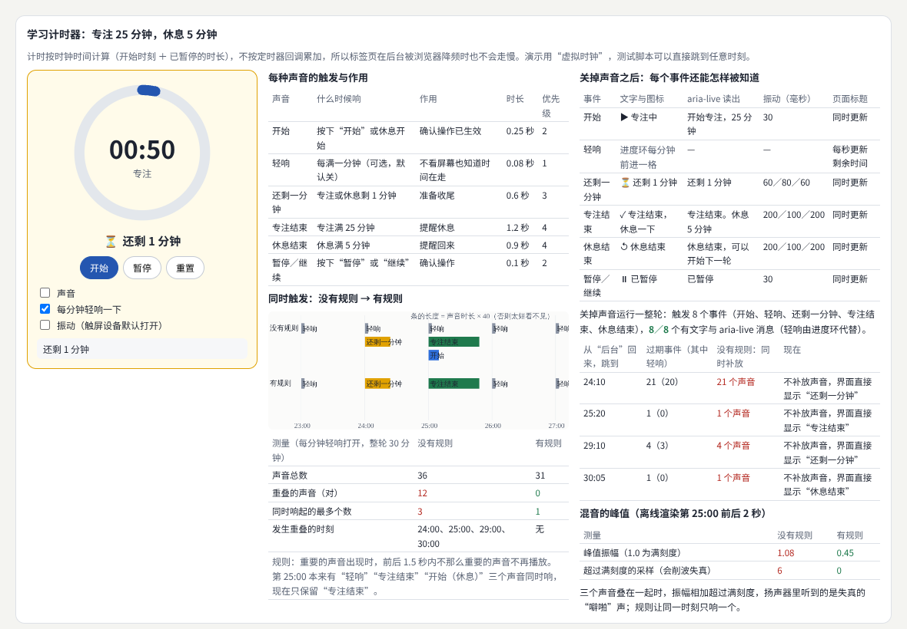
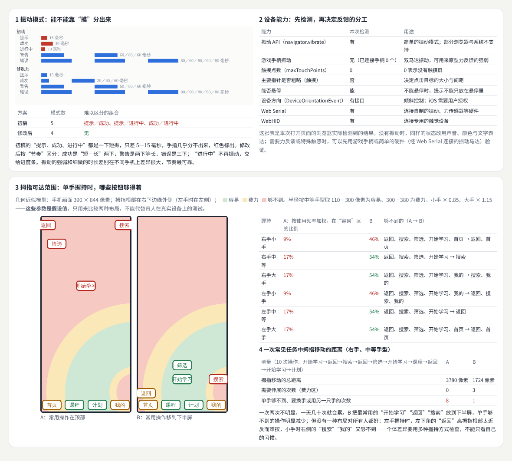
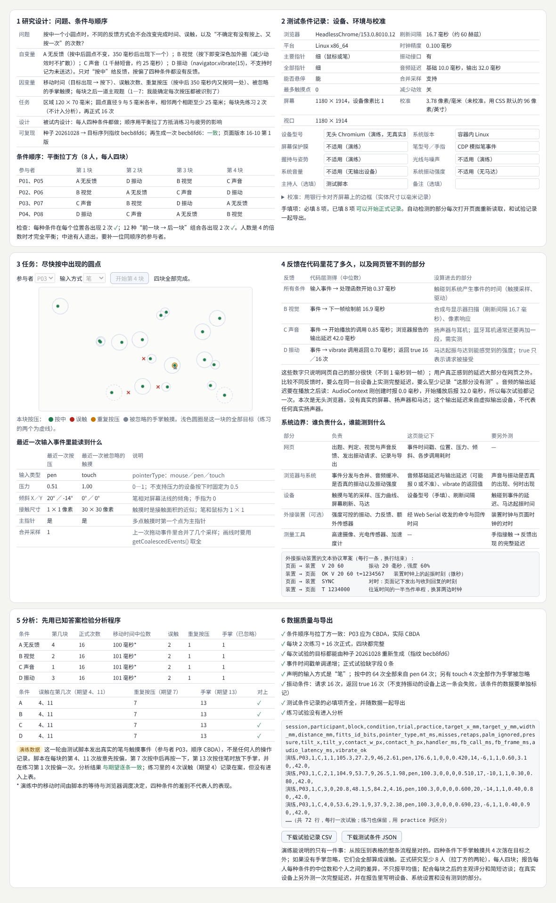
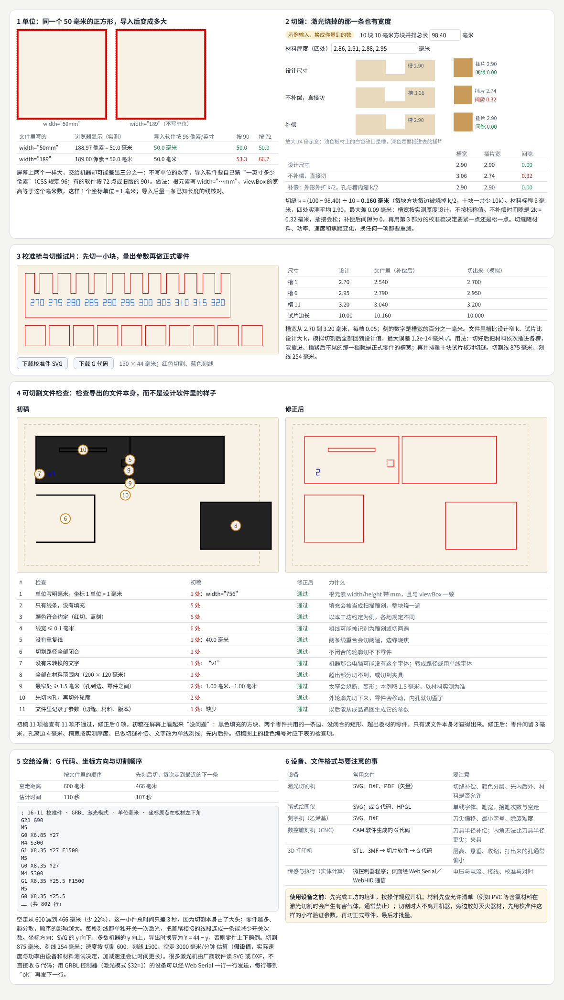
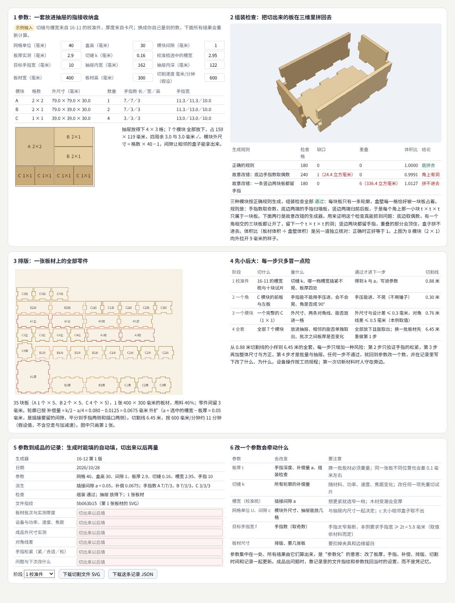

# 包容、国际化与多感官

> 五个按实际问题组织的横向方向：无障碍与包容性设计、国际化与跨文化设计、声音设计与声学交互、触觉与身体交互、数字制造与实体计算。每个方向先讲概念与方法，再做一个可以验收的项目：为一个报名页完成一轮无障碍改进、为学习工作台加上第二种语言、做一个带可选声音反馈的学习计时器、做一个比较触摸与笔输入反馈的小研究、做一套参数化生成的实体收纳模块。  
> 版本：1.0 · 整理日期：2026-10-25  
> 适用对象：已经能做页面和组件，想让作品被更多人、在更多条件下使用的前端开发与设计师，以及想把界面延伸到声音、触感和实体材料的同学。先修：读过[《前端界面工程》](01-前端界面工程.md)的语义与表单部分、[《产品交互与用户体验》](03-产品交互与用户体验.md)的可用性测试部分，以及[《感知与认知》](13-感知与认知.md)的 03、09 章。

这五个方向可以接入前面的多个领域。它们按实际问题组织，适合用来**发现新的项目题材**、**补足产品能力**或**发展长期专长**。它们有三个共同点：

- **人和条件都不一样**。看不清、听不见、手不方便、注意力被打断，可能是长期的，也可能只是今天手里抱着东西；同一段文字换一种语言会变长，同一个提示音换到嘈杂的车厢里会听不见。
- **只靠一种感官的信息是脆弱的**。声音要有文字与图标的替代，振动要有声音与颜色的替代，地图与三维要有列表与文字版。
- **要在真实条件下验证**。屏幕上看起来一样的两个正方形，交给激光机可能差出三分之一；无头浏览器测得的延迟，不等于用户手指感到的延迟。

本册每章都按同样的顺序讲：先说明它解决什么问题；再用白话解释核心概念；然后给出一个可以直接运行的示例与运行截图；接着是常见问题和本章练习；最后是一张**进阶学习卡**：技术栈、要掌握的高阶词汇（附英文）、搜索关键词、值得去看的实例，以及四级进阶阶梯：

| 级别 | 含义 |
| --- | --- |
| L1 入门 | 能运行并解释本章示例，说出每个概念的作用 |
| L2 熟练 | 能在自己的项目中正确使用这些方法，完成本章练习 |
| L3 进阶 | 能做完整的项目，并用检查、测量和真实条件下的测试验收 |
| L4 深入 | 能组织有真实用户参与的研究或生产，研究方法的效果与边界 |

四级是本手册的教学结构，用来安排学习顺序，不对应任何公司的职级。

所有示例都放在本目录的[示例](示例/)文件夹中，用浏览器直接打开即可运行；每个示例都已在无头浏览器中实际运行并自动检查。书中的数字分三类，正文会逐处说明：**浏览器实际测得的**（自动检查的结果、真实按键得到的焦点顺序、文字宽度、离线渲染的响度、事件时间戳、组装检查的格子数）、**按规则或模型算出的**（对比度、复数类别、切缝补偿、拇指可达的几何模型、G 代码的时间估算）、**为演示而构造的数据**（页面与译文、课程与任务、材料的测量值、演练脚本的操作）。**示例里没有真实参与者的数据**；需要人来填写的地方（主观评分、成品实测）都留空。

主线是：**从限制与条件出发 → 五个方向各做一次“概念 ＋ 项目” → 方向之间的连接。**

## 阅读导航

正文共 13 章（01—13），附 10 个可运行示例、3 组附录与 63 项资料入口。

- [第一篇：共同的基础](#part-1)
  - [01 这一册研究什么](#ch01)
  - [02 共同的方法：限制、真实条件、系统边界与单位](#ch02)
- [第二篇：五个方向](#part-2)
  - [03 无障碍基础：语义、焦点、对比、字幕、表单、放大与动效](#ch03)
  - [04 无障碍改进项目：一个报名页的问题与修正证据](#ch04)
  - [05 国际化基础：文本扩展、复数、排序、搜索与语言资源](#ch05)
  - [06 第二种语言项目：学习任务工作台](#ch06)
  - [07 声音设计：音频层级、播放条件与控制](#ch07)
  - [08 计时工具项目：带可选声音反馈的学习计时器](#ch08)
  - [09 触觉与身体：振动、设备能力与可达范围](#ch09)
  - [10 触摸与笔输入项目：比较四种反馈方式的小研究](#ch10)
  - [11 数字制造：单位、切缝、校准与可切割文件](#ch11)
  - [12 参数化实体模块项目：一套指接收纳盒](#ch12)
- [第三篇：连接与路线](#part-3)
  - [13 方向之间的连接、工具与学习路线](#ch13)
- [附录 A：术语表](#appendix-a)
- [附录 B：资料入口](#appendix-b)
- [附录 C：与原手册的对应关系及修订记录](#appendix-c)

## 第一篇：共同的基础

### 01 这一册研究什么

| 方向 | 核心问题 | 本册的项目 | 主要连接 |
| --- | --- | --- | --- |
| 无障碍与包容性设计 | 看不清、听不见、手不方便、注意力有限的人，能否完成同样的任务 | 为一个报名页完成一轮无障碍改进（04） | 前端工程、内容设计、测试 |
| 国际化与跨文化设计 | 换一种语言、地区和书写方向，界面与内容是否仍然正确 | 为学习工作台增加第二种语言（06） | 内容设计、排版、数据格式 |
| 声音设计与声学交互 | 声音是否有可识别的含义、可以控制，并且关掉后不丢信息 | 带可选声音反馈的学习计时器（08） | 动效与时间、无障碍 |
| 触觉与身体交互 | 振动、触摸与姿态能否区分状态，是否考虑疲劳与个体差异 | 比较触摸或笔输入反馈方式的小研究（10） | 人机交互、感知、硬件 |
| 数字制造与实体计算 | 程序生成的图形能否变成尺寸正确、能装配的实体 | 参数化生成的实体收纳模块（12） | 计算设计、三维、硬件 |

五个方向各用两章：先讲概念与方法，再做项目。前两个方向保证“更多的人能用”，后三个方向把界面延伸到耳朵、手和实体材料。

### 02 共同的方法：限制、真实条件、系统边界与单位

#### 02.1 限制有长期的，也有临时的和情境性的

无障碍与包容性设计横向关注视觉、听觉、运动和认知差异，以及临时和情境性限制[B01](#ref-b01)。微软的包容性设计方法把限制分成三种[B02](#ref-b02)：

| 方面 | 长期 | 临时 | 情境性 |
| --- | --- | --- | --- |
| 视觉 | 低视力、全盲 | 散瞳检查之后 | 阳光直射屏幕 |
| 听觉 | 听障 | 耳部感染 | 嘈杂的车厢、需要静音的会议 |
| 运动 | 一只手臂缺失、震颤 | 手腕骨折 | 一只手抱着孩子或拎着东西 |
| 认知 | 学习障碍、注意力差异 | 疲劳、服药之后 | 被频繁打断、在第二语言里阅读 |

为长期限制做的设计，往往同时帮到临时和情境性限制的人：字幕帮到听障者，也帮到在地铁里不方便外放的人。了解不同的人怎样使用网页，可以从 W3C 的介绍开始[B03](#ref-b03)；判断标准见 WCAG 2.2[B04](#ref-b04)；设计原则的简短版本见[B05](#ref-b05)。

#### 02.2 在真实条件下比较

| 方向 | 要记录的条件 | 例子 |
| --- | --- | --- |
| 无障碍 | 浏览器、辅助技术与版本、系统设置 | 读屏软件、系统放大、减少动态效果 |
| 国际化 | 语言、地区、书写方向、字体 | 德文的长单词、阿拉伯文从右到左 |
| 声音 | 播放设备与环境 | 耳机、手机扬声器、公共环境 |
| 触觉 | 设备、握持、姿势、手型 | 单手握持、坐着或走路 |
| 制造 | 材料批次与实测厚度、设备参数 | 切缝、功率、速度、焦距 |

同一个设计在不同条件下的结果可能完全不同。比较两个方案时，要么在同样的条件下比较，要么把条件记下来。

#### 02.3 明确系统边界

网页只负责其中一部分：

| 部分 | 网页能控制 | 网页管不到 |
| --- | --- | --- |
| 浏览器与系统 | 发出请求、读取设置（例如 `prefers-reduced-motion`） | 是否真的振动、振动强度、音频输出缓冲 |
| 设备 | 读取能力（触摸点数、指针精度、能否悬停） | 屏幕刷新、触摸采样、马达类型、扬声器频响 |
| 外接装置 | 经 Web Serial、WebHID 收发命令 | 装置自己的固件与时钟 |
| 实体材料 | 生成文件、记录参数 | 材料厚度的偏差、切缝、受潮变形 |

在报告里写清楚哪部分由网页负责、哪部分没有测到，比给出一个看起来精确的数更有用（10 章）。

#### 02.4 单位与公差

屏幕上的单位是 CSS 像素，实体上的单位是毫米：1 英寸 = 96 CSS 像素 = 25.4 毫米，所以 1 毫米约等于 3.78 CSS 像素，但这只是约定，真实屏幕上的物理尺寸要用实物校准（10、11 章）。声音的响度用 dBFS（相对满刻度的分贝，0 为最大），时间用毫秒。实体结果通常要求比屏幕更明确的单位与公差：一个插槽差 0.3 毫米，就从“插紧不晃”变成“一碰就掉”（11 章）。

#### 02.5 数据要诚实

示例里的数分三类（见引言）。演练数据（例如 10 章由测试脚本发出的笔与触摸事件）只用来检验流程是否正确，不能当作人的表现；需要人来测量或回答的部分（主观评分、成品尺寸）在示例中留空。

**本章练习**：

1. 为你正在做的一个页面，按 02.1 的表格写出每种限制的一个具体情境。
2. 为它写一张系统边界表：哪些由你的代码负责，哪些由浏览器、系统和设备负责。

## 第二篇：五个方向

### 03 无障碍基础：语义、焦点、对比、字幕、表单、放大与动效

#### 03.1 解决什么问题

要学习**语义结构**、**键盘焦点**、**文字对比**、**字幕**、**表单提示**、**放大阅读**和**减少动态效果**等[B01](#ref-b01)。这不只是前端的工作：**设计稿**决定对比度、焦点框和放大后的布局，**代码**决定语义与键盘操作，**内容**决定字幕、链接文字和错误提示。设计稿、代码和内容都参与这一工作。

#### 03.2 核心概念

| 概念 | 含义 | 检查方法 |
| --- | --- | --- |
| 语义结构 | 用 `<nav>`、`<main>`、`<h1>`、`<button>`、`<ul>` 说出“这是什么” | 读屏软件能列出地标、标题与按钮 |
| 键盘焦点 | 每个可操作的元素都能用 Tab 到达，顺序与阅读顺序一致，焦点看得见[B06](#ref-b06)[B07](#ref-b07) | 拔掉鼠标，只用键盘完成任务 |
| 文字对比 | 正文与背景的对比度至少 4.5:1，大字至少 3:1[B08](#ref-b08) | 按相对亮度计算 |
| 字幕 | 有声内容都有文字，包括音乐与音效的说明[B09](#ref-b09) | WebVTT 字幕文件[B10](#ref-b10)，阅读速度不超过约定 |
| 表单提示 | 每个输入框有标签，说明与错误能被读出，错误不只靠颜色[B11](#ref-b11) | `<label>`、`aria-describedby` |
| 放大阅读 | 放大到 400% 时（相当于 320 像素宽）不需要左右滚动[B12](#ref-b12) | 把视口设为 320 像素宽，量横向溢出 |
| 减少动态效果 | 尊重系统的“减少动态效果”设置[B13](#ref-b13)；自动播放的动画能暂停[B14](#ref-b14) | `@media (prefers-reduced-motion: reduce)` |

#### 03.3 示例：七种做法的之前与之后

示例：[16-03-a11y-basics.html](示例/16-03-a11y-basics.html)

页面上的每一组数都是浏览器里实际测得的：

| 做法 | 测量 | 之前 | 之后 |
| --- | --- | --- | --- |
| 语义结构 | 地标、标题、按钮、列表的数量 | 0、0、0、0 | 1、1、1、1 |
| 语义结构 | 能点却不能用键盘聚焦的元素 | 4 | 0 |
| 键盘焦点 | 真实按 Tab 的顺序与阅读顺序一致 | 否 | 是 |
| 键盘焦点 | 获得焦点时有 2 像素以上的焦点框 | 否 | 是（3 像素） |
| 文字对比 | 说明文字、按钮文字 | 2.37、2.20 | 5.96、6.92 |
| 字幕 | 讲解被字幕覆盖的时间 | 0% | 100% |
| 字幕 | 非语音声音的说明 | 无 | 1 处（[轻快的音乐]） |
| 表单提示 | 读屏软件能读到的名称 | 无（占位符一输入就消失） | 手机号 |
| 放大阅读 | 320 像素宽时需要左右滚动的宽度 | 282 像素 | 0 像素 |
| 减少动态效果 | 打开系统设置后仍在运行的动画 | 1 | 0 |

几处值得注意的地方：

- **外观几乎一样，体验完全不同**。“之前”的“开始学习”是一个带点击事件的 ``，看上去是按钮，读屏软件读不出它是按钮，Tab 也到不了。
- **正数的 `tabindex` 会打乱顺序**。之前的三个链接用 `tabindex` 1、2、3 排序，真实按键得到的顺序是“课程介绍 → 常见问题 → 报名”，和眼睛看到的“报名、课程介绍、常见问题”不同；而且从页面开头按第一下 Tab 就跳到这里，比页面最上方的导航还早。改为按文档顺序，并用 `:focus-visible` 画 3 像素的焦点框。
- **字幕要有阅读速度的约定**。三段字幕的阅读速度是每秒 3.2、3.4、2.5 字；上限由团队按观众约定（示例约定每秒约 4 字），英文字幕的常见约定可以参考广播机构的指南[B15](#ref-b15)。
- **错误不只靠颜色**。之前只有一个红框；之后有标签“手机号”、说明“11 位数字，用于登录”和错误文字“现在是 10 位，请检查是否漏输。”，三者都通过 `aria-describedby` 关联到输入框。

#### 03.4 常见问题

- **用 `div` 做按钮**：要自己补上角色、键盘事件和焦点，几乎总会漏掉一样；直接用 `<button>`。
- **为了好看去掉焦点框**：键盘用户就不知道自己在哪；用 `:focus-visible` 只在键盘操作时显示。
- **用占位符代替标签**：一输入就消失，读屏软件也不一定读；标签放在输入框外面。
- **字幕只有说话**：音乐、笑声、门铃这些非语音的声音也要写。
- **只在 1280 像素宽下检查**：放大到 400% 时页面只有 320 像素宽，固定宽度与绝对定位会溢出。
- **动画不能停**：轮播、滚动公告要能暂停；打开“减少动态效果”时改成静止的文字，信息不丢。

**本章练习**：

1. 拔掉鼠标，只用键盘完成你产品里的一个主要任务，记下每一处卡住的地方。
2. 把浏览器视口设为 320 像素宽，列出所有需要左右滚动的区域，并改成可换行的弹性布局。

#### 03.5 进阶学习卡

| 级别 | 目标 | 怎样检验 |
| --- | --- | --- |
| L1 入门 | 能用语义元素写页面，知道七种做法各解决什么 | 示例的七组测量都能解释 |
| L2 熟练 | 能只用键盘、放大与读屏软件检查自己的页面 | 一份问题清单与修正 |
| L3 进阶 | 能在设计稿阶段规定对比、焦点、放大布局与字幕规范 | 设计规范里有可检查的数值 |
| L4 深入 | 能为团队建立组件级的无障碍标准，并与真实用户一起测试 | 组件库的无障碍说明与用户测试记录 |

- **技术栈**：语义 HTML（`<nav>`、`<main>`、`<button>`、`<label>`）；`:focus-visible`；WebVTT 与 `<track kind="captions">`；`aria-describedby`；CSS `@media (prefers-reduced-motion)`；对比度计算（WCAG 相对亮度）。
- **高阶词汇**：无障碍（accessibility，a11y）、包容性设计（inclusive design）、辅助技术（assistive technology）、读屏软件（screen reader）、地标（landmark）、可访问名称（accessible name）、焦点顺序（focus order）、焦点可见（focus visible）、对比度（contrast ratio）、字幕（captions）、重排（reflow）、减少动态效果（reduced motion）。
- **搜索关键词**：`wcag 2.2 understanding`、`semantic html button vs div`、`focus-visible outline`、`webvtt captions sound description`、`reflow 320px wcag`、`prefers-reduced-motion`、`无障碍 设计 规范`。
- **值得看的实例**：[GOV.UK 设计系统](https://design-system.service.gov.uk/)——每个组件都写明了无障碍的做法与研究依据，可以对照它的表单、错误提示和焦点样式。
- **资料**：[B01](#ref-b01)、[B04](#ref-b04)、[B06](#ref-b06)、[B07](#ref-b07)、[B08](#ref-b08)、[B09](#ref-b09)、[B10](#ref-b10)、[B15](#ref-b15)、[B11](#ref-b11)、[B12](#ref-b12)、[B13](#ref-b13)、[B14](#ref-b14)。

### 04 无障碍改进项目：一个报名页的问题与修正证据

#### 04.1 任务

为已有页面完成一轮无障碍改进。结合**自动检查**、**键盘操作**和**适当辅助技术测试**，保存具体问题与修正证据。自动工具覆盖有限，人工任务检查仍然重要。

#### 04.2 示例

示例：[16-04-a11y-audit.html](示例/16-04-a11y-audit.html)

报名页是为演示而构造的，两个版本放在各自的 iframe 里，是完整的文档。检查分四种方式：

**自动检查**：用 axe-core 4.10.3 和它的中文规则说明[B16](#ref-b16)：

| 规则 | 说明 | WCAG | 改进前 | 改进后 |
| --- | --- | --- | --- | --- |
| button-name | 按钮必须有可辨识的文本 | 4.1.2 | 1 处 | 0 |
| color-contrast | 文字与背景的对比度不足 | 1.4.3 | 2 处 | 0 |
| document-title | 页面必须有 `<title>` | 2.4.2 | 1 处 | 0 |
| html-has-lang | `<html>` 必须有 lang 属性 | 3.1.1 | 1 处 | 0 |
| image-alt | 图像必须有替代文本 | 1.1.1 | 1 处 | 0 |
| landmark-one-main | 页面应有一个主要地标 | 最佳实践 | 1 处 | 0 |
| page-has-heading-one | 页面应包含一级标题 | 最佳实践 | 1 处 | 0 |
| region | 所有内容应包含在地标中 | 最佳实践 | 10 处 | 0 |
| select-name | 下拉框必须有可访问的名称 | 4.1.2 | 1 处 | 0 |

改进前 9 条规则、19 处；改进后 0 条。

**键盘任务**（真实按键：遇到输入框就输入，到“提交”按 Enter，再按 Esc）：

| | 改进前 | 改进后 |
| --- | --- | --- |
| 按键次数 | 6 次后离开页面 | 10 次完成 |
| Tab 依次到达 | 文本框（无名称）× 2 → 下拉框（无名称）→ 按钮（无名称）→ 链接“点击这里” → 离开页面 | 首页 → 课程 → 我的 → 暂停轮播 → 姓名 → 手机号 → 开课时间 → 提交报名 |
| 能到达“提交” | 否（“报名”是带点击事件的 `div`） | 是 |
| 提交后焦点进入对话框，Esc 关闭后回到提交按钮 | 否 | 是[B17](#ref-b17)[B18](#ref-b18) |
| 每一步都看得见焦点 | 否 | 是 |

**放大检查**：320 像素宽时需要左右滚动的宽度，222 像素 → 0。

**人工阅读**发现了 axe 没有报告的 3 个问题：轮播每 3 秒自动切换、无法暂停（2.2.2[B14](#ref-b14)）；链接文字“点击这里”离开上下文不知道去哪（2.4.4[B19](#ref-b19)）；装饰图片的替代文本写成了文件名“IMG_2041.png”，读屏软件会读出来——axe 只检查有没有替代文本，有就通过。

**辅助技术看到的结构**：按页面顺序列出标题、地标与可操作元素的角色和名称。改进前 12 项，其中 3 个 `span` 与 1 个 `div` 读屏软件不知道能点，5 项没有名称；改进后 21 项，每一项都有角色和名称。

**问题与修正证据**一共 16 条：自动检查 9 条、键盘任务 3 条（2.1.1、2.4.7、2.4.3 与 2.1.2）、放大检查 1 条（1.4.10）、人工阅读 3 条。每一条都写明发现方式、WCAG 条款、怎样修正，以及修正前后的证据。

制作时的两处修正：axe 的规则说明里含有 `<title>`，未转义就插进表格，吞掉了后半张表——所有外部文字都要转义；`<dialog>` 的 `hidden` 属性默认是 false，曾被误判为“已打开”——要按元素类型判断（`<dialog>` 看 `open`）。

**结论**：axe 在改进前报告了 9 条规则、19 处问题；键盘任务、放大检查和人工阅读又发现了 7 个 axe 没有报告的问题，包括最严重的一个：只用键盘根本无法报名。自动检查覆盖有限，人工任务检查仍然重要[B20](#ref-b20)。示例里没有读屏软件和放大软件的真人测试；下一步应当请这些工具的日常使用者参与[B21](#ref-b21)。

#### 04.3 验收清单

- [ ] 自动检查报告 0 条，并记下工具与版本。
- [ ] 只用键盘完成主要任务，焦点顺序合理、每一步看得见；对话框打开时焦点进入、关闭时回到触发它的按钮。
- [ ] 320 像素宽时没有横向滚动。
- [ ] 人工阅读检查了自动工具查不出的问题：替代文本的质量、链接文字、自动播放。
- [ ] 每个问题都有发现方式、WCAG 条款、修正与前后证据。
- [ ] 请辅助技术的日常使用者做过任务测试，或写明还没有做。

#### 04.4 常见问题

- **把 axe 报 0 当作完成**：自动工具只能发现一部分问题；键盘任务、放大与人工阅读必须做。
- **只记“修好了”**：没有前后证据，下次改版就无法确认没有退回去；把检查写进自动测试。
- **对话框关闭后焦点丢失**：用原生 `<dialog>` 的 `showModal()`，关闭时把焦点还给触发按钮。
- **修了技术、忘了内容**：链接文字、替代文本、错误提示都是内容问题，要内容负责人一起改。
- **只在一种读屏软件上测**：不同的读屏软件与浏览器组合表现不同，记下组合与版本。

**本章练习**：

1. 对你的一个页面跑一次 axe，再只用键盘完成一个任务，整理一张“问题与修正证据”表。
2. 找一个自动工具报告 0 处、但仍有问题的例子（例如替代文本写成文件名），说明为什么工具查不出。

#### 04.5 进阶学习卡

| 级别 | 目标 | 怎样检验 |
| --- | --- | --- |
| L1 入门 | 能运行 axe，看懂规则与 WCAG 条款 | 能解释示例的 9 条规则 |
| L2 熟练 | 能用自动检查、键盘与放大完成一轮改进 | 问题与修正证据表 |
| L3 进阶 | 能把检查写进持续集成，并组织人工阅读 | 自动测试与人工检查清单 |
| L4 深入 | 能组织辅助技术使用者参与的测试，并按结果改进流程 | 用户测试报告与流程改进 |

- **技术栈**：axe-core（或 Playwright 中的 `@axe-core/playwright`）；Playwright 键盘脚本；原生 `<dialog>` 与 `showModal()`；浏览器开发者工具的无障碍树；读屏软件（NVDA、VoiceOver、TalkBack）。
- **高阶词汇**：无障碍审计（accessibility audit）、自动检查（automated testing）、人工评估（manual evaluation）、无障碍树（accessibility tree）、焦点管理（focus management）、模态对话框（modal dialog）、符合性（conformance）、用户测试（usability testing with disabled users）。
- **搜索关键词**：`axe-core playwright`、`accessibility audit report template`、`modal dialog focus management`、`automated accessibility testing limitations`、`wcag easy checks`、`无障碍 审计 报告`。
- **值得看的实例**：[W3C 无障碍改进前后的演示（BAD）](https://www.w3.org/WAI/demos/bad/)——同一个网站的改进前与改进后，逐页标出问题；也可以看 [WebAIM Million](https://webaim.org/projects/million/)，每年对一百万个首页做自动检查，统计最常见的问题。
- **资料**：[B16](#ref-b16)、[B20](#ref-b20)、[B21](#ref-b21)、[B17](#ref-b17)、[B18](#ref-b18)、[B19](#ref-b19)、[B04](#ref-b04)。

### 05 国际化基础：文本扩展、复数、排序、搜索与语言资源

#### 05.1 解决什么问题

国际化与跨文化设计研究**多语言文本扩展**、**日期数字格式**、**阅读方向**、**字体**、**搜索**和**符号含义**[B22](#ref-b22)。组件需要适应长短不同的翻译，内容与语言资源也需要可维护的结构。文化适配要依据具体对象，避免凭印象给群体贴标签。

#### 05.2 核心概念

| 概念 | 含义 | 浏览器里的工具 |
| --- | --- | --- |
| 文本扩展 | 翻译后的文字往往比原文长，越短的文字扩展比例越大[B23](#ref-b23) | 弹性布局、允许换行；伪本地化 |
| 复数规则 | 不同语言的复数类别不同[B24](#ref-b24) | `Intl.PluralRules`[B25](#ref-b25)、ICU 消息格式[B26](#ref-b26) |
| 日期数字格式 | 日期顺序、千位分隔符、货币位置都随地区变化 | `Intl.DateTimeFormat`、`Intl.NumberFormat` |
| 排序 | 按语言的规则排，而不是按编码[B27](#ref-b27) | `Intl.Collator` |
| 搜索 | 全角半角、大小写、变音符号要先规范化[B28](#ref-b28) | `String.prototype.normalize()` |
| 阅读方向 | 阿拉伯文、希伯来文从右到左，页面结构要整体镜像[B29](#ref-b29) | `dir` 属性、CSS 逻辑属性 |
| 字体 | 每种文字要有合适的字体与回退 | `font-family` 回退链、`lang` 属性 |
| 符号含义 | 颜色、手势、图标在不同文化里的含义不同 | 依据目标用户研究与当地审校 |

#### 05.3 示例：五种问题与浏览器的工具

示例：[16-05-i18n-basics.html](示例/16-05-i18n-basics.html)

译文为演示而写，真实项目应由译者提供。

**多语言文本扩展**：五条界面文字按 12 像素字号在浏览器里实际测量宽度，合计相对中文：英文 1.54 倍、德文 1.85 倍、日文 1.37 倍、阿拉伯文 1.56 倍、伪本地化 2.62 倍。德文的四个标签放进每个 85 像素的固定宽度，1 个被截断（Zuletzt aktualisiert）；改为按内容伸缩、允许换行后为 0。

**复数**：`Intl.PluralRules` 给出的类别：

| 语言 | 0 | 1 | 2 | 5 | 11 | 100 |
| --- | --- | --- | --- | --- | --- | --- |
| 中文 | other | other | other | other | other | other |
| 英文 | other | one | other | other | other | other |
| 俄文 | many | one | few | many | many | many |
| 阿拉伯文 | zero | one | two | few | many | other |

拼接字符串 `"You have " + n + " new messages"` 在 n = 1 时得到 “You have 1 new messages”，n = 1200 时得到 “You have 1200 new messages”（没有千位分隔符）。改用“模板 ＋ 复数规则”：英文 “You have 1 new message”“You have 1,200 new messages”，德文 “1.200 neue Nachrichten”，中文“你有 1,200 条新消息”。

**排序**：

| 语言 | 默认 `sort()`（按编码） | `Intl.Collator` |
| --- | --- | --- |
| 中文 | 安娜、张伟、李娜、欧阳明、王芳、陈静 | 安娜、陈静、李娜、欧阳明、王芳、张伟（按拼音） |
| 德文 | Apfel、Ober、Zander、zebra、Äpfel、Österreich | Apfel、Äpfel、Ober、Österreich、Zander、zebra |
| 瑞典文 | Anna、Olle、Zander、Ärla、Åsa、Örjan | Anna、Olle、Zander、Åsa、Ärla、Örjan |

同一组字母，不同语言的规则不同：德文把 Ä 当作 A 的变体，瑞典文的 Å、Ä、Ö 是排在 Z 后面的独立字母。

**搜索**：先做 NFKC（全角变半角）、再做 NFD 并去掉变音符号、最后统一小写。直接用 `includes()` 时 “cafe”“JavaScript”“resume”“ｄａｔａ” 都没有结果；规范化后分别找到 1、2、1、1 条。规范化解决不了简体与繁体、拼音首字母这类问题，那需要专门的数据；而有些语言里变音符号会改变意思（例如瑞典文的 å），是否忽略要看用户与语言。

**语言资源文件**：文字按“键 → 文字”组织，复数写成按类别的对象，并为译者记下长度上限与说明。检查脚本发现两处问题：`error.save` 的占位符中文是 `{reason}`、英文写成了 `{reson}`；`btn.save` 的英文超过了长度上限 16 个字符。这类检查可以放进持续集成，在发布前发现。

#### 05.4 常见问题

- **拼接字符串**：词序与复数在不同语言里不同；整句放进资源文件，用占位符。
- **按钮宽度写死**：德文、俄文常常更长；用弹性布局，给译者长度上限。
- **自己格式化日期和数字**：用 `Intl`，并按用户的地区设置。
- **用 `sort()` 排名字**：按编码排序对任何语言都不对；用 `Intl.Collator`。
- **凭印象做“文化适配”**：颜色、图标与插画的含义要依据目标用户的研究与当地审校。

**本章练习**：

1. 把你的产品里所有拼接出来的句子找出来，改成带占位符和复数规则的模板。
2. 用伪本地化把界面文字拉长 40%，截图找出所有被截断或溢出的地方。

#### 05.5 进阶学习卡

| 级别 | 目标 | 怎样检验 |
| --- | --- | --- |
| L1 入门 | 能用 `Intl` 格式化日期、数字、复数，并正确排序 | 示例五组结果都能解释 |
| L2 熟练 | 能把界面文字整理成语言资源，组件适应长文本 | 伪本地化下无截断 |
| L3 进阶 | 能建立资源检查（缺键、占位符、长度）与译者说明 | 持续集成里的检查 |
| L4 深入 | 能支持从右到左的语言与多种书写系统，并组织本地化流程 | RTL 版本与本地化流程文档 |

- **技术栈**：`Intl.PluralRules`、`Intl.NumberFormat`、`Intl.DateTimeFormat`、`Intl.Collator`、`String.prototype.normalize()`；ICU 消息格式（FormatJS、i18next）；CLDR 数据；伪本地化脚本。
- **高阶词汇**：国际化（internationalization，i18n）、本地化（localization，l10n）、区域设置（locale）、文本扩展（text expansion）、复数规则（plural rules）、消息格式（message format）、排序规则（collation）、Unicode 规范化（Unicode normalization）、伪本地化（pseudo-localization）、从右到左（right-to-left，RTL）。
- **搜索关键词**：`intl pluralrules cldr`、`icu messageformat plural select`、`intl collator locale sort`、`unicode normalization nfkc search`、`text expansion translation ui`、`国际化 复数 规则`。
- **值得看的实例**：[FormatJS](https://formatjs.github.io/)——看 ICU 消息格式怎样写复数、选择和日期，以及怎样把界面文字抽成资源文件。
- **资料**：[B22](#ref-b22)、[B23](#ref-b23)、[B24](#ref-b24)、[B25](#ref-b25)、[B26](#ref-b26)、[B27](#ref-b27)、[B28](#ref-b28)、[B29](#ref-b29)。

### 06 第二种语言项目：学习任务工作台

#### 06.1 任务

为一个工作台增加第二种语言，检查**长文本**、**日期**、**排序**、**空状态**和**错误提示**。页面结构与文本含义都需要审查[B22](#ref-b22)。

#### 06.2 示例

示例：[16-06-second-language.html](示例/16-06-second-language.html)

三个面板由同一份代码、不同的语言资源渲染，各自设置 `lang`；“今天”固定为 2026-10-28，有 6 个学习任务。测试脚本在每种语言中依次做：按名称排序、搜索一个不存在的词（看空状态）、触发一次保存失败（看错误提示）。界面文字与课程名称的译文为演示而写。

| 检查 | 修正前 | 修正后 | 怎样修正 |
| --- | --- | --- | --- |
| 长文本被截断或被裁掉 | 16 处 | 0 | 侧栏、状态标签与列表行改为可伸缩、可换行；内容列用 `minmax(0, 1fr)` |
| 写死在代码里的文字 | 2 处 | 0 | “导出”等按钮文字移入语言资源 |
| 写死的日期格式 | 14 处 | 0 | 用 `Intl.DateTimeFormat` 与 `Intl.RelativeTimeFormat`[B30](#ref-b30) |
| 排序不符合语言规则 | 1 处 | 0 | 按名称排序用 `Intl.Collator` |
| 空状态没有下一步 | 3 处 | 0 | 说明原因，并提供“清除搜索” |
| 错误提示没有翻译或占位符未替换 | 0 | 0 | 错误文字与原因都来自语言资源 |
| 术语不一致 | 1 处 | 0 | 英文空状态把“任务”译成了 assignment，其他地方是 task，按术语表统一 |
| `lang` 属性不对 | 0 | 0 | 每个面板设置自己的 `lang` |

中文的排序修正前是“CSS 布局、Git 与协作、JavaScript 基础、数据可视化入门、数据清洗、无障碍设计”（按编码，西文在前），修正后是“数据可视化入门、数据清洗、无障碍设计、CSS 布局、Git 与协作、JavaScript 基础”（`Intl.Collator('zh-CN')` 的结果）。

伪本地化把英文换成带变音符号的字母并拉长约 40%[B31](#ref-b31)，用来在翻译之前发现写死的文字和放不下的地方。

制作时的两处发现：

- 伪本地化函数把占位符 `{reason}` 也改成了 `{réàšöñ}`，错误提示检查抓到了——伪本地化要跳过占位符。
- 第一版“修正后”在 360 像素的面板里，内容被 `overflow: hidden` 裁掉了：grid 的 `1fr` 列最小宽度等于内容宽度，长单词把列撑宽。原来的检查只看按钮与标签是否被截断；补上“超出面板右边缘”的检查后，发现了 17 处。改为 `minmax(0, 1fr)`、列表行可以换行。

**还需要人来审查的四项**：译文是否准确自然（“等待批改”译成 Waiting for review 还是 Awaiting grading，要看产品用词与读者）；语气是否一致；页面结构是否适合（英文更长时信息层级是否还清楚，从右到左的语言要整体镜像，CSS 逻辑属性可以减少镜像的工作[B32](#ref-b32)）；文化适配（依据目标用户的研究与当地审校）。

#### 06.3 验收清单

- [ ] 所有界面文字都来自语言资源，没有写死的文字、日期与数字。
- [ ] 在最长的语言与伪本地化下没有截断、溢出或被裁掉的内容。
- [ ] 排序、搜索、日期、复数在每种语言下都正确。
- [ ] 空状态说明原因并给出下一步；错误提示说明原因、给出办法，并保留已填内容。
- [ ] 术语表统一了每个概念的译法；译者看得到长度上限与说明。
- [ ] 由译者或母语者审查了译文、语气与页面结构。

#### 06.4 常见问题

- **只翻译文字，不检查布局**：长文本、换行与从右到左都会改变布局；每种语言都截图检查。
- **空状态与错误提示忘了翻译**：它们只在特定条件下出现；测试脚本要主动触发。
- **译者看不到上下文**：给每条文字写说明与截图，否则“Save”可能被译成“节省”。
- **伪本地化弄坏占位符**：处理文字时跳过 `{…}`。
- **把国旗当作语言选择**：一种语言在多个国家使用，一个国家也有多种语言；用语言名称本身来写（例如“English”“中文”）。

**本章练习**：

1. 为你的一个页面加上伪本地化，按示例的八项检查整理修正前后的数字。
2. 写一份术语表：每个术语的定义、不用的说法与各语言的译法。

#### 06.5 进阶学习卡

| 级别 | 目标 | 怎样检验 |
| --- | --- | --- |
| L1 入门 | 能把一个页面的文字抽成两种语言的资源 | 切换语言后没有写死的文字 |
| L2 熟练 | 能用伪本地化与自动检查发现长文本、日期与排序问题 | 八项检查全部为 0 |
| L3 进阶 | 能组织译者、术语表与审校，处理空状态与错误提示 | 审校记录与术语表 |
| L4 深入 | 能支持从右到左的语言，建立持续本地化的流程 | RTL 版本、翻译管理平台与发布流程 |

- **技术栈**：i18next 或 FormatJS；`Intl.DateTimeFormat`、`Intl.RelativeTimeFormat`、`Intl.Collator`；CSS Grid 的 `minmax(0, 1fr)` 与逻辑属性；伪本地化；Playwright 截图对比。
- **高阶词汇**：本地化（localization）、翻译记忆（translation memory）、术语库（termbase）、字符串上下文（string context）、空状态（empty state）、硬编码文字（hard-coded string）、逻辑属性（logical properties）、双向文字（bidirectional text）、持续本地化（continuous localization）。
- **搜索关键词**：`pseudo localization testing`、`i18n empty state error message`、`css logical properties rtl`、`translation context for translators`、`continuous localization workflow`、`本地化 测试 伪本地化`。
- **值得看的实例**：[Mozilla Pontoon](https://pontoon.mozilla.org/)——Firefox 的社区翻译平台，可以看到每条文字的上下文、占位符检查和多人审校。
- **资料**：[B22](#ref-b22)、[B30](#ref-b30)、[B31](#ref-b31)、[B32](#ref-b32)、[B29](#ref-b29)。

### 07 声音设计：音频层级、播放条件与控制

#### 07.1 解决什么问题

声音设计与声学交互从界面里偶尔的“叮”一声，扩展到提示音、环境音、音频层级、语音播放与视觉节奏。声音应有可识别的含义，并允许控制音量和静音。公共环境、耳机和设备扬声器会影响体验，需要在实际使用条件下比较[B33](#ref-b33)。

#### 07.2 核心概念

| 概念 | 含义 | 网页里的做法 |
| --- | --- | --- |
| 提示音 | 短促、有固定含义的声音（保存成功、提醒） | Web Audio 合成或短音频文件[B34](#ref-b34)[B35](#ref-b35) |
| 环境音 | 持续的背景声音，营造氛围 | 低音量循环，可单独关闭 |
| 音频层级 | 同时出现时谁最重要：语音 > 提示音 > 环境音 | 每类一个增益节点；讲话时压低背景（闪避） |
| 语音播放 | 朗读文字或讲解 | Web Speech API 的 `speechSynthesis`[B36](#ref-b36) |
| 视觉节奏 | 声音与画面的动作对齐，互相加强 | 与动效使用同一个时钟 |
| 控制 | 总音量、分类音量、静音，设置能保存 | 自动播放超过 3 秒的声音必须能停止或调节[B37](#ref-b37) |
| 播放条件 | 耳机、手机扬声器、公共环境 | 在目标条件下试听；小扬声器放不出低频 |

#### 07.3 示例：音频层级、播放条件与控制

示例：[16-07-sound.html](示例/16-07-sound.html)

所有声音都由 Web Audio 合成，用 `OfflineAudioContext` 离线渲染 6 秒（不需要扬声器，每次结果相同），再每 50 毫秒算一次响度（dBFS）。讲解是模拟的：锯齿波经过两个共振峰滤波器，每秒 4 个音节。

**音频层级**：

| 测量（dBFS） | 不压低 | 讲解时把环境音压低 12 dB | 再加上公共环境的嘈杂声 |
| --- | --- | --- | --- |
| 讲解的响度 | −19.9 | −19.9 | −19.9 |
| 环境音的响度 | −30.4 | −30.4 | — |
| 讲解高出背景 | 10.5 dB | 22.5 dB | 5.2 dB |

提示音“保存成功”的响度是 −23.3 dBFS。团队约定讲解要比背景高 15 dB 以上（这是示例中的设计约定，应在目标环境中请人试听来校准）。闪避解决了自家环境音的干扰；但公共环境的嘈杂声（−25.1 dBFS，比应用的环境音高 5.3 dB）来自外面，应用压不低它——这时需要字幕。

**播放条件**：手机扬声器用两级 300 赫兹高通加 7 千赫低通模拟，公共环境用一段带通的嘈杂声模拟：

| 提示音 | 手机扬声器上保留的能量 | 公共环境中高出嘈杂声 |
| --- | --- | --- |
| 低音“咚”（150 赫兹） | 0.4%（−24.2 dB） | 0.7 dB |
| 保存成功（660 → 880 赫兹） | 92.1% | 0.8 dB |
| 提醒（1320 赫兹） | 99.4% | −1.0 dB |
| 点击（短噪声） | 55.3% | −8.3 dB |

150 赫兹的“咚”在手机扬声器上几乎听不到——只在耳机上试听，就不会发现。公共环境中，提示音的响度与嘈杂声相近甚至更低，很容易被盖住（宽带响度的比较只是粗略估计，是否听得见要在现场试听），所以每个声音都要有视觉或振动的替代。

**音量与静音**：每类声音走自己的增益节点，再汇到总音量；离线渲染测得默认设置（总音量 80%、环境音 60%）下讲解 −21.8、提示音 −25.3、环境音 −36.7 dBFS；只静音环境音时另外两类不变；“全部静音”时三类都静音。设置保存在本地，下次打开仍然有效。

**语音不可用时**：无头浏览器中可用的语音数为 0，讲解自动改为只显示字幕，并在设置里说明原因。

制作时的一处修正：Web Audio 的高通、低通滤波器的 Q 值以 dB 为单位，默认值会在截止频率附近放大信号，第一次测得 660 赫兹保留了 158.9%（超过 100%）；改为 Q = −3.01 dB（巴特沃斯响应）后正常[B34](#ref-b34)。

#### 07.4 常见问题

- **声音没有固定含义**：同一个声音一会儿表示成功、一会儿表示提醒，用户就学不会；每个声音写下触发条件与作用（08 章）。
- **只在耳机上试听**：手机扬声器放不出低频，公共环境会盖住小声音。
- **没有分类控制**：用户可能想保留提醒、关掉环境音。
- **声音是唯一的通道**：关掉声音或听不见时，状态与结果必须还能看到。
- **自动播放**：浏览器会阻止没有用户操作的自动播放；也不要这样做。

**本章练习**：

1. 为你的产品列出所有声音：触发条件、作用、时长、响度，以及关掉声音后的替代。
2. 用 `OfflineAudioContext` 渲染一段混音，测出每类声音的响度，并在手机扬声器上试听一次。

#### 07.5 进阶学习卡

| 级别 | 目标 | 怎样检验 |
| --- | --- | --- |
| L1 入门 | 能用 Web Audio 合成提示音，并加上音量与静音 | 示例的控制都能用 |
| L2 熟练 | 能设计音频层级与闪避，测量响度 | 离线渲染的响度表 |
| L3 进阶 | 能在耳机、扬声器与公共环境下比较，并提供替代通道 | 试听记录与替代方案 |
| L4 深入 | 能做空间音频、语音交互或声音品牌，并做听辨测试 | 听辨测试的设计与结果 |

- **技术栈**：Web Audio API（`OscillatorNode`、`GainNode`、`BiquadFilterNode`、`OfflineAudioContext`）；Web Speech API；`localStorage` 保存设置；音频编辑软件（Audacity）。
- **高阶词汇**：声音设计（sound design）、提示音（earcon）、听觉图标（auditory icon）、环境音（ambience）、音频层级（audio hierarchy）、闪避（ducking）、响度（loudness）、满刻度分贝（dBFS）、频率响应（frequency response）、语音合成（speech synthesis）。
- **搜索关键词**：`ui sound design guidelines`、`earcons vs auditory icons`、`web audio ducking gain`、`offlineaudiocontext render`、`phone speaker frequency response`、`界面 声音 设计`。
- **值得看的实例**：[Material Design 的声音设计](https://m2.material.io/design/sound/about-sound.html)——看界面声音怎样分类（品牌声音、提示、反馈），以及每类声音的用途与限制。
- **资料**：[B34](#ref-b34)、[B35](#ref-b35)、[B37](#ref-b37)、[B33](#ref-b33)、[B36](#ref-b36)。

### 08 计时工具项目：带可选声音反馈的学习计时器

#### 08.1 任务

做一个带可选声音反馈的**计时**、**学习**或**创作工具**。为每种声音定义触发和作用，检查同时触发时是否混乱。关掉声音后，状态与结果应通过其他方式表达。

#### 08.2 示例

示例：[16-08-timer-sound.html](示例/16-08-timer-sound.html)

**按时钟计算时间**：剩余时间 = 总时长 −（现在 − 开始时刻 − 已暂停的时长），不靠计时器一秒一秒累加。标签页在后台时，浏览器会降低计时器的频率[B38](#ref-b38)[B39](#ref-b39)，累加的计时器会走慢；按时钟计算就不会。演示用一个“虚拟时钟”，测试脚本可以直接跳到任意时刻。

**每种声音的触发与作用**：

| 声音 | 什么时候响 | 作用 | 时长 | 优先级 |
| --- | --- | --- | --- | --- |
| 开始 | 按下“开始”或休息开始 | 确认操作已生效 | 0.25 秒 | 2 |
| 轻响 | 每满一分钟（可选，默认关） | 不看屏幕也知道时间在走 | 0.08 秒 | 1 |
| 还剩一分钟 | 专注或休息剩 1 分钟 | 准备收尾 | 0.6 秒 | 3 |
| 专注结束 | 专注 25 分钟 | 提醒休息 | 1.2 秒 | 4 |
| 休息结束 | 休息 5 分钟 | 提醒回来 | 0.9 秒 | 4 |
| 暂停／继续 | 按下“暂停”或“继续” | 确认操作 | 0.1 秒 | 2 |

**同时触发**（打开每分钟轻响，整轮 30 分钟）。规则：重要的声音出现时，前后 1.5 秒内不那么重要的声音不再播放。

| 测量 | 没有规则 | 有规则 |
| --- | --- | --- |
| 声音总数 | 36 | 31 |
| 重叠的声音 | 12 对 | 0 |
| 同时响起的最多个数 | 3 | 1 |
| 发生重叠的时刻 | 24:00、25:00、29:00、30:00 | 无 |

第 25:00 本来有“轻响”“专注结束”“开始（休息）”三个声音同时响，现在只保留“专注结束”。离线渲染 25:00 前后 2 秒：没有规则时峰值振幅 1.08，有 6 个采样超过满刻度（会削波失真，扬声器里听到的是“噼啪”声）；有规则时峰值 0.45，没有削波。

**关掉声音之后**：运行一整轮，8 个事件（开始、轻响、还剩一分钟、专注结束、休息结束）中 8 个都有文字与 `aria-live` 消息[B40](#ref-b40)（轻响由进度环每分钟前进一格代替）。另外有图标、振动（30、60/80/60、200/100/200 毫秒，只在触屏设备上默认打开）和每秒更新剩余时间的页面标题。

**从后台回来**：如果标签页长时间在后台，回来时可能一下子“错过”很多事件：

| 回来的时刻 | 过期的事件（其中轻响） | 没有规则时同时补放 | 现在 |
| --- | --- | --- | --- |
| 24:10 | 21 个（20） | 21 个声音 | 不补放声音，界面直接显示“还剩一分钟” |
| 25:20 | 1 个（0） | 1 个 | 显示“专注结束” |
| 29:10 | 4 个（3） | 4 个 | 显示“还剩一分钟” |
| 30:05 | 1 个（0） | 1 个 | 显示“休息结束” |

规则：过期超过 2 秒的事件不补放声音，只更新界面。

制作时的两处修正：未开始时也会触发“开始”的声音（重置后同样）——改为未开始或暂停时不触发事件；振动在桌面无头浏览器中被拦截并报错——改为只在触屏设备上默认打开。

#### 08.3 验收清单

- [ ] 每种声音都有触发条件、作用、时长与优先级。
- [ ] 同时触发时有规则，没有重叠，混音不削波。
- [ ] 关掉声音运行一整轮，每个事件都能通过文字、图标或读屏消息知道。
- [ ] 后台、休眠后回来，时间正确，不会一次补放一串声音。
- [ ] 总音量、分类开关与振动开关都能保存。

#### 08.4 常见问题

- **用 `setInterval` 累加时间**：后台会走慢；按开始时刻与暂停时长计算。
- **一个时刻好几个声音**：定义优先级与避让规则，并离线渲染检查峰值。
- **关掉声音就什么都不知道了**：每个事件都要有文字；`aria-live` 让读屏软件也能读到。
- **振动不可用时报错**：先检测能力，用户操作之后再调用。
- **轻响太频繁**：默认关闭，让需要的人自己打开。

**本章练习**：

1. 为你的计时或学习工具写一张声音表，并找出所有可能同时触发的时刻。
2. 关掉声音、关掉屏幕各运行一次，记下哪些状态变化会被错过。

#### 08.5 进阶学习卡

| 级别 | 目标 | 怎样检验 |
| --- | --- | --- |
| L1 入门 | 能做一个按时钟计算、带提示音的计时器 | 后台回来时间正确 |
| L2 熟练 | 能定义声音表与避让规则，提供替代通道 | 一整轮没有重叠，静音时 8/8 可知 |
| L3 进阶 | 能用离线渲染检查混音峰值，处理后台与休眠 | 峰值与补放测试 |
| L4 深入 | 能为创作工具设计完整的声音系统，并与用户一起评估 | 评估记录与声音规范 |

- **技术栈**：`performance.now()` 与开始时刻计算；Page Visibility API；Web Audio 与 `OfflineAudioContext`；`aria-live`；Vibration API；`document.title` 显示剩余时间。
- **高阶词汇**：虚拟时钟（virtual clock）、计时漂移（timer drift）、后台限流（background throttling）、优先级（priority）、避让（ducking／suppression）、削波（clipping）、峰值（peak level）、实时区域（live region）、多通道冗余（multimodal redundancy）。
- **搜索关键词**：`timer drift background tab throttling`、`page visibility api timer`、`aria-live polite timer`、`audio clipping peak`、`pomodoro timer accessibility`、`计时器 后台 节流`。
- **值得看的实例**：[Pomofocus](https://pomofocus.io/)——一个网页番茄钟，可以对照它的提示音选择、音量、标签页标题倒计时和后台行为。
- **资料**：[B38](#ref-b38)、[B39](#ref-b39)、[B40](#ref-b40)、[B34](#ref-b34)、[B37](#ref-b37)。

### 09 触觉与身体：振动、设备能力与可达范围

#### 09.1 解决什么问题

触觉与身体交互关注**振动**、**力反馈**、**动作范围**、**姿态**与**触摸材料**。技术依赖设备能力，可先用简单硬件或可用设备验证。反馈应能区分状态，并考虑**疲劳**、**可达范围**和**个体差异**。

#### 09.2 核心概念

| 概念 | 含义 | 例子 |
| --- | --- | --- |
| 振动 | 用时长与节奏表达状态[B41](#ref-b41)[B42](#ref-b42)[B43](#ref-b43) | `navigator.vibrate([20, 60, 60])`：短—停—长 |
| 力反馈 | 让手感到阻力或推力 | 游戏手柄的双马达振动[B44](#ref-b44)、专用的力反馈设备 |
| 动作范围 | 手指、手臂能舒适地移动到哪里 | 单手握持时拇指够得着的区域[B45](#ref-b45)[B46](#ref-b46) |
| 姿态 | 坐着、站着、走路、躺着，单手或双手 | 走路时目标要更大 |
| 触摸材料 | 屏幕、保护膜、手套、笔尖、实体按钮的材质 | 手套与厚保护膜会降低触摸精度 |
| 疲劳 | 重复动作与伸展让人累 | 常用的操作放在不用伸展的地方 |
| 个体差异 | 手的大小、握法、左右手、力量 | 用多种握持方式检查，不只看自己的习惯 |
| 触控目标 | 可以点中的区域 | WCAG 2.2 要求至少 24 × 24 CSS 像素（有例外）[B47](#ref-b47) |

#### 09.3 示例：振动模式、设备能力与拇指可达范围

示例：[16-09-haptics-reach.html](示例/16-09-haptics-reach.html)

**振动模式能不能靠“摸”分出来**：用一条启发式规则（脉冲个数不同，或长短节奏不同才算能区分；50 毫秒以上算长）检查：

| 方案 | 模式 | 难以区分的组合 |
| --- | --- | --- |
| 初稿 | 提示 15、成功 30、进行中 10、警告 60/80/60、错误 80/60/80/60/80（毫秒） | 3 对：提示／成功、提示／进行中、成功／进行中 |
| 修改后 | 成功改为 20/60/60（短—长）；“进行中”不再振动，交给进度条 | 0 |

振动的强弱和细微的时长差别在不同手机上差异很大，节奏最可靠；规则只是初筛，最终要请人在真实设备上辨认。

**设备能力：先检测，再决定反馈的分工**。本次（无头浏览器）检测到：振动接口——有；已连接手柄——0 个；最多触摸点——0；主要指针是否粗略——否；能否悬停——能；设备方向——有接口；Web Serial——有；WebHID——有。没有振动时，同样的状态改用声音、颜色与文字表达；需要力反馈或特殊触感时，可以先用游戏手柄或简单的硬件（经 Web Serial 连接的振动马达）验证。

**拇指可达范围**：这是一个几何近似模型，参数都是假设值——手机画面 390 × 844 像素，拇指根部在右下边缘外侧（左手时在左侧），中等手型半径 110—300 像素为容易、300—380 为费力，小手 × 0.85、大手 × 1.15——只用来比较两种布局，不能代替真人在真实设备上的测试[B46](#ref-b46)。按每个按钮的使用频率加权，在“容易”区的比例：

| 握持 | A：常用操作在顶部 | B：移到下半屏 | 够不到的（A → B） |
| --- | --- | --- | --- |
| 右手，小手 | 9% | 46% | 返回、搜索、筛选、开始学习、首页 → 返回、首页 |
| 右手，中等 | 17% | 54% | 返回、搜索、筛选、开始学习 → 搜索 |
| 右手，大手 | 17% | 54% | 返回、搜索、筛选、开始学习、我的 → 搜索、我的 |
| 左手，小手 | 9% | 46% | 返回、搜索、筛选、开始学习、我的 → 返回、搜索、我的 |
| 左手，中等 | 17% | 54% | 返回、搜索、筛选、开始学习 → 返回 |
| 左手，大手 | 17% | 54% | 返回、搜索、筛选、开始学习、首页 → 返回、首页 |

一次常见任务（10 次操作：开始学习 → 返回 → 搜索 → 返回 → 筛选 → 开始学习 → 课程 → 返回 → 开始学习 → 计划），右手、中等手型：拇指移动的总距离 A 3780 像素、B 1724 像素；需要伸展（费力区）的次数 A 0、B 3；够不到、要换手或用另一只手的次数 A 8、B 1。

一次两次不明显，一天几十次就会累。B 把最常用的操作放到下半屏，单手够不到的操作明显减少；但没有一种布局对所有人都好：左手握持时左下角的“返回”离拇指根部太近反而难按，小手时右侧的“搜索”“我的”又够不到——个体差异要用多种握持方式检查。真实用户的握法也在不断变化：街头观察发现单手握持约占一半，其余是一手托着另一手点或双手握持[B45](#ref-b45)。

制作时的修正：手机画布太高，挤占了表格——改为两列各 210 像素；振动时间线的刻度改为每毫秒 1.6 像素，短脉冲也看得清。

#### 09.4 常见问题

- **只用振动表达状态**：很多设备与浏览器不支持（例如 Safari），系统设置也可能关掉；要有替代。
- **振动太多**：每个操作都振，很快就被忽略；只给重要、需要确认的事件。
- **只按时长区分**：10 毫秒与 15 毫秒摸不出来；用脉冲个数与节奏。
- **只按自己的手设计**：左右手、手的大小、握法都要检查。
- **触控目标太小、太近**：小于 24 像素或彼此挨着，容易误触；常用操作再大一些。

**本章练习**：

1. 为你的产品设计一套振动模式，用示例的规则检查，再在两台不同的手机上请人辨认。
2. 画出你的手机应用在单手握持时的可达区域，把最常用的三个操作放进“容易”区。

#### 09.5 进阶学习卡

| 级别 | 目标 | 怎样检验 |
| --- | --- | --- |
| L1 入门 | 能用 Vibration API 做出可区分的振动，并检测设备能力 | 难以区分的组合为 0 |
| L2 熟练 | 能按可达范围与使用频率安排布局 | 两种布局的比较 |
| L3 进阶 | 能用手柄或简单硬件做触觉原型，并考虑疲劳与个体差异 | 多种握持与设备的测试 |
| L4 深入 | 能研究触觉反馈与身体交互的效果，设计实验并解释边界 | 实验设计与结果（10 章） |

- **技术栈**：Vibration API；Gamepad API 的 `vibrationActuator`；Pointer Events；CSS 媒体查询 `(pointer: coarse)`、`(hover: hover)`；`DeviceOrientationEvent`；Web Serial、WebHID 连接外接装置。
- **高阶词汇**：触觉反馈（haptic feedback）、触觉图标（tacton）、振动模式（vibration pattern）、力反馈（force feedback）、拇指可达区（thumb zone）、握持方式（grip）、触控目标尺寸（target size）、人体测量（anthropometry）、疲劳（fatigue）、能力检测（feature detection）。
- **搜索关键词**：`haptic design guidelines`、`vibration api pattern`、`thumb zone mobile design`、`how users hold mobile devices`、`gamepad haptic actuator`、`触觉 反馈 设计`。
- **值得看的实例**：[Chrome 的振动示例](https://googlechrome.github.io/samples/vibration/)——在自己的手机上试几种振动模式，感受时长和节奏的差别。
- **资料**：[B41](#ref-b41)、[B42](#ref-b42)、[B43](#ref-b43)、[B45](#ref-b45)、[B46](#ref-b46)、[B47](#ref-b47)、[B44](#ref-b44)。

### 10 触摸与笔输入项目：比较四种反馈方式的小研究

#### 10.1 任务

研究一个触摸或笔输入任务，比较不同反馈方式对操作的影响。记录硬件与测试条件，控制可复现性。网页与实体装置可能承担不同部分，应明确系统边界。

#### 10.2 示例

示例：[16-10-feedback-study.html](示例/16-10-feedback-study.html)

这是一个可以直接用来做研究的工具，加上一轮由测试脚本完成的演练。演练数据只用来检验流程，**不是任何人的操作记录**。

**研究设计**：

| 项目 | 内容 |
| --- | --- |
| 问题 | 按中一个小圆点时，不同的反馈方式会不会改变完成时间、误触，以及“不确定有没有按上、又按一次”的次数 |
| 条件 | A 无反馈；B 视觉（按下即变深色加外圈，减少动效时不扩散）；C 声音（1 千赫短音，约 25 毫秒）；D 振动（`navigator.vibrate(15)`）。只对“按中”给反馈 |
| 测量 | 移动时间（目标出现 → 按下）、误触次数、重复按压（按中后 350 毫秒内又按同一处）、被忽略的手掌触摸；每块之后一道主观题（1—7） |
| 任务 | 区域 120 × 70 毫米；圆点直径 9 与 5 毫米各半，相邻两个相距至少 25 毫米；每块先练习 2 次（不计入分析），再正式 16 次 |
| 设计 | 被试内设计；条件顺序用平衡拉丁方（威廉姆斯设计）[B48](#ref-b48) |
| 可复现 | 种子 20261028 → 目标序列指纹 becb8fd6，再生成一次结果一致；页面版本写进记录 |

8 人的顺序：P01、P05 为 A D B C；P02、P06 为 B A C D；P03、P07 为 C B D A；P04、P08 为 D C A B。检查结果：每种条件在每个位置各出现 2 次；12 种“前一块 → 后一块”的组合各出现 2 次。人数是 4 的倍数时才完全平衡；中途有人退出，要补一位同顺序的参与者。目标的距离与直径也写进记录，可以计算菲茨定律的难度指数 log₂(D/W + 1)[B49](#ref-b49)。

**测试条件记录**：自动检测浏览器、平台、主要指针与全部指针、能否悬停、最多触摸点、屏幕与设备像素比、视口、刷新间隔、时钟精度、振动接口、音频延迟、合并采样、减少动效与校准；手填设备型号、系统版本、屏幕保护膜、笔型号或手指、握持与姿势、光线与噪声、系统音量、系统振动强度 8 项必填。缺项时只能算“试跑”。尺寸以毫米记录：屏幕上 1 毫米是多少像素，要用一张银行卡（ISO/IEC 7810 ID-1，85.60 × 53.98 毫米[B50](#ref-b50)）对齐屏幕上的边框来校准。本次无头浏览器测得：刷新间隔 16.7 毫秒、时钟精度 0.100 毫秒、最多触摸点 0、有振动接口，校准用 CSS 默认的 3.78 像素/毫米。

**输入事件里能读到什么**：Pointer Events[B51](#ref-b51) 统一了鼠标、笔与触摸。演练用浏览器的调试协议（CDP）发出真实的笔与触摸事件：笔的压力 0.42—0.78、倾斜 X 14°—26°、接触尺寸 1 × 1 像素；被忽略的触摸压力 1.00、接触尺寸 30 × 30 像素。不支持压力的设备按下时压力固定为 0.5。画线时要用 `getCoalescedEvents()` 取回一帧里合并掉的采样[B52](#ref-b52)。

**手掌忽略**：笔正按着或刚离开 300 毫秒内，触摸一律不算。演练中 4 次手掌触摸全部落在目标之外；如果不忽略，它们会全部算成误触。

**已知答案检验**：演练脚本事先写好在每块的第 4、11 次故意先按偏，第 7 次按中后再按一下，第 13 次按住笔时放下手掌，并在练习第 1 次按偏一次。分析程序必须逐条找回：

| 条件 | 第几块 | 正式次数 | 误触在第几次 | 重复按压 | 手掌 | 对上 |
| --- | --- | --- | --- | --- | --- | --- |
| A 无反馈 | 4 | 16 | 4、11 | 7 | 13 | 是 |
| B 视觉 | 2 | 16 | 4、11 | 7 | 13 | 是 |
| C 声音 | 1 | 16 | 4、11 | 7 | 13 | 是 |
| D 振动 | 3 | 16 | 4、11 | 7 | 13 | 是 |

练习里的 4 次误触（期望 4）记录在案，但没有进入分析。演练中的移动时间约 100 毫秒，由脚本的等待与浏览器调度决定，四种条件的差别不代表人的表现。

**反馈在代码里花了多久**（演练测得的中位数）：

| 反馈 | 代码层测得 | 没算进去的部分 |
| --- | --- | --- |
| 所有条件 | 输入事件 → 处理函数开始 0.37 毫秒 | 触碰到系统产生事件的时间 |
| B 视觉 | 事件 → 下一帧绘制前 16.9 毫秒 | 合成与显示器扫描、像素响应 |
| C 声音 | 事件 → 开始播放的调用 0.80 毫秒；浏览器报告的输出延迟 42 毫秒 | 扬声器与耳机，蓝牙耳机通常还要再加一段 |
| D 振动 | 事件 → `vibrate()` 返回 0.70 毫秒；返回 true 16／16 次 | 马达起振与达到能感觉到的强度 |

音频的输出延迟要在播放之后读：`AudioContext` 刚创建时 `outputLatency` 报 0，开始播放后报 32 毫秒（加上 `baseLatency` 10 毫秒共 42 毫秒）[B53](#ref-b53)，所以每次试验都记一次。这里是无头浏览器的虚拟输出设备，不代表任何真实扬声器。`vibrate()` 返回 true 只表示请求被接受，不表示马达真的振了。用户真正感到的延迟大部分在网页之外：要么在同一台设备上用高速摄像、光电传感器或加速度计实测完整延迟，要么至少写明“这部分没有测”。

**系统边界**：网页负责出题、判定、视觉与声音反馈、发出振动请求、记录与导出；浏览器与系统决定事件分发、音频缓冲以及是否真的振动；设备决定触摸采样、压力曲线、屏幕刷新与马达；需要强度可控的振动或力反馈时，可以加一个外接装置，网页经 Web Serial[B54](#ref-b54) 或 WebHID[B55](#ref-b55) 发命令。示例给出了一个文本协议草案：页面发 `V 20 60`（振动 20 毫秒、强度 60%），装置回 `OK V 20 60 t=…`（装置时钟上的起振时刻），再用 `SYNC` 往返对时，把两边的时钟换算到一起。

**数据质量检查**（8 项全部通过）：条件顺序与拉丁方一致（P03 应为 CBDA，实际 CBDA）；四块都有 2 次练习 + 16 次正式；每次试验的目标都能由种子重新生成；时间戳单调、正式试验没有缺字段；按中的 64 次全部来自笔，触摸 4 次全部作为手掌被忽略；振动请求 16 次全部返回 true；测试条件必填项齐全；练习没有进入分析。

**导出**：试验记录 CSV 共 72 行（每行一次试验，练习也保留，用 `practice` 列区分），26 列，包括目标位置与直径（毫米）、难度指数、输入类型、移动时间、误触、重复按压、手掌、压力、倾斜、接触尺寸与各项代码层延迟；测试条件导出为 JSON。

**能得出什么结论**：演练只能说明从按压到表格的整条流程是对的。正式研究至少 8 人（拉丁方的两轮），每人四块；报告每人每种条件的中位数和个人之间的差异，不只报平均值；配合每块之后的主观评分和简短访谈；在真实设备上另外测一次完整延迟，并在报告里写明设备、系统设置和没有测到的部分。

#### 10.3 验收清单

- [ ] 研究问题、条件、测量与任务写清楚；条件顺序用平衡拉丁方，人数是条件数的倍数。
- [ ] 目标由种子生成，能复现；页面版本、种子与指纹写进记录。
- [ ] 测试条件自动检测与手填齐全，尺寸以毫米记录并做过校准。
- [ ] 用已知答案的演练检验过分析程序，逐条对上。
- [ ] 代码层延迟与“没有测到的部分”都写进报告；系统边界清楚。
- [ ] 正式数据来自真实参与者，报告每人的结果与差异。

#### 10.4 常见问题

- **所有人用同一个顺序**：后做的条件受益于练习、受累于疲劳；用平衡拉丁方。
- **目标每次随机**：不同的人、不同的条件面对的难度不同；用种子固定每种条件的目标。
- **只报平均值**：几个人的极端值会左右平均值；报中位数与每个人的结果。
- **把代码层延迟当作用户感到的延迟**：屏幕、扬声器和马达都还要时间。
- **用演练数据下结论**：演练只检验流程；结论来自真实参与者。
- **忘了手掌**：笔输入时手掌常常碰到屏幕，没有手掌忽略会多出很多“误触”。

**本章练习**：

1. 用示例在自己的手机或平板上跑一轮（试跑即可），导出 CSV，找出你自己按偏的次数。
2. 为一个你关心的输入任务写一份研究设计：问题、条件、测量、顺序与要记录的测试条件。

#### 10.5 进阶学习卡

| 级别 | 目标 | 怎样检验 |
| --- | --- | --- |
| L1 入门 | 能读懂 Pointer Events 的属性，记录一次按压的完整信息 | 示例的输入属性表 |
| L2 熟练 | 能写出可复现的任务（种子、拉丁方、条件记录） | 重新生成一致、顺序平衡 |
| L3 进阶 | 能用已知答案检验分析程序，记录系统边界与延迟 | 已知答案逐条对上 |
| L4 深入 | 能组织真实参与者的研究，测量完整延迟，并诚实地报告结果与局限 | 研究报告、伦理与同意书、硬件测量 |

- **技术栈**：Pointer Events（`pressure`、`tiltX`、`width`、`getCoalescedEvents()`）；`performance.now()` 与事件时间戳；Web Audio 的 `outputLatency`；Vibration API；Playwright 与 CDP 的 `Input.dispatchMouseEvent`、`Input.dispatchTouchEvent`；CSV 与 JSON 导出；Web Serial。
- **高阶词汇**：被试内设计（within-subjects design）、平衡拉丁方（balanced Latin square）、顺序效应（order effect）、可复现性（reproducibility）、伪随机种子（random seed）、菲茨定律（Fitts' law）、难度指数（index of difficulty）、手掌忽略（palm rejection）、端到端延迟（end-to-end latency）、已知答案检验（known-answer test）。
- **搜索关键词**：`balanced latin square williams design`、`fitts law index of difficulty`、`pointer events pressure tilt`、`palm rejection stylus web`、`touch latency measurement high speed camera`、`人机交互 实验 设计 拉丁方`。
- **值得看的实例**：[Patrick H. Lauke 的触摸与指针事件测试页](https://patrickhlauke.github.io/touch/)——在不同设备上看鼠标、触摸与笔各自触发哪些事件、什么顺序、带哪些属性。
- **资料**：[B51](#ref-b51)、[B52](#ref-b52)、[B48](#ref-b48)、[B49](#ref-b49)、[B54](#ref-b54)、[B55](#ref-b55)、[B53](#ref-b53)、[B50](#ref-b50)。

### 11 数字制造：单位、切缝、校准与可切割文件

#### 11.1 解决什么问题

数字制造与实体计算把程序化几何、图形或交互输出到实体材料和设备，例如激光切割图案、可组合模块或感应装置。需要学习**尺寸**、**材料**、**制造约束**、**设备接口**和**校准**。实体结果通常要求比屏幕更明确的单位与公差。

#### 11.2 核心概念

| 概念 | 含义 | 例子 |
| --- | --- | --- |
| 单位 | 文件里的数字是多少毫米 | SVG 根元素写 `width="50mm"`，`viewBox` 与之一致[B56](#ref-b56)[B57](#ref-b57) |
| 切缝 | 激光或刀具烧掉、切掉的那一条的宽度 | 3 毫米胶合板上常见零点几毫米，要实测 |
| 切缝补偿 | 外形外扩、孔与槽内缩切缝的一半 | 补偿后切出来的尺寸等于设计尺寸 |
| 校准件 | 先切的小样，用来量出参数 | 槽宽梳、十块方块试片 |
| 制造约束 | 设备与材料能做到什么 | 最窄处、最小孔、幅面、允许的材料[B58](#ref-b58) |
| 设备接口 | 文件怎样交给设备 | SVG、DXF 交给厂商软件；G 代码交给控制器[B59](#ref-b59)[B60](#ref-b60) |
| 实体计算 | 传感器与执行器经微控制器和页面通信 | Web Serial 连接的感应装置 |

#### 11.3 示例：单位、切缝、校准件、文件检查与 G 代码

示例：[16-11-fabrication.html](示例/16-11-fabrication.html)

**单位：同一个 50 毫米的正方形，导入后变成多大**。浏览器里实测：`width="50mm"` 显示为 188.97 像素 = 50.0 毫米；不写单位的 `width="189"` 显示为 189 像素，在浏览器里也是 50.0 毫米。但交给导入软件时，不写单位的数字要软件自己猜“一英寸多少像素”：按 CSS 规定的 96 是 50.0 毫米，按旧版软件的 90 是 53.3 毫米，按 72 点是 66.7 毫米。Inkscape 在 0.92 版把默认值从 90 改成了 96[B61](#ref-b61)，旧文件因此变了大小。做法：根元素写 `width="…mm"`，`viewBox` 的宽高等于这个毫米数，1 个坐标单位 = 1 毫米；导入后量一条已知长度的线核对。

**切缝**（示例输入，换成你量到的数）：切 10 块 10 毫米的方块，分开切、并排量总长 98.40 毫米，切缝 k = (100 − 98.40) ÷ 10 = 0.160 毫米（每块每边烧掉 k/2，十块一共少 10k）。材料标称 3 毫米，卡尺量四处 2.86、2.91、2.88、2.95，平均 2.90、最大差 0.09 毫米——槽宽按实测厚度设计，不按标称值：

| | 槽宽 | 插片宽 | 间隙 |
| --- | --- | --- | --- |
| 设计尺寸 | 2.90 | 2.90 | 0.00 |
| 不补偿，直接切 | 3.06 | 2.74 | 0.32（= 2k） |
| 补偿：外形外扩 k/2，孔与槽内缩 k/2 | 2.90 | 2.90 | 0.00 |

切缝随材料、功率、速度和焦距变化，换任何一项都要重测。

**校准件**：130 × 44 毫米，一把槽宽从 2.70 到 3.20 毫米、每档 0.05 的梳子（11 个槽，刻的数字是槽宽的百分之一毫米，用七段式的单线数字，机器那边不需要字体），加十块 10 毫米试片。文件里的槽比设计窄 k（2.540…3.040），试片大 k（10.160）；模拟切割（再向内收 k/2）后全部回到设计值，最大误差 1.2 × 10⁻¹⁴ 毫米。用法：切好后把材料依次插进各槽，能插进、插紧后不晃的那一档就是正式零件的槽宽；再并排量十块试片核对切缝。切割线 875 毫米、刻线 254 毫米。

**可切割文件检查**：检查导出的文件本身，而不是设计软件里的样子。程序解析 SVG（本例只支持 `path` 的 M/L/Z、`rect` 与 `text`），板材 200 × 120 毫米，最窄处取 1.5 毫米（以材料实测为准）：

| 检查 | 初稿 | 修正后 | 为什么 |
| --- | --- | --- | --- |
| 单位写明毫米，1 单位 = 1 毫米 | 1 处（`width="756"`） | 通过 | 不写单位，导入软件要猜 |
| 只有线条，没有填充 | 5 处 | 通过 | 填充会被当成扫描雕刻 |
| 颜色符合约定（红切、蓝刻） | 6 处 | 通过 | 以本工坊约定为例，各地规定不同 |
| 线宽不超过 0.1 毫米 | 6 处 | 通过 | 粗线可能被识别为雕刻或切两遍 |
| 没有重复线 | 1 处（40.0 毫米的共边） | 通过 | 两条线重合会切两遍，边缘烧焦 |
| 切割路径全部闭合 | 1 处 | 通过 | 不闭合的轮廓切不下零件 |
| 没有未转换的文字 | 1 处（“v1”） | 通过 | 机器那台电脑可能没有这个字体 |
| 全部在材料范围内 | 1 处 | 通过 | 超出部分切不到，或切到夹具 |
| 最窄处不小于 1.5 毫米 | 2 处（1.00、1.00 毫米） | 通过 | 太窄会烧断、变形 |
| 先切内孔，再切外轮廓 | 2 处 | 通过 | 外轮廓先切下来，零件会移动 |
| 文件里记录了参数 | 缺少 | 通过 | 以后能从成品追回参数 |

初稿在屏幕上看起来“没问题”：黑色填充的方块、两个零件共用的一条边、没闭合的矩形、超出板材的零件，只有读文件本身才查得出来。

**交给设备**：生成 GRBL 激光模式的 G 代码（`G21` 毫米、`G90` 绝对坐标、`M4` 动态功率、`M5` 关闭）[B59](#ref-b59)[B60](#ref-b60)，共 802 行。SVG 的 y 向下、多数机器的 y 向上，导出时换算为 Y = 44 − y，否则零件上下颠倒。按“先刻后切、每次走到最近的下一条”排序后，空走从 600 毫米减到 466 毫米（少 22%）；按假设的速度（切割 600、刻线 1500、空走 3000 毫米/分钟）估计 110 秒 → 107 秒——这一小件只差 3 秒，因为切割本身占了大头；零件越多、越分散，顺序的影响越大。很多激光机由厂商软件读 SVG 或 DXF，不直接收 G 代码；用 GRBL 控制器的设备可以经 Web Serial 一行一行发送，每行等到“ok”再发下一行。

**设备与文件格式**：

| 设备 | 常用文件 | 要注意 |
| --- | --- | --- |
| 激光切割机 | SVG、DXF、PDF（矢量） | 切缝补偿、颜色分层、先内后外、材料是否允许 |
| 笔式绘图仪 | SVG；或 G 代码、HPGL | 单线字体、笔宽、抬笔次数与空走 |
| 刻字机 | SVG、DXF | 刀尖偏移、最小字号 |
| 数控雕刻机（CNC） | CAM 软件生成的 G 代码 | 刀具半径补偿；内角无法比刀具半径更尖 |
| 3D 打印机 | STL、3MF → 切片软件 → G 代码 | 层高、悬垂、收缩；打出来的孔通常偏小 |
| 感应装置与执行器 | 微控制器程序；页面经 Web Serial／WebHID 通信 | 电压与电流、接线、校准与对时 |

**使用设备之前**：先完成工坊的培训，按操作规程开机；材料先查允许清单（例如 PVC 等含氯材料在激光切割时会产生有害气体，通常禁止[B58](#ref-b58)）；切割时人不离开机器；先用校准件这样的小样验证参数，再切正式零件，最后才批量。

制作时的两处修正：画布上的文字在网页字体加载之前就画了，数字显示成衬线字体——改为等 `document.fonts.ready` 之后再画；七段式的“1”画在右侧，“310”看起来像“3 10”——把“1”居中。

#### 11.4 常见问题

- **按屏幕的样子判断尺寸**：不写单位的文件在不同软件里大小不同；写明毫米并实测核对。
- **按标称厚度设计插槽**：3 毫米的板常常不是 3 毫米；量四处，按实测值设计。
- **不做切缝补偿**：插接会松；或者补偿方向反了，越补越松。
- **直接切正式零件**：先切校准件与一个角，再切整件。
- **文件里的问题屏幕上看不出**：重复线、不闭合、填充、文字，都要用程序读文件来检查。
- **忽视材料安全**：不在允许清单里的材料不切。

**本章练习**：

1. 下载示例的校准件，在你能用的激光机上切一次，量出切缝与合适的槽宽。
2. 用示例的检查规则检查你以前导出的一份切割文件，列出问题。

#### 11.5 进阶学习卡

| 级别 | 目标 | 怎样检验 |
| --- | --- | --- |
| L1 入门 | 能导出单位正确的 SVG，理解切缝 | 导入后量得的尺寸正确 |
| L2 熟练 | 能做切缝补偿与校准件，量出自己设备的参数 | 校准记录 |
| L3 进阶 | 能用程序检查可切割文件，生成 G 代码并优化顺序 | 文件检查全部通过 |
| L4 深入 | 能把传感器、执行器与页面连起来，做可校准的实体计算装置 | 装置、通信协议与校准记录 |

- **技术栈**：SVG（毫米单位与 `viewBox`）；多边形偏移（切缝补偿）；DOMParser 解析 SVG；G 代码（GRBL）；Web Serial；Inkscape、LightBurn 等切割软件；Arduino 等微控制器。
- **高阶词汇**：数字制造（digital fabrication）、实体计算（physical computing）、切缝（kerf）、切缝补偿（kerf compensation）、公差（tolerance）、配合（fit：press fit、clearance fit）、校准件（calibration test piece）、可制造性设计（design for manufacturing，DFM）、刀具路径（toolpath）、G 代码（G-code）。
- **搜索关键词**：`laser cutter kerf test`、`press fit kerf comb`、`svg units mm inkscape 96 dpi`、`grbl laser mode m4`、`laser cutter prohibited materials`、`激光切割 切缝 补偿`。
- **值得看的实例**：[MakerCase](https://en.makercase.com/)——在线生成可激光切割的盒子，可以对照它怎样处理板厚、切缝和插接方式。
- **资料**：[B56](#ref-b56)、[B57](#ref-b57)、[B61](#ref-b61)、[B59](#ref-b59)、[B60](#ref-b60)、[B58](#ref-b58)、[B54](#ref-b54)。

### 12 参数化实体模块项目：一套指接收纳盒

#### 12.1 任务

制作一套可参数化生成的实体模块或纸面原型，记录参数到成品的过程。使用设备时遵循其操作规范，先进行小规模验证，再扩大制作范围。

#### 12.2 示例

示例：[16-12-modules.html](示例/16-12-modules.html)

一套放进抽屉的开口指接收纳盒。参数集中在一处（示例输入：网格单位 40、盒高 30、模块间隙 1、板厚实测 2.90、切缝 0.160、校准梳选中的槽宽 2.95、目标手指宽 10、抽屉内尺寸 162 × 122、板材 400 × 300，单位都是毫米），所有结果由它们算出来：

| 模块 | 格数 | 外尺寸（毫米） | 数量 | 手指数（长／宽／高） | 手指宽（毫米） |
| --- | --- | --- | --- | --- | --- |
| A | 2 × 2 | 79 × 79 × 30 | 1 | 7／7／3 | 11.3／11.3／10.0 |
| B | 2 × 1 | 79 × 39 × 30 | 2 | 7／3／3 | 11.3／13.0／10.0 |
| C | 1 × 1 | 39 × 39 × 30 | 4 | 3／3／3 | 13.0／13.0／10.0 |

模块外尺寸 = 格数 × 40 − 1，间隙让相邻的盒子能拿出来。抽屉放得下 4 × 3 格，7 个模块全部放下，占 159 × 119 毫米，四周各余 3.0 毫米。

**组装检查**：把切出来的五块板按它在盒子里的位置放回三维，逐格数“这一格被几块板占着”——盒壁的每一格应当恰好一块，盒子里面应当没有。这个检查读的是生成的轮廓，而不是生成规则本身：

| 生成规则（B 模块） | 检查的格子 | 缺口 | 重叠 | 板材体积 ÷ 盒壁体积 |
| --- | --- | --- | --- | --- |
| 正确的规则 | 180 | 0 | 0 | 1.0000 |
| 故意改错：底边手指数取偶数 | 240 | 1（24.4 立方毫米） | 0 | 0.9991 |
| 故意改错：一条竖边两块板都留手指 | 180 | 0 | 6（336.4 立方毫米） | 1.0127 |

三种模块按正确规则生成，检查全部通过（A 324 格、B 180 格、C 100 格；每块板只有一条轮廓）。规则是：手指数取奇数，底边两端的手指归墙板，竖边两端的手指归前后板，于是每个角上那一小块 t × t × t 只属于一块板。两种故意改错的生成器用来证明检查真能抓到问题：底边取偶数时，有一个角相交的三块板都让开了，留下一个 2.9³ ≈ 24.4 立方毫米的洞；竖边两块都留手指时，重叠的部分会顶住，盒子拼不进去。体积比是另一道独立的核对，正确时正好等于 1。

**补偿与排版**：插接间隙 a = 选中的槽宽 − 板厚 = 0.05 毫米，平分到手指两侧和插口两侧；轮廓外扩的补偿量 = k/2 − a/4 = 0.080 − 0.0125 = 0.0675 毫米。35 块板（A 1 个、B 2 个、C 4 个，每个 5 块）排在 1 张 400 × 300 毫米的板材上，零件间留 3 毫米，用料 46%；切割线 6.45 米，按假设的 600 毫米/分钟约 11 分钟（不含空走与加减速）。这类指接盒也可以用现成的生成器对照[B62](#ref-b62)。

**先小后大**：

| 阶段 | 切什么 | 量什么 | 通过才进下一步 | 切割线 |
| --- | --- | --- | --- | --- |
| 1 校准件 | 11 章的槽宽梳与十块试片 | 切缝、哪一档槽宽插紧不晃、板厚四处 | 得到 k 与 a，写进参数 | 0.88 米 |
| 2 一个角 | C 模块的前板与左板 | 手指能否用手压进、会不会晃、角是否成 90° | 手压能进、不晃 | 0.30 米 |
| 3 一个模块 | 一个完整的 C | 外尺寸、两条对角线、能否放进一格 | 外尺寸与设计差 ≤ 0.3 毫米，对角线差 ≤ 0.5 毫米（本例取值） | 0.76 米 |
| 4 全套 | 全部 7 个模块 | 放进抽屉、相邻的能否单独取出、批次之间板厚是否变化 | 全部放下且能取出；换一批板材先重做第 1 步 | 6.45 米 |

每一步只增加一种风险：第 2 步只验证手指的松紧，第 3 步再加整体尺寸与方正，第 4 步才是批量与抽屉。任何一步不通过，就回到参数改一个数，并在记录里写下改了什么、为什么。

**参数到成品的记录**：生成时能填的自动填——生成器版本、日期、参数、派生值（插接间隙、补偿量、各模块的手指数）、检查结果、文件指纹（第 1 张板材 SVG 的指纹 5b063b15）；切出来以后再量的六项留空——板材批次与实测厚度、设备与功率速度焦距、成品外尺寸、对角线差、手指松紧、问题与下次改什么。示例不编造这些实测值。成品出问题时，靠记录里的指纹和参数找回当时的设置，而不是凭记忆。

**改一个参数会牵动什么**：板厚牵动手指深度、补偿量与组装检查（换一批板材必须重量）；切缝牵动所有轮廓的补偿量；槽宽牵动插接间隙（想更紧就选窄一档，木材受潮会变厚）；网格单位与间隙牵动模块外尺寸和抽屉能放几格；目标手指宽牵动手指数（本例要求手指宽 ≥ 2t = 5.8 毫米，取值依材料而定）；板材尺寸牵动排版与张数。

制作时的修正：三维视角太低，看不到底板的手指——把相机抬高、拉近。

#### 12.3 验收清单

- [ ] 所有尺寸由一组参数算出来，参数里的板厚、切缝与槽宽来自实测。
- [ ] 组装检查通过（缺口 0、重叠 0、体积比 1），并用故意改错的生成器证明检查有效。
- [ ] 文件通过 11 章的可切割文件检查。
- [ ] 按校准件 → 一个角 → 一个模块 → 全套的顺序制作，每一步有通过标准。
- [ ] 每次制作都有记录：参数、文件指纹、设备设置、实测结果与下次的修改。
- [ ] 遵循工坊的操作规程与材料清单。

#### 12.4 常见问题

- **改了一处尺寸，别处没跟着改**：所有尺寸都从参数算出来，不手动改图。
- **手指数取偶数**：一端归墙板、一端归底板，角上会留洞。
- **只看三维图就切**：三维图看不出 0.1 毫米的冲突；用逐格的组装检查。
- **一次切一整套**：一个参数错了，整张板材都浪费；先小后大。
- **记录只有文件没有参数**：过几个月就不知道当时的切缝和板厚是多少。

**本章练习**：

1. 改用你自己的板厚与切缝，重新生成一套模块，记下哪些数随之改变。
2. 设计另一种可组合的模块（例如可以叠放的托盘），写出参数表、组装检查与分阶段计划。

#### 12.5 进阶学习卡

| 级别 | 目标 | 怎样检验 |
| --- | --- | --- |
| L1 入门 | 能用参数生成指接盒，并解释每个参数 | 改参数后结果正确更新 |
| L2 熟练 | 能做组装检查与排版，按阶段切出一个模块 | 一个模块的实测记录 |
| L3 进阶 | 能设计一套可组合的模块，完整记录参数到成品的过程 | 全套成品与记录 |
| L4 深入 | 能把模块与传感器、执行器结合，做可批量、可维护的实体系统 | 系统、文档与多批次的记录 |

- **技术栈**：参数化几何（指接、偏移、排版）；体素或网格化的组装检查；three.js 的 `ExtrudeGeometry` 预览；SVG 导出；JSON 记录；OpenSCAD 或 boxes.py 等参数化工具[B62](#ref-b62)。
- **高阶词汇**：参数化设计（parametric design）、指接（finger joint）、插接（press fit）、可组合模块（modular system）、组装检查（assembly check）、排版（nesting）、材料利用率（material utilization）、制作记录（build log）、溯源（traceability）、迭代原型（iterative prototyping）。
- **搜索关键词**：`parametric finger joint box generator`、`laser cut nesting`、`press fit construction kit`、`fab academy computer controlled cutting`、`build log documentation`、`参数化 设计 激光切割 盒子`。
- **值得看的实例**：[OpenSCAD](https://openscad.org/)——用代码描述实体模型，参数一改就重新生成；也可以看 [Fab Academy](https://fabacademy.org/) 每年学员公开的“计算机控制切割”作业与制作记录[B63](#ref-b63)。
- **资料**：[B62](#ref-b62)、[B63](#ref-b63)、[B56](#ref-b56)、[B58](#ref-b58)。

## 第三篇：连接与路线

### 13 方向之间的连接、工具与学习路线

#### 13.1 方向之间怎样互相支撑

| 从 | 到 | 例子 |
| --- | --- | --- |
| 无障碍 | 声音、触觉 | 声音与振动都要有文字的替代；`aria-live` 让状态变化被读出来（08 章） |
| 国际化 | 无障碍 | `lang` 属性让读屏软件用正确的语音读；长文本与放大阅读要求同样的弹性布局 |
| 声音 | 触觉 | 同一个事件的声音和振动用同样的节奏，互相印证（08、09 章） |
| 触觉 | 研究方法 | 振动与触摸反馈的效果要用可复现的实验来比较（10 章） |
| 研究方法 | 制造 | 种子、版本、指纹与条件记录，也是制作记录的核心（10、12 章） |
| 制造 | 实体计算 | 切出来的外壳装上传感器与马达，经 Web Serial 与页面通信 |

#### 13.2 工具的位置

| 任务 | 工具 | 章节 |
| --- | --- | --- |
| 语义与键盘 | 语义 HTML、`:focus-visible`、`<dialog>` | 03、04 |
| 自动检查 | axe-core、Playwright | 04 |
| 字幕 | WebVTT、`<track>` | 03 |
| 国际化 | `Intl`、ICU 消息格式、i18next／FormatJS、伪本地化 | 05、06 |
| 声音 | Web Audio、`OfflineAudioContext`、Web Speech API | 07、08 |
| 时间 | `performance.now()`、Page Visibility API | 08 |
| 触觉与输入 | Vibration API、Gamepad API、Pointer Events | 09、10 |
| 研究记录 | 种子随机数、拉丁方、CSV／JSON 导出 | 10 |
| 外接装置 | Web Serial、WebHID、微控制器 | 09—12 |
| 制造 | SVG（毫米）、多边形偏移、G 代码、three.js 预览 | 11、12 |

#### 13.3 五个方向的进阶阶梯

| 方向 | L1 入门 | L2 熟练 | L3 进阶 | L4 深入 |
| --- | --- | --- | --- | --- |
| 无障碍与包容性设计 | 语义、焦点、对比 | 键盘、放大与自动检查 | 规范与持续检查 | 与辅助技术使用者一起测试 |
| 国际化与跨文化设计 | `Intl` 与语言资源 | 伪本地化与长文本 | 资源检查与审校流程 | 从右到左与持续本地化 |
| 声音设计与声学交互 | 提示音与控制 | 音频层级与响度 | 播放条件与替代通道 | 声音系统与听辨测试 |
| 触觉与身体交互 | 振动与能力检测 | 可达范围与布局 | 触觉原型与个体差异 | 可复现的实验研究 |
| 数字制造与实体计算 | 毫米单位与切缝 | 校准件与补偿 | 文件检查与参数化模块 | 结合传感与执行的实体系统 |

**建议的学习顺序**：先读 02 章；做网页产品的先做 03、04 和 05、06 两组——这是每个产品都需要的；对声音和时间感兴趣的做 07、08；对输入和研究方法感兴趣的做 09、10；对实体材料感兴趣的做 11、12。最后读 13.1，把方向连起来。

#### 13.4 横向连接

- 语义、表单与组件：[《前端界面工程》](01-前端界面工程.md)。
- 可用性测试与研究方法：[《产品交互与用户体验》](03-产品交互与用户体验.md)。
- 动效、时间与减少动态效果：[《动效与时间设计》](04-动效与时间设计.md)。
- 参数化几何与创作工具：[《计算设计与创作工具》](11-计算设计与创作工具.md)。
- 新型输入、可穿戴与实体交互：[《人机交互与新型媒介》](12-人机交互与新型媒介.md)。
- 对比、注意、延迟与测量：[《感知与认知》](13-感知与认知.md)。
- 内容设计、术语表与数据格式：[《信息、数据与空间》](15-信息数据与空间.md)。

## 附录 A：术语表

| 术语 | 英文 | 含义 | 阅读位置 |
| --- | --- | --- | --- |
| 无障碍 | accessibility（a11y） | 让有各种限制的人都能感知、理解、操作和使用 | 03、04 |
| 包容性设计 | inclusive design | 从长期、临时与情境性限制出发，为更多人设计 | 02 |
| 情境性限制 | situational limitation | 由环境造成的限制，例如强光、嘈杂、单手 | 02 |
| 辅助技术 | assistive technology | 读屏软件、放大软件、开关设备等 | 03、04 |
| 可访问名称 | accessible name | 辅助技术读出的元素名称 | 03、04 |
| 焦点顺序 | focus order | 按 Tab 时焦点经过元素的顺序 | 03、04 |
| 重排 | reflow | 放大或窄屏时内容重新排列，不需要左右滚动 | 03、04 |
| 无障碍树 | accessibility tree | 浏览器提供给辅助技术的结构 | 04 |
| 国际化 | internationalization（i18n） | 让产品能适应不同语言与地区的工程准备 | 05、06 |
| 本地化 | localization（l10n） | 为某一种语言与地区翻译和适配 | 06 |
| 区域设置 | locale | 语言与地区的组合，例如 zh-CN、de-DE | 05 |
| 复数规则 | plural rules | 一种语言按数量选择词形的类别 | 05 |
| 排序规则 | collation | 按语言规则比较与排序文字 | 05、06 |
| Unicode 规范化 | Unicode normalization | 把等价的字符序列转成统一的形式 | 05 |
| 伪本地化 | pseudo-localization | 用拉长、加变音符号的假译文提前发现问题 | 05、06 |
| 提示音 | earcon | 有固定含义的短促抽象声音 | 07、08 |
| 闪避 | ducking | 重要声音出现时自动压低背景 | 07 |
| 满刻度分贝 | dBFS | 相对于数字音频最大值的分贝，0 为最大 | 07、08 |
| 削波 | clipping | 信号超过满刻度被截平，产生失真 | 08 |
| 实时区域 | live region | 内容变化会被读屏软件自动读出的区域 | 08 |
| 触觉反馈 | haptic feedback | 用振动或力传达信息 | 09、10 |
| 力反馈 | force feedback | 让手感到阻力或推力的反馈 | 09 |
| 拇指可达区 | thumb zone | 单手握持时拇指能舒适触及的区域 | 09 |
| 平衡拉丁方 | balanced Latin square | 让每种条件在各位置与各前后组合中均衡出现的顺序安排 | 10 |
| 菲茨定律 | Fitts' law | 指向时间与目标距离、大小的关系 | 10 |
| 手掌忽略 | palm rejection | 笔输入时忽略手掌对屏幕的触碰 | 10 |
| 端到端延迟 | end-to-end latency | 从用户动作到反馈被感知的全部时间 | 10 |
| 已知答案检验 | known-answer test | 用结果已知的输入检验程序是否正确 | 10、12 |
| 切缝 | kerf | 切割时被烧掉或切掉的材料宽度 | 11、12 |
| 公差 | tolerance | 尺寸允许的偏差范围 | 11、12 |
| 校准件 | calibration test piece | 用来量出设备与材料参数的小样 | 11、12 |
| G 代码 | G-code | 数控设备的运动与加工指令 | 11 |
| 指接 | finger joint | 两块板边缘交错的矩形手指互相咬合的接合方式 | 12 |
| 排版 | nesting | 把零件排在板材上以节省材料 | 12 |
| 实体计算 | physical computing | 用传感器、执行器与程序构建与物理世界交互的系统 | 11、13 |

## 附录 B：资料入口

以下资料用于核对方法来源和继续学习。资料核对日期：2026-10-28。

**B01 · W3C WAI：无障碍入门。** [Introduction to Web Accessibility](https://www.w3.org/WAI/fundamentals/accessibility-intro/)。对应 02、03 章。

**B02 · 微软：包容性设计。** [Microsoft Inclusive Design](https://inclusive.microsoft.design/)。对应 02 章，长期、临时与情境性限制。

**B03 · W3C WAI：残障人士怎样使用网络。** [How People with Disabilities Use the Web](https://www.w3.org/WAI/people-use-web/)。对应 02 章。

**B04 · W3C：网页内容无障碍指南 2.2。** [Web Content Accessibility Guidelines (WCAG) 2.2](https://www.w3.org/TR/WCAG22/)。对应 02—04 章。

**B05 · 包容性设计原则。** [Inclusive Design Principles](https://inclusivedesignprinciples.info/)。对应 02 章。

**B06 · W3C：理解 WCAG 2.4.3 焦点顺序。** [Understanding Success Criterion 2.4.3: Focus Order](https://www.w3.org/WAI/WCAG22/Understanding/focus-order.html)。对应 03 章。

**B07 · W3C：理解 WCAG 2.4.7 焦点可见。** [Understanding Success Criterion 2.4.7: Focus Visible](https://www.w3.org/WAI/WCAG22/Understanding/focus-visible.html)。对应 03 章。

**B08 · W3C：理解 WCAG 1.4.3 对比度（最低）。** [Understanding Success Criterion 1.4.3: Contrast (Minimum)](https://www.w3.org/WAI/WCAG22/Understanding/contrast-minimum.html)。对应 03 章。

**B09 · W3C：理解 WCAG 1.2.2 字幕（预录）。** [Understanding Success Criterion 1.2.2: Captions (Prerecorded)](https://www.w3.org/WAI/WCAG22/Understanding/captions-prerecorded.html)。对应 03 章。

**B10 · W3C：WebVTT 字幕格式。** [WebVTT: The Web Video Text Tracks Format](https://www.w3.org/TR/webvtt1/)。对应 03 章。

**B11 · W3C WAI：表单教程。** [Forms Tutorial](https://www.w3.org/WAI/tutorials/forms/)。对应 03 章，标签、说明与错误提示。

**B12 · W3C：理解 WCAG 1.4.10 重排。** [Understanding Success Criterion 1.4.10: Reflow](https://www.w3.org/WAI/WCAG22/Understanding/reflow.html)。对应 03、04 章。

**B13 · MDN：prefers-reduced-motion。** [prefers-reduced-motion](https://developer.mozilla.org/en-US/docs/Web/CSS/Reference/At-rules/@media/prefers-reduced-motion)。对应 03 章。

**B14 · W3C：理解 WCAG 2.2.2 暂停、停止、隐藏。** [Understanding Success Criterion 2.2.2: Pause, Stop, Hide](https://www.w3.org/WAI/WCAG22/Understanding/pause-stop-hide.html)。对应 03、04 章。

**B15 · BBC：字幕指南。** [BBC Subtitle Guidelines](https://www.bbc.co.uk/accessibility/forproducts/guides/subtitles/)。对应 03 章，阅读速度与声音说明。

**B16 · Deque：axe-core。** [axe-core](https://github.com/dequelabs/axe-core)。对应 04 章，示例使用 4.10.3 版与中文规则说明。

**B17 · W3C WAI-ARIA 编写实践：模态对话框。** [Dialog (Modal) Pattern](https://www.w3.org/WAI/ARIA/apg/patterns/dialog-modal/)。对应 04 章，焦点进入与返回。

**B18 · MDN：HTMLDialogElement.showModal()。** [HTMLDialogElement: showModal() method](https://developer.mozilla.org/en-US/docs/Web/API/HTMLDialogElement/showModal)。对应 04 章。

**B19 · W3C：理解 WCAG 2.4.4 链接目的（上下文中）。** [Understanding Success Criterion 2.4.4: Link Purpose (In Context)](https://www.w3.org/WAI/WCAG22/Understanding/link-purpose-in-context.html)。对应 04 章。

**B20 · W3C WAI：简易检查。** [Easy Checks – A First Review of Web Accessibility](https://www.w3.org/WAI/test-evaluate/preliminary/)。对应 04 章。

**B21 · W3C WAI：请用户参与无障碍评估。** [Involving Users in Evaluating Web Accessibility](https://www.w3.org/WAI/test-evaluate/involving-users/)。对应 04 章。

**B22 · W3C Internationalization。** [W3C Internationalization (i18n)](https://www.w3.org/International/)。对应 05、06 章。

**B23 · W3C：翻译后的文字长度。** [Text size in translation](https://www.w3.org/International/articles/article-text-size)。对应 05 章。

**B24 · Unicode CLDR：各语言的复数规则。** [Language Plural Rules](https://www.unicode.org/cldr/charts/latest/supplemental/language_plural_rules.html)。对应 05 章。

**B25 · MDN：Intl.PluralRules。** [Intl.PluralRules](https://developer.mozilla.org/en-US/docs/Web/JavaScript/Reference/Global_Objects/Intl/PluralRules)。对应 05 章。

**B26 · ICU：消息格式。** [Formatting Messages](https://unicode-org.github.io/icu/userguide/format_parse/messages/)。对应 05 章。

**B27 · Unicode 技术标准 #10：排序算法。** [Unicode Collation Algorithm](https://www.unicode.org/reports/tr10/)。对应 05、06 章。

**B28 · Unicode 标准附录 #15：规范化形式。** [Unicode Normalization Forms](https://www.unicode.org/reports/tr15/)。对应 05 章。

**B29 · W3C：HTML 中的结构标记与从右到左的文字。** [Structural markup and right-to-left text in HTML](https://www.w3.org/International/questions/qa-html-dir)。对应 05、06 章。

**B30 · MDN：Intl。** [Intl](https://developer.mozilla.org/en-US/docs/Web/JavaScript/Reference/Global_Objects/Intl)。对应 06 章，日期、相对时间与排序。

**B31 · 微软：伪本地化。** [Pseudo-localization](https://learn.microsoft.com/en-us/globalization/methodology/pseudolocalization)。对应 06 章。

**B32 · MDN：CSS 逻辑属性与值。** [CSS logical properties and values](https://developer.mozilla.org/en-US/docs/Web/CSS/Guides/Logical_properties_and_values)。对应 06 章。

**B33 · Case 与 Day：《用声音设计》。** [Designing with Sound](https://www.oreilly.com/library/view/designing-with-sound/9781491961094/)。对应 07 章，O'Reilly，2018 年。

**B34 · W3C：Web Audio API。** [Web Audio API](https://www.w3.org/TR/webaudio/)。对应 07、08 章，含 BiquadFilterNode 的 Q 值定义。

**B35 · MDN：Web Audio API。** [Web Audio API](https://developer.mozilla.org/en-US/docs/Web/API/Web_Audio_API)。对应 07 章。

**B36 · MDN：SpeechSynthesis。** [SpeechSynthesis](https://developer.mozilla.org/en-US/docs/Web/API/SpeechSynthesis)。对应 07 章。

**B37 · W3C：理解 WCAG 1.4.2 音频控制。** [Understanding Success Criterion 1.4.2: Audio Control](https://www.w3.org/WAI/WCAG22/Understanding/audio-control.html)。对应 07、08 章。

**B38 · MDN：Page Visibility API。** [Page Visibility API](https://developer.mozilla.org/en-US/docs/Web/API/Page_Visibility_API)。对应 08 章。

**B39 · MDN：setTimeout() 的延迟。** [Window: setTimeout() method](https://developer.mozilla.org/en-US/docs/Web/API/Window/setTimeout)。对应 08 章，后台标签页的计时器限流。

**B40 · MDN：ARIA 实时区域。** [ARIA live regions](https://developer.mozilla.org/en-US/docs/Web/Accessibility/ARIA/Guides/Live_regions)。对应 08 章。

**B41 · W3C：振动 API。** [Vibration API](https://www.w3.org/TR/vibration/)。对应 09、10 章。

**B42 · Apple：人机界面指南——触觉。** [Playing haptics](https://developer.apple.com/design/human-interface-guidelines/playing-haptics)。对应 09 章。

**B43 · Android：触觉设计原则。** [Haptics design principles](https://developer.android.com/develop/ui/views/haptics/haptics-principles)。对应 09 章。

**B44 · MDN：GamepadHapticActuator。** [GamepadHapticActuator](https://developer.mozilla.org/en-US/docs/Web/API/GamepadHapticActuator)。对应 09 章，手柄振动。

**B45 · Hoober：人们实际上怎样握手机。** [How Do Users Really Hold Mobile Devices?](https://www.uxmatters.com/mt/archives/2013/02/how-do-users-really-hold-mobile-devices.php)。对应 09 章，UXmatters，2013 年。

**B46 · Bergstrom-Lehtovirta 与 Oulasvirta：拇指在触屏上的功能区域建模。** [Modeling the functional area of the thumb on mobile touchscreen surfaces](https://doi.org/10.1145/2556288.2557354)。对应 09 章，CHI 2014。

**B47 · W3C：理解 WCAG 2.5.8 目标尺寸（最低）。** [Understanding Success Criterion 2.5.8: Target Size (Minimum)](https://www.w3.org/WAI/WCAG22/Understanding/target-size-minimum.html)。对应 09 章。

**B48 · Williams：平衡残留效应的实验设计。** [Experimental Designs Balanced for the Estimation of Residual Effects of Treatments](https://doi.org/10.1071/CH9490149)。对应 10 章，Australian Journal of Scientific Research，1949 年。

**B49 · MacKenzie：菲茨定律作为人机交互的研究与设计工具。** [Fitts' Law as a Research and Design Tool in Human-Computer Interaction](https://doi.org/10.1207/s15327051hci0701_3)。对应 10 章，Human–Computer Interaction，1992 年。

**B50 · ISO/IEC 7810:2019 识别卡的物理特性。** [ISO/IEC 7810:2019](https://www.iso.org/standard/70483.html)。对应 10 章，ID-1 卡的尺寸用于屏幕校准。

**B51 · W3C：指针事件第 3 级。** [Pointer Events Level 3](https://www.w3.org/TR/pointerevents3/)。对应 10 章，压力、倾斜与接触尺寸。

**B52 · MDN：PointerEvent.getCoalescedEvents()。** [PointerEvent: getCoalescedEvents() method](https://developer.mozilla.org/en-US/docs/Web/API/PointerEvent/getCoalescedEvents)。对应 10 章。

**B53 · MDN：AudioContext.outputLatency。** [AudioContext: outputLatency property](https://developer.mozilla.org/en-US/docs/Web/API/AudioContext/outputLatency)。对应 10 章。

**B54 · WICG：Web Serial API。** [Web Serial API](https://wicg.github.io/serial/)。对应 10、11 章。

**B55 · WICG：WebHID API。** [WebHID API](https://wicg.github.io/webhid/)。对应 10 章。

**B56 · W3C：CSS 值与单位第 4 级。** [CSS Values and Units Module Level 4](https://www.w3.org/TR/css-values-4/)。对应 11、12 章，绝对长度：1 英寸 = 96 像素 = 25.4 毫米。

**B57 · W3C：SVG 2 坐标系统。** [Coordinate Systems, Transformations and Units](https://www.w3.org/TR/SVG2/coords.html)。对应 11 章，`viewBox` 与单位。

**B58 · 埃默里大学 TechLab：禁止激光切割的材料。** [Prohibited Materials for Laser Cutting](https://ats.emory.edu/sdl/student-resources/prohibited-laser-cutter-materials.html)。对应 11、12 章，PVC 等含氯材料。

**B59 · GRBL：v1.1 激光模式。** [Grbl v1.1 Laser Mode](https://github.com/gnea/grbl/wiki/Grbl-v1.1-Laser-Mode)。对应 11 章，`$32=1` 与 `M4` 动态功率。

**B60 · LinuxCNC：G 代码参考。** [G-Codes](https://linuxcnc.org/docs/html/gcode/g-code.html)。对应 11 章。

**B61 · Inkscape 0.92 发布说明。** [Inkscape 0.92](https://inkscape.org/release/inkscape-0.92/)。对应 11 章，默认分辨率从 90 改为 96。

**B62 · boxes.py：参数化盒子生成器。** [boxes.py](https://boxes.hackerspace-bamberg.de/)。对应 12 章；文档见 [Boxes.py documentation](https://florianfesti.github.io/boxes/html/index.html)。

**B63 · Fab Academy。** [Fab Academy](https://fabacademy.org/)。对应 12 章，数字制造课程与学员公开的制作记录。

## 附录 C：与原手册的对应关系及修订记录

### C.1 与原手册的对应关系

本册由原《前端与 UI／UX 设计进阶全景手册》第 17 章“十八个横向拓展方向”中的五个方向扩写而成：

| 原手册内容 | 本册位置 |
| --- | --- |
| 17.5 无障碍与包容性设计 | 02、03、04 章 |
| 17.6 国际化与跨文化设计 | 05、06 章 |
| 17.7 声音设计与声学交互 | 07、08 章 |
| 17.8 触觉与身体交互 | 09、10 章 |
| 17.18 数字制造与实体计算 | 11、12 章 |

17 章的引言与 17.1—17.4、17.13 写入[《信息、数据与空间》](15-信息数据与空间.md)；其余方向写入[《产品形态专题》](17-产品形态专题.md)与[《质量、性能与设计运营》](18-质量性能与设计运营.md)。

### C.2 修订记录

| 版本 | 日期 | 主要变化 |
| --- | --- | --- |
| 1.0 | 2026-10-25 | 初版：由原手册第 17 章的五个方向扩写，新增 10 个可运行示例与截图；每章附进阶学习卡 |
