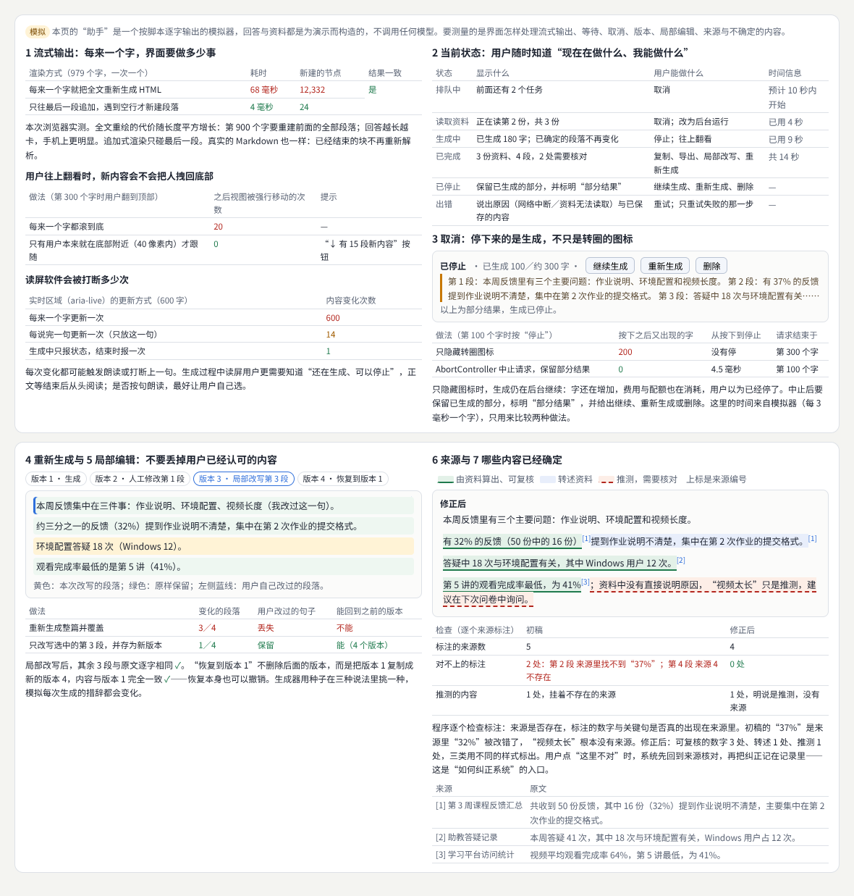
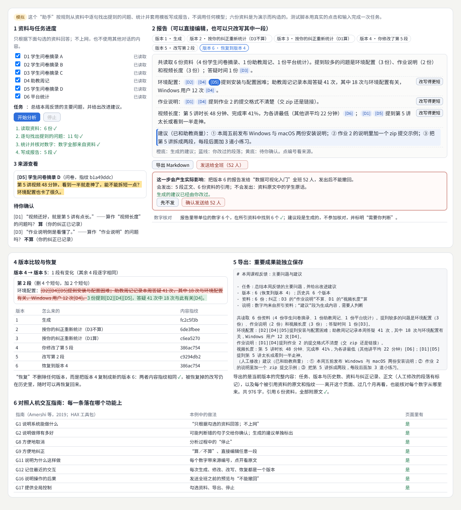
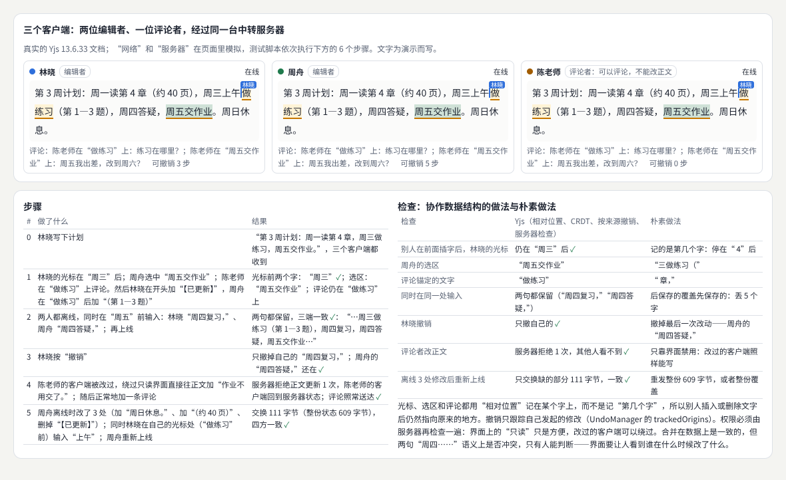
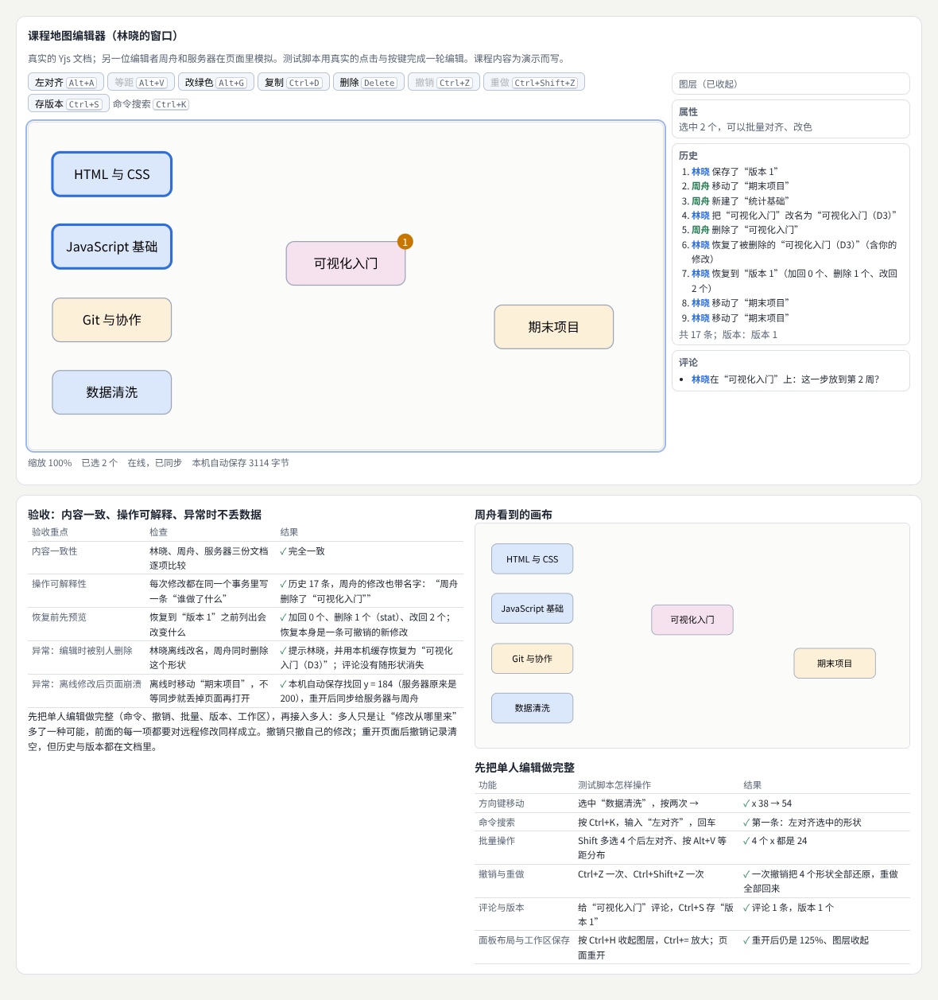
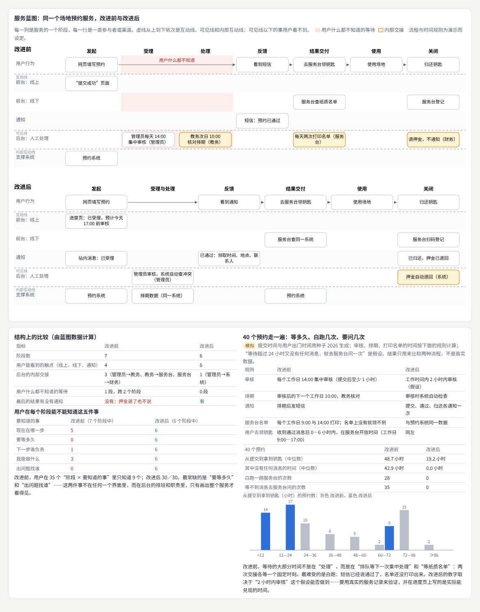
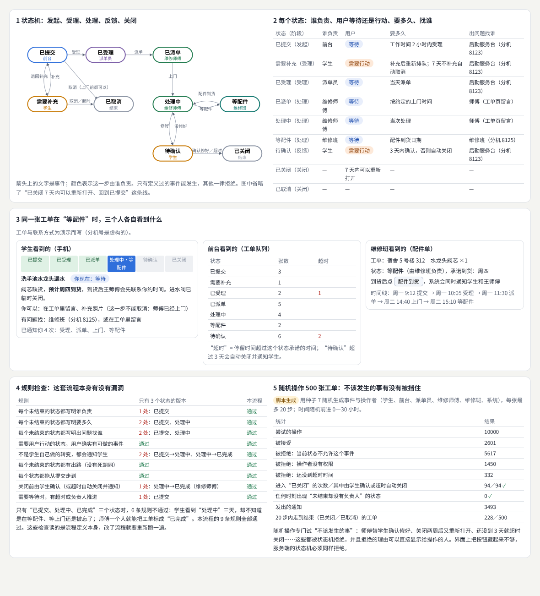
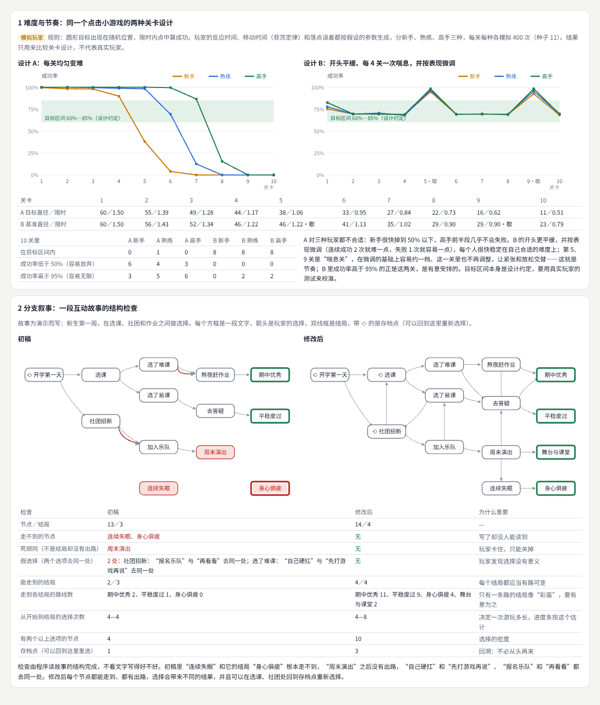
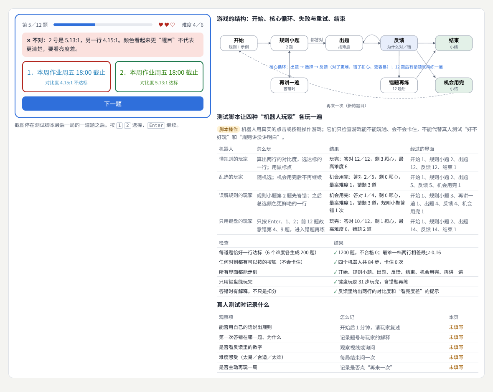
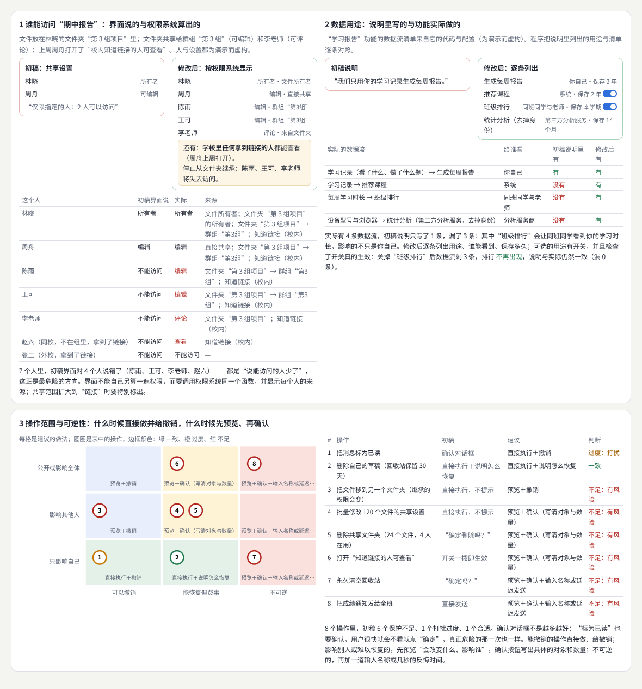
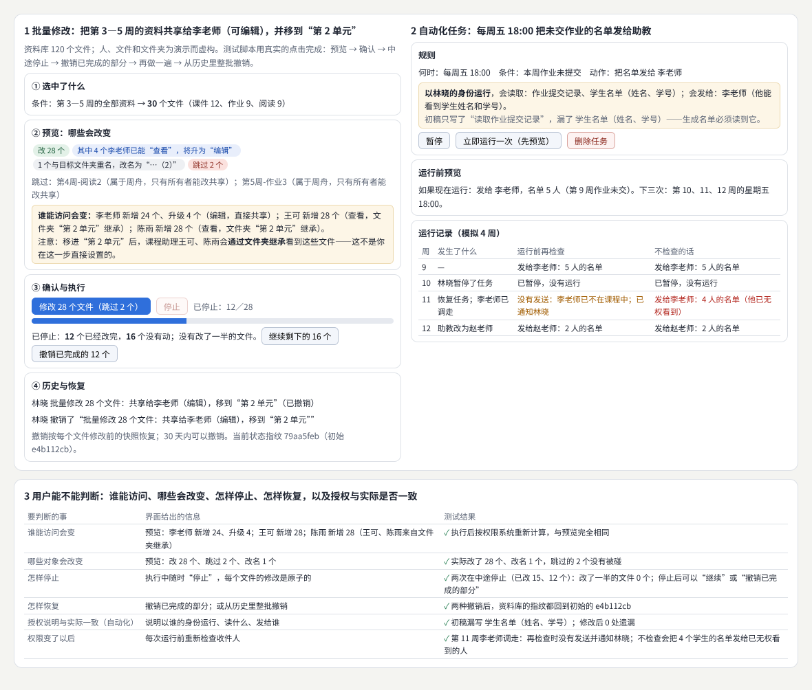

# 产品形态专题

> 五种对界面要求很高的产品形态：AI 产品与生成式界面、协作编辑器与专业工作台、服务设计与全流程体验、游戏体验与交互叙事、信任权限与可恢复设计。每个方向先讲概念与方法，再做一个可以验收的项目：一个资料分析助手、一个带撤销、评论和版本恢复的画布编辑器、一项校园报修服务、一个可以玩完的知识游戏、一套批量修改与自动化任务的完整流程。  
> 版本：1.0 · 整理日期：2026-10-25  
> 适用对象：已经能做页面和组件，开始负责完整产品的前端开发、设计师和产品同学。先修：读过[《前端界面工程》](01-前端界面工程.md)的状态管理部分、[《产品交互与用户体验》](03-产品交互与用户体验.md)的流程与可用性部分，以及[《计算设计与创作工具》](11-计算设计与创作工具.md)的 09 章（版本与协作）。

这五个方向可以接入前面的多个领域。它们按实际问题组织，适合用来**发现新的项目题材**、**补足产品能力**或**发展长期专长**。它们有三个共同点：

- **界面背后是一台状态机**。生成任务有排队、生成、停止、完成、出错；文档有版本；工单有受理、处理、等配件；游戏有开始、循环、失败、结束；批量任务有预览、执行、停止、撤销。先把状态和它们之间的转变画清楚，界面才不会漏掉情况。
- **操作会影响别人，也可能无法撤回**。发给全班、共享给助教、删除共享文件夹、合并别人的修改——要让人在做之前知道会改变什么、影响谁，在做之后能停下、能恢复。
- **要用可重复的方式验收**。机器人玩家、随机操作、已知答案的演练、修改前后的指纹比较，都能在不打扰任何人的情况下发现大部分问题；剩下的“好不好用、讲没讲明白”，再请真人来看。

本册每章都按同样的顺序讲：先说明它解决什么问题；再用白话解释核心概念；然后给出一个可以直接运行的示例与运行截图；接着是常见问题和本章练习；最后是一张**进阶学习卡**：技术栈、要掌握的高阶词汇（附英文）、搜索关键词、值得去看的实例，以及四级进阶阶梯：

| 级别 | 含义 |
| --- | --- |
| L1 入门 | 能运行并解释本章示例，说出每个概念的作用 |
| L2 熟练 | 能在自己的项目中正确使用这些方法，完成本章练习 |
| L3 进阶 | 能做完整的项目，并用脚本、检查和真实条件下的测试验收 |
| L4 深入 | 能在真实规模与真实用户中运营这些形态，研究方法的效果与边界 |

四级是本手册的教学结构，用来安排学习顺序，不对应任何公司的职级。

所有示例都放在本目录的[示例](示例/)文件夹中，用浏览器直接打开即可运行；每个示例都已在无头浏览器中实际运行并自动检查。书中的数字分三类，正文会逐处说明：**浏览器实际测得的**（渲染耗时、新建的节点数、停止所用的时间、同步交换的字节数、组装后三份文档的比较）、**按规则或模型算出的**（来源核对、权限计算、流程规则检查、对比度、指纹）、**为演示而构造的数据**（资料与回答、课程与工单、故事、文件与人员）。示例中的“助手”**不调用任何模型**，是按规则抽取与模板生成的模拟器；“玩家”“参与者”都是测试脚本或按假设参数生成的模拟玩家，**示例里没有真实用户的数据**。

主线是：**从状态与影响出发 → 五个方向各做一次“概念 ＋ 项目” → 方向之间的连接。**

## 阅读导航

正文共 13 章（01—13），附 10 个可运行示例、3 组附录与 37 项资料入口。

- [第一篇：共同的基础](#part-1)
  - [01 这一册研究什么](#ch01)
  - [02 共同的方法：状态、影响、责任与可重复的验收](#ch02)
- [第二篇：五个方向](#part-2)
  - [03 生成式界面：流式输出、取消、版本、局部编辑与来源](#ch03)
  - [04 AI 项目：资料分析助手](#ch04)
  - [05 协作编辑：光标、评论、各自撤销、权限、冲突与离线恢复](#ch05)
  - [06 协作项目：带撤销、评论和版本恢复的画布编辑器](#ch06)
  - [07 服务设计：用户旅程、服务蓝图与等待](#ch07)
  - [08 服务项目：校园报修](#ch08)
  - [09 游戏体验：规则、难度、节奏与分支叙事](#ch09)
  - [10 游戏项目：一个可以玩完的知识游戏](#ch10)
  - [11 信任与权限：界面说的与系统做的是否一致](#ch11)
  - [12 信任项目：批量修改与自动化任务](#ch12)
- [第三篇：连接与路线](#part-3)
  - [13 方向之间的连接、工具与学习路线](#ch13)
- [附录 A：术语表](#appendix-a)
- [附录 B：资料入口](#appendix-b)
- [附录 C：与原手册的对应关系及修订记录](#appendix-c)

## 第一篇：共同的基础

### 01 这一册研究什么

| 方向 | 核心问题 | 本册的项目 | 主要连接 |
| --- | --- | --- | --- |
| AI 产品与生成式界面交互 | 用户是否知道当前状态、哪些内容已经确定、如何纠正系统、哪些动作会产生实际影响 | 资料分析助手（04） | 内容设计、无障碍、信任 |
| 协作编辑器与专业工作台 | 多人同时修改时内容是否一致，每次修改能否解释、能否找回 | 画布编辑器（06） | 前端状态、数据结构、计算设计 |
| 服务设计与全流程体验 | 界面之外的线下环节、人工处理与通知是否衔接，用户何时等待、何时行动 | 校园报修服务（08） | 产品流程、内容设计 |
| 游戏体验与交互叙事 | 规则是否清楚，难度与节奏是否合适，选择是否有意义 | 小型知识游戏（10） | 动效、声音、学习设计 |
| 信任、权限与可恢复设计 | 用户能否判断谁能访问、哪些对象会改变、怎样停止和恢复 | 批量修改与自动化任务（12） | 安全、后端、服务设计 |

五个方向各用两章：先讲概念与方法，再做项目。

### 02 共同的方法：状态、影响、责任与可重复的验收

#### 02.1 先画状态

把产品画成状态和转变：

| 产品形态 | 状态的例子 | 本册章节 |
| --- | --- | --- |
| 生成任务 | 排队、读取资料、生成中、已完成、已停止、出错 | 03、04 |
| 协作文档 | 在线、离线、同步中；每次修改是一个版本 | 05、06 |
| 服务工单 | 已提交、需要补充、已受理、已派单、处理中、等配件、待确认、已关闭 | 07、08 |
| 游戏 | 开始、规则小题、出题、反馈、错题再练、结束、机会用完 | 09、10 |
| 批量任务 | 预览、执行中、已停止、已完成、已撤销 | 12 |

每个状态都要回答：用户现在看到什么、能做什么、要等多久、出了问题找谁。状态图也是测试的依据：只有画出来的转变能发生，其他一律拒绝（08 章）。

#### 02.2 影响与可逆性

一个操作该直接执行并给撤销，还是先预览、再确认，取决于两件事：**影响到谁**（只影响自己、影响其他人、公开）和**能否撤回**（可以撤销、能恢复但费事、不可逆）。11 章用一张矩阵把八个常见操作放进去；确认对话框不是越多越好。

#### 02.3 责任与交接

服务里的每一步都要有负责的人或系统；从一个人交给另一个人（交接）的地方最容易出问题：等下一次集中处理、等一张纸质名单、谁也没通知用户（07 章）。

#### 02.4 用可重复的方式验收

| 方法 | 用途 | 本册例子 |
| --- | --- | --- |
| 测试脚本的真实点击与按键 | 走完一遍主要流程 | 04、06、10、12 |
| 已知答案 | 事先知道结果的输入，检验程序算得对不对 | 03 的来源核对、12 的撤销后指纹 |
| 随机操作 | 大量尝试“不该发生的事” | 08 的 500 张工单 |
| 模拟玩家或模拟服务 | 在假设的参数下比较两种设计 | 07、09 |
| 指纹（哈希）比较 | 判断两份内容是否完全相同 | 04、06、12 |

这些都不能代替真人：规则讲没讲明白、等待是否难受、选择是否有意思，要请人来试，并在报告里写明哪些结论来自模拟。

**本章练习**：

1. 为你正在做的产品画一张状态图，给每个状态写上“用户看到什么、能做什么、要等多久、找谁”。
2. 列出产品里最危险的三个操作，按“影响到谁、能否撤回”分类，并写出你会用的保护方式。

## 第二篇：五个方向

### 03 生成式界面：流式输出、取消、版本、局部编辑与来源

#### 03.1 解决什么问题

AI 产品与生成式界面交互需要处理**流式输出**、**等待**、**取消**、**重新生成**、**局部编辑**、**来源展示**和**不确定结果**。设计者应让用户理解**当前状态**、**哪些内容已经确定**、**如何纠正系统**，以及哪些动作会产生实际影响[B01](#ref-b01)[B02](#ref-b02)[B03](#ref-b03)。

#### 03.2 核心概念

| 概念 | 含义 | 做法 |
| --- | --- | --- |
| 流式输出 | 边生成边显示，减少等待[B04](#ref-b04)[B05](#ref-b05) | 只追加最后一段；已经结束的段落不再重新渲染 |
| 等待与当前状态 | 用户随时知道系统正在做什么、自己能做什么 | 每个状态写明显示什么、能做什么、时间信息 |
| 取消 | 停下来的是生成本身，而不只是转圈的图标 | `AbortController` 中止请求，保留部分结果[B06](#ref-b06) |
| 重新生成 | 再生成一次，措辞会变 | 存为新版本，不覆盖旧的 |
| 局部编辑 | 只改选中的一段 | 其余段落逐字保留 |
| 来源展示 | 每个数字和说法能回到原文 | 标注编号，点开看原文；程序核对标注 |
| 不确定结果 | 推测与事实分开 | 由资料算出、转述资料、推测三种样式 |
| 纠正 | 用户指出错误，系统回到来源核对 | 记录纠正，之后的结果按纠正计算（04 章） |

#### 03.3 示例：七种状态与做法

示例：[17-03-ai-states.html](示例/17-03-ai-states.html)

页面上的“助手”是按脚本逐字输出的模拟器，回答与资料都是构造的。要测量的是界面怎样处理这些情况：

**流式输出**：979 个字一次一个地显示（浏览器实测，截图那次）：

| 渲染方式 | 耗时 | 新建的节点 |
| --- | --- | --- |
| 每来一个字就把全文重新生成 HTML | 68 毫秒 | 12,332 |
| 只往最后一段追加，遇到空行才新建段落 | 4 毫秒 | 24 |

两种结果的文字完全一致；全文重绘的代价随长度平方增长，回答越长越卡。第 300 个字时用户翻到顶部：“每来一个字都滚到底”之后视图被强行移动 20 次；“只有用户本来就在底部 40 像素内才跟随”为 0 次，并显示“↓ 有 15 段新内容”。读屏软件方面，`aria-live` 区域在 600 个字中每字更新 600 次、每句更新 14 次、只在结束时报 1 次——生成过程中只报状态、结束后让人从头阅读，最不打扰[B07](#ref-b07)。

**当前状态**：排队中、读取资料、生成中、已完成、已停止、出错，每种状态都写明显示什么、用户能做什么（取消、改为后台运行、继续生成、只重试失败的那一步）和时间信息。

**取消**：模拟器每 3 毫秒输出一个字，在第 100 个字时按“停止”：

| 做法 | 按下之后又出现的字 | 请求结束于 |
| --- | --- | --- |
| 只隐藏转圈图标 | 200 | 第 300 个字 |
| `AbortController` 中止请求，保留部分结果 | 0（4.5 毫秒内停止） | 第 100 个字 |

只隐藏图标时生成仍在继续，费用与配额也在消耗，用户却以为已经停了。

**重新生成与局部编辑**：

| 做法 | 变化的段落 | 用户改过的句子 | 能回到之前的版本 |
| --- | --- | --- | --- |
| 重新生成整篇并覆盖 | 3／4 | 丢失 | 不能 |
| 只改写选中的第 3 段，并存为新版本 | 1／4 | 保留 | 能（4 个版本） |

局部改写后其余 3 段逐字相同；“恢复到版本 1”不删除后面的版本，而是把版本 1 复制成版本 4，内容完全一致——恢复本身也可以撤销。

**来源与哪些内容已经确定**：程序逐个检查标注——来源是否存在，标注的数字与关键句是否真的出现在来源里。初稿 5 处标注中 2 处对不上：“37%”在来源里是“32%”，“视频太长”标注了一个不存在的来源 4。修正后 4 处标注全部对上；可复核的数字 3 处、转述 1 处、推测 1 处，推测明说“资料中没有直接说明原因，只是推测，建议在下次问卷中询问”，不挂来源。

#### 03.4 常见问题

- **流式输出越来越卡**：每个字都重绘全文；改为只追加最后一段。
- **生成时把用户拽回底部**：只在用户本来就在底部时跟随。
- **“停止”只是隐藏了图标**：请求要真正中止，并保留部分结果。
- **重新生成覆盖了用户的修改**：每次生成都是新版本，用户改过的段落要保留。
- **来源编号随便挂**：编号要能点开看原文，程序要核对数字与原文一致。
- **把推测写得像事实**：推测要明说，并告诉用户怎样验证。

**本章练习**：

1. 为你的生成功能列出所有状态，写出每个状态显示什么、能做什么。
2. 为生成结果写一个来源核对程序：每个数字都要在所引原文中找到。

#### 03.5 进阶学习卡

| 级别 | 目标 | 怎样检验 |
| --- | --- | --- |
| L1 入门 | 能做流式显示、停止与重新生成 | 示例的七组测量都能解释 |
| L2 熟练 | 能做版本、局部编辑与来源标注 | 局部改写不影响其他段落 |
| L3 进阶 | 能自动核对来源，区分确定与推测，并支持纠正 | 来源核对 0 处对不上 |
| L4 深入 | 能为真实的模型输出设计评估与反馈闭环，研究用户的信任是否恰当 | 评估集、用户研究与改进记录 |

- **技术栈**：Fetch 与 Streams API、Server-Sent Events；`AbortController`；增量渲染（只追加最后一块）；`aria-live`；版本存储；来源核对脚本。
- **高阶词汇**：生成式界面（generative UI）、流式输出（streaming）、首字时间（time to first token）、取消（cancellation）、重新生成（regeneration）、局部编辑（inline editing）、来源标注（citation／grounding）、不确定性表达（uncertainty communication）、恰当的信任（calibrated trust）、人机协作（human-AI collaboration）。
- **搜索关键词**：`streaming ui markdown incremental render`、`abortcontroller cancel fetch stream`、`ai citation grounding ux`、`human-ai interaction guidelines`、`uncertainty in ai interfaces`、`生成式 界面 设计`。
- **值得看的实例**：[Elicit](https://elicit.com/)——一个研究资料助手，看它怎样把每个结论连回原始论文、怎样表示哪些结果需要核对。
- **资料**：[B01](#ref-b01)、[B02](#ref-b02)、[B03](#ref-b03)、[B08](#ref-b08)、[B04](#ref-b04)、[B05](#ref-b05)、[B06](#ref-b06)、[B07](#ref-b07)。

### 04 AI 项目：资料分析助手

#### 04.1 任务

做一个资料分析或创作助手，提供**任务进度**、**可编辑结果**、**来源查看**、**版本比较**与**恢复**。重要成果应能够导出与独立保存。参考 Microsoft HAX Toolkit[B01](#ref-b01)，用于理解人机协作的设计问题。

#### 04.2 示例

示例：[17-04-ai-assistant.html](示例/17-04-ai-assistant.html)

“助手”按规则从六份构造的资料（四份学生问卷摘录、一份助教周记、一份平台统计）中逐句找出提到的问题，统计后套用模板写成报告，不调用任何模型。测试脚本用真实的点击和输入完成一次任务：

**任务进度**：读取资料 6／6 → 逐句找出提到的问题（11 句，其中 2 句可能是正面评价）→ 统计并核对数字 → 写成报告（5 段）。过程中可以停止。

**如何纠正系统**：两句话交给用户确认——“视频还好，就是第 5 讲有点长”算不算视频长度的问题（用户判“算”），“作业说明倒是看懂了”算不算作业说明的问题（用户判“不算”）。系统按纠正重新统计，并把纠正写进记录。

**可编辑结果与版本**：

| 版本 | 怎么来的 |
| --- | --- |
| 1 | 生成 |
| 2 | 按纠正重新统计（D3 不算） |
| 3 | 按纠正重新统计（D1 算） |
| 4 | 用户修改了第 5 段（建议） |
| 5 | 只改写第 2 段（更短） |
| 6 | 恢复到版本 4（内容指纹与版本 4 相同） |

**版本比较**：版本 4 → 版本 5 只有 1 段变化，其余 4 段逐字相同；按短句比较，删 4 个短句、加 2 个短句。逐字比较对中文很难读，示例改为按“，。；：”切成短句再比较。

**来源查看**：点报告里的编号，在旁边看到原文、资料的指纹，以及被引用的句子高亮。报告里带单位的 6 个数字全部能在所引资料中找到；“建议”段是生成的，不参加核对，并标明“需要你判断”。

**导出**：导出当前版本的 Markdown：任务、版本与历史数、资料与纠正记录、正文（人工修改的段落有标记），以及每份被引用资料的原文和指纹，共 976 字，引用 6 份资料全部附原文——离开这个页面、过几个月再看，也能核对每个数字从哪里来。

**会产生实际影响的动作**：“发送给全班（52 人）”与导出分开，用不同的样式；点下后先预览：发给谁、会发出什么、不会发出什么（学生原话不发）、发出后不能撤回，以及“生成的建议是否已经有人改过”。测试脚本选择“先不发”。

**对照人机交互指南**[B02](#ref-b02)：G1 说明系统能做什么（“只根据勾选的资料回答；不上网”）、G2 说明做得有多好（待确认的句子、生成的建议单独标出）、G8 方便地取消、G9 方便地纠正、G11 说明为什么这样做（来源）、G12 记住最近的交互（版本）、G16 说明操作的后果（发送前预览）、G17 提供全局控制——8 条都能在页面里找到对应的功能。

制作时的一处修正：用户编辑段落后，引用编号丢了方括号（编号按钮只显示“D1”）；改为按钮显示“[D1]”，编辑后文字里的编号原样保留。

#### 04.3 验收清单

- [ ] 任务进度说明每一步做了什么、处理了多少，可以停止。
- [ ] 结果可以直接编辑，也可以只改写一段；每次变化都是一个版本。
- [ ] 版本之间可以比较，恢复不删除任何版本。
- [ ] 每个数字都有来源，点开能看到原文；程序核对过。
- [ ] 系统没有把握的地方交给用户确认，纠正会被记住。
- [ ] 重要成果可以导出，导出物自带来源与版本信息。
- [ ] 会产生实际影响的动作先预览，并与普通操作区分。

#### 04.4 常见问题

- **把“导出”和“发送”放在一起**：一个只影响自己，一个影响 52 个人，样式和流程都要分开。
- **用户编辑后来源丢了**：编辑器要把来源编号当作文字的一部分保留。
- **版本太多看不过来**：每个版本写清“怎么来的”，比较时只显示变化的段落。
- **导出的文件离开系统就看不懂**：把来源原文、版本和纠正记录一起导出。
- **把模型的输出当作最终结果**：生成的部分要标明，并让人确认。

**本章练习**：

1. 给示例增加第七份资料，看哪些数字与段落会变，并比较新旧版本。
2. 按 HAX 的 18 条指南逐条检查你自己的 AI 功能，列出缺的几条。

#### 04.5 进阶学习卡

| 级别 | 目标 | 怎样检验 |
| --- | --- | --- |
| L1 入门 | 能做带进度与来源的结果页 | 每个数字都能点开原文 |
| L2 熟练 | 能做版本、比较、恢复与导出 | 恢复后的指纹与原版本相同 |
| L3 进阶 | 能设计纠正与确认的闭环，并区分有实际影响的动作 | 按 HAX 指南逐条有对应 |
| L4 深入 | 能在真实模型与真实用户中评估助手的有用性与风险 | 评估报告、失败案例与改进 |

- **技术栈**：任务进度与 `AbortController`；`contenteditable` 或富文本编辑器；按短句的差异比较（最长公共子序列）；Markdown 导出；内容指纹（哈希）。
- **高阶词汇**：人在回路中（human-in-the-loop）、任务进度（task progress）、来源查看（source inspection）、版本比较（diff）、恢复（restore）、纠正反馈（corrective feedback）、导出（export）、人机交互指南（guidelines for human-AI interaction）、有后果的动作（consequential action）。
- **搜索关键词**：`hax toolkit guidelines human-ai interaction`、`ai assistant source citation ui`、`document version diff restore ux`、`people ai guidebook`、`text diff chinese sentence`、`AI 助手 交互 设计`。
- **值得看的实例**：[HAX 设计库](https://www.microsoft.com/en-us/haxtoolkit/design-library/)——按 18 条指南整理的设计模式与真实产品案例。
- **资料**：[B01](#ref-b01)、[B02](#ref-b02)、[B03](#ref-b03)、[B08](#ref-b08)。

### 05 协作编辑：光标、评论、各自撤销、权限、冲突与离线恢复

#### 05.1 解决什么问题

协作编辑器与专业工作台横向进入多人光标、选区、评论、历史、权限、冲突和离线恢复。专业工具还需要快捷键、命令搜索、批量操作、面板布局和工作区保存（06 章）。复杂交互应建立明确的数据与状态模型。同时编辑的基本问题（并发修改、离线、保存失败）见[《计算设计与创作工具》](11-计算设计与创作工具.md) 09 章；本章讲光标、评论、撤销与权限。

#### 05.2 核心概念

| 概念 | 含义 | 做法 |
| --- | --- | --- |
| CRDT | 各端独立修改、最后自动合并为同一结果的数据结构[B09](#ref-b09) | Yjs 等库[B10](#ref-b10) |
| 相对位置 | 把光标、选区、评论锚点记在“某个字”上，而不是“第几个字”[B11](#ref-b11) | 别人插入、删除后仍指向原处 |
| 各自撤销 | 撤销只撤自己的修改[B12](#ref-b12) | 撤销管理器只跟踪自己发起的事务 |
| 权限 | 谁能改正文、谁只能评论 | 服务器检查每一条更新；界面的“只读”只是方便 |
| 冲突 | 两人同时改同一处 | 数据上自动合并；语义上的冲突要让人看到 |
| 离线恢复 | 离线时继续编辑，上线后合并 | 交换状态向量，只补缺的部分；本地持久化[B13](#ref-b13) |

#### 05.3 示例：三个客户端、六个步骤

示例：[17-05-collab-basics.html](示例/17-05-collab-basics.html)

真实的 Yjs 13.6.33 文档；“网络”和“服务器”在页面里模拟。林晓、周舟是编辑者，陈老师是评论者。正文初始为“第 3 周计划：周一读第 4 章，周三做练习，周五交作业。”

| 检查 | 相对位置、CRDT、按来源撤销、服务器检查 | 朴素做法 |
| --- | --- | --- |
| 开头加“【已更新】”、“做练习”后加“（第 1—3 题）”之后，林晓的光标 | 仍在“周三”后 | 记的是第几个字：停在“ 4”后 |
| 周舟的选区 | “周五交作业” | “三做练习（”（多了半个括号） |
| 评论锚定的文字 | “做练习” | “ 章，” |
| 两人离线，同时在“周五”前输入“周四复习，”“周四答疑，” | 两句都保留，三端一致；上线时分别交换 44、79 字节 | 后保存的覆盖先保存的：丢 5 个字 |
| 林晓撤销 | 只撤自己的“周四复习，” | 撤掉最后一次改动——周舟的“周四答疑，” |
| 评论者的客户端被改过，绕过只读界面直接往正文加“作业不用交了。” | 服务器拒绝 1 次，其他人与服务器都看不到；它随后的评论照常送达 | 只靠界面禁用：改过的客户端照样能写 |
| 周舟离线改了 3 处，同时林晓在自己的光标处输入“上午”，周舟重新上线 | 只交换缺的部分 110 字节（整份状态 620 字节），四方一致 | 重发整份或整份覆盖 |

最终正文：“第 3 周计划：周一读第 4 章（约 40 页），周三上午做练习（第 1—3 题），周四答疑，周五交作业。周日休息。”

制作时的一处修正：撤销产生的修改，来源是撤销管理器本身而不是用户，最初没有转发给服务器；改为同样转发。

**合并在数据上一致，不等于语义上没有冲突**：“周四答疑”和“周四复习”是否矛盾，只有人能判断。界面要让人看到谁在什么时候改了什么（06 章的历史）。

#### 05.4 常见问题

- **光标和评论“跑”到别处**：用的是“第几个字”；改用相对位置。
- **撤销把别人的修改撤掉了**：撤销只跟踪自己发起的修改。
- **权限只在界面上做**：客户端可以被修改；服务器必须检查每一条更新。
- **离线后整份覆盖**：交换状态向量，只补缺的部分；离线修改要先保存在本地。
- **“自动合并了”就不提示**：重要的合并结果要让人看到，并能从历史中找回。

**本章练习**：

1. 在示例中增加第四个客户端（只读查看者），检查它的光标与评论显示。
2. 记录你常用的一个协作工具在离线编辑后的合并行为，写出它保证什么、不保证什么。

#### 05.5 进阶学习卡

| 级别 | 目标 | 怎样检验 |
| --- | --- | --- |
| L1 入门 | 能用 Yjs 做两端同步的文本 | 两端内容一致 |
| L2 熟练 | 能做相对位置的光标、选区与评论，以及各自撤销 | 插入删除后位置正确 |
| L3 进阶 | 能做服务器权限检查与离线恢复 | 改过的客户端写不进来；离线合并一致 |
| L4 深入 | 能为大型文档设计同步、持久化与历史压缩，并处理语义冲突 | 性能测量与冲突处理方案 |

- **技术栈**：Yjs（`Y.Text`、`Y.Map`、`Y.UndoManager`、相对位置、状态向量）；y-websocket 或 y-webrtc；IndexedDB 持久化；Automerge 等其他 CRDT 库。
- **高阶词汇**：无冲突复制数据类型（conflict-free replicated data type，CRDT）、操作转换（operational transformation，OT）、相对位置（relative position）、在线状态（awareness／presence）、状态向量（state vector）、最终一致（eventual consistency）、本地优先（local-first）、按来源撤销（selective undo）。
- **搜索关键词**：`yjs relative position cursor`、`yjs undomanager trackedOrigins`、`crdt vs ot collaborative editing`、`local-first software`、`collaborative editor permissions server side`、`协同编辑 CRDT`。
- **值得看的实例**：[Yjs 演示](https://demos.yjs.dev/)——多个编辑器（文本、富文本、代码、绘图）的协作演示，可以开两个窗口对照。
- **资料**：[B09](#ref-b09)、[B10](#ref-b10)、[B11](#ref-b11)、[B12](#ref-b12)、[B14](#ref-b14)、[B13](#ref-b13)。

### 06 协作项目：带撤销、评论和版本恢复的画布编辑器

#### 06.1 任务

做一个带撤销、评论和版本恢复的画布或文档编辑器。先把单人编辑做完整，再加入多人协作。验收重点是内容一致性、操作可解释性和异常情况下的数据保护。

#### 06.2 示例

示例：[17-06-canvas-editor.html](示例/17-06-canvas-editor.html)

真实的 Yjs 文档；另一位编辑者周舟和服务器在页面里模拟；测试脚本用真实的点击与按键完成一轮编辑。

**先把单人编辑做完整**：所有功能都注册成“命令”，快捷键、工具栏和命令搜索共用一份[B15](#ref-b15)；命令在不可用时自动变灰（例如只选中 2 个时“等距分布”不可用）。

| 功能 | 测试脚本怎样操作 | 结果 |
| --- | --- | --- |
| 方向键移动 | 选中“数据清洗”，按两次 → | x 38 → 54 |
| 命令搜索 | 按 Ctrl+K，输入“左对齐”，回车 | 第一条就是“左对齐选中的形状” |
| 批量操作 | Shift 多选 4 个后左对齐，再按 Alt+V 等距分布 | 4 个 x 都是 24 |
| 撤销与重做 | Ctrl+Z 一次、Ctrl+Shift+Z 一次 | 一次撤销把 4 个形状全部还原，重做全部回来 |
| 评论与版本 | 给“可视化入门”评论，Ctrl+S 存“版本 1” | 评论 1 条，版本 1 个 |
| 面板布局与工作区保存 | Ctrl+H 收起图层面板，Ctrl+= 放大到 125%；页面重开 | 重开后仍是 125%、图层收起 |

**验收**：

| 验收重点 | 检查 | 结果 |
| --- | --- | --- |
| 内容一致性 | 林晓、周舟、服务器三份文档逐项比较 | 完全一致 |
| 操作可解释性 | 每次修改都在同一个事务里写一条“谁做了什么” | 历史 17 条，周舟的修改也带名字，例如“周舟删除了‘可视化入门’” |
| 恢复前先预览 | 恢复到“版本 1”之前列出会改变什么 | 加回 0 个、删除 1 个（统计基础）、改回 2 个；恢复本身是一条可撤销的新修改 |
| 异常：编辑时被别人删除 | 林晓离线把“可视化入门”改名为“可视化入门（D3）”，周舟同时删除这个形状 | 林晓上线后看到提示“……被周舟删除了。你的修改没有丢”，用本机缓存恢复为“可视化入门（D3）”；评论没有随形状消失，显示“所附形状已删除，评论保留” |
| 异常：离线修改后页面崩溃 | 离线时把“期末项目”上移 16 像素，不等同步就丢掉页面再打开 | 本机自动保存找回 y = 184（服务器原来是 200），重开后同步给服务器与周舟 |

制作时的三处修正：放大最初用“缩放内容”，形状会盖到侧栏上，改为缩小画布的 `viewBox`；删除提示最初取的是最后一条历史（其实是林晓自己的改名），改为找别人那条“删除”；重开页面后撤销记录清空，但历史与版本都在文档里。

**先单人、后多人**：多人只是让“修改从哪里来”多了一种可能，前面的每一项都要对远程修改同样成立——撤销只撤自己的，历史要写上别人的名字，被别人删除时要提示并能找回。

#### 06.3 验收清单

- [ ] 所有功能都是命令，快捷键、工具栏、命令搜索共用；不可用时说明原因。
- [ ] 批量操作是一次撤销；撤销只撤自己的修改。
- [ ] 每次修改都有“谁、做了什么”的历史，远程修改也有。
- [ ] 版本可以命名、预览后恢复，恢复本身可以撤销。
- [ ] 面板布局与缩放等工作区设置能保存。
- [ ] 多端内容一致；编辑中被删除、离线后崩溃都不丢数据。

#### 06.4 常见问题

- **快捷键、按钮、菜单各写一份逻辑**：注册成命令，一处定义。
- **批量操作要撤销很多次**：把批量修改放在一个事务里。
- **历史只有时间没有内容**：写成“谁把什么做了什么”，用户才看得懂。
- **恢复版本直接覆盖**：先列出会改变什么，再作为一次新的修改执行。
- **只在服务器保存**：离线或崩溃时未同步的修改会丢；本机要自动保存。

**本章练习**：

1. 给示例增加“对齐到网格”命令，并让它出现在命令搜索、工具栏和快捷键中。
2. 设计“版本恢复”的预览界面：用颜色标出会被删除、加回、改回的形状。

#### 06.5 进阶学习卡

| 级别 | 目标 | 怎样检验 |
| --- | --- | --- |
| L1 入门 | 能做带撤销与历史的单人画布编辑器 | 撤销、重做、历史都对 |
| L2 熟练 | 能做命令系统、命令搜索、批量操作与工作区保存 | 单人功能表全部通过 |
| L3 进阶 | 能接入多人协作，并通过一致性、可解释性与异常保护的验收 | 验收表全部通过 |
| L4 深入 | 能做大型文档的性能、权限与历史管理，并支持插件扩展 | 性能测量与扩展机制 |

- **技术栈**：命令模式与命令注册表；SVG 画布与 `viewBox` 缩放；Yjs（`Y.Map`、`Y.Array`、`Y.UndoManager`）；`localStorage`／IndexedDB 本地保存；模糊搜索。
- **高阶词汇**：命令面板（command palette）、命令模式（command pattern）、快捷键（keyboard shortcut）、批量操作（bulk action）、工作区（workspace）、操作历史（activity log）、命名版本（named version）、乐观更新（optimistic update）、自动保存（autosave）、崩溃恢复（crash recovery）。
- **搜索关键词**：`command palette design`、`undo redo command pattern`、`figma multiplayer`、`canvas editor yjs`、`autosave crash recovery indexeddb`、`画布 编辑器 协作`。
- **值得看的实例**：[Excalidraw](https://excalidraw.com/)——开源的协作白板，有命令面板、快捷键、多人协作与本地保存，可以对照它的交互细节。
- **资料**：[B15](#ref-b15)、[B16](#ref-b16)、[B14](#ref-b14)、[B12](#ref-b12)、[B13](#ref-b13)。

### 07 服务设计：用户旅程、服务蓝图与等待

#### 07.1 解决什么问题

服务设计与全流程体验把界面放进更大的服务过程，观察线上、线下、通知、人工处理和结果交付之间的关系。要学习用户旅程、服务触点、前台与后台流程[B17](#ref-b17)[B18](#ref-b18)。设计需要明确各方责任和状态传递。

#### 07.2 核心概念

| 概念 | 含义 |
| --- | --- |
| 用户旅程 | 用户从产生需要到得到结果的全过程[B19](#ref-b19) |
| 服务触点 | 用户接触到服务的每一处：网页、短信、服务台、门禁 |
| 前台与后台 | 用户看得到的与看不到的工作 |
| 服务蓝图 | 按阶段（列）和参与者（行）画出整个服务，并标出互动线、可见线、内部互动线[B20](#ref-b20) |
| 交接 | 工作从一个人或部门交给另一个 |
| 等待黑洞 | 用户在等，却既不知道进行到哪一步、也不知道要等多久 |

政府服务的设计手册把这些整理成了可以执行的方法[B21](#ref-b21)[B22](#ref-b22)。

#### 07.3 示例：校园场地预约的服务蓝图

示例：[17-07-service-blueprint.html](示例/17-07-service-blueprint.html)

流程与时间规则为演示而设定。蓝图的行依次是用户行为、前台（线上）、前台（线下）、通知、后台（人工处理）、支撑系统。

**结构上的比较**（由蓝图数据计算）：

| 指标 | 改进前 | 改进后 |
| --- | --- | --- |
| 阶段数 | 7 | 6 |
| 用户能看到的触点 | 4 | 6 |
| 后台的内部交接 | 3（管理员→教务、教务→服务台、服务台→财务） | 1 |
| 用户什么都不知道的等待 | 1 段，跨“受理”“处理”2 个阶段 | 0 |
| 最后的结果有没有通知 | 没有：押金退了也不说 | 有 |

**用户在每个阶段能不能知道五件事**（进行到哪一步、要等多久、下一步谁负责、我能做什么、出问题找谁）：改进前 35 格里只知道 9 格，“要等多久”和“出问题找谁”一格都没有；改进后 30／30。这两件事不在任何一个界面里，而在后台的排班和职责里，只有画出整个服务才看得见。

**40 个预约走一遍**：提交时间与用户出门时间用种子生成；改进前每个工作日 14:00 集中审核，次日 10:00 教务核对排期后发短信，服务台每天 9:00 与 14:00 打印名单；改进后工作时间内 2 小时审核（假设）、系统自动查冲突、服务台与预约系统同一数据。“等待超过 24 小时又没有任何消息，就去服务台问一次”也是假设。结果只用来比较两种流程：

| 40 个预约 | 改进前 | 改进后 |
| --- | --- | --- |
| 从提交到拿到钥匙（中位数） | 48.7 小时 | 19.2 小时 |
| 其中没有任何消息的时间（中位数） | 42.9 小时 | 0 |
| 白跑一趟服务台 | 28 次 | 0 |
| 等不到消息去服务台问 | 35 次 | 0 |

等待的大部分时间不在“处理”，而在“排队等下一次集中处理”和“等纸质名单”。改进后的数字取决于“2 小时内审核”能否做到，要用真实的服务记录验证，进度页上写的必须是能兑现的时间。

制作时的三处修正：最初名单只在次日打印，40 个预约全部白跑，不合理，改为每天两次；“等待黑洞”最初按“没有可见的卡片”判断，把改进后有进度页的等待也算了进去，改为“在等待且不知道进度和时长”；可见线和内部互动线画在了同一位置，分别移到前台与后台之间、后台与支撑系统之间。

#### 07.4 常见问题

- **只设计网页**：服务台、短信、纸质名单同样是服务的一部分。
- **集中处理造成的等待**：每次交接都可能等一个固定时刻；减少交接或改为连续处理。
- **结果不通知**：“押金已退回”“问题已解决”都要告诉用户。
- **进度页写不能兑现的时间**：承诺的时间要来自真实记录。
- **只问用户感受，不看后台**：蓝图把前台的体验和后台的原因连在一起。

**本章练习**：

1. 为学校或公司的一项服务（报修、报销、借设备）画一张服务蓝图，标出交接和等待黑洞。
2. 为其中一个阶段写出“五件事”：在哪一步、等多久、谁负责、能做什么、找谁。

#### 07.5 进阶学习卡

| 级别 | 目标 | 怎样检验 |
| --- | --- | --- |
| L1 入门 | 能画用户旅程与服务蓝图 | 五条泳道、三条线都正确 |
| L2 熟练 | 能找出交接、等待黑洞与缺失的通知 | 结构比较表 |
| L3 进阶 | 能提出改进并用记录或模拟估计效果 | 改进前后的数据对比 |
| L4 深入 | 能与业务部门一起改流程，并持续测量服务质量 | 服务指标与改进记录 |

- **技术栈**：服务蓝图与用户旅程图（可以用 SVG 或白板工具）；流程模拟（种子随机数、工作时间计算）；服务指标（等待时间、一次解决率、询问次数）。
- **高阶词汇**：服务设计（service design）、服务蓝图（service blueprint）、用户旅程图（customer journey map）、触点（touchpoint）、前台（frontstage）、后台（backstage）、可见线（line of visibility）、交接（handoff）、服务水平协议（service level agreement，SLA）、全渠道（omnichannel）。
- **搜索关键词**：`service blueprint example`、`line of visibility service design`、`customer journey map template`、`gov.uk service manual`、`handoff waiting time service`、`服务蓝图 服务设计`。
- **值得看的实例**：[GOV.UK 服务工具包](https://www.gov.uk/service-toolkit)——英国政府做数字服务用的标准、手册与组件，可以看一项公共服务从线上到线下是怎样设计的。
- **资料**：[B17](#ref-b17)、[B18](#ref-b18)、[B20](#ref-b20)、[B21](#ref-b21)、[B22](#ref-b22)。

### 08 服务项目：校园报修

#### 08.1 任务

做校园预约、报修或活动报名服务，梳理发起、受理、处理、反馈和关闭。界面应反映真实流程，明确用户何时需要等待、何时可以行动、发生问题联系谁。

#### 08.2 示例

示例：[17-08-repair-service.html](示例/17-08-repair-service.html)

**状态机**[B23](#ref-b23)：九个状态（已提交；需要补充、已受理；已派单、处理中、等配件；待确认；已关闭、已取消），对应发起、受理、处理、反馈、关闭五个阶段；十七个转变，包括退回补充、等配件、没修好、超时自动关闭、关闭后 7 天内重新打开、上门前可以取消。每个未结束的状态都写明负责人、用户是在等待还是需要行动、要多久、出问题找谁。工单、联系人与分机号是虚构的。

**同一张工单在“等配件”时，三个人各自看到什么**：

- 学生（手机）：进度条停在“处理中·等配件”；“你现在：等待”；阀芯缺货，预计周四到货，到货后王师傅会先联系你约时间；你可以在工单里留言、补充照片（这一步不能取消，师傅已经上门）；有问题找维修班（分机 8125）；已通知你 4 次。
- 前台（工单队列）：每个状态的张数和超时的张数；“待确认”超过 3 天会自动关闭并通知学生。
- 维修班（配件单）：这一步由维修班负责，承诺周四到货；到货后点“配件到货”，系统同时通知学生和师傅。

**规则检查**：程序读流程定义本身，与一个只有“已提交、处理中、已完成”三个状态的版本对比：

| 规则 | 3 个状态的版本 | 本流程 |
| --- | --- | --- |
| 每个未结束的状态都写明谁负责 | 1 处不通过 | 通过 |
| 每个未结束的状态都写明要多久 | 2 处 | 通过 |
| 每个未结束的状态都写明出问题找谁 | 2 处 | 通过 |
| 需要用户行动的状态，用户确实有可做的事件 | 通过 | 通过 |
| 不是学生自己做的转变，都会通知学生 | 2 处 | 通过 |
| 每个未结束的状态都有出路 | 通过 | 通过 |
| 每个状态都能从提交走到 | 通过 | 通过 |
| 关闭前由学生确认（或超时自动关闭并通知） | 1 处：师傅一个人就能标“已完成” | 通过 |
| 需要等待时有负责人推进 | 1 处 | 通过 |

只有三个状态时，学生看到“处理中”三天，却不知道是在等配件、等上门还是被忘了。

**随机操作 500 张工单**（种子 7，每张最多 20 步，事件与操作者随机，85% 的时间不选“取消”以便走完流程）：

| 统计 | 结果 |
| --- | --- |
| 尝试的操作／被接受 | 10000／2601 |
| 被拒绝：当前状态不允许这个事件 | 5617 |
| 被拒绝：操作者没有权限 | 1450 |
| 被拒绝：还没到超时时间 | 332 |
| 进入“已关闭”的次数／其中由学生确认或超时自动关闭 | 94／94 |
| 任何时刻出现“未结束却没有负责人”的状态 | 0 |
| 发出的通知 | 3493 |
| 20 步内走到结束的工单 | 228／500 |

随机操作专门试“不该发生的事”：师傅替学生确认修好、还没到 3 天就超时关闭……这些都被状态机拒绝，并且拒绝的理由可以直接显示给操作的人。界面上把按钮藏起来不够，服务端的状态机必须同样拒绝。工作流引擎与状态图工具可以把这些写成可视化、可测试的定义[B24](#ref-b24)。

#### 08.3 验收清单

- [ ] 流程覆盖发起、受理、处理、反馈、关闭，以及补充、等待、取消、重新打开、超时。
- [ ] 每个状态写明负责人、等待还是行动、时长与联系人，并显示在用户的界面上。
- [ ] 不是用户自己做的变化都会通知用户。
- [ ] 关闭由用户确认，或超时自动关闭并通知。
- [ ] 规则检查全部通过；随机操作中非法事件全部被拒绝。
- [ ] 前台和后台人员各有自己的视图。

#### 08.4 常见问题

- **状态太少**：“处理中”里藏着等上门、等配件、等审批，用户只能干等。
- **只给用户看进度条**：还要写出预计时间和联系人。
- **处理人自己关闭工单**：问题是否解决应由提出的人确认。
- **状态只在界面上限制**：服务端必须用同一个状态机拒绝非法操作。
- **忘了“重新打开”**：修好又坏了是常见情况。

**本章练习**：

1. 为“活动报名”服务写出状态机，并用示例的九条规则检查。
2. 给示例增加“改约上门时间”的事件，补上通知与权限，并重新跑随机操作。

#### 08.5 进阶学习卡

| 级别 | 目标 | 怎样检验 |
| --- | --- | --- |
| L1 入门 | 能画出服务的状态机，并写出每个状态的四件事 | 状态表完整 |
| L2 熟练 | 能做用户、前台、后台三种视图 | 三视图信息一致 |
| L3 进阶 | 能用规则检查与随机操作验证流程 | 检查全部通过 |
| L4 深入 | 能把流程接入真实的工单系统与通知渠道，并持续测量 | 服务指标与超时分析 |

- **技术栈**：状态机与状态图（XState 等）；服务端的转变检查与权限；通知（站内、短信、邮件）；随机测试（种子随机数、基于性质的测试）。
- **高阶词汇**：状态机（state machine）、状态图（statechart）、工作流（workflow）、工单（ticket）、服务水平协议（SLA）、超时（timeout）、不变量（invariant）、基于性质的测试（property-based testing）、职责分配（ownership）。
- **搜索关键词**：`statechart workflow ticket`、`xstate state machine`、`property based testing state machine`、`ticket status design ux`、`service level agreement timeout`、`工单 状态 设计`。
- **值得看的实例**：[Linear 的工作流配置](https://linear.app/docs/configuring-workflows)——看一个任务管理工具怎样让团队定义自己的状态，以及状态之间的约定。
- **资料**：[B23](#ref-b23)、[B24](#ref-b24)、[B20](#ref-b20)。

### 09 游戏体验：规则、难度、节奏与分支叙事

#### 09.1 解决什么问题

游戏体验与交互叙事要学习**规则**、**目标**、**反馈**、**难度**、**节奏**和**叙事选择**[B25](#ref-b25)。游戏化界面应围绕用户任务设计，奖励和挑战需要能够解释其作用[B26](#ref-b26)。交互故事还涉及**分支**、**回溯**、**进度**和**结局**。

#### 09.2 核心概念

| 概念 | 含义 |
| --- | --- |
| 规则与目标 | 玩家能做什么、要达成什么 |
| 反馈 | 每次操作后立刻知道结果和原因 |
| 难度曲线 | 随关卡变化的挑战；太难放弃，太易无聊[B27](#ref-b27) |
| 动态难度 | 按玩家表现调整[B28](#ref-b28)；“连续成功 2 次变难、失败 1 次变易”会稳定在约 71% 的成功率[B29](#ref-b29) |
| 节奏 | 紧张与放松交替，例如“喘息关” |
| 分支叙事 | 玩家的选择带来不同的段落与结局[B30](#ref-b30)[B31](#ref-b31) |
| 回溯 | 回到存档点重新选择 |

#### 09.3 示例：难度曲线与分支叙事的检查

示例：[17-09-game-basics.html](示例/17-09-game-basics.html)

**难度与节奏**：一个限时点中圆点的小游戏。玩家是模拟的：反应时间、移动时间（菲茨定律[B32](#ref-b32)）和落点误差都按假设的参数生成，分新手、熟练、高手，每关每种模拟 400 次。目标区间 60%—85% 是设计约定。

| 10 关里 | A 新手 | A 熟练 | A 高手 | B 新手 | B 熟练 | B 高手 |
| --- | --- | --- | --- | --- | --- | --- |
| 在目标区间内 | 0 | 1 | 0 | 8 | 8 | 8 |
| 成功率低于 50%（容易放弃） | 6 | 4 | 3 | 0 | 0 | 0 |
| 成功率高于 95%（容易无聊） | 3 | 5 | 6 | 0 | 2 | 2 |

设计 A 每关均匀变难：新手第 5 关成功率 38%、第 6 关 4%；高手前 6 关几乎不会失败。设计 B 开头平缓，并按表现微调，每个人很快稳定在约 70% 的成功率；第 5、9 关是喘息关，在微调的基础上容易约一档、这一关里也不调整，成功率升到 93%—98%——B 里“高于 95%”的正是这两关，是有意安排的。目标区间本身要用真实玩家的测试来校准。

制作时的两处修正：最初的微调范围太窄，高手仍有 8 关高于 95%，改为“2 上 1 下”的阶梯法并放宽范围；喘息关最初也在微调，几乎没有差别，改为喘息关内不调整。

**分支叙事**：一段为演示而写的互动故事（新生第一周，在选课、社团和作业之间做选择）。程序读故事的结构：

| 检查 | 初稿 | 修改后 |
| --- | --- | --- |
| 节点／结局 | 13／3 | 14／4 |
| 走不到的节点 | 连续失眠、身心俱疲 | 无 |
| 死胡同（不是结局却没有出路） | 周末演出 | 无 |
| 假选择（两个选项去同一处） | 2 处：“报名乐队”与“再看看”；“自己硬扛”与“先打游戏再说” | 无 |
| 能走到的结局 | 2／3 | 4／4 |
| 走到各结局的路线数 | 期中优秀 2、平稳度过 1、身心俱疲 0 | 期中优秀 11、平稳度过 9、身心俱疲 4、舞台与课堂 2 |
| 从开始到结局的选择次数 | 4 | 4—8 |
| 有两个以上选项的节点 | 4 | 10 |
| 存档点 | 1 | 3 |

选择次数决定一次游玩多长，进度条按它估计；存档点让玩家不必从头再来。检查只看结构，不看文字写得好不好。

#### 09.4 常见问题

- **只看画面不看可玩性**：规则是否清楚、难度是否合适，要观察真人怎样玩。
- **难度均匀上升**：对不同水平的人都不合适；开头平缓、加入喘息、按表现微调。
- **奖励没有意义**：积分和徽章要说明它鼓励什么行为。
- **假选择**：两个选项去同一处，玩家会觉得被骗。
- **故事写到一半没有出路**：用程序检查可达性与死胡同。

**本章练习**：

1. 改变模拟玩家的参数（例如更慢的反应时间），看设计 B 是否仍然合适。
2. 用 Twine 或 ink 写一个 10 个节点的小故事，用示例的规则检查它的结构。

#### 09.5 进阶学习卡

| 级别 | 目标 | 怎样检验 |
| --- | --- | --- |
| L1 入门 | 能说出一个游戏的规则、目标、反馈与核心循环 | 一页游戏说明 |
| L2 熟练 | 能用模拟估计难度曲线，设计节奏 | 难度曲线与喘息关 |
| L3 进阶 | 能写分支故事并自动检查结构 | 结构检查全部通过 |
| L4 深入 | 能组织玩家测试，用数据调整难度与叙事 | 测试记录与调整 |

- **技术栈**：模拟（种子随机数、菲茨定律、阶梯法）；图的遍历（可达性、路径计数）；Twine、ink 等叙事工具；Canvas／SVG 图表。
- **高阶词汇**：机制—动态—美学框架（MDA framework）、核心循环（core loop）、心流（flow）、难度曲线（difficulty curve）、动态难度调整（dynamic difficulty adjustment）、节奏（pacing）、分支叙事（branching narrative）、存档点（checkpoint）、有意义的选择（meaningful choice）、游戏化（gamification）。
- **搜索关键词**：`mda framework game design`、`dynamic difficulty adjustment`、`flow channel game difficulty`、`branching narrative structure`、`twine ink interactive fiction`、`游戏 难度 曲线 设计`。
- **值得看的实例**：[Twine](https://twinery.org/)——开源的互动故事工具，可以直接看到故事的分支图；配合 [ink 的网页教程](https://www.inklestudios.com/ink/web-tutorial/)看专业叙事游戏怎样写分支。
- **资料**：[B25](#ref-b25)、[B27](#ref-b27)、[B28](#ref-b28)、[B29](#ref-b29)、[B26](#ref-b26)、[B30](#ref-b30)、[B31](#ref-b31)、[B32](#ref-b32)。

### 10 游戏项目：一个可以玩完的知识游戏

#### 10.1 任务

做一个可完成的小型知识游戏或互动故事。定义清楚的开始、核心循环、失败与重试、结束。观察用户是否理解规则，避免只评价画面而忽略实际可玩性。

#### 10.2 示例

示例：[17-10-knowledge-game.html](示例/17-10-knowledge-game.html)

一个关于文字对比度的知识游戏（规则见[《包容、国际化与多感官》](16-包容国际化与多感官.md) 03 章）：

- **清楚的开始**：目标、规则和一个示例（4.54:1 达标、2.32:1 不达标），然后两道规则小题；答错就“再讲一遍”。
- **核心循环**：12 道题，每题从两行文字中选出够清楚的一行；答对下一题更难（两行越来越接近，最难一档是 4.55—4.9 对 4.1—4.42），答错扣一颗心、难度降一档；反馈说出两行的对比度和原因。
- **失败与重试**：共 3 颗心，用完显示小结和“再来一次”（新的题目）；做完 12 题后，答错的题会再出现一次。
- **结束**：小结答对数、最长连对、最高难度，并重述要记住的规则。
- 可以只用键盘玩：1、2 选择，Enter 继续。

**四个机器人玩家**（测试脚本用真实的点击或按键）：

| 机器人 | 怎么玩 | 结果 |
| --- | --- | --- |
| 懂规则的玩家 | 算出两行的对比度，选达标的一行；用鼠标 | 玩完：12／12，3 颗心，最高难度 6，27 步 |
| 乱选的玩家 | 随机选 | 机会用完：答对 2／5 |
| 误解规则的玩家 | 规则小题第 2 题先答错，之后总选颜色更鲜艳的一行 | 经过“再讲一遍”；机会用完：答对 1／4 |
| 只用键盘的玩家 | 只按 Enter、1、2；故意答错第 4、9 题 | 玩完：10／12，剩 1 颗心，经过错题再练 2 道，31 步 |

**检查**：每道题恰好一行达标（6 个难度各生成 200 题，共 1200 题，不合格 0，最难一档两行最少相差 0.16）；四个机器人共 84 步，没有一次出现“没有按钮可按”；7 种界面全部走到；只用键盘能玩完；答错时有解释。

机器人只检查游戏能不能玩通、会不会卡住。**规则讲没讲明白、好不好玩，要请真人来试**：示例给出观察表——能否用自己的话说出规则、第一次答错在哪一题和为什么、是否看反馈里的数字、难度感受、是否主动再玩一局——这些在示例中留空。

制作时的一处修正：深色背景上，文字亮度的搜索下限设成了 50%，“不达标”的一行有时也会达标；题目检查发现了这个问题，放宽了搜索范围。

#### 10.3 验收清单

- [ ] 开始时说清目标与规则，有示例，并检查玩家是否理解。
- [ ] 核心循环里每次操作都有立即的反馈和原因。
- [ ] 失败后可以重试，错过的内容会再次出现。
- [ ] 有明确的结束和小结。
- [ ] 机器人玩家能玩完，所有界面都能走到，任何时刻都有可以做的操作。
- [ ] 请真人试玩并记录规则理解、难度感受与是否想再玩。

#### 10.4 常见问题

- **规则只写在开头的一大段文字里**：用示例和一两道小题确认玩家理解。
- **答错只扣分**：说出为什么错，玩家才会学到东西。
- **失败就从头再来**：给重试与错题再练，不让人因为一次失误放弃。
- **没有结束**：小结让玩家知道自己学到了什么。
- **只用自己测试**：设计者最了解规则，最不适合判断“讲没讲清楚”。

**本章练习**：

1. 把示例改成另一个知识点（例如“哪个按钮的触控目标够大”），保留开始、循环、重试和结束。
2. 请三位同学试玩，用示例的观察表记录，并根据结果改一处规则说明。

#### 10.5 进阶学习卡

| 级别 | 目标 | 怎样检验 |
| --- | --- | --- |
| L1 入门 | 能做有开始、循环、结束的小游戏 | 能玩完 |
| L2 熟练 | 能加入失败与重试、难度调整与键盘操作 | 机器人玩家全部通过 |
| L3 进阶 | 能用机器人与题目检查验证，并组织真人试玩 | 检查与观察记录 |
| L4 深入 | 能把游戏用于真实的学习目标，并评估学习效果 | 前后测与改进 |

- **技术栈**：状态机驱动的游戏界面；WCAG 对比度计算；种子随机出题；键盘操作；Playwright 机器人玩家。
- **高阶词汇**：新手引导（onboarding／tutorial）、核心循环（core loop）、即时反馈（immediate feedback）、自适应难度（adaptive difficulty）、重试（retry）、间隔重复（spaced repetition）、可玩性测试（playtesting）、严肃游戏（serious game）、游戏无障碍（game accessibility）。
- **搜索关键词**：`playtesting checklist`、`educational game design core loop`、`adaptive difficulty quiz`、`game accessibility guidelines`、`spaced repetition retry wrong answers`、`教育 游戏 设计`。
- **值得看的实例**：[Duolingo](https://www.duolingo.com/)——看它的心数、连续天数、错题重练和每课结束的小结怎样组成一个循环；也可以对照[游戏无障碍指南](https://gameaccessibilityguidelines.com/)。
- **资料**：[B27](#ref-b27)、[B28](#ref-b28)、[B33](#ref-b33)、[B25](#ref-b25)。

### 11 信任与权限：界面说的与系统做的是否一致

#### 11.1 解决什么问题

信任、权限与可恢复设计要求界面清楚表达权限、数据用途、操作范围和结果。高影响操作应让用户理解变化，提供合适的预览、确认或撤销。错误恢复、历史和来源说明也会影响信任。

#### 11.2 核心概念

| 概念 | 含义 | 做法 |
| --- | --- | --- |
| 谁能访问 | 一个人能否看到、改动某个对象 | 由权限系统计算，界面调用同一个函数并显示来源[B34](#ref-b34) |
| 继承 | 文件从所在文件夹获得共享设置 | 移动文件会改变谁能访问 |
| 链接共享 | 拿到链接的人就能访问 | 范围扩大时特别标出 |
| 数据用途 | 数据被用来做什么、谁能看到、保存多久[B35](#ref-b35) | 逐条列出；可选用途有开关，并检查开关真的生效 |
| 范围与可逆性 | 影响谁、能否撤回 | 决定撤销、预览、确认或输入名称[B36](#ref-b36)[B16](#ref-b16) |
| 最小权限 | 只给完成任务需要的权限[B37](#ref-b37) | 自动化任务写明以谁的身份运行（12 章） |

#### 11.3 示例：三组对照

示例：[17-11-trust-basics.html](示例/17-11-trust-basics.html)

人、文件与数据流都是虚构的。

**谁能访问“期中报告”**：文件在林晓的文件夹“第 3 组项目”里；文件夹共享给群组“第 3 组”（可编辑）和李老师（可评论）；上周周舟打开了“校内知道链接的人可查看”；文件本身只直接共享给周舟。初稿界面只看文件自己的设置，写着“仅限指定的人：2 人可以访问”。权限系统算出的是：

| 这个人 | 初稿界面说 | 实际 | 来源 |
| --- | --- | --- | --- |
| 林晓 | 所有者 | 所有者 | 文件所有者 |
| 周舟 | 编辑 | 编辑 | 直接共享；文件夹→群组 |
| 陈雨、王可 | 不能访问 | 编辑 | 文件夹“第 3 组项目”→ 群组“第 3 组” |
| 李老师 | 不能访问 | 评论 | 文件夹“第 3 组项目” |
| 赵六（同校，拿到了链接） | 不能访问 | 查看 | 知道链接（校内） |
| 张三（外校，拿到了链接） | 不能访问 | 不能访问 | — |

初稿对 4 个人说错了，而且都是“说能访问的人少了”——这是最危险的方向。修改后的界面调用权限系统，显示每个人的来源，单独提示“学校里任何拿到链接的人都能查看”，并预告“停止从文件夹继承：陈雨、王可、李老师将失去访问”。

**数据用途**：“学习报告”功能实际有 4 条数据流：学习记录 → 每周报告（你自己看）；学习记录 → 推荐课程；每周学习时长 → 班级排行（同班同学与老师可见）；设备型号与浏览器 → 统计分析（第三方分析服务，去掉身份）。初稿说明只写了“我们只用你的学习记录生成每周报告”，漏了 3 条，其中“班级排行”影响的不只是本人。修改后逐条列出用途、谁能看到、保存多久，可选的用途有开关；程序检查了开关真的生效：关掉“班级排行”后数据流剩 3 条，排行不再出现，说明与实际仍然一致。

**范围与可逆性**：按“影响谁（只影响自己、影响其他人、公开或影响全体）× 能否撤回（可以撤销、能恢复但费事、不可逆）”给出建议的做法：能撤销的直接做并给撤销；影响别人或难以恢复的，先预览“会改变什么、影响谁”，确认按钮写出对象和数量；不可逆的，再加输入名称或几秒的反悔时间。八个操作中，初稿 6 个保护不足（例如删除有 4 人在用的共享文件夹只问“确定删除吗？”、打开链接共享一拨即生效、成绩通知直接发送）、1 个打扰过度（“标为已读”也要确认）、1 个合适。确认对话框用多了，用户会不看就点“确定”，真正危险的那一次也一样。

#### 11.4 常见问题

- **界面自己另算一遍权限**：会和真实的权限系统不一致；调用同一个函数。
- **只显示直接共享**：继承、群组和链接带来的访问同样要显示。
- **数据用途写得很笼统**：逐条列出，并写明谁能看到、保存多久。
- **关掉开关但数据流还在**：要检查开关真的生效。
- **处处弹确认框**：按范围与可逆性选择做法；能撤销就不必确认。

**本章练习**：

1. 列出你的产品中一个对象的所有访问来源（直接、继承、群组、链接），检查界面是否都显示了。
2. 把你的产品里的八个操作放进范围与可逆性的矩阵，找出保护不足和打扰过度的。

#### 11.5 进阶学习卡

| 级别 | 目标 | 怎样检验 |
| --- | --- | --- |
| L1 入门 | 能按范围与可逆性选择撤销、预览或确认 | 八个操作的分类 |
| L2 熟练 | 能让共享界面显示所有访问来源 | 与权限系统逐人对照一致 |
| L3 进阶 | 能写出与实际数据流一致的数据用途说明，并检查开关 | 对照表 0 处遗漏 |
| L4 深入 | 能设计权限模型并做审计，处理隐私与合规 | 权限审计与隐私评估 |

- **技术栈**：基于关系的权限模型（例如 Zanzibar 式的元组与继承）；权限计算函数在前后端共用；数据流清单；审计日志。
- **高阶词汇**：访问控制（access control）、基于角色的访问控制（RBAC）、基于关系的访问控制（ReBAC）、继承（inheritance）、链接共享（link sharing）、最小权限（least privilege）、数据最小化（data minimization）、知情同意（informed consent）、确认疲劳（confirmation fatigue）、可撤销（undoable）。
- **搜索关键词**：`zanzibar authorization relationship based access control`、`sharing dialog ux who has access`、`privacy nutrition label app`、`confirmation dialog vs undo`、`least privilege principle`、`权限 共享 设计`。
- **值得看的实例**：[Google Drive 的共享说明](https://support.google.com/drive/answer/2494822)——看共享对象、链接共享的范围和角色是怎样向用户解释的。
- **资料**：[B36](#ref-b36)、[B34](#ref-b34)、[B35](#ref-b35)、[B37](#ref-b37)、[B16](#ref-b16)。

### 12 信任项目：批量修改与自动化任务

#### 12.1 任务

设计文件分享、批量修改或自动化任务的完整流程。检查用户能否判断谁能访问、哪些对象会改变、怎样停止和恢复。授权信息应和实际系统行为保持一致。

#### 12.2 示例

示例：[17-12-batch-automation.html](示例/17-12-batch-automation.html)

资料库 120 个文件，人、文件和文件夹为演示而虚构。测试脚本用真实的点击完成：预览 → 确认 → 中途停止 → 撤销已完成的部分 → 再做一遍 → 从历史里整批撤销。

**批量修改：把第 3—5 周的资料共享给李老师（可编辑），并移到“第 2 单元”**：

1. **选中了什么**：第 3—5 周的全部资料，30 个文件（课件 12、作业 9、阅读 9）。
2. **预览哪些会改变**：改 28 个；其中 4 个李老师已能“查看”，将升为“编辑”；1 个与目标文件夹里的文件重名，改名为“…（2）”；跳过 2 个（属于周舟，只有所有者能改共享）。**谁能访问会变**：李老师新增 24 个、升级 4 个（编辑，直接共享）；王可、陈雨各新增 28 个（查看）——这是移进“第 2 单元”后**通过文件夹继承**得到的，不是这一步直接设置的，预览特别说明了这一点。
3. **确认与执行**：确认按钮写“修改 28 个文件（跳过 2 个）”。执行时每个文件的三处修改（共享、位置、名称）一起生效；随时可以停止。两次在中途停止（已改 15 个、12 个），改了一半的文件都是 0 个；停止后可以“继续剩下的”或“撤销已完成的”。
4. **历史与恢复**：撤销已完成的部分、或从历史里整批撤销后，资料库的指纹都回到初始值 e4b112cb。

完整执行一次后，按权限系统重新计算每个文件的访问变化，与预览完全相同；实际改了 28 个、改名 1 个，跳过的 2 个没有被碰。

**自动化任务：每周五 18:00 把未交作业的名单发给助教**：规则写明以林晓的身份运行，会读取作业提交记录和学生名单（姓名、学号），会发给李老师（他能看到学生姓名和学号）。初稿只写了“读取作业提交记录”，漏了学生名单——生成名单必须读到它。运行前可以预览“如果现在运行会发给谁、名单几人”。模拟四周：

| 周 | 发生了什么 | 运行前再检查 | 不检查的话 |
| --- | --- | --- | --- |
| 9 | — | 发给李老师：5 人的名单 | 同左 |
| 10 | 林晓暂停了任务 | 已暂停，没有运行 | 同左 |
| 11 | 恢复任务；李老师已调走 | 没有发送；通知林晓 | 把 4 人的名单发给已无权看到的人 |
| 12 | 助教改为赵老师 | 发给赵老师：2 人的名单 | 同左 |

自动化任务在你不在场时替你行动；每次运行前都要用当时的权限重新检查，权限变了就停下并通知负责人，而不是照旧执行。

制作时的一处修正：最初执行进度每更新一次就重建整块界面，“停止”按钮也被重建，按下的那一下落在被替换掉的旧按钮上——测试脚本怎么也点不中，真实用户同样可能点不中。改为按钮只创建一次，只更新进度。

#### 12.3 验收清单

- [ ] 执行前列出选中了什么、哪些会改变、哪些会跳过以及原因。
- [ ] 预览“谁能访问会变”，包括继承带来的访问；执行后与权限系统的结果一致。
- [ ] 确认按钮写出对象与数量。
- [ ] 执行中可以停止，每个对象要么完全改好、要么完全没动。
- [ ] 可以撤销已完成的部分，也可以从历史整批撤销，撤销后与原状完全一致。
- [ ] 自动化任务写明以谁的身份运行、读什么、发给谁；每次运行前重新检查权限；可以暂停、预览和查看运行记录。

#### 12.4 常见问题

- **预览只显示数量**：还要说明影响谁，尤其是继承带来的访问。
- **停止后状态说不清**：每个对象的修改要原子，停止后报告改了多少、没动多少。
- **撤销只能撤最后一步**：批量操作要记下每个对象修改前的快照。
- **自动化任务按创建时的权限一直运行**：每次运行前重新检查。
- **进度刷新把按钮也刷掉了**：长时间操作中的控制按钮要保持稳定。

**本章练习**：

1. 给示例增加“批量删除”，按 11 章的矩阵选择保护方式，并实现可恢复。
2. 为一个你常用的自动化工具写出“以谁的身份运行、读什么、写什么、发给谁”，检查它的说明是否完整。

#### 12.5 进阶学习卡

| 级别 | 目标 | 怎样检验 |
| --- | --- | --- |
| L1 入门 | 能做带预览与确认的批量操作 | 预览与实际一致 |
| L2 熟练 | 能做可停止、可撤销的批量执行 | 撤销后指纹与原状相同 |
| L3 进阶 | 能预览权限变化，设计带运行身份与再检查的自动化 | 六项判断全部通过 |
| L4 深入 | 能在真实系统中做批量与自动化的审计、限流与回滚 | 审计日志与事故演练 |

- **技术栈**：试运行（dry run）与预览；按对象的原子修改与操作日志；快照与回滚；权限计算；定时任务与运行前检查；内容指纹。
- **高阶词汇**：批量操作（bulk operation）、试运行（dry run）、预览（preview）、原子性（atomicity）、补偿操作（compensating action）、回滚（rollback）、审计日志（audit log）、运行身份（run-as identity）、失败即安全（fail-safe）、延迟发送（undo send）。
- **搜索关键词**：`bulk edit preview ux`、`dry run before apply`、`undo bulk action design`、`automation run as permissions`、`fail safe design`、`批量 操作 撤销 设计`。
- **值得看的实例**：[Gmail 的“撤消发送”](https://support.google.com/mail/answer/2819488)——不可撤回的发送，用几秒到半分钟的延迟换来反悔的机会。
- **资料**：[B36](#ref-b36)、[B34](#ref-b34)、[B37](#ref-b37)、[B16](#ref-b16)。

## 第三篇：连接与路线

### 13 方向之间的连接、工具与学习路线

#### 13.1 方向之间怎样互相支撑

| 从 | 到 | 例子 |
| --- | --- | --- |
| 信任 | AI | 会产生实际影响的生成动作（发送、修改）需要预览与确认（04、11 章） |
| 协作 | 信任 | 谁能编辑、谁能评论，必须由服务器检查（05 章） |
| 服务设计 | AI、协作 | 生成任务与多人文档同样有前台、后台与等待（03、07 章） |
| 游戏 | 学习、服务 | 核心循环与即时反馈可以用在学习工具和引导流程里（10 章） |
| 状态机 | 所有方向 | 生成任务、工单、游戏、批量任务都用状态图设计与测试（02 章） |

#### 13.2 工具的位置

| 任务 | 工具 | 章节 |
| --- | --- | --- |
| 流式与取消 | Fetch 与 Streams、Server-Sent Events、`AbortController` | 03、04 |
| 来源与版本 | 来源核对脚本、差异比较、内容指纹 | 03、04 |
| 协作 | Yjs、y-websocket、IndexedDB | 05、06 |
| 编辑器 | 命令注册表、SVG 画布、模糊搜索 | 06 |
| 流程 | 服务蓝图、状态机（XState）、随机测试 | 07、08 |
| 游戏与叙事 | 模拟玩家、阶梯法、Twine、ink | 09、10 |
| 权限与数据 | 权限计算函数、数据流清单、审计日志 | 11、12 |
| 验收 | Playwright 的真实点击与按键、机器人玩家 | 全部 |

#### 13.3 五个方向的进阶阶梯

| 方向 | L1 入门 | L2 熟练 | L3 进阶 | L4 深入 |
| --- | --- | --- | --- | --- |
| AI 产品与生成式界面 | 流式、停止与重新生成 | 版本、局部编辑与来源 | 来源核对与纠正闭环 | 真实模型的评估与信任研究 |
| 协作编辑器与专业工作台 | 两端同步与撤销 | 光标、评论、命令与工作区 | 权限、离线与异常保护 | 大型文档的性能与历史 |
| 服务设计与全流程体验 | 旅程与蓝图 | 交接与等待黑洞 | 状态机与三视图 | 与业务一起改流程 |
| 游戏体验与交互叙事 | 规则与核心循环 | 难度与节奏 | 结构检查与机器人试玩 | 真人测试与学习效果 |
| 信任、权限与可恢复设计 | 撤销、预览与确认 | 访问来源与数据用途 | 批量与自动化的完整流程 | 权限模型与审计 |

**建议的学习顺序**：先读 02 章；做产品的从 11、12 章开始——每个产品都有共享和批量操作；做 AI 功能的读 03、04；做编辑器的读 05、06；做线下服务或内部系统的读 07、08；对学习工具感兴趣的读 09、10。最后读 13.1，把方向连起来。

#### 13.4 横向连接

- 状态管理与表单：[《前端界面工程》](01-前端界面工程.md)。
- 流程、可用性与研究方法：[《产品交互与用户体验》](03-产品交互与用户体验.md)。
- 反馈时机与动效：[《动效与时间设计》](04-动效与时间设计.md)。
- 版本、协作与创作工具：[《计算设计与创作工具》](11-计算设计与创作工具.md)。
- 注意、记忆与心智模型：[《感知与认知》](13-感知与认知.md)。
- 内容设计与错误提示：[《信息、数据与空间》](15-信息数据与空间.md)。
- 无障碍、声音与触觉：[《包容、国际化与多感官》](16-包容国际化与多感官.md)。

## 附录 A：术语表

| 术语 | 英文 | 含义 | 阅读位置 |
| --- | --- | --- | --- |
| 生成式界面 | generative UI | 内容由模型生成、需要处理流式与不确定结果的界面 | 03、04 |
| 流式输出 | streaming | 边生成边显示 | 03 |
| 来源标注 | citation／grounding | 把结论连回原始资料 | 03、04 |
| 恰当的信任 | calibrated trust | 用户的信任程度与系统的实际可靠程度相符 | 03、04 |
| 人在回路中 | human-in-the-loop | 关键判断由人确认或纠正 | 04 |
| 版本比较 | diff | 找出两个版本之间的变化 | 04、06 |
| 无冲突复制数据类型 | CRDT | 各端独立修改后能自动合并为同一结果的数据结构 | 05、06 |
| 相对位置 | relative position | 记在某个字上而不是第几个字上的位置 | 05 |
| 状态向量 | state vector | 记录一端已经收到哪些修改，用来只补缺的部分 | 05 |
| 本地优先 | local-first | 数据先保存在本机，网络只用来同步 | 05、06 |
| 命令面板 | command palette | 输入文字搜索并执行命令的界面 | 06 |
| 命令模式 | command pattern | 把操作封装成对象，便于撤销、快捷键与搜索共用 | 06 |
| 服务蓝图 | service blueprint | 按阶段与参与者画出整个服务的图 | 07 |
| 触点 | touchpoint | 用户接触服务的每一处 | 07 |
| 可见线 | line of visibility | 服务蓝图中区分用户看得到与看不到的线 | 07 |
| 交接 | handoff | 工作从一方交给另一方 | 07 |
| 状态机 | state machine | 由状态与转变组成的模型，只允许定义过的转变 | 02、08 |
| 状态图 | statechart | 带层级与并发的状态机图示 | 08 |
| 基于性质的测试 | property-based testing | 用大量随机输入检查某个性质总是成立 | 08 |
| 核心循环 | core loop | 游戏中反复进行的基本操作序列 | 09、10 |
| 心流 | flow | 挑战与能力相当时的专注状态 | 09 |
| 动态难度调整 | dynamic difficulty adjustment | 按玩家表现调整难度 | 09、10 |
| 分支叙事 | branching narrative | 玩家的选择带来不同段落与结局的故事 | 09 |
| 存档点 | checkpoint | 可以回到这里重新选择的位置 | 09 |
| 可玩性测试 | playtesting | 请玩家试玩并观察 | 10 |
| 访问控制 | access control | 决定谁能对什么做什么 | 11、12 |
| 继承 | inheritance | 对象从所在位置获得权限 | 11、12 |
| 最小权限 | least privilege | 只给完成任务所需的权限 | 11、12 |
| 确认疲劳 | confirmation fatigue | 确认框太多，用户不看就点确定 | 11 |
| 试运行 | dry run | 只计算会发生什么、不真正执行 | 12 |
| 原子性 | atomicity | 一组修改要么全部生效、要么全不生效 | 12 |
| 失败即安全 | fail-safe | 出问题时停在安全的状态 | 12 |

## 附录 B：资料入口

以下资料用于核对方法来源和继续学习。资料核对日期：2026-10-28。

**B01 · 微软：HAX 工具包。** [Microsoft HAX Toolkit](https://www.microsoft.com/en-us/haxtoolkit/)。对应 03、04 章，人机协作的设计指南、设计库与工作手册。

**B02 · Amershi 等：人机交互指南。** [Guidelines for Human-AI Interaction](https://doi.org/10.1145/3290605.3300233)。对应 03、04 章，CHI 2019，18 条指南。

**B03 · Google PAIR：人与 AI 指南。** [People + AI Guidebook](https://pair.withgoogle.com/guidebook/)。对应 03、04 章。

**B04 · MDN：Streams API。** [Streams API](https://developer.mozilla.org/en-US/docs/Web/API/Streams_API)。对应 03 章。

**B05 · MDN：服务器发送事件。** [Server-sent events](https://developer.mozilla.org/en-US/docs/Web/API/Server-sent_events)。对应 03 章。

**B06 · MDN：AbortController。** [AbortController](https://developer.mozilla.org/en-US/docs/Web/API/AbortController)。对应 03 章。

**B07 · MDN：ARIA 实时区域。** [ARIA live regions](https://developer.mozilla.org/en-US/docs/Web/Accessibility/ARIA/Guides/Live_regions)。对应 03 章。

**B08 · Apple：人机界面指南——生成式 AI。** [Generative AI](https://developer.apple.com/design/human-interface-guidelines/generative-ai)。对应 03、04 章。

**B09 · Shapiro 等：无冲突复制数据类型。** [Conflict-Free Replicated Data Types](https://doi.org/10.1007/978-3-642-24550-3_29)。对应 05 章，SSS 2011。

**B10 · Yjs 文档。** [Yjs Docs](https://docs.yjs.dev/)。对应 05、06 章。

**B11 · Yjs：相对位置。** [Relative Positions](https://docs.yjs.dev/api/relative-positions)。对应 05 章。

**B12 · Yjs：撤销管理器。** [Y.UndoManager](https://docs.yjs.dev/api/undo-manager)。对应 05、06 章。

**B13 · Kleppmann 等：本地优先软件。** [Local-first software: you own your data, in spite of the cloud](https://doi.org/10.1145/3359591.3359737)。对应 05、06 章，Onward! 2019；网页版见 [Ink & Switch](https://www.inkandswitch.com/local-first/)。

**B14 · Figma：多人协作技术怎样工作。** [How Figma's multiplayer technology works](https://www.figma.com/blog/how-figmas-multiplayer-technology-works/)。对应 05、06 章。

**B15 · Visual Studio Code：用户界面与命令面板。** [User Interface](https://code.visualstudio.com/docs/getstarted/userinterface)。对应 06 章。

**B16 · Nielsen Norman Group：用户控制与自由。** [User Control and Freedom](https://www.nngroup.com/articles/user-control-and-freedom/)。对应 06、11、12 章，撤销与退出。

**B17 · Shostack：设计能兑现的服务。** [Designing Services That Deliver](https://hbr.org/1984/01/designing-services-that-deliver)。对应 07 章，《哈佛商业评论》，1984 年，服务蓝图的起点。

**B18 · Bitner、Ostrom 与 Morgan：服务蓝图。** [Service Blueprinting: A Practical Technique for Service Innovation](https://doi.org/10.2307/41166446)。对应 07 章，California Management Review，2008 年。

**B19 · Nielsen Norman Group：旅程图入门。** [Journey Mapping 101](https://www.nngroup.com/articles/journey-mapping-101/)。对应 07 章，用户旅程图的做法。

**B20 · Nielsen Norman Group：服务蓝图的定义。** [Service Blueprints: Definition](https://www.nngroup.com/articles/service-blueprints-definition/)。对应 07、08 章。

**B21 · 英国政府：服务手册。** [Service Manual](https://www.gov.uk/service-manual)。对应 07 章。

**B22 · Stickdorn 等：《服务设计实践》。** [This Is Service Design Doing](https://www.thisisservicedesigndoing.com/)。对应 07 章，方法与工具。

**B23 · Harel：状态图。** [Statecharts: a visual formalism for complex systems](https://doi.org/10.1016/0167-6423%2887%2990035-9)。对应 08 章，Science of Computer Programming，1987 年。

**B24 · Stately：状态机与状态图文档。** [Stately Docs](https://stately.ai/docs)。对应 08 章，XState。

**B25 · Hunicke、LeBlanc 与 Zubek：MDA 框架。** [MDA: A Formal Approach to Game Design and Game Research](https://users.cs.northwestern.edu/~hunicke/MDA.pdf)。对应 09、10 章，2004 年。

**B26 · Deterding 等：从游戏设计元素到游戏性。** [From game design elements to gamefulness: defining gamification](https://doi.org/10.1145/2181037.2181040)。对应 09 章，MindTrek 2011。

**B27 · Chen：游戏中的心流。** [Flow in games (and everything else)](https://doi.org/10.1145/1232743.1232769)。对应 09、10 章，Communications of the ACM，2007 年。

**B28 · Hunicke：动态难度调整。** [The case for dynamic difficulty adjustment in games](https://doi.org/10.1145/1178477.1178573)。对应 09、10 章，ACE 2005。

**B29 · Levitt：变换的升降法。** [Transformed Up-Down Methods in Psychoacoustics](https://doi.org/10.1121/1.1912375)。对应 09 章，JASA，1971 年；“2 下 1 上”收敛到约 70.7%。

**B30 · Twine。** [Twine](https://twinery.org/)。对应 09 章，开源的互动故事工具。

**B31 · inkle：ink 叙事脚本语言。** [ink](https://www.inklestudios.com/ink/)。对应 09 章。

**B32 · MacKenzie：菲茨定律作为人机交互的研究与设计工具。** [Fitts' Law as a Research and Design Tool in Human-Computer Interaction](https://doi.org/10.1207/s15327051hci0701_3)。对应 09 章，Human–Computer Interaction，1992 年。

**B33 · 游戏无障碍指南。** [Game accessibility guidelines](https://gameaccessibilityguidelines.com/)。对应 10 章。

**B34 · Pang 等：Zanzibar，谷歌的全局授权系统。** [Zanzibar: Google's Consistent, Global Authorization System](https://www.usenix.org/conference/atc19/presentation/pang)。对应 11、12 章，USENIX ATC 2019。

**B35 · Apple：App 隐私详情。** [App privacy details on the App Store](https://developer.apple.com/app-store/app-privacy-details/)。对应 11 章，按用途声明收集的数据。

**B36 · Nielsen Norman Group：确认对话框。** [Confirmation Dialogs Can Prevent User Errors (If Not Overused)](https://www.nngroup.com/articles/confirmation-dialog/)。对应 11、12 章。

**B37 · NIST：最小权限。** [least privilege](https://csrc.nist.gov/glossary/term/least_privilege)。对应 11、12 章。

## 附录 C：与原手册的对应关系及修订记录

### C.1 与原手册的对应关系

本册由原《前端与 UI／UX 设计进阶全景手册》第 17 章“十八个横向拓展方向”中的五个方向扩写而成：

| 原手册内容 | 本册位置 |
| --- | --- |
| 17.9 AI 产品与生成式界面交互 | 03、04 章 |
| 17.10 协作编辑器与专业工作台 | 05、06 章 |
| 17.11 服务设计与全流程体验 | 07、08 章 |
| 17.12 游戏体验与交互叙事 | 09、10 章 |
| 17.17 信任、权限与可恢复设计 | 11、12 章 |

17 章的引言与 17.1—17.4、17.13 写入[《信息、数据与空间》](15-信息数据与空间.md)；17.5—17.8、17.18 写入[《包容、国际化与多感官》](16-包容国际化与多感官.md)；17.14—17.16 写入[《质量、性能与设计运营》](18-质量性能与设计运营.md)。

### C.2 修订记录

| 版本 | 日期 | 主要变化 |
| --- | --- | --- |
| 1.0 | 2026-10-25 | 初版：由原手册第 17 章的五个方向扩写，新增 10 个可运行示例与截图；每章附进阶学习卡 |
