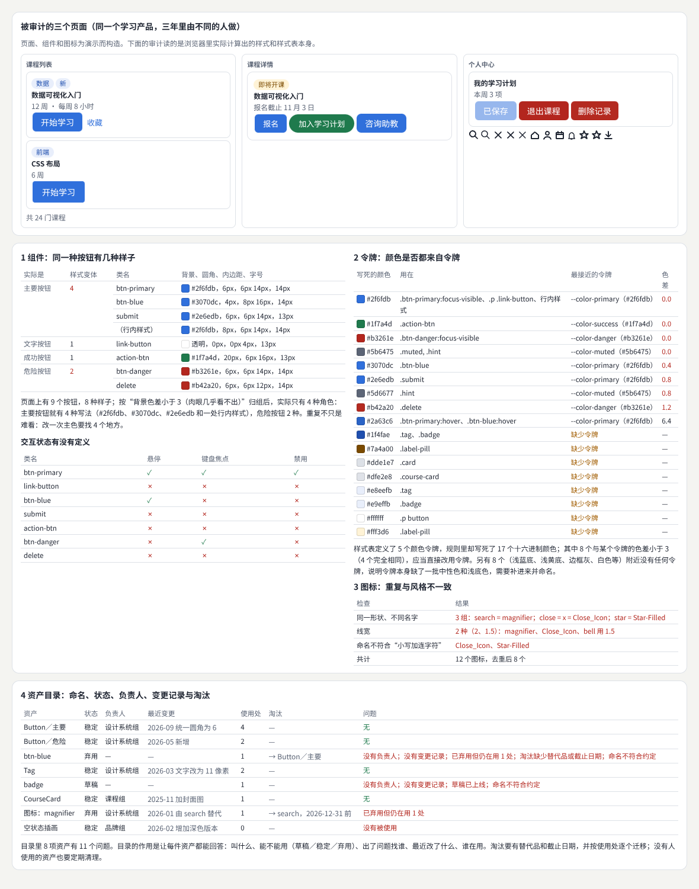
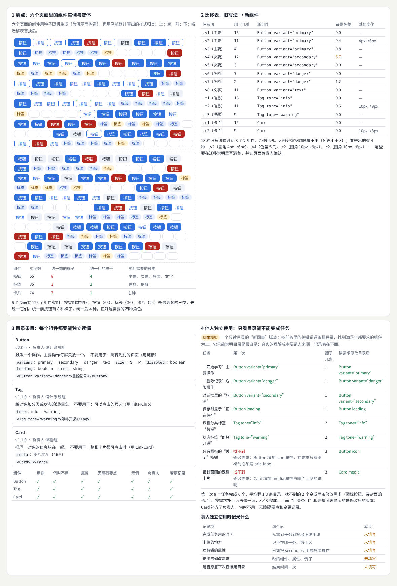
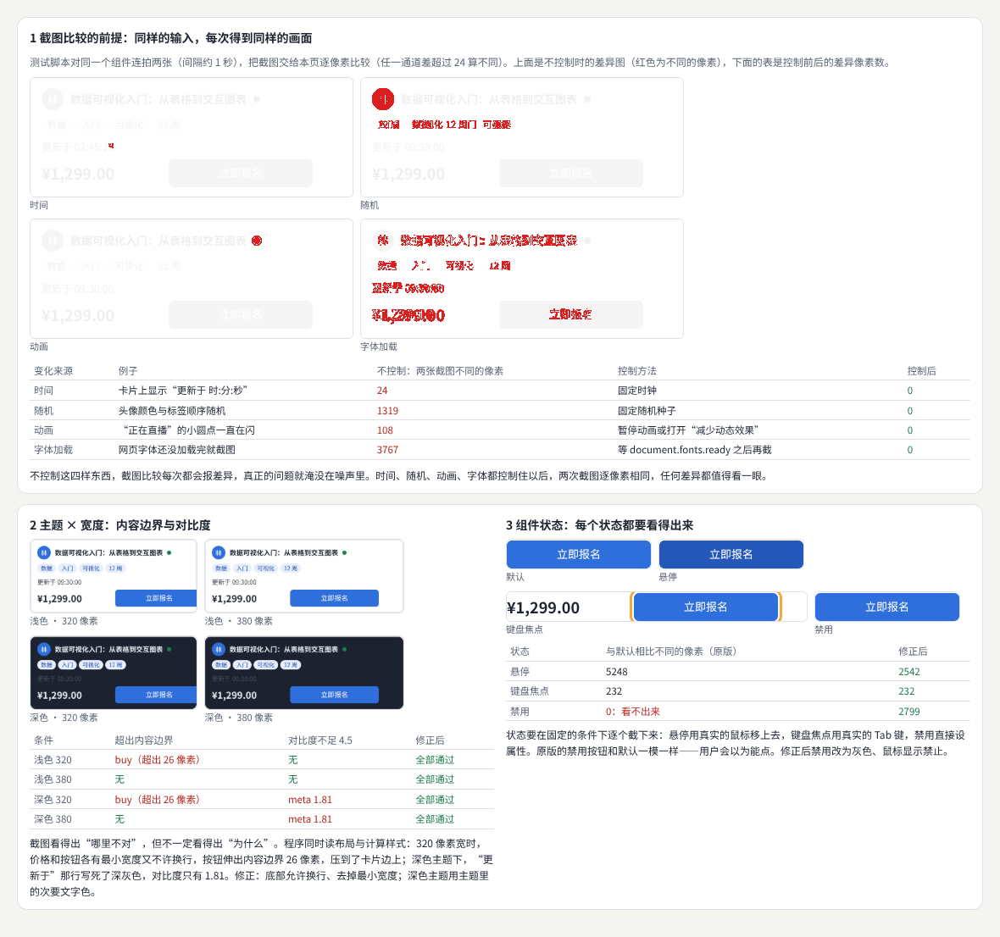
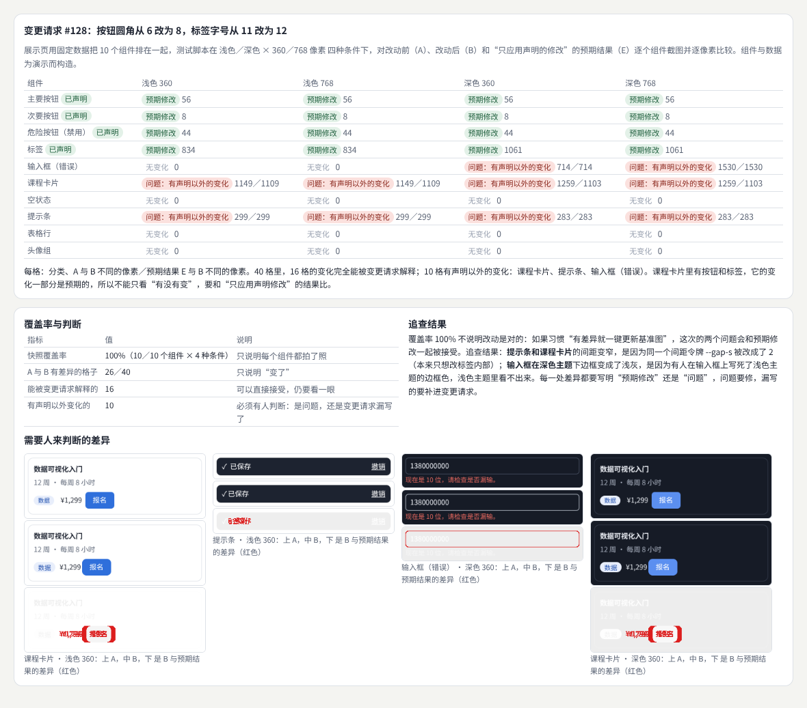
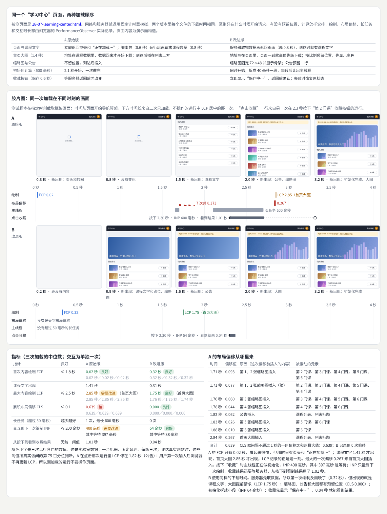
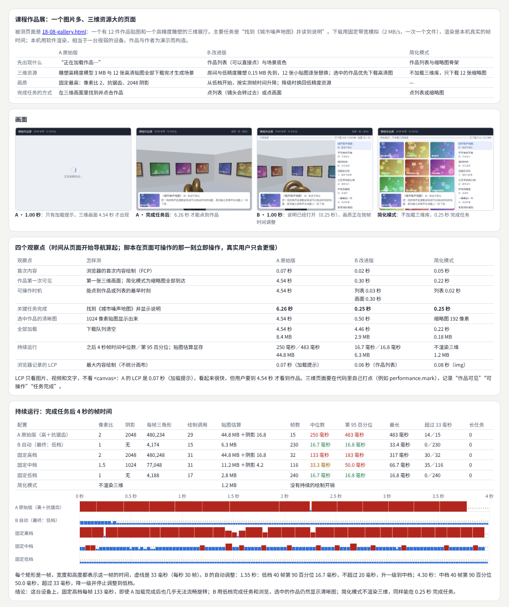
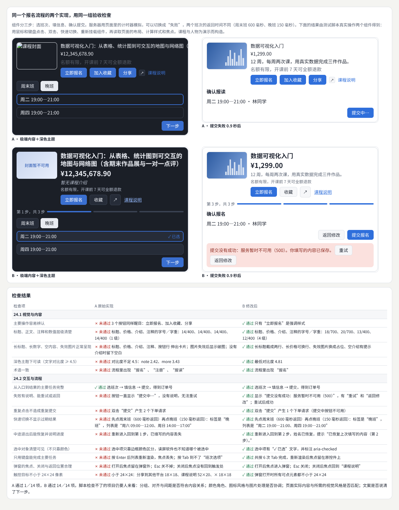
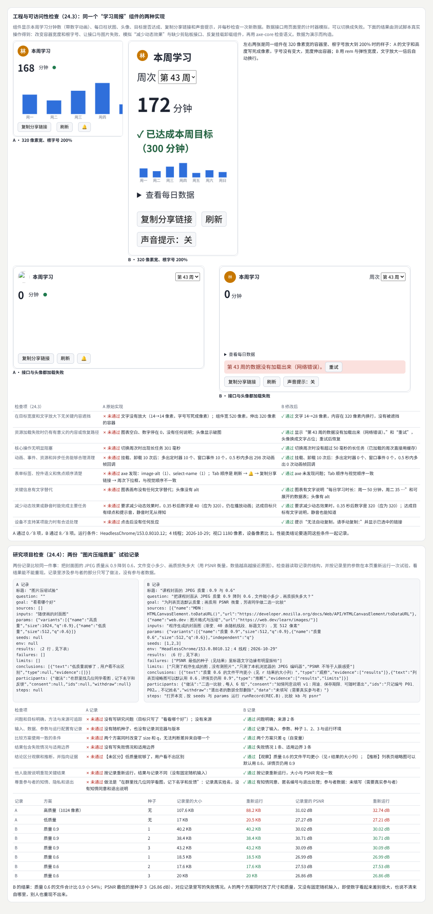
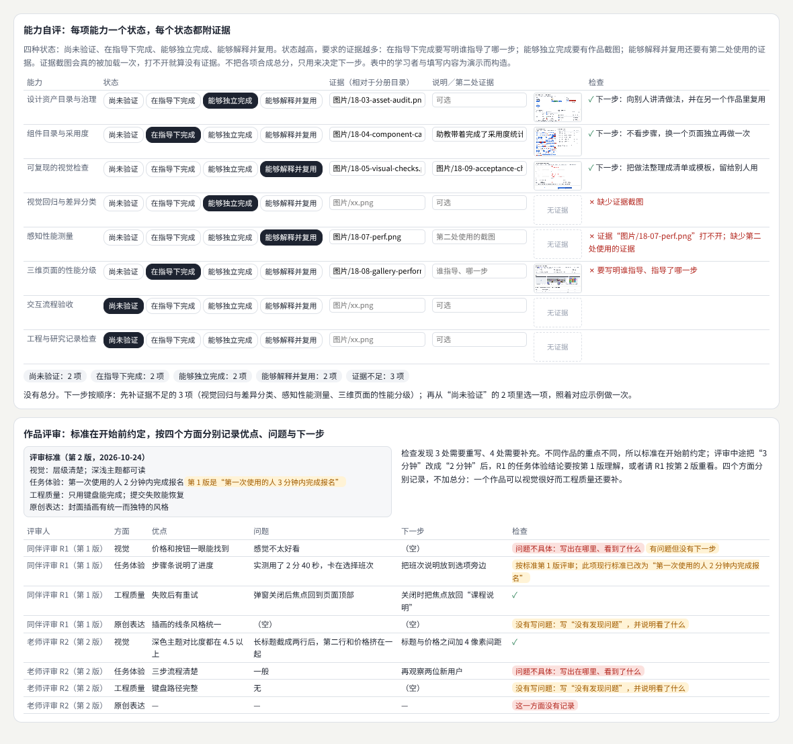
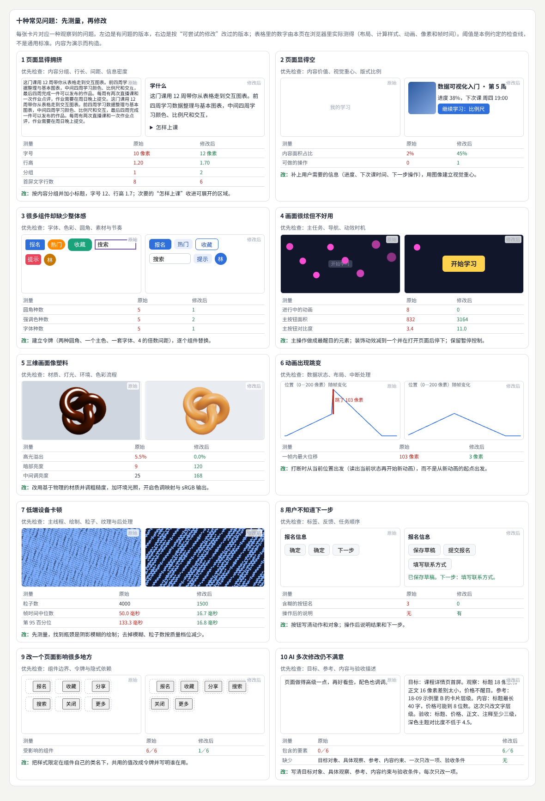

# 质量、性能与设计运营

> 怎样确认做出来的东西是好的，并且一直保持好：维护组件与资产、用截图自动发现视觉回归、测量用户感受到的速度、按清单验收视觉、流程、工程与研究，再用自评与评审决定下一步、用测量定位常见问题。每个方向先讲概念与方法，再做一个可以验收的项目：一份组件与资产目录、一套固定数据的视觉回归、一个图片多又有三维场景的页面、一组可以重复运行的验收检查。  
> 版本：1.0 · 整理日期：2026-10-25  
> 适用对象：已经能独立做页面和组件，开始负责一个产品长期质量的前端开发、设计师和设计系统维护者。先修：读过[《前端界面工程》](01-前端界面工程.md)的组件与测试部分、[《视觉设计与品牌表达》](02-视觉设计与品牌表达.md)的令牌部分，以及[《图形工程与渲染系统》](09-图形工程与渲染系统.md)的 09 章（性能剖析）。

这五个方向不新增功能，而是回答同一个问题：**怎样知道它真的好，并且下个月还好**。它们有三个共同点：

- **先有证据，再下结论**。“按钮风格不统一”要变成“9 个按钮有 8 种样子”；“页面有点慢”要变成“首页大图 2.85 秒才出现”；“不好用”要变成“只用键盘到不了班次选项”。证据可以是计算样式、像素差异、性能记录或一次真实操作的结果。
- **让检查可以重复**。时间、随机数、动画、字体加载、网络都会让同一页面每次不一样。先把这些固定下来，自动检查才有意义；每次检查都写下运行条件，别人才能重现。
- **机器发现差异，人判断意义**。脚本能找出 26 个变化的格子、14 项未通过的检查、10 个打不开的证据；哪些是预期修改、哪些是问题、下一步做什么，要由人根据约定的标准判断。

本册每章都按同样的顺序讲：先说明它解决什么问题；再用白话解释核心概念；然后给出一个可以直接运行的示例与运行截图；接着是常见问题和本章练习；最后是一张**进阶学习卡**：技术栈、要掌握的高阶词汇（附英文）、搜索关键词、值得去看的实例，以及四级进阶阶梯：

| 级别 | 含义 |
| --- | --- |
| L1 入门 | 能运行并解释本章示例，说出每个概念的作用 |
| L2 熟练 | 能在自己的项目中正确使用这些方法，完成本章练习 |
| L3 进阶 | 能为一个完整产品建立检查、测量与记录，并用它们发现和定位问题 |
| L4 深入 | 能在团队与真实用户的规模上运营这些做法，研究它们的效果与成本 |

四级是本手册的教学结构，用来安排学习顺序，不对应任何公司的职级。

所有示例都放在本目录的[示例](示例/)文件夹中，用浏览器直接打开即可运行；每个示例都已在无头浏览器中实际运行并自动检查。书中的数字分三类，正文会逐处说明：**浏览器实际测得的**（计算样式、像素差异、绘制与布局偏移的时间、帧时间、焦点位置、按记录重新运行的结果）、**按规则算出的**（色差、对比度、分组与分类、检查清单的结论）、**为演示而构造的数据**（页面、组件、课程、作品、学习者与评审意见）。性能数字来自本机的无头浏览器与软件渲染，相当于一台很弱的设备，只看版本之间的相对差异。**示例里没有真实用户的数据**；需要真人参与的记录表都留空，写着“未填写”。

主线是：**先有证据与可复现的条件 → 五个方向各做一次“概念 ＋ 项目” → 方向之间的连接。**

## 阅读导航

正文共 13 章（01—13），附 10 个可运行示例、3 组附录与 56 项资料入口。

- [第一篇：共同的基础](#part-1)
  - [01 这一册研究什么](#ch01)
  - [02 共同的方法：证据、可复现的条件与人工判断](#ch02)
- [第二篇：五个方向](#part-2)
  - [03 设计运营与资产治理](#ch03)
  - [04 运营项目：组件与资产目录](#ch04)
  - [05 视觉质量自动检查](#ch05)
  - [06 视觉项目：固定数据展示页与视觉回归](#ch06)
  - [07 感知性能与适应性呈现](#ch07)
  - [08 性能项目：图片多、三维资源大的页面](#ch08)
  - [09 验收（一）：视觉与内容、交互与流程](#ch09)
  - [10 验收（二）：工程与可访问性、研究与原创项目](#ch10)
  - [11 自评与评审](#ch11)
  - [12 常见问题的定位方法](#ch12)
- [第三篇：连接与路线](#part-3)
  - [13 方向之间的连接、工具与学习路线](#ch13)
- [附录 A：术语表](#appendix-a)
- [附录 B：资料入口](#appendix-b)
- [附录 C：与原手册的对应关系及修订记录](#appendix-c)

## 第一篇：共同的基础

### 01 这一册研究什么

| 方向 | 核心问题 | 本册的示例与项目 | 主要连接 |
| --- | --- | --- | --- |
| 设计运营与资产治理 | 组件、令牌、模板、图标、素材怎样保持一致，并被真实项目采用 | 资产审计（03）、组件与资产目录（04） | 视觉设计、前端组件 |
| 视觉质量自动检查 | 一次修改有没有在意料之外的地方改变了画面 | 可复现的截图检查（05）、视觉回归（06） | 测试、设计评审 |
| 感知性能与适应性呈现 | 用户等多久、等的时候看到什么、点了多久有反应 | 同一页面两种加载顺序（07）、三维作品展（08） | 前端工程、图形工程 |
| 质量验收 | 视觉、流程、工程、可访问性与研究记录是否达到约定的标准 | 报名流程的 14 项检查（09）、学习周报与试验记录（10） | 交互、无障碍、研究方法 |
| 自评、评审与问题定位 | 下一步该补什么；观察到问题时先查哪里 | 能力自评与评审记录（11）、十种症状的测量（12） | 学习规划、所有方向 |

前四个方向各用两章：先讲概念与方法，再做项目；第五个方向分成自评评审与问题定位两章。

### 02 共同的方法：证据、可复现的条件与人工判断

#### 02.1 把感觉变成证据

| 感觉 | 证据 | 本册的例子 |
| --- | --- | --- |
| 风格不统一 | 计算样式的种数、与令牌的色差 | 9 个按钮 8 种样子（03 章） |
| 改坏了 | 修改前后逐像素比较 | 40 个格子里 10 个有声明以外的变化（06 章） |
| 有点慢 | 绘制时间、布局偏移、长任务、帧时间 | 首页大图 2.85 秒才出现（07 章） |
| 不好用 | 一次真实操作的结果 | 只用键盘到不了班次选项（09 章） |
| 说不清的不满意 | 具体对象、具体观察与验收条件 | 需求描述包含的要素 0／6 → 6／6（12 章） |

#### 02.2 让每次运行都一样

同一页面每次截图都可能不同：**时间**在走、**随机**结果每次不同、**动画**停在不同的帧、**字体加载**有先后、网络快慢不一。检查之前先建立可复现条件：固定时钟、固定随机种子、暂停动画、等字体加载完成、用固定延迟模拟网络。05 章的示例里，不控制时连拍两张就有几百到几千个像素不同；控制之后是 0。

#### 02.3 预期变化还是问题

自动检查只能说“变了”。每个差异都要回答：这是变更请求里声明的**预期修改**，还是**问题**？办法是把“只应用声明修改的预期结果”也截一张，与实际结果比较：能被声明解释的是预期修改，解释不了的是问题（06 章）。**测试覆盖率**只说明拍了多少张照片，不能代替这一步判断。

#### 02.4 写下运行条件

性能和研究结论都离不开条件：浏览器与版本、线程数、视口、设备像素比、网络模型、数据与参数、随机种子。没有条件的数字无法比较，也无法重现（07、08、10 章）。

**本章练习**：

1. 把你最近一次“感觉不对”的反馈改写成一条证据：对象、测量方法和数字。
2. 列出你的页面里会让截图每次不同的因素，并为每一项写出固定它的办法。

## 第二篇：五个方向

### 03 设计运营与资产治理

#### 03.1 解决什么问题

**设计运营与资产治理**研究团队怎样维护**组件**、**令牌**、**模板**、**图标**、**素材**与**使用说明**[B01](#ref-b01)[B02](#ref-b02)。要建立**命名**、**状态**、**负责人**、**变更记录**和**淘汰机制**：谁能新增，什么时候算正式可用，改了什么、为什么改，旧的什么时候停用、用什么替代。设计系统的价值需要通过真实项目采用和问题反馈体现：写好的规范没人用，或者被各自改成不同的样子，就等于没有。

#### 03.2 核心概念

| 概念 | 含义 | 做法 |
| --- | --- | --- |
| 令牌 | 有名字的设计决定，如“主色”“小圆角”[B03](#ref-b03)[B04](#ref-b04) | 颜色、间距、圆角、字号都从令牌取值，不在规则里写死 |
| 资产目录 | 组件、图标、模板、素材的清单 | 每项有名称、状态、负责人、变更记录、使用位置 |
| 状态 | 草稿、试用、正式、弃用 | 草稿不应上线；弃用要写替代品与截止日期[B02](#ref-b02) |
| 审计 | 从真实页面反推实际在用的东西 | 读计算样式与样式表，而不是读设计稿 |
| 重复、缺失与不一致 | 同一样东西有几种写法；需要的东西没有；名字和样子对不上 | 按“看起来是否一样”归组，再看名字 |
| 采用度 | 组件在真实项目里被用了多少次、用对了没有 | 统计实例与写法，跟踪迁移进度 |

#### 03.3 示例：从三个页面审计组件、颜色与图标

示例：[18-03-asset-audit.html](示例/18-03-asset-audit.html)

三个页面（课程列表、课程详情、个人中心）是为演示构造的。审计脚本只读浏览器里的**计算样式**和**样式表**，不看设计稿：

**按钮**：9 个按钮有 8 种样子。按背景色差小于 3 归组后是 4 种角色：主要按钮有 4 种写法（`btn-primary`、`btn-blue`、`submit` 和一处行内样式，圆角 4、6、8 像素不等），危险按钮 2 种，文字按钮和成功按钮各 1 种。

**交互状态**（读样式表里的 `:hover`、`:focus-visible`、`:disabled`）：7 个按钮类中 5 个没有键盘焦点样式，6 个没有禁用样式，5 个没有悬停样式。看起来“差不多”的按钮，键盘用户可能完全看不到焦点在哪里。

**颜色**：只有 5 个颜色令牌，规则里却写死了 17 个颜色（浏览器把颜色序列化成 `rgb()`，两种写法都要找）。其中 8 个与某个令牌的色差小于 3（4 个完全相同）——应该直接改用令牌；8 个附近没有任何令牌，说明令牌缺少中性色和浅底色；1 个介于两者之间（悬停色，色差 6.4）。

**图标**：12 个图标去重后 8 个；同形不同名 3 组（`search` 与 `magnifier`；`close`、`x` 与 `Close_Icon`；`star` 与 `Star-Filled`）；线宽有 2 种；2 个名字不符合命名规则。

**资产目录**：8 项中查出 11 个问题——`btn-blue` 没有负责人、没有变更记录、已弃用却还有 1 处在用、淘汰没写替代品和截止日期、名字不合规；`badge` 是草稿却已上线；`magnifier` 已弃用仍在用；空状态插画没有任何页面使用。

#### 03.4 常见问题

- **令牌有了，没人用**：审计规则里写死的值，与令牌色差小于 3 的直接替换，并在代码检查里拦住新写死的值。
- **组件越加越多**：新增前先查目录；按“看起来是否一样”归组，名字不同而样子相同的合并。
- **弃用了还在用**：弃用要写替代品和截止日期，并列出仍在使用的位置。
- **只统一了默认状态**：悬停、焦点、禁用也是组件的一部分，要一起审计。
- **图标重复**：用图形本身（路径）去重，而不是只看文件名。

**本章练习**：

1. 对你的一个页面运行一次审计：列出所有按钮的计算样式，按样子归组。
2. 为一个组件写一条完整的目录记录：名称、状态、负责人、变更记录、使用位置。

#### 03.5 进阶学习卡

| 级别 | 目标 | 怎样检验 |
| --- | --- | --- |
| L1 入门 | 能读出页面实际使用的样式与颜色 | 能解释示例的四组审计结果 |
| L2 熟练 | 能为一个产品建立令牌和资产目录 | 每项都有状态、负责人与变更记录 |
| L3 进阶 | 能用脚本持续审计并跟踪采用度 | 写死的值与重复写法逐月减少 |
| L4 深入 | 能为多个团队运营设计系统，衡量它的价值 | 采用度、问题反馈与迁移成本的记录 |

- **技术栈**：`getComputedStyle`、`document.styleSheets`；CSS 自定义属性；设计令牌文件（JSON）与 Style Dictionary 一类的转换工具；色差计算（CIEDE2000）；SVG 路径比较。
- **高阶词汇**：设计运营（DesignOps）、设计系统（design system）、设计令牌（design tokens）、资产治理（asset governance）、组件库（component library）、弃用（deprecation）、变更记录（changelog）、采用度（adoption）、审计（audit）、单一来源（single source of truth）。
- **搜索关键词**：`design system governance`、`design tokens format`、`component deprecation policy`、`css audit computed style`、`design system adoption metrics`、`设计系统 治理`。
- **值得看的实例**：[GOV.UK 设计系统的贡献标准](https://design-system.service.gov.uk/community/contribution-criteria/)——看一个组件从提议到正式发布要满足哪些条件。
- **资料**：[B01](#ref-b01)、[B02](#ref-b02)、[B03](#ref-b03)、[B05](#ref-b05)、[B04](#ref-b04)。

### 04 运营项目：组件与资产目录

#### 04.1 任务

为已有产品建立组件与资产目录，识别**重复**、**缺失**和**不一致**，选择一批高频组件统一。验收时让其他人独立使用目录，并记录理解成本与修改需求。

#### 04.2 做法

| 步骤 | 产出 |
| --- | --- |
| 盘点 | 每个页面里每个组件实例的计算样式 |
| 归类 | 按样子归组：哪些是同一种组件的不同写法 |
| 选高频 | 实例最多的几类先统一 |
| 迁移表 | 每种旧写法对应哪个新组件、哪种用法，修改后看得出的变化有哪些 |
| 目录条目 | 用途、何时不用、属性、无障碍要点、示例、负责人、变更记录[B06](#ref-b06)[B07](#ref-b07) |
| 独立使用 | 让没参与的人只看目录完成任务，记录找不到的地方 |

#### 04.3 示例：126 个实例归成 3 个组件

示例：[18-04-component-catalog.html](示例/18-04-component-catalog.html)

六个页面的组件用固定种子生成（构造的数据）。盘点得到 126 个实例：按钮 66 个（8 种样子 → 统一为 4 种），标签 36 个（3 种 → 2 种），卡片 24 个（2 种 → 1 种）。

**迁移表**：13 种旧写法对应到 3 个新组件的 7 种用法，每种都写明影响多少处。对比修改前后的计算样式，有 4 种变化是看得出的（例如一种按钮圆角 4 → 6 像素，一种按钮从白底描边变成浅灰底，色差 5.7），要提前告诉页面负责人；其余只是写法统一，画面不变。文字按钮本来就没有背景和边框，圆角变化看不出来，不应算进去。

**目录条目**：Card 最初缺少负责人、何时不用、无障碍要点、变更记录和属性说明——这样的条目，别人拿到也不知道能不能用、该怎样用。

**他人独立使用**：测试脚本扮演“新同事”，只读目录完成 8 个任务（如“做一个危险操作的按钮”）。第一次完成 6 个，平均要翻 1.8 条才找到；找不到的 2 个是“只有图标的关闭按钮”和“带封面的卡片”。由此得到两条修改需求：Button 增加图标用法并要求写 `aria-label`；Card 增加封面区域。补齐后 8 个任务全部完成。真人测试的记录表（参与者、任务、用时、卡住的地方、建议）留空，写着“未填写”——脚本只能发现目录里**有没有**，**看不看得懂**要请真人来测。

#### 04.4 常见问题

- **目录只写了怎么用，没写何时不用**：误用比不会用更常见。
- **统一时不告诉页面负责人**：迁移表要列出看得出的变化与影响的位置。
- **验收只问“好不好”**：给出具体任务，记录翻了几条、在哪里卡住。
- **把脚本测试当成用户测试**：脚本检查内容是否齐全，理解成本要请真人测。

**本章练习**：

1. 选你项目里实例最多的一种组件，做一张迁移表。
2. 请一位没参与的人只看目录完成三个任务，记录他们翻了几条、在哪里卡住。

#### 04.5 进阶学习卡

| 级别 | 目标 | 怎样检验 |
| --- | --- | --- |
| L1 入门 | 能盘点并归类组件实例 | 得到每类的实例数与写法数 |
| L2 熟练 | 能写迁移表与完整的目录条目 | 条目七个字段齐全 |
| L3 进阶 | 能组织他人独立使用的验收，并据此修改目录 | 有任务、用时与修改需求的记录 |
| L4 深入 | 能长期运营目录并衡量采用度与维护成本 | 季度采用度与问题处理记录 |

- **技术栈**：Storybook 一类的组件展示工具；组件文档（MDX）；计算样式盘点脚本；迁移脚本（codemod）；使用统计。
- **高阶词汇**：组件目录（component catalog）、使用说明（usage guidelines）、迁移（migration）、代码修改脚本（codemod）、采用度（adoption）、贡献流程（contribution model）、文档驱动（documentation-driven）、可发现性（discoverability）。
- **搜索关键词**：`component documentation template`、`design system migration codemod`、`storybook docs mdx`、`design system usability testing`、`组件 文档 模板`。
- **值得看的实例**：[Shopify Polaris](https://shopify.dev/docs/api/polaris)——看每个组件的说明怎样写用途、何时不用和无障碍要点。
- **资料**：[B06](#ref-b06)、[B07](#ref-b07)、[B08](#ref-b08)、[B02](#ref-b02)、[B05](#ref-b05)。

### 05 视觉质量自动检查

#### 05.1 解决什么问题

**视觉质量自动检查**把**截图比较**、**内容边界**、**主题**、**视口**、**字体加载**和组件状态纳入检查[B09](#ref-b09)。自动化适合发现回归，人工评审负责理解变化是否合理。要先为动态内容、**时间**和随机结果建立可复现条件，否则每次截图都不同，检查只会不停报警。

#### 05.2 核心概念

| 概念 | 含义 | 做法 |
| --- | --- | --- |
| 截图比较 | 修改前后逐像素比较 | 设定通道差阈值；输出差异图，红色标出不同的像素 |
| 可复现条件 | 同样的输入，每次得到同样的画面 | 固定时钟[B10](#ref-b10)、固定随机种子、暂停动画、等字体加载完成 |
| 内容边界 | 内容不能伸进内边距，更不能伸出容器 | 用内容框（扣掉边框与内边距）检查每个元素 |
| 主题与视口 | 深浅主题 × 几种宽度 | 每种组合截图并检查对比度与边界[B11](#ref-b11) |
| 组件状态 | 悬停、焦点、禁用也要看得出来 | 用真实的鼠标悬停和 Tab 键进入状态再截图 |

#### 05.3 示例：可复现的截图、主题与宽度、组件状态

示例：[18-05-visual-checks.html](示例/18-05-visual-checks.html)

测试脚本对同一张课程卡片连拍两张（间隔约 1 秒），把截图交给页面逐像素比较，任一通道差超过 24 算不同：

| 让画面变化的原因 | 不控制 | 控制后 | 做法 |
| --- | --- | --- | --- |
| 时间（“更新于”后面的时刻，精确到秒） | 40—100 像素 | 0 | 固定时钟 |
| 随机（头像颜色、标签顺序） | 几百到一千多像素 | 0 | 固定随机种子 |
| 动画（直播圆点闪烁） | 约 109 像素 | 0 | 暂停动画 |
| 字体加载（字体还没到就截图） | 3,767 像素 | 0 | 等 `document.fonts.ready` |

**主题 × 宽度**：320 像素宽时，价格与按钮设了最小宽度又不换行，按钮伸出内容边界 26 像素；深色主题下“更新于”的颜色写死成深灰，对比度只有 1.81。改成可换行、颜色取主题变量后，四种组合全部通过。

**组件状态**：用真实鼠标悬停、真实按 Tab 进入焦点后截图，与默认状态比较：悬停差 5,248 像素、焦点差 232 像素、**禁用差 0**——禁用的按钮和可用的一模一样。加上禁用样式后差 2,799 像素。

制作中遇到的两个问题值得记住：边界检查一开始对比的是卡片外框，按钮只伸进了内边距，没有被发现，改成对比内容框才查出；网格的列被长内容撑宽，导致每一行都“超出”，卡片列要用 `minmax(0, 1fr)`。

#### 05.4 常见问题

- **每次都报差异**：先找出时间、随机、动画、字体这些变化来源，逐个固定。
- **阈值调得很大来“消除”差异**：会把真正的问题一起放过；应该固定来源，阈值只用来忽略抗锯齿这类细小差别。
- **只截默认状态**：悬停、焦点、禁用、错误、加载中都要截。
- **只截一种宽度**：至少包括最窄的目标宽度和深色主题。

**本章练习**：

1. 为你的一个组件写一个脚本：连拍两张，找出所有让截图不同的因素并固定它们。
2. 对同一个组件截深浅两种主题 × 两种宽度 × 四种状态，检查边界与对比度。

#### 05.5 进阶学习卡

| 级别 | 目标 | 怎样检验 |
| --- | --- | --- |
| L1 入门 | 能截图并逐像素比较 | 能解释示例的四类变化来源 |
| L2 熟练 | 能建立可复现条件，覆盖主题、宽度与状态 | 连拍差异为 0 |
| L3 进阶 | 能把视觉检查接进每次提交的流程 | 回归在合并前被发现 |
| L4 深入 | 能为大型组件库设计检查策略，平衡覆盖与维护成本 | 误报率、漏报与维护时间的记录 |

- **技术栈**：Playwright 的截图与 `toHaveScreenshot`、固定时钟（`page.clock`）与环境模拟（`emulateMedia`）；画布逐像素比较；`document.fonts.ready`；`getAnimations()`。
- **高阶词汇**：视觉回归测试（visual regression testing）、快照（snapshot）、基准图（baseline）、像素差异（pixel diff）、抗锯齿（anti-aliasing）、可复现（deterministic）、不稳定测试（flaky test）、视口（viewport）。
- **搜索关键词**：`playwright toHaveScreenshot`、`playwright clock install`、`visual regression flaky fonts animations`、`pixelmatch threshold anti-aliasing`、`视觉回归 测试`。
- **值得看的实例**：[Playwright 的截图比较文档](https://playwright.dev/docs/test-snapshots)——看它怎样处理基准图、阈值与不同平台的差别。
- **资料**：[B09](#ref-b09)、[B10](#ref-b10)、[B11](#ref-b11)。

### 06 视觉项目：固定数据展示页与视觉回归

#### 06.1 任务

给一套组件建立固定数据的展示页，在不同主题与宽度下生成检查结果。对每个差异说明是预期修改还是问题，并避免用测试覆盖率代替视觉判断[B12](#ref-b12)[B13](#ref-b13)。

#### 06.2 做法

| 步骤 | 做法 |
| --- | --- |
| 展示页 | 用固定数据把每个组件排在一起，每个组件一个可截图的区域 |
| 条件 | 浅色／深色 × 360／768 像素 |
| 三个版本 | 改动前（A）、改动后（B）、只应用变更请求里声明的修改（E） |
| 分类 | A 与 B 不同、E 与 B 相同 → 预期修改；E 与 B 不同 → 问题；声明要改却没变 → 修改没有生效 |

#### 06.3 示例：变更请求 #128

示例：[18-06-visual-regression.html](示例/18-06-visual-regression.html)

变更请求 #128 只声明了两处修改：按钮圆角 6 → 8 像素，标签字号 11 → 12 像素。10 个组件 × 4 种条件 = 40 格，A 与 B 有差异的 26 格：

| 分类 | 格数 | 组件 |
| --- | --- | --- |
| 预期修改 | 16 | 主要、次要、危险按钮和标签，4 种条件都变了，且能被声明解释 |
| 问题：有声明以外的变化 | 10 | 课程卡片 × 4、提示条 × 4、输入框（只在深色主题下）× 2 |
| 无变化 | 14 | 空状态、表格行、头像组等 |

追查结果：课程卡片和提示条的问题来自共用令牌 `--gap-s` 被顺手从 6 改成了 2——它不在变更请求里，却影响了所有用到它的组件；输入框的边框颜色在新版本里写死成浅色，浅色主题看不出来，深色主题下才变化。课程卡片里本来就有按钮和标签，它的变化一部分是预期的，所以不能只看“有没有变”，要与“只应用声明修改”的结果比较才分得清。

快照覆盖率是 100%（10 个组件 × 4 种条件都拍了）——但这只说明拍了照片。如果习惯“有差异就一键更新基准图”，这次的两个问题会和预期修改一起被接受。

#### 06.4 常见问题

- **一键更新基准图**：每个差异都要写明是预期修改还是问题。
- **只比较新旧两版**：再加一版“只应用声明的修改”，才能分出预期和意外。
- **共用令牌被顺手改了**：令牌修改要单独提交，并列出使用它的组件。
- **只在浅色主题检查**：深色主题下写死的颜色最容易露出来。

**本章练习**：

1. 为你的组件库做一个固定数据的展示页，覆盖两种主题和两种宽度。
2. 做一次小改动，用三个版本的比较为每个差异分类。

#### 06.5 进阶学习卡

| 级别 | 目标 | 怎样检验 |
| --- | --- | --- |
| L1 入门 | 能为展示页截图并比较新旧两版 | 能读懂示例的分类表 |
| L2 熟练 | 能用“预期结果”版本为差异分类 | 每个差异都有分类与原因 |
| L3 进阶 | 能把视觉回归接入评审流程，由负责人确认每个差异 | 合并前的审核记录 |
| L4 深入 | 能衡量视觉回归的成本与收益，改进策略 | 发现的问题数、误报与维护时间 |

- **技术栈**：组件展示页（Storybook 一类工具）；Playwright 截图；逐像素比较与差异图；Chromatic、BackstopJS 一类的视觉回归服务或工具。
- **高阶词汇**：展示页（component gallery／storybook）、基准图（baseline）、预期修改（intended change）、意外变化（unintended change）、变更请求（change request）、测试覆盖率（test coverage）、人工审核（human review）。
- **搜索关键词**：`visual regression component library`、`chromatic ui review`、`backstopjs reference test`、`expected vs unexpected visual diff`、`组件 视觉 回归`。
- **值得看的实例**：[Chromatic 的文档](https://www.chromatic.com/docs/)——看视觉差异怎样交给设计师和开发者逐个确认。
- **资料**：[B12](#ref-b12)、[B13](#ref-b13)、[B06](#ref-b06)、[B09](#ref-b09)。

### 07 感知性能与适应性呈现

#### 07.1 解决什么问题

**感知性能与适应性呈现**研究用户怎样体验等待、**渐进加载**和**交互响应**[B14](#ref-b14)。要把**内容优先级**、**资源加载**、**骨架**[B15](#ref-b15)、**进度**[B16](#ref-b16)和局部更新结合起来。性能改进应通过实际测量与任务观察判断。

Core Web Vitals 提供了一组常用的外部参照[B17](#ref-b17)：按真实访问的第 75 百分位评估，**LCP**（最大内容绘制）不超过 2.5 秒、**INP**（交互到下一次绘制）不超过 200 毫秒、**CLS**（累积布局偏移）不超过 0.1 被视为良好[B18](#ref-b18)。这些阈值适合发现加载、**响应**和布局稳定性问题，但不能代替对关键任务的观察；**三维**、**编辑器**等长时间运行的页面还需要单独记录帧时间与内存（08 章）。阈值的说明见 web.dev[B18](#ref-b18)。

#### 07.2 核心概念

| 概念 | 含义 | 浏览器里怎样测 |
| --- | --- | --- |
| 首次内容绘制 FCP | 第一次画出文字或图片的时刻[B19](#ref-b19) | `PerformanceObserver` 观察 `paint`[B20](#ref-b20) |
| 最大内容绘制 LCP | 视口里最大的图片或文字块画出的时刻[B21](#ref-b21) | 观察 `largest-contentful-paint`；用户第一次输入后停止更新 |
| 累积布局偏移 CLS | 已有内容被挤动的程度[B22](#ref-b22) | 观察 `layout-shift`；排除输入后 500 毫秒内的偏移；取间隔不超过 1 秒、总长不超过 5 秒的一组之和的最大值 |
| 交互到下一次绘制 INP | 一次点击、按键到下一帧画出来要多久[B23](#ref-b23) | 观察 `event`[B24](#ref-b24)；分成输入延迟、处理时间、呈现延迟 |
| 长任务 | 主线程上超过 50 毫秒的任务[B25](#ref-b25) | 观察 `longtask`；期间的点击只能排队 |
| 骨架与占位 | 内容到达前按最终尺寸显示的形状 | 预留宽高或比例，内容到达时不挤动别人[B26](#ref-b26) |
| 局部更新 | 只改变化的部分，先在本地显示结果 | 乐观更新，失败时恢复并说明 |
| 实验室与现场 | 一台机器上的测量与真实访问的统计[B27](#ref-b27) | 实验室定位原因，现场数据（CrUX、web-vitals 库）判断是否达标[B28](#ref-b28)[B29](#ref-b29) |

#### 07.3 示例：同一个页面，两种加载顺序

示例：[18-07-perceived-performance.html](示例/18-07-perceived-performance.html)（被测页面：[18-07-learning-center.html](示例/18-07-learning-center.html)）

被测页面是一个“学习中心”：页头、公告、首页大图、6 门课程（缩略图、标题、收藏按钮）。网络和服务器延迟用固定计时器模拟，**两个版本里每个文件的下载时间相同**，区别只在什么时候开始请求、有没有预留位置、计算怎样安排：

| | A 原始版 | B 改进版 |
| --- | --- | --- |
| 课程文字 | 立即返回空壳；脚本包（0.6 秒）运行后再请求数据（0.8 秒） | 服务器取完数据再返回页面（晚 0.3 秒），到达时就有文字 |
| 首页大图（1.4 秒） | 地址在数据里，数据回来才下载；到达后插在列表上方 | 地址写在页面里，页面一到就以高优先级下载[B30](#ref-b30)[B31](#ref-b31)；按比例预留位置，先显示主色 |
| 缩略图与公告 | 不留位置，到达后插入 | 缩略图固定 72×48 并显示骨架；公告预留一行 |
| 初始化计算（600 毫秒） | 一次做完 | 拆成 40 毫秒一段，每段后用 `scheduler.yield()` 让出主线程[B32](#ref-b32)[B33](#ref-b33) |
| 收藏（保存 0.6 秒） | 等服务器返回才改变 | 立即显示“保存中…”，返回后确认；失败时恢复 |

所有指标都由浏览器的 `PerformanceObserver` 实际记录，每版加载 3 次取中位数，交互单独运行一次：

| 指标 | 良好 | A 原始版 | B 改进版 |
| --- | --- | --- | --- |
| FCP | ≤ 1.8 秒 | 0.02 秒 | 0.32 秒 |
| 课程文字出现 | — | 1.41 秒 | 0.31 秒 |
| LCP | ≤ 2.5 秒 | 2.85 秒（首页大图），需要改进 | 1.75 秒（首页大图），良好 |
| CLS | ≤ 0.1 | 0.639，差 | 0.000，良好 |
| 长任务 | — | 2 次，最长 600 毫秒 | 0 次 |
| INP（在初始化期间点“收藏”） | ≤ 200 毫秒 | 400 毫秒，其中等待约 397 毫秒 | 64—72 毫秒，其中等待约 38 毫秒 |
| 从按下到看到收藏结果 | 无统一阈值 | 1.01 秒 | 0.04 秒 |

几点值得仔细看：

- **FCP 很快不等于快**：A 的首次内容绘制只有 0.02 秒，那时只有页头和“正在加载…”；LCP 记录的是首页大图出现的 2.85 秒。B 的第一次绘制反而晚了 0.3 秒（服务器先取数据），但出现的就是课程文字。
- **CLS 的来源**：A 有 7 次小偏移（缩略图逐张插入、公告插入，合计 0.373）和 1 次大偏移（首页大图插在列表上方，0.267）。示例逐次列出每次偏移推动了哪些元素、之前插入了什么。B 所有晚到的内容都有预留位置，没有记录到偏移。
- **INP 只量到下一次绘制**：A 的点击要等 600 毫秒的初始化做完才能处理；即使处理了，收藏结果还要等服务器返回。所以除了 INP，还要记录“看到结果”的时间。
- **LCP 在第一次输入后停止更新**：A 在点击那次运行里 LCP 停在 1.82 秒（公告）——测加载的运行不要操作页面。

#### 07.4 常见问题

- **只看 FCP**：第一次绘制可能只有页头和转圈；看 LCP，也看主要内容何时出现。
- **骨架和真实内容尺寸不同**：内容到达时照样挤动别人；骨架要按最终尺寸占位。
- **大图地址藏在脚本或数据里**：浏览器发现得晚；写进页面并提高优先级。
- **一次做完所有初始化**：拆成小段并让出主线程，点击才能及时响应。
- **乐观更新不处理失败**：失败时恢复原状态并说明。
- **用实验室数字代替现场数据**：实验室用来定位原因，达没达标要看真实访问的第 75 百分位。

**本章练习**：

1. 在你的页面上用 `PerformanceObserver` 记录 FCP、LCP、CLS、长任务和 INP，各运行三次取中位数。
2. 找出 LCP 元素，写出它从被发现到画出来经过了哪些步骤，并缩短其中一步。

#### 07.5 进阶学习卡

| 级别 | 目标 | 怎样检验 |
| --- | --- | --- |
| L1 入门 | 能测出 FCP、LCP、CLS、INP 与长任务 | 能解释示例两版的每项差异 |
| L2 熟练 | 能用预留位置、提前请求、拆分任务和乐观更新改进 | CLS 接近 0，INP 在 200 毫秒内 |
| L3 进阶 | 能结合实验室测量与现场数据定位问题 | 有现场数据的第 75 百分位与对应的实验室复现 |
| L4 深入 | 能把性能目标纳入产品流程，研究性能与任务完成的关系 | 性能预算、回归告警与用户研究记录 |

- **技术栈**：`PerformanceObserver`（`paint`、`largest-contentful-paint`、`layout-shift`、`event`、`longtask`）；`scheduler.yield()`；`fetchpriority` 与 `<link rel="preload">`；`aspect-ratio`；web-vitals 库；Lighthouse 与 Chrome 用户体验报告（CrUX）。
- **高阶词汇**：感知性能（perceived performance）、核心网页指标（Core Web Vitals）、第 75 百分位（75th percentile）、实验室数据与现场数据（lab vs field data）、长任务（long task）、让出主线程（yield to main thread）、骨架屏（skeleton screen）、乐观更新（optimistic update）、胶片图（filmstrip）、资源优先级（fetch priority）。
- **搜索关键词**：`web vitals thresholds 75th percentile`、`optimize lcp resource load delay`、`cls session window`、`inp input delay processing presentation`、`scheduler.yield long tasks`、`感知 性能 骨架屏`。
- **值得看的实例**：[web.dev 的 Core Web Vitals 阈值说明](https://web.dev/articles/defining-core-web-vitals-thresholds)——看 2.5 秒、200 毫秒和 0.1 这三个数是怎样定出来的。
- **资料**：[B17](#ref-b17)、[B18](#ref-b18)、[B19](#ref-b19)、[B21](#ref-b21)、[B22](#ref-b22)、[B23](#ref-b23)、[B31](#ref-b31)、[B26](#ref-b26)、[B33](#ref-b33)、[B20](#ref-b20)、[B24](#ref-b24)、[B25](#ref-b25)、[B32](#ref-b32)、[B30](#ref-b30)、[B27](#ref-b27)、[B28](#ref-b28)、[B29](#ref-b29)、[B14](#ref-b14)、[B15](#ref-b15)、[B16](#ref-b16)。

### 08 性能项目：图片多、三维资源大的页面

#### 08.1 任务

改进一个图片多或三维资源大的页面，分别观察**首次内容**、**可操作时机**、**关键任务完成**和**持续运行情况**。简化模式应仍然能够完成主要任务，避免只有空白或错误提示。

#### 08.2 做法

| 观察点 | 怎样测 |
| --- | --- |
| 首次内容 | FCP；对三维页面，另记“作品第一次可见”——LCP 不统计 `<canvas>`[B21](#ref-b21) |
| 可操作时机 | 能点到目标（列表或画面里的物体）的最早时刻，用 `performance.mark()` 自己打点[B34](#ref-b34) |
| 关键任务完成 | 脚本在页面可操作的那一刻立即操作，记录任务完成的时刻 |
| 持续运行 | 完成任务后 4 秒的帧时间（中位数、第 95 百分位、超过 33 毫秒的帧）、贴图估算显存、绘制调用[B35](#ref-b35) |
| 简化模式 | 不加载三维库，用缩略图和列表完成同一任务 |

#### 08.3 示例：课程作品展

示例：[18-08-gallery-performance.html](示例/18-08-gallery-performance.html)（被测页面：[18-08-gallery.html](示例/18-08-gallery.html)）

一个有 12 件作品贴图和一个高精度雕塑的三维展厅；主要任务是“找到《城市噪声地图》并读到说明”。下载用固定带宽模拟（2 MB/s，一次一个文件），渲染是本机真实的帧时间：

| 观察点 | A 原始版 | B 改进版 | 简化模式 |
| --- | --- | --- | --- |
| 首次内容（FCP） | 0.06 秒 | 0.04 秒 | 0.03 秒 |
| 作品第一次可见 | 4.55 秒 | 0.30 秒 | 0.22 秒（缩略图） |
| 可操作时机 | 4.55 秒 | 列表 0.02 秒，画面 0.30 秒 | 列表 0.02 秒 |
| 关键任务完成 | **6.25 秒** | **0.25 秒** | **0.25 秒** |
| 选中作品的清晰图 | 4.55 秒 | 0.51 秒 | 192 像素缩略图 |
| 下载量 | 8.4 MB | 2.9 MB | 0.18 MB |
| 持续运行（帧时间中位数／第 95 百分位） | 250／283 毫秒 | 16.7／16.8 毫秒 | 不渲染三维 |
| 贴图估算显存 | 44.8 MB（另有阴影 16.8 MB） | 6.3 MB | 1.2 MB |
| 浏览器记录的 LCP | 0.06 秒（加载提示） | 0.04 秒（作品列表） | 0.09 秒（缩略图） |

A 把 3 MB 的雕塑模型和 12 张高清贴图全部下载完才生成场景；第一帧上传贴图又占了主线程约 1.7 秒，所以虽然 4.55 秒就“可操作”，点击直到 6.25 秒才完成。它的 LCP 却只有 0.06 秒——那是“正在加载作品…”这几个字。

B 的做法：作品列表随页面出现，可以直接点；房间与低精度雕塑（0.15 MB）先到，先显示；12 张小贴图逐张替换；选中的作品优先下载高清图；画质从低档开始，按实测帧时间调整。

**质量分级**：同一个场景固定在三个档位各测 4 秒：

| 配置 | 像素比 | 阴影 | 帧时间中位数 | 第 95 百分位 | 贴图估算 |
| --- | --- | --- | --- | --- | --- |
| A（高档＋抗锯齿） | 2 | 2048 | 250 毫秒 | 483 毫秒 | 44.8 MB |
| 固定高档 | 2 | 2048 | 133—150 毫秒 | 183—217 毫秒 | 44.8 MB |
| 固定中档 | 1.5 | 1024 | 33 毫秒 | 50 毫秒 | 11.2 MB |
| 固定低档 | 1 | 无 | 16.7 毫秒 | 16.8 毫秒 | 2.8 MB |

B 的自动调整：低档 40 帧的第 90 百分位 16.7 毫秒，不超过 20 毫秒，升一级到中档；中档 50 毫秒，超过 33 毫秒，降回低档并停止调整，同时换回已下载的低精度模型与贴图释放显存，只保留选中作品的清晰图。升档时重新编译着色器、上传新贴图会造成长任务，所以调整次数要少，最好在用户不操作时进行。在这台设备上，A 即使加载完成也几乎无法流畅旋转；简化模式不加载三维库，同样在 0.25 秒完成任务。

制作中发现：上一轮高档渲染积压的帧会拖慢下一轮的第一帧（B 的首次内容一度测成 7 秒），每轮之间要停止渲染、释放 WebGL 上下文并等待片刻。

#### 08.4 常见问题

- **用 LCP 评价三维页面**：画布不在统计范围内，要自己打点。
- **等全部资源下载完才显示**：先显示能用的部分，资源逐步替换。
- **固定最高画质**：按实测帧时间选择档位；降级时同时释放高分辨率资源。
- **简化模式只是一句“设备不支持”**：简化模式也要能完成主要任务。
- **只测加载不测持续运行**：长时间运行的页面要记录帧时间与内存。

**本章练习**：

1. 为你的三维或图片页面加上“作品可见”“可操作”“任务完成”三个打点，记录三次。
2. 为页面设计三个画质档位与一个简化模式，测出每档的帧时间与显存估算。

#### 08.5 进阶学习卡

| 级别 | 目标 | 怎样检验 |
| --- | --- | --- |
| L1 入门 | 能测出四个观察点 | 能解释示例的三种版本差异 |
| L2 熟练 | 能做渐进加载、优先下载与质量分级 | 任务完成时间与帧时间都改善 |
| L3 进阶 | 能按实测自动选择档位，并提供能完成任务的简化模式 | 不同设备上的记录 |
| L4 深入 | 能为长时间运行的应用建立性能与内存的持续监测 | 帧时间、内存与崩溃率的长期记录 |

- **技术栈**：three.js（`WebGLRenderer` 的像素比、阴影、`renderer.info`）；`performance.mark()`；`requestAnimationFrame` 帧时间统计；动态导入（`import()`）；纹理压缩（KTX2、Basis）；`performance.memory`（仅 Chromium，非标准[B36](#ref-b36)）。
- **高阶词汇**：渐进加载（progressive loading）、质量分级（quality tiers）、自适应画质（adaptive quality）、帧时间（frame time）、第 95 百分位（p95）、显存（GPU memory）、细节层次（level of detail，LOD）、简化模式（lite mode）、自定义打点（user timing）。
- **搜索关键词**：`three.js performance tips`、`adaptive quality webgl frame time`、`progressive loading 3d web`、`user timing performance.mark`、`ktx2 basis texture compression`、`三维 网页 性能 分级`。
- **值得看的实例**：[three.js 的 WebGLRenderer 文档](https://threejs.org/docs/pages/WebGLRenderer.html)——看像素比、阴影与 `info` 统计怎样影响和反映渲染成本。
- **资料**：[B21](#ref-b21)、[B34](#ref-b34)、[B35](#ref-b35)、[B36](#ref-b36)、[B27](#ref-b27)、[B16](#ref-b16)。

### 09 验收（一）：视觉与内容、交互与流程

#### 09.1 解决什么问题

**质量验收与问题诊断**要在交付前用约定的清单检查作品。本章是前两组：**视觉与内容检查**、**交互与流程检查**[B37](#ref-b37)。

**视觉与内容检查**：

- [ ] 页面主任务和主要操作容易辨认。
- [ ] 标题、正文、注释和数值具有清楚层级。
- [ ] 分组、对齐、间距与内容关系一致。
- [ ] 颜色角色、图标风格和图片处理协调。
- [ ] 长标题、长数字、空内容和缺失图片能够正常呈现。
- [ ] 深浅主题或不同背景下保持可读性。
- [ ] 文案明确、术语一致，必要说明出现在合适位置。
- [ ] 页面实际内容与所需的视觉风格相匹配。

**交互与流程检查**：

- [ ] 从入口到结果的主要任务完整。
- [ ] 加载、成功、失败、取消、重试和返回都有定义。
- [ ] 重复点击、快速切换和中途退出不会造成混乱。
- [ ] 编辑内容能够按设计保存、恢复或撤销。
- [ ] 选中对象、操作范围和结果清楚可见。
- [ ] 触摸、鼠标和键盘的关键路径可用。
- [ ] 弹窗和浮层的焦点、关闭与返回位置合理。
- [ ] 多步骤任务在中断后能够解释当前进度。

#### 09.2 哪些能自动检查

| 检查 | 自动化的做法 | 仍要人看的 |
| --- | --- | --- |
| 主要操作 | 统计强调样式的按钮数 | 主任务本身是否选对 |
| 层级 | 读标题、数值、正文、注释的字号与字重 | 层级是否符合阅读顺序 |
| 极端内容 | 换上长标题、长数字、空内容、失效图片，检查边界 | 截断后的意思是否还清楚 |
| 深色主题 | 计算每段文字的对比度 | 整体气氛是否合适 |
| 术语 | 收集流程中每一步的文字，查同义词 | 措辞是否自然 |
| 流程 | 用真实点击、双击、快速切换、重新挂载、纯键盘操作走一遍 | 顺序是否符合用户的预期 |
| 弹窗 | 检查焦点是否进入弹窗、Esc 能否关闭、焦点是否返回[B38](#ref-b38)[B39](#ref-b39) | 弹窗是否必要 |
| 触控目标 | 量每个可点元素的尺寸，不小于 24×24 像素[B40](#ref-b40) | 间距是否容易误触 |

分组、对齐、间距是否与内容关系一致，颜色角色、图标风格和图片处理是否协调，页面内容与视觉风格是否匹配——这些仍然需要人来判断。

#### 09.3 示例：同一个报名流程的两种实现

示例：[18-09-acceptance-checks.html](示例/18-09-acceptance-checks.html)

报名组件分三步：选班次、填信息、确认提交。服务器用计时器模拟，可以切换成“失败”；周末班 600 毫秒返回、晚班 150 毫秒返回。测试脚本真实操作两个实现：

| 检查项 | A 原始实现 | B 修改后 |
| --- | --- | --- |
| 主要操作容易辨认 | ✗ 3 个按钮同样醒目 | ✓ 只有“立即报名”是强调样式 |
| 层级清楚 | ✗ 四种文字都是 14 像素常规字重（1 级） | ✓ 18／20／13／12 像素（4 级） |
| 极端内容 | ✗ 长标题把整列撑出卡片；失效图片显示破图；空介绍留白 | ✓ 标题截成两行、价格可换行、图片换成占位、空介绍有提示 |
| 深色主题可读 | ✗ 注释对比度 2.42、链接 3.69 | ✓ 最低 4.5 以上 |
| 术语一致 | ✗ 同时出现“报名”“注册”“报读” | ✓ 只用“报名” |
| 主要任务完整 | ✓ | ✓ |
| 失败有说明、能重试或返回 | ✗ 按钮一直显示“提交中…” | ✓ 说明原因，有“重试”“返回修改”，重试后成功 |
| 重复点击 | ✗ 双击产生 2 个订单请求 | ✓ 1 个（提交中按钮不可用） |
| 快速切换 | ✗ 标签是晚班，列表却是周末班的 | ✓ 只采用最后一次请求的结果 |
| 中途退出后恢复 | ✗ 回到第 1 步，内容丢失 | ✓ 回到第 2 步，提示“已恢复上次填写的内容” |
| 选中对象清楚 | ✗ 只靠边框颜色 | ✓ 有“✓ 已选”文字并标注 `aria-checked` |
| 只用键盘完成 | ✗ 列表重新渲染后焦点丢失；选项是 `div`，Tab 到不了 | ✓ 按 6 次 Tab 完成；单选组只让选中项进入 Tab 顺序，方向键切换[B41](#ref-b41) |
| 弹窗焦点与返回 | ✗ 焦点留在弹窗外，Esc 关不掉，关闭后焦点不返回 | ✓ 用 `<dialog>`，Esc 关闭，焦点回到“课程说明” |
| 触控目标 | ✗ 18×18 的图标按钮 | ✓ 都不小于 24×24 |

这 14 项是同一组脚本对两个实现执行的结果：A 通过 1 项，B 全部通过。修改 B 的过程中，深色主题的主按钮白字对比度一开始是 4.47，差一点没过，把主色从 `#3d74d9` 调到 `#3a6fd0`（4.81）才通过——自动检查能发现这种肉眼难以分辨的差距。

#### 09.4 常见问题

- **检查只在默认数据下做**：长标题、长数字、空内容和失效图片要专门试。
- **失败只记录在控制台**：用户看到的应是原因和出路。
- **只防住按钮的重复点击**：快速切换的旧请求同样会覆盖新结果。
- **重新渲染后焦点丢失**：记住焦点所在的控件，渲染后放回去。
- **把清单当成全部**：能自动化的部分自动化，其余每次交付都由人看一遍。

**本章练习**：

1. 为你的一个流程写脚本：双击提交、快速切换、中途刷新、只用键盘，各走一次。
2. 用长标题、长数字、空内容和失效图片渲染你的卡片，并检查深色主题下的对比度。

#### 09.5 进阶学习卡

| 级别 | 目标 | 怎样检验 |
| --- | --- | --- |
| L1 入门 | 能按清单人工检查一个页面 | 每项都写出观察到的证据 |
| L2 熟练 | 能把其中一半写成可以重复运行的脚本 | 示例的 14 项都能在自己的项目里复现 |
| L3 进阶 | 能把验收接进交付流程，失败时给出证据 | 每次交付都有检查记录 |
| L4 深入 | 能根据产品的风险调整清单，并研究漏掉的问题 | 漏检问题的回顾与清单修订记录 |

- **技术栈**：Playwright 的真实点击、双击与键盘；计算样式与对比度计算；`<dialog>`；roving tabindex；请求编号或 `AbortController` 丢弃过期结果；草稿存储（`sessionStorage`）。
- **高阶词汇**：验收测试（acceptance testing）、端到端测试（end-to-end test）、边界情况（edge case）、竞态条件（race condition）、幂等（idempotency）、焦点管理（focus management）、目标尺寸（target size）、草稿恢复（draft recovery）。
- **搜索关键词**：`acceptance checklist ui`、`race condition stale response ui`、`prevent double submit`、`focus management after rerender`、`roving tabindex radio group`、`验收 清单 前端`。
- **值得看的实例**：[WAI-ARIA 实践指南的模态对话框模式](https://www.w3.org/WAI/ARIA/apg/patterns/dialog-modal/)——看焦点进入、Esc 关闭与焦点返回的完整要求。
- **资料**：[B37](#ref-b37)、[B38](#ref-b38)、[B41](#ref-b41)、[B39](#ref-b39)、[B40](#ref-b40)、[B42](#ref-b42)。

### 10 验收（二）：工程与可访问性、研究与原创项目

#### 10.1 解决什么问题

后两组清单。**工程与可访问性检查**[B42](#ref-b42)：

- [ ] 在目标宽度和文字放大条件下无关键内容遮挡。
- [ ] 资源加载失败时仍有有意义的内容或恢复路径。
- [ ] 核心操作无明显阻塞，记录了实际性能条件。
- [ ] 动画、事件、资源和异步任务能够合理清理。
- [ ] 表单标签、控件语义和焦点顺序清楚。
- [ ] 关键信息有适当的文字替代或其他表达。
- [ ] 用户减少动态效果或静音时能够完成主要任务。
- [ ] 设备不支持某项能力时有合适处理。

**研究与原创项目检查**[B43](#ref-b43)：

- [ ] 问题和目标明确，已有方法与来源可追踪。
- [ ] 输入、数据、参数与运行配置有记录。
- [ ] 比较方案使用尽量一致的条件。
- [ ] 结果包含失败情况与适用边界。
- [ ] 结论与证据范围一致，区分观察和推断。
- [ ] 他人能够按说明重现关键结果[B44](#ref-b44)。
- [ ] 用户研究尊重参与者的知情、隐私和退出选择[B45](#ref-b45)。

#### 10.2 怎样检查

| 检查 | 做法 |
| --- | --- |
| 宽度与文字放大 | 容器 320 像素宽[B46](#ref-b46)，根字号放大到 200%[B47](#ref-b47)，查伸出与被裁掉的内容 |
| 资源失败 | 让接口与图片失败，看是否有说明、占位和重试 |
| 阻塞 | 操作期间观察长任务[B25](#ref-b25)，并写下运行条件 |
| 清理 | 反复挂载、卸载组件，数剩下的定时器、窗口事件和动画帧回调；用 `AbortController` 一次取消[B48](#ref-b48) |
| 语义与焦点顺序 | axe-core 检查[B49](#ref-b49)；比较 Tab 顺序与视觉顺序 |
| 文字替代 | 图表画布要有文字说明或数据表；图片要有 `alt` |
| 减少动态效果、静音 | 模拟 `prefers-reduced-motion`[B50](#ref-b50)，看数字是否直接显示结果；重要信息不能只靠声音 |
| 能力缺失 | 去掉剪贴板接口[B51](#ref-b51)，看是否有替代做法 |
| 研究记录 | 读记录的结构，再按记录重新运行一次，比较结果 |

#### 10.3 示例：学习周报组件与两份试验记录

示例：[18-10-engineering-research-checks.html](示例/18-10-engineering-research-checks.html)

**学习周报组件**显示本周学习分钟数（带数字动画）、每日柱状图、头像、目标是否达成、复制分享链接和声音提示，并每秒检查一次新数据：

| 检查项 | A 原始实现 | B 修改后 |
| --- | --- | --- |
| 宽度与文字放大 | ✗ 字号写死成像素，放大后仍是 14 像素；组件宽 520 像素，伸出 320 像素的容器 | ✓ 用 rem 与弹性宽度，文字 14 → 28 像素，自动换行 |
| 资源失败 | ✗ 图表空白、数字停在 0，头像显示破图 | ✓ 说明“数据没有加载出来（网络错误）”并可重试，头像换成文字占位 |
| 阻塞 | ✗ 切换周次时同步重算，长任务约 300 毫秒 | ✓ 已加载的周次用缓存，没有长任务 |
| 清理 | ✗ 挂载、卸载 10 次后多出 10 个定时器、10 个窗口事件，0.5 秒内还有 298 次动画帧回调 | ✓ 全部为 0：`AbortController`、`clearInterval`、`cancelAnimationFrame` |
| 语义与焦点顺序 | ✗ axe 发现头像缺 `alt`、下拉框没有名称；正数 `tabindex` 打乱了 Tab 顺序 | ✓ axe 未发现问题，Tab 顺序与视觉顺序一致 |
| 文字替代 | ✗ 图表画布没有任何文字 | ✓ 画布有逐日的文字说明，并可展开数据表 |
| 减少动态效果、静音 | ✗ 0.35 秒后数字是 36，仍在播放动画；达成目标只有绿点和提示音 | ✓ 直接显示 320；达成目标有文字，声音默认关闭 |
| 能力缺失 | ✗ 没有剪贴板接口时点击无反应 | ✓ 显示已选中的链接，提示手动复制 |

运行条件写在结果下方（浏览器与版本、线程数、日期、视口与设备像素比）——性能类结论要连同条件一起记录。

**两份试验记录**比较同一件事：把封面图的 JPEG 质量[B52](#ref-b52)从 0.9 降到 0.6，文件变小多少、画质损失多大（用 PSNR 衡量[B53](#ref-b53)）。检查器读取记录的结构，并**按记录里的参数在页面里重新运行一次**：

| 检查项 | A 记录 | B 记录 |
| --- | --- | --- |
| 问题与来源 | ✗ 没写研究问题（目标只写了“看看哪个好”），没有来源 | ✓ 问题明确，来源 2 条 |
| 输入、参数与运行配置 | ✗ 没有随机种子，没有记录浏览器与版本 | ✓ 记录了输入、参数、种子 1、2、3 与运行环境 |
| 一致的条件 | ✗ 两个方案同时改了尺寸和质量 | ✓ 只差质量这一个自变量 |
| 失败与边界 | ✗ 没有 | ✓ 失败 1 条、边界 3 条 |
| 观察与推断 | ✗ “低质量就够了，用户看不出区别”未区分 | ✓ 一条【观察】、一条【推断】，都指向证据 |
| 重现 | ✗ 重新运行的大小与 PSNR 都和记录不同 | ✓ 6 行结果完全一致 |
| 参与者 | ✗ 记下真实姓名，没有知情同意与退出说明 | ✓ 知情同意、匿名编号与退出处理；参与者数据“未填写（需要真实参与者）” |

B 的结果：质量 0.6 的文件合计比 0.9 小 54%；PSNR 最低的是种子 3（26.86 dB），正好对应记录里写的失败情况。A 即使数字看起来差别很大，也说不清差别来自尺寸还是质量，别人也重现不出来。

#### 10.4 常见问题

- **只在默认字号下检查**：用户可以放大文字，组件要用相对单位并允许换行。
- **卸载时只清空了 DOM**：定时器、窗口事件、动画帧和请求还在运行。
- **性能数字没有条件**：同一段代码在不同设备上差几倍。
- **研究记录只有结论**：没有输入、参数和种子，别人无法重现。
- **两个方案同时改了几处**：一次只改一个自变量。
- **在示例或报告里编造参与者数据**：没有真实参与者时，记录做法，数据留空。

**本章练习**：

1. 对你的组件反复挂载、卸载 10 次，数剩下的定时器、事件和动画帧回调。
2. 为你最近的一次比较写一份试验记录，然后请别人按记录重新运行。

#### 10.5 进阶学习卡

| 级别 | 目标 | 怎样检验 |
| --- | --- | --- |
| L1 入门 | 能按两份清单检查 | 每项都写出证据 |
| L2 熟练 | 能用脚本完成工程检查、写出可以重现的记录 | 示例的 15 项都能在自己的项目里复现 |
| L3 进阶 | 能在持续集成里运行可访问性与清理检查，研究记录可被他人重现 | 他人重现的记录 |
| L4 深入 | 能组织符合伦理要求的用户研究，并公开可复用的研究产物 | 知情同意材料、数据管理计划与公开的研究产物 |

- **技术栈**：axe-core；`AbortController`；`prefers-reduced-motion` 与 Playwright 的 `emulateMedia`；剪贴板接口与替代做法；rem 与容器宽度；试验记录（JSON）与固定随机种子；PSNR。
- **高阶词汇**：重排（reflow）、文字缩放（text resize）、资源清理（cleanup）、内存泄漏（memory leak）、优雅降级（graceful degradation）、能力检测（feature detection）、可重现性（reproducibility）、自变量（independent variable）、知情同意（informed consent）、研究产物（research artifact）。
- **搜索关键词**：`wcag reflow 320 css pixels`、`axe-core playwright`、`abortcontroller remove event listeners`、`reproducible research checklist`、`informed consent user research`、`可重现 研究 记录`。
- **值得看的实例**：[The Turing Way 的可重现研究指南](https://book.the-turing-way.org/reproducible-research/reproducible-research/)——看怎样让别人拿到数据和代码就能得到同样的结果。
- **资料**：[B42](#ref-b42)、[B46](#ref-b46)、[B47](#ref-b47)、[B49](#ref-b49)、[B48](#ref-b48)、[B50](#ref-b50)、[B51](#ref-b51)、[B25](#ref-b25)、[B52](#ref-b52)、[B53](#ref-b53)、[B43](#ref-b43)、[B44](#ref-b44)、[B45](#ref-b45)。

### 11 自评与评审

#### 11.1 解决什么问题

**建议的自评方式**：可以对每项能力采用四种状态：**尚未验证**、**在指导下完成**、**能够独立完成**、**能够解释并复用**。每个状态都附上证据链接。自评用于确定下一步，不必把所有方向合成一个总分。

如果希望进行作品评审，可以分别记录视觉、**任务体验**、工程质量和原创表达的优点、**问题**与**下一步**。不同作品的重点不同，评审标准应在开始前约定。

#### 11.2 核心概念

| 状态 | 需要的证据 | 下一步 |
| --- | --- | --- |
| 尚未验证 | — | 照着对应示例完成一次，保存截图 |
| 在指导下完成 | 作品截图，并写明谁指导、指导了哪一步 | 不看步骤，换一个页面独立再做一次 |
| 能够独立完成 | 自己独立完成的作品截图 | 向别人讲清做法，并在另一个作品里复用 |
| 能够解释并复用 | 再加上第二处使用的证据 | 把做法整理成清单或模板，留给别人用 |

评审的四个方面分别记录，每个方面都写优点、问题、下一步。问题要写成**可以观察的描述**（在哪里、看到了什么、有多少），而不是“感觉不太好看”。

#### 11.3 示例：能力自评与评审记录

示例：[18-11-self-review.html](示例/18-11-self-review.html)

8 项能力对应本册的 8 个示例。测试脚本像学习者一样点状态、填证据（填写内容是构造的）：

| 能力 | 选择的状态 | 检查结果 |
| --- | --- | --- |
| 设计资产目录与治理 | 能够独立完成 | ✓ 证据截图能打开 |
| 组件目录与采用度 | 在指导下完成 | ✓ 写了“助教带着完成了采用度统计” |
| 可复现的视觉检查 | 能够解释并复用 | ✓ 第二处证据是另一个示例的截图 |
| 视觉回归与差异分类 | 能够独立完成 | ✗ 缺少证据截图 |
| 感知性能测量 | 能够解释并复用 | ✗ 证据路径写错，打不开；也没有第二处证据 |
| 三维页面的性能分级 | 在指导下完成 | ✗ 没写谁指导、指导了哪一步 |
| 交互流程验收 | 尚未验证 | 下一步：照着示例完成一次 |
| 工程与研究记录检查 | 尚未验证 | 下一步：照着示例完成一次 |

证据截图会被真的加载一次，打不开就算没有证据。页面只显示按状态的统计（各 2 项）和“证据不足 3 项”，**不出总分**；下一步先补证据不足的 3 项，再从尚未验证的里面选一项。

**评审记录**（内容为演示而构造）：标准在开始前约定为第 1 版，评审中途把“3 分钟内完成报名”改成“2 分钟”，成为第 2 版。检查器发现 3 处需要重写、4 处需要补充：

- 同伴评审的视觉问题写的是“感觉不太好看”，老师评审的任务体验问题只写了“一般”——都要改成可观察的描述；
- 老师评审漏了原创表达这一方面；
- 有问题却没写下一步，或者问题栏写“无”而没说明看了什么；
- 同伴评审按第 1 版标准评审，任务体验一项的现行标准已经改了——要么按第 1 版理解，要么请评审人按第 2 版重看。

写得好的记录是这样的：“实测用了 2 分 40 秒，卡在选择班次”“长标题截成两行后，第二行和价格挤在一起；标题与价格之间加 4 像素间距”。

#### 11.4 常见问题

- **把自评合成总分**：总分掩盖了具体的短板，也决定不了下一步。
- **状态没有证据**：每个状态都附上能打开的作品。
- **评审中途改标准却不告诉评审人**：改标准就出新版本，并说明之前的评审按哪一版。
- **问题写成感受**：写出在哪里、看到了什么、有多少。
- **一个方面很好就忽略另一个方面**：四个方面分别记录。

**本章练习**：

1. 用四种状态为本册的 8 项能力自评，每项附证据链接。
2. 与同伴约定一份评审标准，互相评审一个作品，并检查对方的记录是否都可以观察。

#### 11.5 进阶学习卡

| 级别 | 目标 | 怎样检验 |
| --- | --- | --- |
| L1 入门 | 能用四种状态为自己的能力自评 | 每项都有证据 |
| L2 熟练 | 能按约定的标准写出可以观察的评审记录 | 记录通过示例的检查 |
| L3 进阶 | 能组织一次多人评审，并根据结果安排下一步 | 评审记录与改进计划 |
| L4 深入 | 能为团队或课程设计能力框架与评审流程，并检验它是否公平、有用 | 框架的修订记录与使用反馈 |

- **技术栈**：能力矩阵表格；作品集与证据链接；评审模板；版本化的评审标准；简单的记录检查脚本。
- **高阶词汇**：自我评估（self-assessment）、能力矩阵（competency matrix）、证据（evidence）、评审标准（rubric）、设计评审（design critique）、可观察的反馈（actionable feedback）、刻意练习（deliberate practice）。
- **搜索关键词**：`design critique feedback framework`、`competency matrix designers`、`rubric design review`、`actionable design feedback`、`设计 评审 反馈`。
- **值得看的实例**：[NN/g 的十条可用性原则](https://www.nngroup.com/articles/ten-usability-heuristics/)——评审时可以按条目写出具体的观察。
- **资料**：[B37](#ref-b37)。

### 12 常见问题的定位方法

#### 12.1 解决什么问题

观察到问题时，先查最可能的原因，再做有针对性的修改：

| 观察到的问题 | 优先检查 | 可尝试的修改 |
| --- | --- | --- |
| 页面显得拥挤 | 内容分组、行长、间距、信息密度 | 重组层级、分区、展开次要内容 |
| 页面显得空 | 内容价值、视觉重心、版式比例 | 补足必要信息、调整构图与图像 |
| 很多组件却缺少整体感 | 字体、色彩、圆角、素材与节奏 | 建立统一规则并检查跨页应用 |
| 画面很炫但不好用 | 主任务、导航、动效时机 | 调整强调、保留控制、明确状态 |
| 三维画面像塑料 | 材质、灯光、环境、色彩流程 | 分项检查粗糙度、反射与光照 |
| 动画出现跳变 | 数据状态、布局、中断处理 | 明确状态转换与可取消行为 |
| 低端设备卡顿 | 主线程、绘制、粒子、纹理与后处理 | 测量瓶颈并做质量分级 |
| 用户不知道下一步 | 标签、反馈、任务顺序 | 增加具体操作与结果说明 |
| 改一个页面影响很多地方 | 组件边界、令牌与隐式依赖 | 明确接口与变更范围 |
| AI 多次修改仍不满意 | 目标、参考、内容与验收描述 | 给出具体观察并分项迭代 |

#### 12.2 每种症状都能先测量

“优先检查”一列都可以变成数字：每行字数和行高、内容面积占比、圆角与颜色的种数、正在运行的动画数、高光溢出的像素比例、一帧内的最大位移、帧时间、含糊的按钮名、一条样式影响的组件数、一段需求包含的要素。先测量，修改后再测一次，才知道改对了没有。

#### 12.3 示例：十种症状的测量与修改

示例：[18-12-diagnosis.html](示例/18-12-diagnosis.html)

每张卡片的数字由页面在浏览器里实际测得；阈值是本例约定的检查线，不是通用标准：

| 症状 | 测量 | 原始 | 修改后 | 修改 |
| --- | --- | --- | --- | --- |
| 页面显得拥挤 | 字号、行高、分组、首屏文字行数 | 10 像素、1.20、1 组、8 行 | 12 像素、1.70、2 组、6 行 | 分组加小标题，次要内容收进可展开区域 |
| 页面显得空 | 内容面积占比、可做的操作 | 2%、0 | 45%、1 | 补上进度、下次课时间和“继续学习” |
| 缺少整体感 | 圆角、强调色、字体的种数 | 5、5、5 | 1、2、1 | 建立令牌，逐个组件替换 |
| 很炫但不好用 | 无限循环的动画、主按钮面积、对比度 | 8、832、3.4 | 0、3,164、11.0 | 主操作最醒目，装饰动效播放两次就停 |
| 三维画面像塑料 | 物体上的高光溢出、暗部亮度、中间调亮度 | 5.5%、9、25 | 0%、120、168 | 基于物理的材质（粗糙度 0.42）[B54](#ref-b54)、环境光照、色调映射与 sRGB 输出[B55](#ref-b55) |
| 动画出现跳变 | 打断时一帧内的最大位移 | 103 像素 | 3 像素 | 从当前位置出发，而不是从新动画的起点 |
| 低端设备卡顿 | 帧时间中位数、第 95 百分位 | 50、133 毫秒 | 16.7、16.8 毫秒 | 测出瓶颈是阴影模糊的绘制；去掉模糊，粒子数 4,000 → 1,500 |
| 不知道下一步 | 含糊的按钮名、操作后的说明 | 3、无 | 0、有 | 按钮写清动作和对象，操作后说明结果和下一步 |
| 改一处影响多处 | 一条样式影响的组件 | 6／6 | 1／6 | 样式限定在组件自己的类名下 |
| AI 多次修改仍不满意 | 需求包含的要素 | 0／6 | 6／6 | 写清目标对象、具体观察、参考、内容约束、一次只改一项、验收条件 |

两处测量细节值得注意：三维材质的统计要排除背景像素——线性输出下背景色会变，要以画面角落的像素为背景参照；“影响了几个组件”只看组件自身的宽度和内部位置，不把因前一个组件变宽而整体平移的算进去。

#### 12.4 常见问题

- **看到症状就改**：先测，确定原因；改完再测一次。
- **一次改很多处**：无法知道是哪一处起了作用。
- **把卡顿归因于“设备太差”**：先测出瓶颈在主线程、绘制、粒子、纹理还是后处理。
- **让 AI“再改改”**：给出具体观察和验收条件，一次只改一项。

**本章练习**：

1. 从你的项目里选两种症状，按示例的方法各写一个测量。
2. 把你最近一次给 AI 或同事的修改要求，改写成包含六个要素的描述。

#### 12.5 进阶学习卡

| 级别 | 目标 | 怎样检验 |
| --- | --- | --- |
| L1 入门 | 能把十种症状对应到优先检查项 | 能解释示例每张卡片的数字 |
| L2 熟练 | 能为症状写出测量，并验证修改的效果 | 修改前后的数字 |
| L3 进阶 | 能在真实项目里系统地定位问题，并沉淀成检查 | 问题记录与增加的检查项 |
| L4 深入 | 能研究某类问题的成因，提出新的测量或工具 | 研究报告或公开的工具 |

- **技术栈**：计算样式统计；`getAnimations()`；WebGL 读回像素与亮度统计；`requestAnimationFrame` 采样；帧时间测量；样式影响范围的布局比较；需求描述检查表。
- **高阶词汇**：根因分析（root cause analysis）、信息密度（information density）、视觉重心（visual weight）、设计令牌（design tokens）、基于物理的渲染（PBR）、色调映射（tone mapping）、可中断动画（interruptible animation）、隐式依赖（implicit dependency）、样式作用域（style scoping）、提示词（prompt）与验收条件（acceptance criteria）。
- **搜索关键词**：`visual hierarchy information density`、`interruptible animations current value`、`pbr roughness tone mapping three.js`、`css scoping cascade layers`、`writing good design feedback for ai`、`问题 定位 前端 设计`。
- **值得看的实例**：[three.js 手册的色彩管理](https://threejs.org/manual/pages/color-management.html)——塑料感常常来自色彩流程，而不只是材质参数。
- **资料**：[B54](#ref-b54)、[B55](#ref-b55)、[B37](#ref-b37)。

## 第三篇：连接与路线

### 13 方向之间的连接、工具与学习路线

#### 13.1 方向之间怎样互相支撑

| 从 | 到 | 例子 |
| --- | --- | --- |
| 资产治理 | 视觉回归 | 共用令牌被改，影响所有用到它的组件（03、06 章） |
| 视觉检查 | 验收 | 极端内容、深色主题、组件状态也是验收清单的一部分（05、09 章） |
| 性能 | 验收 | “核心操作无明显阻塞，记录了实际性能条件”（07、10 章） |
| 验收 | 自评 | 每项检查的结果就是自评的证据（09—11 章） |
| 问题定位 | 所有方向 | 症状先测量，再回到对应章节修改（12 章） |

#### 13.2 工具的位置

| 任务 | 工具 | 章节 |
| --- | --- | --- |
| 资产审计 | `getComputedStyle`、样式表读取、色差计算 | 03、04 |
| 组件目录 | Storybook 一类的展示工具、组件文档 | 04、06 |
| 截图比较 | Playwright 截图、逐像素比较、Chromatic、BackstopJS | 05、06 |
| 性能测量 | `PerformanceObserver`、web-vitals 库、Lighthouse[B56](#ref-b56)、CrUX | 07、08 |
| 三维性能 | `renderer.info`、帧时间统计、质量分级 | 08 |
| 可访问性 | axe-core、真实键盘操作、环境模拟 | 09、10 |
| 研究记录 | 固定随机种子、试验记录、重新运行 | 10 |
| 自评与评审 | 能力表、证据链接、版本化的评审标准 | 11 |

#### 13.3 五个方向的进阶阶梯

| 方向 | L1 入门 | L2 熟练 | L3 进阶 | L4 深入 |
| --- | --- | --- | --- | --- |
| 设计运营与资产治理 | 审计实际在用的样式 | 令牌与资产目录 | 采用度与迁移 | 多团队运营与价值衡量 |
| 视觉质量自动检查 | 截图比较 | 可复现条件与差异分类 | 接入评审流程 | 检查策略与成本 |
| 感知性能与适应性呈现 | 测出五项指标 | 预留位置、提前请求、拆分任务 | 质量分级与简化模式 | 现场数据与性能预算 |
| 质量验收 | 按清单人工检查 | 半数写成脚本 | 接入交付流程 | 按风险修订清单 |
| 自评、评审与问题定位 | 四种状态与证据 | 可以观察的评审 | 系统地定位问题 | 设计能力框架与新测量 |

**建议的学习顺序**：先读 02 章；维护设计系统的从 03、04 开始，再读 05、06；关心速度的读 07、08；准备交付作品的读 09、10，再用 11 章自评；遇到具体问题时直接查 12 章的表。

#### 13.4 横向连接

- 组件、状态与测试：[《前端界面工程》](01-前端界面工程.md)。
- 令牌、颜色与排版：[《视觉设计与品牌表达》](02-视觉设计与品牌表达.md)。
- 流程与可用性研究：[《产品交互与用户体验》](03-产品交互与用户体验.md)。
- 动效的中断与时间：[《动效与时间设计》](04-动效与时间设计.md)。
- 渲染性能剖析与资源管理：[《图形工程与渲染系统》](09-图形工程与渲染系统.md)。
- 实验设计与可重现：[《图形学与视觉计算研究》](10-图形学与视觉计算研究.md)。
- 无障碍与多感官：[《包容、国际化与多感官》](16-包容国际化与多感官.md)。
- 状态机与可恢复设计：[《产品形态专题》](17-产品形态专题.md)。

## 附录 A：术语表

| 术语 | 英文 | 含义 | 阅读位置 |
| --- | --- | --- | --- |
| 设计运营 | DesignOps | 让设计工作能持续、规模化进行的流程、工具与分工 | 03 |
| 设计令牌 | design tokens | 有名字的设计决定，组件从令牌取值 | 03、04、12 |
| 资产目录 | asset catalog | 组件、图标、模板、素材的清单与状态 | 03、04 |
| 弃用 | deprecation | 停止推荐使用，写明替代品与截止日期 | 03 |
| 采用度 | adoption | 组件在真实项目里被使用的程度 | 03、04 |
| 迁移表 | migration table | 旧写法到新组件的对应关系与影响 | 04 |
| 视觉回归测试 | visual regression testing | 比较修改前后的截图，发现意外的视觉变化 | 05、06 |
| 基准图 | baseline | 用来比较的参考截图 | 06 |
| 可复现条件 | deterministic conditions | 让每次运行得到同样画面的设置 | 02、05 |
| 预期修改 | intended change | 能被变更请求解释的差异 | 06 |
| 感知性能 | perceived performance | 用户感受到的快慢 | 07 |
| 首次内容绘制 | First Contentful Paint，FCP | 第一次画出文字或图片的时刻 | 07、08 |
| 最大内容绘制 | Largest Contentful Paint，LCP | 视口里最大的图片或文字块画出的时刻 | 07、08 |
| 累积布局偏移 | Cumulative Layout Shift，CLS | 已有内容被挤动的程度 | 07 |
| 交互到下一次绘制 | Interaction to Next Paint，INP | 交互到下一帧画出的时间 | 07 |
| 长任务 | long task | 主线程上超过 50 毫秒的任务 | 07、08、10 |
| 骨架屏 | skeleton screen | 内容到达前按最终尺寸显示的形状 | 07 |
| 乐观更新 | optimistic update | 先在本地显示结果，失败再恢复 | 07 |
| 实验室数据与现场数据 | lab data／field data | 一台机器上的测量与真实访问的统计 | 07、08 |
| 质量分级 | quality tiers | 按设备能力选择不同的画质档位 | 08、12 |
| 帧时间 | frame time | 相邻两帧之间的时间 | 08、12 |
| 简化模式 | lite mode | 不加载重资源、仍能完成主要任务的模式 | 08 |
| 竞态条件 | race condition | 先发的请求后到，覆盖了新结果 | 09 |
| 焦点管理 | focus management | 重新渲染、打开或关闭弹窗时把焦点放在合适的位置 | 09 |
| 目标尺寸 | target size | 可点元素的最小尺寸 | 09 |
| 重排 | reflow | 窄宽度或放大后内容重新排列而不需要横向滚动 | 10 |
| 资源清理 | cleanup | 卸载时停止定时器、事件、动画与请求 | 10 |
| 可重现性 | reproducibility | 别人按记录能得到同样的结果 | 10 |
| 知情同意 | informed consent | 参与者在了解用途与风险后同意参加，并可随时退出 | 10 |
| 评审标准 | rubric | 评审开始前约定的各方面要求 | 11 |
| 根因分析 | root cause analysis | 从症状追查到原因 | 12 |
| 隐式依赖 | implicit dependency | 没有写明的共用样式或数据，改一处影响多处 | 12 |

## 附录 B：资料入口

以下资料用于核对方法来源和继续学习。资料核对日期：2026-10-29。

**B01 · Brad Frost：原子设计。** [Atomic Design](https://atomicdesign.bradfrost.com/)。对应 03、04 章，组件的层次与设计系统的维护。

**B02 · GOV.UK 设计系统：贡献标准。** [Contribution criteria](https://design-system.service.gov.uk/community/contribution-criteria/)。对应 03、04 章，组件从提议到发布的状态与标准。

**B03 · W3C 设计令牌社区组。** [Design Tokens Community Group](https://www.designtokens.org/)。对应 03 章。

**B04 · Material Design 3：设计令牌。** [Design tokens](https://m3.material.io/foundations/design-tokens)。对应 03 章，参考令牌、系统令牌与组件令牌。

**B05 · 设计令牌格式草案。** [Design Tokens Format Module](https://www.designtokens.org/tr/drafts/format/)。对应 03、04 章，令牌的文件格式。

**B06 · Storybook。** [Storybook Docs](https://storybook.js.org/docs)。对应 04、06 章，组件展示页。

**B07 · Shopify Polaris。** [Polaris](https://shopify.dev/docs/api/polaris)。对应 04 章，组件文档的写法。

**B08 · IBM Carbon 设计系统。** [Carbon Design System](https://www.carbondesignsystem.com/)。对应 04 章，组件状态与使用说明。

**B09 · Playwright：截图比较。** [Visual comparisons](https://playwright.dev/docs/test-snapshots)。对应 05、06 章。

**B10 · Playwright：固定时钟。** [Clock](https://playwright.dev/docs/clock)。对应 05 章，让时间可复现。

**B11 · Playwright：环境模拟。** [Emulation](https://playwright.dev/docs/emulation)。对应 05、10 章，主题、视口与减少动态效果。

**B12 · Chromatic。** [Chromatic documentation](https://www.chromatic.com/docs/)。对应 06 章，组件级视觉回归与人工审核。

**B13 · BackstopJS。** [garris/BackstopJS](https://github.com/garris/BackstopJS)。对应 06 章，开源的页面截图比较。

**B14 · NN/g：响应时间的三个界限。** [Response Times: The 3 Important Limits](https://www.nngroup.com/articles/response-times-3-important-limits/)。对应 07 章，0.1 秒、1 秒、10 秒。

**B15 · NN/g：骨架屏。** [Skeleton Screens 101](https://www.nngroup.com/articles/skeleton-screens/)。对应 07 章。

**B16 · NN/g：进度指示。** [Progress Indicators Make a Slow System Less Insufferable](https://www.nngroup.com/articles/progress-indicators/)。对应 07、08 章。

**B17 · web.dev：Web Vitals。** [Web Vitals](https://web.dev/articles/vitals)。对应 07 章，三项核心指标的总览。

**B18 · web.dev：Core Web Vitals 阈值。** [Defining the Core Web Vitals metrics thresholds](https://web.dev/articles/defining-core-web-vitals-thresholds)。对应 07、08 章，LCP 2.5 秒、INP 200 毫秒、CLS 0.1 与第 75 百分位的来历。

**B19 · web.dev：首次内容绘制。** [First Contentful Paint (FCP)](https://web.dev/articles/fcp)。对应 07、08 章。

**B20 · MDN：PerformanceObserver。** [PerformanceObserver](https://developer.mozilla.org/en-US/docs/Web/API/PerformanceObserver)。对应 07、08、10 章。

**B21 · web.dev：最大内容绘制。** [Largest Contentful Paint (LCP)](https://web.dev/articles/lcp)。对应 07、08 章，哪些元素算候选、第一次输入后停止记录。

**B22 · web.dev：累积布局偏移。** [Cumulative Layout Shift (CLS)](https://web.dev/articles/cls)。对应 07 章，会话窗口与最近输入的排除规则。

**B23 · web.dev：交互到下一次绘制。** [Interaction to Next Paint (INP)](https://web.dev/articles/inp)。对应 07 章，输入延迟、处理时间与呈现延迟。

**B24 · MDN：事件计时。** [PerformanceEventTiming](https://developer.mozilla.org/en-US/docs/Web/API/PerformanceEventTiming)。对应 07 章。

**B25 · MDN：长任务计时。** [PerformanceLongTaskTiming](https://developer.mozilla.org/en-US/docs/Web/API/PerformanceLongTaskTiming)。对应 07、08、10 章。

**B26 · web.dev：优化 CLS。** [Optimize Cumulative Layout Shift](https://web.dev/articles/optimize-cls)。对应 07 章，预留尺寸与晚到的内容。

**B27 · web.dev：实验室数据与现场数据。** [Why lab and field data can be different](https://web.dev/articles/lab-and-field-data-differences)。对应 07、08 章。

**B28 · Chrome 用户体验报告。** [Chrome UX Report (CrUX)](https://developer.chrome.com/docs/crux)。对应 07 章，现场数据的来源。

**B29 · Google：web-vitals 库。** [GoogleChrome/web-vitals](https://github.com/GoogleChrome/web-vitals)。对应 07 章，在真实访问中收集三项指标。

**B30 · MDN：fetchPriority。** [HTMLImageElement: fetchPriority property](https://developer.mozilla.org/en-US/docs/Web/API/HTMLImageElement/fetchPriority)。对应 07 章。

**B31 · web.dev：优化 LCP。** [Optimize Largest Contentful Paint](https://web.dev/articles/optimize-lcp)。对应 07 章，资源发现与加载优先级。

**B32 · MDN：scheduler.yield()。** [Scheduler: yield() method](https://developer.mozilla.org/en-US/docs/Web/API/Scheduler/yield)。对应 07 章。

**B33 · web.dev：优化长任务。** [Optimize long tasks](https://web.dev/articles/optimize-long-tasks)。对应 07、10 章，拆分任务与让出主线程。

**B34 · MDN：performance.mark()。** [Performance: mark() method](https://developer.mozilla.org/en-US/docs/Web/API/Performance/mark)。对应 08 章，在代码里自己打点。

**B35 · three.js：WebGLRenderer。** [WebGLRenderer](https://threejs.org/docs/pages/WebGLRenderer.html)。对应 08 章，像素比、阴影与 info 统计。

**B36 · MDN：performance.memory。** [Performance: memory property](https://developer.mozilla.org/en-US/docs/Web/API/Performance/memory)。对应 08 章，非标准、只在 Chromium 中可用。

**B37 · NN/g：十条可用性原则。** [10 Usability Heuristics for User Interface Design](https://www.nngroup.com/articles/ten-usability-heuristics/)。对应 09、12 章。

**B38 · WAI-ARIA 实践指南：模态对话框。** [Dialog (Modal) Pattern](https://www.w3.org/WAI/ARIA/apg/patterns/dialog-modal/)。对应 09 章，焦点进入、Esc 关闭与焦点返回。

**B39 · MDN：<dialog>。** [<dialog>: The Dialog element](https://developer.mozilla.org/en-US/docs/Web/HTML/Reference/Elements/dialog)。对应 09 章。

**B40 · W3C：理解“目标尺寸（最小）”。** [Understanding Success Criterion 2.5.8: Target Size (Minimum)](https://www.w3.org/WAI/WCAG22/Understanding/target-size-minimum.html)。对应 09 章，24×24 像素。

**B41 · WAI-ARIA 实践指南：单选组。** [Radio Group Pattern](https://www.w3.org/WAI/ARIA/apg/patterns/radio/)。对应 09 章，roving tabindex 与方向键。

**B42 · W3C：WCAG 2.2。** [Web Content Accessibility Guidelines (WCAG) 2.2](https://www.w3.org/TR/WCAG22/)。对应 09、10 章。

**B43 · The Turing Way：可重现研究。** [Guide for Reproducible Research](https://book.the-turing-way.org/reproducible-research/reproducible-research/)。对应 10 章。

**B44 · ACM：研究产物评审与徽章。** [Artifact Review and Badging](https://www.acm.org/publications/policies/artifact-review-and-badging-current)。对应 10 章，可重复、可重现与可复用的区别。

**B45 · 贝尔蒙报告。** [The Belmont Report](https://www.hhs.gov/ohrp/regulations-and-policy/belmont-report/index.html)。对应 10 章，知情同意、尊重与公正。

**B46 · W3C：理解“重排”。** [Understanding Success Criterion 1.4.10: Reflow](https://www.w3.org/WAI/WCAG22/Understanding/reflow.html)。对应 10 章，320 像素宽。

**B47 · W3C：理解“调整文字大小”。** [Understanding Success Criterion 1.4.4: Resize Text](https://www.w3.org/WAI/WCAG22/Understanding/resize-text.html)。对应 10 章，放大到 200%。

**B48 · MDN：AbortController。** [AbortController](https://developer.mozilla.org/en-US/docs/Web/API/AbortController)。对应 10 章，一次取消一组事件与请求。

**B49 · Deque：axe-core。** [dequelabs/axe-core](https://github.com/dequelabs/axe-core)。对应 10 章，自动可访问性检查。

**B50 · MDN：prefers-reduced-motion。** [prefers-reduced-motion](https://developer.mozilla.org/en-US/docs/Web/CSS/Reference/At-rules/@media/prefers-reduced-motion)。对应 10 章。

**B51 · MDN：剪贴板 API。** [Clipboard API](https://developer.mozilla.org/en-US/docs/Web/API/Clipboard_API)。对应 10 章。

**B52 · MDN：toDataURL()。** [HTMLCanvasElement: toDataURL() method](https://developer.mozilla.org/en-US/docs/Web/API/HTMLCanvasElement/toDataURL)。对应 10 章，JPEG 质量参数。

**B53 · 维基百科：峰值信噪比。** [Peak signal-to-noise ratio](https://en.wikipedia.org/wiki/Peak_signal-to-noise_ratio)。对应 10 章，PSNR 的定义与局限。

**B54 · three.js：MeshStandardMaterial。** [MeshStandardMaterial](https://threejs.org/docs/pages/MeshStandardMaterial.html)。对应 12 章，粗糙度与金属度。

**B55 · three.js 手册：色彩管理。** [Color management](https://threejs.org/manual/pages/color-management.html)。对应 12 章，sRGB 输出与色调映射。

**B56 · Lighthouse。** [Introduction to Lighthouse](https://developer.chrome.com/docs/lighthouse/overview)。对应 07、13 章，实验室测量。

## 附录 C：与原手册的对应关系及修订记录

### C.1 与原手册的对应关系

本册由原《前端与 UI／UX 设计进阶全景手册》第 17 章“十八个横向拓展方向”中的三个方向与第 24 章“质量验收与问题诊断”扩写而成：

| 原手册内容 | 本册位置 |
| --- | --- |
| 17.14 设计运营与资产治理 | 03、04 章 |
| 17.15 视觉质量自动检查 | 05、06 章 |
| 17.16 感知性能与适应性呈现 | 07、08 章 |
| 24.1 视觉与内容检查、24.2 交互与流程检查 | 09 章 |
| 24.3 工程与可访问性检查、24.4 研究与原创项目检查 | 10 章 |
| 24.5 建议的自评方式 | 11 章 |
| 24.6 常见问题的定位方法 | 12 章 |

17 章的其余方向分别写入[《信息、数据与空间》](15-信息数据与空间.md)、[《包容、国际化与多感官》](16-包容国际化与多感官.md)与[《产品形态专题》](17-产品形态专题.md)。

### C.2 修订记录

| 版本 | 日期 | 主要变化 |
| --- | --- | --- |
| 1.0 | 2026-10-25 | 初版：由原手册第 17 章的三个方向与第 24 章扩写，新增 10 个可运行示例与截图；每章附进阶学习卡 |
