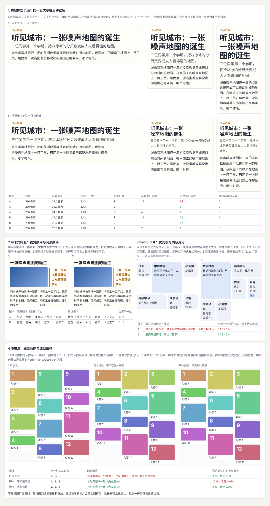
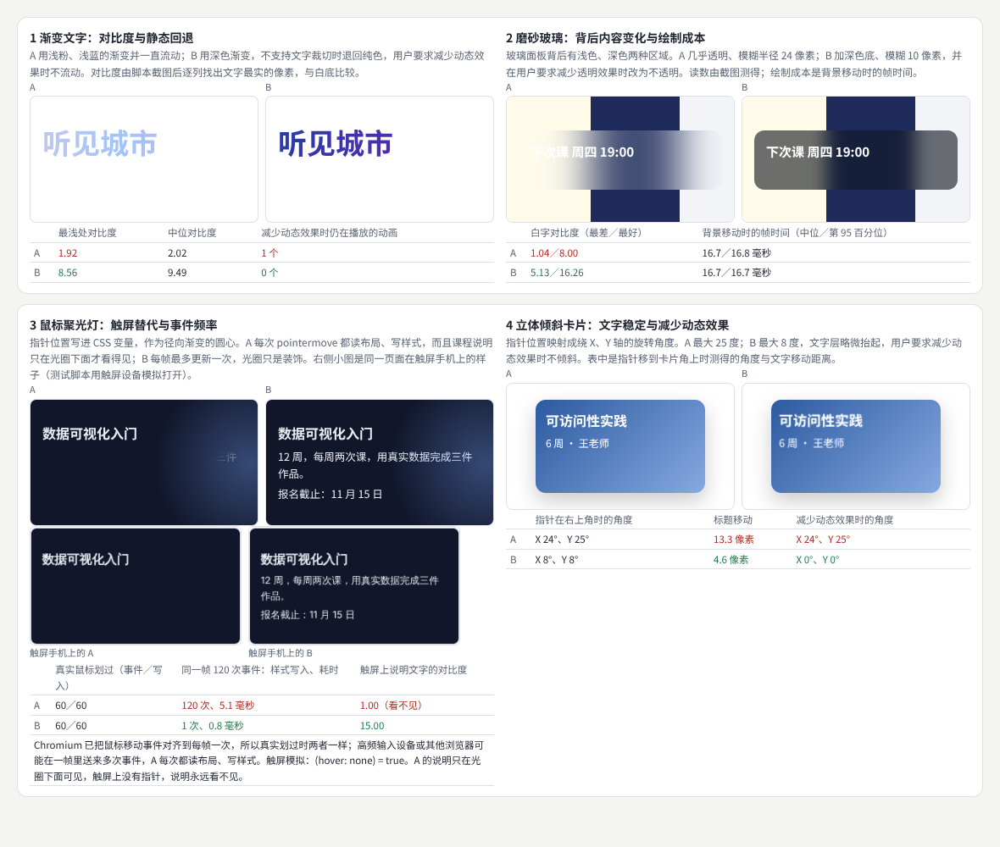
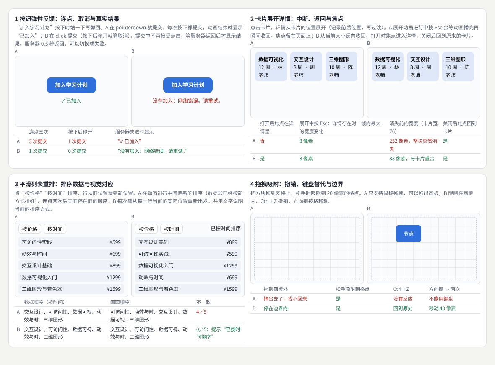
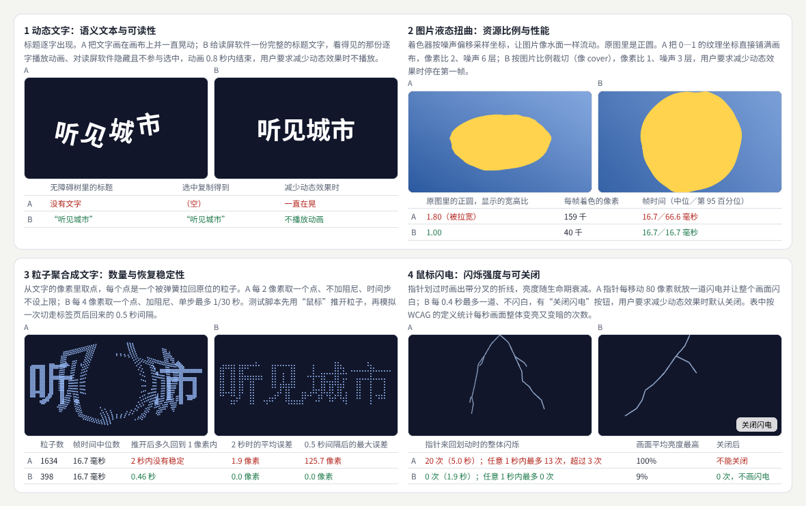
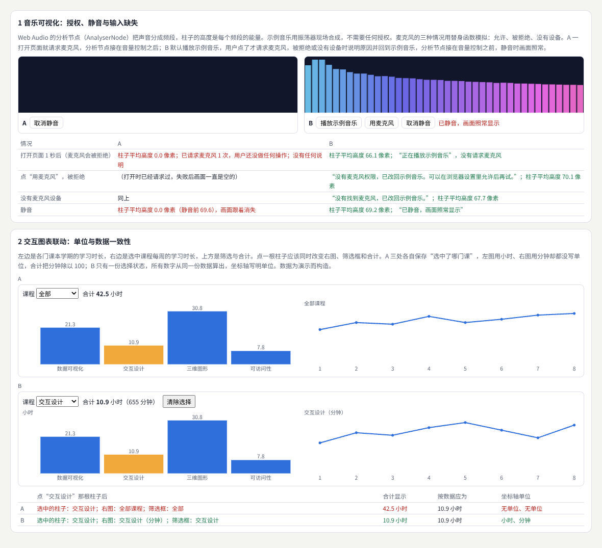
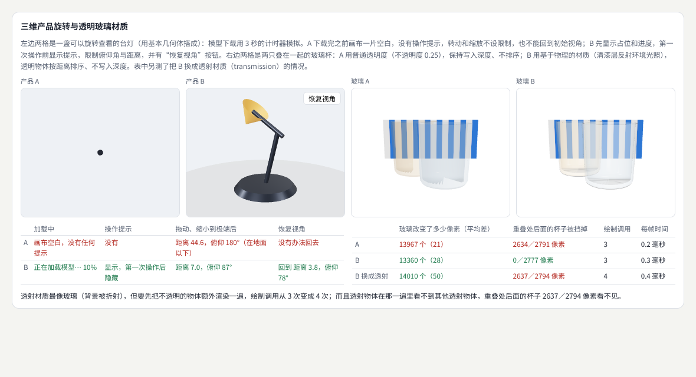
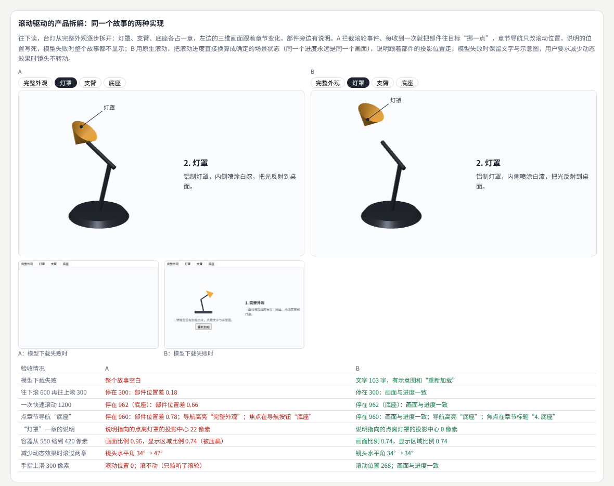
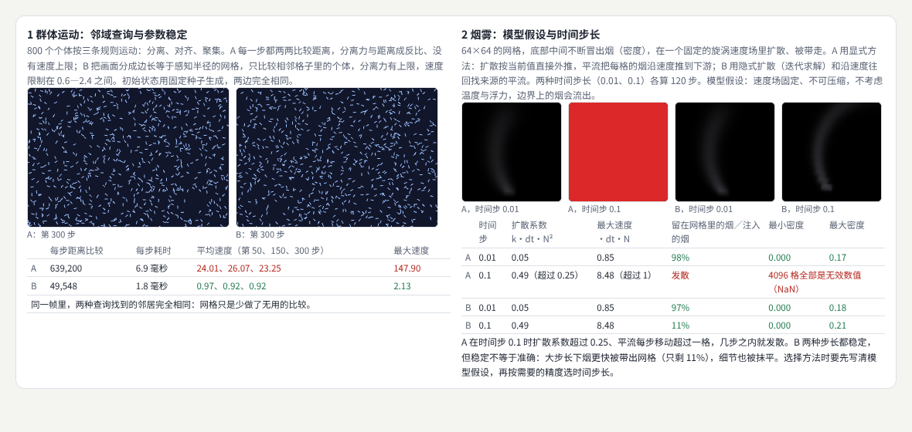
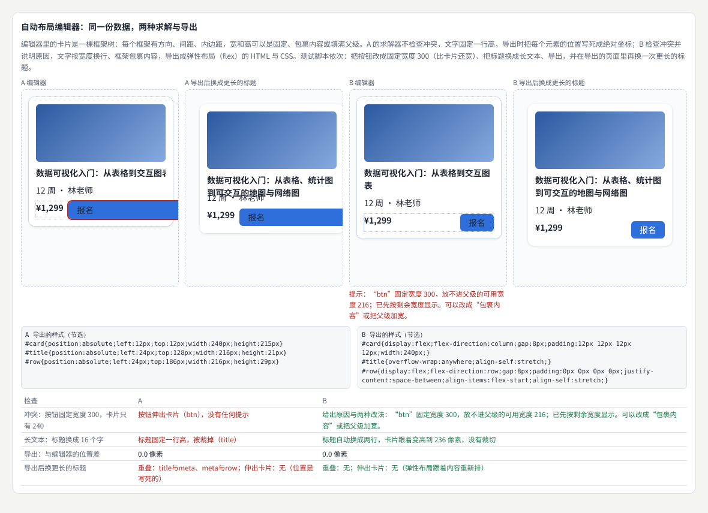
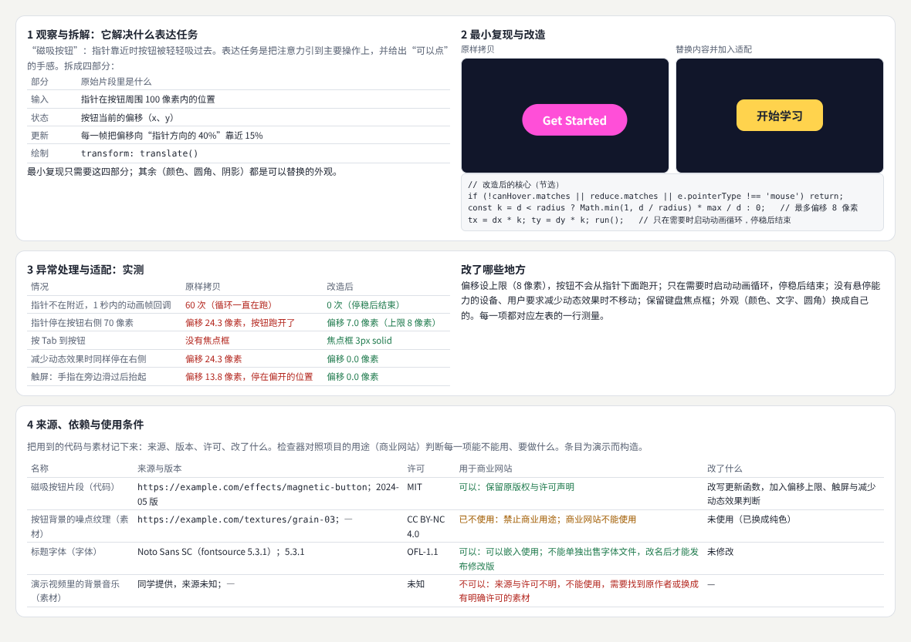

# 常见视觉效果拆解

> 看到一个好看的效果，怎样把它拆成能实现、能验收的几部分：它解决什么表达任务，输入是什么、保存哪些状态、每一帧怎样更新、最后怎样画出来，以及上线前最该检查什么。本册覆盖二十八种常见效果，按版式、表面与光影、反馈与布局动画、文字与图像、数据与声音、三维、模拟、工具型界面分组，并做一个完整的滚动拆解项目。  
> 版本：1.0 · 整理日期：2026-10-25  
> 适用对象：能写页面和组件、想把看到的效果做出来并做稳的前端开发、设计师和创意开发者。先修：读过[《前端界面工程》](01-前端界面工程.md)、[《动效与时间设计》](04-动效与时间设计.md)，三维与模拟部分需要[《三维内容与空间设计》](06-三维内容与空间设计.md)与[《生成艺术与物理仿真》](08-生成艺术与物理仿真.md)的基础。

这一册不追求把效果做得多炫，而是回答：**它能不能在真实内容、真实设备和真实用户面前站得住**。它们有三个共同点：

- **每个效果都能拆成四部分**：输入（指针、滚动、声音、数据）、状态（位置、进度、选中项）、更新（每一帧或每个事件怎样改状态）、绘制（DOM、SVG、Canvas 或 GPU）。拆清楚了，才知道哪一部分会出问题。
- **“应重点检查”比“怎样实现”更重要**。效果库给的代码通常只覆盖顺利的情况；连点、中断、触屏、减少动态效果、静音、资源失败、长内容、窗口变化，才是上线后真正会遇到的。
- **用测量代替感觉**。本册每个示例都把原样实现（A）与改进后的实现（B）放在一起，用同一组脚本测出差别：阅读顺序、布局偏移、对比度、事件次数、帧时间、闪烁次数、部件位置误差、导出后的重叠。

本册每章都按同样的顺序讲：先说明它解决什么问题；再用白话解释核心概念；然后给出一个可以直接运行的示例与运行截图；接着是常见问题和本章练习；最后是一张**进阶学习卡**：技术栈、要掌握的高阶词汇（附英文）、搜索关键词、值得去看的实例，以及四级进阶阶梯：

| 级别 | 含义 |
| --- | --- |
| L1 入门 | 能运行并解释本章示例，说出效果的输入、状态、更新与绘制 |
| L2 熟练 | 能在自己的项目里实现这些效果，并通过本章的检查 |
| L3 进阶 | 能把效果做成可复用的组件，处理异常、适配与性能 |
| L4 深入 | 能设计新的效果或工具，研究它对理解、注意力与可用性的影响 |

四级是本手册的教学结构，用来安排学习顺序，不对应任何公司的职级。

所有示例都放在本目录的[示例](示例/)文件夹中，用浏览器直接打开即可运行；每个示例都已在无头浏览器中实际运行并自动检查。书中的数字分三类，正文会逐处说明：**浏览器实际测得的**（布局、计算样式、无障碍树、像素、事件与动画帧次数、帧时间、相机与部件的位置）、**按规则或模型算出的**（对比度、邻域比较次数、数值格式的稳定条件、许可核对）、**为演示而构造的数据**（文章、课程、作品、效果片段与素材条目）。性能数字来自无头浏览器与软件渲染，只看两种实现之间的相对差异。具体库与技术只是候选，应根据框架、目标设备和内容需求选择。

主线是：**拆成输入、状态、更新与绘制 → 八组效果各用一个示例测出“应重点检查”的问题 → 一个完整拆解项目 → 从效果库学习的方法。**

## 阅读导航

正文共 13 章（01—13），附 10 个可运行示例、3 组附录与 41 项资料入口。

- [第一篇：共同的基础](#part-1)
  - [01 这一册研究什么：二十八种效果一览](#ch01)
  - [02 共同的方法：输入、状态、更新、绘制与应重点检查](#ch02)
- [第二篇：效果分组](#part-2)
  - [03 版式：精致静态页、杂志式排版、Bento 与瀑布流](#ch03)
  - [04 表面与光影：渐变文字、磨砂玻璃、聚光灯与倾斜卡片](#ch04)
  - [05 反馈与布局动画：弹性按钮、卡片展开、列表重排与拖拽吸附](#ch05)
  - [06 文字与图像：动态文字、液态扭曲、粒子文字与鼠标闪电](#ch06)
  - [07 数据与声音：音乐可视化与交互图表联动](#ch07)
  - [08 三维展示：产品旋转与透明玻璃](#ch08)
  - [09 项目：一个完整拆解示例——滚动驱动的产品拆解](#ch09)
  - [10 模拟：群体运动、流体与烟雾](#ch10)
  - [11 工具型界面：自动布局编辑器、AI 工作台、照片场景与实体形变](#ch11)
  - [12 从效果库学习的方法](#ch12)
- [第三篇：连接与路线](#part-3)
  - [13 效果之间的连接、工具与学习路线](#ch13)
- [附录 A：术语表](#appendix-a)
- [附录 B：资料入口](#appendix-b)
- [附录 C：与原手册的对应关系及修订记录](#appendix-c)

## 第一篇：共同的基础

### 01 这一册研究什么：二十八种效果一览

**常见视觉效果的实现拆解**：下表提供实现思路，具体库与技术只是候选。最后一列是本册讲到它的章节。

| 效果或体验 | 主要知识 | 实现思路 | 应重点检查 | 本册 |
| --- | --- | --- | --- | --- |
| 精致静态页面 | 版式、字体、色彩 | HTML、CSS 网格与视觉规范 | 内容层级与不同屏幕 | 03 |
| 杂志式排版 | 编辑设计、图片编排 | Grid、字体比例、图文关系 | 阅读顺序与长内容 | 03 |
| Bento 卡片布局 | 分组与网格 | Grid 区域安排与自适应 | 卡片优先级与内容变化 | 03 |
| 瀑布流 | 列布局、内容尺寸 | 选用适配目标平台的布局方案 | 阅读顺序与加载位移 | 03 |
| 渐变文字 | 背景与遮罩 | CSS 背景裁切等 | 对比与静态回退 | 04 |
| 磨砂玻璃界面 | 透明、模糊、分层 | CSS 半透明与背景滤镜 | 背后内容变化与绘制成本 | 04 |
| 鼠标聚光灯 | 坐标、事件、渐变 | 指针映射到局部渐变位置 | 触屏替代与事件频率 | 04 |
| 立体倾斜卡片 | 透视与变换 | 指针位置映射旋转角度 | 文字稳定与减少动态效果 | 04 |
| 按钮弹性反馈 | 动效、状态 | CSS 或动画库 | 连点、取消和真实结果 | 05 |
| 卡片展开详情 | 共享元素与布局 | 动画库或适用的浏览器能力 | 中断、返回和焦点 | 05 |
| 平滑列表重排 | 布局动画 | 记录前后位置并过渡 | 排序数据与视觉对应 | 05 |
| 拖拽吸附 | 命中、几何、状态 | 指针事件与吸附规则 | 撤销、键盘替代与边界 | 05 |
| 滚动叙事 | 时间线、内容编排 | 滚动进度关联场景状态 | 导航、节奏与手机端 | 09 |
| 动态文字 | 排版、遮罩、路径 | DOM、SVG 或图形层 | 语义文本与可读性 | 06 |
| 图片液态扭曲 | UV、噪声、输入 | 着色器采样偏移 | 资源比例与性能 | 06 |
| 粒子聚合成文字 | 点采样、力场 | Canvas 或 GPU 更新 | 数量与恢复稳定性 | 06 |
| 鼠标闪电 | 路径、随机、生命期 | 折线分叉与亮度衰减 | 闪烁强度与可关闭 | 06 |
| 音乐可视化 | 音频特征、映射 | Web Audio 与图形绘制 | 授权、静音与输入缺失 | 07 |
| 交互图表联动 | 数据映射、状态 | 图表与筛选共享选择状态 | 单位与数据一致性 | 07 |
| 三维产品旋转 | 模型、相机、材质 | 三维场景与旋转控制 | 加载、操作提示与恢复视角 | 08 |
| 产品拆解演示 | 物体层级、动画 | 部件变换与时间线 | 说明与部件关系 | 09 |
| 透明玻璃材质 | 透射、光照、环境 | 三维材质与相关渲染流程 | 背景、透明排序与成本 | 08 |
| 群体运动 | 邻域、速度、规则 | 智能体更新（CPU 或 GPU） | 参数稳定与邻域查询 | 10 |
| 流体与烟雾 | 数值模型、渲染 | 选择近似或物理模拟方案 | 模型假设与时间步长 | 10 |
| 照片场景浏览 | 重建、场景表示 | 使用适合数据的重建与渲染流程 | 未观测区域与资源成本 | 11 |
| 自动布局编辑器 | 约束、状态、数据模型 | 参数与约束求解加编辑界面 | 冲突、长文本与导出 | 11 |
| 生成式 AI 工作台 | 异步任务、人机协作 | 流式输出、版本、编辑与来源 | 取消、纠错与内容保存 | 11 |
| 实体形变界面 | 传感、控制、实体结构 | 硬件与软件共同设计 | 校准、可靠性与操作条件 | 11 |

### 02 共同的方法：输入、状态、更新、绘制与应重点检查

#### 02.1 四个问题

| 问题 | 例子（鼠标聚光灯） | 常见的坑 |
| --- | --- | --- |
| 输入是什么 | 指针在卡片里的坐标 | 触屏没有悬停；一帧里可能来多次事件 |
| 保存哪些状态 | 光圈中心的位置 | 状态和画面各存一份，彼此对不上 |
| 怎样更新 | 每帧最多写一次 CSS 变量 | 每个事件都读布局、写样式 |
| 怎样绘制 | 径向渐变 | 把重要内容放进只有悬停才看得见的效果里 |

#### 02.2 应重点检查的八类情况

1. **重复与中断**：连点、快速切换、动画中途被打断。
2. **输入方式**：鼠标、触屏、键盘、没有悬停能力的设备。
3. **用户偏好**：减少动态效果、减少透明效果、静音。
4. **内容变化**：长标题、长数字、空内容、图片尺寸未知。
5. **资源与权限**：图片、模型、麦克风失败或被拒绝。
6. **环境变化**：窗口大小、标签页切走后回来的时间间隔。
7. **语义**：读屏软件能否读出文字，阅读顺序是否与视觉顺序一致。
8. **成本**：每帧的比较次数、像素数、绘制调用、空闲时的循环。

#### 02.3 A／B 对照

每个示例都写两种实现：A 是常见的直接写法，B 按“应重点检查”改过。两者用同一组脚本测量，所以差别只来自实现方式。

**本章练习**：

1. 选一个你喜欢的效果，写出它的输入、状态、更新与绘制。
2. 对照 02.2 的八类情况，列出它最可能出问题的三类。

## 第二篇：效果分组

### 03 版式：精致静态页、杂志式排版、Bento 与瀑布流

#### 03.1 解决什么问题

**精致静态页面**靠**版式**、**字体**、**色彩**取胜，用 **HTML**、**CSS 网格**与**视觉规范**实现，重点检查内容层级与不同屏幕。**杂志式排版**属于**编辑设计**与**图片编排**，用 **Grid**、**字体比例**与**图文关系**组织，重点检查阅读顺序与长内容。**Bento 卡片布局**讲分组与网格，用 Grid 区域安排与自适应，重点检查卡片优先级与内容变化。**瀑布流**涉及**列布局**与**内容尺寸**，要选用适配目标平台的布局方案，重点检查阅读顺序与加载位移[B01](#ref-b01)。

#### 03.2 核心概念

| 概念 | 含义 | 做法 |
| --- | --- | --- |
| 容器查询 | 组件按自己所在容器的宽度调整[B02](#ref-b02) | 标题字号用 `clamp()` 与容器单位 `cqi` |
| 行长 | 每行字数 | 正文限制在约 30 个字一行 |
| 均衡换行 | 标题各行长度接近[B03](#ref-b03) | `text-wrap: balance`，避免末行只剩一两个字 |
| 源码顺序 | 读屏软件与 Tab 键走的顺序 | 网格只负责摆放，源码顺序就是阅读顺序 |
| 优先级 | 卡片的重要程度 | 源码按优先级排，窄屏改成一列时顺序自然正确 |
| 瀑布流 | 不等高的卡片按列排 | 数据里带宽高比，先摆在最终位置；原生方案见[B04](#ref-b04) |

#### 03.3 示例：同一组内容的两种写法

示例：[19-03-layouts.html](示例/19-03-layouts.html)

**精致静态页面**（同一篇文章在三种容器宽度）：

| 版本 | 宽度 | 标题字号 | 标题行数与末行字数 | 正文每行字数 |
| --- | --- | --- | --- | --- |
| A 写死字号 | 596／290／200 | 34／34／34 像素 | 1 行／2 行（末行 7 字）／3 行（末行 4 字） | 34／17／11 |
| B 容器单位＋均衡换行 | 596／290／200 | 34／20.2／20 像素 | 1 行／2 行（7／7）／2 行（7／7） | 22／17／11 |

**杂志式排版**：A 为了让引语出现在图片旁边，把它放在源码最前面再用网格位置挪回去——源码顺序“引语 → 标题 → 正文二 → 图片 → 正文一”与视觉顺序 5 处全部不一致；B 0 处。读屏软件与 Tab 键按源码顺序走，看起来一样的两个页面，听起来完全不同。

**Bento 卡片**：把第 4 张的内容换成长文本，A 的卡片固定高度、超出部分直接裁掉，第 3、4、5 张都被裁且没有提示；窄屏一列时的顺序是 3、1、6、2、5、4。B 摘要截成两行并给出“更多”，窄屏顺序 1—6 与优先级一致。

**瀑布流**（12 条动态，图片在 0.2—1.3 秒间陆续到达）：

| 做法 | 第一行从左到右 | 图片到达时的布局偏移 |
| --- | --- | --- |
| CSS 多列 | 1、5、9（先竖着读完一列） | 0 次 |
| 脚本按最短列摆放，不知道图片高度 | 1、2、3 | 9—12 次 |
| 脚本按数据里的宽高比预留位置 | 1、2、3 | 0 次 |

测量布局偏移时，三种做法要依次运行：同一帧里的偏移会合并成一条记录，分不清是谁造成的；而且只有视口内的元素才会被记录。

#### 03.4 常见问题

- **大屏上好看，小屏上标题一字一行**：用容器单位与 `clamp()`，标题加均衡换行。
- **用网格位置改变视觉顺序**：读屏软件仍按源码读；源码顺序应与阅读顺序一致。
- **卡片固定高度**：长内容被悄悄裁掉；高度随内容增长，摘要截断要给出入口。
- **瀑布流用 CSS 多列**：时间顺序被打乱；按时间排序的信息流用脚本摆放。
- **图片到达后才知道高度**：数据里带宽高比，先预留位置。

**本章练习**：

1. 把你的一篇文章放进三种宽度的容器，测出标题字号、行数和正文每行字数。
2. 为一个 Bento 首页按优先级写源码顺序，换成窄屏一列时检查顺序。

#### 03.5 进阶学习卡

| 级别 | 目标 | 怎样检验 |
| --- | --- | --- |
| L1 入门 | 能用网格做出四种版式 | 能解释示例的每组测量 |
| L2 熟练 | 能让版式适应容器宽度、内容变化与加载 | 阅读顺序一致，布局偏移为 0 |
| L3 进阶 | 能为内容系统设计版式规则，处理长内容与多语言 | 规则覆盖极端内容 |
| L4 深入 | 能研究版式对阅读与理解的影响 | 阅读实验或长期数据 |

- **技术栈**：CSS Grid（`grid-template-areas`、`minmax()`）；容器查询与 `cqi` 单位；`clamp()`；`text-wrap: balance`；`aspect-ratio`；瀑布流的脚本摆放与数据里的宽高比。
- **高阶词汇**：版式（layout）、网格系统（grid system）、编辑设计（editorial design）、容器查询（container queries）、流体排版（fluid typography）、行长（measure）、孤行（orphan）、阅读顺序（reading order）、瀑布流（masonry）、累积布局偏移（CLS）。
- **搜索关键词**：`css grid editorial layout`、`container queries fluid typography clamp`、`text-wrap balance`、`masonry layout reading order accessibility`、`bento grid design`、`杂志 排版 网格`。
- **值得看的实例**：[MDN 的网格布局指南](https://developer.mozilla.org/en-US/docs/Web/CSS/Guides/Grid_layout)——从基本网格到命名区域，附大量可编辑的例子。
- **资料**：[B01](#ref-b01)、[B02](#ref-b02)、[B03](#ref-b03)、[B04](#ref-b04)。

### 04 表面与光影：渐变文字、磨砂玻璃、聚光灯与倾斜卡片

#### 04.1 解决什么问题

**渐变文字**用背景与遮罩，实现上是 CSS 背景裁切等[B05](#ref-b05)，重点检查对比与静态回退。**磨砂玻璃界面**涉及**透明**、**模糊**与**分层**，用 CSS 半透明与背景滤镜[B06](#ref-b06)，重点检查背后内容变化与绘制成本。**鼠标聚光灯**把指针的**坐标**通过**事件**映射到局部**渐变**的位置，重点检查触屏替代与事件频率。**立体倾斜卡片**用透视与变换[B07](#ref-b07)，把指针位置映射成旋转角度，重点检查文字稳定与减少动态效果。

#### 04.2 核心概念

| 概念 | 含义 | 做法 |
| --- | --- | --- |
| 背景裁切 | 用文字的形状裁出背景 | `background-clip: text`，不支持时退回纯色 |
| 背景滤镜 | 模糊玻璃后面的内容 | 加深色底，减少透明效果时改为不透明[B08](#ref-b08) |
| 悬停能力 | 设备有没有可以悬停的指针[B09](#ref-b09) | 没有时，效果只能是装饰，不能藏内容 |
| 合并事件 | 一帧里收到多次移动事件[B10](#ref-b10) | 每帧最多更新一次 |
| 透视 | 近大远小的投影 | 角度设上限，文字层略微抬起 |

#### 04.3 示例：截图里测对比度、事件次数与角度

示例：[19-04-surfaces.html](示例/19-04-surfaces.html)

| 效果 | 测量 | A | B |
| --- | --- | --- | --- |
| 渐变文字 | 渐变最浅处的对比度（截图逐列取笔画中心） | 1.91 | 8.88 |
| | 减少动态效果时仍在播放的动画 | 1 个 | 0 个 |
| 磨砂玻璃 | 白字与玻璃背景的对比度（最差／最好） | 1.04／8.00 | 5.13／16.26 |
| | 背景移动时的帧时间 | 16.7 毫秒 | 16.7 毫秒 |
| 鼠标聚光灯 | 同一帧收到 120 次移动事件时的样式写入 | 120 次，4.4 毫秒 | 1 次，0.5 毫秒 |
| | 触屏手机上说明文字（区域最亮与最暗之比） | 1（看不见） | 15 |
| 倾斜卡片 | 指针在右上角时的角度与标题移动 | 24°、13.3 像素 | 8°、4.6 像素 |
| | 减少动态效果时的角度 | 24° | 0° |

几点说明：Chromium 已经把真实鼠标的移动事件对齐到每帧一次，所以真实划过时两种聚光灯都是每帧一次；高频输入设备或其他浏览器可能在一帧里送来多次事件，测试用连续派发 120 次来模拟。磨砂玻璃在这个面积下的绘制成本看不出差别，面积和模糊半径变大时才会显现。A 的聚光灯把课程说明藏在光圈下面，触屏上永远看不见——效果只能是装饰，不能承载内容。

制作中遇到的坑：浏览器的强制颜色模式会把透明文字强制成黑色并去掉渐变，两种写法都看得见，不能用来检验回退。

#### 04.4 常见问题

- **渐变用了很浅的颜色**：最浅处要满足对比度；只在笔画中心取样，排除抗锯齿的边缘。
- **玻璃几乎全透明**：背后是浅色时白字看不清；加深色底。
- **把内容藏在悬停效果里**：触屏和键盘用户看不到。
- **每个事件都读布局、写样式**：每帧最多更新一次。
- **倾斜角度太大**：文字晃得难以阅读；设上限并在减少动态效果时关闭。

**本章练习**：

1. 截图测出你的渐变文字最浅处的对比度。
2. 为你的悬停效果写出在触屏、键盘和减少动态效果下的表现。

#### 04.5 进阶学习卡

| 级别 | 目标 | 怎样检验 |
| --- | --- | --- |
| L1 入门 | 能做出四种表面效果 | 能解释示例的测量 |
| L2 熟练 | 能保证对比度，并为触屏与减少动态效果提供替代 | 示例的 B 列标准 |
| L3 进阶 | 能把效果做成带开关与回退的组件 | 不同设备与偏好下的检查记录 |
| L4 深入 | 能研究这类效果对注意力与可读性的影响 | 用户研究 |

- **技术栈**：`background-clip: text`、`@supports`；`backdrop-filter`、`prefers-reduced-transparency`；CSS 自定义属性与 `requestAnimationFrame` 节流；`perspective`、`transform-style: preserve-3d`；`@media (hover: hover)`。
- **高阶词汇**：背景裁切（background clip）、玻璃拟态（glassmorphism）、背景滤镜（backdrop filter）、聚光灯效果（spotlight effect）、指针事件（pointer events）、合并事件（coalesced events）、节流（throttling）、透视（perspective）、视差倾斜（parallax tilt）、渐进增强（progressive enhancement）。
- **搜索关键词**：`gradient text accessibility contrast`、`glassmorphism accessibility`、`backdrop-filter performance`、`spotlight hover effect touch fallback`、`3d tilt card reduced motion`、`磨砂玻璃 可读性`。
- **值得看的实例**：[MDN 的 backdrop-filter 页面](https://developer.mozilla.org/en-US/docs/Web/CSS/Reference/Properties/backdrop-filter)——可以直接调整各种滤镜，观察背景变化对可读性的影响。
- **资料**：[B05](#ref-b05)、[B06](#ref-b06)、[B08](#ref-b08)、[B09](#ref-b09)、[B10](#ref-b10)、[B07](#ref-b07)。

### 05 反馈与布局动画：弹性按钮、卡片展开、列表重排与拖拽吸附

#### 05.1 解决什么问题

**按钮弹性反馈**用**动效**表达**状态**，可以用 CSS 或动画库实现，重点检查**连点**、**取消**和**真实结果**。**卡片展开详情**涉及共享元素与布局，用动画库或适用的浏览器能力[B11](#ref-b11)[B12](#ref-b12)，重点检查**中断**、**返回**和**焦点**。**平滑列表重排**是布局动画，记录前后位置并过渡[B13](#ref-b13)，重点检查排序数据与视觉对应。**拖拽吸附**涉及**命中**、**几何**与状态，用指针事件与吸附规则，重点检查**撤销**、**键盘替代**与**边界**[B14](#ref-b14)。

#### 05.2 核心概念

| 概念 | 含义 | 做法 |
| --- | --- | --- |
| 真实结果 | 动画表达的是用户的操作，结果要等服务器 | 按下有反馈；成功、失败由返回结果决定 |
| 取消 | 按下后移开再松手 | 在 click 而不是 pointerdown 提交 |
| 可中断 | 动画进行中改变主意 | 从当前值出发反向，而不是等动画播完 |
| FLIP | 先记录起点，改布局，再从起点过渡到终点 | 起点读每一行当前的实际位置 |
| 吸附 | 松手时对齐到格点 | 边界也对齐到格点 |
| 键盘替代 | 不拖动也能完成 | 方向键按格移动，Ctrl＋Z 撤销 |

#### 05.3 示例：真实点击、按下移开、连点排序与拖出边界

示例：[19-05-motion-feedback.html](示例/19-05-motion-feedback.html)

| 效果 | 情况 | A | B |
| --- | --- | --- | --- |
| 弹性按钮 | 连点三次 | 3 次提交 | 1 次（提交中不可用） |
| | 按下后移开 | 1 次提交（按下就提交） | 0 次 |
| | 服务器失败 | 仍显示“✓ 已加入” | “没有加入：网络错误。请重试。” |
| 卡片展开 | 打开后焦点在详情里 | 否 | 是 |
| | 展开 0.15 秒时按 Esc | 等动画播完，252 像素宽的详情整块消失 | 从当前大小收回到卡片大小（与卡片重合） |
| | 关闭后焦点回到卡片 | 是（焦点从没离开） | 是 |
| 列表重排 | 0.1 秒内先按价格、再按时间 | 画面与数据 4／5 行不一致 | 0／5，提示“已按时间排序” |
| 拖拽吸附 | 拖到画板外 | 拖出去了，找不回来 | 停在边界内最后一个格点 |
| | Ctrl＋Z／方向键 | 没有反应／不能用键盘 | 回到原处／每次移动 20 像素 |

A 的列表在动画进行中忽略了新的排序，但数据已经换成了新顺序——画面和数据对不上，是布局动画最隐蔽的错误。

#### 05.4 常见问题

- **动画结束就显示成功**：成功要等服务器返回。
- **在 pointerdown 提交**：用户没办法反悔。
- **动画不能中断**：用户每次改主意都要等。
- **重排时用过期的位置**：每次从当前的实际位置出发。
- **只能拖拽**：提供键盘与按钮等不拖动的方式，并能撤销。

**本章练习**：

1. 为你的提交按钮写三个测试：连点、按下移开、服务器失败。
2. 为一个可拖拽的列表加上键盘移动与撤销。

#### 05.5 进阶学习卡

| 级别 | 目标 | 怎样检验 |
| --- | --- | --- |
| L1 入门 | 能做出四种动画反馈 | 能解释示例的测量 |
| L2 熟练 | 能处理连点、取消、中断与失败 | 通过示例的全部检查 |
| L3 进阶 | 能把布局动画与数据状态做成一致的组件 | 快速操作下画面与数据一致 |
| L4 深入 | 能研究动画反馈对理解与效率的影响 | 用户实验 |

- **技术栈**：CSS 动画与 Web Animations API（`cancel()`、`finished`）；View Transitions；FLIP；Pointer Events 与 `setPointerCapture()`；键盘事件；撤销栈。
- **高阶词汇**：微交互（micro-interaction）、乐观更新（optimistic UI）、共享元素过渡（shared element transition）、可中断动画（interruptible animation）、FLIP、布局动画（layout animation）、命中测试（hit testing）、吸附（snapping）、拖放（drag and drop）、撤销（undo）。
- **搜索关键词**：`flip animation technique`、`view transitions api shared element`、`interruptible animations web animations api`、`accessible drag and drop keyboard`、`prevent double submit button`、`布局 动画 FLIP`。
- **值得看的实例**：[Paul Lewis 的 FLIP 动画](https://aerotwist.com/blog/flip-your-animations/)——用“先记录、再改布局、再过渡”的顺序做出流畅的布局动画。
- **资料**：[B11](#ref-b11)、[B12](#ref-b12)、[B13](#ref-b13)、[B14](#ref-b14)。

### 06 文字与图像：动态文字、液态扭曲、粒子文字与鼠标闪电

#### 06.1 解决什么问题

**动态文字**涉及**排版**、**遮罩**与**路径**，可以用 **DOM**、**SVG** 或**图形层**实现，重点检查语义文本与可读性[B15](#ref-b15)。**图片液态扭曲**用 **UV**、**噪声**[B16](#ref-b16)与**输入**，在着色器里偏移采样坐标，重点检查资源比例与性能。**粒子聚合成文字**需要**点采样**与**力场**，用 **Canvas** 或 **GPU** 更新，重点检查数量与恢复稳定性。**鼠标闪电**用路径、**随机**与**生命期**，折线分叉、亮度衰减，重点检查闪烁强度与可关闭[B17](#ref-b17)。

#### 06.2 核心概念

| 概念 | 含义 | 做法 |
| --- | --- | --- |
| 可访问名称 | 读屏软件读出的标题文字 | 给读屏软件一份完整文字，逐字动画的那份隐藏 |
| 纹理坐标 | 图片上的位置，0—1 | 按图片比例换算，像 `cover` 那样裁切 |
| 噪声 | 平滑的随机起伏 | 层数越多越细腻，也越费 |
| 弹簧与阻尼 | 粒子被拉回原位 | 加阻尼，单步时间设上限 |
| 闪烁 | 画面整体先变亮再变暗 | 任意 1 秒内不超过 3 次，并能关闭 |

#### 06.3 示例：无障碍树、读回像素、粒子误差与闪烁次数

示例：[19-06-text-image-effects.html](示例/19-06-text-image-effects.html)

| 效果 | 测量 | A | B |
| --- | --- | --- | --- |
| 动态文字 | 无障碍树里的标题／选中复制得到 | 没有文字／（空） | “听见城市”／“听见城市” |
| | 减少动态效果时 | 一直在晃 | 不播放动画 |
| 液态扭曲 | 原图里的正圆显示的宽高比 | 1.80（被拉宽） | 1.00 |
| | 每帧着色的像素 | 159 千 | 40 千 |
| 粒子文字 | 粒子数 | 1,634 | 398 |
| | 推开后多久回到 1 像素内 | 2 秒内没有稳定 | 0.46 秒 |
| | 模拟切走标签页后的 0.5 秒间隔 | 最大误差约 126 像素 | 0 |
| 鼠标闪电 | 画面整体闪烁（任意 1 秒内最多） | 20 次，最多 13 次 | 0 次 |
| | 能否关闭 | 不能 | 能；减少动态效果时默认关闭 |

A 把标题画在画布上，读屏软件读不到，也不能选中复制。B 的做法里有一个值得记住的细节：如果直接把每个字包成 `inline-block` 元素，浏览器算出的名称会在每两个字之间多出一个空格；把完整文字和逐字动画分成两份，又要让动画那份不参与选中，否则会复制出两遍。

液态扭曲两版的帧时间都是 16.7 毫秒——在这个尺寸下着色并不是瓶颈，但 A 每帧着色的像素是 B 的 4 倍，在更大的画面或更弱的设备上会先卡住。粒子文字 A 不加阻尼，被推开后一直振荡；一次 0.5 秒的时间间隔（切走标签页再回来）让它几乎飞散。

测量闪烁时遇到一个坑：鼠标事件密集时，单独的测量循环拿不到动画帧，只采到 1 个样本；改为在效果自己的绘制循环里记录每一帧的平均亮度。

#### 06.4 常见问题

- **把文字画进画布或拆成单字**：读屏软件读不到或读成单字；给一份完整文字。
- **纹理坐标直接铺满**：图片被拉伸；按比例换算。
- **粒子太多**：先测帧时间，再定数量。
- **用真实时间步长直接积分**：标签页切回来时一步跨很远，单步时间要设上限。
- **整屏闪白**：可能引发光敏性癫痫；每秒不超过 3 次，并提供关闭。

**本章练习**：

1. 为你的动态标题检查无障碍树与选中复制。
2. 给你的粒子效果加上阻尼与单步时间上限，测出恢复时间。

#### 06.5 进阶学习卡

| 级别 | 目标 | 怎样检验 |
| --- | --- | --- |
| L1 入门 | 能做出四种文字与图像特效 | 能解释示例的测量 |
| L2 熟练 | 能保证语义、比例、稳定与闪烁安全 | 通过示例 B 列的标准 |
| L3 进阶 | 能把效果做成可配置、可降级的组件 | 不同设备上的帧时间记录 |
| L4 深入 | 能研究动态文字与图像效果对阅读与注意的影响 | 实验或眼动研究 |

- **技术栈**：DOM 与 SVG 文字、`aria-hidden`、`user-select`；WebGL 片元着色器、纹理坐标与噪声；Canvas 2D 粒子与弹簧—阻尼积分；`requestAnimationFrame`；读回像素统计亮度。
- **高阶词汇**：动态排版（kinetic typography）、可访问名称（accessible name）、纹理坐标（UV coordinates）、值噪声与分形噪声（value noise／fBm）、粒子系统（particle system）、弹簧—阻尼（spring–damper）、固定时间步长（fixed timestep）、光敏性癫痫（photosensitive epilepsy）、闪烁阈值（flash threshold）。
- **搜索关键词**：`kinetic typography accessibility`、`webgl image distortion shader uv`、`particles to text canvas`、`fix your timestep`、`wcag three flashes`、`动态 文字 可访问性`。
- **值得看的实例**：[The Book of Shaders 的噪声一章](https://thebookofshaders.com/11/)——一步步做出液态扭曲需要的噪声。
- **资料**：[B15](#ref-b15)、[B16](#ref-b16)、[B17](#ref-b17)、[B18](#ref-b18)、[B19](#ref-b19)。

### 07 数据与声音：音乐可视化与交互图表联动

#### 07.1 解决什么问题

**音乐可视化**要提取**音频特征**并**映射**成图形，用 **Web Audio** 与图形绘制[B20](#ref-b20)，重点检查**授权**、**静音**与**输入缺失**。**交互图表联动**涉及**数据映射**与状态，图表与筛选共享选择状态，重点检查单位与数据一致性。

#### 07.2 核心概念

| 概念 | 含义 | 做法 |
| --- | --- | --- |
| 分析节点 | 把声音分成频段，取出每段的能量[B21](#ref-b21) | 接在音量控制之前，静音时画面照常 |
| 授权时机 | 什么时候请求麦克风[B22](#ref-b22) | 用户点了才请求；默认用不需要授权的示例 |
| 输入缺失 | 被拒绝或没有设备 | 说明原因，回到示例 |
| 单一选择状态 | 所有图表与筛选共用一份“选中了什么” | 从同一份数据算出所有数字 |
| 单位 | 小时、分钟 | 坐标轴写明；合计与分项可以互相换算 |

#### 07.3 示例：麦克风被拒、静音与联动后的数字

示例：[19-07-data-sound.html](示例/19-07-data-sound.html)

麦克风的三种结果用替身函数模拟（允许、被拒绝、没有设备），示例音乐用振荡器现场合成：

| 情况 | A | B |
| --- | --- | --- |
| 打开页面 1 秒后 | 已请求麦克风 1 次（用户还没操作），被拒后柱子高度 0，没有说明 | 在播放示例音乐，没有请求麦克风 |
| 点“用麦克风”，被拒绝 | — | “没有麦克风权限，已改回示例音乐。可以在浏览器设置里允许后再试。” |
| 没有麦克风设备 | — | “没有找到麦克风，已改回示例音乐。” |
| 静音 | 柱子高度从 66.5 降到 0 | 69.7，提示“已静音，画面照常显示” |

图表联动（点“交互设计”那根柱子）：

| | 三处显示 | 合计 | 按数据应为 | 单位 |
| --- | --- | --- | --- | --- |
| A | 柱子选中交互设计；右图仍是全部课程；筛选框仍是全部 | 42.5 小时（把分钟除以 100） | 10.9 小时 | 两图都没写 |
| B | 三处都是交互设计 | 10.9 小时（655 分钟） | 10.9 小时 | 小时、分钟 |

#### 07.4 常见问题

- **一打开就请求麦克风**：用户还不知道为什么要授权；等用户主动选择。
- **分析节点接在音量之后**：静音时画面也消失。
- **几个图表各存一份选择**：点一处，其他地方不跟着变。
- **单位不写、换算写错**：合计与分项对不上。

**本章练习**：

1. 为你的音频可视化写出被拒绝、没有设备、静音三种情况的处理。
2. 为一组联动图表写一个检查：选中后三处是否一致，合计是否等于分项之和。

#### 07.5 进阶学习卡

| 级别 | 目标 | 怎样检验 |
| --- | --- | --- |
| L1 入门 | 能做出频谱可视化与两张联动图表 | 能解释示例的测量 |
| L2 熟练 | 能处理授权、静音、输入缺失与单位 | 通过示例 B 列 |
| L3 进阶 | 能设计可扩展的联动状态与音频特征映射 | 多图表、多输入的检查 |
| L4 深入 | 能研究声音与数据映射的感知效果 | 用户研究 |

- **技术栈**：Web Audio API（`AudioContext`、`AnalyserNode`、`GainNode`、`OscillatorNode`）；`getUserMedia()` 与错误类型；SVG 图表；单一状态源。
- **高阶词汇**：音频可视化（audio visualization）、快速傅里叶变换（FFT）、频谱（spectrum）、音频图（audio graph）、权限请求（permission prompt）、联动视图（coordinated views）、刷选与联动（brushing and linking）、单一数据源（single source of truth）。
- **搜索关键词**：`web audio analysernode visualizer`、`getusermedia notallowederror handling`、`coordinated multiple views linking`、`chart units consistency`、`音乐 可视化 web audio`。
- **值得看的实例**：[MDN 的 Web Audio API 指南](https://developer.mozilla.org/en-US/docs/Web/API/Web_Audio_API)——从音频图的基本概念到可视化的完整例子。
- **资料**：[B20](#ref-b20)、[B21](#ref-b21)、[B22](#ref-b22)。

### 08 三维展示：产品旋转与透明玻璃

#### 08.1 解决什么问题

**三维产品旋转**涉及**模型**、**相机**与**材质**，用三维场景与旋转控制[B23](#ref-b23)，重点检查**加载**、**操作提示**与**恢复视角**。**透明玻璃材质**涉及**透射**、**光照**与**环境**，用三维材质与相关渲染流程[B24](#ref-b24)，重点检查**背景**、**透明排序**与**成本**。

#### 08.2 核心概念

| 概念 | 含义 | 做法 |
| --- | --- | --- |
| 轨道控制 | 拖动旋转、滚轮缩放 | 限制俯仰角与距离，提供“恢复视角” |
| 占位与进度 | 模型下载期间显示什么 | 先显示占位与进度；渲染器等下载完再创建 |
| 透明排序 | 透明物体按距离从远到近画 | 打开排序，透明物体不写入深度 |
| 透射 | 光穿过物体并折射 | 多一遍渲染；透射物体彼此看不见 |

#### 08.3 示例：拖到极端、恢复视角与两只叠在一起的玻璃杯

示例：[19-08-3d-display.html](示例/19-08-3d-display.html)

| 情况 | A | B |
| --- | --- | --- |
| 加载中（模型下载模拟 3 秒） | 画布空白，没有任何提示 | “正在加载模型… 10%” |
| 操作提示 | 没有 | 显示，第一次操作后隐藏 |
| 向上拖很多、滚轮缩小 12 次 | 距离 44.6，俯仰 180°（在地面以下） | 距离 7.0，俯仰 87° |
| 恢复视角 | 没有办法回去 | 回到距离 3.8、俯仰 78° |

| 玻璃 | 玻璃改变的像素（平均差） | 重叠处后面的杯子被挡掉 | 绘制调用 |
| --- | --- | --- | --- |
| A 普通透明度、写入深度、不排序 | 13,967 个（21） | 2,634／2,791 像素 | 3 |
| B 基于物理的材质、环境反射、排序、不写深度 | 13,360 个（28） | 0／2,777 像素 | 3 |
| B 换成透射材质 | 14,010 个（50） | 2,637／2,794 像素 | 4 |

透射材质最像玻璃，但要先把不透明的物体额外渲染一遍；而且透射物体在那一遍里看不到其他透射物体，重叠处后面的杯子同样看不见。选哪种做法，取决于画面里有没有多个透明物体叠在一起。

制作中遇到的坑：在轨道控制的 `change` 事件里再调用 `update()` 会再次触发 `change`，无限递归；模块脚本的顶层 `await` 和同步的环境贴图生成都会推迟页面的 load 事件，所以 B 改为模型下载完成后才创建渲染器。

#### 08.4 常见问题

- **下载期间一片空白**：先显示占位、进度与可以阅读的文字。
- **不限制视角**：用户转到地面以下就找不回来；限制俯仰角与距离，并提供恢复。
- **透明物体不排序**：后面的物体在重叠处消失。
- **以为透射总是更好**：多一遍渲染，且透射物体彼此看不见。

**本章练习**：

1. 为你的三维查看器加上视角限制、恢复按钮与第一次操作前的提示。
2. 在场景里放两个重叠的透明物体，检查排序与深度写入。

#### 08.5 进阶学习卡

| 级别 | 目标 | 怎样检验 |
| --- | --- | --- |
| L1 入门 | 能做出可以旋转的产品与玻璃材质 | 能解释示例的测量 |
| L2 熟练 | 能处理加载、提示、视角限制与透明排序 | 通过示例 B 列 |
| L3 进阶 | 能在真实模型与多个透明物体下保持正确与流畅 | 不同设备上的记录 |
| L4 深入 | 能研究三维查看器的可用性与透明渲染方法 | 研究报告 |

- **技术栈**：three.js（`OrbitControls`、`MeshPhysicalMaterial`、`RoomEnvironment` 与 `PMREMGenerator`）；`renderer.sortObjects`、`depthWrite`；读回像素比较。
- **高阶词汇**：轨道控制（orbit controls）、俯仰角（polar angle）、透明排序（transparency sorting）、深度写入（depth write）、顺序无关透明（order-independent transparency）、透射（transmission）、基于物理的渲染（PBR）、环境贴图（environment map）、清漆层（clearcoat）。
- **搜索关键词**：`three.js orbitcontrols limits reset`、`three.js transparent sorting depthwrite`、`meshphysicalmaterial transmission`、`order independent transparency`、`3d product viewer ux`、`三维 产品 展示 交互`。
- **值得看的实例**：[three.js 的 OrbitControls 文档](https://threejs.org/docs/pages/OrbitControls.html)——俯仰角、距离、阻尼与恢复的每个参数。
- **资料**：[B23](#ref-b23)、[B24](#ref-b24)。

### 09 项目：一个完整拆解示例——滚动驱动的产品拆解

#### 09.1 任务

**滚动叙事**用**时间线**与**内容编排**，把滚动进度关联到场景状态[B25](#ref-b25)[B26](#ref-b26)，重点检查**导航**、**节奏**与**手机端**。**产品拆解演示**涉及**物体层级**与**动画**，用部件变换与时间线，重点检查说明与部件关系。

目标是“用户滚动时，产品从完整外观逐步拆解，并出现部件说明”。先准备可分离部件的模型，再确定每个章节的相机、**部件位置**和说明。将滚动进度映射到一个确定的场景状态，使向上和向下滚动都能得到一致结果。

界面层提供**章节导航**、**简化浏览**和**产品文字信息**。资源未就绪时先展示可阅读内容；三维资源失败时保留说明。验收应包含**快速滚动**、**窗口变化**、**触屏**、**减少动态效果偏好**、**跳转章节**与**资源加载失败**。

#### 09.2 做法

| 部分 | 做法 |
| --- | --- |
| 关键帧 | 每章一组部件偏移与镜头角度，两章之间线性插值 |
| 进度到状态 | 进度 = 滚动位置 ÷ 每章高度；状态只由进度决定，不依赖过去的事件 |
| 滚动 | 原生滚动（触屏、键盘、滚动条都能用），每帧最多更新一次 |
| 说明 | 把部件中心投影到画面上，说明跟着部件走 |
| 导航 | 滚到对应章节，焦点放到章节标题 |
| 适配 | 画布尺寸随容器变化[B27](#ref-b27)；减少动态效果时镜头不转 |
| 失败 | 文字随页面一起出现；模型失败时显示示意图与“重新加载” |

#### 09.3 示例：八项验收

示例：[19-09-scroll-explode.html](示例/19-09-scroll-explode.html)

A 拦截滚轮事件、每收到一次就把部件往目标挪 15%；B 用原生滚动，进度直接换算成场景状态。部件位置差是“实际画面”与“这个滚动位置应有的画面”之间的最大偏差：

| 验收情况 | A | B |
| --- | --- | --- |
| 模型下载失败 | 整个故事空白 | 文字 103 字，有示意图和“重新加载” |
| 往下滚 600 再往上滚 300 | 部件位置差 0.18 | 画面与进度一致 |
| 一次快速滚动 1,200 | 部件位置差 0.66 | 画面与进度一致 |
| 点章节导航“底座” | 位置差 0.78；导航仍高亮“完整外观”；焦点留在导航按钮 | 一致；高亮“底座”；焦点在章节标题 |
| “灯罩”一章的说明 | 写死的位置离灯罩的投影中心约 20 像素 | 0 像素 |
| 容器从 550 缩到 420 像素 | 画面比例 0.96，显示区域 0.74（被压扁） | 0.74／0.74 |
| 减少动态效果时滚过两章 | 镜头 34° → 47° | 34° → 34° |
| 手指上滑 300 像素 | 滚不动（只监听了滚轮） | 滚到 272，画面与进度一致 |

“状态只由进度决定”是这个项目的核心：A 的画面取决于收到了多少次、多大的滚轮事件，所以往返、快速滚动和导航跳转都会让画面与位置脱节；B 无论怎样到达同一个位置，画面都一样。

制作中遇到的坑：画布被移除时，`ResizeObserver` 会以 0 尺寸回调，相机宽高比变成 NaN；无头浏览器里合成的滚动手势不会滚动页面，触屏测试改为逐步派发触摸事件。

#### 09.4 常见问题

- **按事件增量更新画面**：结果取决于滚动路径；让状态只由进度决定。
- **拦截滚轮事件**：触屏、键盘、滚动条都失效。
- **章节导航只改滚动位置**：画面与焦点不跟着变。
- **说明位置写死**：部件动了，说明还指着原处。
- **文字等模型加载完才出现**：模型失败时什么都看不到。

**本章练习**：

1. 为你的滚动叙事写一个函数：输入进度，输出完整的场景状态；用往返与快速滚动检验它。
2. 让你的三维资源加载失败，检查文字、示意图与重试入口。

#### 09.5 进阶学习卡

| 级别 | 目标 | 怎样检验 |
| --- | --- | --- |
| L1 入门 | 能把滚动进度映射到场景状态 | 往返滚动画面一致 |
| L2 熟练 | 能完成章节导航、说明与失败处理 | 通过示例的八项验收 |
| L3 进阶 | 能为真实产品模型做出流畅、可访问的滚动叙事 | 手机与桌面上的完整验收 |
| L4 深入 | 能研究滚动叙事的节奏对理解的影响 | 阅读实验 |

- **技术栈**：three.js 场景与部件层级；关键帧插值；原生滚动与 `requestAnimationFrame` 节流；`ResizeObserver`；投影计算说明位置；CSS 滚动驱动动画或 Scrollama 一类的库。
- **高阶词汇**：滚动叙事（scrollytelling）、关键帧（keyframe）、插值（interpolation）、确定性状态（deterministic state）、爆炸图（exploded view）、场景图（scene graph）、投影（projection）、渐进增强（progressive enhancement）。
- **搜索关键词**：`scrollytelling three.js exploded view`、`scroll driven animations`、`scrollama`、`deterministic scroll animation state`、`产品 拆解 滚动 动画`。
- **值得看的实例**：[MDN 的滚动驱动动画指南](https://developer.mozilla.org/en-US/docs/Web/CSS/Guides/Scroll-driven_animations)——用 CSS 把动画进度直接绑定到滚动位置。
- **资料**：[B25](#ref-b25)、[B26](#ref-b26)、[B27](#ref-b27)、[B23](#ref-b23)。

### 10 模拟：群体运动、流体与烟雾

#### 10.1 解决什么问题

**群体运动**由**邻域**、**速度**与**规则**组成[B28](#ref-b28)，每个智能体的更新可以放在 **CPU** 或 GPU 上，重点检查参数稳定与邻域查询。**流体与烟雾**需要**数值模型**与**渲染**，要选择近似或物理模拟方案[B29](#ref-b29)[B30](#ref-b30)，重点检查模型假设与时间步长。

#### 10.2 核心概念

| 概念 | 含义 | 做法 |
| --- | --- | --- |
| 分离、对齐、聚集 | 群体运动的三条规则 | 力有上限，速度限制在一个范围内 |
| 邻域查询 | 找出感知半径内的个体 | 均匀网格，只查相邻格子 |
| 显式与隐式 | 用当前值外推，还是解方程求下一步 | 显式简单但步长受限，隐式稳定 |
| 稳定条件 | 显式扩散系数不超过 0.25；平流每步移动不超过一格 | 超过就振荡发散 |
| 模型假设 | 速度场固定、不可压缩、不考虑温度与浮力 | 写进说明，结果只在假设内成立 |

#### 10.3 示例：同一个初始状态，两种方法

示例：[19-10-simulation.html](示例/19-10-simulation.html)

**群体运动**（800 个，300 步，初始状态用固定种子生成）：

| | 每步距离比较 | 每步耗时 | 平均速度 | 最大速度 |
| --- | --- | --- | --- | --- |
| A 两两比较、分离力与距离成反比、不限速 | 639,200 | 6.9—7.8 毫秒 | 约 23—26 | 148—221 |
| B 均匀网格、分离力有上限、速度 0.6—2.4 | 约 49,500 | 1.8 毫秒 | 0.91 | 约 2 |

同一帧里，两种查询找到的邻居完全相同——网格只是少做了无用的比较。制作中发现：画面宽 270 像素按 20 像素分格，会剩下一个只有 10 像素宽的格子，跨左右边界的近邻会漏掉；要把宽、高平均分成整数个不小于感知半径的格子。

**烟雾**（64×64 网格，120 步）：

| | 时间步 | 扩散系数 | 速度·步长·格数 | 留在网格里的烟 |
| --- | --- | --- | --- | --- |
| A 显式扩散＋迎风平流 | 0.01 | 0.05 | 0.85 | 98% |
| | 0.1 | 0.49（超过 0.25） | 8.48（超过 1） | 发散：4,096 格全部是无效数值 |
| B 隐式扩散＋沿速度回溯的平流 | 0.01 | 0.05 | 0.85 | 97% |
| | 0.1 | 0.49 | 8.48 | 11%（稳定，但更多烟被带出网格） |

B 在两种步长下都稳定，但稳定不等于准确：大步长下烟更快被带出网格，细节也被抹平。选择方法时要先写清模型假设，再按需要的精度选时间步长。

#### 10.4 常见问题

- **两两比较所有个体**：数量翻倍，比较次数变成四倍；用网格。
- **力与距离成反比**：距离很近时力趋于无穷；设上限。
- **显式方法用大步长**：几步之内发散；检查稳定条件或改用隐式方法。
- **只追求好看**：不写模型假设，别人不知道结果在什么条件下成立。

**本章练习**：

1. 为你的群体模拟加上网格查询，验证邻居与两两比较完全相同。
2. 用显式方法找到你的模拟开始发散的时间步长，并解释为什么。

#### 10.5 进阶学习卡

| 级别 | 目标 | 怎样检验 |
| --- | --- | --- |
| L1 入门 | 能写出群体与烟雾模拟 | 能解释示例的测量 |
| L2 熟练 | 能做邻域加速与稳定的积分 | 通过示例 B 列 |
| L3 进阶 | 能把模拟搬到 GPU，处理上万个体或高分辨率网格 | 帧时间记录 |
| L4 深入 | 能根据物理问题选择或设计数值方法 | 误差与稳定性分析 |

- **技术栈**：均匀网格（空间哈希）；显式与半隐式积分；Gauss–Seidel／Jacobi 迭代；半拉格朗日平流；WebGL 或 WebGPU 计算着色器。
- **高阶词汇**：群体模拟（flocking）、智能体（agent）、空间哈希（spatial hashing）、邻域查询（neighbor search）、显式与隐式方法（explicit／implicit method）、CFL 条件（Courant–Friedrichs–Lewy condition）、半拉格朗日平流（semi-Lagrangian advection）、数值耗散（numerical dissipation）、不可压缩流体（incompressible flow）。
- **搜索关键词**：`boids spatial hashing`、`stable fluids stam`、`cfl condition explicit diffusion`、`semi lagrangian advection`、`gpu fluid simulation webgl`、`群体 模拟 邻域 查询`。
- **值得看的实例**：[Craig Reynolds 的 Boids 页面](https://www.red3d.com/cwr/boids/)——群体运动三条规则的原始说明与大量后续作品。
- **资料**：[B28](#ref-b28)、[B29](#ref-b29)、[B30](#ref-b30)。

### 11 工具型界面：自动布局编辑器、AI 工作台、照片场景与实体形变

#### 11.1 解决什么问题

**自动布局编辑器**的核心是**约束**、状态与**数据模型**，用参数与约束求解加编辑界面[B31](#ref-b31)[B32](#ref-b32)[B33](#ref-b33)，重点检查**冲突**、**长文本**与**导出**。**生成式 AI 工作台**涉及**异步任务**与**人机协作**，需要**流式输出**、**版本**、**编辑**与**来源**，重点检查取消、**纠错**与**内容保存**——这些在[《产品形态专题》](17-产品形态专题.md)的 03、04 章有完整示例。**照片场景浏览**涉及**重建**与**场景表示**，要使用适合数据的重建与渲染流程[B34](#ref-b34)[B35](#ref-b35)，重点检查未观测区域与资源成本。**实体形变界面**涉及**传感**、**控制**与**实体结构**，需要硬件与软件共同设计[B36](#ref-b36)[B37](#ref-b37)，重点检查**校准**、**可靠性**与**操作条件**。

#### 11.2 四种工具型界面的要点

| 界面 | 数据与模型 | 最容易出问题的地方 |
| --- | --- | --- |
| 自动布局编辑器 | 框架树：方向、间距、内边距、固定／包裹内容／填满 | 约束冲突时不说明；文字不换行；导出成写死的坐标 |
| 生成式 AI 工作台 | 任务、版本、来源、编辑记录 | 停止只是隐藏图标；重新生成覆盖用户的修改 |
| 照片场景浏览 | 由照片重建的点、高斯或神经场 | 没拍到的区域出现空洞或伪影；资源很大 |
| 实体形变界面 | 传感器读数、执行器、机械结构 | 没校准就漂移；磨损与环境改变行为 |

#### 11.3 示例：自动布局编辑器

示例：[19-11-auto-layout.html](示例/19-11-auto-layout.html)

同一份框架树，A 的求解器不检查冲突、文字固定一行高、导出成绝对坐标；B 检查冲突、文字按宽度换行、导出成弹性布局：

| 检查 | A | B |
| --- | --- | --- |
| 按钮固定宽度 300，卡片只有 240 | 按钮伸出卡片，没有提示 | “btn 固定宽度 300，放不进父级的可用宽度 216；已先按剩余宽度显示。可以改成‘包裹内容’或把父级加宽。” |
| 标题换成 16 个字 | 固定一行高，被裁掉 | 自动换成两行，卡片变高到 236 像素 |
| 导出与编辑器的位置差 | 0 像素 | 0 像素 |
| 导出后在页面里换更长的标题 | 标题与课程信息、课程信息与按钮行重叠 | 没有重叠，跟着内容重新排 |

两种导出在原内容下都与编辑器完全一致——差别只在内容变化之后。写死坐标的导出看起来“像素级还原”，却经不起任何内容更新。

制作中的三个坑：`return { css, html: walk() }` 里 `css` 在 `walk()` 运行之前就取值，导出的样式是空的；导出页放进 Shadow DOM 后要补上 `box-sizing` 与外边距；编辑器顶端对齐而导出垂直居中，会差 4 像素。

#### 11.4 常见问题

- **冲突时静默溢出**：说明哪个约束和哪个约束冲突，给出改法。
- **文字高度写死**：长文本和翻译后的文字会被裁掉。
- **导出绝对坐标**：内容一变就重叠；导出与编辑器同样的布局规则。
- **照片重建只看拍到的角度**：换个角度就露出空洞；限制视角或标出未观测区域。
- **实体界面不校准**：每次开机、每台设备都不一样。

**本章练习**：

1. 为你的布局工具写一个冲突检查：子元素固定宽度大于父级可用宽度时给出说明。
2. 导出一个组件，在导出的页面里把文字换长，检查是否重叠。

#### 11.5 进阶学习卡

| 级别 | 目标 | 怎样检验 |
| --- | --- | --- |
| L1 入门 | 能写出固定、包裹内容、填满三种尺寸的求解 | 能解释示例的测量 |
| L2 熟练 | 能检查冲突并导出与编辑器一致的布局 | 通过示例 B 列 |
| L3 进阶 | 能支持约束优先级、多语言与组件变体 | 极端内容下的检查 |
| L4 深入 | 能研究新的约束模型、重建方法或实体界面 | 研究原型与评估 |

- **技术栈**：框架树数据模型；Flexbox 规则与求解；Cassowary 一类的约束求解器；Yoga；文字测量（Canvas `measureText`）；Shadow DOM 隔离导出预览；三维高斯泼溅与 NeRF 的查看器；传感器与执行器的校准流程。
- **高阶词汇**：自动布局（auto layout）、约束求解（constraint solving）、约束优先级（constraint priority）、包裹内容与填满（hug／fill）、设计到代码（design-to-code）、辐射场（radiance field）、高斯泼溅（Gaussian splatting）、新视角合成（novel view synthesis）、形变界面（shape-changing interface）、校准（calibration）。
- **搜索关键词**：`auto layout constraint solver cassowary`、`yoga flexbox layout engine`、`design to code export flexbox`、`3d gaussian splatting viewer web`、`shape changing interfaces review`、`自动 布局 约束 求解`。
- **值得看的实例**：[Figma 的自动布局指南](https://help.figma.com/hc/en-us/articles/360040451373-Guide-to-auto-layout-in-Figma)——固定、包裹内容、填满三种尺寸怎样组合。
- **资料**：[B31](#ref-b31)、[B32](#ref-b32)、[B33](#ref-b33)、[B34](#ref-b34)、[B35](#ref-b35)、[B36](#ref-b36)、[B37](#ref-b37)。

### 12 从效果库学习的方法

#### 12.1 解决什么问题

**从效果库学习的方法**：先观察效果解决了什么表达任务，再**看输入**、**状态**、**更新**与**绘制**。用最小例子复现核心机制，替换成自己的内容，然后加入异常处理和适配。保存来源与依赖信息，并核对素材和代码的使用条件[B38](#ref-b38)。

#### 12.2 五个步骤

| 步骤 | 产出 |
| --- | --- |
| 观察 | 一句话写出表达任务：它让用户注意到什么、感到什么 |
| 拆解 | 输入、状态、更新、绘制各是什么 |
| 最小复现 | 只保留四部分的最短代码 |
| 替换与适配 | 换成自己的内容；处理触屏、键盘、减少动态效果、空闲、边界 |
| 记录 | 来源、版本、许可、改了什么；对照用途判断能不能用 |

#### 12.3 示例：一个“磁吸按钮”片段的改造

示例：[19-12-learn-from-library.html](示例/19-12-learn-from-library.html)

“磁吸按钮”：指针靠近时按钮被轻轻吸过去。片段为演示而构造，代表效果库[B39](#ref-b39)里常见的写法：

| 情况 | 原样拷贝 | 改造后 |
| --- | --- | --- |
| 指针不在附近，1 秒内的动画帧回调 | 60 次（循环一直在跑） | 0 次（停稳后结束） |
| 指针停在按钮右侧 70 像素 | 偏移 24.3 像素，按钮跑开了 | 7.0 像素（上限 8） |
| 按 Tab 到按钮 | 没有焦点框 | 3 像素焦点框 |
| 减少动态效果时同样停在右侧 | 偏移 24.3 像素 | 0 |
| 触屏：手指在旁边滑过后抬起 | 偏移 13.8 像素，停在偏开的位置 | 0 |

**来源与使用条件**（条目为演示而构造，用途是商业网站）：

| 名称 | 许可 | 结论 |
| --- | --- | --- |
| 磁吸按钮片段（代码） | MIT | 可以：保留原版权与许可声明 |
| 按钮背景的噪点纹理（素材） | CC BY-NC 4.0[B40](#ref-b40) | 禁止商业用途；已不使用 |
| 标题字体 | OFL-1.1[B41](#ref-b41) | 可以嵌入使用；不能单独出售字体文件 |
| 演示视频里的背景音乐 | 来源与许可不明 | 不能使用，需要找到原作者或换成有明确许可的素材 |

#### 12.4 常见问题

- **整段拷贝**：不知道哪部分是核心，出了问题也不知道改哪里。
- **只在桌面浏览器上看**：触屏、键盘与减少动态效果下的问题都没发现。
- **动画循环一直在跑**：空闲时也在耗电；停稳后结束。
- **不记来源**：上线后才发现素材禁止商业使用。

**本章练习**：

1. 从任意效果库挑一个效果，按五个步骤改造，并为每个改动写一项测量。
2. 为你当前项目用到的代码与素材做一张来源表，对照用途检查许可。

#### 12.5 进阶学习卡

| 级别 | 目标 | 怎样检验 |
| --- | --- | --- |
| L1 入门 | 能拆出一个效果的四部分 | 拆解表 |
| L2 熟练 | 能最小复现并完成适配 | 示例的五项测量 |
| L3 进阶 | 能把改造后的效果沉淀为团队组件，并维护来源记录 | 组件库与来源表 |
| L4 深入 | 能为团队建立效果引入的评审流程 | 流程文档与使用记录 |

- **技术栈**：浏览器开发者工具（性能面板、无障碍树）；`matchMedia`（`hover`、`prefers-reduced-motion`）；动画循环的启动与停止；来源与许可记录表。
- **高阶词汇**：最小可复现示例（minimal reproducible example）、逆向拆解（reverse engineering）、渐进增强（progressive enhancement）、软件许可（software license）、署名（attribution）、非商业条款（non-commercial clause）、开放字体许可（Open Font License）、依赖清单（dependency inventory）。
- **搜索关键词**：`magnetic button effect accessibility`、`minimal reproducible example`、`choose a license comparison`、`creative commons noncommercial meaning`、`效果 拆解 学习 方法`。
- **值得看的实例**：[选择许可证网站](https://choosealicense.com/licenses/)——用一张表对比常见开源许可的允许、条件与限制。
- **资料**：[B38](#ref-b38)、[B39](#ref-b39)、[B19](#ref-b19)、[B40](#ref-b40)、[B41](#ref-b41)、[B09](#ref-b09)、[B18](#ref-b18)。

## 第三篇：连接与路线

### 13 效果之间的连接、工具与学习路线

#### 13.1 共同的问题

| 问题 | 出现在 | 共同的做法 |
| --- | --- | --- |
| 内容只在悬停或画布里 | 聚光灯、动态文字、三维 | 内容放在 DOM 里，效果只是装饰 |
| 状态依赖事件历史 | 列表重排、滚动拆解、粒子 | 状态由当前输入或进度决定；单步时间设上限 |
| 不响应用户偏好 | 渐变、倾斜、闪电、镜头 | 检查减少动态效果、减少透明、静音 |
| 资源失败时空白 | 瀑布流、音频、三维、拆解 | 先显示可阅读内容，失败时说明并提供重试 |
| 成本看不见 | 聚光灯、粒子、群体、玻璃 | 数比较次数、像素数、绘制调用与空闲循环 |

#### 13.2 工具的位置

| 任务 | 工具 | 章节 |
| --- | --- | --- |
| 版式 | CSS Grid、容器查询、`text-wrap` | 03 |
| 表面与指针效果 | `background-clip`、`backdrop-filter`、Pointer Events | 04 |
| 动画 | Web Animations API、View Transitions、FLIP | 05 |
| 着色器与粒子 | WebGL、Canvas 2D | 06、10 |
| 声音 | Web Audio API | 07 |
| 三维 | three.js | 08、09 |
| 约束与导出 | 约束求解器、Yoga、Shadow DOM | 11 |
| 验收 | Playwright 的真实输入、无障碍树快照、读回像素、触摸事件 | 全部 |

#### 13.3 进阶阶梯

| 方向 | L1 入门 | L2 熟练 | L3 进阶 | L4 深入 |
| --- | --- | --- | --- | --- |
| 版式 | 四种版式 | 适应宽度与内容 | 内容系统的版式规则 | 阅读研究 |
| 表面与光影 | 四种效果 | 对比度与替代 | 带开关与回退的组件 | 注意力研究 |
| 反馈与布局动画 | 四种动画 | 连点、中断与失败 | 与数据一致的组件 | 效率研究 |
| 文字与图像 | 四种特效 | 语义、比例、稳定、闪烁 | 可配置、可降级 | 阅读与注意 |
| 数据与声音 | 频谱与联动 | 授权、静音、单位 | 多视图联动 | 感知研究 |
| 三维与拆解 | 旋转与玻璃 | 视角、排序、八项验收 | 真实模型 | 可用性研究 |
| 模拟 | 群体与烟雾 | 邻域与稳定 | GPU 模拟 | 数值方法 |
| 工具型界面 | 三种尺寸 | 冲突与导出 | 约束优先级 | 新的约束模型 |

**建议的学习顺序**：先读 02 章；做网站页面的从 03、04、05 开始；做创意与视觉表达的读 06、08、10；做数据产品的读 07；做产品展示的直接做 09 章的项目；做设计工具的读 11；遇到想学的新效果时，按 12 章的步骤走一遍。

#### 13.4 横向连接

- 布局、组件与测试：[《前端界面工程》](01-前端界面工程.md)。
- 排版与色彩：[《视觉设计与品牌表达》](02-视觉设计与品牌表达.md)。
- 动效与中断：[《动效与时间设计》](04-动效与时间设计.md)。
- 着色器与粒子：[《创意编程与二维图形》](05-创意编程与二维图形.md)、[《技术美术与实时效果》](07-技术美术与实时效果.md)。
- 三维场景与材质：[《三维内容与空间设计》](06-三维内容与空间设计.md)。
- 物理模拟：[《生成艺术与物理仿真》](08-生成艺术与物理仿真.md)。
- 无障碍与多感官：[《包容、国际化与多感官》](16-包容国际化与多感官.md)。
- AI 工作台：[《产品形态专题》](17-产品形态专题.md)。
- 性能与验收：[《质量、性能与设计运营》](18-质量性能与设计运营.md)。

## 附录 A：术语表

| 术语 | 英文 | 含义 | 阅读位置 |
| --- | --- | --- | --- |
| 容器查询 | container queries | 组件按所在容器的尺寸调整样式 | 03 |
| 流体排版 | fluid typography | 字号随宽度在上下限之间连续变化 | 03 |
| 阅读顺序 | reading order | 读屏软件与 Tab 键遵循的源码顺序 | 03、09 |
| 瀑布流 | masonry | 不等高的卡片按列排 | 03 |
| 背景裁切 | background clip | 用文字形状裁出背景，做渐变文字 | 04 |
| 背景滤镜 | backdrop filter | 模糊元素后面的内容，做磨砂玻璃 | 04 |
| 合并事件 | coalesced events | 一帧里合并的多次指针事件 | 04 |
| 透视 | perspective | 近大远小的投影 | 04 |
| FLIP | First, Last, Invert, Play | 先记录起点，改布局，再过渡的布局动画方法 | 05 |
| 共享元素过渡 | shared element transition | 同一元素在两个状态之间平滑过渡 | 05 |
| 可中断动画 | interruptible animation | 从当前值出发响应新的目标 | 05、06 |
| 吸附 | snapping | 松手时对齐到格点或参考线 | 05 |
| 可访问名称 | accessible name | 读屏软件读出的元素名称 | 06 |
| 纹理坐标 | UV coordinates | 图片上的位置，范围 0—1 | 06 |
| 弹簧—阻尼 | spring–damper | 把物体拉回原位并逐渐停下的模型 | 06 |
| 闪烁阈值 | flash threshold | 任意 1 秒内不超过 3 次整体闪烁 | 06 |
| 分析节点 | AnalyserNode | 取出声音频谱数据的 Web Audio 节点 | 07 |
| 联动视图 | coordinated views | 多个图表共用选择状态 | 07 |
| 轨道控制 | orbit controls | 围绕目标旋转、缩放的相机控制 | 08 |
| 透明排序 | transparency sorting | 透明物体从远到近绘制 | 08 |
| 透射 | transmission | 光穿过物体并折射 | 08 |
| 滚动叙事 | scrollytelling | 随滚动推进的图文叙事 | 09 |
| 爆炸图 | exploded view | 把部件沿装配方向拆开的图 | 09 |
| 确定性状态 | deterministic state | 同样的输入永远得到同样的状态 | 09 |
| 空间哈希 | spatial hashing | 用网格加速邻域查询 | 10 |
| CFL 条件 | CFL condition | 显式方法每步移动不能超过一格的稳定条件 | 10 |
| 半拉格朗日平流 | semi-Lagrangian advection | 沿速度回溯找来源位置的平流方法 | 10 |
| 约束求解 | constraint solving | 根据约束计算位置与尺寸 | 11 |
| 高斯泼溅 | Gaussian splatting | 用大量三维高斯表示由照片重建的场景 | 11 |
| 形变界面 | shape-changing interface | 实体形状可以改变的交互界面 | 11 |
| 最小可复现示例 | minimal reproducible example | 只保留核心机制的最短代码 | 12 |
| 软件许可 | software license | 代码与素材的使用条件 | 12 |

## 附录 B：资料入口

以下资料用于核对方法来源和继续学习。资料核对日期：2026-10-29。

**B01 · MDN：网格布局。** [CSS grid layout](https://developer.mozilla.org/en-US/docs/Web/CSS/Guides/Grid_layout)。对应 03 章。

**B02 · MDN：容器查询。** [Container size and style queries](https://developer.mozilla.org/en-US/docs/Web/CSS/Guides/Containment/Container_queries)。对应 03 章，按容器宽度调整字号。

**B03 · MDN：text-wrap。** [text-wrap](https://developer.mozilla.org/en-US/docs/Web/CSS/Reference/Properties/text-wrap)。对应 03 章，标题均衡换行。

**B04 · MDN：网格的瀑布流排列。** [Grid lanes (masonry)](https://developer.mozilla.org/en-US/docs/Web/CSS/Guides/Grid_layout/Grid_lanes)。对应 03 章，原生瀑布流布局的进展。

**B05 · MDN：background-clip。** [background-clip](https://developer.mozilla.org/en-US/docs/Web/CSS/Reference/Properties/background-clip)。对应 04 章，渐变文字。

**B06 · MDN：backdrop-filter。** [backdrop-filter](https://developer.mozilla.org/en-US/docs/Web/CSS/Reference/Properties/backdrop-filter)。对应 04 章，磨砂玻璃。

**B07 · MDN：perspective。** [perspective](https://developer.mozilla.org/en-US/docs/Web/CSS/Reference/Properties/perspective)。对应 04 章，倾斜卡片。

**B08 · MDN：prefers-reduced-transparency。** [prefers-reduced-transparency](https://developer.mozilla.org/en-US/docs/Web/CSS/Reference/At-rules/@media/prefers-reduced-transparency)。对应 04 章。

**B09 · MDN：hover 媒体特性。** [hover](https://developer.mozilla.org/en-US/docs/Web/CSS/Reference/At-rules/@media/hover)。对应 04、12 章，区分有没有悬停能力。

**B10 · MDN：getCoalescedEvents()。** [PointerEvent: getCoalescedEvents() method](https://developer.mozilla.org/en-US/docs/Web/API/PointerEvent/getCoalescedEvents)。对应 04 章，一帧里合并的指针事件。

**B11 · MDN：View Transition API。** [View Transition API](https://developer.mozilla.org/en-US/docs/Web/API/View_Transition_API)。对应 05 章，共享元素过渡。

**B12 · MDN：Web Animations API。** [Web Animations API](https://developer.mozilla.org/en-US/docs/Web/API/Web_Animations_API)。对应 05 章，可以取消、反向的动画。

**B13 · Paul Lewis：FLIP 动画。** [FLIP Your Animations](https://aerotwist.com/blog/flip-your-animations/)。对应 05 章，记录前后位置再过渡。

**B14 · W3C：理解“拖动动作”。** [Understanding Success Criterion 2.5.7: Dragging Movements](https://www.w3.org/WAI/WCAG22/Understanding/dragging-movements.html)。对应 05 章，拖拽要有不拖动的替代方式。

**B15 · W3C：可访问名称的计算。** [Accessible Name and Description Computation 1.2](https://www.w3.org/TR/accname-1.2/)。对应 06 章，逐字拆开的文字怎样组成名称。

**B16 · The Book of Shaders：噪声。** [Noise](https://thebookofshaders.com/11/)。对应 06 章，液态扭曲用的噪声。

**B17 · W3C：理解“三次闪烁”。** [Understanding Success Criterion 2.3.1: Three Flashes or Below Threshold](https://www.w3.org/WAI/WCAG22/Understanding/three-flashes-or-below-threshold.html)。对应 06 章。

**B18 · MDN：requestAnimationFrame()。** [Window: requestAnimationFrame() method](https://developer.mozilla.org/en-US/docs/Web/API/Window/requestAnimationFrame)。对应 06、12 章。

**B19 · Shadertoy。** [Shadertoy](https://www.shadertoy.com/)。对应 06、12 章，着色器效果库。

**B20 · MDN：Web Audio API。** [Web Audio API](https://developer.mozilla.org/en-US/docs/Web/API/Web_Audio_API)。对应 07 章。

**B21 · MDN：AnalyserNode。** [AnalyserNode](https://developer.mozilla.org/en-US/docs/Web/API/AnalyserNode)。对应 07 章，频谱数据。

**B22 · MDN：getUserMedia()。** [MediaDevices: getUserMedia() method](https://developer.mozilla.org/en-US/docs/Web/API/MediaDevices/getUserMedia)。对应 07 章，NotAllowedError 与 NotFoundError。

**B23 · three.js：OrbitControls。** [OrbitControls](https://threejs.org/docs/pages/OrbitControls.html)。对应 08 章，俯仰角、距离限制与 reset()。

**B24 · three.js：MeshPhysicalMaterial。** [MeshPhysicalMaterial](https://threejs.org/docs/pages/MeshPhysicalMaterial.html)。对应 08 章，透射与清漆层。

**B25 · MDN：滚动驱动动画。** [CSS scroll-driven animations](https://developer.mozilla.org/en-US/docs/Web/CSS/Guides/Scroll-driven_animations)。对应 09 章。

**B26 · Scrollama。** [russellsamora/scrollama](https://github.com/russellsamora/scrollama)。对应 09 章，滚动叙事的常用库。

**B27 · MDN：ResizeObserver。** [ResizeObserver](https://developer.mozilla.org/en-US/docs/Web/API/ResizeObserver)。对应 09 章，窗口变化时更新画布。

**B28 · Craig Reynolds：Boids。** [Boids](https://www.red3d.com/cwr/boids/)。对应 10 章，群体运动的三条规则。

**B29 · Stam：稳定流体。** [Stable Fluids](https://doi.org/10.1145/311535.311548)。对应 10 章，SIGGRAPH 1999，隐式扩散与半拉格朗日平流。

**B30 · GPU Gems：在 GPU 上快速模拟流体。** [Chapter 38. Fast Fluid Dynamics Simulation on the GPU](https://developer.nvidia.com/gpugems/gpugems/part-vi-beyond-triangles/chapter-38-fast-fluid-dynamics-simulation-gpu)。对应 10 章。

**B31 · Cassowary 约束求解。** [Cassowary Constraint Solving Toolkit](https://constraints.cs.washington.edu/cassowary/)。对应 11 章，带优先级的线性约束。

**B32 · Yoga 布局引擎。** [Yoga](https://www.yogalayout.dev/)。对应 11 章，弹性布局的跨平台实现。

**B33 · Figma：自动布局。** [Guide to auto layout in Figma](https://help.figma.com/hc/en-us/articles/360040451373-Guide-to-auto-layout-in-Figma)。对应 11 章，固定、包裹内容与填满。

**B34 · 三维高斯泼溅。** [3D Gaussian Splatting for Real-Time Radiance Field Rendering](https://repo-sam.inria.fr/fungraph/3d-gaussian-splatting/)。对应 11 章，照片场景浏览。

**B35 · NeRF。** [NeRF: Representing Scenes as Neural Radiance Fields for View Synthesis](https://www.matthewtancik.com/nerf)。对应 11 章。

**B36 · Rasmussen 等：形变界面综述。** [Shape-changing interfaces: a review of the design space and open research questions](https://doi.org/10.1145/2207676.2207781)。对应 11 章，CHI 2012。

**B37 · MIT 实体媒体组：inFORM。** [inFORM](https://tangible.media.mit.edu/project/inform/)。对应 11 章，可以改变形状的桌面。

**B38 · 选择许可证。** [Licenses](https://choosealicense.com/licenses/)。对应 12 章，常见开源许可的条件。

**B39 · Codrops。** [Codrops](https://tympanus.net/codrops/)。对应 12 章，常见的效果库与教程。

**B40 · 知识共享：署名—非商业性使用 4.0。** [CC BY-NC 4.0](https://creativecommons.org/licenses/by-nc/4.0/)。对应 12 章。

**B41 · SIL 开放字体许可。** [SIL Open Font License](https://openfontlicense.org/)。对应 12 章。

## 附录 C：与原手册的对应关系及修订记录

### C.1 与原手册的对应关系

本册由原《前端与 UI／UX 设计进阶全景手册》第 19 章“常见视觉效果的实现拆解”扩写而成：

| 原手册内容 | 本册位置 |
| --- | --- |
| 19 章总表的二十八种效果 | 01 章一览；03—11 章分组讲解 |
| 19.1 一个完整拆解示例 | 09 章 |
| 19.2 从效果库学习的方法 | 12 章 |

### C.2 修订记录

| 版本 | 日期 | 主要变化 |
| --- | --- | --- |
| 1.0 | 2026-10-25 | 初版：由原手册第 19 章扩写，新增 10 个可运行示例与截图；每章附进阶学习卡 |
