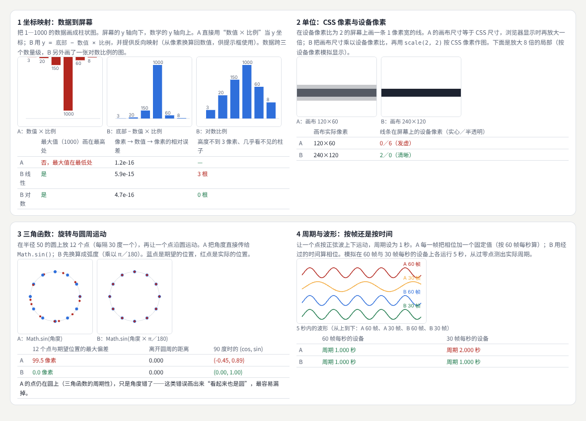
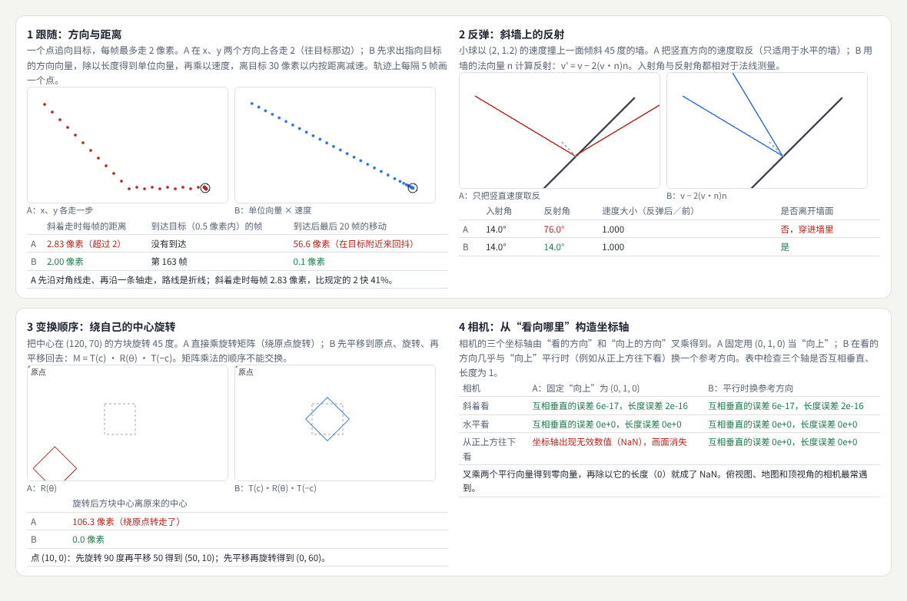
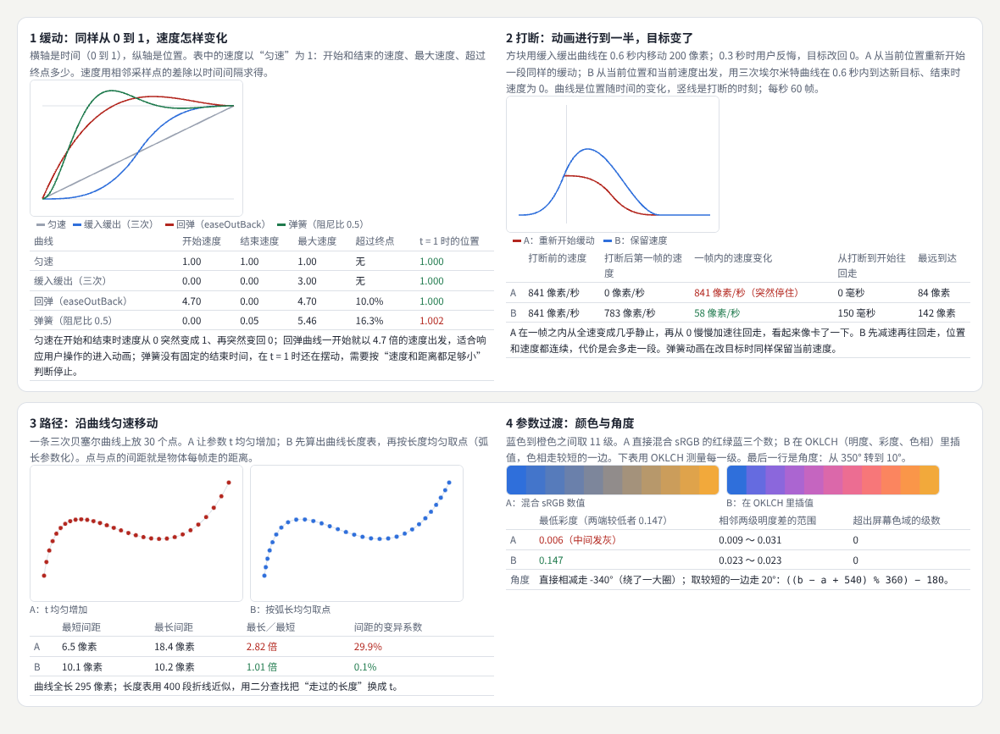
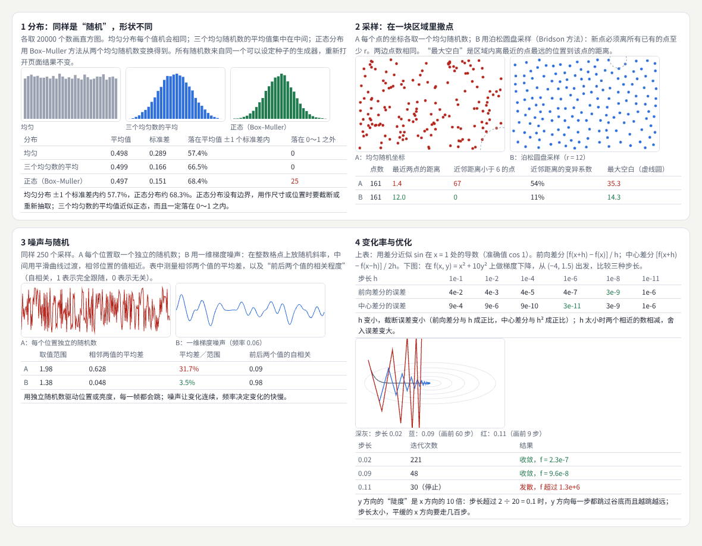
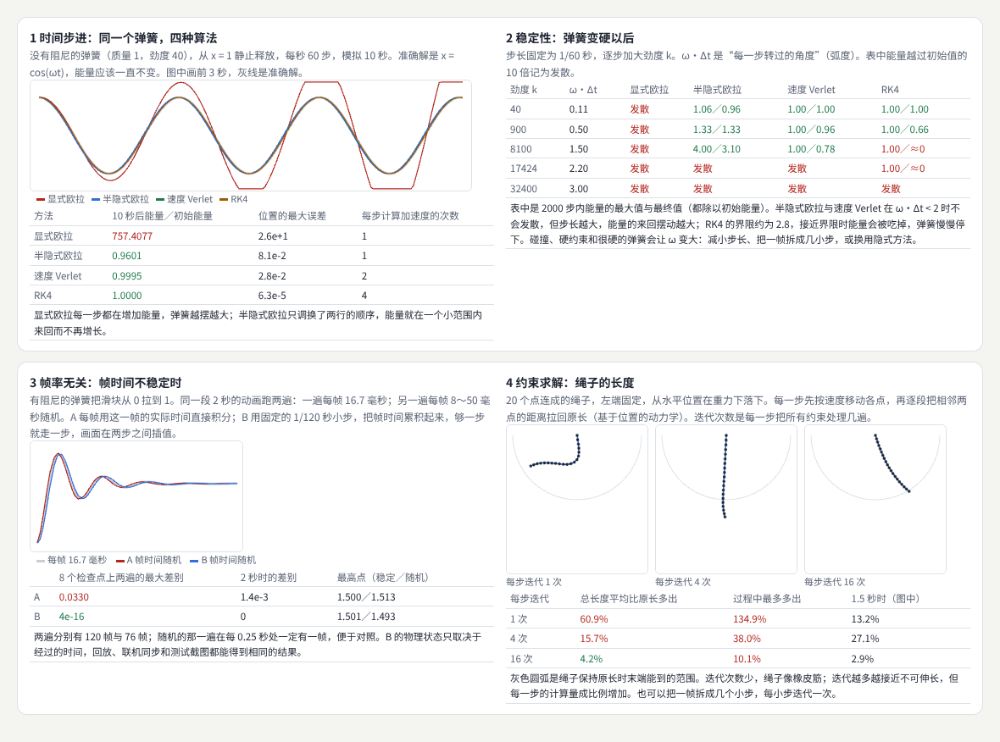
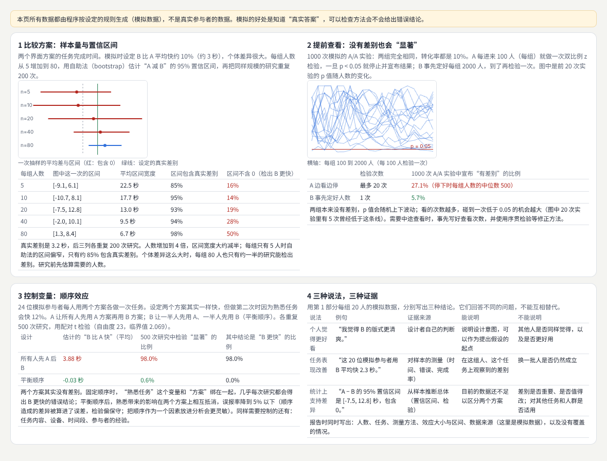
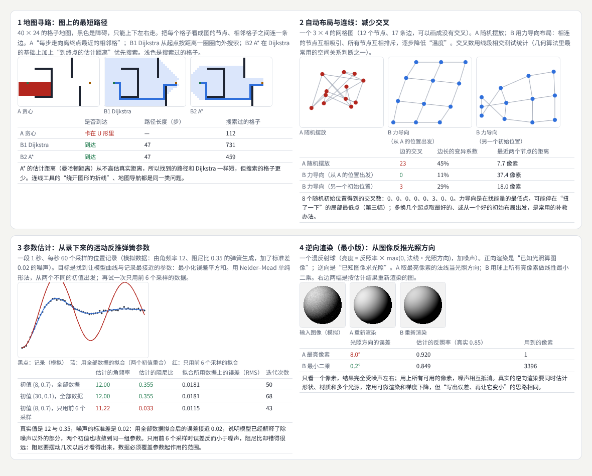
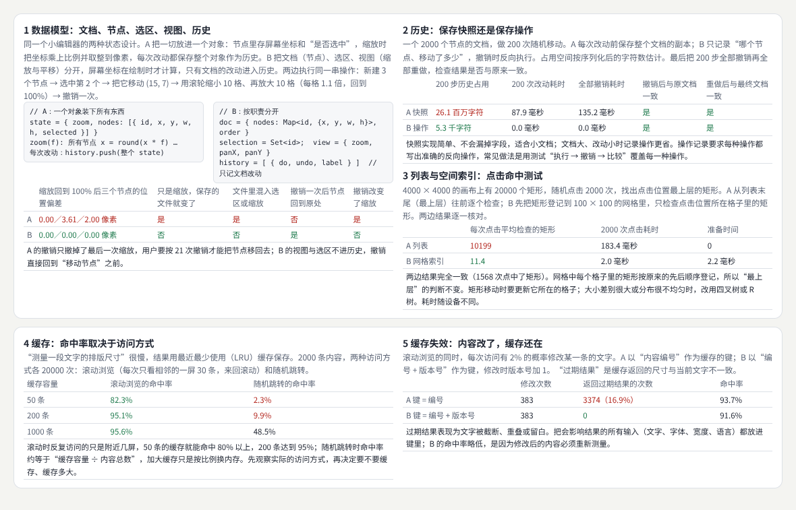
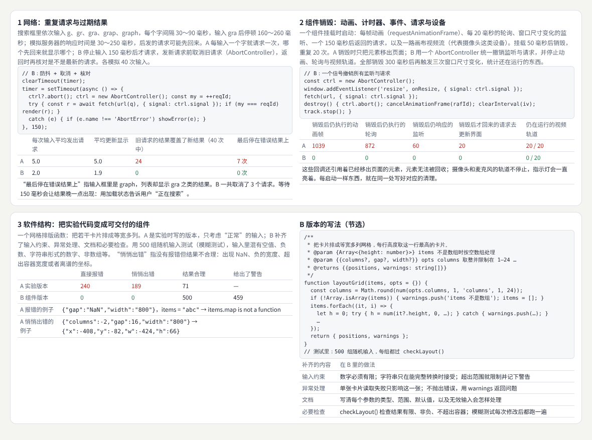
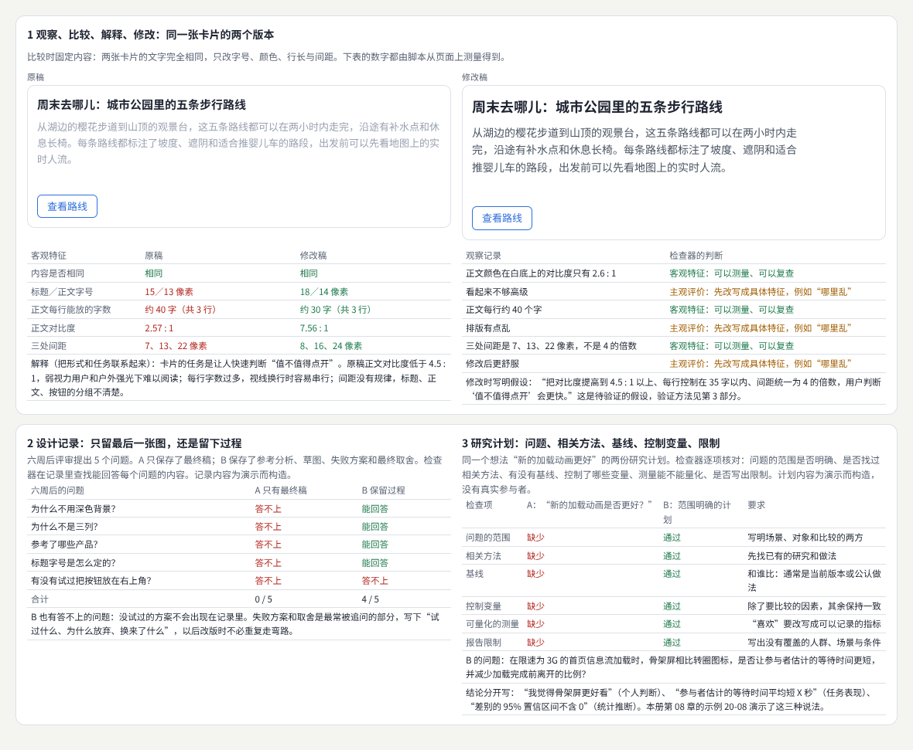

# 图形与交互的数学基础

> 数学、编程与研究基础：坐标与单位、三角函数、向量与矩阵、插值与曲线、概率与随机、微积分基础、数值方法、统计与实验设计、图论与几何算法、优化方法；再加上编辑器的数据模型、算法与数据结构、异步与生命周期、软件结构，以及设计与研究的基本功。每个概念都配一个能运行的可视化练习，用测量说明“写错了会怎样”。  
> 版本：1.0 · 整理日期：2026-10-25  
> 适用对象：做界面、动效、图形、生成艺术、数据可视化或设计工具，写代码时常常卡在“这一步的数学是什么”的开发者、设计师和学生。先修：会写基本的 JavaScript，读过[《前端界面工程》](01-前端界面工程.md)；数学只需要中学水平，其余在书里边用边讲。

这一册不是数学课本，而是一张**按实际需要补充数学**的地图。它们有三个共同点：

- **从问题出发**。先遇到“柱子画反了”“球穿进了墙”“动画在慢手机上变慢”“搜索结果跳回旧的”，再学能解决它的那一点数学或编程知识。
- **每个概念都配一个可视化练习**。看得见的错误最容易记住：方向反了、轨迹抖动、能量越来越大、点挤成一团、绳子被拉长。
- **用测量代替感觉**。每个示例都把常见的写法（A）与改进后的写法（B）放在一起，用同一段脚本测出差别：误差、能量、间距、交叉数、请求次数、过期结果、残留的回调。

本册每章都按同样的顺序讲：先说明它解决什么问题；再用白话解释核心概念；然后给出一个可以直接运行的示例与运行截图；接着是常见问题和本章练习；最后是一张**进阶学习卡**：技术栈、要掌握的高阶词汇（附英文）、搜索关键词、值得去看的实例，以及四级进阶阶梯：

| 级别 | 含义 |
| --- | --- |
| L1 入门 | 能运行并解释本章示例，说出每个公式的输入、单位、输出和假设 |
| L2 熟练 | 能在自己的项目里正确使用这些方法，并用测量检查结果 |
| L3 进阶 | 能根据需求选择或组合方法，写成可复用、处理异常的模块 |
| L4 深入 | 能阅读相关论文，改进方法或设计新的评价方式 |

四级是本手册的教学结构，用来安排学习顺序，不对应任何公司的职级。

所有示例都放在本目录的[示例](示例/)文件夹中，用浏览器直接打开即可运行；每个示例都已在无头浏览器中实际运行并自动检查。书中的数字分三类，正文会逐处说明：**浏览器实际测得的**（布局与计算样式、画布像素、计时器与事件次数、耗时）、**按规则或模型算出的**（坐标、矩阵、数值积分、统计模拟、寻路与优化的结果）、**为演示而构造的数据**（模拟的任务时间与转化数据、设计记录、研究计划、地图与图）。08 章的“参与者”全部由程序生成，不是真实的人。耗时数字随设备不同，只看两种实现之间的相对差异。

主线是：**十种数学知识各配一个练习 → 编程基础：数据模型、数据结构、异步与生命周期、软件结构 → 设计与研究的基本功 → 按方向选择学习路线。**

## 阅读导航

正文共 13 章（01—13），附 10 个可运行示例、3 组附录与 44 项资料入口。

- [第一篇：共同的基础](#part-1)
  - [01 这一册研究什么：按需要补充的十种数学知识](#ch01)
  - [02 共同的方法：可视化练习与数学记录](#ch02)
- [第二篇：数学](#part-2)
  - [03 比例、坐标、单位与三角函数](#ch03)
  - [04 向量与矩阵：方向、距离、变换与相机](#ch04)
  - [05 插值与曲线：缓动、路径与参数过渡](#ch05)
  - [06 概率与随机、微积分基础](#ch06)
  - [07 数值方法：时间步进、稳定性与约束求解](#ch07)
  - [08 统计与实验设计：比较方案与研究证据](#ch08)
  - [09 图论、几何算法与优化方法](#ch09)
- [第三篇：编程、设计与研究](#part-3)
  - [10 编程基础（一）：数据模型、算法与数据结构](#ch10)
  - [11 编程基础（二）：异步与生命周期、软件结构](#ch11)
  - [12 设计基础与研究基础](#ch12)
  - [13 知识之间的连接与学习路线](#ch13)
- [附录 A：术语表](#appendix-a)
- [附录 B：资料入口](#appendix-b)
- [附录 C：与原手册的对应关系及修订记录](#appendix-c)

## 第一篇：共同的基础

### 01 这一册研究什么：按需要补充的十种数学知识

不必先学完数学再动手。下表列出图形与交互工作中最常用的十种数学知识、它们的主要用途和适合开始学习的时机；最后一列是本册讲到它的章节。

| 知识 | 主要用途 | 适合开始学习的时机 | 本册章节 |
| --- | --- | --- | --- |
| 比例、坐标与单位 | 布局、映射、尺寸与位置 | 界面与二维图形阶段 | 03 |
| 三角函数 | 旋转、周期、波形、圆周运动 | 动态图形与三维阶段 | 03 |
| 向量与矩阵 | 方向、距离、变换、相机 | 三维与着色器阶段 | 04 |
| 插值与曲线 | 缓动、路径、参数过渡 | 动效阶段 | 05 |
| 概率与随机 | 变化、分布、噪声、采样 | 生成图形阶段 | 06 |
| 微积分基础 | 变化率、优化、运动模型 | 仿真与研究阶段 | 06、07 |
| 数值方法 | 时间步进、约束求解、稳定性 | 复杂仿真阶段 | 07 |
| 统计与实验设计 | 比较方案、研究证据 | 用户研究与算法评价阶段 | 08 |
| 图论与几何算法 | 连线、布局、路径、空间关系 | 编辑器、地图与图形工程阶段 | 09、10 |
| 优化方法 | 参数估计、自动布局、逆向渲染 | 计算设计与研究阶段 | 09 |

数学之外，做出能长期修改的作品还需要四项编程基础（10、11 章）和设计、研究的基本功（12 章）。

### 02 共同的方法：可视化练习与数学记录

#### 02.1 每个概念配一个可视化练习

每学一个概念都应配一个可视化练习。例如学习向量后实现跟随与反弹（04 章）；学习插值后比较不同运动曲线（05 章）；学习随机分布后观察粒子分布差异（06 章）。练习的价值在于让错误“看得见”：

| 写错的地方 | 看到的现象 | 本册位置 |
| --- | --- | --- |
| 屏幕 y 轴向下 | 柱状图上下颠倒 | 03 |
| 角度与弧度混用 | 点在圆上乱跳 | 03 |
| 按帧而不是按时间计算 | 慢设备上动画变慢 | 03、07 |
| 只翻转一个速度分量 | 斜墙上的反弹方向错误 | 04 |
| 矩阵乘法顺序反了 | 方块绕着屏幕角转走 | 04 |
| 打断时重新开始缓动 | 物体突然停住 | 05 |
| 独立随机数驱动运动 | 每一帧都在跳 | 06 |
| 显式欧拉积分 | 弹簧越摆越大 | 07 |

#### 02.2 数学记录：输入、单位、输出与假设

数学记录中写出输入、单位、输出和假设，帮助以后迁移。四项缺一项，换一个场景就容易出错：

| 项目 | 例子：04 章的“跟随” |
| --- | --- |
| 输入 | 当前位置 p、目标位置 t（CSS 像素）；最大速度 v（像素／秒）；时间步长 Δt（秒） |
| 输出 | 下一帧的位置 p′ |
| 公式 | d = t − p；p′ = p + d / ‖d‖ × min(v·Δt, ‖d‖) |
| 假设 | 目标在这一帧内不动；没有障碍；Δt 不超过 1/30 秒（超过时分成几小步） |

单位最容易被忽略：像素还是设备像素、角度还是弧度、“每帧”还是“每秒”、毫秒还是秒。记录里写清单位，等于提前写好了一半的测试。

#### 02.3 A／B 对照

本册每个示例都把两种写法放在一起：A 是常见的、看起来也能用的写法，B 是改进后的写法。两边用同样的输入和同样的测量脚本，差别直接写在页面的表格里。读每一章时可以先运行示例，看 A 错在哪里，再读核心概念。

## 第二篇：数学

### 03 比例、坐标、单位与三角函数

#### 03.1 解决什么问题

**比例、坐标与单位**用于**布局**、**映射**、**尺寸**与**位置**：把数据换算成屏幕上的位置，把 CSS 像素换算成设备像素，把鼠标位置换算回数据。**三角函数**用于**旋转**、**周期**、**波形**与**圆周运动**：按角度摆放元素，让东西转圈、摆动、呼吸[B01](#ref-b01)。

#### 03.2 核心概念

| 概念 | 含义 | 做法 |
| --- | --- | --- |
| 线性映射 | 把一个区间按比例换到另一个区间 | y = 底部 − (值 − 最小值) × 比例；同时写出反向映射 |
| 屏幕坐标 | 原点在左上角，y 轴向下 | 数学公式里的 y 要取反 |
| 对数比例 | 按数量级均匀排列 | 数据跨越几个数量级时使用，坐标轴上要注明 |
| 设备像素比 | 一个 CSS 像素对应几个设备像素[B02](#ref-b02) | 画布尺寸 = CSS 尺寸 × 设备像素比，再按 CSS 像素作图 |
| 弧度 | 用半径长度量角度，一圈是 2π | `Math.sin()` 等函数只接受弧度：弧度 = 角度 × π / 180 |
| atan2 | 由 x、y 求角度，四个象限都正确[B03](#ref-b03) | `Math.atan2(y, x)`，注意参数顺序 |
| 周期 | 重复一次需要的时间 | 相位 = 2π × 经过的时间 / 周期，按时间而不是按帧 |

#### 03.3 示例：映射方向、设备像素、弧度与按时间计算

示例：[20-03-coords-trig.html](示例/20-03-coords-trig.html)

| 测量 | A 常见写法 | B 改进写法 |
| --- | --- | --- |
| 1—1000 的柱状图 | 直接用“数值 × 比例”当 y，最大值画在最低处 | y = 底部 − 数值 × 比例，方向正确；像素 → 数值 → 像素的往返误差约 1e-15 |
| 数量级跨度大的数据 | — | 线性比例下 3 根柱子不到 3 像素高，几乎看不见；对数比例下 0 根 |
| 设备像素比 2 的 1 像素线 | 画布 120 × 60，线条落在 0 个实心、6 个半透明的设备像素上（发虚） | 画布 240 × 120，2 个实心、0 个半透明（清晰） |
| 圆上 12 个点 | 把角度直接传给 `Math.sin()`：位置最大偏差 99.5 像素，90° 的点算成 (−0.45, 0.89) | 先换成弧度，偏差 0 |
| 周期 1 秒的正弦波 | 每帧加固定相位：60 帧时周期 1.000 秒，30 帧时变成 2.000 秒 | 用经过的时间算相位：两种帧率都是 1.000 秒 |

角度当弧度用时，点仍然在圆上，只是位置全错——只看“是不是一个圆”发现不了，要逐点比较。

#### 03.4 常见问题

- **图表上下颠倒**：屏幕 y 轴向下；先写映射函数，再画图。
- **提示框显示的数值不对**：只写了正向映射；反向映射与正向映射放在一起测试。
- **高分屏上线条发虚**：画布尺寸没有乘设备像素比。
- **旋转角度全乱**：角度与弧度混用；变量名带上单位，例如 `angleRad`。
- **动画在不同设备上速度不同**：按帧累加；改为按经过的时间计算。

**本章练习**：

1. 为一组跨越三个数量级的数据写线性与对数两种映射，以及它们的反向映射，并测试往返误差。
2. 用 `atan2` 让一个箭头始终指向鼠标，分别在四个象限检查角度。

#### 03.5 进阶学习卡

| 级别 | 目标 | 怎样检验 |
| --- | --- | --- |
| L1 入门 | 能写出数据到屏幕的映射，能用正弦、余弦摆放与旋转 | 能解释示例的每组测量 |
| L2 熟练 | 能处理设备像素比、对数比例与按时间的周期运动 | 高分屏清晰；两种帧率的周期相同 |
| L3 进阶 | 能写出通用的比例尺模块（线性、对数、时间、分段） | 正反映射往返误差可忽略 |
| L4 深入 | 能为新的数据类型或投影设计坐标系统 | 有误差与失真的分析 |

- **技术栈**：Canvas 2D 与 `devicePixelRatio`；`Math.sin`／`Math.cos`／`Math.atan2`；D3 的比例尺（`d3-scale`）；`performance.now()` 与 `requestAnimationFrame` 的时间戳。
- **高阶词汇**：线性映射（linear mapping）、比例尺（scale）、对数比例（logarithmic scale）、设备像素比（device pixel ratio）、弧度（radian）、相位（phase）、振幅（amplitude）、频率（frequency）、极坐标（polar coordinates）。
- **搜索关键词**：`canvas devicePixelRatio crisp lines`、`d3 scale linear invert`、`atan2 angle to mouse`、`frame rate independent animation`、`polar coordinates generative art`、`弧度 角度 转换`。
- **值得看的实例**：[The Nature of Code](https://natureofcode.com/)——“振荡”一章用三角函数做摆动、波形与圆周运动，例子都能在浏览器里直接运行。
- **资料**：[B02](#ref-b02)、[B03](#ref-b03)、[B01](#ref-b01)。

### 04 向量与矩阵：方向、距离、变换与相机

#### 04.1 解决什么问题

**向量与矩阵**用于**方向**、**距离**、**变换**与**相机**：让物体朝目标移动、在墙上反弹、绕自己的中心旋转，以及让三维相机“看向”某处。浏览器里的 CSS `transform`、Canvas 的 `setTransform()` 与 `DOMMatrix` 背后都是矩阵[B04](#ref-b04)。

#### 04.2 核心概念

| 概念 | 含义 | 做法 |
| --- | --- | --- |
| 向量 | 有方向和长度的量 | 位置、速度、方向都用 (x, y) 或 (x, y, z) 表示 |
| 单位向量 | 长度为 1 的向量，只表示方向 | 向量除以自己的长度；长度为 0 时要单独处理 |
| 点积 | a·b = ‖a‖‖b‖cos θ | 求夹角、投影，判断在墙的哪一边 |
| 反射 | 速度关于法线的镜像 | v′ = v − 2(v·n)n，n 是单位法向量 |
| 变换矩阵 | 把平移、旋转、缩放写成一个矩阵[B05](#ref-b05) | 多个变换相乘；顺序不能交换 |
| 绕中心旋转 | 先移到原点，旋转，再移回去 | M = T(c) · R(θ) · T(−c)[B06](#ref-b06) |
| 叉积 | 得到与两个向量都垂直的向量 | 由“看的方向”和“向上”求相机的右方向[B07](#ref-b07) |

#### 04.3 示例：跟随、反弹、变换顺序与相机

示例：[20-04-vectors-matrices.html](示例/20-04-vectors-matrices.html)

**跟随**（每帧最多走 2 像素，目标在 (231, 131)）：A 在 x、y 方向各走一步，斜着走时每帧 2.83 像素，比规定的快 41%；目标不在步长的格子上，A 永远到不了，最后 20 帧在目标附近来回抖了 56.6 像素。B 用单位向量乘速度，每帧 2.00 像素，第 163 帧到达，最后 20 帧只移动 0.1 像素。

**反弹**（小球以 (2, 1.2) 的速度撞上 45° 的墙）：入射角 14.0°。A 把竖直速度取反（只适用于水平的墙），反射角变成 76.0°，而且穿进了墙里；B 用 v − 2(v·n)n，反射角 14.0°，速度大小不变（比值 1.000）。

**变换顺序**：方块中心在 (120, 70)，旋转 45°。A 直接乘旋转矩阵，方块绕屏幕原点转走，中心偏移 106.3 像素；B 用 T(c)·R(θ)·T(−c)，偏移 0。同一个点 (10, 0)：先旋转 90° 再平移 50 得到 (50, 10)，先平移再旋转得到 (0, 60)。

**相机坐标轴**：斜着看、水平看时两种写法都正确（三个轴互相垂直的误差 6e-17）。从正上方往下看时，“看的方向”与固定的“向上” (0, 1, 0) 平行，叉积为零向量，A 的坐标轴变成 NaN，画面消失；B 在两者几乎平行时换一个参考方向，误差 0。俯视图、地图和顶视角相机最常遇到这个问题。

#### 04.4 常见问题

- **斜着走更快**：两个分量各自限速；先求方向再乘速度。
- **到达目标后抖动**：步长固定；最后一步走剩下的距离，或者在附近减速。
- **反弹方向错误**：只翻转一个分量只适用于水平或竖直的墙；用法线反射。
- **旋转时物体飞走**：绕的是原点；先平移到原点。
- **相机朝下时画面消失**：“向上”与视线平行；换参考方向，或改用四元数表示朝向。

**本章练习**：

1. 写一个“视线锥”：判断一个点是否在角色前方 60° 以内、距离 200 像素以内，只用点积和长度。
2. 用 `DOMMatrix` 实现“按住某个角缩放”：缩放中心是被拖动角的对角。

#### 04.5 进阶学习卡

| 级别 | 目标 | 怎样检验 |
| --- | --- | --- |
| L1 入门 | 能用向量写跟随与反弹，能组合平移、旋转、缩放 | 能解释示例的每组测量 |
| L2 熟练 | 能用点积、叉积解决朝向、投影与碰撞问题 | 斜墙反弹角度正确，相机在任何朝向下都有效 |
| L3 进阶 | 能处理三维变换、四元数与层级变换 | 父子物体的变换顺序正确 |
| L4 深入 | 能推导投影、相机与着色器里的变换 | 能写出完整的模型—视图—投影推导 |

- **技术栈**：`DOMMatrix`、CSS `transform`、Canvas `setTransform()`；gl-matrix；three.js 的 `Vector3`、`Matrix4`、`Quaternion` 与 `Object3D.lookAt()`。
- **高阶词汇**：向量（vector）、归一化（normalize）、点积（dot product）、叉积（cross product）、法线（normal）、反射（reflection）、仿射变换（affine transform）、齐次坐标（homogeneous coordinates）、正交基（orthonormal basis）、四元数（quaternion）、万向节锁（gimbal lock）。
- **搜索关键词**：`vector reflection formula normal`、`rotate around point transform matrix order`、`lookAt up vector parallel`、`DOMMatrix multiply`、`quaternion camera orientation`、`线性代数 可视化`。
- **值得看的实例**：[3Blue1Brown 的《线性代数的本质》](https://www.3blue1brown.com/topics/linear-algebra)——用动画说明“矩阵就是对空间的变换”，看完再读本章的变换顺序会很直观；[Immersive Math](https://immersivemath.com/ila/index.html)——每一张图都可以拖动。
- **资料**：[B04](#ref-b04)、[B06](#ref-b06)、[B05](#ref-b05)、[B08](#ref-b08)、[B07](#ref-b07)、[B01](#ref-b01)。

### 05 插值与曲线：缓动、路径与参数过渡

#### 05.1 解决什么问题

**插值与曲线**用于**缓动**、**路径**与**参数过渡**：动画从起点到终点怎样加速减速，物体怎样沿曲线匀速移动，颜色、角度这些参数在两个值之间怎样过渡[B09](#ref-b09)。

#### 05.2 核心概念

| 概念 | 含义 | 做法 |
| --- | --- | --- |
| 线性插值 | a + (b − a) × t，t 从 0 到 1 | 所有过渡的基础 |
| 缓动曲线 | 把时间 t 映射成进度[B10](#ref-b10) | 看开始与结束的速度：为 0 才是平稳起停 |
| 回弹与弹簧 | 允许超过终点 | 弹簧没有固定的结束时间，按“速度和距离都足够小”判断停止[B11](#ref-b11) |
| 可中断 | 目标中途改变时，从当前位置与速度继续 | 保留速度（埃尔米特曲线或弹簧）[B12](#ref-b12) |
| 弧长参数化 | 按走过的长度而不是参数 t 取点 | 先建长度表，再用二分查找把长度换成 t[B13](#ref-b13) |
| 感知均匀的颜色空间 | 数值的距离接近人眼看到的差别[B14](#ref-b14) | 渐变在 OKLCH 里插值：CSS 写 `in oklch`[B15](#ref-b15) |
| 角度的最短路径 | 350° 到 10° 应该走 20° | 差值 = ((b − a + 540) % 360) − 180 |

#### 05.3 示例：缓动、打断、路径与颜色

示例：[20-05-interpolation-curves.html](示例/20-05-interpolation-curves.html)

**缓动**（速度以“匀速”为 1）：

| 曲线 | 开始速度 | 结束速度 | 最大速度 | 超过终点 |
| --- | --- | --- | --- | --- |
| 匀速 | 1.00 | 1.00 | 1.00 | 无 |
| 缓入缓出（三次） | 0.00 | 0.00 | 3.00 | 无 |
| 回弹（easeOutBack） | 4.70 | 0.00 | 4.70 | 10.0% |
| 弹簧（阻尼比 0.5） | 0.00 | 0.05 | 5.46 | 16.3% |

匀速在开始与结束时速度突然跳变；回弹一开始就以 4.7 倍速度出发，适合响应用户操作的进入动画；弹簧在 t = 1 时位置是 1.002，还在摆动。

**打断**（0.6 秒内移动 200 像素，0.3 秒时目标改回 0）：A 从当前位置重新开始一段缓动，速度在一帧内从 841 像素／秒降到 0，看起来像卡了一下，最远到 84 像素；B 从当前位置和速度出发，用三次埃尔米特曲线到达新目标，一帧内的速度变化只有 58 像素／秒（全程最大 112），先减速 150 毫秒再往回走，最远到 142 像素——多走的一段是保留速度的代价。

**路径**（295 像素长的贝塞尔曲线上放 30 个点）：A 让 t 均匀增加，相邻点间距从 6.5 到 18.4 像素（2.82 倍，变异系数 29.9%），物体忽快忽慢；B 按弧长取点，间距 10.1—10.2 像素（变异系数 0.1%）。

**颜色与角度**（#2f6fdb 到 #f2a93b，11 级）：A 直接混合 sRGB 数值，中间一级的彩度只有 0.006（发灰），相邻两级的明度差在 0.009—0.031 之间忽大忽小；B 在 OKLCH 里插值，彩度保持 0.147，明度每级均匀增加 0.023，没有超出屏幕色域。角度从 350° 到 10°：直接相减走 −340°，取最短路径走 20°。

#### 05.4 常见问题

- **动画开始或结束时“顿”一下**：用了匀速；选择起停速度为 0 的曲线。
- **用户反悔时动画卡住**：重新开始一段缓动会丢掉速度；保留当前速度。
- **沿路径运动忽快忽慢**：按 t 取点；用弧长参数化。
- **渐变中间发灰发脏**：在 sRGB 里插值；改用 OKLCH 或 OKLab。
- **旋转动画绕了一大圈**：角度插值要取最短路径。

**本章练习**：

1. 把一个按钮的展开动画分别用匀速、缓出、弹簧实现，连续快速点击五次，记录哪一种会突然跳变。
2. 让一个点沿 SVG 路径匀速移动：用 `getTotalLength()` 与 `getPointAtLength()`，与按 t 取点比较间距。

#### 05.5 进阶学习卡

| 级别 | 目标 | 怎样检验 |
| --- | --- | --- |
| L1 入门 | 能写线性插值与常见缓动，能画出速度曲线 | 能解释示例的每组测量 |
| L2 熟练 | 能做可中断的动画、沿路径匀速移动、感知均匀的颜色过渡 | 打断时速度连续；间距变异系数接近 0 |
| L3 进阶 | 能设计一套动效曲线与参数规范，供团队复用 | 规范覆盖进入、退出、打断与减少动态效果 |
| L4 深入 | 能研究曲线参数与感知、可用性的关系 | 有实验数据支持参数选择 |

- **技术栈**：CSS `transition-timing-function` 与 `linear()`；Web Animations API；Motion（原 Framer Motion）与 react-spring 的弹簧；SVG `getPointAtLength()`；CSS `color-mix()` 与 `in oklch`。
- **高阶词汇**：线性插值（lerp）、缓动函数（easing function）、三次贝塞尔（cubic Bézier）、埃尔米特曲线（Hermite curve）、弹簧阻尼（damped spring）、阻尼比（damping ratio）、弧长参数化（arc-length parameterization）、感知均匀（perceptually uniform）、色域（gamut）。
- **搜索关键词**：`easing function velocity`、`interruptible animation spring velocity`、`bezier arc length parameterization`、`oklch gradient interpolation`、`css linear() easing spring`、`缓动 曲线 速度`。
- **值得看的实例**：[Pomax 的贝塞尔曲线入门](https://pomax.github.io/bezierinfo/)——每一节都有可以拖动控制点的交互图，“弧长”一节正好对应本章的路径练习；[easings.net](https://easings.net/) 可以并排比较常用缓动。
- **资料**：[B09](#ref-b09)、[B10](#ref-b10)、[B11](#ref-b11)、[B12](#ref-b12)、[B13](#ref-b13)、[B14](#ref-b14)、[B15](#ref-b15)。

### 06 概率与随机、微积分基础

#### 06.1 解决什么问题

**概率与随机**用于**变化**、**分布**、**噪声**与**采样**：让生成的图形有变化又不杂乱，让粒子分布均匀，让运动自然。**微积分基础**用于**变化率**、**优化**与**运动模型**：速度是位置的变化率，加速度是速度的变化率；找最低点要沿着下降最快的方向走[B16](#ref-b16)。

#### 06.2 核心概念

| 概念 | 含义 | 做法 |
| --- | --- | --- |
| 分布 | 每个值出现的可能性[B17](#ref-b17) | 均匀分布适合“哪里都一样”；正态分布适合“大多数在中间” |
| 可复现的随机 | 同一个种子得到同一串随机数 | 用可设种子的生成器（例如 mulberry32），作品与测试都能复现 |
| 泊松圆盘采样 | 任意两点至少相隔 r[B18](#ref-b18) | 撒点、树木、星空等“均匀又不规则”的分布 |
| 噪声 | 相邻位置的值相近的随机[B19](#ref-b19) | 驱动连续变化的位置、亮度、风；频率决定变化快慢 |
| 导数 | 某一点的变化率 | 中心差分 [f(x+h) − f(x−h)] / 2h 比前向差分更准 |
| 梯度下降 | 沿着下降最快的方向一步步走 | 步长太大会越跳越远，太小会走很久 |

#### 06.3 示例：分布、采样、噪声、差分与梯度下降

示例：[20-06-random-calculus.html](示例/20-06-random-calculus.html)

**分布**（各 20000 个数，种子固定）：均匀分布的标准差 0.289，落在平均值 ±1 个标准差内的占 57.4%；三个均匀数的平均值标准差 0.166，占 66.5%，全部落在 0～1 之内；Box–Muller 正态分布标准差 0.151，占 68.4%，但有 25 个落在 0～1 之外——用作尺寸或位置时要截断或重新抽取。

**采样**（240 × 150 的区域，两边都是 161 个点）：

| 方法 | 最近两点的距离 | 近邻距离小于 6 的点 | 近邻距离的变异系数 | 最大空白 |
| --- | --- | --- | --- | --- |
| A 均匀随机坐标 | 1.4 | 67 | 54% | 35.3 |
| B 泊松圆盘（r = 12） | 12.0 | 0 | 11% | 14.3 |

**噪声**：独立随机数相邻两个值的平均差是取值范围的 31.7%，前后两个值的自相关只有 0.09；一维梯度噪声的平均差是范围的 3.5%，自相关 0.98。

**变化率**（近似 sin 在 x = 1 处的导数）：前向差分在 h = 1e-8 时误差最小（约 3e-9），中心差分在 h = 1e-6 时最小（约 3e-11）；h 再小，两个几乎相等的数相减，舍入误差反而变大，h = 1e-11 时两者都约 1e-6。

**优化**（在 f(x, y) = x² + 10y² 上做梯度下降）：步长 0.02 用 221 步收敛；0.09 用 48 步；0.11 超过了界限 2 ÷ 20 = 0.1，30 步后函数值已超过 130 万，发散。

#### 06.4 常见问题

- **每次打开结果都不一样，无法调试**：`Math.random()` 不能设种子；用可设种子的生成器。
- **随机撒的点挤成一团又留下大片空白**：用泊松圆盘采样或抖动网格。
- **动画抖动**：用独立随机数驱动连续运动；改用噪声。
- **正态分布产生了负的尺寸**：正态分布没有边界；截断或重新抽取。
- **数值求导结果很奇怪**：步长太小；中心差分配合 1e-6 左右的步长。
- **优化时数值越来越大**：步长超过稳定界限；减小步长或按各方向分别缩放。

**本章练习**：

1. 用同一个种子生成一组海报，换三个种子，记录哪些参数决定了“像同一个系列”。
2. 用噪声驱动 100 根草的摆动，比较频率 0.02、0.06、0.2 的效果。

#### 06.5 进阶学习卡

| 级别 | 目标 | 怎样检验 |
| --- | --- | --- |
| L1 入门 | 能使用均匀、正态分布与噪声，能用差分估计变化率 | 能解释示例的每组测量 |
| L2 熟练 | 能选择合适的采样方法与噪声频率，能用梯度下降求最小值 | 点间距、平滑度与收敛步数符合预期 |
| L3 进阶 | 能组合噪声（分形叠加、域扭曲），能处理多参数优化 | 作品可复现，优化稳定收敛 |
| L4 深入 | 能研究采样与噪声的频谱性质，能推导优化方法的收敛条件 | 有频谱分析或收敛证明 |

- **技术栈**：可设种子的随机数生成器（mulberry32、`seedrandom`）；`simplex-noise`；p5.js 的 `noise()` 与 `randomGaussian()`；`d3-random`；Poisson-disk 采样库。
- **高阶词汇**：概率分布（probability distribution）、标准差（standard deviation）、随机种子（random seed）、泊松圆盘采样（Poisson-disk sampling）、蓝噪声（blue noise）、梯度噪声（gradient noise）、自相关（autocorrelation）、有限差分（finite difference）、梯度下降（gradient descent）、学习率（learning rate）。
- **搜索关键词**：`seeded random javascript mulberry32`、`poisson disk sampling bridson`、`perlin noise vs random`、`finite difference step size error`、`gradient descent learning rate divergence`、`生成艺术 噪声`。
- **值得看的实例**：[Seeing Theory](https://seeing-theory.brown.edu/)——布朗大学做的概率与统计可视化，可以拖动参数看分布怎样变化；[The Nature of Code](https://natureofcode.com/) 的“随机”一章对比了随机数与噪声。
- **资料**：[B17](#ref-b17)、[B18](#ref-b18)、[B19](#ref-b19)、[B16](#ref-b16)、[B01](#ref-b01)。

### 07 数值方法：时间步进、稳定性与约束求解

#### 07.1 解决什么问题

**数值方法**用于**时间步进**、**约束求解**与**稳定性**：计算机只能一小步一小步地推进时间，每一步的误差会累积；弹簧、布料、绳子、粒子的模拟能不能稳定、在快慢设备上结果是否一致，都取决于怎样走这一步[B20](#ref-b20)。

#### 07.2 核心概念

| 概念 | 含义 | 做法 |
| --- | --- | --- |
| 显式欧拉 | 用这一步开始时的速度更新位置 | 最简单，但没有阻尼的振动会越摆越大 |
| 半隐式欧拉 | 先更新速度，再用新速度更新位置 | 只调换两行顺序，能量不再持续增长 |
| 速度 Verlet、RK4 | 每步多算几次加速度，精度更高 | 精度与计算量之间取舍 |
| 稳定界限 | 步长太大会发散 | ω·Δt 是每一步“转过的角度”；半隐式欧拉要小于 2 |
| 固定时间步长 | 物理每次走固定的一小步[B21](#ref-b21) | 累积帧时间，够一步走一步，画面在两步之间插值 |
| 刚性 | 系统里有变化很快的部分[B22](#ref-b22) | 很硬的弹簧、碰撞：减小步长、拆成小步或用隐式方法 |
| 基于位置的约束 | 直接把点拉回满足约束的位置[B23](#ref-b23) | 迭代次数越多越接近“不可伸长” |

#### 07.3 示例：四种步进方法、稳定界限、帧率无关与绳子

示例：[20-07-numerical-methods.html](示例/20-07-numerical-methods.html)

**时间步进**（无阻尼弹簧，劲度 40，每秒 60 步，模拟 10 秒）：

| 方法 | 10 秒后能量／初始能量 | 位置的最大误差 | 每步计算加速度 |
| --- | --- | --- | --- |
| 显式欧拉 | 757.4 | 26 | 1 次 |
| 半隐式欧拉 | 0.960 | 0.08 | 1 次 |
| 速度 Verlet | 0.9995 | 0.03 | 2 次 |
| RK4 | 1.0000 | 6e-5 | 4 次 |

**稳定性**（步长 1/60 秒，加大劲度；表中是 2000 步内能量的最大值／最终值，越过 10 倍记为发散）：

| ω·Δt | 显式欧拉 | 半隐式欧拉 | 速度 Verlet | RK4 |
| --- | --- | --- | --- | --- |
| 0.11 | 发散 | 1.06／0.96 | 1.00／1.00 | 1.00／1.00 |
| 0.50 | 发散 | 1.33／1.33 | 1.00／0.96 | 1.00／0.66 |
| 1.50 | 发散 | 4.00／3.10 | 1.00／0.78 | 1.00／≈0 |
| 2.20 | 发散 | 发散 | 发散 | 1.00／≈0 |
| 3.00 | 发散 | 发散 | 发散 | 发散 |

半隐式欧拉与速度 Verlet 在 ω·Δt < 2 时不会发散，RK4 的界限约为 2.8，但接近界限时能量会被吃掉，弹簧慢慢停下——“不发散”不等于“正确”。

**帧率无关**：同一段 2 秒的阻尼弹簧，一遍每帧 16.7 毫秒（120 帧），一遍每帧 8～50 毫秒随机（76 帧）。在 8 个检查点上比较：A 每帧用实际帧时间积分，两遍最多相差 0.033；B 用固定的 1/120 秒小步加累积器，最多相差 4e-16。B 的状态只取决于经过的时间，回放、联机同步和测试截图都能得到相同的结果。

**约束求解**（20 个点的绳子在重力下摆动 1.5 秒，基于位置的动力学）：每步迭代 1、4、16 次时，总长度平均比原长多出 60.9%、15.7%、4.2%，过程中最多多出 134.9%、38.0%、10.1%。迭代越多越接近不可伸长，计算量也成比例增加。

#### 07.4 常见问题

- **弹簧或轨道越转越大**：显式欧拉；至少用半隐式欧拉。
- **切到后台再回来，物体飞出屏幕**：一帧的时间太长；单帧时间设上限，并分成小步。
- **慢设备上的结果与快设备不同**：步长随帧时间变化；用固定步长。
- **布料、绳子被拉长**：约束迭代不够；增加迭代或拆成小步。
- **调硬了弹簧就爆炸**：超过稳定界限；减小步长或换隐式方法。

**本章练习**：

1. 给 07 章的示例加一个“切到后台 500 毫秒”的帧，比较有无单帧上限时的结果。
2. 用基于位置的动力学做一块 10 × 10 的布，比较“一帧迭代 10 次”与“拆成 10 个小步、每步迭代 1 次”。

#### 07.5 进阶学习卡

| 级别 | 目标 | 怎样检验 |
| --- | --- | --- |
| L1 入门 | 能写半隐式欧拉，能解释示例的四种方法 | 能解释示例的每组测量 |
| L2 熟练 | 能用固定步长实现帧率无关的模拟，能做约束 | 不同帧率下结果一致；约束误差可控 |
| L3 进阶 | 能为布料、刚体、流体选择积分与求解方法 | 在目标设备上稳定且达到帧时间预算 |
| L4 深入 | 能分析方法的稳定性与精度，实现隐式或高阶方法 | 有误差阶与稳定域的分析 |

- **技术栈**：固定步长循环与累积器；Rapier、Matter.js、cannon-es 等物理引擎；基于位置的动力学（PBD／XPBD）；WebGPU 计算着色器。
- **高阶词汇**：数值积分（numerical integration）、显式欧拉（explicit Euler）、半隐式欧拉（semi-implicit Euler）、辛积分（symplectic integrator）、龙格—库塔法（Runge–Kutta）、稳定域（stability region）、刚性方程（stiff equation）、固定时间步长（fixed timestep）、约束求解（constraint solving）、高斯—赛德尔迭代（Gauss–Seidel iteration）。
- **搜索关键词**：`fix your timestep accumulator`、`semi-implicit euler energy`、`verlet integration cloth`、`position based dynamics xpbd`、`stiff spring stability timestep`、`物理模拟 时间步长`。
- **值得看的实例**：[Gaffer On Games 的《Fix Your Timestep!》](https://gafferongames.com/post/fix_your_timestep/)——游戏物理里讲固定步长最常被引用的一篇，本章的帧率无关测试就是它的做法。
- **资料**：[B20](#ref-b20)、[B21](#ref-b21)、[B22](#ref-b22)、[B23](#ref-b23)。

### 08 统计与实验设计：比较方案与研究证据

#### 08.1 解决什么问题

**统计与实验设计**用于比较**方案**与提供**研究证据**：两个界面哪个更快，新的推荐算法有没有提高点击，一个差别是真的还是碰巧。实验设计决定数据能不能回答问题，统计决定能从数据里说出多少[B24](#ref-b24)。

#### 08.2 核心概念

| 概念 | 含义 | 做法 |
| --- | --- | --- |
| 效应大小 | 差别有多大 | 报告“快了几秒、几个百分点”，而不只是“显著” |
| 置信区间 | 真实差别大概落在哪个范围[B25](#ref-b25) | 自助法（bootstrap）：从样本里有放回地重抽样[B26](#ref-b26) |
| 检出率（统计功效） | 真实存在的差别被检出的比例 | 研究前估算需要的样本量 |
| 提前查看 | 边收集数据边检验，看到显著就停[B27](#ref-b27) | 会大大增加误报；事先定好样本量，或用序贯检验 |
| 控制变量 | 除了要比较的因素，其余保持一致 | 平衡呈现顺序，固定任务、设备与内容 |
| 三种说法 | 个人判断、任务表现、统计推断 | 分开写，不混为一个结论 |

#### 08.3 示例：样本量、提前查看、顺序效应与三种说法

本节所有数据都由程序按设定的规则生成（模拟数据），不是真实参与者。模拟的好处是知道“真实答案”，可以检查方法会不会给出错误结论。

示例：[20-08-statistics-experiments.html](示例/20-08-statistics-experiments.html)

**样本量与置信区间**（设定 B 比 A 平均快 3.2 秒，个体差异很大；后三列各重复 200 次研究）：

| 每组人数 | 平均区间宽度 | 区间包含真实差别 | 区间不含 0（检出 B 更快） |
| --- | --- | --- | --- |
| 5 | 22.5 秒 | 85% | 16% |
| 10 | 17.7 秒 | 95% | 14% |
| 20 | 13.0 秒 | 93% | 19% |
| 40 | 9.5 秒 | 94% | 28% |
| 80 | 6.7 秒 | 98% | 50% |

人数增加到 4 倍，区间宽度大约减半；每组 5 人时自助法的区间偏窄，只有约 85% 包含真实差别；个体差异这么大时，每组 80 人也只有约一半的研究能检出差别。

**提前查看**（1000 次 A/A 实验，两组完全相同，转化率都是 10%）：每进来 100 人就检验一次、p < 0.05 就停止，有 27.1% 的实验宣布“有差别”，停下时每组人数的中位数是 500；事先定好每组 2000 人、只检验一次，误报率是 5.7%。

**顺序效应**（24 位模拟参与者，两个方案其实一样快，第二次做时因为熟悉快 12%；各重复 500 次研究）：所有人先 A 后 B，平均估计“B 快 3.88 秒”，98.0% 的研究检验显著，结论全部是“B 更快”；平衡顺序后估计 −0.03 秒，显著的只有 0.6%。

**三种说法**（用每组 20 人的那次模拟）：“我觉得 B 的版式更清爽”是个人判断；“这 20 位模拟参与者用 B 平均快 2.3 秒”是对样本的测量；“A − B 的 95% 置信区间是 [−7.5, 12.8] 秒，包含 0”是统计推断——目前的数据还不足以区分两个方案。

#### 08.4 常见问题

- **5 个人试用就下结论**：区间太宽；先估算需要的人数，或把结论写成“初步观察”。
- **每天看一次实验数据，显著就停**：误报率成倍增加；事先定好样本量或查看计划。
- **所有人都先用旧版再用新版**：熟悉程度和方案绑在一起；平衡顺序。
- **只报告“显著”**：没有效应大小，读者无法判断差别是否重要；同时报告区间。
- **把“我觉得好看”写成“用户更喜欢”**：三种说法要分开。

**本章练习**：

1. 修改示例中的真实差别与个体差异，找出“检出率达到 80%”需要的每组人数。
2. 为一次界面比较写实验计划：任务、测量、样本量、呈现顺序、事先定好的分析方法。

#### 08.5 进阶学习卡

| 级别 | 目标 | 怎样检验 |
| --- | --- | --- |
| L1 入门 | 能计算平均值、标准差与自助法置信区间 | 能解释示例的每组测量 |
| L2 熟练 | 能设计控制了顺序与任务的比较实验，能估算样本量 | 计划经得起“还有什么会影响结果”的追问 |
| L3 进阶 | 能处理重复测量、多个指标与在线实验的常见陷阱 | 分析方法事先写好，报告包含效应与区间 |
| L4 深入 | 能设计新的评价方法，评估统计方法本身的可靠性 | 用模拟检查方法的误报率与检出率 |

- **技术栈**：模拟与重抽样（JavaScript、Python 的 NumPy／SciPy、R）；`simple-statistics`；在线实验平台（GrowthBook、Statsig 等）；预注册模板。
- **高阶词汇**：效应大小（effect size）、置信区间（confidence interval）、自助法（bootstrap）、统计功效（statistical power）、第一类错误（type I error）、提前查看（peeking）、序贯检验（sequential testing）、被试内设计（within-subjects design）、平衡（counterbalancing）、混杂变量（confounding variable）。
- **搜索关键词**：`bootstrap confidence interval difference of means`、`peeking ab test false positive`、`counterbalancing order effects`、`sample size power analysis`、`estimation statistics HCI`、`实验设计 置信区间`。
- **值得看的实例**：[Evan Miller 的《How Not To Run an A/B Test》](https://www.evanmiller.org/how-not-to-run-an-ab-test.html)——用很短的篇幅说明“提前查看”为什么会制造假结论，与本章的模拟结果可以互相印证。
- **资料**：[B24](#ref-b24)、[B25](#ref-b25)、[B26](#ref-b26)、[B27](#ref-b27)、[B17](#ref-b17)。

### 09 图论、几何算法与优化方法

#### 09.1 解决什么问题

**图论与几何算法**用于**连线**、**布局**、**路径**与**空间关系**，是**编辑器**、**地图**与**图形工程阶段**的常用工具：连线工具绕开图形，地图上找最短路线，节点图自动排开，判断两条线段是否相交。**优化方法**用于**参数估计**、**自动布局**与**逆向渲染**：先写出“误差”，再让它变小。

#### 09.2 核心概念

| 概念 | 含义 | 做法 |
| --- | --- | --- |
| 图 | 节点和连接它们的边 | 格子地图、节点编辑器、社交关系都可以看成图 |
| Dijkstra 与 A* | 求最短路径[B28](#ref-b28) | A* 加上“到终点的估计距离”，估计不高估时结果仍然最短 |
| 线段相交测试 | 判断两条线段是否交叉 | 用叉积的符号判断端点在线的哪一边 |
| 力导向布局 | 相连的点互相吸引、所有点互相排斥[B29](#ref-b29) | 逐步降温；可能停在局部最低点，多试几个起点 |
| 最小二乘 | 让模型与数据的误差平方和最小 | 线性问题直接解方程；非线性问题用迭代方法[B30](#ref-b30) |
| 逆向渲染 | 从图像反推光照、材质、形状[B31](#ref-b31) | 写出“渲染结果与图像的差别”，再让它变小[B32](#ref-b32) |

#### 09.3 示例：寻路、布局、参数估计与逆向渲染

示例：[20-09-graph-optimization.html](示例/20-09-graph-optimization.html)

**寻路**（40 × 24 的格子地图，中间有开口朝向起点的 U 形障碍）：

| 方法 | 结果 | 路径长度 | 搜索过的格子 |
| --- | --- | --- | --- |
| A 每步走向离终点最近的相邻格 | 卡在 U 形里 | — | 112 |
| B1 Dijkstra | 到达 | 47 步 | 731 |
| B2 A*（曼哈顿距离） | 到达 | 47 步 | 459 |

**自动布局与连线**（3 × 4 的网格图，12 个节点、17 条边）：随机摆放有 23 处交叉，边长的变异系数 45%，最近两个节点只隔 7.7 像素；力导向布局从同样的位置出发，交叉 0 处、变异系数 11%、最近距离 37.4 像素。换 8 个随机起点，交叉数是 0、0、0、0、0、3、0、0——有一次停在“扭了一下”的局部最低点。

**参数估计**（一段 1 秒的位置记录，由角频率 12、阻尼比 0.35 的弹簧生成并加了标准差 0.02 的噪声，模拟数据）：Nelder–Mead 方法从 (8, 0.7) 和 (30, 0.1) 两个初值出发，都得到 12.00 与 0.355，误差（RMS）0.0181，接近噪声水平。只用前 6 个采样（约 0.1 秒）时，误差 0.0115 反而小于噪声，阻尼比却估成 0.033——阻尼要摆动几次以后才看得出来，数据必须覆盖参数起作用的范围。

**逆向渲染**（漫反射球，加了噪声）：A 取最亮像素的法线当光照方向，误差 8.0°，反照率估成 0.920；B 用 3396 个亮像素做线性最小二乘，误差 0.2°，反照率 0.849（真实值 0.85）。

#### 09.4 常见问题

- **寻路走进死胡同**：贪心只看眼前；用 A*。
- **A* 找到的路径不是最短**：估计距离高估了真实距离；对四方向移动用曼哈顿距离。
- **力导向布局每次结果不同、有时打结**：固定随机种子，多试几个起点，或从一个好的初始布局出发。
- **拟合误差很小，参数却不对**：数据没有覆盖参数起作用的范围，或者模型过于灵活。
- **单个样本决定结果**：用上所有可用的数据，让噪声相互抵消。

**本章练习**：

1. 为流程图编辑器写“正交连线”：用 A* 在格子上找一条绕开所有节点、拐弯尽量少的路径（拐弯加代价）。
2. 用最小二乘从 20 个带噪声的点拟合一条三次贝塞尔曲线的控制点。

#### 09.5 进阶学习卡

| 级别 | 目标 | 怎样检验 |
| --- | --- | --- |
| L1 入门 | 能实现 BFS、Dijkstra、A* 与线段相交测试 | 能解释示例的每组测量 |
| L2 熟练 | 能做连线绕行、力导向布局与简单的参数拟合 | 路径最短；交叉数、拟合误差可测 |
| L3 进阶 | 能处理大规模图、约束布局与多参数优化 | 在真实数据规模下稳定、可解释 |
| L4 深入 | 能把可微渲染、约束优化用于设计工具或重建 | 有与基线方法的比较 |

- **技术栈**：PathFinding.js、ngraph；D3 的 `d3-force`；ELK（Eclipse Layout Kernel）与 dagre；`ml-levenberg-marquardt` 等拟合库；Mitsuba 3、PyTorch3D 等可微渲染工具。
- **高阶词汇**：图（graph）、最短路径（shortest path）、启发式（heuristic）、可采纳的估计（admissible heuristic）、线段相交（segment intersection）、力导向布局（force-directed layout）、局部最小值（local minimum）、最小二乘（least squares）、单纯形法（Nelder–Mead method）、逆向渲染（inverse rendering）、可微渲染（differentiable rendering）。
- **搜索关键词**：`a star pathfinding interactive`、`orthogonal connector routing`、`force directed graph layout local minima`、`nelder mead curve fitting javascript`、`inverse rendering lighting estimation`、`寻路 算法 可视化`。
- **值得看的实例**：[Red Blob Games 的 A* 入门](https://www.redblobgames.com/pathfinding/a-star/introduction.html)——可以在地图上拖动起点、终点和墙，实时看到 BFS、Dijkstra 与 A* 的搜索范围差别。
- **资料**：[B28](#ref-b28)、[B29](#ref-b29)、[B30](#ref-b30)、[B31](#ref-b31)、[B32](#ref-b32)。

## 第三篇：编程、设计与研究

### 10 编程基础（一）：数据模型、算法与数据结构

#### 10.1 解决什么问题

编程基础的横向展开从两件事开始。**数据模型**决定界面能够保存和恢复什么。一个编辑器应明确文档、节点、选区、视图和历史分别怎样表示。先处理数据关系，再设计交互状态，可以减少后期冲突[B33](#ref-b33)。**算法与数据结构**影响规模增长后的表现。列表、树、图、空间索引和缓存各有使用场景。选择结构时依据访问与更新模式，并用实际数据观察成本。

#### 10.2 核心概念

| 概念 | 含义 | 做法 |
| --- | --- | --- |
| 文档 | 要保存、要协作的内容[B34](#ref-b34) | 节点用编号索引（Map），顺序单独保存 |
| 选区与视图 | 当前选中什么、看的是哪里、放大多少 | 不写进文档，不进入撤销历史 |
| 历史 | 撤销与重做 | 保存快照（简单）或保存操作及其反向操作（省空间）[B35](#ref-b35) |
| 列表 | 按顺序存放 | 逐个检查，数量大时变慢 |
| 树与图 | 层级与连接关系 | 图层、分组用树；连线、依赖用图 |
| 空间索引 | 按位置分组，只检查附近的东西[B36](#ref-b36) | 均匀网格、四叉树、R 树 |
| 缓存 | 保存算过的结果 | 命中率取决于访问方式；键要包含所有会影响结果的输入 |

#### 10.3 示例：编辑器状态、历史、命中测试与缓存

示例：[20-10-data-structures.html](示例/20-10-data-structures.html)

**数据模型**（新建 3 个节点 → 选中第 2 个 → 移动 (15, 7) → 滚轮缩小 10 格再放大 10 格 → 撤销一次）：

| 检查 | A 一切放进一个对象 | B 文档、选区、视图分开 |
| --- | --- | --- |
| 缩放回到 100% 后三个节点的位置偏差 | 0.00／3.61／2.00 像素 | 0／0／0 |
| 只是缩放，保存的文件就变了 | 是 | 否 |
| 文件里混入选区或缩放 | 是 | 否 |
| 撤销一次后节点回到原处 | 否（只撤掉了最后一次缩放，要按 21 次） | 是 |

A 在节点里存屏幕坐标、缩放时取整，反复缩放后位置漂移。

**历史**（2000 个节点，200 次移动）：快照占用约 2613 万字符，200 次改动约 97 毫秒、全部撤销约 184 毫秒；记录操作只占约 5300 字符，两项都约 0.1—0.2 毫秒。两种方法撤销与重做后都与原文档一致。

**命中测试**（20000 个矩形，随机点击 2000 次）：列表每次平均检查 10199 个矩形、共约 190 毫秒；100 × 100 的网格索引每次平均检查 11.4 个、约 2 毫秒，建索引约 3 毫秒。两边结果逐一核对完全一致。

**缓存**（2000 条内容，各访问 20000 次）：

| 缓存容量 | 滚动浏览的命中率 | 随机跳转的命中率 |
| --- | --- | --- |
| 50 条 | 82.3% | 2.3% |
| 200 条 | 95.1% | 9.9% |
| 1000 条 | 95.6% | 48.5% |

**缓存失效**（滚动时有 2% 的概率修改某一条，共修改 383 次）：以“编号”为键，返回了 3374 次过期的尺寸（16.9%）；以“编号 + 版本号”为键，过期 0 次，命中率从 93.7% 降到 91.6%——修改后的内容必须重新测量。

#### 10.4 常见问题

- **缩放、选中也能被撤销**：视图和选区进了历史；只有文档的改动进入历史。
- **反复缩放后元素位置漂移**：文档里存了取整后的屏幕坐标；文档坐标与屏幕坐标分开。
- **大文档撤销很慢、内存很高**：快照太大；改为记录操作，或只保存改动的部分。
- **元素多了以后点击变卡**：逐个检查；用空间索引。
- **缓存后内容显示错位**：缓存键缺少会影响结果的输入；加入版本号、字体、宽度等。

**本章练习**：

1. 为一个白板编辑器写出文档、节点、选区、视图和历史的数据结构，并列出哪些操作进入历史。
2. 给示例的网格索引加上“移动矩形”的更新，测量 20000 个矩形每帧移动 100 个时的成本。

#### 10.5 进阶学习卡

| 级别 | 目标 | 怎样检验 |
| --- | --- | --- |
| L1 入门 | 能区分文档、选区、视图与历史，能写列表与 Map 的查找 | 能解释示例的每组测量 |
| L2 熟练 | 能实现操作式撤销、空间索引与带失效规则的缓存 | 撤销—重做测试通过；命中测试结果一致 |
| L3 进阶 | 能为多人协作、插件与大文档设计数据模型 | 支持增量保存与冲突处理 |
| L4 深入 | 能研究协同编辑算法、增量计算与大规模索引 | 有正确性与性能的分析 |

- **技术栈**：Immer 与结构共享；ProseMirror、Lexical、tldraw 的数据模型；Yjs、Automerge 等协同数据结构；`rbush`（R 树）、`flatbush`；LRU 缓存（`lru-cache`）。
- **高阶词汇**：数据模型（data model）、单一数据源（single source of truth）、命令模式（command pattern）、不可变数据（immutable data）、结构共享（structural sharing）、空间索引（spatial index）、四叉树（quadtree）、R 树（R-tree）、命中测试（hit testing）、缓存失效（cache invalidation）、最近最少使用（LRU）。
- **搜索关键词**：`editor data model selection viewport history`、`undo redo command pattern inverse`、`spatial hash hit testing canvas`、`rbush r-tree javascript`、`cache invalidation version key`、`编辑器 撤销 重做 设计`。
- **值得看的实例**：[ProseMirror 指南](https://prosemirror.net/docs/guide/)——一个成熟编辑器怎样分开文档、选区与事务（transaction），撤销历史只记录事务，可以对照本章的 A／B 设计阅读。
- **资料**：[B33](#ref-b33)、[B34](#ref-b34)、[B35](#ref-b35)、[B36](#ref-b36)。

### 11 编程基础（二）：异步与生命周期、软件结构

#### 11.1 解决什么问题

**异步与生命周期**贯穿网络、资源、动画和设备。需要理解取消、清理、重复请求、过期结果和组件销毁。交互状态应能解释这些过程，而不是把异步细节暴露为用户困惑。**软件结构**帮助作品持续修改。根据实际重复提炼模块，建立清楚接口，保存配置和依赖。把实验代码转为可交付组件时，应补齐输入约束、异常处理、文档和必要检查。

#### 11.2 核心概念

| 概念 | 含义 | 做法 |
| --- | --- | --- |
| 防抖 | 停止输入一段时间后才执行 | 减少重复请求；用加载状态说明“正在搜索” |
| 取消 | 不再需要的请求不再处理[B37](#ref-b37) | `AbortController`；新请求前取消旧请求 |
| 过期结果 | 先发的请求晚回来，覆盖了新结果 | 返回时核对请求编号 |
| 清理 | 销毁时撤销启动过的一切[B38](#ref-b38) | 动画帧、计时器、监听[B39](#ref-b39)、请求、设备轨道[B40](#ref-b40) 成对出现 |
| 输入约束 | 规定参数的类型、范围与默认值 | 无效输入有明确的处理方式，并给出警告 |
| 异常处理 | 局部出错不拖垮整体 | 单项失败只影响这一项；错误要能被看见 |
| 文档与必要检查 | 写清用法，并用测试守住[B41](#ref-b41) | 模糊测试与基于性质的测试[B42](#ref-b42) |

#### 11.3 示例：请求竞态、组件销毁与模糊测试

示例：[20-11-async-lifecycle.html](示例/20-11-async-lifecycle.html)

这一节使用真实的计时器，重新运行时数字会小幅波动。

**网络**（搜索框依次输入 g、gr、gra、grap、graph，模拟服务器 30～250 毫秒返回，各模拟 40 次）：A 每输入一个字就请求，每次输入发出 5 个请求、更新 5 次显示；40 次中有 24 次出现旧请求的结果覆盖新结果，7 次最后停在错误的结果上（输入框是 graph，列表显示 gra 的结果）。B 防抖 150 毫秒、取消旧请求并核对编号，平均 2.0 个请求、1.9 次更新，覆盖 0 次、停错 0 次，共取消了 3 个请求。

**组件销毁**（组件挂载 50 毫秒后销毁，重复 20 次；全部销毁 300 毫秒后再触发三次窗口尺寸变化）：

| 销毁之后 | A 只把元素移出页面 | B 统一清理 |
| --- | --- | --- |
| 仍在执行的动画帧 | 约 1050 次 | 0 |
| 仍在执行的轮询 | 约 890 次 | 0 |
| 仍在响应的监听 | 60 次 | 0 |
| 销毁后才回来、去更新界面的请求 | 20 次 | 0 |
| 仍在运行的视频轨道 | 20／20 | 0／20 |

这些回调还引用着已经移出页面的元素，元素无法被回收；摄像头和麦克风的轨道不停止，指示灯会一直亮着。

**软件结构**（网格排版函数，500 组随机输入，混有空值、负数、字符串形式的数字和非数组）：实验版本直接报错 240 组，悄悄出错 189 组（例如列数为 −2 时算出 −424 像素的宽度），结果合理的只有 71 组；补齐输入约束、异常处理、文档和必要检查的组件版本报错 0 组、出错 0 组，459 组给出了警告。

#### 11.4 常见问题

- **搜索结果跳回旧的**：请求返回顺序不确定；取消旧请求并核对编号。
- **切换页面后控制台不断报错**：组件销毁后回调还在执行；在同一处写好启动与清理。
- **摄像头指示灯一直亮**：没有停止轨道；销毁时调用 `track.stop()`。
- **实验代码一换数据就崩溃**：没有输入约束；规定类型、范围、默认值，并用模糊测试检查。
- **出错时什么也看不到**：吞掉了异常；用警告或错误状态让问题可见。

**本章练习**：

1. 给一个图片画廊组件写清理：取消未完成的图片请求、停止自动播放、移除键盘监听，并写测试检查挂载—销毁 100 次后没有残留。
2. 把你写过的一个实验函数改成组件：写出参数文档，再用 fast-check 生成 1000 组输入测试。

#### 11.5 进阶学习卡

| 级别 | 目标 | 怎样检验 |
| --- | --- | --- |
| L1 入门 | 能用 `AbortController` 取消请求，能在销毁时清理计时器与监听 | 能解释示例的每组测量 |
| L2 熟练 | 能处理竞态、重试、加载与错误状态；能把实验代码改成带约束的组件 | 竞态测试与模糊测试通过 |
| L3 进阶 | 能设计数据请求层、资源管理与模块边界 | 挂载—销毁压力测试无残留；接口有文档 |
| L4 深入 | 能用状态机或形式化方法描述异步流程，研究并发与一致性 | 有状态图与覆盖全部状态的测试 |

- **技术栈**：`AbortController` 与 `AbortSignal.timeout()`；`addEventListener` 的 `signal` 选项；TanStack Query、SWR；XState；fast-check；TypeScript 与 JSDoc；Vitest、Playwright。
- **高阶词汇**：竞态条件（race condition）、防抖（debounce）、节流（throttle）、取消（cancellation）、过期结果（stale response）、生命周期（lifecycle）、清理函数（cleanup function）、内存泄漏（memory leak）、模糊测试（fuzz testing）、基于性质的测试（property-based testing）、防御式编程（defensive programming）。
- **搜索关键词**：`abortcontroller race condition search`、`useEffect cleanup fetch abort`、`addEventListener signal remove`、`mediastreamtrack stop camera light`、`property based testing fast-check`、`组件 销毁 内存泄漏`。
- **值得看的实例**：[React 文档《用 Effect 同步》](https://react.dev/learn/synchronizing-with-effects)——用多个可运行的例子说明“每个 Effect 都要写清理”，包括请求竞态的处理方式。
- **资料**：[B37](#ref-b37)、[B39](#ref-b39)、[B40](#ref-b40)、[B38](#ref-b38)、[B41](#ref-b41)、[B42](#ref-b42)。

### 12 设计基础与研究基础

#### 12.1 解决什么问题

**设计基础的横向展开**：训练观察、比较、解释与修改。观察时描述客观特征；比较时尽量固定内容；解释时把形式与任务联系起来；修改时明确假设。建议保留参考分析、草图、失败方案和最终取舍，而不是只保存最后一张图。

**研究基础的横向展开**：学习提出范围明确的问题、寻找相关方法、选择基线、控制变量和报告限制。用户研究与算法研究都需要证据，但数据类型和方法不同。把“个人觉得更好看”“任务表现改善”“统计上支持差异”分别表达，避免混为一个结论（08 章）。

#### 12.2 核心概念

| 概念 | 含义 | 做法 |
| --- | --- | --- |
| 观察 | 描述客观特征 | 写可以测量的事实：字号、对比度、行长、间距[B43](#ref-b43)[B44](#ref-b44) |
| 比较 | 只改一个方面 | 两个版本使用完全相同的内容 |
| 解释 | 把形式与任务联系起来 | “对比度低 → 户外难以阅读 → 判断变慢” |
| 修改 | 带着假设改 | 写出“改什么、预期什么、怎样验证” |
| 设计记录 | 过程而不只是结果 | 参考分析、草图、失败方案、最终取舍 |
| 研究问题 | 范围明确的问题 | 写明场景、对象、比较的两方和测量 |
| 基线与限制 | 和谁比，没有覆盖什么 | 基线通常是当前版本或公认做法；限制写进报告[B25](#ref-b25) |

#### 12.3 示例：固定内容的比较、设计记录与研究计划

示例：[20-12-design-research-basics.html](示例/20-12-design-research-basics.html)

**观察、比较、解释、修改**（两张卡片的文字完全相同，数字由脚本从页面上测得）：

| 客观特征 | 原稿 | 修改稿 |
| --- | --- | --- |
| 标题／正文字号 | 15／13 像素 | 18／14 像素 |
| 正文每行能放的字数 | 约 40 字 | 约 30 字 |
| 正文对比度 | 2.57 : 1 | 7.56 : 1 |
| 三处间距 | 7、13、22 像素 | 8、16、24 像素 |

6 条观察记录里，“对比度只有 2.6 : 1”“每行约 40 个字”“间距是 7、13、22 像素”被判为客观特征；“不够高级”“有点乱”“更舒服”被判为主观评价，需要先改写成具体特征。修改时写明假设：“把对比度提高到 4.5 : 1 以上、每行控制在 35 字以内、间距统一为 4 的倍数，用户判断‘值不值得点开’会更快”——这是待验证的假设。

**设计记录**（六周后评审提出 5 个问题，记录内容为演示而构造）：只有最终稿的记录能回答 0 个；保留了参考分析、草图、失败方案和最终取舍的记录能回答 4 个（“为什么不用深色背景”“为什么不是三列”“参考了哪些产品”“标题字号怎么定的”），没试过的“按钮放右上角”仍然答不上。

**研究计划**（计划内容为演示而构造，没有真实参与者）：“新的加载动画是否更好？”在问题范围、相关方法、基线、控制变量、可量化的测量、报告限制六项上全部缺少；改写后的计划——“在限速为 3G 的首页信息流加载时，骨架屏相比转圈图标，是否让参与者估计的等待时间更短，并减少加载完成前离开的比例？”——六项全部通过。

#### 12.4 常见问题

- **观察记录全是形容词**：“乱”“高级”无法复查；改写成可测量的特征。
- **比较两个版本时内容也不同**：差别可能来自内容；固定内容。
- **只保存最终稿**：以后无法解释取舍，改版时重复走弯路；保留失败方案与理由。
- **研究问题太大**：“是否更好”无法回答；写明场景、对象、测量。
- **没有基线**：新方法和什么比？通常是当前版本或公认做法。
- **结论超出了数据**：报告限制：没有覆盖的人群、设备、任务。

**本章练习**：

1. 选一个你喜欢的界面，写 10 条客观观察，再针对一个任务写 3 条解释。
2. 为你正在做的一个设计决定写研究计划，逐项填写问题、相关方法、基线、控制变量、测量与限制。

#### 12.5 进阶学习卡

| 级别 | 目标 | 怎样检验 |
| --- | --- | --- |
| L1 入门 | 能写客观观察，能在固定内容的条件下比较两个版本 | 能解释示例的每组测量 |
| L2 熟练 | 能保留完整的设计记录，能写范围明确的研究计划 | 记录能回答评审的大部分问题；计划六项齐全 |
| L3 进阶 | 能组织设计评审与小型研究，报告效应与限制 | 结论区分三种说法 |
| L4 深入 | 能提出新的研究问题与方法，发表或公开研究结果 | 有同行评审或公开复现 |

- **技术栈**：浏览器开发者工具的计算样式与对比度检查；Figma 的版本历史与分支；设计决策记录（design decision record）模板；预注册平台（OSF）；Jupyter 或 Observable 记录分析过程。
- **高阶词汇**：设计评审（design critique）、设计依据（design rationale）、设计决策记录（design decision record）、研究问题（research question）、基线（baseline）、控制变量（controlled variable）、效度（validity）、研究局限（limitations）、预注册（preregistration）。
- **搜索关键词**：`design critique objective observation`、`design rationale documentation`、`research question scope HCI`、`baseline comparison user study`、`threats to validity HCI study`、`设计评审 方法`。
- **值得看的实例**：[Dragicevic 的《Fair Statistical Communication in HCI》](https://doi.org/10.1007/978-3-319-26633-6_13)——HCI 研究中怎样用效应大小与置信区间诚实地报告结果，配有大量图例。
- **资料**：[B43](#ref-b43)、[B44](#ref-b44)、[B25](#ref-b25)。

### 13 知识之间的连接与学习路线

#### 13.1 共同的问题

| 问题 | 出现在 | 共同的做法 |
| --- | --- | --- |
| 单位混用 | 像素与设备像素、角度与弧度、帧与秒 | 变量名带单位；数学记录写清单位 |
| 按帧而不是按时间 | 周期运动、动画、物理模拟 | 用经过的时间；物理用固定步长 |
| 只测“顺利的情况” | 映射、反弹、打断、请求、排版函数 | 边界输入、打断、乱序、随机输入都要测 |
| 局部最优 | 力导向布局、参数拟合、贪心寻路 | 多个起点、更好的初值、全局搜索 |
| 结论超出证据 | 统计比较、设计记录、研究计划 | 报告效应、区间与限制；三种说法分开 |

#### 13.2 工具的位置

| 任务 | 工具 | 章节 |
| --- | --- | --- |
| 坐标、比例与画布 | Canvas 2D、`devicePixelRatio`、D3 比例尺 | 03 |
| 变换与相机 | `DOMMatrix`、gl-matrix、three.js | 04 |
| 动效曲线 | CSS 缓动与 `linear()`、Web Animations API、弹簧动画库 | 05 |
| 随机与噪声 | 可设种子的生成器、simplex-noise、泊松圆盘采样 | 06 |
| 物理模拟 | 固定步长循环、PBD、物理引擎 | 07 |
| 统计 | 重抽样、模拟、在线实验平台 | 08 |
| 图与优化 | A*、d3-force、ELK、拟合库、可微渲染 | 09 |
| 编辑器与数据 | ProseMirror、Yjs、rbush、LRU 缓存 | 10 |
| 异步与质量 | `AbortController`、TanStack Query、fast-check、Playwright | 11 |
| 设计与研究记录 | 版本历史、决策记录、预注册 | 12 |

#### 13.3 进阶阶梯

| 方向 | L1 入门 | L2 熟练 | L3 进阶 | L4 深入 |
| --- | --- | --- | --- | --- |
| 坐标与三角 | 映射与旋转 | 设备像素与按时间 | 比例尺模块 | 新的投影 |
| 向量与矩阵 | 跟随与反弹 | 朝向与碰撞 | 三维与四元数 | 渲染管线推导 |
| 插值与曲线 | 缓动 | 可中断与弧长 | 动效规范 | 感知研究 |
| 随机与微积分 | 分布与噪声 | 采样与梯度下降 | 组合噪声与多参数优化 | 频谱与收敛分析 |
| 数值方法 | 半隐式欧拉 | 固定步长与约束 | 布料、刚体、流体 | 稳定性分析 |
| 统计与实验 | 区间 | 实验设计 | 在线实验陷阱 | 方法评估 |
| 图论与优化 | 寻路与相交 | 布局与拟合 | 大规模与约束 | 可微渲染 |
| 编程基础 | 状态拆分与清理 | 撤销、索引、竞态 | 数据层与模块边界 | 协同与形式化 |
| 设计与研究 | 客观观察 | 记录与计划 | 评审与报告 | 新问题与方法 |

**建议的学习顺序**：先读 02 章；做界面与可视化的从 03、05、10、11 开始；做动效的读 03、05、07；做生成艺术与模拟的读 06、07、09；做三维与着色器的读 04；做设计工具与编辑器的读 09、10、11；要做比较与研究的读 08、12。遇到具体问题时，先查 02.1 的表，看是哪一类错误。

#### 13.4 横向连接

- 布局、组件与测试：[《前端界面工程》](01-前端界面工程.md)。
- 动效曲线与中断：[《动效与时间设计》](04-动效与时间设计.md)。
- 二维图形、随机与噪声：[《创意编程与二维图形》](05-创意编程与二维图形.md)。
- 三维变换与相机：[《三维内容与空间设计》](06-三维内容与空间设计.md)。
- 物理模拟与时间步进：[《生成艺术与物理仿真》](08-生成艺术与物理仿真.md)。
- 渲染管线与 GPU：[《图形工程与渲染系统》](09-图形工程与渲染系统.md)。
- 逆向渲染与研究方法：[《图形学与视觉计算研究》](10-图形学与视觉计算研究.md)。
- 约束、自动布局与编辑器：[《计算设计与创作工具》](11-计算设计与创作工具.md)。
- 实验与评估：[《人机交互与新型媒介》](12-人机交互与新型媒介.md)、[《感知与认知》](13-感知与认知.md)。
- 效果的拆解与验收：[《常见视觉效果拆解》](19-常见视觉效果拆解.md)。

## 附录 A：术语表

| 术语 | 英文 | 含义 | 阅读位置 |
| --- | --- | --- | --- |
| 线性映射 | linear mapping | 把一个区间按比例换到另一个区间 | 03 |
| 设备像素比 | device pixel ratio | 一个 CSS 像素对应的设备像素数 | 03 |
| 弧度 | radian | 用半径长度量角度，一圈 2π | 03 |
| 相位 | phase | 周期运动进行到哪里 | 03 |
| 单位向量 | unit vector | 长度为 1、只表示方向的向量 | 04 |
| 点积 | dot product | 两向量长度与夹角余弦的乘积 | 04 |
| 叉积 | cross product | 与两个向量都垂直的向量 | 04 |
| 仿射变换 | affine transform | 平移、旋转、缩放、错切的组合 | 04 |
| 正交基 | orthonormal basis | 互相垂直、长度为 1 的坐标轴 | 04 |
| 缓动函数 | easing function | 把时间映射成进度的曲线 | 05 |
| 埃尔米特曲线 | Hermite curve | 由两端位置与速度确定的三次曲线 | 05 |
| 弧长参数化 | arc-length parameterization | 按走过的长度在曲线上取点 | 05 |
| 感知均匀 | perceptually uniform | 数值距离接近人眼感受到的差别 | 05 |
| 泊松圆盘采样 | Poisson-disk sampling | 任意两点至少相隔 r 的随机撒点 | 06 |
| 梯度噪声 | gradient noise | 相邻位置的值连续变化的随机函数 | 06 |
| 有限差分 | finite difference | 用相邻点的函数值近似导数 | 06 |
| 梯度下降 | gradient descent | 沿下降最快的方向迭代求最小值 | 06 |
| 半隐式欧拉 | semi-implicit Euler | 先更新速度再更新位置的积分方法 | 07 |
| 稳定界限 | stability limit | 步长超过它就会发散 | 07 |
| 固定时间步长 | fixed timestep | 物理每次前进固定时间 | 07 |
| 基于位置的动力学 | position-based dynamics | 直接修正位置来满足约束 | 07 |
| 置信区间 | confidence interval | 真实值大概落在的范围 | 08 |
| 自助法 | bootstrap | 从样本有放回地重抽样估计不确定性 | 08 |
| 统计功效 | statistical power | 真实存在的差别被检出的概率 | 08 |
| 平衡 | counterbalancing | 让呈现顺序在各条件之间均衡 | 08 |
| 启发式 | heuristic | 对剩余代价的估计 | 09 |
| 力导向布局 | force-directed layout | 用吸引与排斥摆放节点 | 09 |
| 最小二乘 | least squares | 让误差平方和最小的拟合方法 | 09 |
| 逆向渲染 | inverse rendering | 从图像反推场景参数 | 09 |
| 命令模式 | command pattern | 把操作及其反向操作记录下来 | 10 |
| 空间索引 | spatial index | 按位置组织数据以加速查询 | 10 |
| 缓存失效 | cache invalidation | 输入改变后让旧结果作废 | 10 |
| 竞态条件 | race condition | 结果取决于异步完成的先后 | 11 |
| 清理函数 | cleanup function | 销毁时撤销启动过的资源 | 11 |
| 模糊测试 | fuzz testing | 用大量随机输入寻找错误 | 11 |
| 设计依据 | design rationale | 设计决定的理由与取舍 | 12 |
| 基线 | baseline | 新方法用来比较的参照 | 12 |

## 附录 B：资料入口

以下资料用于核对方法来源和继续学习。资料核对日期：2026-10-29。

**B01 · The Nature of Code。** [The Nature of Code](https://natureofcode.com/)。对应 03、04、06 章，振荡、向量、随机与噪声。

**B02 · MDN：devicePixelRatio。** [Window: devicePixelRatio property](https://developer.mozilla.org/en-US/docs/Web/API/Window/devicePixelRatio)。对应 03 章，按设备像素比设置画布尺寸。

**B03 · MDN：Math.atan2()。** [Math.atan2()](https://developer.mozilla.org/en-US/docs/Web/JavaScript/Reference/Global_Objects/Math/atan2)。对应 03 章，由坐标求角度。

**B04 · MDN：DOMMatrix。** [DOMMatrix](https://developer.mozilla.org/en-US/docs/Web/API/DOMMatrix)。对应 04 章，浏览器里的二维与三维变换矩阵。

**B05 · 3Blue1Brown：线性代数的本质。** [Essence of linear algebra](https://www.3blue1brown.com/topics/linear-algebra)。对应 04 章，矩阵就是变换。

**B06 · MDN：CSS 变换函数。** [<transform-function>](https://developer.mozilla.org/en-US/docs/Web/CSS/Reference/Values/transform-function)。对应 04 章，变换的书写顺序。

**B07 · LearnOpenGL：相机。** [Camera](https://learnopengl.com/Getting-started/Camera)。对应 04 章，lookAt 与相机坐标轴。

**B08 · Immersive Math：交互式线性代数。** [Immersive Linear Algebra](https://immersivemath.com/ila/index.html)。对应 04 章，可以拖动的向量与矩阵图。

**B09 · MDN：缓动函数。** [<easing-function>](https://developer.mozilla.org/en-US/docs/Web/CSS/Reference/Values/easing-function)。对应 05 章。

**B10 · easings.net。** [Easing Functions Cheat Sheet](https://easings.net/)。对应 05 章，常用缓动曲线对照。

**B11 · Josh W. Comeau：弹簧物理入门。** [A Friendly Introduction to Spring Physics](https://www.joshwcomeau.com/animation/a-friendly-introduction-to-spring-physics/)。对应 05 章。

**B12 · Motion：弹簧动画。** [spring](https://motion.dev/docs/spring)。对应 05 章，改目标时保留当前速度。

**B13 · Pomax：贝塞尔曲线入门。** [A Primer on Bézier Curves](https://pomax.github.io/bezierinfo/)。对应 05 章，弧长与按长度取点。

**B14 · Björn Ottosson：OKLab。** [A perceptual color space for image processing](https://bottosson.github.io/posts/oklab/)。对应 05 章，感知均匀的颜色空间。

**B15 · MDN：颜色插值方法。** [<color-interpolation-method>](https://developer.mozilla.org/en-US/docs/Web/CSS/Reference/Values/color-interpolation-method)。对应 05 章，渐变里的 in oklch。

**B16 · 3Blue1Brown：微积分的本质。** [Essence of calculus](https://www.3blue1brown.com/topics/calculus)。对应 06 章，导数与变化率。

**B17 · Seeing Theory。** [Seeing Theory](https://seeing-theory.brown.edu/)。对应 06、08 章，可视化的概率与统计。

**B18 · Bridson：泊松圆盘采样。** [Fast Poisson disk sampling in arbitrary dimensions](https://doi.org/10.1145/1278780.1278807)。对应 06 章，SIGGRAPH 2007 草图。

**B19 · Perlin：改进的噪声。** [Improving noise](https://doi.org/10.1145/566654.566636)。对应 06 章，ACM Transactions on Graphics 2002。

**B20 · Gaffer On Games：积分基础。** [Integration Basics](https://gafferongames.com/post/integration_basics/)。对应 07 章，欧拉、半隐式欧拉与 RK4。

**B21 · Gaffer On Games：固定时间步长。** [Fix Your Timestep!](https://gafferongames.com/post/fix_your_timestep/)。对应 07 章，累积器与插值。

**B22 · Witkin 与 Baraff：基于物理的建模。** [Physically Based Modeling (SIGGRAPH course notes)](https://www.cs.cmu.edu/~baraff/sigcourse/)。对应 07 章，微分方程、刚性与约束。

**B23 · Müller 等：基于位置的动力学。** [Position based dynamics](https://doi.org/10.1016/j.jvcir.2007.01.005)。对应 07 章，Journal of Visual Communication and Image Representation 2007。

**B24 · Kohavi 等：可信的在线对照实验。** [Trustworthy Online Controlled Experiments](https://experimentguide.com/)。对应 08 章。

**B25 · Dragicevic：HCI 中公正的统计表达。** [Fair Statistical Communication in HCI](https://doi.org/10.1007/978-3-319-26633-6_13)。对应 08、12 章，用效应大小与置信区间报告。

**B26 · Efron：自助法。** [Bootstrap Methods: Another Look at the Jackknife](https://doi.org/10.1214/aos/1176344552)。对应 08 章，The Annals of Statistics 1979。

**B27 · Evan Miller：A/B 测试不要这样做。** [How Not To Run an A/B Test](https://www.evanmiller.org/how-not-to-run-an-ab-test.html)。对应 08 章，提前查看的问题。

**B28 · Red Blob Games：A* 入门。** [Introduction to the A* Algorithm](https://www.redblobgames.com/pathfinding/a-star/introduction.html)。对应 09 章。

**B29 · Fruchterman 与 Reingold：力导向布局。** [Graph drawing by force-directed placement](https://doi.org/10.1002/spe.4380211102)。对应 09 章，Software: Practice and Experience 1991。

**B30 · Nelder 与 Mead：单纯形法。** [A Simplex Method for Function Minimization](https://doi.org/10.1093/comjnl/7.4.308)。对应 09 章，The Computer Journal 1965。

**B31 · 可微渲染综述。** [Differentiable Rendering: A Survey](https://arxiv.org/abs/2006.12057)。对应 09 章，逆向渲染。

**B32 · Mitsuba 3。** [Mitsuba 3 documentation](https://mitsuba.readthedocs.io/en/stable/)。对应 09 章，可微渲染器。

**B33 · ProseMirror 指南。** [ProseMirror Guide](https://prosemirror.net/docs/guide/)。对应 10 章，文档、选区与事务。

**B34 · Figma：多人协作技术。** [How Figma’s multiplayer technology works](https://www.figma.com/blog/how-figmas-multiplayer-technology-works/)。对应 10 章，文档的数据模型。

**B35 · Game Programming Patterns：命令模式。** [Command](https://gameprogrammingpatterns.com/command.html)。对应 10 章，撤销与重做。

**B36 · Game Programming Patterns：空间划分。** [Spatial Partition](https://gameprogrammingpatterns.com/spatial-partition.html)。对应 10 章。

**B37 · MDN：AbortController。** [AbortController](https://developer.mozilla.org/en-US/docs/Web/API/AbortController)。对应 11 章。

**B38 · React：用 Effect 同步。** [Synchronizing with Effects](https://react.dev/learn/synchronizing-with-effects)。对应 11 章，清理函数。

**B39 · MDN：addEventListener()。** [EventTarget: addEventListener() method](https://developer.mozilla.org/en-US/docs/Web/API/EventTarget/addEventListener)。对应 11 章，signal 选项。

**B40 · MDN：MediaStreamTrack.stop()。** [MediaStreamTrack: stop() method](https://developer.mozilla.org/en-US/docs/Web/API/MediaStreamTrack/stop)。对应 11 章，释放摄像头与麦克风。

**B41 · JSDoc。** [JSDoc](https://jsdoc.app/)。对应 11 章，给函数写文档。

**B42 · fast-check。** [fast-check](https://fast-check.dev/)。对应 11 章，基于性质的测试。

**B43 · W3C：理解“最低对比度”。** [Understanding Success Criterion 1.4.3: Contrast (Minimum)](https://www.w3.org/WAI/WCAG22/Understanding/contrast-minimum.html)。对应 12 章。

**B44 · Practical Typography：行长。** [Line length](https://practicaltypography.com/line-length.html)。对应 12 章。

## 附录 C：与原手册的对应关系及修订记录

### C.1 与原手册的对应关系

本册由原《前端与 UI／UX 设计进阶全景手册》第 20 章“数学、编程与研究基础”的 20.1—20.4 节扩写而成（20.5“每个分支都能形成的六种成果”放在本目录的总览中）：

| 原手册内容 | 本册位置 |
| --- | --- |
| 20.1 按实际需要补充数学（十种知识表与可视化练习） | 01、02 章；03—09 章分别展开 |
| 20.2 编程基础的横向展开 | 10、11 章 |
| 20.3 设计基础的横向展开 | 12 章 |
| 20.4 研究基础的横向展开 | 08、12 章 |

### C.2 修订记录

| 版本 | 日期 | 主要变化 |
| --- | --- | --- |
| 1.0 | 2026-10-25 | 初版：由原手册第 20 章扩写，新增 10 个可运行示例与截图；每章附进阶学习卡 |
