# 十二个递进实战项目

> 从一张响应式个人作品页，到设计系统、动效流程、数据工作台、生成海报、三维展示、实时特效、能力画布、AI 工作台，最后是一次研究复现。每个项目都给出目标与范围、能力组合、交付与验收，并配一个可以运行的参考实现：同一组验收脚本分别检查“初版”和“完成版”，用测量说明差距在哪里。  
> 版本：1.0 · 整理日期：2026-10-25  
> 适用对象：读过本目录前面几册、想用完整项目把知识串起来并形成作品集的前端开发者、设计师、创意开发者和学生。先修：[《前端界面工程》](01-前端界面工程.md)；每个项目另列出需要先读的分册。

这一册讲的是十二个递进实战项目。它们有三个共同点：

- **项目一个比一个复杂**。前四个以界面与组件为主，中间四个加入动效、数据、生成规则与三维，最后四个是实时特效、创作工具、AI 交互和研究。后面的项目会用到前面建立的规则与组件。
- **验收写在开始之前**。每个项目的“交付与验收”就是检查清单：先把它变成脚本，再写实现。示例里的验收脚本用真实的点击、键盘、触摸、窗口尺寸和网络条件操作页面。
- **初版与完成版放在一起**。每个示例都可以用 `?v=a` 打开“初版”——实验阶段常见的写法；默认打开“完成版”。同一组检查分别跑两遍，表格里的每个红字都是一次具体的失败。

本册每章都按同样的顺序讲：先说明目标与范围；再列出能力组合与要先读的分册；然后是交付与验收、可运行示例与运行截图；接着是常见问题和本章练习；最后是一张**进阶学习卡**：技术栈、要掌握的高阶词汇（附英文）、搜索关键词、值得去看的实例，以及四级进阶阶梯：

| 级别 | 含义 |
| --- | --- |
| L1 入门 | 能运行并解释本章示例，说出初版每一项失败的原因 |
| L2 熟练 | 能用自己的内容完成项目，并通过本章的全部检查 |
| L3 进阶 | 能把项目做成可复用、可交接的成果：规则、组件、文档与自动检查 |
| L4 深入 | 能把项目延伸成方法、工具或研究，并用证据说明它的价值 |

四级是本手册的教学结构，用来安排学习顺序，不对应任何公司的职级。

所有示例都放在本目录的[示例](示例/)文件夹中，用浏览器直接打开即可运行；每个示例都已在无头浏览器中实际运行并自动检查。书中的数字分三类，正文会逐处说明：**浏览器实际测得的**（溢出、布局偏移、焦点、对比度、帧数、像素、事件与请求次数、计时）、**按规则或模型算出的**（统计、色调映射、公式核对）、**为演示而构造的数据**（作品、产品、骑行数据、简历与岗位说明、能力画布、模拟服务器与模拟的“模型”）。耗时数字来自无头浏览器与软件渲染，只看两种实现之间的相对差异。

主线是：**先把验收写成脚本 → 用初版暴露问题 → 完成版逐项修正 → 留下记录，形成作品集。**

## 阅读导航

正文共 14 章（01—14），附 12 个可运行示例、3 组附录与 30 项资料入口。

- [第一篇：怎样做这些项目](#part-1)
  - [01 十二个项目的递进关系与做法](#ch01)
- [第二篇：界面与组件](#part-2)
  - [02 项目 01 响应式个人作品页](#ch02)
  - [03 项目 02 同一内容的三种视觉方向](#ch03)
  - [04 项目 03 完整资料上传流程](#ch04)
  - [05 项目 04 产品设计系统](#ch05)
- [第三篇：动效、数据、生成与三维](#part-3)
  - [06 项目 05 连贯的动效流程](#ch06)
  - [07 项目 06 可探索的数据工作台](#ch07)
  - [08 项目 07 生成式图形海报](#ch08)
  - [09 项目 08 三维产品展示](#ch09)
- [第四篇：特效、工具、AI 与研究](#part-4)
  - [10 项目 09 可控的实时特效](#ch10)
  - [11 项目 10 可编辑的能力画布](#ch11)
  - [12 项目 11 AI 资料与职业探索工作台](#ch12)
  - [13 项目 12 研究复现或新媒介原型](#ch13)
  - [14 项目记录建议与作品集](#ch14)
- [附录 A：术语表](#appendix-a)
- [附录 B：资料入口](#appendix-b)
- [附录 C：与原手册的对应关系及修订记录](#appendix-c)

## 第一篇：怎样做这些项目

### 01 十二个项目的递进关系与做法

#### 01.1 递进关系

| 项目 | 主要能力 | 先读的分册 | 示例里的验收重点 |
| --- | --- | --- | --- |
| 01 响应式个人作品页 | 语义结构、排版、响应式 | 01、02 | 三种宽度、放大文字、键盘、慢速图片 |
| 02 同一内容的三种视觉方向 | 艺术方向、版式、色彩 | 02、14 | 固定内容；层级、可读性、一致性 |
| 03 完整资料上传流程 | 状态、反馈、异步 | 03、20 | 重复提交、断网、取消、空结果 |
| 04 产品设计系统 | 令牌、组件、无障碍 | 01、16、18 | 六种状态、键盘、对比度、采用页面 |
| 05 连贯的动效流程 | 动效、状态机、手势 | 04 | 快速切换、中途反向、减少动态效果 |
| 06 可探索的数据工作台 | 数据、图表、联动 | 15 | 计算、单位、缺失值、联动与重置 |
| 07 生成式图形海报 | 生成规则、排版 | 05、08 | 可复现、长标题、极端参数、导出 |
| 08 三维产品展示 | 三维、资源工程 | 06、09 | 加载失败、性能、触屏、标注 |
| 09 可控的实时特效 | 着色器、技术美术 | 07、19 | 暂停、重置、缩放、输入缺失、静态替代 |
| 10 可编辑的能力画布 | 数据模型、创作工具 | 11、20 | 大图、循环、撤销、刷新恢复 |
| 11 AI 资料与职业探索工作台 | AI 交互、内容设计 | 17 | 取消、来源、三类内容、版本与纠错 |
| 12 研究复现或新媒介原型 | 研究方法 | 10、12、20 | 问题、基线、配置、失败情况、限制 |

#### 01.2 做法：先写验收脚本

1. **把“交付与验收”逐条改写成可以测量的检查**。例如“放大文字后关键内容可读”改写成“默认字号放大到 200% 时，正文字号翻倍，360 像素宽没有横向溢出”。
2. **先写一个能跑通主流程的初版**，用脚本检查，记下每一项失败。
3. **逐项修正**，每修一项重新跑全部检查，防止修好一处、弄坏另一处。
4. **把检查保留下来**。以后改内容、换框架、升级依赖时都重新跑一遍。

本册的示例里，验收脚本好几次抓到了“完成版”自己的错误：上传组件的按钮在上传时消失，“取消”移到指针下面，连点变成了取消；能力画布按下鼠标就整体重画，双击改名失效；AI 工作台开始生成时没有启用“取消”。这些都是只看截图发现不了的问题。

## 第二篇：界面与组件

### 02 项目 01 响应式个人作品页

#### 02.1 目标与范围

用真实项目内容制作首页、项目列表和详情，完成导航、联系方式与移动端布局。内容中加入长标题、不同图片比例和缺失信息，检查结构适应性。

示例里的作品为演示而构造，故意包含：40 字的长标题、不能断开的长英文词、缺少年份、缺少封面与摘要，以及 16:9、3:4、1:1、21:9 四种图片比例。

#### 02.2 能力组合

前端界面、排版、图像与基础交互。先完成语义结构，再建立间距、字体和颜色规则。

| 能力 | 在本项目里做什么 | 参考 |
| --- | --- | --- |
| 语义结构 | `nav`、`main`、`section`、真正的链接 | [《前端界面工程》](01-前端界面工程.md) |
| 排版与规则 | 用 rem 写字号，四级间距，少量颜色 | [《视觉设计与品牌表达》](02-视觉设计与品牌表达.md) |
| 响应式 | 流式网格，每列最小 15rem[B01](#ref-b01) | 本章 |
| 图像 | 写明宽高，先留出位置[B02](#ref-b02) | 本章 |

#### 02.3 交付与验收：示例

可运行页面、简短视觉规范和内容边界记录。使用不同宽度、放大文字、键盘和慢速资源条件检查，确保关键内容可读可达。

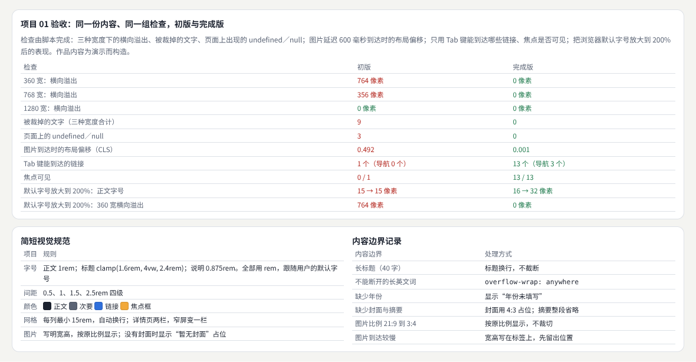

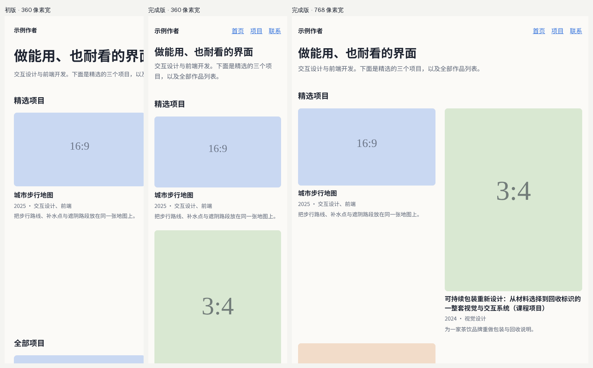

示例：[21-02-portfolio.html](示例/21-02-portfolio.html)（加 `?v=a` 打开初版）

| 检查 | 初版 | 完成版 |
| --- | --- | --- |
| 360／768／1280 像素宽的横向溢出 | 764／356／0 像素 | 0／0／0 |
| 被裁掉的文字（三种宽度合计） | 9 处 | 0 |
| 页面上的 undefined／null | 3 处 | 0 |
| 图片延迟 600 毫秒到达时的布局偏移 | 0.492 | 0.001 |
| Tab 键能到达的链接 | 1 个（导航 0 个） | 13 个（导航 3 个） |
| 焦点可见 | 0／1 | 13／13 |
| 默认字号放大到 200% | 正文 15 → 15 像素；360 宽溢出 764 像素 | 正文 16 → 32 像素；溢出 0[B03](#ref-b03) |

完成版第一次检查时，放大到 200% 后 360 宽仍溢出 29 像素：页脚的邮箱地址不能换行。加上 `overflow-wrap: anywhere` 后为 0[B04](#ref-b04)。

#### 02.4 常见问题

- **用 px 写字号**：用户调大浏览器默认字号时文字不变；用 rem。
- **固定宽度的网格**：手机上横向滚动；用 `repeat(auto-fill, minmax(min(15rem, 100%), 1fr))`。
- **图片不写宽高**：图片到达时内容跳动；写明宽高或 `aspect-ratio`。
- **缺失字段显示成 undefined**：每个字段都要有“缺失时怎么办”。
- **去掉焦点框**：键盘用户不知道自己在哪里[B05](#ref-b05)。

**本章练习**：

1. 用自己的三个真实项目替换示例内容，补上内容边界记录，跑一遍验收脚本。
2. 把网络限速到“慢速 3G”，记录首页第一屏的文字什么时候可读。

#### 02.5 进阶学习卡

| 级别 | 目标 | 怎样检验 |
| --- | --- | --- |
| L1 入门 | 做出首页、列表和详情三页 | 能解释示例的每组测量 |
| L2 熟练 | 用真实内容通过全部检查 | 三种宽度、放大文字、键盘、慢速资源都通过 |
| L3 进阶 | 写成内容可配置的模板，供别人使用 | 换一套内容仍然通过 |
| L4 深入 | 研究作品集的阅读路径与招聘方的浏览习惯 | 有访谈或浏览记录支持 |

- **技术栈**：语义 HTML；CSS Grid 与 `minmax()`；rem 与 `clamp()`；`aspect-ratio`、图片的 `width`／`height`；Playwright 做宽度、键盘与慢速资源检查。
- **高阶词汇**：响应式设计（responsive design）、流式网格（fluid grid）、内容边界（content edge cases）、布局偏移（layout shift）、焦点可见（focus visible）、调整文字大小（resize text）。
- **搜索关键词**：`responsive portfolio grid minmax`、`img width height aspect ratio CLS`、`rem font size user preference`、`overflow-wrap anywhere email`、`作品集 网站 响应式`。
- **值得看的实例**：[web.dev 的 CLS 说明](https://web.dev/articles/cls)——解释布局偏移怎样计算，以及给图片写宽高为什么能消除偏移。
- **资料**：[B01](#ref-b01)、[B02](#ref-b02)、[B03](#ref-b03)、[B04](#ref-b04)、[B05](#ref-b05)。

### 03 项目 02 同一内容的三种视觉方向

#### 03.1 目标与范围

为同一个产品制作简约、编辑设计和科技三种方向，每种包含首页片段、详情和空状态。固定内容，重点改变视觉组织。

示例的产品是为演示而构造的“城市步行路线”应用，三个方向的文字逐字相同。

#### 03.2 能力组合

版式、字体、色彩、图像和艺术方向。解释每种风格适合的用户与内容，而后选择一个方向继续完善。

| 能力 | 在本项目里做什么 | 参考 |
| --- | --- | --- |
| 艺术方向 | 写方向板：配色、字体、图形处理、适合的用户与内容 | [《美学与艺术指导》](14-美学与艺术指导.md) |
| 版式与字体 | 层级、编号、分隔线 | [《视觉设计与品牌表达》](02-视觉设计与品牌表达.md) |
| 可读性 | 对比度、字号种类[B06](#ref-b06) | [《感知与认知》](13-感知与认知.md) |

#### 03.3 交付与验收：示例

方向板、三个页面组和取舍说明。比较层级、可读性、一致性和实际内容适配，记录评审意见。

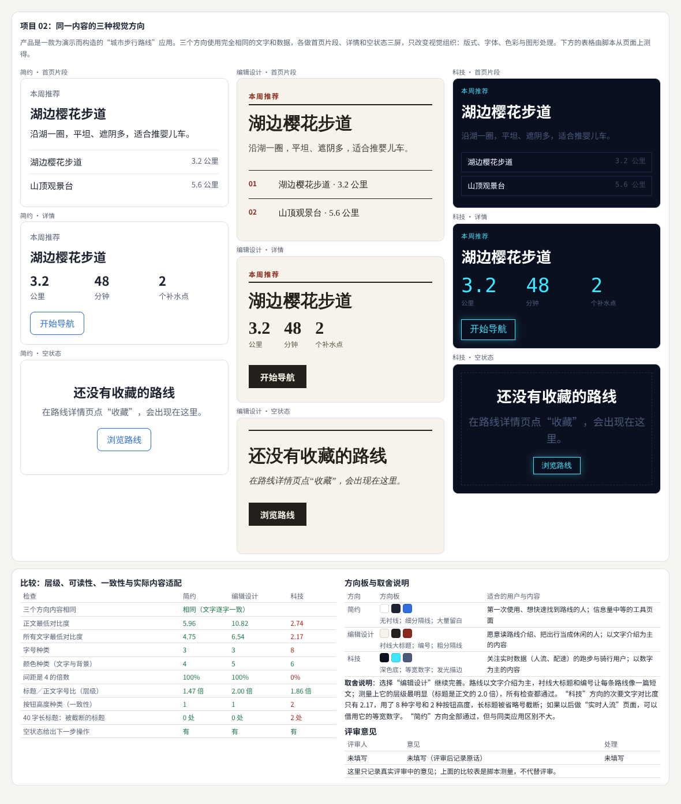

示例：[21-03-three-directions.html](示例/21-03-three-directions.html)

| 检查 | 简约 | 编辑设计 | 科技 |
| --- | --- | --- | --- |
| 正文最低对比度 | 5.96 | 10.82 | 2.74 |
| 所有文字最低对比度 | 4.75 | 6.54 | 2.17 |
| 字号种类 | 3 | 3 | 8 |
| 颜色种类 | 4 | 5 | 6 |
| 间距是 4 的倍数 | 100% | 100% | 0% |
| 标题／正文字号比 | 1.47 | 2.00 | 1.86 |
| 按钮高度种类 | 1 | 1 | 2 |
| 40 字长标题被截断 | 0 处 | 0 处 | 2 处 |

示例选择“编辑设计”继续完善：路线以文字介绍为主，衬线大标题和编号适合这种内容，测量也全部通过；“科技”的等宽数字可以留给以后的实时数据页面。评审意见一栏写着“未填写”——它只记录真实评审中的原话，脚本测量不能代替评审。

#### 03.4 常见问题

- **三个方向的内容也不同**：差别可能来自内容；固定内容。
- **只交三张好看的图**：没有空状态和长内容，方向在真实使用中站不住。
- **深色科技风的次要文字太暗**：对比度低于 4.5 : 1。
- **取舍说明只有“我更喜欢”**：写清适合哪些用户与内容，并引用测量。

**本章练习**：

1. 为同一份内容再做第四个方向（例如“手绘”），用示例的脚本测量。
2. 请三位同学评审，把原话记进评审意见，再写一版修改说明。

#### 03.5 进阶学习卡

| 级别 | 目标 | 怎样检验 |
| --- | --- | --- |
| L1 入门 | 做出三个方向各三屏 | 内容逐字一致 |
| L2 熟练 | 用测量和评审写出取舍说明 | 选中的方向全部检查通过 |
| L3 进阶 | 把选中的方向整理成可执行的视觉规范 | 别人按规范做出新页面 |
| L4 深入 | 研究不同方向对理解与信任的影响 | 有对照实验 |

- **技术栈**：CSS 变量与主题；Figma 的样式与变体；脚本测量计算样式；对比度计算。
- **高阶词汇**：艺术方向（art direction）、方向板（mood board）、视觉层级（visual hierarchy）、字体比例（type scale）、空状态（empty state）、设计评审（design critique）。
- **搜索关键词**：`art direction mood board ui`、`same content different visual style`、`editorial design web`、`dark ui contrast secondary text`、`视觉方向 方案 比较`。
- **值得看的实例**：[W3C 的“最低对比度”说明](https://www.w3.org/WAI/WCAG22/Understanding/contrast-minimum.html)——给出 4.5 : 1 与 3 : 1 的适用范围，正好用来核对深色方向的次要文字。
- **资料**：[B06](#ref-b06)。

### 04 项目 03 完整资料上传流程

#### 04.1 目标与范围

实现文件选择、校验、上传、分析中、结果查看、失败重试和取消。可以使用明确标注的模拟数据验证流程。

示例的服务器是页面里的模拟程序：上传每 80 毫秒前进 10%，分析 400 毫秒；“断网”时请求既不成功也不失败，一直挂起。

#### 04.2 能力组合

UX、内容设计、组件、异步状态与反馈动效。

| 能力 | 在本项目里做什么 | 参考 |
| --- | --- | --- |
| 状态 | 九个状态，每个状态有提示文字和可用操作 | [《产品交互与用户体验》](03-产品交互与用户体验.md) |
| 异步 | 取消用 `AbortController`[B07](#ref-b07)；3 秒无进展视为断网 | [《图形与交互的数学基础》](20-图形与交互的数学基础.md) 11 章 |
| 反馈 | 进度文字放在 `role="status"` 里[B08](#ref-b08) | 本章 |
| 内容设计 | 每条提示说明发生了什么、下一步做什么 | 本章 |

#### 04.3 交付与验收：示例

状态表、交互原型和可运行流程。测试重复提交、断网、超长文件名、取消后返回、空结果与错误恢复。检查用户能否判断任务进行到哪里。

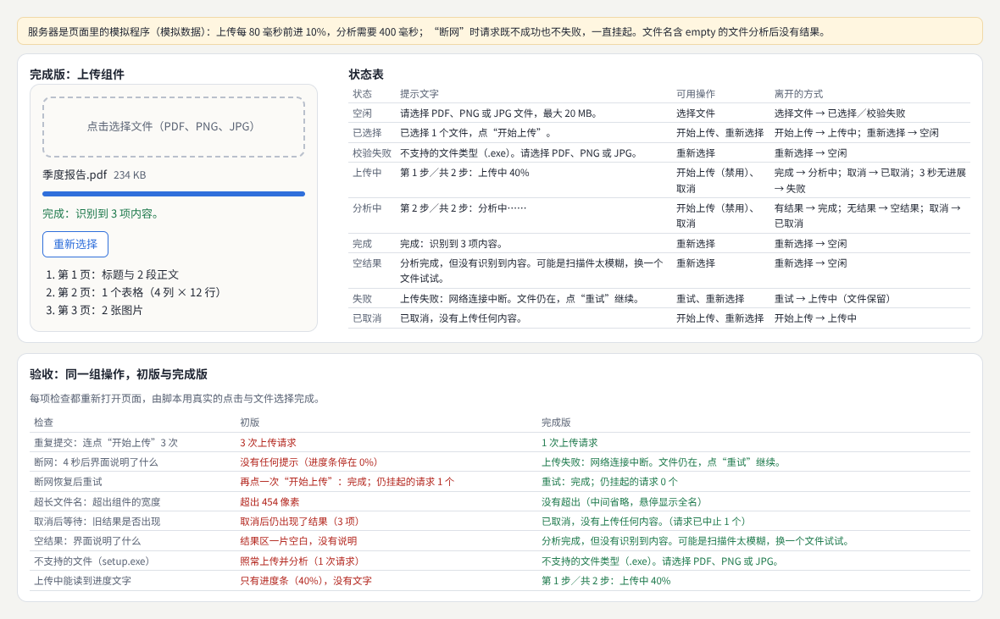

示例：[21-04-upload-flow.html](示例/21-04-upload-flow.html)（测试用 Playwright 选择文件[B09](#ref-b09)[B10](#ref-b10)）

| 检查 | 初版 | 完成版 |
| --- | --- | --- |
| 连点“开始上传”3 次 | 3 次上传请求 | 1 次 |
| 断网 4 秒后 | 没有任何提示（进度停在 0%） | “上传失败：网络连接中断。文件仍在，点‘重试’继续。” |
| 断网恢复后 | 再点开始才完成，仍有 1 个请求挂起 | 点重试完成，挂起 0 个 |
| 超长文件名 | 超出组件 454 像素 | 中间省略，悬停显示全名 |
| 取消后等待 | 仍出现 3 项结果 | “已取消”，请求已中止 |
| 空结果 | 结果区一片空白 | 说明没有识别到内容并给出建议 |
| 上传 setup.exe | 照常上传并分析 | “不支持的文件类型” |
| 上传中的进度 | 只有进度条 | “第 1 步／共 2 步：上传中 40%” |

完成版第一次测连点时发出了 2 个请求：开始按钮在上传时隐藏，“取消”移到了同一个位置，第二下点成取消、第三下又开始了上传。改为“上传中按钮留在原位并禁用”。

#### 04.4 常见问题

- **按钮在上传中消失**：别的按钮会移到指针下面；原位禁用。
- **请求没有超时**：断网时界面一直转圈；设看门狗计时器。
- **取消只是隐藏进度条**：请求还在，结果稍后出现；真正中止请求。
- **失败后要重新选文件**：保留文件，提供重试。
- **只有进度条**：读屏软件读不到；写进度文字。

**本章练习**：

1. 给状态表加“文件太大”和“服务器繁忙（稍后重试）”两个状态，写出提示文字。
2. 把模拟服务器换成真实接口，用浏览器的网络限速重跑检查。

#### 04.5 进阶学习卡

| 级别 | 目标 | 怎样检验 |
| --- | --- | --- |
| L1 入门 | 写出状态表，做出主流程 | 能解释示例的每组测量 |
| L2 熟练 | 处理取消、断网、重试、空结果 | 八项检查通过 |
| L3 进阶 | 支持多文件、断点续传与后台上传 | 刷新页面后能继续 |
| L4 深入 | 研究等待体验：进度表达对放弃率的影响 | 有对照实验 |

- **技术栈**：`<input type="file">` 与拖放；`fetch`／`XMLHttpRequest` 上传进度；`AbortController`；状态机（XState 等）；`role="status"`。
- **高阶词汇**：状态机（state machine）、乐观更新（optimistic update）、超时（timeout）、重试（retry）、幂等（idempotency）、断点续传（resumable upload）、实时区域（live region）。
- **搜索关键词**：`file upload ux states retry cancel`、`abortcontroller upload progress`、`resumable upload tus`、`aria live region progress`、`上传 交互 状态 设计`。
- **值得看的实例**：[MDN 的 AbortController](https://developer.mozilla.org/en-US/docs/Web/API/AbortController)——包括取消下载、合并多个信号的例子。
- **资料**：[B07](#ref-b07)、[B08](#ref-b08)、[B10](#ref-b10)、[B09](#ref-b09)。

### 05 项目 04 产品设计系统

#### 05.1 目标与范围

从已有页面提取颜色、字体、间距和至少一组高频组件，提供默认、悬浮、焦点、禁用、加载和错误等适用状态。

#### 05.2 能力组合

UI、组件工程、无障碍、文档和资产治理。

| 能力 | 在本项目里做什么 | 参考 |
| --- | --- | --- |
| 审计 | 统计已有页面的颜色、字号、间距 | [《质量、性能与设计运营》](18-质量性能与设计运营.md) |
| 令牌 | 颜色、字号、间距、圆角、线宽[B11](#ref-b11) | 本章 |
| 组件与无障碍 | 按钮与输入框的各个状态[B12](#ref-b12) | [《包容、国际化与多感官》](16-包容国际化与多感官.md) |
| 资产治理 | 使用规则；页面里不直接写数值 | 本章 |

#### 05.3 交付与验收：示例

令牌、组件展示、使用规则和一个实际采用页面。让其他人按文档完成新页面，记录难以理解和无法覆盖的场景。

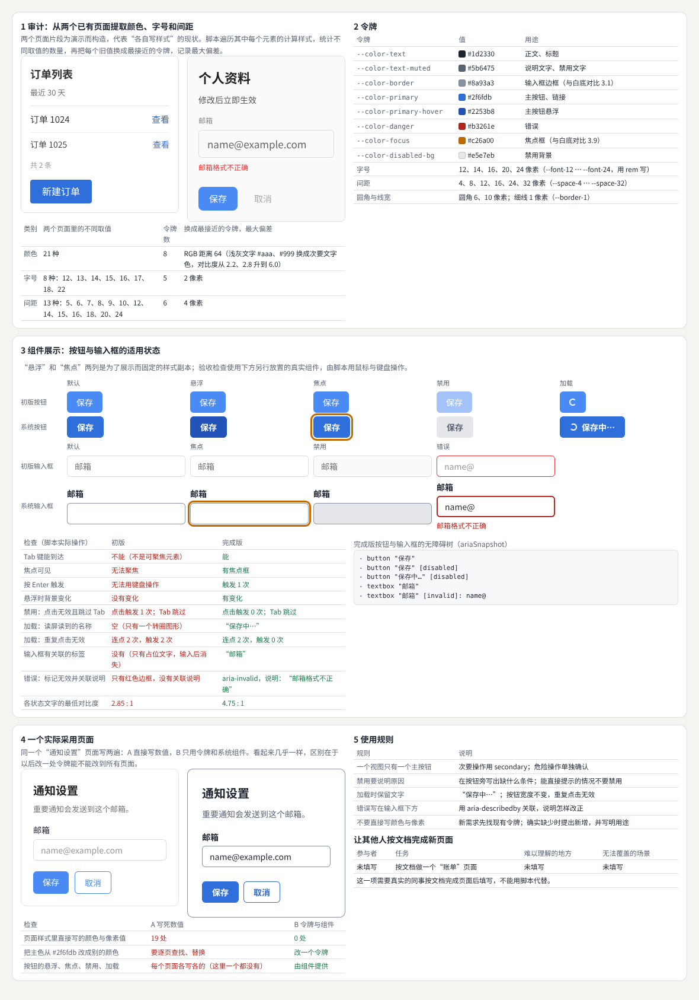

示例：[21-05-design-system.html](示例/21-05-design-system.html)

**审计**（两个为演示而构造的旧页面）：颜色 21 种整理成 8 个令牌（浅灰文字的对比度从 2.2、2.8 提高到 6.0）；字号 8 种整理成 5 个，换成最接近的令牌最多偏差 2 像素；间距 13 种整理成 6 个，最多偏差 4 像素。

**组件检查**（脚本用鼠标与键盘实际操作）：

| 检查 | 初版组件 | 系统组件 |
| --- | --- | --- |
| Tab 键能到达 | 不能 | 能 |
| 焦点可见 | 无法聚焦 | 有焦点框 |
| 按 Enter 触发 | 无法用键盘操作 | 触发 1 次 |
| 悬浮时背景变化 | 没有变化 | 有变化 |
| 禁用时点击 | 触发 1 次 | 0 次，Tab 跳过 |
| 加载时读屏读到的名称 | 空 | “保存中…” |
| 加载时连点 2 次 | 触发 2 次 | 0 次 |
| 输入框的标签 | 只有占位文字 | “邮箱” |
| 错误状态 | 只有红色边框 | `aria-invalid` 并关联说明 |
| 各状态文字的最低对比度 | 2.85 : 1 | 4.75 : 1 |

**采用页面**：同一个“通知设置”页面，直接写数值的版本有 19 处颜色与像素值；只用令牌和组件的版本 0 处。“让其他人按文档完成新页面”一栏是“未填写”——这一项需要真实的同事按文档完成页面后填写。

#### 05.4 常见问题

- **令牌只是把旧值换个名字**：先审计、合并，再命名用途。
- **只做默认状态**：悬浮、焦点、禁用、加载、错误才是组件最容易出错的地方。
- **用 opacity 表示禁用**：仍然能点、能聚焦；用 `disabled` 或 `aria-disabled` 并拦截操作。
- **加载时只放一个转圈**：按钮失去名称；保留文字。
- **文档没人看**：让别人按文档做一个页面，记录卡住的地方。

**本章练习**：

1. 审计你自己的一个项目，列出颜色、字号、间距的取值数量。
2. 给系统加一个“开关”组件，写出它的状态、键盘行为与使用规则。

#### 05.5 进阶学习卡

| 级别 | 目标 | 怎样检验 |
| --- | --- | --- |
| L1 入门 | 提取令牌，做出一组组件的全部状态 | 能解释示例的每组测量 |
| L2 熟练 | 组件通过键盘、读屏与对比度检查，有采用页面 | 页面里没有直接写的数值 |
| L3 进阶 | 建立发布、版本与弃用流程，多人使用 | 有变更记录与迁移说明 |
| L4 深入 | 研究设计系统的采用率与一致性 | 有跨团队的数据 |

- **技术栈**：CSS 变量；Style Dictionary 等令牌转换工具；Storybook；axe-core；Playwright 的 `ariaSnapshot()`。
- **高阶词汇**：设计令牌（design tokens）、组件状态（component states）、设计系统（design system）、采用率（adoption）、无障碍名称（accessible name）、弃用（deprecation）。
- **搜索关键词**：`design tokens audit consolidate`、`button states loading disabled accessibility`、`aria-disabled vs disabled`、`design system adoption metrics`、`设计系统 令牌 规范`。
- **值得看的实例**：[设计令牌社区组](https://www.designtokens.org/)——令牌交换格式的规范草案与各工具的支持情况。
- **资料**：[B11](#ref-b11)、[B12](#ref-b12)、[B06](#ref-b06)。

## 第三篇：动效、数据、生成与三维

### 06 项目 05 连贯的动效流程

#### 06.1 目标与范围

为列表进入详情、编辑、保存和返回设计连续过渡。定义每个动画的触发、目标、持续、取消和恢复。

#### 06.2 能力组合

动效、状态机、布局与手势。

| 能力 | 在本项目里做什么 | 参考 |
| --- | --- | --- |
| 动效 | 卡片放大成整页，返回时收回到卡片当前位置 | [《动效与时间设计》](04-动效与时间设计.md) |
| 状态机 | 动画结束时按当前状态决定显示什么 | 本章 |
| 可中断动画 | 打开途中返回：从当前位置反向[B13](#ref-b13) | 本章 |
| 手势与偏好 | 右滑返回；减少动态效果时直接切换[B14](#ref-b14) | [《包容、国际化与多感官》](16-包容国际化与多感官.md) |

#### 06.3 交付与验收：示例

动效说明、可操作项目和录屏。测试快速切换、中途反向、内容变化、触屏和减少动态效果模式，确保视觉与真实状态一致。

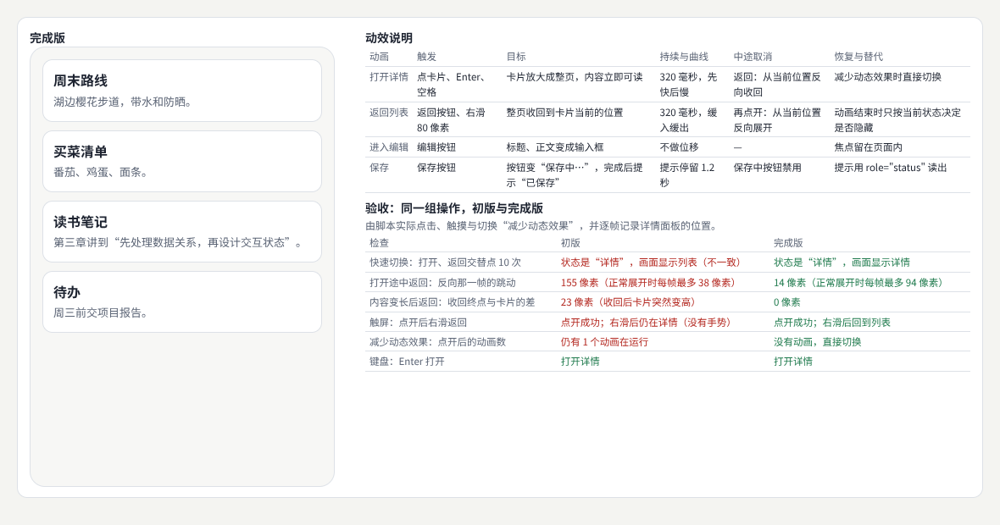

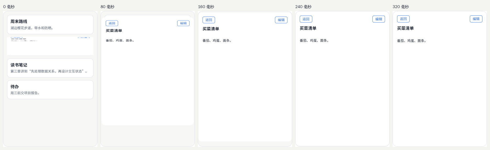

示例：[21-06-motion-flow.html](示例/21-06-motion-flow.html)

| 检查 | 初版（关键帧动画＋计时器） | 完成版（可反向动画＋状态） |
| --- | --- | --- |
| 60 毫秒间隔交替打开、返回 9 次 | 状态是“详情”，画面显示列表 | 一致 |
| 打开途中返回，反向那一帧的跳动 | 155 像素（正常每帧最多 38） | 14 像素（正常每帧最多 94） |
| 标题变长后返回，收回终点与卡片的差 | 23 像素（收回后卡片突然变高） | 0 |
| 触屏点开后右滑 | 仍在详情 | 回到列表 |
| 减少动态效果时点开 | 仍有 1 个动画在运行 | 直接切换 |
| 键盘 Enter 打开 | 能 | 能 |

初版的问题都来自“动画与状态分开管理”：返回的计时器在 320 毫秒后隐藏详情，不管这时用户是否又点开了；收回的终点用的是打开时量的位置。

#### 06.4 常见问题

- **用 setTimeout 等动画结束**：快速操作时多个计时器互相覆盖；以状态为准。
- **关键帧动画不能中途反向**：用 Web Animations API 的 `reverse()`。
- **起点终点只量一次**：内容变化后位置不对；每次过渡前重新测量。
- **缩放变形的文字**：FLIP 的缩放会让文字在过程中变形，过渡要短，或只对容器做缩放。
- **手势与页面滚动冲突**：只在横向滑动时处理返回。

**本章练习**：

1. 给“保存”加一个失败状态：按钮恢复、提示原因，并检查动画不会跳到“已保存”。
2. 用 View Transitions API 重做打开与返回，比较两种做法的代码量和可中断性。

#### 06.5 进阶学习卡

| 级别 | 目标 | 怎样检验 |
| --- | --- | --- |
| L1 入门 | 写出动效说明表，做出打开与返回 | 能解释示例的每组测量 |
| L2 熟练 | 动画可中断、尊重减少动态效果、支持手势 | 六项检查通过 |
| L3 进阶 | 整理成可复用的过渡组件与动效规范 | 新页面直接使用 |
| L4 深入 | 研究过渡对空间理解与任务效率的影响 | 有对照实验 |

- **技术栈**：Web Animations API；View Transitions API；FLIP；Pointer Events；`prefers-reduced-motion`；Playwright 逐帧采样与暂停动画截图。
- **高阶词汇**：共享元素过渡（shared element transition）、可中断动画（interruptible animation）、FLIP、状态机（state machine）、手势（gesture）、减少动态效果（reduced motion）。
- **搜索关键词**：`flip animation interruptible reverse`、`web animations api reverse playbackRate`、`view transitions list to detail`、`swipe back gesture web`、`动效 中断 状态 一致`。
- **值得看的实例**：[MDN 的 Web Animations API](https://developer.mozilla.org/en-US/docs/Web/API/Web_Animations_API)——包括暂停、反向、调整播放速度的完整例子。
- **资料**：[B13](#ref-b13)、[B14](#ref-b14)。

### 07 项目 06 可探索的数据工作台

#### 07.1 目标与范围

使用一份来源清楚的数据，提供概览、筛选、趋势、分布和明细联动，支持重置选择与查看数据说明。

示例的数据是按页面上写明的规则生成的模拟骑行数据：5 个区、56 天，其中有一天全市系统故障、新区连续 7 天传感器故障，共 12 条缺失记录。

#### 07.2 能力组合

数据处理、信息设计、图形、交互和前端状态。

| 能力 | 在本项目里做什么 | 参考 |
| --- | --- | --- |
| 数据处理 | 数据字典；缺失记为空而不是 0 | [《信息、数据与空间》](15-信息数据与空间.md) |
| 信息设计 | 指标带单位；柱状图从 0 开始；缺失处标“缺” | 本章 |
| 交互 | 在图上拖动选择日期范围[B15](#ref-b15)，勾选区与日期类型 | 本章 |
| 前端状态 | 指标、图表、明细共用一个选择状态 | 本章 |

#### 07.3 交付与验收：示例

数据字典、图表说明、分析任务与项目。核对计算、单位、缺失值和图形映射，让用户根据图表回答具体问题。

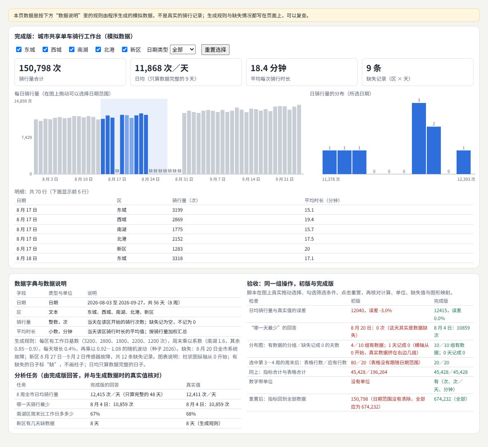

示例：[21-07-data-workbench.html](示例/21-07-data-workbench.html)

| 检查 | 初版 | 完成版 |
| --- | --- | --- |
| 日均骑行量与真实值的误差 | 12040，−3.0% | 12415，0.0%（真实 12411） |
| “哪一天最少” | 8 月 20 日：0 次（其实是数据缺失） | 8 月 4 日：10859 次（与真实一致） |
| 分布图 | 4／10 组有数据；缺失的 1 天记成 0 | 10／10 组有数据 |
| 选中第 3—4 周的周末后，表格行数 | 80／20（不跟随日期范围） | 20／20 |
| 指标合计与表格合计 | 45,428／196,264 | 一致 |
| 数字带单位 | 没有 | 次、次／天、分钟 |
| 重置后指标 | 150,798（日期范围没有清除） | 674,232（全部） |

**分析任务**由完成版回答，再与生成数据时的真实值核对：日均 12,415 次（真实 12,411）、最少的一天一致、南湖区周末比工作日多 67%（真实 68%）、新区缺 8 天（与规则一致）。

原计划的检查之一是“柱状图纵轴从 0 开始”，结果初版也通过了：缺失被记成 0 以后，纵轴自然从 0 开始——一个错误掩盖了另一个。于是改为检查分布图。

#### 07.4 常见问题

- **缺失记成 0**：平均值偏低，“最少的一天”指向故障日；缺失要单独表示。
- **各视图各自筛选**：指标和表格对不上；共用一个选择状态。
- **数字没有单位**：读者只能猜。
- **重置漏掉某个条件**：把所有选择放在同一个状态对象里，一次清空。
- **只做图不做任务**：先写用户要回答的问题，再选图。

**本章练习**：

1. 用一份真实的公开数据替换模拟数据，写出数据字典与来源说明。
2. 为“南湖区周末比工作日多多少”设计一个专门的视图，并测量用户回答的时间。

#### 07.5 进阶学习卡

| 级别 | 目标 | 怎样检验 |
| --- | --- | --- |
| L1 入门 | 做出概览、趋势、分布和明细 | 能解释示例的每组测量 |
| L2 熟练 | 联动、重置、缺失值与单位都正确 | 七项检查通过；分析任务答案与核对一致 |
| L3 进阶 | 处理大数据量与多种数据源 | 十万行仍然流畅 |
| L4 深入 | 研究图表设计对判断准确性的影响 | 有对照实验 |

- **技术栈**：D3（`d3-scale`、`d3-brush`）、Observable Plot、Vega-Lite；Arquero 或 DuckDB-Wasm 做数据处理；共享的选择状态。
- **高阶词汇**：数据字典（data dictionary）、缺失值（missing values）、刷选（brushing）、联动视图（coordinated views）、概览与细节（overview and detail）、分析任务（analytic task）。
- **搜索关键词**：`linked views brushing filtering`、`missing data visualization gaps`、`bar chart zero baseline`、`dashboard reset filters state`、`数据 工作台 联动`。
- **值得看的实例**：[D3 的刷选文档](https://d3js.org/d3-brush)——一维、二维刷选的交互例子，可以直接对照本章的日期范围选择。
- **资料**：[B15](#ref-b15)。

### 08 项目 07 生成式图形海报

#### 08.1 目标与范围

使用固定种子和可调参数生成一组海报，支持颜色、结构密度与标题内容变化，并导出结果。

#### 08.2 能力组合

创意编程、排版、生成规则与艺术指导。

| 能力 | 在本项目里做什么 | 参考 |
| --- | --- | --- |
| 创意编程 | 可设种子的随机数；格子里的四种图形[B16](#ref-b16) | [《创意编程与二维图形》](05-创意编程与二维图形.md) |
| 生成规则 | 密度限制在 5—400，越界时提示 | [《生成艺术与物理仿真》](08-生成艺术与物理仿真.md) |
| 排版 | 标题从 44 像素缩小到放得下，最多 3 行 | 本章 |
| 艺术指导 | 三套配色；标题放在单色色带上 | [《美学与艺术指导》](14-美学与艺术指导.md) |

#### 08.3 交付与验收：示例

参数说明、系列作品和生成工具。相同配置应得到可复现结果；长标题和极端参数应仍有可理解输出。

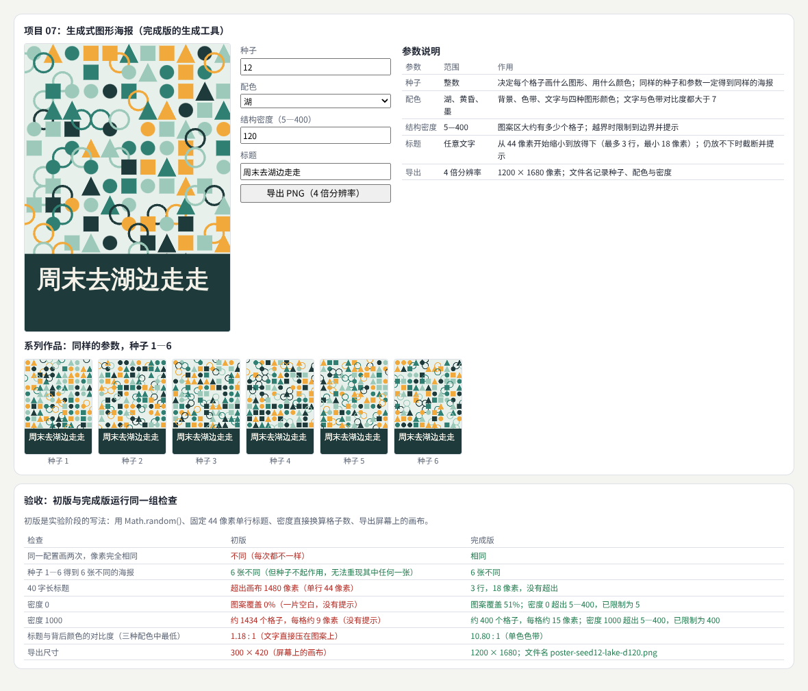

示例：[21-08-generative-poster.html](示例/21-08-generative-poster.html)

| 检查 | 初版 | 完成版 |
| --- | --- | --- |
| 同一配置画两次 | 不同 | 像素完全相同 |
| 种子 1—6 | 6 张不同，但种子不起作用 | 6 张不同，每张都能重现 |
| 40 字长标题 | 超出画布 1480 像素 | 3 行、18 像素，不超出 |
| 密度 0 | 图案覆盖 0%，没有提示 | 覆盖 51%，提示“已限制为 5” |
| 密度 1000 | 约 1434 个 9 像素的格子 | 400 个格子，提示“已限制为 400” |
| 标题与背后颜色的对比度 | 1.18 : 1（压在图案上） | 10.80 : 1（单色色带） |
| 导出尺寸 | 300 × 420 | 1200 × 1680，文件名记录种子、配色与密度[B17](#ref-b17) |

测量对比度时，最初直接取标题区域的中位颜色，得到 1.00——取到的是文字本身。要先去掉文字像素，再看文字背后的颜色。

#### 08.4 常见问题

- **用 Math.random()**：好看的那张再也找不回来；用可设种子的生成器，并把种子写进文件名。
- **标题固定字号**：长标题溢出；按宽度缩小并限制行数。
- **参数不设边界**：0 和极大值产生空白或噪点；限制并提示。
- **文字直接压在图案上**：对比度随图案变化；加色带或描边。
- **导出屏幕上的画布**：打印时模糊；按倍数重新生成。

**本章练习**：

1. 加一个“结构”参数（网格、同心圆、条纹），检查每种结构下的长标题与极端密度。
2. 生成 100 张，挑出 6 张组成系列，写下挑选标准。

#### 08.5 进阶学习卡

| 级别 | 目标 | 怎样检验 |
| --- | --- | --- |
| L1 入门 | 用种子和参数生成海报 | 能解释示例的每组测量 |
| L2 熟练 | 可复现、长标题与极端参数都可理解、高分辨率导出 | 七项检查通过 |
| L3 进阶 | 做成别人能用的生成工具，参数有预设与说明 | 非开发者能做出系列 |
| L4 深入 | 研究参数空间与审美判断的关系 | 有评审或偏好数据 |

- **技术栈**：Canvas 2D 或 p5.js；mulberry32 等可设种子的生成器；`measureText()` 排版；`toDataURL()`／`toBlob()` 导出；Tweakpane 做参数面板。
- **高阶词汇**：随机种子（random seed）、可复现（reproducible）、参数空间（parameter space）、生成规则（generative rules）、系列（series）、安全区（safe area）。
- **搜索关键词**：`generative poster seed parameters`、`canvas export high resolution`、`fit text to box canvas`、`generative art series curation`、`生成 海报 种子 参数`。
- **值得看的实例**：[The Nature of Code](https://natureofcode.com/)——前几章的随机、噪声与规则是生成海报的基础，例子都能在浏览器里运行。
- **资料**：[B16](#ref-b16)、[B17](#ref-b17)。

### 09 项目 08 三维产品展示

#### 09.1 目标与范围

制作一个产品场景，包含旋转、视角选择、部件标注和恢复默认。根据屏幕重新安排镜头与文字。

示例的产品是为演示而构造的便携音箱；“模型、贴图、环境光”三项资源用定时器模拟加载，地址带 `?fail=model` 时模型加载失败。

#### 09.2 能力组合

三维、灯光、材质、UI 与资源工程。

| 能力 | 在本项目里做什么 | 参考 |
| --- | --- | --- |
| 三维与相机 | 轨道控制[B18](#ref-b18)；正面、侧面、顶部与恢复默认 | [《三维内容与空间设计》](06-三维内容与空间设计.md) |
| 灯光与材质 | 平行光、半球光、阴影 | 本章 |
| UI | 规格与部件说明是普通文字；标注只标朝向相机的部件 | 本章 |
| 资源工程 | 资产清单[B19](#ref-b19)；失败时静态图与重试；像素比上限；按需重画 | [《图形工程与渲染系统》](09-图形工程与渲染系统.md) |

#### 09.3 交付与验收：示例

场景、资产清单、加载与性能记录。测试资源失败、低性能设备、触摸操作和模型未就绪时的阅读路径。

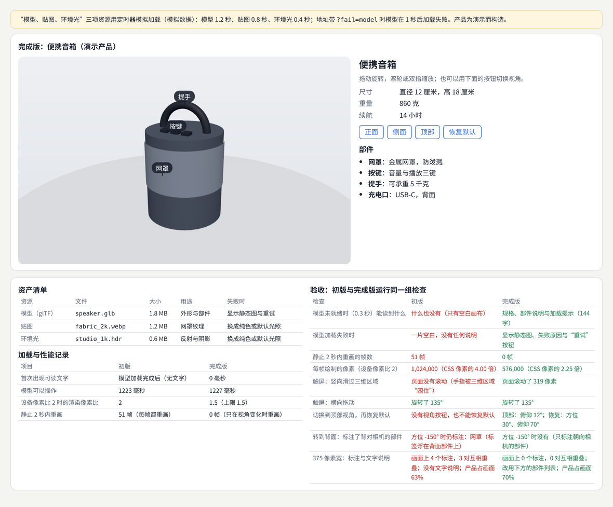

示例：[21-09-product-3d.html](示例/21-09-product-3d.html)

| 检查 | 初版 | 完成版 |
| --- | --- | --- |
| 模型未就绪（0.3 秒）时 | 什么也没有 | 规格、部件说明与加载提示 |
| 模型加载失败 | 一片空白 | 静态图、失败原因与“重试” |
| 静止 2 秒内重画 | 46—55 帧 | 0 帧 |
| 每帧绘制的像素（设备像素比 2） | CSS 像素的 4.00 倍 | 2.25 倍（上限 1.5） |
| 触屏竖向滑过三维区域 | 页面不滚动 | 页面滚动[B20](#ref-b20) |
| 触屏横向拖动 | 旋转 135° | 旋转 135° |
| 顶部视角与恢复默认 | 没有 | 俯仰 12°；恢复到 30°、70° |
| 转到背面时的标注 | 仍标注正面的网罩 | 只标注朝向相机的部件 |
| 375 像素宽 | 4 个标注，3 对重叠，没有文字说明 | 标注改为下方的部件列表 |

检查中发现了一个两版共有的问题：加载完成后清空的占位层仍盖在画布上，挡住了所有拖动和触摸。加上 `.poster:empty { display: none }` 后才能操作。

#### 09.4 常见问题

- **画布一直重画**：静止时也耗电发热；只在视角变化时重画。
- **高像素比设备上按原始像素比渲染**：像素数翻四倍；设上限。
- **画布吃掉所有触摸**：页面滚不动；把竖向滑动留给页面。
- **说明只在三维里**：模型没加载、读屏软件、搜索引擎都读不到；先给文字。
- **标注穿透**：背面的部件也显示标签；按朝向隐藏。

**本章练习**：

1. 换成一个真实的 glTF 模型，记录文件大小、加载时间与首次可操作时间。
2. 加一个“低性能模式”：关闭阴影、降低像素比，比较帧时间。

#### 09.5 进阶学习卡

| 级别 | 目标 | 怎样检验 |
| --- | --- | --- |
| L1 入门 | 做出可旋转、带标注的产品场景 | 能解释示例的每组测量 |
| L2 熟练 | 处理加载失败、触屏、低性能与窄屏 | 九项检查通过 |
| L3 进阶 | 建立模型的压缩、分级加载与资产管线 | 有性能预算与记录 |
| L4 深入 | 研究三维展示对理解产品与购买决策的影响 | 有对照实验 |

- **技术栈**：three.js（`OrbitControls`、`GLTFLoader`）；Draco、Meshopt、KTX2 压缩；`touch-action`；按需渲染；Playwright 的触摸模拟与设备像素比设置。
- **高阶词汇**：轨道控制（orbit controls）、按需渲染（render on demand）、设备像素比（device pixel ratio）、资产管线（asset pipeline）、渐进加载（progressive loading）、降级方案（fallback）。
- **搜索关键词**：`three.js render on demand`、`three.js setPixelRatio limit mobile`、`canvas touch-action pan-y orbit`、`gltf compression draco ktx2`、`三维 产品 展示 网页`。
- **值得看的实例**：[three.js 的 OrbitControls 文档](https://threejs.org/docs/pages/OrbitControls.html)——列出距离、俯仰、平移的限制参数，以及触摸手势的配置方式。
- **资料**：[B18](#ref-b18)、[B19](#ref-b19)、[B20](#ref-b20)。

## 第四篇：特效、工具、AI 与研究

### 10 项目 09 可控的实时特效

#### 10.1 目标与范围

选择液态图像、粒子文字或溶解其中一种效果，拆成输入、更新和绘制，提供少量有意义的参数与预设。

示例选择溶解：输入是图片与进度，更新是每帧推进进度，绘制是在片元着色器里比较噪声值与进度[B21](#ref-b21)。

#### 10.2 能力组合

着色器或 Canvas、数学、动效、技术美术。

| 能力 | 在本项目里做什么 | 参考 |
| --- | --- | --- |
| 着色器 | 值噪声、阈值、发光边 | [《技术美术与实时效果》](07-技术美术与实时效果.md) |
| 数学 | 平滑插值、宽高比修正 | [《图形与交互的数学基础》](20-图形与交互的数学基础.md) |
| 动效 | 播放、暂停、进度、减少动态效果[B14](#ref-b14) | [《动效与时间设计》](04-动效与时间设计.md) |
| 技术美术 | 三个预设：柔和、灼烧、像素 | [《常见视觉效果拆解》](19-常见视觉效果拆解.md) |

#### 10.3 交付与验收：示例

最小原理演示、完整效果、参数说明和性能对比。检查暂停、重置、缩放、输入缺失和静态替代。

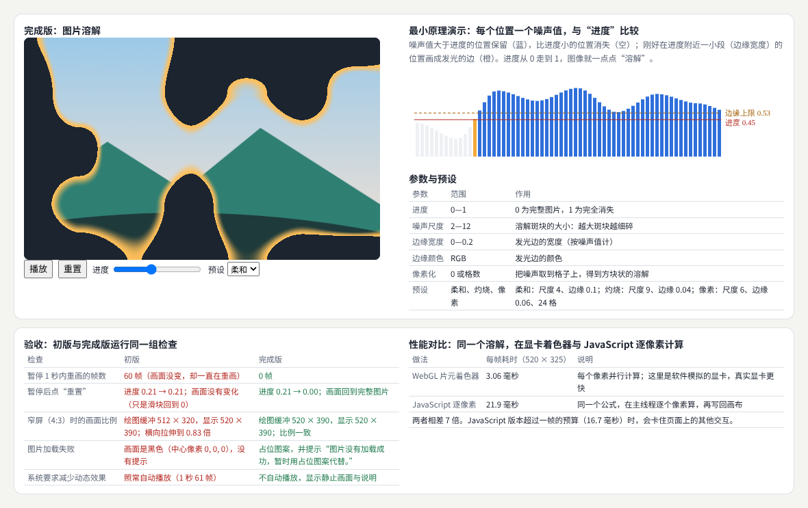

示例：[21-10-dissolve-effect.html](示例/21-10-dissolve-effect.html)

| 检查 | 初版 | 完成版 |
| --- | --- | --- |
| 暂停 1 秒内重画 | 61 帧 | 0 帧 |
| 暂停后点“重置” | 进度不变（只拨回滑块） | 进度归 0，画面回到完整图片 |
| 窄屏（4:3）时的画面比例 | 缓冲 512 × 320，横向拉伸到 0.83 倍 | 缓冲跟随显示尺寸[B22](#ref-b22) |
| 图片加载失败 | 全黑，没有提示 | 占位图案并提示 |
| 系统要求减少动态效果 | 照常自动播放 | 不自动播放，显示静止画面与说明 |

**性能对比**（520 × 325 像素，软件模拟的显卡）：片元着色器每帧约 3—4 毫秒，同一公式用 JavaScript 逐像素计算每帧约 22—30 毫秒，相差约 7 倍；JavaScript 版本超过一帧 16.7 毫秒的预算，会卡住页面上的其他交互[B23](#ref-b23)。

#### 10.4 常见问题

- **暂停只是停止推进进度**：仍在每帧重画；停止循环，参数变化时才画。
- **重置只改了控件**：内部状态没有变；控件和状态要同一个来源。
- **绘图缓冲尺寸写死**：窗口变化后拉伸；跟随显示尺寸并限制像素比。
- **纹理没加载就开始画**：画面全黑；准备占位图案并提示。
- **参数太多**：留下少量有意义的参数，组合成预设。

**本章练习**：

1. 把溶解换成“液态扭曲”，保留同样的五项检查。
2. 加一个“方向”参数，让溶解从左向右推进（噪声加上横坐标的偏移）。

#### 10.5 进阶学习卡

| 级别 | 目标 | 怎样检验 |
| --- | --- | --- |
| L1 入门 | 做出最小原理演示与完整效果 | 能解释示例的每组测量 |
| L2 熟练 | 暂停、重置、缩放、缺失输入与静态替代都正确 | 五项检查通过 |
| L3 进阶 | 做成可配置的组件，提供预设与性能分级 | 在低端设备上达到帧时间预算 |
| L4 深入 | 研究特效对注意力与理解的影响，或提出新的效果模型 | 有实验或论文 |

- **技术栈**：WebGL／WebGL2 片元着色器；GLSL 噪声函数；`ResizeObserver`；`prefers-reduced-motion`；three.js 的 `ShaderMaterial`；Canvas 2D 作为对照。
- **高阶词汇**：片元着色器（fragment shader）、值噪声（value noise）、阈值（threshold）、平滑阶跃（smoothstep）、绘图缓冲（drawing buffer）、静态替代（static fallback）、预设（preset）。
- **搜索关键词**：`dissolve shader noise threshold edge`、`webgl canvas resize drawing buffer`、`shader effect reduced motion fallback`、`glsl value noise`、`溶解 着色器 噪声`。
- **值得看的实例**：[The Book of Shaders 的“噪声”一章](https://thebookofshaders.com/11/)——每段代码都能在页面上直接修改并实时看到结果。
- **资料**：[B21](#ref-b21)、[B23](#ref-b23)、[B22](#ref-b22)、[B14](#ref-b14)。

### 11 项目 10 可编辑的能力画布

#### 11.1 目标与范围

在画布上组织目标、知识、技能与任务，支持节点编辑、关系连接、缩放、搜索、撤销和保存。节点方向、层级和连线含义应可配置并保持清楚。

#### 11.2 能力组合

复杂交互、图形、数据模型、信息架构和创作工具。

| 能力 | 在本项目里做什么 | 参考 |
| --- | --- | --- |
| 数据模型 | 配置、文档、视图、选区、历史分开[B24](#ref-b24) | [《图形与交互的数学基础》](20-图形与交互的数学基础.md) 10 章 |
| 图论 | 在“依赖”关系里找环；找没有关系的节点 | 同上 09 章 |
| 复杂交互 | 单击选中、双击改名、L 键连线、Delete、Ctrl+Z、滚轮缩放 | [《计算设计与创作工具》](11-计算设计与创作工具.md) |
| 保存 | 自动保存，读写失败不影响使用[B25](#ref-b25) | 本章 |

#### 11.3 交付与验收：示例

数据结构、交互规则、示例画布与可运行项目。测试大图、循环关系、断开的节点、长文本、误删恢复和刷新后恢复。后续可加入学习计划、能力验证与版本记录。

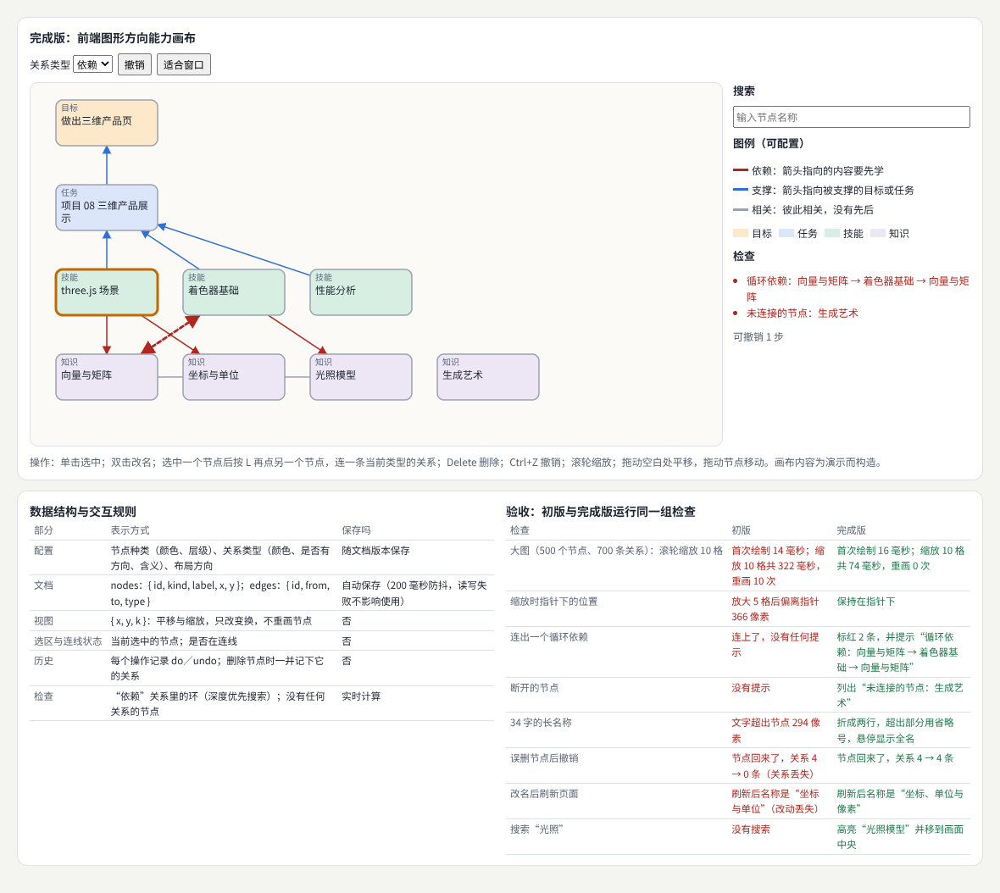

示例：[21-11-capability-canvas.html](示例/21-11-capability-canvas.html)

| 检查 | 初版 | 完成版 |
| --- | --- | --- |
| 500 个节点、700 条关系时滚轮缩放 10 格 | 326—443 毫秒，重画 10 次 | 86—130 毫秒，重画 0 次 |
| 缩放时指针下的位置 | 放大 5 格后偏离 366 像素 | 保持在指针下 |
| 连出一个循环依赖 | 没有任何提示 | 标红 2 条并提示环上的节点 |
| 断开的节点 | 没有提示 | 列出“生成艺术” |
| 34 字的长名称 | 超出节点 294 像素 | 两行加省略号，悬停显示全名 |
| 误删节点后撤销 | 节点回来，关系 4 → 0 条 | 关系 4 → 4 条 |
| 改名后刷新 | 改动丢失 | 保留 |
| 搜索“光照” | 没有搜索 | 高亮并移到画面中央 |

验收脚本还发现了两个两版共有的错误：按下鼠标就重画整个画布，双击的两次点击落在不同的元素上；按下时设置了指针捕获，双击事件的目标变成了整张画布。两处都会让“双击改名”失效。

#### 11.4 常见问题

- **选中时重建所有节点**：双击、拖动、焦点都会出问题；只切换样式。
- **缩放时重画全部**：大图卡顿；只改变换。
- **撤销只放回节点**：关系丢失；删除时一并记下相关的关系。
- **只有手动保存**：刷新或崩溃就丢失；自动保存并处理存储失败。
- **连线含义写死**：用户看不懂箭头；把关系类型、方向和含义放进配置与图例。

**本章练习**：

1. 加入“学习计划”：给技能节点设预计时间，按依赖关系排出学习顺序（拓扑排序）。
2. 加入“版本记录”：每次保存生成一个版本，可以比较两个版本的差别。

#### 11.5 进阶学习卡

| 级别 | 目标 | 怎样检验 |
| --- | --- | --- |
| L1 入门 | 做出节点、关系、选中与改名 | 能解释示例的每组测量 |
| L2 熟练 | 撤销、自动保存、检查、缩放与搜索都正确 | 八项检查通过 |
| L3 进阶 | 支持协作、导入导出与插件 | 多人同时编辑不丢数据 |
| L4 深入 | 研究能力画布对学习规划的帮助 | 有长期使用数据 |

- **技术栈**：SVG 或 Canvas；tldraw、React Flow；JSON Canvas 格式；Yjs 做协作；`localStorage`／IndexedDB 自动保存。
- **高阶词汇**：节点图（node graph）、有向图（directed graph）、环检测（cycle detection）、拓扑排序（topological sort）、命令模式（command pattern）、指针捕获（pointer capture）、视口变换（viewport transform）。
- **搜索关键词**：`node editor zoom to cursor transform`、`undo delete node with edges`、`cycle detection dependency graph ui`、`json canvas format`、`能力 图谱 画布 编辑器`。
- **值得看的实例**：[tldraw](https://tldraw.dev/)——开源的无限画布编辑器，可以对照本章检查它怎样处理缩放、选择、撤销和保存。
- **资料**：[B24](#ref-b24)、[B26](#ref-b26)、[B25](#ref-b25)。

### 12 项目 11 AI 资料与职业探索工作台

#### 12.1 目标与范围

以一个对话工作区组织资料选择、任务发起、生成进度、可编辑结果和版本比较。可以选择资料分析、模拟面试或岗位能力匹配中的一个完整任务作为第一版。

示例选择岗位能力匹配。示例中的“模型”是按固定规则生成文字的模拟程序，不调用任何真实的 AI 服务；简历与岗位说明为演示而构造，不对应任何真实的人或公司。

#### 12.2 能力组合

AI 交互、UX、内容设计、异步状态、设计系统。

| 能力 | 在本项目里做什么 | 参考 |
| --- | --- | --- |
| AI 交互 | 来源、不确定性、纠错与版本[B27](#ref-b27)[B28](#ref-b28) | [《产品形态专题》](17-产品形态专题.md) |
| 内容设计 | 能力匹配、学习建议、行动安排三组；三类标签 | 本章 |
| 异步状态 | 分步进度；随时取消[B07](#ref-b07)[B08](#ref-b08) | 本章 |
| 设计系统 | 标签、按钮、条目的统一样式 | 05 章 |

#### 12.3 交付与验收：示例

任务说明、来源展示、取消与纠错、结果保存和导出。区分用户资料、模型建议和待验证内容。职业规划场景围绕能力、学习与行动安排组织信息。

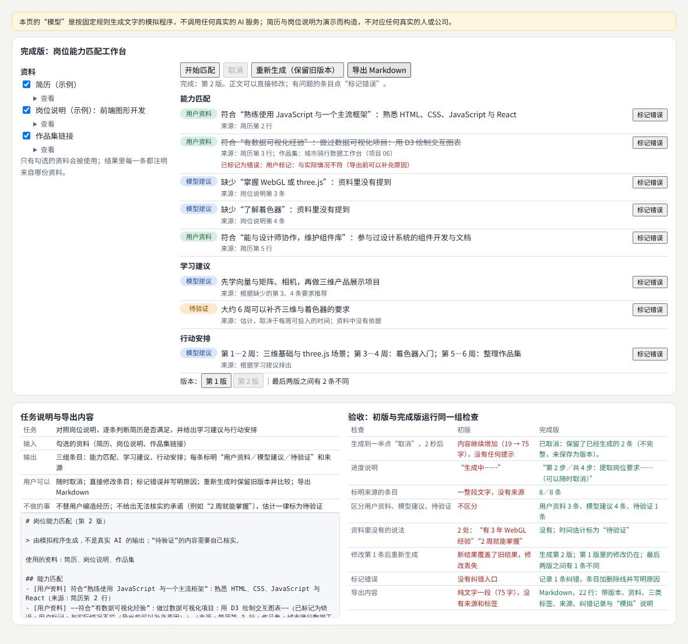

示例：[21-12-ai-workspace.html](示例/21-12-ai-workspace.html)

| 检查 | 初版（聊天式一整段） | 完成版 |
| --- | --- | --- |
| 生成到一半取消，2 秒后 | 内容继续增加（19 → 75 字） | 停止，并说明保留了 2 条不完整的结果 |
| 进度说明 | “生成中……” | “第 2 步／共 4 步：提取岗位要求” |
| 标明来源的条目 | 没有来源 | 8／8 条 |
| 三类内容 | 不区分 | 用户资料 3 条、模型建议 4 条、待验证 1 条 |
| 资料里没有的说法 | 2 处：“有 3 年 WebGL 经验”“2 周就能掌握” | 没有；时间估计标为“待验证” |
| 修改后重新生成 | 新结果覆盖了修改 | 生成第 2 版，第 1 版的修改仍在，可比较 |
| 标记错误 | 没有入口 | 记录纠错，条目加删除线 |
| 导出 | 75 字纯文字 | 22 行 Markdown：版本、资料、标签、来源、纠错与“模拟”说明 |

完成版第一次检查时，开始生成后“取消”按钮仍是禁用的：按钮状态只在结束时刷新。修正为开始时就启用。

#### 12.4 常见问题

- **把推测写成事实**：资料里没有的经历不能出现在结果里；估计要标为待验证。
- **取消只清掉提示**：生成还在继续；真正中止。
- **重新生成覆盖用户的修改**：保留版本，并能比较。
- **没有来源**：用户无法核对；每条注明来自哪份资料。
- **导出时丢掉标签**：别人看到的导出文件没有不确定性的说明。

**本章练习**：

1. 换成“模拟面试”任务：设计题目来源、作答、反馈三类内容，以及哪些内容需要待验证。
2. 接入真实的模型接口，保留本章的八项检查，比较结果的变化。

#### 12.5 进阶学习卡

| 级别 | 目标 | 怎样检验 |
| --- | --- | --- |
| L1 入门 | 做出资料选择、生成进度与结果展示 | 能解释示例的每组测量 |
| L2 熟练 | 来源、三类标签、取消、版本、纠错与导出都可用 | 八项检查通过 |
| L3 进阶 | 接入真实模型，建立评测集与回归检查 | 每次修改提示词后重跑评测 |
| L4 深入 | 研究用户对 AI 建议的信任与核对行为 | 有用户研究 |

- **技术栈**：流式输出（`ReadableStream`、服务器发送事件）；`AbortController`；结构化输出（JSON 模式）；Markdown 导出；评测集与回归检查。
- **高阶词汇**：来源标注（source attribution）、不确定性表达（uncertainty communication）、人在回路中（human in the loop）、幻觉（hallucination）、版本比较（version comparison）、纠错（correction）。
- **搜索关键词**：`ai ux show sources citations`、`human-ai interaction guidelines`、`streaming response cancel abort`、`ai output version history compare`、`AI 产品 交互 来源 不确定性`。
- **值得看的实例**：[Microsoft 的人机协作 AI 指南](https://www.microsoft.com/en-us/haxtoolkit/ai-guidelines/)——18 条指南，每条配有实际产品中的正反例，可以逐条对照本章的工作台。
- **资料**：[B27](#ref-b27)、[B28](#ref-b28)、[B07](#ref-b07)、[B08](#ref-b08)。

### 13 项目 12 研究复现或新媒介原型

#### 13.1 目标与范围

二选一开展。研究方向选择一个公开图形方法复现；交互方向选择一个真实活动制作新的表达或操作原型。限制问题规模，确保能够完整验证。

示例选择研究方向：复现 Reinhard 等人 2002 年论文中的全局色调映射算子（式 1—4）[B29](#ref-b29)，不复现局部算子。交互方向的原型可以按同样的结构记录：问题、基线（现有做法）、方法、配置、使用过程、失败情况与限制。

#### 13.2 能力组合

研究方法，加图形、HCI 或计算设计中的一个专长。

| 能力 | 在本项目里做什么 | 参考 |
| --- | --- | --- |
| 研究方法 | 问题、基线、配置、失败情况、限制 | [《图形与交互的数学基础》](20-图形与交互的数学基础.md) 08、12 章 |
| 图形专长 | 对数平均亮度、关键值、色调曲线、sRGB 编码 | [《图形学与视觉计算研究》](10-图形学与视觉计算研究.md) |
| 复现规范 | 注明来源；公开代码与数据[B30](#ref-b30) | 本章 |

#### 13.3 交付与验收：示例

问题、基线、方法、配置、结果、失败情况与限制。公开方法复现应注明来源；新交互应展示使用过程，并说明证据支持到什么程度。

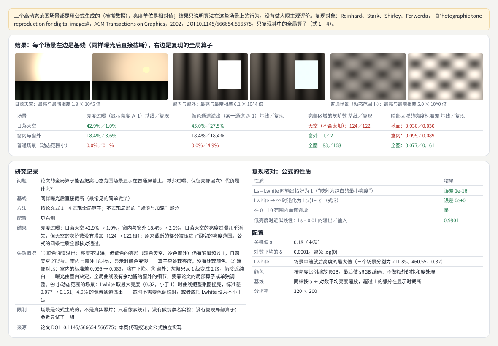

示例：[21-13-research-reproduction.html](示例/21-13-research-reproduction.html)（场景由公式生成，是模拟数据）

| 场景 | 亮度过曝（基线／复现） | 颜色通道溢出（基线／复现） | 亮部灰阶（基线／复现） | 暗部标准差（基线／复现） |
| --- | --- | --- | --- | --- |
| 日落天空 | 42.9%／1.0% | 45.0%／27.5% | 天空 124／122 | 地面 0.030／0.030 |
| 窗内与窗外 | 18.4%／3.6% | 18.4%／18.4% | 窗外 1／2 | 室内 0.095／0.089 |
| 普通场景（动态范围小） | 0／0.1% | 0／4.9% | 83／168 | 0.077／0.161 |

**公式性质核对**：Ls 等于 Lwhite 时输出恰好为 1（误差 1e-16）；Lwhite 趋于无穷时退化为 Ls/(1+Ls)；在 0—10 范围内单调递增；低亮度时近似线性。

**失败情况**：亮度不过曝，但偏色的亮部仍有颜色通道超过 1（算子只处理亮度）；窗外只从 1 级灰阶变成 2 级，仍接近纯白——曝光由室内决定，全局曲线没有余地，要靠局部算子；室内的对比略有下降；动态范围小的场景里，Lwhite 取最大亮度（小于 1）时曲线把整张图提亮。

**记录一次被推翻的结论**：写示例时预先写好了“动态范围小时损失对比”，测量结果正好相反（被提亮，标准差变大）。示例改为由测量数据生成结论；最初的“过曝”指标也被拆成亮度过曝与通道溢出两项，因为两者的原因不同。

#### 13.4 常见问题

- **问题太大**：“复现整篇论文”往往做不完；选一个算子或一张图。
- **没有基线**：无法说明方法带来了什么；用最常见的简单做法作为基线。
- **只放成功的结果**：失败情况往往最有价值；单独列出。
- **结论先于数据**：先测量，再写结论。
- **不注明来源**：复现必须写清论文、版本与自己的改动。

**本章练习**：

1. 实现论文里的局部算子（减淡与加深），在“窗内与窗外”场景上与全局算子比较。
2. 选择交互方向：为一个真实活动（例如社区菜园的预约）做原型，记录三次使用过程和证据能支持到哪里。

#### 13.5 进阶学习卡

| 级别 | 目标 | 怎样检验 |
| --- | --- | --- |
| L1 入门 | 按论文公式实现一个方法 | 能解释示例的每组测量 |
| L2 熟练 | 完整记录问题、基线、配置、结果、失败与限制 | 别人按记录能得到同样的数字 |
| L3 进阶 | 用真实数据复现，公开代码与数据 | 达到可复现的要求 |
| L4 深入 | 提出改进并用实验证明 | 投稿或公开报告 |

- **技术栈**：Canvas 或 WebGL 做图像处理；浮点图像（EXR、HDR）读写；Jupyter 或 Observable 记录实验；Git 记录配置与结果。
- **高阶词汇**：复现（reproduction）、基线（baseline）、色调映射（tone mapping）、高动态范围（HDR）、关键值（key value）、对数平均亮度（log-average luminance）、失败案例（failure case）、局限（limitations）。
- **搜索关键词**：`reinhard global tone mapping operator`、`log average luminance key value`、`reproducibility graphics research artifact`、`hdr tone mapping comparison metrics`、`论文 复现 图形学`。
- **值得看的实例**：[ACM 的研究成果评审与徽章说明](https://www.acm.org/publications/policies/artifact-review-and-badging-current)——区分“可用”“已复现”“已重现”等不同程度，可以用来衡量自己的复现做到了哪一级。
- **资料**：[B29](#ref-b29)、[B30](#ref-b30)。

### 14 项目记录建议与作品集

#### 14.1 项目记录建议

每个项目保存需求、参考、草图、规则、实现、验证和修改记录。作品集应展示关键问题与解决过程，并提供可运行成果。对于模拟功能、示意数据和研究局限，应在适当位置明确说明。

| 记录 | 内容 | 本册示例里的对应 |
| --- | --- | --- |
| 需求 | 目标与范围、要回答的问题 | 每章的 .1 节 |
| 参考 | 参考的产品、论文、资料与来源 | 方向板、资产清单、论文 DOI |
| 草图 | 纸面与线框，包括放弃的方案 | 三种视觉方向、失败的指标 |
| 规则 | 视觉规范、令牌、状态表、动效说明 | 项目 01、03、04、05 |
| 实现 | 可运行的代码与依赖版本 | 每个示例页面 |
| 验证 | 验收脚本与测量结果 | 每章的检查表 |
| 修改记录 | 发现了什么问题、怎样修正 | 每章“完成版第一次检查时……”的段落 |

#### 14.2 明确说明模拟与局限

本册的示例在页面顶部用色块标出模拟的部分：模拟的服务器、按规则生成的数据、模拟的“模型”、公式生成的场景、为演示而构造的作品和人物。需要真人参与的内容（评审意见、按文档做页面的同事）一律写“未填写”，不用脚本代替。作品集里也应这样做：读者需要知道哪些是真实的，哪些是演示。

#### 14.3 作品集怎样展示

- **从问题开始**：每个项目先写一句它解决什么问题，再放结果。
- **展示过程**：初版的失败、测量、修正，比只放成品更能说明能力。
- **提供可运行成果**：链接到可以操作的页面，而不只是截图和视频。
- **说明证据到哪里**：哪些结论有测量，哪些只是判断。

#### 14.4 学习路线

| 方向 | 建议的项目顺序 |
| --- | --- |
| 前端界面与设计系统 | 01 → 02 → 03 → 04 → 05 → 10 |
| 数据与信息设计 | 01 → 03 → 06 → 10 |
| 创意编程与视觉表达 | 01 → 02 → 07 → 09 |
| 三维与图形工程 | 01 → 05 → 08 → 09 → 12 |
| 产品与 AI 交互 | 01 → 03 → 04 → 11 |
| 研究 | 06 → 09 → 12 |

#### 14.5 横向连接

- 验收与性能：[《质量、性能与设计运营》](18-质量性能与设计运营.md)。
- 效果拆解：[《常见视觉效果拆解》](19-常见视觉效果拆解.md)。
- 数学、编程与研究基础：[《图形与交互的数学基础》](20-图形与交互的数学基础.md)。
- 产品形态与 AI：[《产品形态专题》](17-产品形态专题.md)。

## 附录 A：术语表

| 术语 | 英文 | 含义 | 阅读位置 |
| --- | --- | --- | --- |
| 验收脚本 | acceptance test script | 把交付要求写成可以自动运行的检查 | 01 |
| 内容边界 | content edge cases | 长标题、缺失信息等极端内容 | 02 |
| 布局偏移 | layout shift | 内容在加载过程中跳动 | 02 |
| 艺术方向 | art direction | 视觉风格的整体决定 | 03 |
| 方向板 | mood board | 配色、字体、图形处理与适用对象的汇总 | 03 |
| 状态表 | state table | 每个状态的提示、可用操作与离开方式 | 04 |
| 看门狗计时器 | watchdog timer | 一段时间没有进展就判定失败 | 04 |
| 设计令牌 | design tokens | 颜色、字号、间距等可复用的设计决定 | 05 |
| 采用页面 | adoption page | 用设计系统实际完成的页面 | 05 |
| 可中断动画 | interruptible animation | 中途改变目标时从当前位置继续 | 06 |
| 刷选 | brushing | 在图上拖动选择一个范围 | 07 |
| 联动视图 | coordinated views | 多个视图共用一个选择状态 | 07 |
| 随机种子 | random seed | 决定随机数序列的初始值 | 08 |
| 按需渲染 | render on demand | 只在画面需要变化时重画 | 09 |
| 资产清单 | asset manifest | 资源的文件、大小、用途与失败处理 | 09 |
| 静态替代 | static fallback | 不能或不应播放动画时的替代画面 | 10 |
| 环检测 | cycle detection | 在有向图中找出首尾相连的路径 | 11 |
| 指针捕获 | pointer capture | 让后续指针事件都发给同一个元素 | 11 |
| 来源标注 | source attribution | 说明每条内容来自哪份资料 | 12 |
| 待验证内容 | content to verify | 推测或估计，需要用户核实 | 12 |
| 色调映射 | tone mapping | 把高动态范围亮度压缩到屏幕能显示的范围 | 13 |
| 复现 | reproduction | 按公开描述独立实现并核对结果 | 13 |

## 附录 B：资料入口

以下资料用于核对方法来源和继续学习。资料核对日期：2026-10-29。

**B01 · MDN：响应式设计。** [Responsive design](https://developer.mozilla.org/en-US/docs/Learn_web_development/Core/CSS_layout/Responsive_Design)。对应 02 章。

**B02 · web.dev：累积布局偏移。** [Cumulative Layout Shift (CLS)](https://web.dev/articles/cls)。对应 02 章，图片到达时的布局偏移。

**B03 · W3C：理解“调整文字大小”。** [Understanding Success Criterion 1.4.4: Resize Text](https://www.w3.org/WAI/WCAG22/Understanding/resize-text.html)。对应 02 章，放大到 200% 仍可用。

**B04 · MDN：overflow-wrap。** [overflow-wrap](https://developer.mozilla.org/en-US/docs/Web/CSS/Reference/Properties/overflow-wrap)。对应 02 章，长词与邮箱地址换行。

**B05 · W3C：理解“焦点可见”。** [Understanding Success Criterion 2.4.7: Focus Visible](https://www.w3.org/WAI/WCAG22/Understanding/focus-visible.html)。对应 02、05 章。

**B06 · W3C：理解“最低对比度”。** [Understanding Success Criterion 1.4.3: Contrast (Minimum)](https://www.w3.org/WAI/WCAG22/Understanding/contrast-minimum.html)。对应 03、05、08 章。

**B07 · MDN：AbortController。** [AbortController](https://developer.mozilla.org/en-US/docs/Web/API/AbortController)。对应 04、12 章，取消上传与生成。

**B08 · MDN：status 角色。** [ARIA: status role](https://developer.mozilla.org/en-US/docs/Web/Accessibility/ARIA/Reference/Roles/status_role)。对应 04、12 章，读屏软件读出进度。

**B09 · Playwright：setInputFiles。** [page.setInputFiles()](https://playwright.dev/docs/api/class-page#page-set-input-files)。对应 04 章，测试里选择文件。

**B10 · MDN：文件输入框。** [<input type="file">](https://developer.mozilla.org/en-US/docs/Web/HTML/Reference/Elements/input/file)。对应 04 章。

**B11 · 设计令牌社区组。** [Design Tokens Community Group](https://www.designtokens.org/)。对应 05 章，令牌的交换格式。

**B12 · W3C：按钮模式。** [Button Pattern (ARIA Authoring Practices Guide)](https://www.w3.org/WAI/ARIA/apg/patterns/button/)。对应 05 章，按钮的键盘与状态。

**B13 · MDN：Web Animations API。** [Web Animations API](https://developer.mozilla.org/en-US/docs/Web/API/Web_Animations_API)。对应 06 章，可反向的动画。

**B14 · MDN：prefers-reduced-motion。** [prefers-reduced-motion](https://developer.mozilla.org/en-US/docs/Web/CSS/Reference/At-rules/@media/prefers-reduced-motion)。对应 06、10 章。

**B15 · D3：刷选。** [d3-brush](https://d3js.org/d3-brush)。对应 07 章，在图上选择范围。

**B16 · The Nature of Code。** [The Nature of Code](https://natureofcode.com/)。对应 08 章，随机与生成规则。

**B17 · MDN：toDataURL()。** [HTMLCanvasElement: toDataURL() method](https://developer.mozilla.org/en-US/docs/Web/API/HTMLCanvasElement/toDataURL)。对应 08 章，导出图片。

**B18 · three.js：OrbitControls。** [OrbitControls](https://threejs.org/docs/pages/OrbitControls.html)。对应 09 章。

**B19 · Khronos：glTF。** [glTF](https://www.khronos.org/gltf/)。对应 09 章，三维模型的交付格式。

**B20 · MDN：touch-action。** [touch-action](https://developer.mozilla.org/en-US/docs/Web/CSS/Reference/Properties/touch-action)。对应 09 章，把竖向滑动留给页面。

**B21 · The Book of Shaders：噪声。** [Noise](https://thebookofshaders.com/11/)。对应 10 章，溶解用的噪声。

**B22 · MDN：ResizeObserver。** [ResizeObserver](https://developer.mozilla.org/en-US/docs/Web/API/ResizeObserver)。对应 10 章，绘图缓冲跟随显示尺寸。

**B23 · MDN：WebGL 最佳实践。** [WebGL best practices](https://developer.mozilla.org/en-US/docs/Web/API/WebGL_API/WebGL_best_practices)。对应 10 章。

**B24 · JSON Canvas。** [JSON Canvas](https://jsoncanvas.org/)。对应 11 章，画布文档的开放格式。

**B25 · MDN：localStorage。** [Window: localStorage property](https://developer.mozilla.org/en-US/docs/Web/API/Window/localStorage)。对应 11 章，自动保存。

**B26 · tldraw。** [tldraw](https://tldraw.dev/)。对应 11 章，可以对照的画布编辑器。

**B27 · Google PAIR：人与 AI 指南。** [People + AI Guidebook](https://pair.withgoogle.com/guidebook/)。对应 12 章。

**B28 · Microsoft：人机协作 AI 指南。** [Guidelines for Human-AI Interaction](https://www.microsoft.com/en-us/haxtoolkit/ai-guidelines/)。对应 12 章。

**B29 · Reinhard 等：数字图像的摄影式色调再现。** [Photographic tone reproduction for digital images](https://doi.org/10.1145/566654.566575)。对应 13 章，ACM Transactions on Graphics 2002。

**B30 · ACM：研究成果评审与徽章。** [Artifact Review and Badging](https://www.acm.org/publications/policies/artifact-review-and-badging-current)。对应 13、14 章，复现与可用的定义。

## 附录 C：与原手册的对应关系及修订记录

### C.1 与原手册的对应关系

本册由原《前端与 UI／UX 设计进阶全景手册》第 22 章“十二个递进实战项目”扩写而成：

| 原手册内容 | 本册位置 |
| --- | --- |
| 项目 01—12 的目标与范围、能力组合、交付与验收 | 02—13 章 |
| 项目记录建议 | 14 章 |

### C.2 修订记录

| 版本 | 日期 | 主要变化 |
| --- | --- | --- |
| 1.0 | 2026-10-25 | 初版：由原手册第 22 章扩写，新增 12 个可运行示例（初版与完成版共用验收脚本）与截图；每章附进阶学习卡 |
