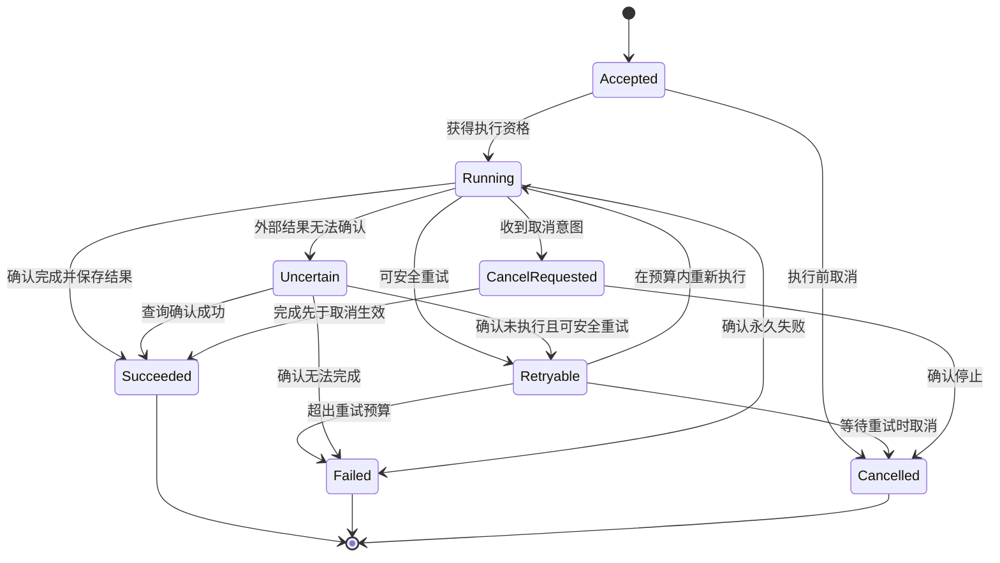

# 后端进阶全景手册

> 从正确实现一个功能，到长期负责一个系统，再到机制设计与研究创新。  
> 版本：1.1 · 修订日期：2026-10-25（初版 1.0：2026-10-21）  
> 适用对象：后端初学者、已有 Java／其他语言开发经验的工程师、独立开发者、平台与系统方向学习者。

本手册把后端工程的知识、职责、横向拓展和纵向深度组织为一份可顺序阅读、可按问题检索、可用于项目验收的学习地图。各主题按依赖关系编排并互相引用，不把技术名称的数量当作能力高低的依据。

主线是：**理解业务与计算基础 → 正确实现 → 可维护与可验证 → 可靠交付和运行 → 处理跨系统与数据生命周期 → 专项产品能力 → 平台与组织演进 → 机制与研究。**

技术框架和云服务会变化。本手册以机制、约束和职责为主；涉及特定产品时只作为例子，实际使用应核对所用版本的官方文档。参考资料见附录 B。分层和学习顺序是本手册的教学组织方式，不是行业统一职级或认证标准。

## 阅读导航

正文共 45 章（00—44），附 38 个方向的进阶矩阵、4 组附录与 28 组官方／原始资料。

- [第一篇：建立坐标，补齐基础](#part-1)
  - [00 如何阅读这本手册](#ch00)
  - [01 能力坐标：横向职责与纵向深度](#ch01)
  - [02 后端职责：从需求进入到系统退出](#ch02)
  - [03 数学、数据结构与计算基础](#ch03)
  - [04 编程语言、并发与运行时](#ch04)
  - [05 操作系统、网络与存储基础](#ch05)
  - [06 开发环境、版本控制与基础工程习惯](#ch06)
- [第二篇：正确实现一个可交付的服务](#part-2)
  - [07 API、输入语义与错误契约](#ch07)
  - [08 业务不变量、状态、时间与数值](#ch08)
  - [09 关系数据库、事务与并发控制](#ch09)
  - [10 身份、授权与基本安全边界](#ch10)
  - [11 文件、导入导出与第三方集成](#ch11)
  - [12 模块、架构与可维护性](#ch12)
  - [13 测试与证据：从样例到性质](#ch13)
  - [14 构建、配置、发布与软件供应链](#ch14)
- [第三篇：让系统可靠、高效地持续运行](#part-3)
  - [15 可观测性、可靠性目标与事故处置](#ch15)
  - [16 性能、容量、公平性与成本](#ch16)
  - [17 缓存、派生视图与新鲜度](#ch17)
  - [18 幂等、身份与副作用边界](#ch18)
  - [19 消息、持久任务与长流程](#ch19)
  - [20 分布式一致性、时间与协调](#ch20)
- [第四篇：数据生命周期与长期演进](#part-4)
  - [21 数据质量、血缘与加工链路](#ch21)
  - [22 搜索、索引与检索评价](#ch22)
  - [23 隐私、保留、删除与数据退出](#ch23)
  - [24 数据修复、备份与灾难恢复](#ch24)
  - [25 兼容迁移、长期版本与架构演进](#ch25)
  - [26 多地域、云与边缘环境](#ch26)
- [第五篇：常见产品的专项后端能力](#part-5)
  - [27 账号、组织、多租户与权限生命周期](#ch27)
  - [28 通知、订阅与消息交付体验](#ch28)
  - [29 用量、额度、权益与账务记录](#ch29)
  - [30 审批、审核、客服与人工操作工具](#ch30)
  - [31 实时通信、多端协作与音视频](#ch31)
  - [32 AI 应用、Agent 与推理服务](#ch32)
- [第六篇：平台、组织与持续改进](#part-6)
  - [33 平台、SDK、插件与领域语言](#ch33)
  - [34 工程经济性、知识管理与技术决策](#ch34)
  - [35 产品度量、实验与反馈](#ch35)
- [第七篇：机制、验证与研究选修](#part-7)
  - [36 类型、所有权、信息流与运行机制](#ch36)
  - [37 形式化规格、模型检查与证明](#ch37)
  - [38 确定性模拟、故障实验与研究方法](#ch38)
  - [39 理论边界、协调避免与跨层优化](#ch39)
  - [40 新抽象、可组合保证与工程方法创新](#ch40)
- [第八篇：能力矩阵、学习路线与实战验收](#part-8)
  - [41 水平拓展 × 纵向延伸能力矩阵](#ch41)
  - [42 阅读顺序、前置知识与分支路线](#ch42)
  - [43 贯穿实战：可靠的资料库与 AI 分析系统](#ch43)
  - [44 可直接复用的评审模板与检查清单](#ch44)
- [附录 A：术语与易混概念速查](#appendix-a)
- [附录 B：官方与原始资料阅读入口](#appendix-b)
- [附录 C：编写说明、易误读表述与修订记录](#appendix-c)
- [附录 D：遗漏扫描与交叉职责检查](#appendix-d)

<a id="part-1"></a>

## 第一篇：建立坐标，补齐基础

<a id="ch00"></a>

### 00 如何阅读这本手册

#### 00.1 三种使用方式

**第一次系统学习**：先读 00—14 章，完成一个有数据库、授权、测试和发布流程的小系统，再读 15—25 章，把它做成可运行、可恢复的产品。不要等到读完研究部分才开始写项目。

**已经能做 Java 前后端**：先读 01、02 章定位自己的职责缺口，重点检查 07—10、13—20、23—25 章。会调用框架但无法解释事务、线程、连接和权限行为时，回到 03—06 章补基础。

**已经负责线上系统**：按实际问题阅读 15—35 章，利用 41 章矩阵定位专项深度，再选读 36—40 章。高级机制的学习应当服务于明确问题，例如证明一个调度规则安全、稳定复现并发故障、减少某类重复实现。

#### 00.2 阅读标记

- **共同基础**：几乎所有后端岗位都需要理解，深度随岗位变化。
- **系统负责**：独立负责服务后应逐步补齐，可以与 SRE、安全、数据等角色分工。
- **专项深入**：按业务需要选择，如音视频、计费、搜索、AI、跨地域部署。
- **研究选修**：面向机制、理论和方法创新，不是普通后端工作的前置门槛。

“选修”表示不必同时深入，不代表可以完全忽视它的边界。例如不研究密码学，也需要正确使用成熟加密库；不实现数据库，也需要理解事务与索引。

#### 00.3 学完一章，要留下什么

每章尽量形成六类证据：一个能运行的实现、一份行为契约、至少一个异常场景、验证结果、运行或恢复说明、已知限制。只有笔记没有实践，难以判断自己是否具备独立负责能力；只有演示没有契约和验证，也难以判断实现是否可信。

阅读中的技术名词可先记下“解决什么问题、依赖什么条件、代价是什么”。不必一次记住所有实现细节。遇到不懂的高级章节，沿前置知识回退，而不是用更多框架名词掩盖理解空缺。

<a id="ch01"></a>

### 01 能力坐标：横向职责与纵向深度

#### 01.1 后端追求的质量，分别意味着什么

| 目标 | 可操作的含义 | 应当寻找的证据 |
| --- | --- | --- |
| 正确性 | 结果和状态变化符合明确业务规则 | 不变量、状态机、测试与对账 |
| 精密性 | 对输入、单位、时间、身份和边界有准确表达 | 契约、版本、精度规则、反例 |
| 效率 | 在既定正确性与可靠性要求下合理使用资源 | 延迟、吞吐、容量和单位成本 |
| 防误用 | 常见错误能被发现、阻止、限制或恢复 | 校验、默认约束、隔离与修复工具 |
| 可复用 | 稳定能力可以被多个场景安全使用 | 多个真实使用者、接入与升级成本 |
| 可扩展性 | 增加行为或能力时改动范围可控 | 扩展点、契约、影响分析 |
| 可伸缩性 | 负载增长时可以增加资源并保持可接受表现 | 扩容实验、瓶颈与资源增长曲线 |
| 可演进性 | 数据、规则、接口和架构能在运行中逐步改变 | 兼容策略、迁移、回退或前向修复 |
| 可移植性 | 能迁移到另一环境或供应商 | 依赖清单、导出格式、迁移演练 |
| 可观测性 | 能通过系统输出解释内部行为与故障 | 日志、指标、追踪、业务时间线 |
| 可恢复性 | 故障之后能恢复服务和业务状态 | 恢复目标、演练、数据核对 |
| 可维护性 | 他人能够理解、修改、排障和接手 | 文档、模块边界、测试和操作工具 |

这些性质可能冲突。更强隔离可能增加资源成本；更灵活的配置可能增加误用空间；更高缓存命中率可能带来更旧的数据。工程设计需要说明优先级与可接受范围，不承诺同时无代价地最大化所有性质。

#### 01.2 六个纵向深度

| 深度 | 能力表现 | 典型证据 |
| --- | --- | --- |
| D1 理解与使用 | 能解释基本概念并使用现有工具 | 小实验、操作记录、机制解释 |
| D2 独立实现 | 能完成边界清晰的功能 | 可运行功能、输入输出与错误说明 |
| D3 工程负责 | 覆盖异常、安全、验证、发布和维护 | 故障测试、监控、运行手册 |
| D4 系统设计 | 协调多个组件、团队和长期变化 | 设计取舍、兼容迁移、成本模型 |
| D5 机制掌握 | 解释保证条件并设计可复用机制 | 源码分析、状态模型、机制实现 |
| D6 研究改进 | 提出可检验的新方法并验证适用范围 | 原型、基线、对照实验、局限说明 |

这六级用于观察能力，不规定每个人必须到达 D6。一个人在业务建模上达到 D5，在音视频上仅有 D1 很正常。安全、测试和文档从早期就应出现，分层只表示责任范围逐步扩大。

#### 01.3 防误用的六种手段

依次考虑提示、阻止、约束、隔离、恢复和改进。比如配置发布：提示字段含义；拒绝非法组合；限制修改权限；先小范围生效；提供回退；把历史事故条件纳入检查。不要把可靠性完全建立在“大家记得看文档”上，也不要为低影响操作一律增加繁琐审批。

<a id="ch02"></a>

### 02 后端职责：从需求进入到系统退出

#### 02.1 需求阶段的责任

后端需要识别角色、资源、动作、状态、时间、异常和成功标准。对每个需求至少问清：谁发起、处理什么、结果交给谁、何时算完成、失败怎样处理、历史数据是否受影响、谁可以纠正结果。

非功能需求也要落到可讨论的范围：预期数据规模、请求峰值、允许延迟、恢复目标、数据新鲜度、权限撤销时限、成本预算和支持方式。早期没有准确数字时，可以先写可验证假设，并约定何时重新评估。

#### 02.2 实现之后仍需负责的事情

上线前要有变更范围、兼容条件、验证方式和观察指标；上线后要能识别异常、止损、恢复和核对业务；长期要处理依赖更新、历史数据、权限变化、成本、交接和退役。开发完成、测试通过、部署成功和用户任务完成，是不同阶段。

不要默认为其他团队会接住所有缝隙。与产品、前端、测试、安全、SRE、数据和客服明确：谁负责决策，谁执行，谁提供证据，谁接收异常。小团队中几种角色可以由同一人承担，职责仍应分开描述。

#### 02.3 一个贯穿手册的例子

用户上传简历，希望得到岗位匹配和职业能力建议。后端需要处理文件与资料版本、提取数据、权限、长任务、外部模型、结果证据、额度、通知、搜索、人工支持以及删除。这个例子可以从一个模块化单体开始，不需要一开始就拆成多个服务。

每当增加一项能力，都追问它与已有能力的交叉：删除后旧消息是否复活数据；撤销权限后任务是否继续；修改简历后旧分析是否覆盖新分析。很多实际缺陷出现在这些交叉处。

**本章练习**：选一个已有功能，写一页“业务承诺与责任边界”，至少覆盖成功、失败、重复、取消、人工处理和退出。

<a id="ch03"></a>

### 03 数学、数据结构与计算基础

#### 03.1 应当优先学习的基础

离散数学中的集合、关系、图、逻辑、归纳和状态转移，帮助表达权限、依赖、流程和正确性。数据结构需要掌握数组、链表、哈希表、树、堆、图、队列和常见索引思想。算法学习要同时关注时间、空间和数据分布，不把平均复杂度当作所有输入下的保证。

概率与统计用于理解采样、实验波动、分位数、置信范围和故障概率。排队论用于理解到达速率、服务能力、在途数量和等待时间；应用公式前要检查稳定性、观测边界和负载假设。优化与控制理论可放在性能调度、容量和自适应系统的深入阶段。

#### 03.2 在工程中使用这些知识

依赖关系可以表示为图，以发现循环和计算影响范围；任务优先级可以使用堆，但还需考虑饥饿；去重可以使用集合或哈希索引，但容量与保留期必须设计；概率数据结构可以降低成本，但误差是否可接受取决于业务，不能直接用于必须精确的授权或余额判断。

对于数据科学背景的学习者，已有的统计和数据处理知识可以迁移到性能实验、数据质量和 AI 评测。但业务事务与分布式故障，需要补上状态和副作用的思维。

**纵向延伸**：会使用结构 → 解释复杂度与适用条件 → 用实际数据验证 → 分析系统瓶颈 → 设计特定负载算法 → 对照研究新方法。

**本章验收**：为一次大量数据导入选择去重、排序和批处理方式，说明内存上限、最坏情况与中断后如何继续。

<a id="ch04"></a>

### 04 编程语言、并发与运行时

#### 04.1 以一门语言作为主线

主线应包括类型、集合、错误处理、模块、泛型或类似抽象、输入输出、并发、资源释放、依赖与测试。语言之间的迁移能力来自机制理解，而不是同时记忆许多框架的配置。

Java 学习者需要理解对象与引用、不可变性、集合契约、异常边界、线程与同步、可见性、执行器、连接池、JVM 内存与垃圾回收。涉及事务代理、异步上下文和框架生命周期时，应能追踪实际调用路径，不只记住注解名称。

#### 04.2 并发学习的三个层次

第一层是线程安全的数据结构与互斥；第二层是任务调度、取消、超时和资源限制；第三层是组合后是否仍然安全，例如持锁时调用外部服务、线程池任务互相等待、上下文在线程切换时丢失。

异步、响应式和更多线程都不是自动提速手段。异步可以改善等待资源的利用，但 CPU 密集计算仍需计算资源；无限提交异步任务可能把压力转化为队列和内存占用。更便宜的线程也不会增加数据库连接或外部服务配额。

#### 04.3 诊断能力

学会通过线程状态、内存分析、分配速率、GC 行为、连接等待和请求追踪建立因果链。一次进程终止可能来自容器限制、直接内存、线程栈或其他资源，不应只看语言堆是否已满。

**本章练习**：构造一个受限线程池执行长任务的服务，观察排队、拒绝、取消和进程退出；给每类资源设置明确上限，并证明退出后不会继续无限积累工作。

<a id="ch05"></a>

### 05 操作系统、网络与存储基础

#### 05.1 操作系统与资源

理解进程、线程、调度、虚拟内存、文件描述符、权限、信号和系统调用。文件描述符可被文件、连接等资源使用；资源泄漏可能先表现为“新连接失败”。文件空间、元数据、权限和读写延迟也可能成为瓶颈。

数据写入应用缓冲区、内核缓存、存储设备以及满足某种持久性保证，不应混为一谈。理解刷盘、日志与恢复的作用，再根据数据库或存储系统提供的契约使用它，避免自行推断“接口返回就绝对不会丢”。

#### 05.2 网络链路

依次学习 DNS、连接建立、TCP、HTTP、TLS、代理、负载均衡、连接复用和超时。需要区分连接超时、读取超时、整体截止时间以及应用处理超时。一次失败可能发生在解析、握手、代理、业务服务或下游依赖。

HTTP 与应用状态是不同层面；连接仍在不代表业务任务已完成。网络连接断开也不证明远端没有执行。TLS 还涉及证书链、主机名校验、有效期和轮换，不能为了排障长期关闭验证。

#### 05.3 环境与信任边界

学习私网、入口、出口和服务身份的概念。允许用户提供 URL 时，需要限制可访问目标、协议、重定向与出口权限；不要只检查 URL 字符串就假定资源访问安全。采用成熟组件与网络策略，并针对实际威胁进行验证。

**本章验收**：从客户端到数据库画出一次请求的路径，标出各阶段的身份、超时、资源上限和诊断信号；能够分别解释 DNS 故障、证书失效、连接池耗尽和数据库锁等待。

<a id="ch06"></a>

### 06 开发环境、版本控制与基础工程习惯

一个可以由他人复现的项目，应包含运行说明、依赖版本、配置示例、数据库初始化或迁移、测试入口以及故障排查起点。凭证与真实个人数据不能作为默认示例提交到仓库。

学习 Git 提交、分支、合并、冲突和历史定位。提交应围绕可理解的意图组织，说明为什么修改、影响哪里、如何验证。代码评审要检查行为与风险，不只检查格式。

开发、测试和生产环境需要明确配置来源与差异。依赖锁定有助于复现，但仍需定期评估更新；长期冻结依赖不能替代维护。测试数据应具有代表性和可控性，避免多个测试依赖共享的、会互相污染的状态。

脚本、迁移、临时修复程序也属于工程交付物。它们需要输入校验、作用范围、退出状态和运行记录。不要因为代码只执行一次，就忽略它可能修改大量数据。

**最低交付标准**：另一个人在干净环境中，能够根据说明完成构建、启动、迁移、测试与停止；遇到预期失败时能得到明确诊断，而不是猜测缺少哪个环境变量。

<a id="part-2"></a>

## 第二篇：正确实现一个可交付的服务

<a id="ch07"></a>

### 07 API、输入语义与错误契约

#### 07.1 接口描述的是行为

接口需要说明角色、输入、前置条件、输出、状态变化、副作用、错误与重试方式。对修改操作，应明确未传字段、空值、空字符串和默认值的含义，区分部分更新与完整替换。采用某种 PATCH 格式时，要遵守该格式的具体语义，不应假定所有 PATCH 都一样。

字段还要分为调用方可设置与服务端决定。组织归属、审核状态、计费等级等字段不能因为反序列化方便就全部开放写入。输入校验也不只检查格式，还要检查对象关系、调用方权限和业务状态。

#### 07.2 同步结果与异步操作

受理、持久化、开始执行、执行完成、结果交付是不同承诺。长任务应有可查询的业务操作资源，返回操作编号和明确状态；刷新页面、断线重连和重复请求仍能找到同一次操作。

错误至少分为输入问题、权限问题、业务冲突、临时故障、结果未知和永久失败。面向程序的错误码应稳定；面向用户的说明应可理解；诊断信息可以更详细，但要控制敏感信息暴露。错误是否可重试，不能只根据 HTTP 5xx 或异常类型决定，还要结合幂等与副作用。

#### 07.3 查询、分页与批量操作

分页需要稳定排序以及处理相同排序值的规则。游标分页并不自动提供快照；若导出要求固定时点的数据，应使用适合的快照、版本或冻结数据集方式。批量操作应规定整体原子性还是逐项成功，以及如何报告失败项和继续执行。

学习 REST、RPC、WebSocket、SSE 等形式时，先确定交互需要，再选择协议。不要用统一响应包装隐藏真实错误，也不要暴露数据库结构作为长期公共接口的唯一模型。

**本章交付**：一份包含成功、冲突、未知结果、分页边界、批量部分成功和兼容承诺的 API 契约。身份编号的区分见 18 章，流式交互见 31 章。

<a id="ch08"></a>

### 08 业务不变量、状态、时间与数值

#### 08.1 从流程图到不变量

不变量是允许的业务状态变化中必须成立的条件，例如“同一资格最多使用一次”“分析结果必须对应明确输入版本”。需要为每条规则指定所有者、实施位置、并发处理方式和修复限制。

状态机应表达合法转换、发起角色、前置条件和副作用。状态多并不自动更精密；只有对行为有实质影响的差异才需要单独表达。避免把付款、履约、审核等相对独立的状态全部拼成一个难以维护的巨大枚举。

#### 08.2 历史、时间与版本

区分事件发生时间、系统记录时间、规则生效时间和任务执行时间。历史订单、审核和分析可能需要保留当时的输入与规则，不能查询时直接套用最新规则而悄悄改变历史解释。

绝对时刻、当地日历日期和持续时长是不同数据。存储 UTC 时刻不能替代用户时区与日历规则；“当地每天九点”需要考虑时区变化和夏令时。测量经过时间应使用适合的单调时钟能力；跨机器时钟不能未经假设就作为严格全局顺序。

数值应带有单位、量纲、精度与舍入规则。精确计量或金额可使用适合的整数单位或十进制类型，但仍需定义币种、分摊、舍入位置、溢出和历史价格。不要假定所有货币都只有两位小数，也不要把数值格式正确当作业务计算正确。

#### 08.3 撤销与补偿

撤销草稿、终止任务、退款和发布更正具有不同语义。补偿通常是一个新的业务动作，可能失败，也可能无法抹去已发生的现实影响。需要记录原动作、补偿动作、当前状态和人工处理路径。

**练习**：为“领取最后一次 AI 分析额度”写不变量，为“分析后取消”写状态机，并说明并发提交、模型已经执行、用户撤销权限三种情况下的行为。

<a id="ch09"></a>

### 09 关系数据库、事务与并发控制

#### 09.1 数据模型与约束

先识别实体、稳定标识、关系、唯一性和生命周期，再选择表结构。规范化有助于控制重复与更新异常；适度冗余需要明确权威来源、同步与重建方式。主键、外键、唯一约束、非空和检查约束应与业务规则对应。

SQL 学习应包含连接、聚合、排序、分页、索引与执行计划。索引设计需要结合访问模式、选择性、排序和写入成本，不能只根据字段出现频率添加。生产数据分布和测试数据不同，执行行为也可能不同。

#### 09.2 事务不是并发问题的统一答案

事务原子性解决一组受控写入的共同提交，隔离规定并发交互的可见行为。仅使用事务，不代表“先查再改”不会产生竞争。可串行化也不意味着绝不失败；实现可能要求应用重试整个事务。

数据库对隔离级别的具体实现不同。PostgreSQL 的官方文档明确说明，其 Read Uncommitted 按 Read Committed 实现，Repeatable Read 的行为也不能简单套用其他数据库经验。阅读时应理解现象与实现，而不只记名称。[B01](#ref-b01)

#### 09.3 一个局部并发约束示例

以下为单个额度记录的条件更新思路，具体参数写法依驱动而定：

```sql
UPDATE quota
SET remaining = remaining - 1,
    version = version + 1
WHERE tenant_id = :tenant_id
  AND account_id = :account_id
  AND remaining >= 1;
```

调用方检查受影响行数，区分成功与额度不足。若还要创建任务、记录用量和识别重复提交，应把相关本地记录放入合适的事务，并结合唯一业务标识。这个语句本身没有解决跨服务扣减、外部费用或永久幂等问题。

学习锁时要关注保护对象、范围、顺序、等待时间与释放时机。避免在长事务内等待外部模型或人工输入。重试事务时，要确保不会重复执行事务之外的副作用。

**本章验收**：并发发送两个请求竞争最后一个名额，只允许约定数量成功；能够解释数据库怎样实施这个约束，以及进程在提交前后退出时如何处理。

#### 09.4 向其他存储与引擎内部延伸

关系型、键值、文档、列式、图、时序与对象存储分别适合不同访问和数据组织需求。选择时比较查询形式、更新模式、事务边界、容量、生命周期和团队维护能力。文档存储不意味着无需模式，关系数据库也不只适合简单表格业务。

向内部深入可学习 B+ 树、日志结构合并树、布隆过滤器、压缩合并、写放大与读放大、缓冲池、预写日志、MVCC、锁和查询优化器。每种机制都有工作负载与成本边界：提高写入效率可能增加读取或后台整理成本，保留历史版本也需要回收策略。

事务异常应通过小型并发实验理解，包括丢失更新、写偏斜、锁等待与死锁。观察真实执行计划、估计行数与实际行数，区分缺索引、统计偏差、数据倾斜和返回数据过多等不同问题。研究引擎时仍要保留同样的持久性与隔离目标，避免以削弱保证换取未说明的性能数字。

<a id="ch10"></a>

### 10 身份、授权与基本安全边界

#### 10.1 认证与授权分别负责什么

认证识别当前主体；授权判断主体是否可以对指定资源执行指定操作。RBAC、ABAC 和关系型授权是表达策略的不同方式，应按组织和资源关系选择，不必为简单业务建立极复杂的通用权限平台。

授权需要覆盖对象、字段、操作和租户，入口、内部 API、后台任务、导出、搜索与支持工具都不能遗漏。客户端隐藏按钮不构成授权。用户提供的组织编号、资源编号或追踪字段不能直接变成可信身份。

#### 10.2 常见防护的职责范围

使用成熟的密码哈希和凭证管理方案；限制会话与密钥权限；参数化数据库查询；对文件、URL 和序列化输入设置边界；在输出到不同上下文时采用适合的编码。理解 CORS、CSRF、会话 Cookie 和令牌各自解决的问题，不能用其中一个替代其他机制。

建立资产与接口清单，清理无主旧接口、调试入口和试用凭证。对依赖返回的数据也进行校验。OWASP API Security 的范围还包括资源消耗、敏感业务流程和不安全的外部 API 使用，因此防护不应只覆盖登录。[B02](#ref-b02)

#### 10.3 威胁与可用性一起设计

记录需要保护的资产、可能的操作者、信任边界、主要误用和攻击路径，再按影响优先处理。异常访问限制需要考虑正常用户恢复与误伤，不能因为一处风险就把全部功能锁死。密码学协议优先使用成熟实现，业务团队重点负责正确集成与生命周期。

**本章验收**：建立对象与角色访问矩阵，验证跨用户、跨租户、字段修改、批量导出和撤销后的行为。更完整的组织与撤销流程见 27 章。

<a id="ch11"></a>

### 11 文件、导入导出与第三方集成

#### 11.1 文件是一条完整链路

文件链路包含上传、临时保存、校验、解析、派生、访问、归档和删除。需要限制原始大小、解压体积、解析耗时、内存与输出规模；文件名、扩展名与实际内容可能不一致。对不可信内容的解析应设置隔离和资源限制，单一杀毒或格式校验不能保证所有风险消失。

分片上传需要清理残留；直接上传链接应限制用途、对象、有效期和可用范围；文件归属由服务端校验。下载链接过期与权限即时撤销可能有不同实现条件，应对用户承诺真实行为。

#### 11.2 导入与导出

导入需要字段映射、数据预览、逐项错误、重复规则和部分成功策略；导出需要数据范围、快照或版本、敏感字段、有效期和资源预算。CSV 等内容被电子表格打开时还要考虑公式解释风险，按实际使用场景处理输出。

不要将原始材料、AI 结果和人工修正覆盖到同一不可追溯字段。保留版本关系，方便重新处理和解释。大批量任务应提供进度、失败项和可恢复游标，而不是一个长时间无反馈的请求。

#### 11.3 第三方能力与退出条件

记录每个供应商的能力、限额、超时、重试、幂等、取消、回调、数据保留和版本策略。供应商之间字段相似不表示语义相同。为不确定结果保留查询编号与对账路径；不要无条件向另一供应商重试可能已经成功的有副作用动作。

Webhook 要验证来源、记录事件身份、处理重复与乱序，并定义持久接收和业务执行的边界。Stripe 官方资料明确说明其事件可能重复投递，也不保证按生成顺序送达，说明这些情形应作为正常协议条件处理。[B03](#ref-b03)

**交付**：文件生命周期说明、导入错误报告示例、供应商能力表、回调与查询核对方案。

<a id="ch12"></a>

### 12 模块、架构与可维护性

#### 12.1 让不同变化有各自的位置

识别业务规则、协议表达、存储实现和供应商适配的变化来源。模块边界应减少不必要的共同变化，并提供清晰契约。分层、依赖倒置和领域建模是工具，价值在于让规则可理解、可测试、可演进。

一个模块化单体可以拥有明确领域边界、异步任务、良好测试和可靠发布。微服务则带来独立部署和隔离机会，同时增加网络故障、数据协作、版本与运维成本。是否拆分应依据业务边界、团队、负载和发布需求。

#### 12.2 复用与抽象的时机

重复代码可能值得消除，也可能代表表面相似但将独立变化的业务。抽象之前寻找多个真实使用场景，明确共同语义和差异；不要只因代码几行相同就把业务绑定在一起。

接口应表达稳定承诺，扩展点应限制可以改变的范围。公共接口中的万能参数、无类型字典、全局上下文和大量特殊开关，可能把复杂度转移给调用者。设计模式应解决明确问题，不作为展示架构高级程度的装饰。

#### 12.3 管理技术债

记录技术债的实际影响：事故、变更耗时、维护负担、知识集中和业务阻塞。决定立即修复、逐步替换或暂时接受，并指定重新评估条件。重构需要行为保护和迁移策略，不能只以代码外观作为成功标准。

**验收**：为一个新需求画出预期改动范围，实际完成后比较偏差；若多个不相关模块总是同时修改，检查边界和依赖。

#### 12.4 常见架构模式的适用边界

DDD 帮助围绕领域语言和边界组织模型，不能靠命名 Entity、Service、Repository 自动完成建模。CQRS 分开读写模型，适合读写需求差异明显的场景，也增加同步、新鲜度和维护成本。

事件驱动描述组件通过事件协作；事件溯源则以事件历史作为重建状态的重要依据，二者不能混用。事件溯源需要处理事件模式演进、重放、快照、更正和数据保留，其不可变历史还要与实际删除要求协调。普通操作日志也不自动等同于完整事件溯源。

Saga 通过一系列本地动作与业务补偿协调长流程，补偿不是数据库回滚。六边形架构等方法强调边界与依赖方向，价值在于隔离变化、便于验证；如果只是增加大量转发层却没有保护任何边界，应简化。

<a id="ch13"></a>

### 13 测试与证据：从样例到性质

#### 13.1 选择能暴露真实风险的验证

单元测试适合局部规则，集成测试适合真实数据库和协议，契约测试适合组件协作，端到端测试适合关键用户流程。数量和覆盖率只能提供局部信息，不能单独说明正确性。

测试要覆盖边界、非法输入、权限、重复、并发、版本和故障；对业务性质可使用性质测试，例如“合法操作序列不会使额度为负”。模糊测试适合探索解析器和输入处理边界。并发测试应检查最终业务不变量，不能只断言没有抛异常。

#### 13.2 可控依赖与代表性数据

时间、随机数、标识生成、网络和外部服务应有可测试边界。关键数据库行为要在对应数据库和版本中验证，模拟对象无法证明隔离、索引或约束的真实行为。测试数据要覆盖规模、热点、空缺、长尾和不同租户，避免只使用整齐的小样本。

历史缺陷要转成稳定反例。偶发问题应先收集执行条件，再通过调度控制或故障注入重现，而不是反复运行直到碰巧通过。

#### 13.3 验证层次与局限

静态检查、架构约束、测试、运行监测和形式化方法提供不同证据。测试只覆盖实际执行或生成的情况；模型检查受模型与状态范围影响；证明依赖规格与假设。把它们组合起来，而不是宣称其中一个能保证整个产品没有错误。

**交付**：一张“风险—验证方式—证据—未覆盖范围”表。低影响、可逆的小修改不必堆积只复述实现的测试；涉及权限、并发、数据迁移和不可逆副作用时应更严格。

<a id="ch14"></a>

### 14 构建、配置、发布与软件供应链

#### 14.1 交付的是可追溯的制品

建立源码、依赖、构建环境、制品和部署之间的关联。理想情况下同一已验证制品逐步进入不同环境，环境差异由受控配置表达。可复现构建是更严格的目标，需要额外控制时间、工具链和其他输入，不能仅凭“能再次构建”就声称完全可复现。

依赖清单、漏洞扫描、来源与签名各有作用。SLSA 关注供应链来源和过程保护，并明确不替代代码质量判断，也不自动给出所有传递依赖的同等级保证。[B04](#ref-b04)

#### 14.2 配置也是行为变更

配置需要类型、取值和跨字段校验，版本、生效范围、默认值、审计和恢复方式。动态配置还需要定义传播延迟、部分生效和不可用时的行为。功能开关应有负责人和清理期限，避免永久堆积相互作用。

密钥与证书需要创建、授权、使用、轮换、撤销和恢复的生命周期。明文配置、日志和追踪不应随意传播凭证。数据加密后，备份恢复也需要考虑解密依赖。

#### 14.3 渐进发布与混合版本

发布前确认新旧代码、数据库结构、消息和客户端可以共存。灰度需要代表性流量、观察窗口和停止条件；“少量用户没投诉”不是充分证据。回退代码不保证能回退已经写入的数据和外部副作用，必要时采用前向修复。

部署还涉及健康检查、准备就绪、终止流程、连接排空和后台任务接管。检查脚本和探针本身的成本，避免故障时因激进重启扩大影响。

**本章验收**：完成一次可观察的发布演练，说明制品来源、配置差异、迁移顺序、停止条件和失败后的恢复路径。

<a id="part-3"></a>

## 第三篇：让系统可靠、高效地持续运行

<a id="ch15"></a>

### 15 可观测性、可靠性目标与事故处置

#### 15.1 从用户任务定义信号

先确定关键用户旅程，再选择指标。例如简历分析需要分别知道：请求是否被接受、任务是否在合理时间内开始、是否成功完成、结果是否可获取。仅监控接口 200 比例会遗漏后台积压和交付失败。

SLI 是测量信号，SLO 是在指定窗口和统计口径下的目标，SLA 通常包含对外约定与后果，不能混用。错误预算帮助讨论可靠性与变更速度的取舍；它不能机械地替代业务优先级与事故判断。为每个目标写清合格事件、分母、时间窗口、排除条件和数据来源。

Google SRE Workbook 提供 SLO、监控、告警、负载、值班、事故、复盘和组织协作的系统性阅读入口。[B05](#ref-b05)

#### 15.2 日志、指标、追踪与业务记录

日志适合离散事实与诊断，指标适合趋势和聚合，追踪适合关联一次跨边界执行。业务审计记录还需要稳定身份、权限、保留策略和可核对性，不能完全依赖可能采样、丢弃或短期保留的调试日志。

上下文传播要覆盖异步任务与线程切换，同时控制外部输入和输出。OpenTelemetry 提醒外部追踪上下文可能被伪造，baggage 不适合传播凭证与个人信息；追踪身份不能代替授权身份。[B06](#ref-b06)

指标维度要有预算。用户 ID、完整 URL、任意错误文本等高基数属性可能引发大量独立聚合状态。OpenTelemetry 的指标说明也讨论了基数与内存成本，具体限制依实现和配置确认。[B07](#ref-b07)

#### 15.3 事故响应与业务修复

发现事故后先判断影响范围和是否仍在扩大，选择止损、降级、限制流量或回退；同时保留事件时间线与关键证据。明确处置负责人、沟通负责人和记录方式，避免多人重复或互相冲突地操作。

服务恢复后核对卡住的任务、重复额度、遗漏通知和外部结果。复盘需要解释触发条件、扩大因素、检测缺口和恢复障碍，提出有负责人、验收标准和优先级的改进。不要用“加强注意”替代机制改进，也不要让所有改进都变成无期限的大型重构。

**交付**：关键旅程看板、告警理由、运行手册、事故时间线、业务修复记录。能被忽略且不影响行动的告警，应重新评估其价值。

<a id="ch16"></a>

### 16 性能、容量、公平性与成本

#### 16.1 明确优化目标

响应时间、吞吐量、并发数、排队时间、错误率和资源成本是不同指标。报告应包含负载组成、数据规模、缓存状态、测量边界和资源配置；不要把最高吞吐量时的表现直接当作满足用户体验的可用容量。

对串行、并行和扇出调用建立整体截止时间与子调用预算。取消和超时后检查资源是否释放、远端是否仍在执行。为重试设置次数、总时间和负载预算，避免网关、业务层和 SDK 同时重试造成倍增。

#### 16.2 先解释，再优化

使用剖析、执行计划、等待指标和追踪定位 CPU、内存、锁、网络、磁盘或下游资源。需要区别资源已饱和与正在等待其他资源。连接池满可能来自慢查询、长事务或外部等待，直接增大连接数可能把故障转移到数据库。

热点、偏斜和长尾会使平均值失真。一个大租户、一批大文件或少量极慢依赖，可能主导系统行为。为在线请求、后台回填和导出设置合理隔离、配额与公平调度，防止低优先级工作挤占关键路径。

#### 16.3 可信的压测与容量判断

封闭负载中，新请求可能等待上一轮结束；系统变慢会连带降低到达速率。开放到达模型更适合某些持续外部流量场景，两者各有用途。k6 官方文档解释了这种区别。[B08](#ref-b08)

测试应覆盖预热与冷启动、稳定运行、突发、依赖变慢、长时间积累和撤除压力后的恢复。检查负载生成器是否达到目标，记录未能发起的请求，不能只统计成功完成的样本。性能优化要在相同语义保证和可比较条件下验证。

#### 16.4 单位经济性

计算每份成功结果的成本，纳入失败重试、模型用量、存储、网络、日志、空闲容量和人工支持。分清固定成本、随业务增长的边际成本和迁移维护成本。为预算敏感业务设计消耗上限与反馈，不只限制请求次数。

**验收**：提交一份可复现性能报告，给出满足目标的容量范围、主要瓶颈、资源增长规律和下一次扩容或优化的触发条件。

#### 16.5 限流、背压与业务滥用

可进一步学习固定窗口、滑动窗口、令牌桶、漏桶、并发限制和加权公平调度。速率与并发是不同约束：相同请求速率下，慢请求会占用更多在途资源。分布式配额还要决定是否允许近似、如何处理节点故障和规则更新。

背压表达下游承受能力并影响上游生产速度；熔断用于限制持续失败调用；舱壁隔离限制故障传播；降级选择仍可交付的功能。它们需要与超时、重试和负载预算共同设计，不能把所有机制同时打开就假定更稳定。

合法格式的请求也可能耗费巨大资源。约束可以按字节、查询深度、结果条数、模型用量和任务数计量，同时提供正常用户的恢复路径。仅按 IP 限制可能误伤共享网络用户，需要结合身份、资源与行为评估。

<a id="ch17"></a>

### 17 缓存、派生视图与新鲜度

#### 17.1 先说明允许多旧

商品介绍、搜索结果、权限、额度和任务所有权对旧数据的容忍不同。缓存方案应说明权威来源、数据新鲜度、失效方式、重建方式和不可用时的行为。缓存命中率高不能证明业务正确。

学习本地与分布式缓存、按需加载、更新或失效、过期、预热和容量淘汰。常见读写顺序只能在特定条件下缩小不一致窗口，不能未经分析就声称严格一致。对必须即时生效的约束，应使用能够满足该约束的权威判断路径。

#### 17.2 故障与并发

热点过期可能引发同时重建；缓存不可用可能把全部流量转向数据库；缓存键遗漏租户或版本会混用数据；负缓存也可能让刚创建的资源短时间不可见。要设计限流、单次重建协调、版本校验、隔离和退化策略。

若使用锁协调重建，还要考虑锁过期后旧执行者继续写入。可以利用版本或条件提交拒绝过期结果，但具体保证取决于最终写入端。不要把“拿到分布式锁”当作所有旧写入都已被阻止。

#### 17.3 派生状态的生命周期

物化视图、搜索索引、向量索引和聚合结果都具有类似问题：如何发现落后、如何重建、怎样切换版本、是否能从权威数据重新计算。记录输入版本与处理版本，有助于识别过期结果和有选择地重新计算。

**本章练习**：为一个读多写少列表设计缓存，演示数据更新、租户隔离、热点重建、缓存失效和数据库容量保护；另说明为什么不能直接把同一策略用于严格额度控制。

<a id="ch18"></a>

### 18 幂等、身份与副作用边界

#### 18.1 先定义“同一次操作”

幂等关注重复执行对所定义状态或效果的影响，不能简单等同于每次 HTTP 响应完全相同。接口幂等也不能推导出外部邮件、扣费和模型调用都会自动去重。首先明确业务意图、作用范围、保留时间和重复处理策略。

| 标识 | 表达的对象 | 设计注意 |
| --- | --- | --- |
| 主体与租户 ID | 谁操作、资源属于谁 | 通过可信认证与授权取得 |
| 请求 ID | 一次接口请求 | 重试可能产生新请求 |
| 业务操作 ID | 一次用户意图 | 跨查询、重试和恢复保持关联 |
| 幂等键 | 协议约定下的重复提交身份 | 需要作用域、参数校验与保留期 |
| 执行尝试 ID | 某次实际执行 | 一个操作可能有多次尝试 |
| 输入与规则版本 | 处理依据 | 防止新旧结果混用 |
| 外部任务 ID | 供应商执行对象 | 用于查询未知结果和对账 |
| 追踪 ID | 诊断关联 | 不替代授权与业务身份 |

#### 18.2 幂等机制需要的要素

至少考虑：原子占有操作身份、相同键参数冲突、进行中状态、成功结果、可重试失败、结果未知、过期与清理、跨租户隔离，以及进程退出后的恢复。客户端生成随机键只是第一步；如果重试时换键，服务端可能把它当成新意图。

可以用数据库唯一约束与事务保护本地“识别操作、改变状态、保存结果”的原子边界。只在 Redis 中先写一个标记，再独立执行业务，可能留下标记成功但业务未完成的缝隙。方案是否足够取决于失败恢复和业务承诺，不能只看正常路径。

供应商契约也各不相同。Stripe 文档对其 API 不同版本的结果复用、失败重试和键保留行为分别说明；集成方应读取实际版本，不能把一个供应商的规则当作普遍标准。[B09](#ref-b09)

#### 18.3 结果未知与现实副作用

外部请求超时后，可能尚未执行、已失败、仍在执行或已成功。记录稳定外部标识，优先按供应商能力查询、使用约定幂等键重试或对账。没有可安全确认的路径时，应保留不确定状态并进入人工处理，不能擅自把未知解释为失败。

重放、重试和重新发起业务也不同：重试延续同一意图；重放可能是重新计算历史记录；用户重新发起可能确实需要一次新操作。重放历史事件时，应控制是否再次触发通知或费用。

**验收**：并发提交相同键、相同键不同参数、提交后进程退出、响应丢失、键过期以及人工重试，都有明确且可验证的结果。

<a id="ch19"></a>

### 19 消息、持久任务与长流程

#### 19.1 消息持久化和业务执行的缝隙

数据库提交后消息发送失败，会使下游不知道业务变化；先发消息后提交数据库，可能让下游处理不存在的事实。事务发件箱（Outbox）把业务记录与待发送事件写入同一本地事务，再由发布者投递；发布者仍可能重复投递，所以消费者也需要正确处理重复。

Inbox 或处理记录可以把事件身份与本地结果一起提交。对外部副作用，仍要采用 18 章的机制。Kafka 官方设计说明指出，其内部事务语义与写入其他目的系统的保证范围不同，外部结果需要相应协作。[B10](#ref-b10)

#### 19.2 调度、接管与过期执行者

任务需要领取、执行、心跳、结果提交与失败策略。租约到期后旧执行者可能仍在运行；执行代次或 fencing token 只有在实际写入端被检查，才能拒绝旧执行者。对不支持该机制的外部系统，需通过幂等、查询核对或其他约束弥补，不能凭本地 token 假定已隔离。

队列长度、积压年龄、重试次数和租户公平性都应可观测。死信队列只是保存待处理问题的位置，不能代替分类、修复、重放和责任人。重试要区分临时错误、永久输入错误和结果未知。

#### 19.3 长任务的状态设计

下面是示意模型，具体业务可以调整：



状态图强调“请求取消”与“取消已生效”不同，也强调 Uncertain 只能由查询或核对推进，不能凭超时直接改判为失败。计费、补偿和结果交付可能具有独立状态，避免把所有维度压入一个枚举。长流程升级时，旧任务采用哪个流程版本、重放是否确定、外部结果如何复用，都要提前设计。

**验收**：任务执行中杀死进程、让旧节点恢复、重复投递、延迟回调和修改流程版本；检查业务不变量、任务推进与资源回收，而不只检查服务能重启。

<a id="ch20"></a>

### 20 分布式一致性、时间与协调

#### 20.1 用准确概念表达保证

| 概念 | 主要约束 | 不应直接推导的结论 |
| --- | --- | --- |
| 线性一致性 | 操作可视为在调用与返回之间某点生效，并尊重实时先后 | 不自动覆盖任意跨系统事务 |
| 可串行化 | 事务效果等价于某种串行顺序 | 不必尊重外部观察到的实时顺序 |
| 严格可串行化 | 可串行化并尊重事务的实时先后 | 不消除业务规格错误 |
| 因果一致性 | 观察顺序尊重因果依赖 | 不保证所有并发操作具有同一全局顺序 |
| 最终一致性 | 在约定条件下，更新停止且传播推进后副本趋于一致 | 不意味着必定在固定时间内收敛 |

“强一致”过于宽泛时，应在设计中写出实际需要的性质。交易规则、搜索新鲜度、会话体验和协作编辑可能需要不同保证，按对象与操作分别选择。

#### 20.2 共识与复制的作用

共识用于在故障条件下对某些值或操作顺序达成一致；复制状态机依赖相同输入顺序和相应执行条件形成一致状态。Raft 提供一个具体学习入口，包括领导者、日志、成员变化和安全性等问题。[B11](#ref-b11)

共识不会自动完成整个应用的正确性：授权、业务规则、外部系统、错误配置与数据生命周期仍然需要设计。多数派、网络恢复等推进条件也必须明确，普通崩溃故障协议不应被当作能够处理任意恶意节点的协议。

#### 20.3 时钟、分区和协调范围

区分物理时间、逻辑顺序和因果关系。服务器时间相同或接近不能证明消息顺序；序列号与版本应说明作用范围。对数据分片，要分析热点、跨分片事务、重平衡、租户迁移和路由更新。

跨系统操作可以选择本地事务、受控协调、工作流补偿或业务约束重设计。选择依据是必须保持的不变量、失败代价、吞吐与维护成本，不是模式名称的流行程度。

**练习**：用两条时间线说明“额度扣减成功、任务创建失败”和“供应商成功、响应丢失”，分别设计确认、恢复与对账路径。CAP、FLP 和协调避免的研究边界放在 39 章。

<a id="part-4"></a>

## 第四篇：数据生命周期与长期演进

<a id="ch21"></a>

### 21 数据质量、血缘与加工链路

#### 21.1 数据可保存，不等于数据可信

为重要字段规定业务含义、单位、来源、缺失含义、更新时间和负责人。区分未知、不适用、未采集和明确没有。例如未填写工作经验不能直接推导为没有工作经验，AI 推测也不能未经标记变成用户确认的事实。

数据质量覆盖完整性、唯一性、合法性、一致性、及时性和来源可信度。跨字段规则需要单独检查，例如时间范围、身份关系和状态组合。异常数据可以拒绝、隔离或带标记继续处理，选择应结合业务代价和后续用途。

#### 21.2 原始、派生与人工修正

记录原始数据版本、解析器或模型版本、处理时间、证据位置和人工修正。权威来源要明确：同一字段来自多个系统时，如何合并、何时冲突、谁能确认。实体合并需要处理误合并与拆分，不能只凭同名或相似文本判定身份相同。

数据血缘表达结果依赖哪些输入和转换。它帮助回答某份材料变化后，哪些标签、搜索索引、报告和 AI 结论需要更新。血缘本身也有成本，应优先覆盖关键数据与高影响转换。

#### 21.3 批流处理与历史重算

学习抽取转换、增量同步、变更捕获、分区、窗口、检查点、重放与回填。事件时间与处理时间不同，迟到和乱序需要明确策略。Beam 的编程指南提供窗口、水位线、触发和迟到数据的具体参考；水位线表达处理进度判断，不应脱离数据源假设理解。[B12](#ref-b12)

历史回填与实时写入并行时，要防止旧结果覆盖新状态，控制资源竞争，并记录检查点与失败项。完成判定要核对来源数量、成功、跳过、异常、版本覆盖和抽样内容；队列为空并不能证明没有遗漏。

**验收**：修改一份简历后，系统能够定位并更新相关派生数据；中断历史重算后可继续，且不会覆盖更晚的人工修正。

<a id="ch22"></a>

### 22 搜索、索引与检索评价

#### 22.1 搜索的四种承诺

相关性回答结果是否有用；覆盖率回答应该出现的内容是否被找到；新鲜度回答结果有多旧；权限回答当前主体可以看到什么。一个综合分数不能代替这些不同维度。

学习分词、倒排索引、过滤、排序、同义词、向量检索与混合检索。建立真实查询样本，包含长尾、拼写差异、缺失信息和权限变化，评价搜索结果而不只测响应速度。近似检索还需分析召回与资源成本的取舍。

#### 22.2 更新、权限和切换

Elasticsearch 官方资料说明，refresh 影响变更何时对搜索可见，因此写入响应和立即可检索并非同一保证；实际配置与产品版本需要核对。[B13](#ref-b13)

权限应覆盖正文、摘要、高亮、补全、聚合和传给模型的上下文。检查详情页的权限不能补救已在搜索结果暴露的内容。若权限索引可能滞后，应设计对应的最终校验或安全失效行为，并考虑对结果数量与体验的影响。

重建索引需要数据快照或同步起点、增量追赶、版本隔离、完整性核对、切换与恢复。更换嵌入模型时，向量空间与历史数据是否兼容需要评估，不能只改一个模型名就假定旧索引仍适用。

#### 22.3 推荐与匹配的进一步延伸

岗位匹配还涉及证据提取、约束过滤、排序和不确定性。应区分缺少证据与明确不满足条件。保留“结论—来源—材料版本”的关联，避免用一个精确外观的分数掩盖依据不足。

**验收**：能解释结果为什么出现、依据哪些材料、数据有多新；删除与权限变化后，所有结果路径都符合约定。

<a id="ch23"></a>

### 23 隐私、保留、删除与数据退出

#### 23.1 建立数据清单

记录收集哪些数据、为什么需要、由谁访问、保存多久、流向哪些系统、如何导出与删除。数据最小化不仅减少暴露面，也减少存储、迁移和支持成本。具体保留期限和法律义务由适当负责人确认，本手册提供工程实现框架，不替代适用规则判断。

个人数据可能存在于主表、对象存储、缓存、索引、向量、日志、导出文件、消息和供应商系统。不能只删除主表后就对外承诺所有副本立即物理清除。

#### 23.2 删除也是一个流程

定义请求受理、访问停止、在线副本清理、派生数据处理、供应商处理和备份到期等阶段。需要说明失败重试、核对和例外处理。可恢复删除、业务归档和不可恢复清除具有不同语义，界面与接口应准确表达。

历史消息、索引重建和备份恢复可能让已删除内容再次进入系统。设计删除标记、版本过滤或恢复后清理机制，并验证标记保留时间与消息、备份的最长生命周期相容。仅有短期删除标记可能不足以覆盖更久的历史重放。

#### 23.3 授权导出与来源控制

导出需要确认主体、范围和可移植格式，处理关联对象、敏感字段和下载有效期。不要把内部备份当作直接面向用户的数据导出。日志脱敏、测试数据生成和分析数据访问，也应纳入同一生命周期。

**验收**：删除一份资料后，运行缓存重建、索引重建、旧事件重放和恢复演练，验证它不会未经允许重新对外可见。

<a id="ch24"></a>

### 24 数据修复、备份与灾难恢复

#### 24.1 修复是受控业务变更

修复工具需要目标范围、执行前预览、状态或版本前置条件、分批与限速、检查点、重复执行策略、操作记录和结果核对。执行前数据可能继续被用户修改，因此修复时必须重新确认适用条件。

能够回退的修复可记录足够的修改前信息，但也要考虑回退是否会覆盖后来的正常变化。不能回退时，设计前向纠正。人工工具最好执行明确业务命令，而不是向所有人员开放任意字段修改。

#### 24.2 备份、复制与恢复的区别

副本可能同步错误删除，不能自动代替历史备份。备份文件存在也不证明可恢复。应考虑恢复点、恢复时长、权限、密钥、完整性、存储隔离和恢复演练。

RPO 表达可接受的数据恢复点损失，RTO 表达目标恢复时长，二者都要绑定具体业务与故障情形。多系统分别恢复到不同时间点，可能形成新的不一致；必须核对数据库、文件、任务与外部副作用。

PostgreSQL 的连续归档恢复基于基础备份和 WAL，官方文档说明该方式恢复整个数据库集群而非任意子集。局部误删可以评估先在隔离环境恢复，再提取和合并所需数据，避免直接覆盖事故后的正常写入。[B14](#ref-b14)

#### 24.3 恢复顺序与证据

列出关键依赖：身份、密钥、配置、数据库、文件、任务队列、索引和外部服务。恢复过程中要控制新写入与任务重放，避免副作用再次发生。服务恢复后通过业务样本和对账确认真实可用。

**交付**：修复方案、备份清单、恢复依赖图、隔离恢复记录、实测时长和未满足的条件。演练发现的缺口应进入改进计划。

<a id="ch25"></a>

### 25 兼容迁移、长期版本与架构演进

#### 25.1 兼容不只看结构

字段增加、枚举扩展、默认值变化、排序变化和错误语义变化，都可能影响旧使用者。消息保留、长任务、缓存和导出格式使旧版本存在时间远长于一次部署。兼容策略要基于真实消费者清单。

数据库迁移常用渐进思路：增加兼容结构；让代码可读写新旧形式；迁移历史数据并核对；切换主要路径；确认旧使用者退出；最后清理。双写本身引入失败窗口，必须说明协调、核对和修复方式，不应把它当作自动安全的步骤。

#### 25.2 迁移中的持续写入

历史回填需要与新写入建立版本关系。切换前检查覆盖率、差异和异常队列；切换后保留适当观察与恢复条件。存在不可逆数据变换时，需要提前决定旧版本是否还可以运行，以及采用回退还是前向修复。

长流程可固定原流程版本、提供兼容执行路径或执行显式迁移。选择取决于运行平台与业务规则，不能把重新部署理解为所有旧任务自动适应新逻辑。

#### 25.3 依赖退出与系统退役

识别调用方、历史数据、外部标识、密钥、定时任务、回调和导出要求。先停止新增依赖，再迁移与核对，最终关闭写入、通知使用方并清理资源。退役后的必要记录和恢复窗口，应事先明确。

**验收**：在混合版本环境演练一次真实迁移，记录继续写入时的行为、差异处理和停止条件；旧版本退出后确认没有无主任务或隐藏调用。

<a id="ch26"></a>

### 26 多地域、云与边缘环境

#### 26.1 从明确故障域出发

进程、主机、机架、可用区、地域、云账号、供应商和共同软件依赖，可能形成不同故障域。部署在两个位置不保证完全独立：它们可能共用身份服务、控制面、发布系统、证书或数据库。

明确需要抵御的故障、关键用户路径和成本，再决定单地域多可用区、主备、跨地域读副本或多写方案。数据复制延迟、冲突、流量切换、容量预留和故障后的回切，都属于设计范围。自动切换应有可靠判定与防抖，错误切换可能扩大事故。

#### 26.2 云服务的取舍

托管服务可以转移部分维护工作，但应用团队仍需理解配额、权限、备份、计费、支持边界和供应商故障。容器、编排、无服务器和服务网格各有适用条件；复杂部署工具不应成为小系统的默认前置条件。

成本包括跨地域网络、存储副本、空闲冗余、日志和运维复杂度。迁移能力需要格式、契约和演练支撑，不应承诺完全没有供应商依赖。

#### 26.3 边缘与离线设备

边缘环境增加弱网、断电、低资源、设备身份、物理接触、时钟偏差和远程升级等问题。需要离线队列、版本协商、冲突处理、升级恢复和设备退役。对现实设备的重复动作，要明确物理副作用，不能照搬普通网页请求的重试方式。

**验收**：列出共同依赖，模拟一个故障域不可用，检查切换是否真正维持关键业务、需要多少数据核对、何时能安全回切。

<a id="part-5"></a>

## 第五篇：常见产品的专项后端能力

<a id="ch27"></a>

### 27 账号、组织、多租户与权限生命周期

#### 27.1 身份不等于成员关系

一个人可以属于多个组织、代表不同角色、拥有个人与组织资源。区分账号、认证凭据、成员关系、服务身份和资源归属，避免把所有关系压进用户表的一列角色。

需要设计邀请、加入、退出、转岗、离职、账号恢复、合并拆分、资源移交和最后管理员保护。姓名、邮箱相似或同一手机号并不能自动证明应合并账号，恢复与合并流程也需要验证授权和处理权益冲突。

#### 27.2 隔离贯穿所有路径

租户标识需要覆盖数据库、缓存、文件、搜索、任务、导出、日志、支持工具和恢复。数据库行级安全可以作为约束之一，但应用使用的角色很关键：PostgreSQL 文档说明，超级用户与 BYPASSRLS 角色绕过行级安全，表所有者通常也绕过，具体应核对策略与 FORCE 等配置。[B15](#ref-b15)

隔离还包括资源公平性：连接、队列、存储和外部用量不应被一个租户无界占用。对大型租户是否采用独立资源，要结合成本、隔离要求和运维能力决定。

#### 27.3 撤销与在途动作

用户提交任务后被移出组织，需要规定执行时、结果保存时与交付时如何检查权限。缓存权限、会话和下载链接的撤销时限应清晰。客服代操作要记录实际操作者、被代表主体、授权依据和动作范围。

**实践**：为组织资料库演练负责人离职、成员移除、资源转交和任务继续执行；确认没有越权结果、孤立资源或无法管理的组织。

<a id="ch28"></a>

### 28 通知、订阅与消息交付体验

#### 28.1 通知的生命周期

区分业务事件、通知意图、渠道任务、渠道受理、渠道反馈与用户行为。不同渠道对送达和阅读的可观察程度不同，不应把发送 API 成功直接展示为用户已阅读。

学习模板、变量校验、语言、时区、用户偏好、渠道选择、重试、限速、合并和重复抑制。通知与业务事件之间可能一对多：不同收件人拥有不同权限、偏好和内容范围。

#### 28.2 防止过时与错误通知

发送前可能需要检查业务仍然成立：面试时间已修改、任务已完成、申请已撤回时，旧提醒不应机械发出。模板与重要变量可保留版本，以解释历史发送内容。敏感内容尽量通过受控访问交付，避免在通知正文暴露不必要材料。

需要处理退信、无效设备标识、渠道故障、反馈延迟与顺序不一致。切换渠道要评估是否会产生用户感知上的重复。订阅取消与必要业务通知的范围由产品规则明确，后端负责执行与记录。

#### 28.3 评价价值

除了发送成功率，也关注通知是否及时、是否仍有效、是否造成打扰和是否帮助用户完成任务。分析行为时不要假定所有打开、点击信号都准确代表真实阅读。

**验收**：可以从一个业务事件追踪各接收者的发送记录，解释当前状态、重试原因、模板版本与过期处理。

<a id="ch29"></a>

### 29 用量、额度、权益与账务记录

#### 29.1 六个不同对象

用量描述消耗，定价描述换算，账单描述应收，支付描述资金处理，权益描述可以使用的能力，配额描述允许使用的数量。它们关联但不应被一个余额字段全部替代。

对 AI 分析要明确何时预留、何时确认消耗、何时释放；失败、部分交付、取消和供应商已经产生费用时分别怎样处理。用户可见价格、内部资源成本和供应商计费也不是同一件事。

#### 29.2 并发与可解释记录

额度操作需遵守 09、18 章的并发和幂等规则。保留业务操作、用量事件、价格版本、预留与调整记录，使余额或账单可重新核对。根据业务重要性选择适合的账务模型，不能通过直接覆盖汇总值抹去历史原因。

外部汇总可能滞后。Stripe 文档说明计量事件异步处理，汇总和待出账单可能不立即包含新事件。因此严格实时配额不能未经设计地依赖异步汇总结果。[B16](#ref-b16)

#### 29.3 周期和历史更正

需要处理套餐升级降级、到期、周期重置、迟到用量、退款、赠送和人工调整。不同来源的额度是否可叠加、优先消耗哪一类、到期是否影响在途任务，都需要明确。历史修正应保留规则与原因，并与已出具结果或外部系统核对。

**验收**：给定一段包含并发、失败、取消和人工调整的操作历史，能够计算并解释最终权益与余额，找出任何差异的来源。

<a id="ch30"></a>

### 30 审批、审核、客服与人工操作工具

#### 30.1 等待人也是系统状态

审批、人工复核、申诉和内容发布可能持续很久。需要处理审核人离职、代理、超时、撤回、重新提交、规则升级和多人竞争处理。批准应绑定明确对象版本，不能让第 3 版的批准自动覆盖后来修改的第 4 版。

审批结果、业务动作和外部副作用可以分离，例如审批通过不代表数据迁移已经完成。状态与责任人要能被追踪；超时提醒、升级和人工接管应有明确条件。

#### 30.2 受控运营能力

常见支持操作包括查询时间线、重新投递通知、重新处理任务、修正归属和调整权益。提供基于业务语义的操作入口，使用与普通路径一致的必要约束，并对高影响动作增加与风险相称的预览、范围限制和复核。

支持工具应展示当前版本、实际失败原因、已尝试的恢复和可执行动作。不要给每个人一个任意 SQL 控制台来代替支持流程；也不要让正常问题只能由原作者临时改库解决。

#### 30.3 人机交接与可解释性

自动化失败时，应把必要上下文、证据和建议动作交给处理人员，避免只提供“失败”两个字。处理人员可以纠正结果，但应记录依据、作用范围和影响。用户收到的说明要对应真实状态，不暴露无关内部技术细节。

**验收**：让一位未参与开发的人，按工具与手册处理典型问题；记录哪些信息不足、哪些动作容易误用，并改进流程。

<a id="ch31"></a>

### 31 实时通信、多端协作与音视频

#### 31.1 连接、交付与状态是不同层次

长连接可传输消息，但持久化、处理确认、重连补发和多端状态收敛仍需应用设计。区分请求身份、消息身份、序列与业务版本。在线状态通常允许一定误差，不能直接当作严格权限或任务所有权依据。

#### 31.2 协作与离线冲突

以多人共同编辑的职业能力画布为例，系统需要面对并发移动、编辑与删除、离线设备恢复、AI 修改旧节点以及撤销范围。可以从版本冲突检测和明确合并策略开始，再按业务需要学习 OT、CRDT 等方法。数据收敛不自动保证所有业务不变量，也不自动解决授权与用户意图。

协作库有自己的数据模型。Yjs 文档提示，直接修改共享类型中存放的普通 JSON 对象可能不通知其他节点；使用时需要遵循其更新机制。[B17](#ref-b17)

#### 31.3 音视频与实时字幕

学习采集、编码、传输、抖动缓冲、丢包处理、同步、录制和回放。实时交互强调截止时间：过期音频与必须完整保存的文档消息，适合不同策略。字幕要区分临时识别与最终结果，处理段落编号、修正和语言切换。

后端还要负责房间权限、会话生命周期、录制任务、存储、导出、配额和故障诊断。实时翻译的端到端延迟来自采集、识别、翻译、合成与网络，应分段测量。是否使用 GPU 取决于模型、硬件与性能目标，应通过实际负载验证。

**验收**：在断线、乱序、重复、多端同时修改和权限变化下，说明各类数据的保留、丢弃、修正与恢复规则。

<a id="ch32"></a>

### 32 AI 应用、Agent 与推理服务

#### 32.1 执行成功与结果质量分别评价

模型接口返回成功，不保证结论有证据、材料完整或符合业务目的。建立代表性评测集，覆盖正常、缺失、冲突、长文本、不同用户群体和对抗输入，评价事实依据、完成度、遗漏、格式、延迟与成本。

保留输入、提示词、模型、检索、工具和结果版本。离线评测、在线反馈与人工抽检相互补充；不要只挑几条好看的案例，也不要把模型自评分数直接当作客观质量。输出符合 JSON Schema 只说明结构满足约束，不能证明内容正确。

#### 32.2 检索与证据

资料提取、切分、嵌入、索引、权限过滤和排序都会影响答案。引用应对应真实材料及其版本；资料不足时允许表达不确定。模型上下文和记忆也属于数据生命周期，需要权限、更新、删除和跨用户隔离。

外部文档、网页和 JD 可能包含提示注入。OWASP 指出 RAG 和微调不能完全消除这类问题，因此应把不可信内容与工具权限、执行边界分别管理。[B18](#ref-b18)

#### 32.3 Agent 的受控执行

工具描述需要准确参数、权限、幂等、失败与副作用语义。计划、建议与实际授权分开；下游执行仍应验证主体、资源、参数和额度。限制循环次数、总时间、并发、费用和可调用能力。OWASP 对过度代理能力的说明强调最小功能、最小权限和下游授权。[B19](#ref-b19)

围绕模型执行的工具、状态、权限、预算、观测与评价共同组成运行环境，常被称为 harness。它的质量与模型本身一样影响结果，应像普通服务一样版本化、测试和监控。任务可采用检查点、可恢复工作流和操作记录。重复工具调用、取消、外部结果未知和人工接管沿用 18—19、30 章的机制。不要让一段自然语言结果绕开普通系统的业务约束。

#### 32.4 模型服务与部署优化

另一条专项路线是推理运行时、批处理、缓存、量化、显存与内存、调度、流式响应和多模型路由。优化要同时核对质量变化与成本，吞吐提升不能掩盖交互延迟恶化。自部署与托管 API 的选择还要计入运维、峰值、闲置、模型更新和失败处理。

**实践**：为岗位匹配生成可追溯证据报告；比较两个版本在固定评测集上的质量、成本和时延；演练错误资料、权限变化和工具调用中断，检查系统是否保持边界。

<a id="part-6"></a>

## 第六篇：平台、组织与持续改进

<a id="ch33"></a>

### 33 平台、SDK、插件与领域语言

#### 33.1 公共能力必须有公共承诺

平台的起点是多个真实使用者反复遇到的问题。把身份、任务、文件、配置、通知或审计做成公共能力时，要定义谁可以使用、输入输出、故障行为、资源边界、版本和支持责任。公共能力被采用之后，升级和兼容就成为正式职责。

SDK 需要合理默认值、准确错误、取消与超时、诊断关联和可测试性；不要隐藏所有差异，让调用者无法判断是否发生副作用。插件需要权限、能力声明、接口兼容、隔离、资源限额和停用机制。加载成功不等于插件值得信任。

#### 33.2 配置、规则与 DSL

重复变化的规则可以使用配置或领域专用语言表达，但要明确类型、语义、验证、解释、版本与执行预算。DSL 需要错误定位、调试、迁移和使用文档，不能只是把 if 语句搬进字符串。

CEL 是可嵌入表达式语言的一个参考，其官方资料介绍解析、检查与求值分离的流程。采用此类机制时，宿主应用仍负责开放哪些变量和函数、允许怎样的输入规模，以及扩展函数是否引入不受控行为。[B20](#ref-b20)

#### 33.3 平台也是一个产品

衡量接入耗时、首次成功率、误用频率、升级成本、支持负担和实际业务收益。平台可提供默认推荐路径，同时为合理例外留下受控空间。避免为了统一而制造所有业务必须绕过的复杂限制。

复用不仅包括代码，也包括行为契约、验证方式、运行经验和迁移工具。若每次接入都必须由平台作者亲自修改业务，说明能力边界或使用体验还没有成熟。

**验收**：让第二个不同业务独立接入，记录特殊分支、文档缺口和支持时间，验证抽象是否确实降低总成本。

<a id="ch34"></a>

### 34 工程经济性、知识管理与技术决策

#### 34.1 评价整个生命周期的成本

技术选择应考虑开发、部署、资源、支持、学习、迁移和退出成本。短期免费不等于长期成本低，自建也不天然便宜。对重大选择写明问题、约束、候选、取舍、风险和重新评估条件。

性能、可靠性和开发效率都是投入与收益问题。优先解决已经造成事故、阻碍变更或形成单点知识的问题。对于未来可能增长的负载，保留合理扩展路径，不需要提前实现所有极端规模能力。

#### 34.2 组织边界影响系统边界

如果普通需求需要多个团队同步发布，应检查职责、数据归属和契约；如果一个服务只有一人能排障，应补齐运行知识与工具。交接材料需要让接手者实际执行构建、发布、诊断和恢复，而不只参加介绍会议。

文档按任务组织：入门说明、领域规则、设计决策、接口、运行手册、迁移记录和已知限制。靠近实现保存适合版本化的说明，为重要文档指定负责人和复核触发条件。文档错误应当像代码缺陷一样被修正。

#### 34.3 支持与退出的成本

评估方案时纳入客服处理、数据修复、供应商故障和退役。可移植性是一种有成本的能力，应针对实际可能迁移的边界建设。确定系统不再有价值时，能有序退役同样是成熟工程能力。

**本章交付**：一份架构决策记录、一张技术债优先级表、一份可执行交接清单和一项退役计划。

<a id="ch35"></a>

### 35 产品度量、实验与反馈

#### 35.1 先定义指标含义

为关键指标写事件、主体、分母、时间窗口、去重、排除条件、迟到处理和数据来源。“分析成功率”可以按点击、受理、执行或交付统计，结论会不同。指标应可独立复算，变更口径时保留说明。

采集不应破坏产品性能和隐私边界。要处理多端身份、匿名到登录的关联、重复上报和客户端离线。运行监控、产品分析与审计数据可以相关，但需求和保留策略不同。

#### 35.2 可信实验

学习稳定分组、实际曝光、实验污染、样本偏差、统计不确定性和多次观察带来的判断问题。预先明确主要目标与护栏指标，避免只选对自己有利的数字。随机实验也有适用前提，业务不能随机时应说明观察性比较的限制。

例如更换模型可能提高用户点赞率，却增加严重事实错误或成本。因此需要同时看质量、任务完成、延迟、费用和投诉等相关维度。数据分布变化之后，原来的结论需要重新评估。

#### 35.3 把反馈变成工程行动

把用户反馈、支持记录和故障信息分类，区分产品规则不合适、实现缺陷、数据问题和使用理解问题。改变规则前确认影响哪些历史数据和运行流程。不要把所有问题都变成“优化提示词”或“增加监控”。

**验收**：针对一个功能改版，给出评价问题、指标口径、比较方式、证据与局限，并决定保留、修改还是撤回。

<a id="part-7"></a>

## 第七篇：机制、验证与研究选修

<a id="ch36"></a>

### 36 类型、所有权、信息流与运行机制

#### 36.1 让一类错误更难被表达

领域类型可以区分用户 ID、租户 ID、金额与单位；不可变数据减少意外共享修改；状态相关接口限制不合法调用顺序；所有权与资源作用域帮助管理释放；效果信息可以区分纯计算与外部副作用。

这些机制的价值在于把检查提前，并帮助组合推理。它们无法自动验证所有动态业务状态，外部输入、权限变化和数据库约束仍需要运行时处理。类型绕过、反射、序列化边界和不安全接口也会影响保证范围。

#### 36.2 信息流与来源

访问控制问“谁能读写”，信息流进一步问“读到之后允许流向哪里”。可以研究敏感标记、污点跟踪、来源追踪、非干扰性质及受控解密或降密。实际系统还需处理日志、错误、缓存和推断产生的信息暴露。

来源记录有助于解释和追责，但来源存在不等于来源可信；签名保证的通常是某种身份与完整性关系，也不自动证明内容真实。不同保证应在接口和文档中分开表述。

#### 36.3 编译器、运行时与沙箱

深入方向包括语法与语义、AST、解释器、类型检查、静态分析、优化、代码生成、任务调度、内存管理和沙箱。可以先为一小类规则构建受限解释器，再研究怎样验证规则、限制资源和保持版本兼容。

插件隔离需要明确宿主能力、文件与网络访问、资源和可信计算基。沙箱不是一个万能开关，隔离强度依赖具体实现与威胁模型。组件拥有更少能力，通常更容易分析其影响范围，但仍需验证实际边界。

**进阶项目**：为任务规则实现带类型校验、成本限制、错误定位和版本管理的表达式执行器；比较它与直接嵌入任意脚本的可验证范围和维护成本。

<a id="ch37"></a>

### 37 形式化规格、模型检查与证明

#### 37.1 先明确验证对象

规格描述状态、动作、前置条件、结果和环境假设。安全性关注坏事不发生，例如不会重复确认消耗；活性关注在约定条件下事情最终推进，例如已受理任务不会永久无人处理。仅证明安全不能证明系统有用：一个永远不执行的系统也可能不违反某些安全条件。

TLA+ 是描述程序和系统的高层语言，尤其面向并发与分布式行为，官方入口包含模型检查和证明工具。学习时可以从一个小状态机和不变量开始，而不必先形式化整个应用。[B21](#ref-b21)

#### 37.2 模型与实现的对应

如果模型把扣减额度与创建任务视为原子动作，实现就必须具有相应原子边界，或在模型中显式表达中间状态。持久化时机、消息确认、锁释放和进程崩溃点都可能影响对应关系。

模型检查要说明状态空间、节点数、队列范围和公平性假设；归纳证明要说明基础条件、保持性质和可信规则。规格到实现的精化研究，关注实现的行为如何满足更抽象的规格，而不是只证明一个脱离代码的理想模型。

#### 37.3 可信计算基与剩余假设

可信计算基（TCB）是保证依赖其正确工作的组件集合。缩小 TCB 有助于集中分析，但不能用数量更少直接推导整体更安全。硬件、编译器、启动代码、运行时、检查器和外部库可能进入不同系统的假设范围。

seL4 官方验证资料明确列出证明假设；其保障应结合具体配置、平台与性质理解。CompCert 研究编译过程的语义保持，不能替代源程序自身的业务正确性，也需尊重其语言语义与验证范围。[B22](#ref-b22) [B23](#ref-b23)

**学习练习**：为有限数量任务的领取与提交建立模型，找出旧执行者覆盖结果的反例，加入代次检查再验证；最后指出代码中哪些语句实现了模型里的动作。

<a id="ch38"></a>

### 38 确定性模拟、故障实验与研究方法

#### 38.1 让复杂失败可重复

确定性模拟需要控制时间、调度、网络、存储与随机性等相关不确定来源。固定一个随机种子不等于真实并发执行已经确定。需要记录或控制实际影响行为的输入，并保留能够重新执行的故障轨迹。

FoundationDB 的官方资料描述了单进程中的集群模拟，并将其与真实性能及硬件故障测试结合。这说明模拟是强大的证据来源，也需要其他验证方式补足模型之外的现实行为。[B24](#ref-b24)

#### 38.2 从故障注入到有意义的实验

注入位置可以是调用前、提交后响应前、收到消息后确认前、租约到期后、写入到一半、磁盘空间不足或网络恢复阶段。先提出要检验的性质，再选择注入方式；随机制造故障但没有结果判定器，很难判断测试是否成功。

需要设计正确性判定：不变量检查、历史核对、差分比较、参考实现或人工标注。测试系统自身可能有缺陷，关键证据应交叉验证，尤其是所有方案共用同一判定器时。

#### 38.3 研究结论的可信度

明确问题、假设、基线、资源、工作负载、语义保证和评价指标。比较时控制关键变量，报告波动、失败、负面结果和有效范围；不能通过降低正确性要求却不说明来宣称性能全面提高。

研究还需要考虑生产化成本：升级、调试、可观测性、迁移和维护。如果新方法只在特殊数据分布或精细人工调参下有效，应明确表达。复现材料应包含版本、配置、数据生成、执行命令和结果解释。

**交付**：一个可复现实验包，回答“改善什么、对比谁、条件是什么、代价是什么、何时无效”。创新性不由代码量或是否从零实现决定。

<a id="ch39"></a>

### 39 理论边界、协调避免与跨层优化

#### 39.1 正确使用不可能性结果

CAP 讨论在允许网络分区的模型中，线性一致性与相应定义的可用性无法同时无条件保证。它不表示任意三个产品指标随意选两个；这里的可用性也不能直接等同于监控平台的月度可用率。实际设计要讨论具体操作在分区时如何响应，以及正常网络下的其他取舍。[B25](#ref-b25)

FLP 结果针对确定性异步共识与允许的崩溃故障：在其模型中不能保证所有允许执行都终止。它不宣称实际分布式系统无法工作。系统可以通过额外时序假设、随机化或故障检测等条件获得不同保证，必须说明改变了什么假设。[B26](#ref-b26)

#### 39.2 从业务约束分析协调需求

协调避免研究关注哪些操作与不变量组合可以在更少协调下保持正确。Invariant confluence 提供了特定模型中的分析框架。它不是“使用最终一致性即可保住所有业务规则”，也不是任何可合并数据结构都能保护任意约束。[B27](#ref-b27)

可以学习单调计算、可交换操作、合并规则、预分配额度和局部不变量。但每种方法需要解释权限、容量分配、合并冲突和重新平衡。把操作改写为更适合分散执行的形式，可能比直接提高协调性能更有价值。

#### 39.3 控制与自适应系统

自动扩缩容、并发控制、缓存配置和模型路由可以看成反馈系统。需要明确被控制量、观测延迟、执行延迟、扰动和稳定性；多个控制环可能互相影响，过于激进的调整可能造成振荡。

先建立可解释的基线和安全范围，再考虑更复杂的预测或学习方法。评价应同时包含峰值、稳态、恢复时间、成本和最坏情况，而不是只看某段平均收益。

#### 39.4 跨层与硬件软件协同

存储布局、网络协议、运行时、CPU 缓存、加速器和调度可以共同优化。研究时要识别瓶颈移动：减少计算后可能变成内存带宽受限，增加批量后可能伤害交互延迟。对特定硬件的优化也会增加移植与维护成本。

**选修项目**：选择一个明确不变量，比较全局协调、分区约束与可合并方案；在相同保证下测量性能，说明哪些条件变化会使方案失效。

<a id="ch40"></a>

### 40 新抽象、可组合保证与工程方法创新

#### 40.1 验证目标本身是否合理

“所有任务都有结果”可以被空结果满足，“接口都返回成功”可以掩盖后台失败。形式化之前仍需与业务人员确认目标、代理指标和现实意图之间的关系。规格正确性、实现正确性和产品价值是相互关联但不同的问题。

#### 40.2 抽象需要语义规则

设计通用任务、存储、规则或 AI 执行接口时，应定义身份、时间、权限、版本、副作用、资源和失败语义。一个抽象的价值在于让使用者能够依赖稳定规则，并把常见危险组合变得难以表达或容易发现。

可组合性需要额外分析：每个组件都支持重试，组合后可能造成负载倍增；每个组件都符合自己的超时，整体仍可能超出用户预算；每个组件都校验权限，但主体不一致仍会越权。可以研究前提—保证契约、资源预算与兼容检查。

#### 40.3 证据随产物一起流动

Proof-Carrying Code 的核心思路是代码携带可检查的证据，接收方根据明确安全策略验证。它依赖规格、证明规则和检查器，并不自动证明任意业务目标。[B28](#ref-b28)

可以进一步探索带来源的数据、带权限范围的任务、带语义变更说明的迁移、带验证结果的发布产物，以及只重新验证受影响部分的增量分析。这里的“证据”必须可解释、可检查，不能只是自动生成一份自称安全的文本。

#### 40.4 人、组织与生态的长期有效性

新方法也要评价人是否理解、能否正确使用、维护者是否能接手，以及迁移成本是否可接受。标准、生态和教学会影响方法实际价值。应区分可运行原型、经过验证的方法和已广泛适用的能力，避免把研究设想直接描述为成熟保证。

**研究输出模板**：问题与受众 → 现有方法不足 → 新语义或机制 → 假设与保证 → 实现 → 对照证据 → 失败边界 → 使用与迁移成本。

<a id="part-8"></a>

## 第八篇：能力矩阵、学习路线与实战验收

<a id="ch41"></a>

### 41 水平拓展 × 纵向延伸能力矩阵

本章用于定位，不要求一次学完。每一行是一个横向方向；同一单元格中用“D1／D2”等区分两个深度。D5、D6 是可选深入方向，不是上线前置要求。各方向的细分知识与案例回到对应正文阅读。

#### 41.1 业务与计算基础

| 横向方向与主章节 | D1 理解／D2 实现 | D3 负责／D4 系统 | D5 机制／D6 研究 |
| --- | --- | --- | --- |
| 业务规则：02、08 | 术语流程／对象与状态 | 边界例外／跨域历史规则 | 不变量与规则组合／需求或规则验证方法 |
| 算法与数据结构：03 | 结构复杂度／场景选型 | 极端输入／系统瓶颈 | 特定负载算法／新算法与对照实验 |
| 语言运行时：04 | 语法资源／业务程序 | 泄漏阻塞／执行模型 | 内存与调度机制／运行时优化 |
| OS 与网络：05 | 进程协议／服务连通 | 链路诊断／资源与信任边界 | I/O 与协议实现／跨层优化 |
| API 与协议：07、11 | 请求响应／完整契约 | 错误兼容／生态集成 | 语义与契约检查／新交互抽象 |
| 模块架构：12 | 职责依赖／模块实现 | 变更控制／团队与服务边界 | 可检查架构规则／组合方法评价 |

#### 41.2 状态、协作与权限

| 横向方向与主章节 | D1 理解／D2 实现 | D3 负责／D4 系统 | D5 机制／D6 研究 |
| --- | --- | --- | --- |
| 数据库：09 | SQL 约束／数据模型 | 并发迁移／存储选型 | 事务索引恢复／引擎与查询研究 |
| 缓存：17 | 命中过期／读路径缓存 | 热点失效／新鲜度与隔离 | 失效传播／自适应缓存 |
| 幂等与副作用：18 | 重复语义／操作身份 | 崩溃恢复／跨系统核对 | 原子边界与协议／可组合效果机制 |
| 消息：19 | 发布消费／事件集成 | 重复乱序／可靠数据流 | 交付与提交语义／消息机制改进 |
| 任务与工作流：19、30 | 任务状态／异步执行 | 接管取消／长流程升级 | 持久执行语义／调度与工作流研究 |
| 分布式协议：20、39 | 部分失败／多节点协作 | 恢复一致性／分片地域 | 协议假设与证明／协调与协议研究 |
| 授权与隔离：10、27 | 身份策略／对象授权 | 全路径验证／撤销与租户 | 策略组合与边界／可验证授权 |
| 隐私与删除：23 | 数据分类／保留清理 | 派生副本／恢复后治理 | 信息流与删除语义／隐私机制研究 |

#### 41.3 工程交付与运行

| 横向方向与主章节 | D1 理解／D2 实现 | D3 负责／D4 系统 | D5 机制／D6 研究 |
| --- | --- | --- | --- |
| 测试验证：13、37 | 样例断言／分层测试 | 并发故障／风险验证体系 | 模型与性质／自动验证方法 |
| 构建供应链：06、14 | 构建部署／可重复流程 | 来源权限／混合版本发布 | 制品与源码关联／变更验证方法 |
| 配置与密钥：14 | 配置使用／校验轮换 | 灰度恢复／跨服务生效 | 配置依赖与能力约束／策略分析 |
| 可观测性：15 | 日志指标／诊断信号 | 告警排障／旅程可靠性 | 因果与信号有效性／诊断研究 |
| 事故与恢复：15、24 | 故障认识／恢复步骤 | 演练核对／多系统恢复 | 故障传播分析／恢复方法改进 |
| 性能容量：16 | 指标测量／局部优化 | 真实负载／容量与隔离 | 排队争用／调度和跨层优化 |
| 成本与资源：16、34 | 成本分类／单位计量 | 预算约束／全生命周期决策 | 公平分配与控制／资源经济性研究 |
| 迁移与退役：25 | 版本意识／迁移脚本 | 在途兼容／长期退出 | 语义变更分析／增量迁移验证 |

#### 41.4 数据与产品专项

| 横向方向与主章节 | D1 理解／D2 实现 | D3 负责／D4 系统 | D5 机制／D6 研究 |
| --- | --- | --- | --- |
| 数据质量：21 | 字段含义／质量规则 | 异常处理／来源治理 | 血缘与一致性／质量检测方法 |
| 数据加工：21 | 批流概念／处理链路 | 重放回填／实时历史协同 | 增量计算／数据系统研究 |
| 搜索推荐：22 | 检索评价／搜索实现 | 新鲜度权限／质量成本取舍 | 索引与排序／检索或推荐研究 |
| 账号组织：27 | 身份关系／加入退出 | 恢复移交／组织生命周期 | 关系与授权模型／组织策略分析 |
| 通知：28 | 渠道概念／发送任务 | 重试过期／跨渠道体验 | 调度与效果语义／通知策略评价 |
| 计量权益：29 | 用量配额／扣减开通 | 核对纠正／规则周期 | 可解释记录／计量与核对改进 |
| 人工运营：30 | 处理步骤／支持工具 | 审计边界／人机交接 | 约束与认知负担／操作方法评价 |
| 实时协作：31 | 连接消息／推送同步 | 重连冲突／多端与媒体 | 同步时序机制／协作或传输研究 |

#### 41.5 平台与研究专项

| 横向方向与主章节 | D1 理解／D2 实现 | D3 负责／D4 系统 | D5 机制／D6 研究 |
| --- | --- | --- | --- |
| AI 与 Agent：32 | 模型工具／应用功能 | 评测恢复／任务数据协作 | 执行边界／可靠 Agent 方法 |
| 推理服务：32 | 推理资源／部署验证 | 负载成本／模型与调度 | 内存批处理／推理优化研究 |
| 平台 SDK DSL：33 | 使用能力／受限封装 | 文档版本／多业务支持 | 类型与扩展语义／新抽象评价 |
| 多地域与边缘：26 | 故障域／基础部署 | 切换离线／成本与独立性 | 同步控制／跨域系统研究 |
| 产品实验：35 | 指标概念／事件采集 | 口径偏差／反馈决策 | 实验与因果假设／评价方法研究 |
| 组织与知识：34 | 文档协作／交接材料 | 技术债支持／团队边界 | 复杂度与反馈／工程方法研究 |
| 形式化与 TCB：36、37 | 状态逻辑／小模型 | 反例修复／实现映射 | 证明精化／可组合验证 |
| 新抽象与方法：38—40 | 理解现有方法／实现原型 | 明确适用范围／成本评价 | 语义与可检查证据／创新与复现 |

#### 41.6 能力评分方式

不建议给整个人贴一个总级别。对每个方向分别填写“能解释、能实现、能负责、能设计、能验证改进”，并附证据。自评与他人评审可以分开，证据可以是项目、测试、演练、文档、代码评审或实验。

没有做过大规模业务并不意味着没有深入能力，但规模相关结论需要规模相关证据。读过论文可以证明学习经历，不能直接证明能够负责相应系统。

<a id="ch42"></a>

### 42 阅读顺序、前置知识与分支路线

#### 42.1 通用学习顺序

| 阶段 | 阅读范围 | 实践目标 | 进入下一阶段的信号 |
| --- | --- | --- | --- |
| A 建立基础 | 00—06 | 能运行、调试和解释一个小服务 | 了解请求路径与资源，能复现环境 |
| B 正确交付 | 07—14 | 接口、数据库、授权、测试与发布 | 正常、非法、并发与变更行为明确 |
| C 线上负责 | 15—20 | 监控、容量、幂等、任务与恢复 | 能处理崩溃、重复、超时和积压 |
| D 长期维护 | 21—26 | 数据质量、删除、恢复、迁移 | 能重建、修复、升级与退出 |
| E 业务专项 | 27—32，按需 | 账号、通知、权益、协作或 AI | 可以对专项完整生命周期负责 |
| F 平台协作 | 33—35 | 复用、决策、文档和评价 | 第二个使用者可独立接入或接手 |
| G 机制研究 | 36—40，选修 | 理解保证，建立模型与实验 | 能给出假设、证据和失效范围 |

每一阶段都水平展开业务、数据、安全、验证、运行和成本。例如阶段 B 的安全是对象授权与输入边界，阶段 C 继续覆盖重试和后台任务，阶段 D 再扩展到恢复与历史数据。无需等到后期才考虑这些职责。

#### 42.2 Java 后端路线

以一门语言、一个主要应用框架、一种关系数据库和一条可复现部署流程起步。具体版本使用当时仍受支持且适合项目的版本，不为了追求“最新”频繁更换。先完成模块化单体，再按证据引入缓存、队列或服务拆分。

优先补齐：SQL 与事务、Java 并发与资源、HTTP 与授权、测试与发布。随后以一个真实长任务练习 18—19 章，再补运行与数据生命周期。框架源码学习可围绕事务边界、线程切换、连接管理和异常处理进行，不必无目的通读。

#### 42.3 AI 应用与 Agent 路线

先具备 API、数据、权限和异步任务基础，再读 21、22、29、32 章。完成可评价的单任务应用，逐步加入检索、工具、长流程和人机交接。模型部署优化可与应用线并行，但应分别管理结果质量与推理性能。

前置不足时，先做可恢复的确定流程，再增加模型决策空间。工具越强、动作越多，授权、幂等、预算和审计越重要，不能只增加提示词复杂度。

#### 42.4 数据、平台与系统路线

数据方向重点是 09、18—25、35、38；平台方向重点是 10、12—20、25、27、33—34；系统研究方向重点是 03—05、09、20、36—40。共同主线仍然是业务契约、验证和实际运行。

想进入音视频或边缘方向，在 05、16、20 基础上学习 26、31 章，并补对应编码、传输、设备和硬件知识。不要用网页请求的全部假设直接推导实时媒体或物理设备行为。

#### 42.5 学习节奏与停止条件

按可验证成果安排阶段，不强制固定周数。每轮选择一个主问题和少量相关分支，完成实现、故障验证与复盘后再增加复杂度。达到当前业务目标后，应停止无明确收益的优化或过度验证，把时间投入下一处真实缺口。

维护一张学习表：方向、当前证据、未覆盖场景、下一实验、完成标准。对陌生名词先掌握问题与边界，再决定是否深入代码或理论。

<a id="ch43"></a>

### 43 贯穿实战：可靠的资料库与 AI 分析系统

本项目贴近简历资料库、岗位匹配和职业能力画布，但其任务、数据和可靠性设计也可迁移到文档处理、报告生成和其他 SaaS。起步采用模块化单体、关系数据库、对象存储与独立工作进程即可；是否引入消息中间件、搜索服务和复杂编排由实际需求决定。

#### 43.1 先写可讨论的产品契约

- 用户能上传并管理多个资料版本，原始文件与派生结果保持关联。
- 用户发起一次分析后获得稳定操作编号，可以刷新、重连和查询。
- 同一幂等键在约定范围与保留期内，表示同一次提交意图；相同键不同参数被明确拒绝。
- 分析结果记录材料、规则、提示词和模型版本，不静默覆盖更新的结果。
- 取消请求有独立确认过程；未知外部结果可以查询或进入人工处理。
- 额度预留、确认和释放有明确政策，任何变化都可解释。
- 权限撤销、资料删除和结果交付遵循已声明的时限与一致性要求。
- 接口受理与分析完成分别测量，失败和积压能够被发现。

数字目标应由实际业务与测量确定。可以先定义演示环境目标，再通过负载实验调整，不在没有证据时承诺某个固定并发量。

#### 43.2 建议的业务对象

| 对象 | 核心信息 | 必须明确的关系 |
| --- | --- | --- |
| 组织与成员 | 主体、角色、成员状态、授权版本 | 谁能使用哪些资料 |
| 资料与资料版本 | 归属、文件引用、内容摘要、版本、状态 | 哪一份输入被分析 |
| 分析操作 | 操作 ID、幂等范围、参数指纹、规则版本、状态 | 一次业务意图与多次执行的区别 |
| 执行尝试 | 尝试 ID、代次、租约、开始结束、外部 ID | 哪个执行者有权提交 |
| 结果 | 输入版本、输出引用、证据、生成配置、有效状态 | 结果为什么成立、是否过期 |
| 额度记录 | 预留、确认、释放、调整和原因 | 费用或次数为何变化 |
| 发件箱与收件记录 | 事件 ID、业务 ID、状态、重试信息 | 本地提交与跨组件传播 |
| 通知记录 | 接收者、模板版本、渠道、状态 | 业务结果如何交付 |
| 删除与修复记录 | 对象、范围、版本、动作、执行结果 | 防止复活并解释历史更正 |

这是概念模型，不要求每一行独立成一个服务。表和模块的拆分要根据事务边界、查询和维护成本决定。

#### 43.3 一条可靠提交路径

1. 认证并确认租户与资源权限，对输入进行规范化和语义校验。
2. 根据主体、租户、操作类型与幂等键识别提交意图，比较参数指纹。
3. 在明确的本地事务中建立操作记录、必要的额度预留、任务或待发布事件。
4. 提交后返回可查询操作编号；响应丢失时，客户端可依契约查询或重试。
5. 工作进程取得执行资格，读取固定输入版本并记录外部请求身份。
6. 调用模型；已确认失败、可安全重试和结果未知进入不同路径。
7. 输出先进入受控暂存或结果存储，再以条件提交确认有效结果、任务状态和用量。
8. 在本地提交中记录后续事件，再异步更新搜索和发送通知。

对象存储与数据库之间不应假定有自动事务。需要处理暂存成功但数据库提交失败的孤立对象，也要避免数据库指向尚未完整生成的结果。可以使用临时对象、有效引用与定期清理，但清理必须考虑正在使用的对象。

结果提交时检查执行代次和输入版本。权限撤销如果要求严格即时生效，还需要将授权版本或相关约束纳入能够保证一致性的提交边界；单独做一次“提交前查询权限”仍可能与撤销竞争。若允许有限传播窗口，应明示并验证该窗口。

#### 43.4 分阶段完成，避免同时引入所有组件

| 阶段 | 增加的能力 | 具体成果 |
| --- | --- | --- |
| P0 契约 | 状态、角色、规则、错误与完成语义 | API 契约、不变量、权限矩阵 |
| P1 正确单体 | 文件、版本、数据库、授权 | 完整用户流程与真实数据库测试 |
| P2 可恢复任务 | 操作身份、预留、执行、查询 | 崩溃与重复请求后仍可继续 |
| P3 可靠运行 | 指标、告警、限流、取消、对账 | 运行手册、负载与故障报告 |
| P4 长期演进 | 删除、修复、重建、迁移 | 数据生命周期与恢复演练 |
| P5 专项深化 | 搜索、模型评价、多租户 | 质量评测集、公平性与成本记录 |
| P6 平台抽象 | 第二个业务接入 | SDK 或任务能力、兼容与支持说明 |
| P7 研究选修 | 小模型、模拟器或机制改进 | 假设、基线、实验与局限 |

P6 需要真实第二场景检验，例如把简历分析能力用于其他文档处理，观察哪些语义共同、哪些必须保留差异。P7 可只研究任务领取和提交，不必形式化整个产品。

#### 43.5 故障与边界验收表

| 场景 | 应观察的正确行为 |
| --- | --- |
| 同一键并发提交 | 识别为同一意图或按契约反馈进行中，避免意外重复预留 |
| 相同键不同材料 | 明确冲突，不复用错误结果 |
| 最后一次额度被并发争抢 | 成功数量符合约束，记录可核对 |
| 本地提交后进程退出 | 操作与任务可发现、可继续 |
| 响应丢失 | 查询或重试返回同一业务操作关系 |
| 消息重复投递 | 本地效果与外部副作用按约定去重 |
| 消费后确认前退出 | 重投后不破坏结果与额度 |
| 旧执行者暂停后恢复 | 无法覆盖新的有效提交 |
| 外部成功但本地超时 | 不把未知立即当作失败；查询和核对可推进 |
| 回调先到或乱序 | 按身份和状态规则处理，不依赖到达顺序 |
| 用户取消与成功竞争 | 结果符合定义的生效顺序，额度规则一致 |
| 用户被移出组织 | 在途任务与交付符合撤销策略 |
| 原文件更新 | 旧结果仍关联原版本，不能静默充当新结果 |
| 文件解析耗尽资源 | 影响被限制，其他业务仍可运行 |
| 单个租户大量提交 | 其他租户保有约定资源和合理等待 |
| 缓存不可用 | 不无界放大数据库压力 |
| 搜索索引落后 | 有新鲜度信号和修复，不泄露权限外内容 |
| 模型输出格式正确但事实错误 | 质量评测与证据检查能够识别对应问题 |
| 不可信材料包含工具指令 | 工具权限和业务校验仍然生效 |
| 已删除资料遭遇旧消息重放 | 不会重新成为可访问资料 |
| 索引重建期间持续更新 | 切换结果有版本和完整性核对 |
| 修复期间用户继续修改 | 修复遵守前置条件，不覆盖后续正常变化 |
| 新旧服务混合运行 | 接口、消息和数据语义兼容 |
| 从备份恢复 | 文件、任务、密钥与外部结果得到核对 |
| 供应商替换 | 能力差异、结果质量和费用变化可解释 |
| 原负责人不在 | 接手者能完成诊断、恢复和必要支持 |

#### 43.6 展示与复盘

展示时先说明业务承诺，再演示正常与故障路径，最后展示证据和局限。保留设计决策、数据模型、关键测试、性能报告、事故或演练记录、成本模型和待改进项。面试或协作中的价值来自能够解释因果与取舍，而不是宣称用了多少中间件。

<a id="ch44"></a>

### 44 可直接复用的评审模板与检查清单

#### 44.1 功能契约模板

```text
功能与用户目标：
参与主体、资源与归属：
输入语义、单位、默认值与限制：
正常结果与完成定义：
业务不变量与状态转换：
重复、并发、超时、取消和未知结果：
授权与撤销要求：
数据、规则和接口版本：
外部副作用与恢复方式：
观测、资源与成本目标：
验证证据、未覆盖范围与负责人：
```

#### 44.2 技术决策模板

```text
问题与当前证据：
业务约束和技术约束：
候选方案及最简单可行方案：
选定方案、收益和代价：
假设、失败边界与共同依赖：
数据与权限影响：
兼容、迁移、回退或前向修复：
运行、支持与退出成本：
验证计划与重新评估条件：
负责人、日期与关联材料：
```

#### 44.3 事故与修复模板

```text
用户影响、开始时间和当前范围：
仍在扩大的风险与止损动作：
关键时间线和保留证据：
触发条件、扩大因素、检测缺口：
技术恢复状态：
业务数据、任务、权益与通知修复状态：
修复前置条件、分批、检查点与核对：
改进行动、负责人、优先级与验收：
仍未知的事实与后续核查：
```

#### 44.4 发布与迁移模板

```text
制品、配置、数据结构和规则版本：
受影响调用方与在途任务：
新旧版本共存条件：
历史回填与持续写入策略：
分批范围、观察窗口与指标：
停止、回退或前向修复条件：
数据、权限和外部结果核对：
旧版本与临时开关清理条件：
执行者、支持与升级联系人角色：
```

#### 44.5 上线前与长期复查清单

- [ ] 成功、受理、交付和失败的含义明确。
- [ ] 输入缺失、空值、默认值、单位与版本有约定。
- [ ] 核心不变量有实施位置和并发验证。
- [ ] 请求、业务操作、幂等键、尝试与追踪身份未混用。
- [ ] 权限覆盖对象、字段、任务、搜索、导出和支持工具。
- [ ] 凭证、日志、测试数据和外部上下文边界受控。
- [ ] 外部副作用、未知结果、重试与取消有处理路径。
- [ ] 任务积压、死信、过期执行者和恢复有人负责。
- [ ] 线程、连接、队列、文件和模型调用有资源边界。
- [ ] 压测负载、错误、尾延迟和恢复行为被记录。
- [ ] 成本统计包含失败、重试和必要支持工作。
- [ ] 关键用户旅程有可用信号与可执行告警。
- [ ] 数据质量、来源、派生结果和人工修正可解释。
- [ ] 删除、恢复和重放不会无意复活数据。
- [ ] 备份实际恢复过，密钥和外部依赖已考虑。
- [ ] 新旧版本、持续写入、迁移和退出经过检查。
- [ ] 运营操作遵守业务约束，修复可预览和核对。
- [ ] 文档与运行手册可以由非原作者使用。
- [ ] 未解决风险有范围、负责人和重新评估条件。

清单按风险选用，不将每一项机械变成审批。一次低影响可逆修改可以采用轻量验证；涉及权限、重要数据和不可逆副作用的变更，应有更强证据。

#### 44.6 职责协作表

| 事项 | 后端主要贡献 | 共同参与角色 | 最低交付 |
| --- | --- | --- | --- |
| 需求与规则 | 澄清含义、发现矛盾、实现约束 | 产品、领域专家 | 契约与不变量 |
| 用户交互 | 真实状态、可恢复动作、明确错误 | 前端、设计 | 状态与错误协定 |
| 数据模型 | 结构、事务、查询和生命周期 | 数据、DBA | 模型与迁移 |
| 安全隐私 | 授权、隔离、最小化与审计 | 安全、数据治理负责人 | 威胁边界与验证 |
| 可靠性 | 应用信号、故障行为、业务修复 | SRE、运维、基础设施 | SLO、手册与演练 |
| 发布 | 兼容、迁移、观察与恢复 | 测试、平台、使用团队 | 发布计划与证据 |
| AI 质量 | 版本、证据、评测和执行控制 | 算法、产品、领域专家 | 评测集与结果 |
| 成本 | 用量归因、资源约束、技术优化 | 产品、平台、成本负责人 | 单位成本与预算 |
| 支持运营 | 诊断、受控工具、修复与追踪 | 客服、运营 | 操作台与流程 |
| 系统退出 | 依赖、数据、任务和密钥清理 | 使用团队、平台、业务负责人 | 退役与核对记录 |

职责分工不能取消边界责任：当某个必要环节无人负责时，应推动明确所有者。团队规模不同可以合并角色，但不要省略所需工作。

<a id="appendix-a"></a>

## 附录 A：术语与易混概念速查

| 术语 | 本手册中的含义 | 阅读位置 |
| --- | --- | --- |
| 不变量 Invariant | 在允许操作下必须持续成立的条件 | 08、37 |
| 契约 Contract | 输入假设、行为、保证和失败边界 | 07、40 |
| 状态机 | 状态、动作与合法转换的模型 | 08、19 |
| 领域模型 | 对业务对象、关系与规则的表达 | 02、08、12 |
| DDD | 围绕领域知识、语言和边界组织设计的方法 | 12 |
| CQRS | 区分命令写入与查询读取模型的设计方式 | 12 |
| 事件驱动 | 组件通过事件进行协作 | 12、19 |
| 事件溯源 | 以事件历史支持状态表达与重建的方式 | 12 |
| Saga | 通过本地动作和业务补偿协调流程 | 08、12、20 |
| 幂等 Idempotency | 重复执行对定义状态或效果具有约定不变性 | 18 |
| 副作用 | 对外部可观察状态造成的改变 | 18、36 |
| 原子性 | 指定范围的一组动作共同生效或不生效 | 09、19 |
| 隔离 Isolation | 并发执行之间允许发生的交互 | 09 |
| 线性一致性 | 尊重实时顺序的操作一致性性质 | 20 |
| 可串行化 | 事务结果等价于某个串行执行顺序 | 09、20 |
| 严格可串行化 | 可串行化并满足事务实时顺序 | 20 |
| 最终一致性 | 在约定传播与更新条件下趋于一致 | 20 |
| MVCC | 通过多个数据版本支持并发访问的机制族 | 09 |
| WAL | 在相关数据持久化前记录恢复所需日志的机制 | 09、24 |
| CAS／条件更新 | 仅在预期状态或版本满足时进行更新 | 09、19 |
| 租约 Lease | 带有效期的使用或执行资格 | 19 |
| Fencing token | 由写入端检查、用于拒绝过期执行者的代次标识 | 19 |
| Outbox | 与业务写入一起记录待发送事件 | 19 |
| Inbox | 接收或处理事件身份与结果的受控记录 | 19 |
| 至少一次 | 在约定故障与持久性假设下不丢失、但可能重复的交付方式 | 19 |
| 至多一次 | 不会重复交付、但可能丢失或未被处理的方式 | 19 |
| Exactly-once | 必须结合事务范围、输出与故障模型解释的保证 | 19 |
| 背压 Backpressure | 下游承受能力影响上游生产速度 | 16 |
| 熔断 Circuit breaker | 在持续故障下限制调用并控制恢复探测 | 16 |
| 舱壁 Bulkhead | 通过资源隔离限制故障影响 | 16 |
| 尾延迟 | 较慢一部分请求的时延表现 | 16 |
| SLI | 服务行为的测量指标 | 15 |
| SLO | 在明确口径与窗口中的服务目标 | 15 |
| SLA | 与服务水平有关的对外约定 | 15 |
| RPO | 特定情形下可接受的恢复点损失目标 | 24 |
| RTO | 特定情形下的目标恢复时长 | 24 |
| CDC | 捕获数据源变更并用于同步或处理 | 21 |
| 血缘 Lineage | 数据与处理之间的来源和依赖关系 | 21 |
| 回填 Backfill | 对历史范围补充或重新处理数据 | 21、25 |
| Watermark | 数据处理系统对事件时间进度的判断 | 21 |
| RBAC | 基于角色表达访问控制 | 10 |
| ABAC | 基于主体、资源与环境等属性表达访问控制 | 10 |
| 租户 Tenant | 需要隔离管理的一组客户或组织资源 | 27 |
| CSRF | 利用浏览器携带认证状态等条件触发非预期请求的风险 | 10 |
| CORS | 浏览器跨源读取相关的策略机制，不等于服务端授权 | 10 |
| SSRF | 诱使服务端访问非预期网络目标的风险 | 05、10 |
| SDK | 帮助调用公共能力的软件开发工具包 | 33 |
| DSL | 面向特定问题领域的语言 | 33、36 |
| AST | 代码或表达式的抽象语法树 | 33、36 |
| TCB | 某项保证依赖其正确性的可信组件集合 | 37 |
| Safety | 不发生指定坏结果的性质 | 37 |
| Liveness | 在假设成立时最终推进的性质 | 37 |
| Refinement | 更具体实现对抽象规格的行为满足关系 | 37 |
| PCC | 将可检查的安全证据随代码交付的思路 | 40 |
| CRDT | 在规定操作与合并规则下支持副本收敛的数据类型族 | 31 |
| OT | 通过转换并发操作等方式支持协作的一类方法 | 31 |
| RAG | 结合检索材料生成结果的方法 | 22、32 |
| Agent | 根据目标和上下文进行工具选择或多步执行的系统形态 | 32 |
| Harness | 围绕执行的工具、状态、约束、观测与评价等支撑环境；具体范围依实现 | 32、38 |
| 质量漂移 | 输入、模型或环境变化导致结果质量发生变化 | 21、32、35 |
| SBOM | 软件组件清单，不能单独证明组件安全 | 14 |
| Provenance | 关于产物来源和生成过程的可验证信息 | 14、40 |

术语用于准确交流。理解一个术语后，应能够给出适用例子、反例和边界；只会翻译名称还不足以完成设计。

<a id="appendix-b"></a>

## 附录 B：官方与原始资料阅读入口

以下资料用于核对特定机制和继续学习，不要求从头通读。先读对应章节、做一个小实验，再阅读相关段落。官方文档的默认值、支持版本和接口行为可能变化，实施时以所用版本为准。资料核对日期：2026-10-25。

本手册的章节组织、能力矩阵、案例与验收模板属于综合整理；下列引用支持对应的技术事实，不代表来源发布了本手册的整体课程体系。

<a id="ref-b01"></a>
**B01 · PostgreSQL：事务隔离。** [Transaction Isolation](https://www.postgresql.org/docs/current/transaction-iso.html)。结合 09、20 章阅读隔离异常、实际实现与事务重试，不将某个引擎的行为推广到所有数据库。

<a id="ref-b02"></a>
**B02 · OWASP：API 安全风险。** [OWASP API Security Top 10 — 2023](https://owasp.org/API-Security/editions/2023/en/0x11-t10/)。结合 10、16、27 章检查对象、属性、功能、资源与外部接口边界；风险清单不能替代项目自己的威胁分析。

<a id="ref-b03"></a>
**B03 · Stripe：Webhook。** [Receive Stripe events](https://docs.stripe.com/webhooks)。重点阅读重复、顺序、来源验证、异步处理与版本；只将其作为具体供应商契约示例。

<a id="ref-b04"></a>
**B04 · SLSA：供应链保证与范围。** [SLSA v1.2 规范](https://slsa.dev/spec/v1.2/)；[Build Provenance](https://slsa.dev/provenance/v1)。对应 14、40 章，区分来源可信、过程保护与代码正确性。v1.2 在构建轨道之外加入了源代码轨道，阅读时注意各轨道和级别分别保证什么。

<a id="ref-b05"></a>
**B05 · Google：SRE Workbook。** [目录](https://sre.google/workbook/table-of-contents/)；[Implementing SLOs](https://sre.google/workbook/implementing-slos/)。优先读目标、告警、事故、负载、配置与发布；按自己的业务和团队规模采用。

<a id="ref-b06"></a>
**B06 · OpenTelemetry：上下文传播。** [Context propagation](https://opentelemetry.io/docs/concepts/context-propagation/)。对应 15 章，关注异步关联、外部上下文与敏感信息。

<a id="ref-b07"></a>
**B07 · OpenTelemetry：指标。** [Metrics](https://opentelemetry.io/docs/concepts/signals/metrics/)。对应 15、35 章，理解聚合、属性组合、成本和实现限制。

<a id="ref-b08"></a>
**B08 · Grafana k6：负载模型。** [Open and closed models](https://grafana.com/docs/k6/latest/using-k6/scenarios/concepts/open-vs-closed/)。对应 16 章，先确认要模拟的流量，再选择负载模型。

<a id="ref-b09"></a>
**B09 · Stripe：幂等请求。** [Idempotent requests](https://docs.stripe.com/api/idempotent_requests)。对应 18 章，重点关注版本、参数一致性、失败行为与保留条件。

<a id="ref-b10"></a>
**B10 · Apache Kafka：交付与事务语义。** [Kafka 4.1 Design](https://kafka.apache.org/41/design)。对应 19 章，阅读 Message Delivery Semantics 与 Using Transactions；这里只使用固定版本作为机制参考，不表示建议默认部署该版本，部署前查看当时受支持的版本。

<a id="ref-b11"></a>
**B11 · Raft：论文、说明与规格。** [Raft Consensus Algorithm](https://raft.github.io/)。对应 20、37 章；理解协议目标、状态机和假设，再阅读实现。

<a id="ref-b12"></a>
**B12 · Apache Beam：数据处理语义。** [Programming Guide](https://beam.apache.org/documentation/programming-guide/)。对应 21 章，按窗口、触发、迟到数据和状态定时器逐项阅读。

<a id="ref-b13"></a>
**B13 · Elastic：近实时检索。** [Near real-time search](https://www.elastic.co/docs/manage-data/data-store/near-real-time-search)。对应 22 章，理解写入与搜索可见的差异。

<a id="ref-b14"></a>
**B14 · PostgreSQL：连续归档与时间点恢复。** [Continuous Archiving and PITR](https://www.postgresql.org/docs/current/continuous-archiving.html)。对应 24 章，注意备份形式、日志连续性、恢复范围与演练。

<a id="ref-b15"></a>
**B15 · PostgreSQL：行级安全。** [Row Security Policies](https://www.postgresql.org/docs/current/ddl-rowsecurity.html)。对应 27 章，重点检查启用方式、策略和实际数据库角色。

<a id="ref-b16"></a>
**B16 · Stripe：用量上报。** [Record usage for billing](https://docs.stripe.com/billing/subscriptions/usage-based/recording-usage-api)。对应 29 章，核对异步汇总、重复上报与当前接收规则。

<a id="ref-b17"></a>
**B17 · Yjs：共享类型。** [Working with Shared Types](https://docs.yjs.dev/getting-started/working-with-shared-types)。对应 31 章，理解具体库的数据更新机制与使用限制。

<a id="ref-b18"></a>
**B18 · OWASP：提示注入。** [LLM01:2025 Prompt Injection](https://genai.owasp.org/llmrisk/llm01-prompt-injection/)。对应 32 章，用于建立不可信材料与模型执行之间的边界。

<a id="ref-b19"></a>
**B19 · OWASP：过度代理能力。** [LLM06:2025 Excessive Agency](https://genai.owasp.org/llmrisk/llm062025-excessive-agency/)。对应 32 章，关注功能、权限、自治范围和下游授权。

<a id="ref-b20"></a>
**B20 · CEL：表达式与执行环境。** [CEL overview](https://cel.dev/overview/cel-overview)。对应 33 章，重点理解解析、检查、环境和求值，不把受限语言等同于整个宿主系统安全。

<a id="ref-b21"></a>
**B21 · Leslie Lamport：TLA+。** [TLA+ Home Page](https://lamport.azurewebsites.net/tla/tla.html)。对应 37 章，包含学习资料、模型检查和证明入口。

<a id="ref-b22"></a>
**B22 · seL4：形式化验证与假设。** [Verification](https://sel4.systems/Verification/)。对应 37 章，关注已证明性质、平台范围与剩余假设。

<a id="ref-b23"></a>
**B23 · CompCert：经过验证的编译器。** [CompCert](https://compcert.org/)。对应 37 章，用于理解编译过程语义保持与保证边界。

<a id="ref-b24"></a>
**B24 · FoundationDB：模拟与测试。** [Simulation and Testing](https://apple.github.io/foundationdb/testing.html)。对应 38 章，理解可重复故障实验与其他测试方式的结合。

<a id="ref-b25"></a>
**B25 · Gilbert 与 Lynch：CAP 理论讨论。** [Perspectives on the CAP Theorem](https://dspace.mit.edu/handle/1721.1/79112)。对应 39 章，阅读性质定义、模型和实际取舍；原文发表于 IEEE Computer 2012 年第 45 卷第 2 期。

<a id="ref-b26"></a>
**B26 · James Aspnes：FLP 课程说明。** [FischerLynchPaterson](https://www.cs.yale.edu/homes/aspnes/pinewiki/FischerLynchPaterson.html)。对应 39 章，包含原始论文入口和证明思路；旧页面部分公式可能存在显示问题，应结合原论文阅读。

<a id="ref-b27"></a>
**B27 · Bailis 等：协调避免。** [Coordination Avoidance in Database Systems](https://amplab.cs.berkeley.edu/publication/coordination-avoidance-in-database-systems/)；[论文 PDF](https://www.vldb.org/pvldb/vol8/p185-bailis.pdf)。对应 39 章，重点理解不变量、操作、合并与模型假设。

<a id="ref-b28"></a>
**B28 · Carnegie Mellon：Proof-Carrying Code。** [The Fox Project / PCC](https://www.cs.cmu.edu/~fox/pcc.html)。对应 40 章，理解证据产生者、接收方检查器、策略与可信基础。

<a id="appendix-c"></a>

## 附录 C：编写说明、易误读表述与修订记录

### C.1 结构取舍

后端能力常被罗列为“功能、正确性、工程质量、性能、分布式、平台、运行、机制、研究、抽象”等并列层次。这种列法混合了职责方向和能力深度，容易让人以为必须先做完所有微服务再研究正确性。本手册保留同样的覆盖范围，改为“阅读主线 × D1—D6 深度”两条坐标：每个方向都可以从基础深入到机制或研究。

多处出现的主题各有一个主要归属章节：幂等与身份在 18 章；消息与任务在 19 章；权限机制在 10 章、生命周期在 27 章；版本迁移在 25 章；数据删除在 23 章；恢复在 24 章；成本在 16、34 章；新抽象与组合保证在 40 章。其他章节只讨论相应的交叉责任，并指回主要章节。

### C.2 容易误读的说法及准确边界

下表列出学习和交流中常见的误读，以及本手册采用的准确表述。

| 容易误读的说法 | 本手册采用的准确表述 |
| --- | --- |
| 微服务比单体更高级 | 架构应适合业务、团队与运行需求，模块化单体也可高度成熟 |
| 每个人都应走到系统研究 | 研究是可选方向，独立负责复杂业务同样具有深度 |
| 使用事务就不会并发出错 | 还需明确隔离、约束、检查与执行的原子边界 |
| 一种隔离级别在所有数据库中相同 | 应核对具体引擎、实现与异常现象 |
| 线性一致性就是可串行化 | 两者约束对象与实时顺序要求不同 |
| 幂等就是相同响应 | 应定义重复执行的业务效果；响应复用是具体接口策略 |
| 加一个幂等键就完成防重 | 仍需作用域、参数、原子占有、结果、保留与恢复 |
| 超时意味着执行失败 | 远端结果可能未知，需要查询与核对 |
| 取消本地请求就停止远端任务 | 取消有传播、竞争和已发生副作用的边界 |
| 分布式锁会阻止所有旧写入 | 租约失效后旧执行者仍可能运行，写入端需相应约束 |
| Outbox 保证所有外部副作用恰好一次 | 它保护指定本地写入边界，外部效果还需协作机制 |
| 中间件支持 exactly-once 就覆盖整个业务 | 必须说明输入、状态、输出、事务与故障范围 |
| 补偿等于回到原来世界 | 补偿是新业务动作，可能失败，也可能无法抹除现实影响 |
| 最终一致一定很快收敛 | 收敛依赖传播与更新条件，时限需额外设计 |
| 缓存失效模式天然强一致 | 需要结合并发、故障、新鲜度与权威判断分析 |
| 所有时间统一 UTC 就解决时间问题 | 还需区分时刻、当地日历、时区、时长与历史规则 |
| 用十进制就能正确算所有金额 | 还需币种、精度、舍入、分摊与规则版本 |
| 搜索写入成功就能立即查到 | 搜索可见性与写入确认可能有不同保证 |
| RLS 开启后任何数据库角色都被限制 | 管理与绕过角色需要特别核对 |
| 数据库有备份就可恢复业务 | 需要恢复演练与文件、密钥、任务、外部状态核对 |
| 删除主表就完成全部删除 | 派生副本、消息、供应商与备份需纳入生命周期 |
| 格式正确的 AI 输出就是正确结果 | 结构、事实、业务价值和授权需要分别验证 |
| 固定随机种子就能重现全部故障 | 调度、时间、I/O 等相关来源也需控制或记录 |
| 形式化验证意味着整个系统绝无错误 | 保证受规格、模型、实现对应、工具与环境假设限制 |
| CAP 就是任意三个指标选两个 | 应在相应网络分区模型与性质定义下理解 |
| FLP 证明分布式系统无法工作 | 它限制特定模型下的确定性共识终止保证 |
| 数据可合并就能保护所有业务约束 | 需分析具体操作、合并方式与不变量 |
| 构建来源可信就证明代码安全 | 来源与过程保证不替代代码与业务正确性 |

### C.3 容易被遗漏的职责

后端学习材料常常停在“能写接口、会用中间件”。本手册特意覆盖了以下容易缺席的职责：计算基础、环境复现、数据质量与血缘、数据库以外的存储选择、文件解析资源边界、组织账号与撤销、通知过期、实时额度、人工审核版本、客服工具、指标口径、测试判定器、密钥恢复、共同故障域、供应商退出、知识交接和退役。

高级部分包括类型与效果、所有权、编译器、运行时、信息流、TCB、模型精化、确定性模拟、理论边界、协调避免、反馈控制、跨层优化、可组合契约、PCC、增量验证和方法评价。它们被放在有前置知识与实验目标的选修章节中，不作为普通后端工作的门槛。

### C.4 内容边界

本手册提供完整的职责与学习框架，但不声称覆盖每种行业规则、数据库内部实现或所有学术分支。医疗、金融、工业控制等领域还需要对应专业知识、风险标准和责任体系。学习资料也不是固定产品采购清单，优先根据业务目标选择最小可行技术组合。

与相邻角色的协作方法，见本仓库《职业角色》系列：例如软件架构师、测试工程师、安全工程师、SRE、平台工程师和 DBA 各有一册，分别从这些角色的视角展开本手册涉及的职责。

### C.5 修订记录

| 版本 | 日期 | 主要变化 |
| --- | --- | --- |
| 1.1 | 2026-10-25 | 修正 55 处在 GitHub 上无法渲染的粗体标签（中文冒号紧贴结束标记）；参考资料按首次引用顺序重排为 B17—B19；更正 OWASP API、SLSA、Kafka 与 CAP 论文链接；补全长任务状态图中的重试耗尽、等待重试时取消和“确认未执行”转换；补充 harness 的正文说明；改写依赖对话上下文的表述 |
| 1.0 | 2026-10-21 | 初版 |

<a id="appendix-d"></a>

## 附录 D：遗漏扫描与交叉职责检查

### D.1 按生命周期检查完整性

| 阶段 | 不能遗漏的工作 | 对应章节 |
| --- | --- | --- |
| 需求进入 | 目标、角色、非功能假设、责任人 | 01、02、08 |
| 设计 | 状态、身份、权限、数据、失败与成本 | 07—12、16、18 |
| 实现 | 边界、资源、模块、可测试性 | 03—14 |
| 验证 | 正常、并发、异常、兼容与恢复 | 13、24、37、38 |
| 发布 | 制品、配置、迁移、观察与停止条件 | 14、25 |
| 运行 | 目标、诊断、容量、告警与支持 | 15—20、30 |
| 变更 | 新旧语义、历史数据、消费者与在途任务 | 21、25、33 |
| 事故 | 止损、证据、技术恢复与业务修复 | 15、24、44 |
| 长期 | 依赖、凭证、成本、文档、数据治理 | 14、23、34 |
| 退出 | 数据迁移、调用清理、权限撤销与退役 | 23、25、34 |

### D.2 按交叉问题检查设计

| 交叉方向 | 需要回答的问题 |
| --- | --- |
| 权限 × 异步任务 | 提交时允许、执行时撤销，最终承诺是什么？ |
| 权限 × 搜索 | 摘要、补全、数量和模型上下文是否泄露？ |
| 版本 × AI | 输入修改后，旧结果是否仍被当作最新结果？ |
| 删除 × 重放 | 历史消息或备份恢复会不会让数据复活？ |
| 缓存 × 额度 | 旧额度是否可以决定一次不可逆消费？ |
| 取消 × 计费 | 已花费成本、预留额度与用户承诺怎样协调？ |
| 发布 × 长流程 | 运行中的旧任务采用哪个规则与代码路径？ |
| 恢复 × 外部系统 | 本地回到过去时，已完成的外部动作如何核对？ |
| 配置 × 实验 | 用户实际执行的是哪个配置与分组版本？ |
| 平台 × 租户 | 共享资源如何兼顾隔离、公平和成本？ |
| 观测 × 隐私 | 排障所需信息怎样最小化、脱敏与保留？ |
| 人工修复 × 实时写入 | 修复是否会覆盖用户之后的正常变化？ |
| 数据质量 × 计量 | 缺失、重复与迟到用量怎样影响汇总？ |
| Agent × 工具 | 模型建议是否经过真实身份和业务约束验证？ |

### D.3 特殊环境的横向分支

- **国际化**：字符与字节、Unicode 规范化、排序与搜索、姓名地址、时区、数字与单位、翻译版本。不要把显示格式当作存储语义。
- **可访问性支持**：稳定且可理解的错误、可查询任务状态、可恢复操作、合理的服务端验证反馈，配合前端满足不同用户的操作需要。
- **内容与社区**：草稿、发布、审核、申诉、撤回、版本与证据，平衡处理效率和误判纠正。
- **地理空间**：坐标系、空间索引、距离与范围语义、轨迹与时间；先确认数据和业务定义，再选算法与服务。
- **工业与物联网**：设备身份、离线、物理副作用、远程升级和现场恢复，结合领域安全要求。
- **企业集成**：组织目录、历史系统、批量导入、客户自定义字段、格式转换、版本与支持边界。
- **软件与内容依赖**：除漏洞与来源外，保留许可证和使用条件的必要记录；具体义务交由相应负责人确认，工程实现提供清单与可追溯性。
- **资源与可持续性**：减少无效计算、过度日志和闲置资源时，仍需保持约定的质量与可靠性；用真实测量评价取舍。

### D.4 个人能力记录模板

| 方向 | 当前证据 | 未覆盖场景 | 下一实践 | 完成标准 |
| --- | --- | --- | --- | --- |
| 业务正确性 | 填写项目与规则 | 填写并发或历史缺口 | 选择一个反例 | 不变量得到实施与验证 |
| 运行与恢复 | 填写监控或演练 | 填写故障与依赖缺口 | 完成一次恢复 | 记录实际恢复与业务核对 |
| 专项能力 | 填写搜索、AI 等成果 | 填写质量与边界缺口 | 完成对照实验 | 能说明收益与适用范围 |
| 协作与维护 | 填写文档与工具 | 填写知识或支持缺口 | 让他人独立接手 | 接手者能完成真实任务 |

使用这本手册时，每次选择一处真实缺口，完成一个可展示、可核对、可交接的改进，再更新自己的能力记录。

