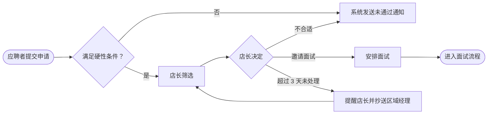

# 业务分析师进阶全景手册

> 从把一句模糊的需求问清楚，到把业务流程、规则与数据变成可实现、可验收的规格，再到推动组织的业务变革。  
> 版本：1.0 · 整理日期：2026-10-25  
> 适用对象：准备转向业务分析的开发者和测试人员、承接外包与企业项目的工程师、产品经理，以及希望系统提升的在职业务分析师（BA）。

业务分析师要回答的核心问题是：业务实际上怎样运作，哪里需要改变，改变以后各方需要什么，以及怎样把这些需要表达成团队能够实现、客户能够验收的内容。客户常说“我们要一个审批功能”，业务分析师要追问：谁在什么时候审批什么、依据哪些规则、例外怎么处理、审批结果影响哪些数据和后续流程、现在的做法哪里有问题。

国际业务分析协会（IIBA）把业务分析定义为：在特定情境中，通过定义需要并推荐能为利益相关方创造价值的解决方案，推动组织变革的实践。[B01](#ref-b01) 这个定义强调两点：业务分析服务于“变革”，不只是记录需求；解决方案不一定是软件，也可能是流程、组织或规则的调整。

本手册先建立角色坐标，再按工作顺序展开：分析现状与目标、识别利益相关方、获取需求、建模流程、规则与数据、编写可验收的规格、验证与追溯；随后进入变更影响与过渡、方案评估、数据与报表需求、敏捷环境与 AI 时代的业务分析；最后说明业务分析与开发者如何协作，并用一个外包项目演示完整过程。

主线是：**理解业务目标与现状 → 识别利益相关方 → 获取需求 → 建模流程、规则与数据 → 编写可验收的规格 → 验证、确认与追溯 → 管理变更与过渡 → 评估方案与业务价值。**

不同组织中，这一职责可能由业务分析师、需求分析师、系统分析师、产品负责人或实施顾问承担。本手册描述业务分析职责本身；D1—D6 分级是学习组织方式，不对应任何职级体系。涉及合同和法规的内容只说明分析时需要考虑的问题，具体义务由相应负责人确认。

## 阅读导航

正文共 19 章（01—19），附 10 个方向的能力矩阵、3 组附录与 8 项资料入口。

- [第一篇：角色定位与能力坐标](#part-1)
  - [01 业务分析师负责什么](#ch01)
  - [02 能力坐标：横向分支与纵向深度](#ch02)
- [第二篇：核心工作方法](#part-2)
  - [03 现状、目标与需求层次](#ch03)
  - [04 利益相关方分析与沟通](#ch04)
  - [05 需求获取](#ch05)
  - [06 流程建模](#ch06)
  - [07 业务规则与决策建模](#ch07)
  - [08 数据与信息建模](#ch08)
  - [09 需求规格与验收标准](#ch09)
  - [10 验证、确认与追溯](#ch10)
- [第三篇：专项与进阶](#part-3)
  - [11 变更影响分析与过渡](#ch11)
  - [12 方案评估与选型](#ch12)
  - [13 数据、报表与指标需求](#ch13)
  - [14 敏捷环境中的业务分析](#ch14)
  - [15 AI 时代的业务分析](#ch15)
- [第四篇：协作、实战与成长](#part-4)
  - [16 与开发者的协作接口](#ch16)
  - [17 开发者怎样借用业务分析方法](#ch17)
  - [18 贯穿实战：连锁企业招聘管理系统](#ch18)
  - [19 能力矩阵、学习路线与模板](#ch19)
- [附录 A：术语与易混概念](#appendix-a)
- [附录 B：资料入口](#appendix-b)
- [附录 C：常见误读、内容边界与修订记录](#appendix-c)

<a id="part-1"></a>

## 第一篇：角色定位与能力坐标

<a id="ch01"></a>

### 01 业务分析师负责什么

#### 01.1 核心问题：把业务需要变成可实现、可验收的变革

需求问题造成的损失通常出现得很晚：系统按文档做完了，客户却说“这不是我们要的”；上线后才发现某类特殊订单无法处理；报表数字和财务对不上。这些问题的根源往往不是代码，而是需求阶段没有弄清业务怎样运作、规则有哪些例外、数据口径是什么、谁有权决定。

业务分析师的价值在于把这些不确定性尽早暴露并解决：在动工前发现矛盾，在实现中保持需求一致，在验收时提供判断依据。英国政府数字与数据能力框架把业务分析师描述为帮助团队分析业务问题或机会、研究业务如何运作（人员、流程、数据与技术）、识别改进点并定义用户与业务需要的角色。[B02](#ref-b02)

#### 01.2 主要产出与质量标准

| 产出 | 用途 | 好的标准 |
| --- | --- | --- |
| 业务目标与范围说明 | 明确为什么变革、边界在哪里 | 目标可度量，写明不在范围内的内容 |
| 利益相关方清单 | 确保相关方被识别和参与 | 包含角色、关注点、影响力和沟通方式 |
| 现状与目标流程模型 | 展示业务怎样运作、将怎样改变 | 覆盖异常与例外，经业务方确认 |
| 业务规则与决策表 | 集中表达判断逻辑 | 无遗漏、无矛盾，有所有者和生效时间 |
| 数据模型与数据字典 | 统一对业务对象和口径的理解 | 定义清楚，标明来源、负责人和生命周期 |
| 需求规格 | 让团队实现、让客户验收 | 每条需求可验证、可追溯，优先级明确 |
| 需求追溯矩阵 | 连接目标、需求、设计、测试与变更 | 能回答“为什么有这条需求”“它被测了吗” |
| 变更影响分析 | 支持变更决策 | 说明影响的流程、数据、系统、人员与成本 |
| 过渡与上线方案 | 让组织顺利切换 | 包含数据迁移、培训、并行运行和回退 |

#### 01.3 职责边界与相邻角色

| 事项 | 业务分析师的位置 | 主要协作者 | 说明 |
| --- | --- | --- | --- |
| 业务目标与价值 | 协助澄清 | 业务负责人、产品经理 | 目标由业务负责人确定 |
| 流程、规则与数据分析 | 主导 | 领域专家、一线人员 | 业务分析的核心工作 |
| 需求规格与验收标准 | 主导 | 产品经理、测试工程师 | 测试人员共同确认可验证性 |
| 优先级 | 协助 | 产品经理或产品负责人主导 | 提供依赖、影响与成本信息 |
| 用户体验与界面设计 | 参与 | UX／交互设计师主导 | 提供流程与规则约束 |
| 技术方案 | 参与 | 技术负责人、解决方案架构师主导 | 提供业务约束，评估方案对业务的影响 |
| 进度与资源 | 参与 | 项目经理主导 | 提供需求范围与变更影响 |
| 上线后的业务效果评估 | 共同负责 | 业务负责人、数据分析师 | 检查变革是否实现预期价值 |

几组容易混淆的角色：

- **业务分析师与产品经理**：产品经理对产品方向、优先级和市场结果负责；业务分析师对需求的完整、准确和可实现负责。在企业项目和外包项目中，业务分析师往往是需求方面的主要负责人；在互联网产品团队中，两者的工作可能由产品经理一人承担。
- **业务分析师与系统分析师**：系统分析师更偏向系统层面的功能、接口和数据设计；业务分析师更偏向业务流程、规则与组织变革。实际岗位常常交叉。
- **业务分析师与领域专家**：领域专家掌握行业知识与实际做法；业务分析师负责提问、结构化、发现矛盾并转化为规格。两者需要紧密合作（见[《领域专家》](04-领域专家.md)）。

#### 01.4 不同组织中的形态

- **企业 IT 部门**：服务内部业务部门，关注流程改进、系统集成和合规。
- **咨询与外包公司**：面向客户，需求分析与合同、报价、验收直接相关，变更管理尤其重要。
- **产品团队**：与产品经理合作，承担复杂业务领域的规则与数据分析，常见于金融、保险、物流、企业软件。
- **数据与报表方向**：专注指标口径、报表需求和数据质量，常称数据业务分析师。
- **实施与交付方向**：在软件落地客户环境时梳理客户流程、配置系统，与实施工程师紧密配合（见[《实施与交付工程师》](23-实施与交付工程师.md)）。

**本章练习**：选一个你参与过的项目，列出上线后才发现的三个需求问题，分析它们本可以在哪个阶段、用什么方法提前发现。

<a id="ch02"></a>

### 02 能力坐标：横向分支与纵向深度

#### 02.1 十个横向分支

1. **战略与现状分析**：理解业务目标、现状问题和变革的价值。
2. **利益相关方管理**：识别相关方，理解其关注点，组织各方参与并保持沟通。
3. **需求获取**：通过访谈、工作坊、观察和文档分析获得需求信息。
4. **流程建模**：描述业务流程的现状与目标状态，识别问题与改进点。
5. **规则与决策建模**：把判断逻辑表达为清晰、完整、可维护的规则。
6. **数据与信息建模**：定义业务对象、关系、状态与口径。
7. **需求规格**：编写可实现、可验证、可追溯的需求。
8. **验证、确认与追溯**：确保需求正确、完整，且被实现和测试。
9. **变更与过渡**：分析变更影响，规划数据迁移、培训与切换。
10. **方案评估与价值实现**：评估候选方案，检查上线后是否实现预期价值。

#### 02.2 六级纵向深度

| 深度 | 业务分析师的能力表现 | 典型证据 |
| --- | --- | --- |
| D1 理解与协助 | 能整理会议纪要、绘制简单流程图，协助编写需求 | 纪要、流程草图、需求清单 |
| D2 独立完成 | 独立完成一个功能模块的需求分析与规格 | 流程模型、规则表、需求规格、验收标准 |
| D3 负责结果 | 负责一个系统或项目的需求，处理冲突与变更 | 需求基线、追溯矩阵、变更记录、验收结果 |
| D4 系统与跨团队 | 负责跨系统、跨部门的业务变革分析 | 端到端流程、集成需求、过渡方案 |
| D5 方法与机制 | 建立组织的需求方法、模板、评审与追溯机制 | 需求管理规范、培训材料、工具配置 |
| D6 创新与影响 | 提出并验证新的分析方法，影响行业实践 | 公开的方法论、标准贡献、可复现的研究 |

#### 02.3 成长中的常见偏差

- 把业务方的话原样记录为需求，不追问原因、例外与冲突。
- 只画正常流程，异常与例外留给开发时再说。
- 文档写得越来越长，却没有人能确认它是否完整。
- 把需求“冻结”当作目标，不建立变更的处理方式。
- 只关心系统，不关心流程改变后人的工作方式和培训。

<a id="part-2"></a>

## 第二篇：核心工作方法

<a id="ch03"></a>

### 03 现状、目标与需求层次

#### 03.1 从问题出发，而不是从功能清单出发

开始分析前先回答：业务现在遇到什么问题？问题造成多大损失？期望变革后达到什么状态？用什么指标判断变革成功？例如“门店店长每周花 6 小时整理应聘者信息，招聘周期平均 20 天，旺季门店长期缺员”比“需要一个招聘系统”更能指导分析。

#### 03.2 需求的层次

区分不同层次的需求，可以避免把“解决方案的一个细节”当作“业务的根本需要”。常用的层次划分如下：

| 层次 | 回答的问题 | 示例 |
| --- | --- | --- |
| 业务需求 | 组织为什么要变革，目标是什么 | 旺季前把门店招聘周期从 20 天缩短到 10 天 |
| 利益相关方需求 | 各类相关方需要什么 | 店长需要在手机上快速筛选应聘者 |
| 解决方案需求：功能 | 系统必须做什么 | 系统按岗位要求自动标记不满足硬性条件的申请 |
| 解决方案需求：非功能 | 系统必须达到什么质量 | 应聘者信息仅对相关门店和人事人员可见 |
| 过渡需求 | 从现状切换到目标状态需要什么 | 把现有表格中的在途应聘者迁移到新系统 |

#### 03.3 现状与目标

先描述现状（as-is）：现在怎样做、使用哪些工具和表格、哪里有等待、返工和错误。再描述目标状态（to-be）：改变哪些环节、去掉哪些步骤、新增哪些控制。两者之间的差异，就是变革的范围。没有现状分析的目标设计，常常遗漏现有流程中隐含但重要的工作，例如某个员工私下维护的一张对照表。

**本章练习**：为一个业务改进项目写出业务需求、两类利益相关方需求、三条功能需求、两条非功能需求和一条过渡需求，检查每一层是否由上一层推导而来。

<a id="ch04"></a>

### 04 利益相关方分析与沟通

#### 04.1 识别利益相关方

利益相关方包括所有影响需求或受变革影响的人：发起人、业务负责人、一线使用者、管理者、IT、安全、法务、财务、外部合作方和最终客户。遗漏某一方，常常意味着上线后才出现的反对或缺失的需求。识别时可以沿着流程逐步提问：每一步谁参与？谁提供输入？谁使用输出？谁审批？谁承担风险？

#### 04.2 分析关注点与影响力

| 利益相关方 | 关注点 | 影响力 | 对变革的态度 | 参与方式 |
| --- | --- | --- | --- | --- |
| 人事总监（发起人） | 招聘周期、用工合规 | 高 | 支持 | 关键决策、阶段评审 |
| 区域经理 | 门店人员到岗率 | 高 | 中立 | 规则确认、试点 |
| 门店店长 | 操作简单、少占用时间 | 中 | 担心增加工作量 | 访谈、原型测试、试点 |
| 应聘者 | 申请方便、知道进展 | 低 | 未知 | 可用性测试 |
| IT 部门 | 系统集成、账号与安全 | 中 | 关注运维负担 | 技术评审 |

对影响力高、态度不明或反对的相关方，需要更早、更频繁地沟通，了解其顾虑的真实原因。

#### 04.3 明确决策权

需求冲突是常态：店长希望少填信息，人事部门希望多收集信息以满足合规要求。业务分析师的职责是让冲突可见，提供各方案的影响分析，并推动有决策权的人做出决定，而不是自己选边或回避冲突。项目开始时就用责任矩阵明确：谁提出需求、谁确认需求、谁批准变更。

**本章练习**：为一个项目绘制利益相关方表，找出两组需求冲突，写出各自的影响分析和需要谁来决定。

<a id="ch05"></a>

### 05 需求获取

#### 05.1 常用技术

| 技术 | 适用场景 | 注意 |
| --- | --- | --- |
| 访谈 | 了解个人的工作、问题与观点 | 准备问题，追问具体例子，记录原话 |
| 工作坊 | 多方共同梳理流程、解决冲突 | 需要有经验的主持人和明确的产出 |
| 观察 | 了解实际做法与环境约束 | 实际做法常与描述的做法不同 |
| 文档分析 | 了解现有制度、表格、报表与系统 | 文档可能过时，需要与实际核对 |
| 问卷 | 收集大量人员的信息 | 适合补充，不适合发现复杂问题 |
| 原型 | 让相关方对具体方案做出反应 | 防止相关方把原型当成最终设计 |
| 接口与系统分析 | 了解现有系统的数据与集成 | 与技术人员合作，核对真实数据 |

#### 05.2 提问的结构

对每个业务活动，至少问清：

- **谁**：谁发起、谁执行、谁审批、谁接收结果？
- **什么**：处理什么对象？需要哪些信息？产生什么结果？
- **何时**：什么事件触发？有没有时限？多久发生一次？
- **何地**：在哪里完成？用什么设备和系统？
- **为何**：为什么需要这一步？去掉会怎样？
- **怎样**：依据什么规则判断？例外怎么处理？
- **多少**：数量、频率、峰值是多少？
- **出错时**：常见错误是什么？怎么发现、怎么纠正？

追问“为什么”有助于找到根本原因，但要注意：连续追问可能让对方感到被质疑；复杂问题往往有多个原因，不一定能追溯到单一根源。

#### 05.3 隐性知识与“理所当然”

业务人员最熟悉的东西，往往最容易被遗漏，因为他们觉得“这还用说吗”。观察实际工作、询问最近一次的具体经过、查看他们自己维护的表格和备忘，是发现隐性知识的有效方式。

**本章验收**：对一位业务人员完成一次 60 分钟的需求访谈，整理出流程步骤、规则、数据和异常四类信息，并请对方确认纪要的准确性。

<a id="ch06"></a>

### 06 流程建模

#### 06.1 为什么要建模

文字描述的流程容易出现歧义和遗漏，图形化的模型能让相关方一起检查：步骤是否完整、谁负责哪一步、哪里需要判断、哪里会等待。业务流程模型与标注法（BPMN）是由对象管理组织（OMG）维护的流程建模标准，业务人员可以读懂，技术人员也可以据此实现。[B03](#ref-b03)

#### 06.2 BPMN 的核心元素

| 元素 | 含义 | 使用要点 |
| --- | --- | --- |
| 池与泳道 | 参与者或部门 | 每条泳道一个明确的角色 |
| 开始、中间、结束事件 | 触发流程、过程中发生的事、流程结束 | 写明触发条件与结束状态 |
| 任务与子流程 | 需要完成的工作 | 用“动词＋对象”命名，例如“审核申请” |
| 排他网关 | 多条路径中只走一条 | 每条出口写明条件，条件互斥且完整 |
| 并行网关 | 同时进行多条路径 | 注意后续的汇合 |
| 顺序流与消息流 | 步骤之间的先后、参与方之间的信息传递 | 不同池之间使用消息流 |
| 数据对象 | 流程中使用或产生的信息 | 与数据模型对应 |

#### 06.3 建模的要点

- 先画主流程，再逐步补充异常、超时、取消、退回等路径。
- 每个判断点的条件必须互斥且完整，“其他情况”也要有去向。
- 区分人工任务、系统任务和外部参与者的动作。
- 标出流程的度量点：耗时、等待、返工率。
- 现状流程与目标流程分别建模，对比差异。



上图使用通用流程图表示核心逻辑；正式的业务流程模型可以用 BPMN 工具绘制，以便表达事件、消息和泳道。

**本章验收**：为一个真实业务流程绘制现状模型和目标模型，包含至少 3 种异常路径，经业务人员逐步走查确认。

<a id="ch07"></a>

### 07 业务规则与决策建模

#### 07.1 规则的类型

| 类型 | 含义 | 示例 |
| --- | --- | --- |
| 约束 | 必须或禁止的条件 | 未满 16 周岁的申请人不得进入录用流程 |
| 推导 | 根据事实得出结论 | 连续三个月出勤率高于 95% 的员工视为全勤 |
| 计算 | 数值的计算方法 | 试用期工资按正式工资的 80% 计算 |
| 触发 | 事件发生后需要执行的动作 | 面试结束 24 小时内未填写评价则提醒面试官 |

规则要集中记录，写明来源（制度、法规、管理决定）、所有者、生效时间和版本。规则散落在会议纪要和聊天记录中，是需求矛盾和系统行为不一致的主要来源。规则引用的法规条款需要由相应负责人确认。

#### 07.2 决策表

当一个判断涉及多个条件时，决策表比文字更清楚，也更容易发现遗漏和矛盾。决策模型与标注法（DMN）是 OMG 维护的决策建模标准，定义了决策表、命中策略等表达方式。[B04](#ref-b04)

| 规则 | 岗位类别 | 薪资超出区间 | 审批路径 |
| --- | --- | --- | --- |
| 1 | 门店基层 | 否 | 店长 |
| 2 | 门店基层 | 是 | 店长、区域经理 |
| 3 | 门店管理 | 任意 | 区域经理、人事总监 |
| 4 | 总部岗位 | 否 | 部门负责人、人事经理 |
| 5 | 总部岗位 | 是 | 部门负责人、人事总监 |

检查决策表时问三个问题：所有条件组合是否都有结果（完整性）？是否有两条规则对同一组合给出不同结果（一致性）？条件的取值边界是否清楚（例如“超出区间”是否包含等于上限）？在 DMN 中，表格的命中策略规定了多条规则同时满足时怎样取结果，例如“唯一命中”要求任何输入最多匹配一条规则。

#### 07.3 规则的变化与时间

规则会变化：薪资区间每年调整，审批权限随组织调整而变化。需求中要说明：规则变化后，正在进行中的申请按新规则还是旧规则处理？历史记录是否需要保留当时适用的规则版本？这与后端设计中的“规则生效时间”直接相关（见[《后端进阶全景手册》第 08 章](../技术方向/后端进阶全景手册.md#ch08)）。

**本章练习**：把一段用文字描述的审批制度改写为决策表，找出制度中的遗漏与矛盾，与制度的负责人确认。

<a id="ch08"></a>

### 08 数据与信息建模

#### 08.1 概念数据模型

识别业务中的核心对象（实体）、对象之间的关系、每个对象的关键属性。概念模型不涉及数据库表结构，而是统一业务方与团队对“我们在管理什么”的理解。例如招聘中的岗位、职位发布、申请、应聘者、面试、评价、录用、门店，以及它们之间“一对多”“多对多”的关系。

#### 08.2 数据字典

| 字段 | 业务定义 | 类型与格式 | 必填 | 来源 | 示例 | 备注 |
| --- | --- | --- | --- | --- | --- | --- |
| 申请状态 | 申请在招聘流程中的当前阶段 | 枚举 | 是 | 系统 | 已提交、筛选中、面试中、已录用、未通过、已撤回 | 状态转换规则见状态模型 |
| 期望到岗日期 | 应聘者可以开始工作的最早日期 | 日期 | 否 | 应聘者填写 | 2026-12-01 | 为空表示可随时到岗，需与业务确认 |
| 招聘周期 | 从职位发布到录用确认的自然日天数 | 整数 | 系统计算 | 系统 | 12 | 撤回的职位不计入统计 |

数据字典中最容易出问题的是“空值的含义”和“统计口径”。“为空”可能表示未知、不适用或尚未填写，需要逐项确认。

#### 08.3 状态模型与 CRUD 矩阵

对生命周期复杂的对象，画出状态模型：有哪些状态、哪些事件导致转换、谁可以触发、转换时有什么规则。再用 CRUD 矩阵检查每个角色或流程对每个对象的创建、读取、更新、删除操作，发现遗漏的权限和流程。

| 对象 | 应聘者 | 店长 | 区域经理 | 人事 |
| --- | --- | --- | --- | --- |
| 申请 | 创建、读取本人、撤回 | 读取本店、更新状态 | 读取本区域 | 读取全部、更新 |
| 面试评价 | 无 | 创建、读取本店 | 读取本区域 | 读取全部 |
| 录用审批 | 读取结果 | 发起 | 审批 | 审批、读取全部 |

“删除”需要特别讨论：是物理删除、标记删除还是归档？个人信息的保存期限和删除要求由相应负责人确认，工程实现见[《后端进阶全景手册》第 23 章](../技术方向/后端进阶全景手册.md#ch23)。

**本章验收**：为一个业务领域完成概念模型、10 个关键字段的数据字典和一个对象的状态模型，并用 CRUD 矩阵检查权限是否完整。

<a id="ch09"></a>

### 09 需求规格与验收标准

#### 09.1 好需求的特征

需求工程国际标准 ISO/IEC/IEEE 29148 列出了单条需求应具备的特征：必要、适当、无歧义、完整、单一、可行、可验证、正确、符合规范；对一组需求，还要求完整、一致、可行、可理解，并且能够被确认。[B05](#ref-b05)

| 不好的写法 | 问题 | 改进后的写法 |
| --- | --- | --- |
| 系统要快速响应 | 不可验证 | 在正常负载下，应聘者列表页 95% 的请求在 2 秒内返回 |
| 店长可以方便地筛选应聘者 | 有歧义 | 店长可以按岗位、申请日期、是否满足硬性条件筛选本店应聘者 |
| 系统应支持审批和通知 | 不单一 | 拆分为审批流程需求和通知需求两条 |
| 根据情况决定审批人 | 不完整 | 引用审批决策表，并说明决策表未覆盖时的处理 |

#### 09.2 需求的属性

每条需求至少记录：唯一编号、描述、来源（谁提出、依据什么）、优先级、验收标准、状态（提出、已确认、已实现、已验证）、关联的目标和测试。这些属性是后续追溯和变更管理的基础。

#### 09.3 功能需求的表达方式

- **用例**：描述参与者与系统之间为达成目标的交互，包含主成功场景和扩展场景，适合复杂交互。
- **用户故事**：简短描述使用者、需要与目的，配合验收标准使用，适合敏捷团队。
- **实例化需求**：用具体的输入输出示例说明规则，示例本身就是验收测试。[B06](#ref-b06)

```gherkin
# language: zh-CN
功能: 录用审批路径

  场景大纲: 根据岗位类别与薪资确定审批人
    假如 一份录用申请的岗位类别为“<岗位类别>”
    而且 拟定薪资<是否超出>岗位薪资区间
    当 店长提交录用审批
    那么 审批路径为“<审批路径>”

    例子:
      | 岗位类别 | 是否超出 | 审批路径           |
      | 门店基层 | 未超出   | 店长               |
      | 门店基层 | 超出     | 店长、区域经理     |
      | 总部岗位 | 超出     | 部门负责人、人事总监 |
```

#### 09.4 非功能需求

非功能需求常被遗漏，或写成无法验证的形容词。可以参考软件产品质量模型 ISO/IEC 25010 的分类逐项检查：2023 版把产品质量分为功能适合性、性能效率、兼容性、交互能力、可靠性、信息安全、可维护性、灵活性和功能安全九个特性。[B07](#ref-b07) 不是每一项都需要详细要求，但每一项都应被考虑过，并写出可度量的目标或明确“不作要求”。

**本章验收**：为一个功能写出 10 条需求，逐条按 29148 的特征检查并修改，其中至少包含 3 条可验证的非功能需求和一组实例化的验收示例。

<a id="ch10"></a>

### 10 验证、确认与追溯

#### 10.1 验证与确认的区别

- **验证**：需求本身是否写得正确，即清楚、一致、完整、可测。方法包括同行评审、检查清单、测试人员审阅。
- **确认**：需求是否真正满足业务需要，即“我们要做的是对的东西吗”。方法包括与业务方走查、原型演示、场景演练。

两者都需要，而且应在开发前完成。测试人员在需求阶段参与评审，是提高可验证性的有效做法。

#### 10.2 需求基线与变更控制

经确认的需求形成基线，之后的变更需要记录并评估影响。变更控制不是为了阻止变化，而是让变化的代价可见：每次变更说明原因、影响的需求、设计、测试、进度和费用，由有权限的人批准。外包项目中，这直接关系到合同与报价（见[《项目经理与交付经理》](21-项目经理与交付经理.md)）。

#### 10.3 需求追溯

| 业务目标 | 需求编号 | 需求摘要 | 设计或实现 | 测试用例 | 状态 |
| --- | --- | --- | --- | --- | --- |
| 缩短招聘周期 | REQ-012 | 自动标记不满足硬性条件的申请 | 筛选服务 | TC-031、TC-032 | 已验证 |
| 缩短招聘周期 | REQ-015 | 超过 3 天未处理的申请提醒店长 | 定时任务 | TC-040 | 已实现 |
| 保护个人信息 | REQ-021 | 应聘者信息仅对相关门店与人事可见 | 权限模型 | TC-050 至 TC-055 | 测试中 |

追溯矩阵能回答几个关键问题：每条需求为什么存在？每个目标是否有需求支撑？每条需求是否被实现和测试？某条需求变更会影响哪些设计和测试？追溯的粒度应与项目风险相称，不必为低风险的小改动维护复杂的矩阵。

**本章练习**：为一个项目建立需求追溯矩阵，找出没有测试覆盖的需求和没有需求支撑的功能。

<a id="part-3"></a>

## 第三篇：专项与进阶

<a id="ch11"></a>

### 11 变更影响分析与过渡

#### 11.1 影响分析

任何变更都可能影响多个方面。分析时逐项检查：

- **流程**：哪些步骤改变、新增或取消？
- **规则**：哪些规则调整？进行中的业务按哪个版本处理？
- **数据**：结构、口径、历史数据是否受影响？
- **系统与接口**：哪些系统需要修改？外部集成方是否受影响？
- **人员与组织**：谁的工作方式改变？需要什么培训？
- **报表与指标**：统计口径是否变化？前后数据能否比较？
- **合规与合同**：是否涉及需要确认的法规或合同条款？

#### 11.2 过渡需求

过渡需求只在切换期间存在，但常常决定上线成败：

- 数据迁移：迁移范围、清洗规则、映射关系、校验方法和失败处理。
- 并行运行：新旧系统是否同时运行一段时间，数据怎样同步与核对。
- 切换方式：一次性切换、分批切换（按门店、区域）或试点后推广。
- 培训与支持：培训对象、材料、时间和上线初期的支持方式。
- 回退方案：出现严重问题时怎样回到原有方式。

**本章练习**：为一次系统切换写过渡方案，列出数据迁移的映射与校验规则、分批计划和回退条件。

<a id="ch12"></a>

### 12 方案评估与选型

#### 12.1 购买、自建还是外包

| 方案 | 优势 | 主要风险 | 适用条件 |
| --- | --- | --- | --- |
| 购买成熟产品 | 上线快，功能成熟 | 定制受限，需要适应产品流程 | 业务流程通用，差异化不重要 |
| 自建 | 完全贴合业务 | 成本高，需要长期维护能力 | 业务是核心竞争力，有技术团队 |
| 外包定制 | 贴合业务，不必自建团队 | 交付质量与后续维护依赖供应商 | 需求明确，有能力管理供应商 |
| 购买加配置或扩展 | 兼顾速度与适配 | 扩展方式受产品限制，升级可能受影响 | 产品提供良好的扩展机制 |

#### 12.2 评估标准

以需求为依据制定评估标准：功能覆盖、非功能质量、集成能力、数据迁移与退出、总拥有成本、供应商能力与服务、安全与合规。用真实业务场景做演示或试用，而不是只看功能清单；记录每项评分的依据。

#### 12.3 上线后的价值评估

上线不是终点。在约定时间检查业务目标是否实现：招聘周期是否缩短？店长的工作时间是否减少？如果没有实现，分析原因：需求不准确、实现有问题、使用方式没有改变，还是外部条件变化？评估结果是下一轮改进的输入。

**本章练习**：为一个选型决策制定评估表，包含至少 8 项加权标准和 3 个真实场景的演示脚本。

<a id="ch13"></a>

### 13 数据、报表与指标需求

#### 13.1 报表需求的要素

报表需求常被简化为“要一个招聘统计报表”。完整的报表需求包括：谁使用、用于什么决定、需要哪些指标、每个指标的定义与口径、维度与筛选条件、数据刷新频率、权限范围、导出方式。

#### 13.2 指标口径

以“招聘周期”为例，需要确认：从职位发布还是从第一份申请开始计算？到录用确认还是到入职？撤回的职位是否计入？按自然日还是工作日？跨月的职位归入哪个月？口径不清是报表与业务认知不一致的最常见原因。复杂的数据需求需要与数据分析师和数据工程师合作（见[《数据分析师与产品分析师》](16-数据分析师与产品分析师.md)、[《数据工程师》](17-数据工程师.md)）。

**本章练习**：为三个业务指标写出完整的口径定义，请两位业务人员独立计算同一组样例数据，比较结果是否一致。

<a id="ch14"></a>

### 14 敏捷环境中的业务分析

#### 14.1 业务分析在敏捷中的位置

敏捷开发并不意味着不需要业务分析，而是把分析分布到整个过程中：在待办列表梳理中细化需求，在迭代前澄清规则和示例，在开发中回答问题，在演示中确认结果。需求文档变得更轻，但对规则、数据和验收示例的要求并没有降低。

#### 14.2 三方会谈

“三方会谈”（Three Amigos）指在开发一项需求前，从业务、开发和测试三个视角共同检查它：要解决什么问题、怎样实现、可能出什么问题。[B08](#ref-b08) 业务分析师常在其中代表业务视角，并负责把讨论结果整理成验收示例。“三方”指视角，而不是固定的三个人。

#### 14.3 需求拆分

大的需求要拆分为可在一个迭代内完成、能独立交付价值的小需求。常用的拆分方式：按流程步骤、按业务规则的变体、按数据类型、按正常与异常路径、按用户角色。避免按技术层次拆分（例如“先做数据库，再做界面”），那样每一片都无法独立验收。

**本章练习**：选一个大的用户故事，用三种不同方式拆分，比较哪种拆分更利于尽早交付价值和获得反馈。

<a id="ch15"></a>

### 15 AI 时代的业务分析

#### 15.1 AI 作为分析助手

AI 工具可以协助整理访谈记录、起草流程描述、检查需求的歧义和遗漏、生成测试示例。使用时需要注意：

- 客户资料、访谈录音和内部制度可能涉及保密和个人信息，上传前确认工具的数据处理方式符合合同与制度。
- 模型可能编造不存在的规则或遗漏关键例外，所有输出都要回到原始材料和业务人员核对。
- AI 生成的完整性检查可以作为提示，但不能代替与业务方的确认。

#### 15.2 为 AI 功能做业务分析

当解决方案中包含 AI 能力时，业务分析需要额外回答：

- 哪些判断交给模型，哪些必须由确定的规则或人工完成？例如“硬性条件筛选”适合确定规则，“经历描述质量评价”可以由模型辅助。
- 模型出错时的业务后果是什么？需要怎样的人工复核？
- 怎样衡量模型在这个业务中的质量？由谁提供评测样例和标准答案？
- 模型的建议是否会影响对人的重要决定（例如录用），需要哪些透明度、申诉和合规措施？

对影响就业等重要决定的自动化处理，不同地区有专门的法律要求，需要由相应负责人确认。

**本章练习**：为一个包含 AI 的业务流程画出泳道图，标出模型、规则和人工各自负责的步骤，以及模型出错时的处理路径。

<a id="part-4"></a>

## 第四篇：协作、实战与成长

<a id="ch16"></a>

### 16 与开发者的协作接口

#### 16.1 业务分析师应提供给开发者的内容

| 内容 | 最低要求 | 常见缺失 |
| --- | --- | --- |
| 业务背景与目标 | 为什么做，解决什么问题 | 只有功能描述 |
| 流程模型 | 包含异常与例外路径 | 只有主流程 |
| 业务规则 | 集中记录，决策表完整无矛盾 | 规则散落在多处，彼此冲突 |
| 数据定义 | 字段含义、口径、空值含义、状态模型 | 字段只有名称，没有定义 |
| 权限要求 | 每个角色对每类数据的操作范围 | 只写“管理员有全部权限” |
| 验收标准与示例 | 可验证，覆盖边界 | 只有正常情况 |
| 过渡需求 | 数据迁移、切换与回退 | 上线前才想起历史数据 |

#### 16.2 开发者应反馈给业务分析师的内容

规则在实现中发现的矛盾和遗漏、数据现状与需求描述不一致的地方、实现成本特别高的需求及替代方案、技术约束对流程的影响（例如外部系统只能每天同步一次）。

#### 16.3 一起工作的方式

开发前一起走查流程和规则，用示例对齐理解；开发中开发者遇到问题直接询问，而不是自行假设；演示时业务分析师用真实场景验收。规则或数据定义一旦在开发中修改，要同步更新需求文档，避免文档与系统逐渐脱节。

<a id="ch17"></a>

### 17 开发者怎样借用业务分析方法

#### 17.1 外包项目中最有价值的五个习惯

1. **先画流程，再谈功能**：和客户一起把现在的工作流程画出来，比讨论功能清单更容易发现真实需求。
2. **规则写成表格**：把审批、计价、权限等规则整理成决策表，请客户逐行确认并签字或书面确认。
3. **问清数据**：每个关键字段的含义、来源、是否必填、空值含义；历史数据怎么迁移。
4. **验收标准前置**：开发前就约定验收用例，避免验收时各执一词。
5. **变更留痕**：每次变更记录原因、影响和费用，由客户确认后再做。

#### 17.2 独立产品中的业务分析

即使没有客户，复杂业务领域（例如会员、计费、预约）的规则和状态同样需要梳理清楚。为核心对象画状态模型，为关键规则写决策表，能显著减少边界缺陷和后期重构。

#### 17.3 技术人员常见的分析偏差

- 过早进入数据库和接口设计，忽视流程与规则的确认。
- 默认客户说的就是全部，不主动追问例外。
- 用技术术语与业务人员沟通，导致对方无法判断理解是否正确。
- 只与提出需求的人沟通，遗漏实际使用者和审批者。

<a id="ch18"></a>

### 18 贯穿实战：连锁企业招聘管理系统

本章以一个外包项目演示业务分析的完整过程。客户、数字和规则都是示意。

#### 18.1 背景与目标

一家拥有 120 家门店的连锁企业，目前用表格和即时通讯工具管理招聘：店长在多个渠道收到简历，手工整理；面试安排靠电话；录用审批通过聊天记录进行。人事总监希望在旺季前上线一套招聘管理系统。

| 层次 | 内容 |
| --- | --- |
| 业务需求 | 旺季前把门店平均招聘周期从 20 天缩短到 10 天；录用审批全部留痕 |
| 利益相关方需求 | 店长：手机上 5 分钟内完成一批申请的筛选；人事：统一查看各门店招聘进展 |
| 关键功能需求 | 统一接收申请、硬性条件自动标记、面试安排与提醒、录用审批、招聘报表 |
| 关键非功能需求 | 应聘者信息按门店与角色隔离；高峰期每日 2 万份申请的处理能力；操作留痕 |
| 过渡需求 | 迁移在途应聘者；按区域分三批上线；培训 120 名店长 |

#### 18.2 获取与建模

1. 访谈人事总监、2 名区域经理、6 名店长，并在两家门店观察一天的招聘工作。
2. 发现关键事实：店长实际最耗时的是重复联系已不合适的应聘者；部分门店私下维护“黑名单”表格，涉及个人信息合规问题，需要单独讨论。
3. 绘制现状与目标流程，覆盖申请撤回、面试爽约、审批超时、门店调岗等异常。
4. 整理录用审批决策表（见 07 章），发现制度中“门店管理岗薪资超出区间”的情况没有规定，提交人事总监决定。
5. 建立概念数据模型、数据字典和申请的状态模型，用 CRUD 矩阵确认区域经理只能查看本区域数据。

#### 18.3 规格与验证

- 以用户故事加实例化示例编写需求，共 86 条，每条有编号、来源和验收标准。
- 测试负责人参与需求评审，标记 9 条不可验证的需求，全部改写。
- 与 3 名店长用可点击原型走查完整流程，调整了筛选页面的信息顺序。
- 建立追溯矩阵，连接业务目标、需求、测试用例。

#### 18.4 变更与过渡

开发中期，客户要求增加“推荐人奖励”功能。影响分析显示：需要新增推荐关系数据、奖励规则和财务对接，影响 12 条需求和 2 周工期。客户决定把它放到二期，变更记录经双方确认。过渡方案按区域分三批上线，每批前一周完成店长培训，旧表格并行使用两周后停用。

#### 18.5 上线后评估

上线两个月后与人事总监复盘：平均招聘周期降至 11 天，接近目标；审批全部在系统内留痕；店长反馈面试提醒很有用，但移动端填写面试评价仍然不便。评估结论作为二期需求的输入。

<a id="ch19"></a>

### 19 能力矩阵、学习路线与模板

#### 19.1 能力矩阵

| 横向分支 | D1 理解／D2 独立 | D3 负责／D4 跨团队 | D5 机制／D6 创新 |
| --- | --- | --- | --- |
| 战略与现状分析 | 理解目标／分析一个流程的问题 | 项目价值论证／跨部门变革分析 | 分析框架与方法／新的价值分析方法 |
| 利益相关方管理 | 记录诉求／组织访谈与评审 | 处理冲突与决策／多组织协调 | 参与和沟通规范／协作方法创新 |
| 需求获取 | 协助访谈／独立访谈与工作坊 | 复杂领域获取／跨地区获取 | 获取技术培训／新的获取方法 |
| 流程建模 | 读懂流程图／BPMN 建模 | 端到端流程／跨系统流程架构 | 建模规范与模型库／流程方法创新 |
| 规则与决策建模 | 记录规则／编写决策表 | 规则体系与版本／跨系统规则治理 | 规则管理机制／决策建模研究 |
| 数据与信息建模 | 读懂数据字典／概念模型与状态模型 | 领域数据模型／主数据与口径治理 | 数据定义标准／信息建模方法 |
| 需求规格 | 用户故事／完整规格与验收标准 | 系统需求基线／跨团队接口需求 | 需求标准与模板体系／表达方式创新 |
| 验证、确认与追溯 | 参与评审／组织评审与追溯 | 需求质量负责／项目群追溯 | 需求管理流程与工具／验证方法研究 |
| 变更与过渡 | 记录变更／影响分析 | 过渡方案与切换／组织变革 | 变更管理机制／变革方法创新 |
| 方案评估与价值 | 了解方案差异／参与选型 | 选型与价值评估／组合层面评估 | 评估框架／价值实现研究 |

#### 19.2 学习路线

| 阶段 | 学习重点 | 实践目标 | 进入下一阶段的信号 |
| --- | --- | --- | --- |
| A 建立基础 | 01—05 章 | 完成一次需求访谈并写出纪要 | 能区分需求层次，访谈能追问出例外 |
| B 建模与规格 | 06—10 章 | 为一个模块完成流程、规则、数据与规格 | 规格经测试评审后可验证 |
| C 项目负责 | 11—14 章 | 负责一个项目的需求与变更 | 上线后需求类缺陷明显减少 |
| D 变革与机制 | 12、15、19 章 | 负责跨部门变革或建立需求管理规范 | 他人能用你建立的方法稳定产出高质量需求 |

#### 19.3 需求访谈纪要模板

```text
访谈对象、角色与日期：
访谈目的：
业务活动与步骤（谁、何时、做什么、用什么）：
业务规则（含来源与例外）：
数据与表格（字段、来源、口径）：
问题与痛点（含频率与影响）：
期望与建议（区分事实与观点）：
待确认事项与负责人：
对方确认纪要的方式与时间：
```

#### 19.4 变更申请模板

```text
变更编号与提出人：
变更内容：
变更原因：
影响分析（流程、规则、数据、系统、人员、报表、合规）：
受影响的需求与测试：
工期与费用影响：
可选方案（含不变更）：
决定、决策人与日期：
```

#### 19.5 检查清单

需求确认前：

- [ ] 业务目标可度量，范围写明“不做什么”。
- [ ] 利益相关方已识别，决策权已明确。
- [ ] 流程覆盖异常、超时、取消与退回。
- [ ] 规则集中记录，决策表完整、无矛盾，有所有者和生效时间。
- [ ] 关键字段有定义、口径与空值含义。
- [ ] 每个角色对每类数据的操作范围已确认。
- [ ] 需求可验证，非功能需求已逐项考虑。
- [ ] 过渡需求（迁移、培训、切换、回退）已列出。

开发与验收中：

- [ ] 需求基线已建立，变更有记录与审批。
- [ ] 追溯矩阵能找到每条需求的测试。
- [ ] 规则或数据定义的修改已同步到文档。
- [ ] 验收使用真实业务场景与边界数据。

上线后：

- [ ] 在约定时间评估业务目标是否实现。
- [ ] 评估结论与遗留问题进入下一轮需求。

<a id="appendix-a"></a>

## 附录 A：术语与易混概念

| 术语 | 本手册中的含义 | 阅读位置 |
| --- | --- | --- |
| 业务分析 | 通过定义需要和推荐解决方案推动组织变革的实践 | 01 |
| 业务需求 | 组织层面的目标与变革理由 | 03 |
| 利益相关方需求 | 各类相关方的需要 | 03 |
| 解决方案需求 | 解决方案必须具备的功能与质量 | 03 |
| 过渡需求 | 从现状切换到目标状态期间才需要的能力 | 03、11 |
| 现状与目标状态 | 变革前后的业务运作方式 | 03 |
| 利益相关方 | 影响需求或受变革影响的个人或团体 | 04 |
| 需求获取 | 通过各种技术获得需求信息的活动 | 05 |
| BPMN | 业务流程模型与标注法 | 06 |
| 网关 | 流程中表示分支与汇合的元素 | 06 |
| 业务规则 | 约束、推导、计算或触发业务行为的规定 | 07 |
| 决策表 | 用条件与结果的表格表达判断逻辑 | 07 |
| DMN | 决策模型与标注法 | 07 |
| 命中策略 | 决策表中多条规则同时满足时的取值方式 | 07 |
| 概念数据模型 | 业务对象及其关系的模型 | 08 |
| 数据字典 | 字段定义、格式、来源与口径的说明 | 08 |
| CRUD 矩阵 | 角色或流程对数据对象的增删改查范围 | 08 |
| 用例 | 参与者与系统为达成目标的交互描述 | 09 |
| 实例化需求 | 用具体示例说明规则并作为验收测试 | 09 |
| 非功能需求 | 对性能、安全、可靠性等质量的要求 | 09 |
| 验证与确认 | 需求是否写对，以及是否做对的东西 | 10 |
| 需求基线 | 经确认、作为变更控制起点的需求集合 | 10 |
| 追溯矩阵 | 连接目标、需求、实现与测试的表格 | 10 |
| 三方会谈 | 从业务、开发、测试视角共同检查需求 | 14 |

<a id="appendix-b"></a>

## 附录 B：资料入口

以下资料用于核对方法来源和继续学习。资料核对日期：2026-10-25。

<a id="ref-b01"></a>
**B01 · IIBA：业务分析的定义。** [Defining Business Analysis](https://www.iiba.org/knowledgehub/the-business-analysis-standard/2-understanding-business-analysis/2-1-defining-business-analysis/)。对应 01 章，阅读业务分析的定义与核心概念；完整的知识体系指南需要会员或购买获取。

<a id="ref-b02"></a>
**B02 · 英国政府数字与数据能力框架：业务分析师。** [Business analyst](https://ddat-capability-framework.service.gov.uk/role/business-analyst)。对应 01、02 章，参考各级别的职责与技能描述。

<a id="ref-b03"></a>
**B03 · OMG：业务流程模型与标注法。** [BPMN 2.0.2](https://www.omg.org/spec/BPMN/2.0.2/)。对应 06 章，规范原文较长，建议先掌握核心元素再查阅细节。

<a id="ref-b04"></a>
**B04 · OMG：决策模型与标注法。** [Decision Model and Notation](https://www.omg.org/spec/DMN/)。对应 07 章，阅读决策表与命中策略部分。

<a id="ref-b05"></a>
**B05 · ISO：需求工程国际标准。** [ISO/IEC/IEEE 29148:2018](https://www.iso.org/standard/72089.html)。对应 09 章，标准正文需购买，可阅读公开摘要了解范围。

<a id="ref-b06"></a>
**B06 · Martin Fowler：实例化需求。** [Specification By Example](https://martinfowler.com/bliki/SpecificationByExample.html)。对应 09 章，理解用示例同时表达需求和验收测试的思路。

<a id="ref-b07"></a>
**B07 · ISO：软件产品质量模型。** [ISO/IEC 25010:2023](https://www.iso.org/standard/78176.html)。对应 09 章，用于逐项检查非功能需求；2023 版替代了 2011 版。

<a id="ref-b08"></a>
**B08 · Agile Alliance：三方会谈。** [Three Amigos](https://www.agilealliance.org/glossary/three-amigos/)。对应 14 章，理解从业务、开发与测试视角检查需求的做法。

本手册未单独列出链接、但值得阅读的经典材料包括：IIBA 的《业务分析知识体系指南》（BABOK Guide）、Karl Wiegers 与 Joy Beatty 的《Software Requirements》、Gojko Adzic 的《Specification by Example》。

<a id="appendix-c"></a>

## 附录 C：常见误读、内容边界与修订记录

### C.1 常见误读与准确表述

| 容易误读的说法 | 更准确的表述 |
| --- | --- |
| 业务分析师就是记录需求的人 | 业务分析师需要追问、建模、发现矛盾，并推动决策 |
| 需求文档越厚越完整 | 完整性取决于是否覆盖流程、规则、数据与异常，而不是页数 |
| 敏捷项目不需要业务分析 | 敏捷把分析分布到全过程，对规则与示例的要求并未降低 |
| 客户说的就是需求 | 客户描述的往往是方案，需要还原为业务问题和需要 |
| 需求冻结后就不会变 | 变化是常态，关键是让变化及其代价可见 |
| 非功能需求是技术团队的事 | 性能、安全、可用性等直接影响业务，需要业务方确认目标 |
| 流程图画了主流程就够了 | 缺陷和争议多集中在异常、例外与边界 |
| 上线就是项目结束 | 需要评估业务目标是否实现，并处理遗留问题 |
| 规则写在代码里就行 | 规则需要业务可读的集中记录、所有者与版本 |
| AI 可以自动写出完整需求 | AI 可以辅助整理和检查，需求仍需与业务方确认 |

### C.2 内容边界

本手册覆盖业务分析的通用方法，不替代特定行业的业务知识与法规，例如金融监管、医疗流程或劳动用工规定。涉及合同、个人信息和用工合规的内容，只说明分析中需要识别的问题，具体义务由相应负责人确认。BPMN、DMN 等标准的完整语义以规范原文为准。

相邻角色的展开见本系列其他各册，总览见[《职业角色全景》](README.md)。

### C.3 修订记录

| 版本 | 日期 | 主要变化 |
| --- | --- | --- |
| 1.0 | 2026-10-25 | 初版 |
